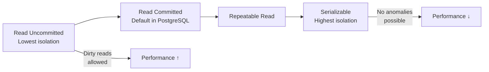

# خصائص ACID — الذرية والاتساق والعزل والديمومة

> [!NOTE]
> ‏ACID ليست مفهومًا أكاديميًا مجردًا — بل هي الأساس التشغيلي لسلامة البيانات المالية. فكل معاملة يعالجها نظامك تعتمد على هذه الضمانات. ويجب أن يستطيع كبار المهندسين التفكير فيما يحدث حين تُنتهك كل واحدة منها.

## لماذا تهم ACID للأنظمة المالية

لنأخذ تحويلًا ماليًا: خصم 500 جنيه إسترليني من الحساب A، وإضافة 500 جنيه إلى الحساب B.

دون ACID:
- **دون الذرية** — ينجح الخصم، وتفشل الإضافة ← تختفي 500 جنيه من النظام
- **دون الاتساق** — يتغير إجمالي المال في النظام بعد التحويل
- **دون العزل** — تقرأ معاملة أخرى الحساب A أقل بـ 500 جنيه في منتصف التحويل، قبل إضافة المبلغ إلى الحساب B
- **دون الديمومة** — ينجح التحويل، لكن تعطلًا قبل الكتابة إلى القرص يفقده

## الذرية — الكل أو لا شيء

المعاملة الذرية إما أن تكتمل كليًا أو لا يكون لها أي أثر. لا توجد حالة جزئية.

```java
// Without atomicity — a crash between debit and credit causes money to disappear
accountRepository.debit(fromAccountId, amount);   // If crash here...
accountRepository.credit(toAccountId, amount);    // ...this never runs

// With atomicity — both operations in one transaction
@Transactional
public TransferResult transfer(UUID fromId, UUID toId, BigDecimal amount) {
    // Lock both rows in a FIXED order (by id) -- two opposite transfers that
    // lock in different orders would deadlock
    boolean fromFirst = fromId.compareTo(toId) < 0;
    Account first  = accountRepository.findByIdForUpdate(fromFirst ? fromId : toId);
    Account second = accountRepository.findByIdForUpdate(fromFirst ? toId : fromId);
    Account from = fromFirst ? first : second;
    Account to   = fromFirst ? second : first;
    
    if (from.getBalance().compareTo(amount) < 0) {
        throw new InsufficientFundsException(fromId, amount, from.getBalance());
    }
    
    from.debit(amount);
    to.credit(amount);
    
    // Both writes happen atomically — either both persist or neither does
    accountRepository.save(from);
    accountRepository.save(to);
    
    return TransferResult.success(UUID.randomUUID(), from.getBalance(), to.getBalance());
    
    // If any exception occurs, Spring's @Transactional rolls back BOTH writes
}
```

### تنفيذ الذرية — سجل WAL في PostgreSQL

ينفذ PostgreSQL الذرية عبر سجل الكتابة المسبقة (WAL). فقبل تعديل أي صفحة بيانات، يُكتب التغيير إلى WAL. وإذا تعطلت قاعدة البيانات في منتصف معاملة:

1. عند إعادة التشغيل، يعيد PostgreSQL تشغيل WAL من آخر نقطة تفتيش ("redo")
2. تصبح المعاملات التي لها سجل COMMIT مرئية
3. تُعامل المعاملات التي ليس لها سجل COMMIT كمُلغاة — تبقى نسخ صفوفها في الجدول لكنها غير مرئية لأحد (MVCC)، ويزيلها VACUUM لاحقًا. ولا توجد خطوة "تراجع (undo)" منفصلة.

يوفر WAL ضمان التعافي من التعطل — فلا تصبح أي معاملة ملتزمة جزئيًا مرئية بعد التعطل.

## الاتساق — انتقالات حالة صالحة

يضمن الاتساق أن تنقل المعاملة قاعدة البيانات من حالة صالحة إلى حالة صالحة أخرى. ويعتمد على القيود، والمشغّلات (triggers)، ومنطق التطبيق معًا.

```sql
-- Database constraints enforce consistency rules
CREATE TABLE accounts (
    id          UUID PRIMARY KEY,
    balance     NUMERIC(20, 4) NOT NULL,
    -- Constraint: balance can never go negative
    CONSTRAINT balance_non_negative CHECK (balance >= 0)
);

CREATE TABLE journal_entries (
    id              UUID PRIMARY KEY,
    debit_account   UUID NOT NULL REFERENCES accounts(id),
    credit_account  UUID NOT NULL REFERENCES accounts(id),
    amount          NUMERIC(20, 4) NOT NULL CHECK (amount > 0),
    -- Constraint: a journal entry cannot debit and credit the same account
    CONSTRAINT different_accounts CHECK (debit_account != credit_account)
);
```

```java
// Application-level consistency: double-entry accounting invariant
// Sum of all debits must equal sum of all credits across all accounts
@Scheduled(cron = "0 0 1 * * *", zone = "UTC")  // Daily reconciliation
public void verifyLedgerBalance() {
    BigDecimal totalDebits  = ledgerRepository.sumAllDebits();
    BigDecimal totalCredits = ledgerRepository.sumAllCredits();
    
    if (totalDebits.compareTo(totalCredits) != 0) {
        BigDecimal imbalance = totalDebits.subtract(totalCredits);
        alertingService.page(OnCallTier.P1, 
            "LEDGER IMBALANCE: " + imbalance + " — immediate investigation required");
    }
}
```

> [!WARNING]
> **الاتساق مسؤوليتك جزئيًا.** تفرض قاعدة البيانات القيود البنيوية (CHECK، وFOREIGN KEY)، لكن قواعد الاتساق التجارية يجب أن تُنفذ في شيفرة التطبيق. وقيد `CHECK (balance >= 0)` لن يحميك من *التحديث المفقود*: فإذا قرأت معاملتان 500 جنيه، وحسبتا الرصيد الجديد في التطبيق، وكتبتا قيمة مطلقة (`SET balance = 100`)، فكلتا الكتابتين تحققان القيد. واستخدم التحديثات النسبية (`SET balance = balance - 400`، التي يحرسها CHECK حينها)، أو `SELECT ... FOR UPDATE`، أو فحوص الإصدار المتفائلة.

## العزل — استقلال المعاملات المتزامنة

العزل أعقد خصائص ACID. فهو يحكم ما يمكن أن تراه المعاملة حين تكون معاملات أخرى قيد التنفيذ بالتزامن.

### مستويات العزل الأربعة



| مستوى العزل | القراءة القذرة | القراءة غير القابلة للتكرار | القراءة الشبحية | الاستخدام المالي |
|---|---|---|---|---|
| Read Uncommitted | ممكنة | ممكنة | ممكنة | أبدًا — يرى بيانات غير ملتزمة |
| **Read Committed** | ممنوعة | ممكنة | ممكنة | الافتراضي — معظم OLTP المالي (مع أقفال الصفوف) |
| Repeatable Read | ممنوعة | ممنوعة | ممكنة (وفق معيار SQL) | قراءات لقطة الحساب |
| **Serializable** | ممنوعة | ممنوعة | ممنوعة | الإجماليات المالية الحرجة، والقواعد المعرضة لانحراف الكتابة |

**خصوصيات PostgreSQL:** يتصرف Read Uncommitted تمامًا مثل Read Committed (القراءات القذرة لا تحدث أبدًا). وRepeatable Read هو عزل اللقطة (snapshot isolation)، فيمنع القراءات الشبحية أيضًا — لكنه ما زال يسمح *بانحراف الكتابة (write skew)* (معاملتان تفحص كل منهما شرطًا وتكتبان صفوفًا مختلفة)، وهو ما لا يمنعه إلا Serializable.

### شذوذ القراءة في السياقات المالية

**القراءة القذرة** — قراءة بيانات كتبتها معاملة غير ملتزمة:

```
Transaction A: debit £500 from Account X (not yet committed)
Transaction B: reads Account X balance (sees £500 lower — dirty read)
Transaction A: rolls back (never committed)
Transaction B: made a decision based on data that never existed
```

**القراءة غير القابلة للتكرار** — الصف نفسه يعيد قيمًا مختلفة داخل معاملة:

```
Transaction A: reads Account X balance = £1,000
Transaction B: commits: Account X balance = £800
Transaction A: reads Account X balance again = £800 (different!)
Transaction A: calculates fee based on first read (incorrect)
```

**القراءة الشبحية** — استعلام يعيد صفوفًا مختلفة عند تنفيذه ثانية:

```
Transaction A: SELECT SUM(balance) FROM accounts WHERE type='CURRENT' → £1,000,000
Transaction B: INSERT new CURRENT account with £50,000 (committed)
Transaction A: SELECT SUM(balance) FROM accounts WHERE type='CURRENT' → £1,050,000 (phantom!)
Transaction A: regulatory report shows inconsistent total
```

### ضبط مستويات العزل في Spring

```java
// Read Committed (PostgreSQL default) — good for most payment operations
@Transactional(isolation = Isolation.READ_COMMITTED)
public PaymentResult processPayment(PaymentRequest request) {
    // Each statement gets a fresh snapshot of committed data
    // Non-repeatable reads possible — but typically acceptable for payment processing
}

// Repeatable Read — prevents non-repeatable reads
// Useful when you read a balance at start of transaction and reference it at end
@Transactional(isolation = Isolation.REPEATABLE_READ)
public AccountSummary generateStatement(UUID accountId, YearMonth period) {
    // The same account row will return the same values throughout this transaction
    // Even if another transaction commits an update mid-way through
    Account account = accountRepository.findById(accountId).orElseThrow();
    List<Transaction> transactions = transactionRepository
        .findByAccountAndPeriod(accountId, period);
    return AccountSummary.from(account, transactions);
}

// Serializable — the strictest; prevents all anomalies including phantoms
// Use for regulatory reports, audit totals, and balance sheet calculations
@Transactional(isolation = Isolation.SERIALIZABLE)
public BalanceSheetReport generateBalanceSheet(LocalDate asOf) {
    // No concurrent transaction can affect what this transaction sees
    // PostgreSQL's SSI (Serializable Snapshot Isolation) does not block readers
    // or writers, but may abort a transaction with a serialization failure
    // (SQLSTATE 40001) -- callers must retry. For a read-only report,
    // SERIALIZABLE READ ONLY DEFERRABLE avoids such failures.
    BigDecimal totalAssets      = accountRepository.sumAssets(asOf);
    BigDecimal totalLiabilities = accountRepository.sumLiabilities(asOf);
    BigDecimal equity           = totalAssets.subtract(totalLiabilities);
    return new BalanceSheetReport(asOf, totalAssets, totalLiabilities, equity);
}
```

## الديمومة — البيانات الملتزمة تنجو من الأعطال

يجب أن تنجو المعاملة الملتزمة من أي عطل لاحق: تعطل العملية، أو انقطاع الكهرباء، أو انهيار نظام التشغيل.

يوفر PostgreSQL الديمومة عبر:

1. **‏fsync لـ WAL** — قبل إعادة النجاح لـ COMMIT، يُفرّغ سجل WAL إلى القرص
2. **النسخ المتزامن** — حين تُضبط نسخ احتياطية متزامنة، يجعل `synchronous_commit = on` الخادم الأساسي ينتظر حتى *تفرّغ* النسخ المطلوبة WAL إلى قرصها (`remote_write` ينتظر فقط حتى تكتبه، و`remote_apply` حتى يصبح مرئيًا عليها)

```ini
# Configure synchronous replication for a financial production environment
# postgresql.conf

synchronous_commit = on                                # wait for standby WAL flush
synchronous_standby_names = 'ANY 1 (standby1, standby2)' # any one of two confirms
# (With only ONE synchronous standby, commits stop when that standby fails.)

# WARNING: synchronous_commit = off returns before the local WAL flush:
# a crash can lose the last fraction of a second of commits (no corruption).
# Never use it for financial writes or audit records. Acceptable for:
# analytics events, caches, other reconstructable non-financial state.
```

### التحقق من الديمومة

```java
// Test that committed data survives a simulated crash
// Using Testcontainers with PostgreSQL.
// NOTE: container.stop() REMOVES the container (and its data) -- a restarted
// Testcontainers container is a fresh database. Kill and start the SAME
// container instead (SIGKILL = no clean shutdown, like a power cut).
@Test
void committedTransfer_survivesCrash() {
    UUID accountId = UUID.randomUUID();

    // Setup: create account with £1000
    testTemplate.update("INSERT INTO accounts VALUES (?, 1000.00)", accountId);

    // Execute: commit a debit of £300 (auto-commit, no @Transactional)
    testTemplate.update("UPDATE accounts SET balance = balance - 300 WHERE id = ?", accountId);

    // Simulate crash: kill the postgres process, then start the same container
    DockerClient docker = postgreSQLContainer.getDockerClient();
    docker.killContainerCmd(postgreSQLContainer.getContainerId()).exec();
    docker.startContainerCmd(postgreSQLContainer.getContainerId()).exec();
    // (Docker may assign a new host port: rebuild the DataSource from the
    //  container's current port mapping before querying.)
    JdbcTemplate afterCrash = jdbcTemplateFor(postgreSQLContainer);

    // Verify: committed balance survives crash recovery
    BigDecimal balance = afterCrash.queryForObject(
        "SELECT balance FROM accounts WHERE id = ?", BigDecimal.class, accountId);

    assertThat(balance).isEqualByComparingTo(new BigDecimal("700.00"));
}
```

## مفاضلات ACID — متى تخفف الضمانات

ليست كل كتابة في نظام مالي تحتاج ضمانات ACID كاملة. وفهم أين يمكنك تخفيفها — بأمان — يفتح مكاسب أداء كبيرة.

| نوع البيانات | الذرية | الاتساق | العزل | الديمومة |
|---|---|---|---|---|
| تحويل رصيد حساب | مطلوبة | مطلوب | ‏Read Committed + أقفال الصفوف (أو Serializable) | مطلوبة |
| سجل تدقيق الدفع | مطلوبة | مطلوب | ‏Read Committed | مطلوبة (سجل رقابي) |
| تحديث ذاكرة درجة الاحتيال | غير مطلوبة | غير مطلوب | لا شيء | غير مطلوبة |
| تحديث سعر الصرف | مطلوبة | مطلوب | ‏Read Committed | مطلوبة إن استُخدم للتسعير |
| حدث تحليلات | اختيارية | غير مطلوب | لا شيء | غير مطلوبة |

```java
// Relaxed durability for ANALYTICS events — synchronous_commit = local
// Commits after the LOCAL WAL flush without waiting for the standby.
// Risk: if the primary fails and we fail over to the standby, commits not
// yet replicated are lost. Fine for reconstructable data -- never for
// balances, payments or audit records.
@Transactional
public void recordAnalyticsEvent(AnalyticsEvent event) {
    // SET LOCAL applies only to the current transaction
    jdbcTemplate.execute("SET LOCAL synchronous_commit = 'local'");
    analyticsRepository.insert(event);
    // Returns faster — does not wait for standby replication
}
```

<!-- KNOWLEDGE-CHECK
{
  "questions": [
    {
      "id": "q1",
      "text": "تعمل خدمة دفع بمستوى عزل Read Committed. تقرأ المعاملة A رصيد الحساب = 500 جنيه في الوقت T1. وتخصم المعاملة B ‏300 جنيه وتلتزم في T2. وتقرأ المعاملة A الرصيد ثانية في T3 ‏(T3 > T2). ماذا ترى المعاملة A في T3؟",
      "options": [
        "500 جنيه — Read Committed يمنع تغير كل القراءات المتكررة",
        "200 جنيه — Read Committed يسمح بالقراءات غير القابلة للتكرار؛ فكل عبارة ترى أحدث البيانات الملتزمة",
        "500 أو 200 جنيه بحسب أي المعاملتين لها أولوية أعلى",
        "خطأ — اكتُشف تعديل متزامن"
      ],
      "correct": 1,
      "explanation": "يمنع Read Committed القراءات القذرة (البيانات غير الملتزمة) لكنه يسمح بالقراءات غير القابلة للتكرار. فكل عبارة في المعاملة A تحصل على لقطة جديدة من البيانات الملتزمة. وفي T3 يكون التزام المعاملة B مرئيًا، فترى المعاملة A ‏200 جنيه. وهذا سلوك صحيح لعزل Read Committed."
    },
    {
      "id": "q2",
      "text": "تولّد تقرير ميزانية عمومية رقابي يجب أن يُظهر لقطة متسقة في لحظة زمنية لكل أرصدة الحسابات. والمعاملات المتزامنة تحدّث الأرصدة باستمرار. أي مستوى عزل يجب أن تستخدم؟",
      "options": [
        "Read Committed — الأسرع ومعظم قواعد البيانات تعتمده افتراضيًا",
        "Repeatable Read — يمنع القراءات غير القابلة للتكرار لصفوف الحسابات",
        "Serializable — يمنع القراءات الشبحية، فيضمن عدم تضمين حسابات جديدة في منتصف التقرير",
        "Read Uncommitted — لرؤية أحدث البيانات"
      ],
      "correct": 2,
      "explanation": "وفق معيار SQL، لا يمنع كل الشذوذ بما فيه القراءات الشبحية إلا Serializable. ولميزانية عمومية تحتاج (1) أرصدة لا تتغير في منتصف التقرير و(2) عدم ظهور حسابات جديدة في منتصفه. وRepeatable Read القياسي يضمن (1) لا (2). (وفي PostgreSQL، Repeatable Read هو عزل لقطة ويعطي أصلًا عرضًا متسقًا في لحظة زمنية لتقرير للقراءة فقط؛ وSERIALIZABLE READ ONLY DEFERRABLE يعطي العرض نفسه مع قابلية تسلسل كاملة ودون خطر أعطال التسلسل.)"
    },
    {
      "id": "q3",
      "text": "يوجد قيد CHECK ‏`balance >= 0` على جدول الحسابات. هل يمكن أن يحدث إنفاق مزدوج متزامن رغم ذلك عند عزل Read Committed؟",
      "options": [
        "لا — قيد CHECK يمنع أي رصيد سالب",
        "نعم — يمكن لمعاملتين متزامنتين أن تقرأ كل منهما الرصيد = 500 جنيه، وتجتازا فحص القيد، وتطرحا 400 جنيه، فيلتقط القيد التحديث الثاني. لكن الأول ربما التزم أصلًا.",
        "نعم — يمكن لمعاملتين متزامنتين أن تقرأ كل منهما الرصيد = 500 جنيه، وتنجح كل منهما في خصم 400 جنيه (فتضبط كل منهما الرصيد على 100 جنيه)، فيكون الرصيد 100 جنيه (القيد متحقق لكن 800 جنيه أُنفقت من 500)",
        "لا — عزل Read Committed يمنع حالة التسابق هذه"
      ],
      "correct": 2,
      "explanation": "هذه حالة التسابق الكلاسيكية قراءة-تعديل-كتابة (التحديث المفقود). تقرأ المعاملتان 500 جنيه، وتحسبان الرصيد الجديد 100 جنيه في التطبيق، وتكتبان القيمة المطلقة؛ فكل كتابة تحقق القيد (100 ≥ 0) وتلتزم الاثنتان. والرصيد النهائي 100 جنيه، مع أن 800 جنيه أُنفقت من 500. والمنع: SELECT ... FOR UPDATE، أو تحديث نسبي ذري (SET balance = balance - 400 WHERE balance >= 400)، أو فحوص الإصدار المتفائلة."
    },
    {
      "id": "q4",
      "text": "متى يكون استخدام `synchronous_commit = off` آمنًا في نشر PostgreSQL مالي؟",
      "options": [
        "أبدًا — كل البيانات المالية يجب أن تستخدم الالتزام المتزامن",
        "للكتابات غير المالية حيث تُقبل نافذة صغيرة من فقد البيانات (حتى نحو 600 مللي ثانية): حالة الجلسة، وأحداث التحليلات، وعدادات حد المعدل",
        "لكل الكتابات — فائدة الأداء تفوق الخطر",
        "فقط عند استخدام Amazon RDS Multi-AZ"
      ],
      "correct": 1,
      "explanation": "يعني synchronous_commit = off أن قاعدة البيانات تعيد النجاح قبل تفريغ WAL إلى القرص. فقد يسبب تعطل خلال نحو 600 مللي ثانية من الالتزام فقد بيانات. وهذا غير مقبول أبدًا لأرصدة الحسابات، أو المعاملات، أو البيانات الرقابية. وهو مقبول للبيانات المؤقتة (حالة الجلسة)، أو القابلة لإعادة البناء (من تدفق أحداث)، أو منخفضة المخاطر (أحداث التحليلات، وعدادات حد المعدل)."
    }
  ]
}
-->

<!-- PRACTICAL-CHALLENGE
{
  "title": "ACID عمليًا — تحويلات آمنة في PostgreSQL",
  "difficulty": "advanced",
  "estimatedMinutes": 85,
  "tasks": [
    {"id": "1", "description": "صمم المخطط: جدول accounts ‏(مع CHECK balance >= 0) وجدول قيود journal_entries بالقيد المزدوج مع مفاتيح أجنبية وCHECK يمنع تطابق حسابي الخصم والإضافة."},
    {"id": "2", "description": "بيّن حالة التسابق: اكتب اختبارًا يشغّل تحويلين متزامنين يقرأ كل منهما الرصيد، ويحسب القيمة الجديدة في Java ويكتبها؛ وأظهر التحديث المفقود."},
    {"id": "3", "description": "أصلح حالة التسابق بطريقتين — SELECT ... FOR UPDATE مع أخذ الأقفال بترتيب ثابت للمعرّفات، وUPDATE ... SET balance = balance - ? WHERE balance >= ? ذري — وأثبت كلتيهما بالاختبار المتزامن نفسه."},
    {"id": "4", "description": "اختيار مستوى العزل: لتحويل، وكشف حساب عميل، وميزانية عمومية نهاية الشهر، اختر مستوى العزل في PostgreSQL، واشرح أي الشذوذ يهم، وتعامل مع أعطال التسلسل (SQLSTATE 40001) بإعادة المحاولة."}
  ]
}
-->
