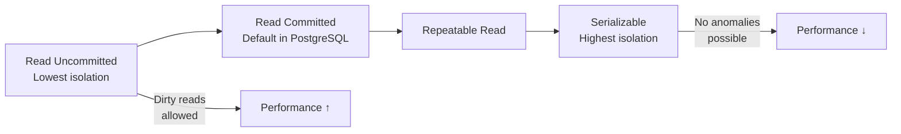

# ACID Properties — Atomicity, Consistency, Isolation, Durability

> [!NOTE]
> ACID is not an abstract academic concept — it is the operational foundation of financial data integrity. Every transaction your system processes relies on these guarantees. Principal engineers must be able to reason about what happens when each one is violated.

## Why ACID Matters for Financial Systems

Consider a money transfer: debit £500 from Account A, credit £500 to Account B.

Without ACID:
- **Without Atomicity** — debit succeeds, credit fails → £500 disappears from the system
- **Without Consistency** — total money in the system changes after the transfer
- **Without Isolation** — another transaction reads Account A as £500 lower mid-transfer, before Account B is credited
- **Without Durability** — the transfer succeeds, but a crash before disk flush loses it

---

## Atomicity — All or Nothing

An atomic transaction either completes fully or has no effect at all. There is no partial state.

```java
// Without atomicity — a crash between debit and credit causes money to disappear
accountRepository.debit(fromAccountId, amount);   // If crash here...
accountRepository.credit(toAccountId, amount);    // ...this never runs

// With atomicity — both operations in one transaction
@Transactional
public TransferResult transfer(UUID fromId, UUID toId, BigDecimal amount) {
    // Lock both rows in a FIXED order (by id) -- two opposite transfers that
    // lock in different orders would deadlock
    boolean fromFirst = fromId.compareTo(toId) < 0;
    Account first  = accountRepository.findByIdForUpdate(fromFirst ? fromId : toId);
    Account second = accountRepository.findByIdForUpdate(fromFirst ? toId : fromId);
    Account from = fromFirst ? first : second;
    Account to   = fromFirst ? second : first;
    
    if (from.getBalance().compareTo(amount) < 0) {
        throw new InsufficientFundsException(fromId, amount, from.getBalance());
    }
    
    from.debit(amount);
    to.credit(amount);
    
    // Both writes happen atomically — either both persist or neither does
    accountRepository.save(from);
    accountRepository.save(to);
    
    return TransferResult.success(UUID.randomUUID(), from.getBalance(), to.getBalance());
    
    // If any exception occurs, Spring's @Transactional rolls back BOTH writes
}
```

### Atomicity Implementation — PostgreSQL WAL

PostgreSQL implements atomicity through the Write-Ahead Log (WAL). Before any data page is modified, the change is written to the WAL. If the database crashes mid-transaction:

1. On restart, PostgreSQL replays the WAL from the last checkpoint ("redo")
2. Transactions with a COMMIT record become visible
3. Transactions without a COMMIT record are treated as aborted — their row versions stay in the table but are invisible to everyone (MVCC), and VACUUM removes them later. There is no separate "undo" step.

The WAL provides the crash recovery guarantee — no partially-committed transaction becomes visible after a crash.

---

## Consistency — Valid State Transitions

Consistency guarantees that a transaction transforms the database from one valid state to another valid state. It relies on constraints, triggers, and application logic working together.

```sql
-- Database constraints enforce consistency rules
CREATE TABLE accounts (
    id          UUID PRIMARY KEY,
    balance     NUMERIC(20, 4) NOT NULL,
    -- Constraint: balance can never go negative
    CONSTRAINT balance_non_negative CHECK (balance >= 0)
);

CREATE TABLE journal_entries (
    id              UUID PRIMARY KEY,
    debit_account   UUID NOT NULL REFERENCES accounts(id),
    credit_account  UUID NOT NULL REFERENCES accounts(id),
    amount          NUMERIC(20, 4) NOT NULL CHECK (amount > 0),
    -- Constraint: a journal entry cannot debit and credit the same account
    CONSTRAINT different_accounts CHECK (debit_account != credit_account)
);
```

```java
// Application-level consistency: double-entry accounting invariant
// Sum of all debits must equal sum of all credits across all accounts
@Scheduled(cron = "0 0 1 * * *", zone = "UTC")  // Daily reconciliation
public void verifyLedgerBalance() {
    BigDecimal totalDebits  = ledgerRepository.sumAllDebits();
    BigDecimal totalCredits = ledgerRepository.sumAllCredits();
    
    if (totalDebits.compareTo(totalCredits) != 0) {
        BigDecimal imbalance = totalDebits.subtract(totalCredits);
        alertingService.page(OnCallTier.P1, 
            "LEDGER IMBALANCE: " + imbalance + " — immediate investigation required");
    }
}
```

> [!WARNING]
> **Consistency is partly your responsibility.** The database enforces structural constraints (CHECK, FOREIGN KEY), but business consistency rules must be implemented in application code. A `CHECK (balance >= 0)` constraint won't protect you from a *lost update*: if two transactions both read £500, compute the new balance in the application and write back an absolute value (`SET balance = 100`), both writes satisfy the constraint. Use relative updates (`SET balance = balance - 400`, which the CHECK then guards), `SELECT ... FOR UPDATE`, or optimistic version checks.

---

## Isolation — Concurrent Transaction Independence

Isolation is the most complex ACID property. It governs what a transaction can see when other transactions are in-flight concurrently.

### The Four Isolation Levels



| Isolation Level | Dirty Read | Non-Repeatable Read | Phantom Read | Financial Use |
|---|---|---|---|---|
| Read Uncommitted | Possible | Possible | Possible | Never — sees uncommitted data |
| **Read Committed** | Prevented | Possible | Possible | Default — most financial OLTP (with row locks) |
| Repeatable Read | Prevented | Prevented | Possible (SQL standard) | Account snapshot reads |
| **Serializable** | Prevented | Prevented | Prevented | Critical financial totals, write-skew-prone rules |

**PostgreSQL specifics:** Read Uncommitted behaves exactly like Read Committed (dirty reads never happen). Repeatable Read is snapshot isolation, so it also prevents phantoms — but it still allows *write skew* (two transactions each check a condition and write different rows), which only Serializable prevents.

### Read Anomalies in Financial Contexts

**Dirty Read** — Reading data written by an uncommitted transaction:
```
Transaction A: debit £500 from Account X (not yet committed)
Transaction B: reads Account X balance (sees £500 lower — dirty read)
Transaction A: rolls back (never committed)
Transaction B: made a decision based on data that never existed
```

**Non-Repeatable Read** — The same row returns different values within a transaction:
```
Transaction A: reads Account X balance = £1,000
Transaction B: commits: Account X balance = £800
Transaction A: reads Account X balance again = £800 (different!)
Transaction A: calculates fee based on first read (incorrect)
```

**Phantom Read** — A query returns different rows on second execution:
```
Transaction A: SELECT SUM(balance) FROM accounts WHERE type='CURRENT' → £1,000,000
Transaction B: INSERT new CURRENT account with £50,000 (committed)
Transaction A: SELECT SUM(balance) FROM accounts WHERE type='CURRENT' → £1,050,000 (phantom!)
Transaction A: regulatory report shows inconsistent total
```

### Setting Isolation Levels in Spring

```java
// Read Committed (PostgreSQL default) — good for most payment operations
@Transactional(isolation = Isolation.READ_COMMITTED)
public PaymentResult processPayment(PaymentRequest request) {
    // Each statement gets a fresh snapshot of committed data
    // Non-repeatable reads possible — but typically acceptable for payment processing
}

// Repeatable Read — prevents non-repeatable reads
// Useful when you read a balance at start of transaction and reference it at end
@Transactional(isolation = Isolation.REPEATABLE_READ)
public AccountSummary generateStatement(UUID accountId, YearMonth period) {
    // The same account row will return the same values throughout this transaction
    // Even if another transaction commits an update mid-way through
    Account account = accountRepository.findById(accountId).orElseThrow();
    List<Transaction> transactions = transactionRepository
        .findByAccountAndPeriod(accountId, period);
    return AccountSummary.from(account, transactions);
}

// Serializable — the strictest; prevents all anomalies including phantoms
// Use for regulatory reports, audit totals, and balance sheet calculations
@Transactional(isolation = Isolation.SERIALIZABLE)
public BalanceSheetReport generateBalanceSheet(LocalDate asOf) {
    // No concurrent transaction can affect what this transaction sees
    // PostgreSQL's SSI (Serializable Snapshot Isolation) does not block readers
    // or writers, but may abort a transaction with a serialization failure
    // (SQLSTATE 40001) -- callers must retry. For a read-only report,
    // SERIALIZABLE READ ONLY DEFERRABLE avoids such failures.
    BigDecimal totalAssets      = accountRepository.sumAssets(asOf);
    BigDecimal totalLiabilities = accountRepository.sumLiabilities(asOf);
    BigDecimal equity           = totalAssets.subtract(totalLiabilities);
    return new BalanceSheetReport(asOf, totalAssets, totalLiabilities, equity);
}
```

---

## Durability — Committed Data Survives Failures

A committed transaction must survive any subsequent failure: process crash, power loss, OS panic.

PostgreSQL provides durability through:

1. **WAL fsync** — before returning success for a COMMIT, the WAL record is flushed to disk
2. **Synchronous replication** — when synchronous standbys are configured, `synchronous_commit = on` makes the primary wait until the required standbys have *flushed* the WAL to their disk (`remote_write` waits only until they have written it, `remote_apply` until it is visible on them)

```sql
-- Configure synchronous replication for a financial production environment
-- postgresql.conf

synchronous_commit = on                                -- wait for standby WAL flush
synchronous_standby_names = 'ANY 1 (standby1, standby2)' -- any one of two confirms
-- (With only ONE synchronous standby, commits stop when that standby fails.)

-- WARNING: synchronous_commit = off returns before the local WAL flush:
-- a crash can lose the last fraction of a second of commits (no corruption).
-- Never use it for financial writes or audit records. Acceptable for:
-- analytics events, caches, other reconstructable non-financial state.
```

### Durability Verification

```java
// Test that committed data survives a simulated crash
// Using Testcontainers with PostgreSQL.
// NOTE: container.stop() REMOVES the container (and its data) -- a restarted
// Testcontainers container is a fresh database. Kill and start the SAME
// container instead (SIGKILL = no clean shutdown, like a power cut).
@Test
void committedTransfer_survivesCrash() {
    UUID accountId = UUID.randomUUID();

    // Setup: create account with £1000
    testTemplate.update("INSERT INTO accounts VALUES (?, 1000.00)", accountId);

    // Execute: commit a debit of £300 (auto-commit, no @Transactional)
    testTemplate.update("UPDATE accounts SET balance = balance - 300 WHERE id = ?", accountId);

    // Simulate crash: kill the postgres process, then start the same container
    DockerClient docker = postgreSQLContainer.getDockerClient();
    docker.killContainerCmd(postgreSQLContainer.getContainerId()).exec();
    docker.startContainerCmd(postgreSQLContainer.getContainerId()).exec();
    // (Docker may assign a new host port: rebuild the DataSource from the
    //  container's current port mapping before querying.)
    JdbcTemplate afterCrash = jdbcTemplateFor(postgreSQLContainer);

    // Verify: committed balance survives crash recovery
    BigDecimal balance = afterCrash.queryForObject(
        "SELECT balance FROM accounts WHERE id = ?", BigDecimal.class, accountId);

    assertThat(balance).isEqualByComparingTo(new BigDecimal("700.00"));
}
```

---

## ACID Trade-offs — When to Relax Guarantees

Not every write in a financial system needs full ACID guarantees. Understanding where you can relax them — safely — unlocks significant performance gains.

| Data Type | Atomicity | Consistency | Isolation | Durability |
|---|---|---|---|---|
| Account balance transfer | Required | Required | Read Committed + row locks (or Serializable) | Required |
| Payment audit log | Required | Required | Read Committed | Required (regulatory record) |
| Fraud score cache update | Not required | Not required | None | Not required |
| Exchange rate update | Required | Required | Read Committed | Required if used for pricing |
| Analytics event | Optional | Not required | None | Not required |

```java
// Relaxed durability for ANALYTICS events — synchronous_commit = local
// Commits after the LOCAL WAL flush without waiting for the standby.
// Risk: if the primary fails and we fail over to the standby, commits not
// yet replicated are lost. Fine for reconstructable data -- never for
// balances, payments or audit records.
@Transactional
public void recordAnalyticsEvent(AnalyticsEvent event) {
    // SET LOCAL applies only to the current transaction
    jdbcTemplate.execute("SET LOCAL synchronous_commit = 'local'");
    analyticsRepository.insert(event);
    // Returns faster — does not wait for standby replication
}
```

<!-- KNOWLEDGE-CHECK
{
  "questions": [
    {
      "id": "q1",
      "text": "A payment service runs at Read Committed isolation. Transaction A reads account balance = £500 at time T1. Transaction B debits £300, committed at T2. Transaction A reads the balance again at T3 (T3 > T2). What does Transaction A see at T3?",
      "options": [
        "£500 — Read Committed prevents all re-reads from changing",
        "£200 — Read Committed allows non-repeatable reads; each statement sees the latest committed data",
        "£500 or £200 depending on which transaction has higher priority",
        "An error — concurrent modification detected"
      ],
      "correct": 1,
      "explanation": "Read Committed prevents dirty reads (uncommitted data) but allows non-repeatable reads. Each statement in Transaction A gets a fresh snapshot of committed data. At T3, Transaction B's commit is visible, so Transaction A sees £200. This is correct behaviour for Read Committed isolation."
    },
    {
      "id": "q2",
      "text": "You are generating a regulatory balance sheet report that must show a consistent point-in-time snapshot of all account balances. Concurrent transactions are continuously updating balances. Which isolation level should you use?",
      "options": [
        "Read Committed — it's the fastest and most databases default to it",
        "Repeatable Read — prevents non-repeatable reads for account rows",
        "Serializable — prevents phantom reads, ensuring no new accounts are included mid-report",
        "Read Uncommitted — to see the most current data"
      ],
      "correct": 2,
      "explanation": "By the SQL standard only Serializable prevents all anomalies including phantoms. For a balance sheet you need (1) balances that don't change mid-report and (2) no new accounts appearing mid-report. Standard Repeatable Read guarantees (1) but not (2). (In PostgreSQL, Repeatable Read is snapshot isolation and already gives a consistent point-in-time view for a read-only report; SERIALIZABLE READ ONLY DEFERRABLE gives the same view with full serializability and no risk of serialization failures.)"
    },
    {
      "id": "q3",
      "text": "A CHECK constraint `balance >= 0` exists on the accounts table. Can a concurrent double-spend still occur at Read Committed isolation?",
      "options": [
        "No — the CHECK constraint prevents any negative balance",
        "Yes — two concurrent transactions can both read balance = £500, both pass the constraint check, both subtract £400, and the constraint catches the second update. But the first may have already committed.",
        "Yes — two concurrent transactions can both read balance = £500, both succeed with their £400 debit (each setting balance to £100), resulting in balance = £100 (the CHECK is satisfied but £800 was spent from £500)",
        "No — Read Committed isolation prevents this race condition"
      ],
      "correct": 2,
      "explanation": "This is the classic read-modify-write (lost update) race. Both transactions read £500, both compute the new balance £100 in the application, and both write back the absolute value; each write satisfies the constraint (£100 ≥ 0) and both commit. The final balance is £100, although £800 was spent from £500. Prevention: SELECT ... FOR UPDATE, an atomic relative update (SET balance = balance - 400 WHERE balance >= 400), or optimistic version checks."
    },
    {
      "id": "q4",
      "text": "When is it safe to use `synchronous_commit = off` in a financial PostgreSQL deployment?",
      "options": [
        "Never — all financial data must use synchronous commit",
        "For non-financial writes where a small window of data loss (up to ~600ms) is acceptable: session state, analytics events, rate limit counters",
        "For all writes — the performance benefit outweighs the risk",
        "Only when using Amazon RDS Multi-AZ"
      ],
      "correct": 1,
      "explanation": "synchronous_commit = off means the database returns success before the WAL is flushed to disk. A crash within ~600ms of the commit can cause data loss. This is never acceptable for account balances, transactions, or regulatory data. It is acceptable for data that is either ephemeral (session state), reconstructable (from an event stream), or low-stakes (analytics events, rate limit counters)."
    }
  ]
}
-->

<!-- PRACTICAL-CHALLENGE
{
  "title": "ACID in Practice — Safe Transfers in PostgreSQL",
  "difficulty": "advanced",
  "estimatedMinutes": 85,
  "tasks": [
    {
      "id": "1",
      "description": "Design the schema: accounts (with CHECK balance >= 0) and a double-entry journal_entries table with foreign keys and a CHECK that debit and credit accounts differ."
    },
    {
      "id": "2",
      "description": "Demonstrate the race condition: write a test that runs two concurrent transfers which each read the balance, compute the new value in Java and write it back; show the lost update."
    },
    {
      "id": "3",
      "description": "Fix the race condition two ways — SELECT ... FOR UPDATE with locks taken in a fixed id order, and an atomic UPDATE ... SET balance = balance - ? WHERE balance >= ? — and prove both with the same concurrent test."
    },
    {
      "id": "4",
      "description": "Isolation level selection: for a transfer, a customer statement and a month-end balance sheet, choose the isolation level in PostgreSQL, explain which anomalies matter, and handle serialization failures (SQLSTATE 40001) with a retry."
    }
  ]
}
-->
