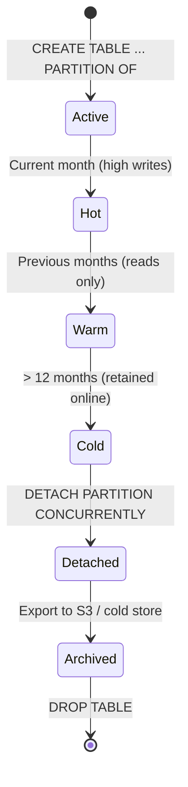

# تقسيم الجداول — النطاق والتجزئة للبيانات المالية

> جدول معاملات ينمو بمعدل 10 ملايين صف يوميًا يبلغ 3.6 مليار صف في عام. ودون تقسيم، تعمل كل عملية VACUUM وREINDEX واستعلام نطاق على مجموعة البيانات كاملة. فالتقسيم ليس تحسينًا — بل شرط مسبق للصيانة لأي جدول مالي على هذا النطاق.

## أهداف التعلم

بنهاية هذا الدرس ستكون قادرًا على:

- شرح الأسباب الثلاثة لتقسيم الجداول المالية واختيار الاستراتيجية المناسبة لكل حالة استخدام
- إنشاء جدول معاملات مقسم شهريًا بالنطاق مع نشر صحيح للفهارس
- إنشاء جدول حسابات مقسم بالتجزئة والتحقق من التوزيع المتساوي
- إثبات تقليم الأقسام بـ EXPLAIN وتشخيص حالات فشله
- ضبط pg_partman لإنشاء الأقسام والاحتفاظ بها آليًا
- ترحيل البيانات القائمة غير المقسمة عبر ATTACH PARTITION
- تصميم استراتيجيات VACUUM وANALYZE والفهارس الجزئية على مستوى القسم

## 1. لماذا تُقسّم الجداول المالية

منصة مدفوعات رقمية تعالج 10 ملايين معاملة يوميًا تراكم:

| الفترة | عدد الصفوف التقريبي |
|--------|-----------------------|
| شهر واحد | 300 مليون صف |
| 6 أشهر | 1.8 مليار صف |
| سنة واحدة | 3.6 مليار صف |
| 3 سنوات | 10.8 مليار صف |

تظهر ثلاث مشكلات تشغيلية على هذا النطاق دون تقسيم:

**1. ‏VACUUM يكافح ليواكب.** يتخطى VACUUM الصفحات المعلّمة مرئية بالكامل، لكن كل تشغيل يجب أن يمسح كل صفحة متغيرة وكل فهرس للجدول. وعلى جدول ضخم واحد بحجم 500 غيغابايت مع حركة كتابة مستمرة، قد يستغرق تشغيل autovacuum واحد ساعات، وتتراكم النسخ الميتة الجديدة أسرع مما ينتهي؛ ويجب أن يمسح التجميد لمنع الالتفاف الجدول كاملًا في النهاية.

**2. انتفاخ الفهارس يصبح غير قابل للإدارة.** تبلغ فهارس B-tree على جدول من 10 مليارات صف مئات الغيغابايتات. وREINDEX العادي يحجب الكتابات إلى الجدول طوال مدته (لدى PostgreSQL 12+ ‏REINDEX CONCURRENTLY، لكنه على فهرس كهذا ما زال يستغرق ساعات ويحتاج مساحة قرص إضافية بقدر الفهرس).

**3. استعلامات النطاق الزمني تنافس البيانات القديمة.** يستخدم استعلام "آخر 30 يومًا" فهارس تغطي أيضًا 10 سنوات من التاريخ؛ وتلك الفهارس الضخمة أصعب في الإبقاء عليها في الذاكرة، وكل مسح كبير أو تقرير أو إعادة بناء فهرس يجب أن يتعامل مع مجموعة البيانات كاملة.

يحل التقسيم المشكلات الثلاث:
- يعمل VACUUM لكل قسم؛ وقسم شهري بحجم 2 غيغابايت يُنظّف في ثوانٍ
- يعمل REINDEX لكل قسم
- يستبعد تقليم الأقسام الأقسام غير ذات الصلة كليًا من تخطيط الاستعلام

## 2. استراتيجيات التقسيم

```
┌─────────────────────────────────────────────────────────────────────┐
│                    PostgreSQL Partition Strategies                  │
├─────────────────┬────────────────────┬──────────────────────────────┤
│ RANGE           │ HASH               │ LIST                         │
├─────────────────┼────────────────────┼──────────────────────────────┤
│ Date/timestamp  │ ID columns         │ Enum values                  │
│ Time-ordered    │ Even distribution  │ Region/currency              │
│ queries         │ No natural order   │ Per-region operations        │
│ Archival        │ Parallel write     │ Jurisdiction retention rules │
├─────────────────┼────────────────────┼──────────────────────────────┤
│ transactions    │ accounts           │ payment_methods by currency  │
│ audit_logs      │ customers          │ orders by country            │
│ statements      │ positions          │ events by type               │
└─────────────────┴────────────────────┴──────────────────────────────┘
```

### اختيار استراتيجية للجداول المالية

| الجدول | الاستراتيجية الموصى بها | المفتاح | السبب |
|-------|---------------------|-----|--------|
| ‏`transactions` | ‏RANGE ‏(transaction_date) | طابع زمني | استعلامات محددة زمنيًا، وأرشفة شهرية |
| ‏`audit_log` | ‏RANGE ‏(created_at) | طابع زمني | الاحتفاظ للامتثال؛ وحذف الأقسام القديمة |
| ‏`accounts` | ‏HASH ‏(account_id) | ‏uuid/bigint | لا ترتيب طبيعي؛ وتوزيع متساوٍ |
| ‏`ledger_entries` | ‏RANGE ‏(posted_at) | طابع زمني | الفترات المحاسبية، وإقفال نهاية السنة |
| ‏`payment_events` | ‏RANGE ‏(event_time) | طابع زمني | سياسات الاحتفاظ بالأحداث |

## 3. التقسيم بالنطاق حسب التاريخ — جدول المعاملات

### 3.1 إنشاء الجدول الأب المقسم

```sql
-- Drop existing unpartitioned version first (migration scenario handled later)
CREATE TABLE transactions (
    transaction_id      UUID        NOT NULL DEFAULT gen_random_uuid(),
    account_id          UUID        NOT NULL,
    counterparty_id     UUID,
    amount              NUMERIC(19,4) NOT NULL,
    currency            CHAR(3)     NOT NULL,
    direction           CHAR(1)     NOT NULL CHECK (direction IN ('D','C')),
    status              VARCHAR(20) NOT NULL DEFAULT 'PENDING',
    reference           VARCHAR(100),
    initiated_at        TIMESTAMPTZ NOT NULL,
    settled_at          TIMESTAMPTZ,
    created_at          TIMESTAMPTZ NOT NULL DEFAULT NOW(),
    metadata            JSONB
) PARTITION BY RANGE (created_at);

-- The partition key MUST be in every unique constraint
-- Global uniqueness on transaction_id alone is NOT enforceable across partitions
-- Use a separate deduplication table if you need cross-partition uniqueness
```

### 3.2 إنشاء أقسام شهرية

```sql
-- Create partitions for a full year
CREATE TABLE transactions_2024_01
    PARTITION OF transactions
    FOR VALUES FROM ('2024-01-01') TO ('2024-02-01');

CREATE TABLE transactions_2024_02
    PARTITION OF transactions
    FOR VALUES FROM ('2024-02-01') TO ('2024-03-01');

-- ... repeat for each month

CREATE TABLE transactions_2024_12
    PARTITION OF transactions
    FOR VALUES FROM ('2024-12-01') TO ('2025-01-01');

-- Default partition: catches out-of-range inserts (without it they fail).
-- Trade-offs: creating a new partition must check the default (and FAILS
-- if it already holds rows for that range), and DETACH ... CONCURRENTLY is
-- not allowed while a default exists. If you use pg_partman, let it create
-- the default -- don't add a second one by hand.
CREATE TABLE transactions_default
    PARTITION OF transactions DEFAULT;
```

**المناطق الزمنية:** ‏`created_at` من نوع `TIMESTAMPTZ`، لذا فالحد المكتوب كـ `'2024-01-01'` يُفسَّر بـ `TimeZone` *الجلسة*. فاكتب الحدود بإزاحة صريحة (`'2024-01-01 00:00:00+00'`) أو تأكد من أن الجلسة التي تنشئ الأقسام تعمل بتوقيت UTC — وإلا تنزاح حدود الأقسام بساعات.

### 3.3 إنشاء الفهارس على الأب (تنتشر إلى كل الأقسام)

```sql
-- Composite index: covers the most common query pattern
-- (account_id = ? AND created_at BETWEEN ? AND ?)
CREATE INDEX idx_transactions_account_date
    ON transactions (account_id, created_at DESC)
    INCLUDE (amount, currency, status);

-- Status index for settlement processing queries
-- Use partial index to avoid indexing terminal states (most rows)
CREATE INDEX idx_transactions_pending
    ON transactions (account_id, created_at)
    WHERE status IN ('PENDING', 'PROCESSING');

-- Verify indexes propagated to all partitions
SELECT
    c.relname   AS partition_name,
    i.relname   AS index_name,
    ix.indisprimary,
    ix.indisunique
FROM pg_class c
JOIN pg_inherits ih ON c.oid = ih.inhrelid
JOIN pg_class p ON p.oid = ih.inhparent
JOIN pg_index ix ON ix.indrelid = c.oid
JOIN pg_class i ON i.oid = ix.indexrelid
WHERE p.relname = 'transactions'
ORDER BY c.relname, i.relname;
```

## 4. تقليم الأقسام — الإثبات بـ EXPLAIN

### 4.1 الشرط الصحيح — التقليم مفعّل

```sql
-- Query with a range predicate on the partition key
EXPLAIN (ANALYZE, BUFFERS, FORMAT TEXT)
SELECT transaction_id, amount, currency, status
FROM transactions
WHERE created_at >= '2024-01-01'
  AND created_at <  '2024-02-01'
  AND account_id = '5f0c7e2a-6f1d-4b8e-9c55-2b8f2a7d9e01';
```

مخرجات الخطة المتوقعة (توضيحية؛ أسماء الفهارس تُولّد لكل قسم):

```
Index Scan using transactions_2024_01_account_id_created_at_idx on transactions_2024_01
  Index Cond: ((account_id = '5f0c7e2a-...') AND (created_at >= '2024-01-01 ...')
               AND (created_at < '2024-02-01 ...'))
  Buffers: shared hit=4
Planning Time: 1.2 ms
Execution Time: 0.08 ms
```

لا يظهر إلا قسم يناير: فالأقسام الـ 11 الأخرى قُلّمت **وقت التخطيط**، فهي ليست في الخطة إطلاقًا. وحين لا تُعرف القيم إلا وقت التشغيل (معاملات ربط في خطة مُعدّة عامة، أو قيم من استعلام فرعي)، يحدث التقليم أثناء التنفيذ وتُظهر الخطة `Subplans Removed: N` تحت عقدة `Append` بدلًا من ذلك.

### 4.2 الشرط الخاطئ — التقليم معطّل

```sql
-- WRONG: wrapping partition key in a function defeats pruning
EXPLAIN (ANALYZE, BUFFERS)
SELECT transaction_id, amount
FROM transactions
WHERE DATE_TRUNC('month', created_at) = '2024-01-01';
```

```
Append  (cost=0.00..1240.00 rows=1500 width=28)
  ->  Seq Scan on transactions_2024_01  (cost=0.00..103.33 ...)
  ->  Seq Scan on transactions_2024_02  (cost=0.00..103.33 ...)
  ->  Seq Scan on transactions_2024_03  (cost=0.00..103.33 ...)
  -- ALL 12 partitions scanned
```

**القاعدة:** لا تغلّف مفتاح التقسيم بدالة في عبارة WHERE أبدًا. واستخدم شروط النطاق مباشرة على العمود.

### 4.3 تفعيل إعداد تقليم الأقسام والتحقق منه

```sql
-- Confirm pruning is enabled (it is by default)
SHOW enable_partition_pruning;

-- Per-session override if needed
SET enable_partition_pruning = on;
```

## 5. التقسيم بالتجزئة لجدول الحسابات

```sql
CREATE TABLE accounts (
    account_id      UUID        NOT NULL DEFAULT gen_random_uuid(),
    customer_id     UUID        NOT NULL,
    account_type    VARCHAR(20) NOT NULL,
    currency        CHAR(3)     NOT NULL,
    status          VARCHAR(20) NOT NULL DEFAULT 'ACTIVE',
    opened_at       TIMESTAMPTZ NOT NULL DEFAULT NOW(),
    closed_at       TIMESTAMPTZ,
    balance_cache   NUMERIC(19,4)  -- Denormalised; always recalculate from ledger
) PARTITION BY HASH (account_id);

-- 16 partitions — power of 2, allows future split if needed
-- Partition names encode modulus/remainder for operational clarity
CREATE TABLE accounts_h0  PARTITION OF accounts FOR VALUES WITH (MODULUS 16, REMAINDER 0);
CREATE TABLE accounts_h1  PARTITION OF accounts FOR VALUES WITH (MODULUS 16, REMAINDER 1);
CREATE TABLE accounts_h2  PARTITION OF accounts FOR VALUES WITH (MODULUS 16, REMAINDER 2);
CREATE TABLE accounts_h3  PARTITION OF accounts FOR VALUES WITH (MODULUS 16, REMAINDER 3);
CREATE TABLE accounts_h4  PARTITION OF accounts FOR VALUES WITH (MODULUS 16, REMAINDER 4);
CREATE TABLE accounts_h5  PARTITION OF accounts FOR VALUES WITH (MODULUS 16, REMAINDER 5);
CREATE TABLE accounts_h6  PARTITION OF accounts FOR VALUES WITH (MODULUS 16, REMAINDER 6);
CREATE TABLE accounts_h7  PARTITION OF accounts FOR VALUES WITH (MODULUS 16, REMAINDER 7);
CREATE TABLE accounts_h8  PARTITION OF accounts FOR VALUES WITH (MODULUS 16, REMAINDER 8);
CREATE TABLE accounts_h9  PARTITION OF accounts FOR VALUES WITH (MODULUS 16, REMAINDER 9);
CREATE TABLE accounts_h10 PARTITION OF accounts FOR VALUES WITH (MODULUS 16, REMAINDER 10);
CREATE TABLE accounts_h11 PARTITION OF accounts FOR VALUES WITH (MODULUS 16, REMAINDER 11);
CREATE TABLE accounts_h12 PARTITION OF accounts FOR VALUES WITH (MODULUS 16, REMAINDER 12);
CREATE TABLE accounts_h13 PARTITION OF accounts FOR VALUES WITH (MODULUS 16, REMAINDER 13);
CREATE TABLE accounts_h14 PARTITION OF accounts FOR VALUES WITH (MODULUS 16, REMAINDER 14);
CREATE TABLE accounts_h15 PARTITION OF accounts FOR VALUES WITH (MODULUS 16, REMAINDER 15);

-- Verify distribution after bulk insert
SELECT
    c.relname                           AS partition,
    pg_stat_get_live_tuples(c.oid)      AS live_rows,
    pg_size_pretty(pg_relation_size(c.oid)) AS size,
    ROUND(
        pg_stat_get_live_tuples(c.oid)::NUMERIC
        / NULLIF(SUM(pg_stat_get_live_tuples(c.oid)) OVER (), 0) * 100,
        2
    )                                   AS pct_of_total
FROM pg_class c
JOIN pg_inherits ih ON c.oid = ih.inhrelid
JOIN pg_class p ON p.oid = ih.inhparent
WHERE p.relname = 'accounts'
ORDER BY c.relname;
```

## 6. ‏pg_partman — إدارة الأقسام آليًا

‏pg_partman هو المعيار الإنتاجي للحفاظ على الأقسام القائمة على التاريخ. فهو يتولى إنشاء الأقسام المستقبلية، والاحتفاظ بالقديمة أو حذفها، والتكامل مع pg_cron.

### 6.1 التثبيت والإعداد

```sql
-- Install extensions (requires superuser; pg_cron must also be listed in
-- shared_preload_libraries)
CREATE SCHEMA IF NOT EXISTS partman;
CREATE EXTENSION pg_partman SCHEMA partman;
CREATE EXTENSION pg_cron;  -- For scheduling maintenance

-- Register the transactions table with pg_partman (5.x syntax)
SELECT partman.create_parent(
    p_parent_table   => 'public.transactions',
    p_control        => 'created_at',
    p_type           => 'range',
    p_interval       => '1 month',
    p_premake        => 3,         -- Pre-create 3 future partitions
    p_start_partition => '2024-01-01'
);
```

### 6.2 ضبط سياسة الاحتفاظ

```sql
-- Keep 24 months of data online; older partitions are dropped automatically
UPDATE partman.part_config
SET
    retention              = '24 months',
    retention_keep_table   = FALSE,   -- Actually DROP old partitions
    retention_keep_index   = FALSE,
    infinite_time_partitions = FALSE,
    premake                = 3        -- Always have 3 future months ready
WHERE parent_table = 'public.transactions';

-- Schedule maintenance via pg_cron (runs at 2:00 AM UTC daily)
SELECT cron.schedule(
    'partman-maintenance',
    '0 2 * * *',
    $$CALL partman.run_maintenance_proc()$$
);
```

### 6.3 التحقق من حالة pg_partman

```sql
SELECT
    parent_table,
    control,
    partition_interval,
    premake,
    retention
FROM partman.part_config
WHERE parent_table = 'public.transactions';

-- List the child partitions pg_partman manages
SELECT * FROM partman.show_partitions('public.transactions');
```

## 7. مهمة صيانة الأقسام بـ Java

إن لم تكن تستخدم pg_partman، فمهمة مجدولة صغيرة تستطيع فعل الشيء نفسه. واستخدم آلية **واحدة** — pg_partman *أو* هذه المهمة — لا كلتيهما على الجدول نفسه أبدًا.

```java
@Component
@RequiredArgsConstructor
@Slf4j
public class PartitionMaintenanceJob {

    private final JdbcTemplate jdbc;

    /**
     * Creates monthly partitions for the next {@code monthsAhead} months.
     * Safe to run multiple times (idempotent via IF NOT EXISTS logic).
     * Month boundaries are computed in UTC and written with an explicit
     * offset, so they do not depend on the session time zone.
     */
    @Scheduled(cron = "0 0 2 * * *")  // Daily at 02:00
    public void ensureFuturePartitions() {
        int monthsAhead = 3;
        YearMonth current = YearMonth.now(ZoneOffset.UTC);

        for (int i = 0; i <= monthsAhead; i++) {
            YearMonth month = current.plusMonths(i);
            createPartitionIfAbsent(month);
        }
    }

    private void createPartitionIfAbsent(YearMonth month) {
        String partitionName = "transactions_" + month.format(DateTimeFormatter.ofPattern("yyyy_MM"));
        LocalDate start = month.atDay(1);
        LocalDate end   = month.plusMonths(1).atDay(1);

        String sql = """
            DO $$
            BEGIN
                IF NOT EXISTS (
                    SELECT 1 FROM pg_class c
                    JOIN pg_namespace n ON n.oid = c.relnamespace
                    WHERE c.relname = :partitionName
                    AND n.nspname = 'public'
                ) THEN
                    EXECUTE format(
                        'CREATE TABLE %I PARTITION OF transactions
                         FOR VALUES FROM (%L) TO (%L)',
                        :partitionName,
                        :start::TEXT,
                        :end::TEXT
                    );
                END IF;
            END $$;
            """;

        try {
            // Values are generated by code (never user input), and format()
            // with %I / %L quotes them safely inside the DO block
            jdbc.execute(sql
                .replace(":partitionName", "'" + partitionName + "'")
                .replace(":start", "'" + start + " 00:00:00+00'")
                .replace(":end",   "'" + end + " 00:00:00+00'")
            );
            log.info("Partition ensured: {}", partitionName);
        } catch (DataAccessException e) {
            log.error("Failed to create partition {}: {}", partitionName, e.getMessage());
            // Do not rethrow — missing future partition is not immediately fatal
            // Alert on-call if this fails 3+ consecutive days
        }
    }

    /**
     * Archives partitions older than retentionMonths by detaching them.
     * Detached tables are independent and can be exported before dropping.
     */
    @Scheduled(cron = "0 30 2 * * *")  // 02:30 daily, after ensureFuturePartitions
    public void archiveOldPartitions() {
        int retentionMonths = 24;
        YearMonth cutoff = YearMonth.now(ZoneOffset.UTC).minusMonths(retentionMonths);

        List<String> candidates = jdbc.queryForList(
            """
            SELECT c.relname
            FROM pg_class c
            JOIN pg_inherits ih ON c.oid = ih.inhrelid
            JOIN pg_class p ON p.oid = ih.inhparent
            WHERE p.relname = 'transactions'
              AND c.relname ~ '^transactions_\\d{4}_\\d{2}$'
            ORDER BY c.relname
            """,
            String.class
        );

        for (String partition : candidates) {
            YearMonth partitionMonth = extractMonth(partition);
            if (partitionMonth != null && partitionMonth.isBefore(cutoff)) {
                detachAndArchive(partition);
            }
        }
    }

    private YearMonth extractMonth(String partitionName) {
        // Format: transactions_2022_01
        String[] parts = partitionName.split("_");
        if (parts.length < 4) return null;
        try {
            int year  = Integer.parseInt(parts[2]);
            int month = Integer.parseInt(parts[3]);
            return YearMonth.of(year, month);
        } catch (NumberFormatException e) {
            return null;
        }
    }

    private void detachAndArchive(String partition) {
        try {
            long rowCount = jdbc.queryForObject(
                "SELECT COUNT(*) FROM " + partition, Long.class
            );
            // DETACH PARTITION CONCURRENTLY requires PostgreSQL 14+, must run
            // outside a transaction block (auto-commit), and is NOT allowed
            // while the table has a default partition. It avoids the
            // ACCESS EXCLUSIVE lock of a plain DETACH.
            jdbc.execute("ALTER TABLE transactions DETACH PARTITION " + partition + " CONCURRENTLY");
            log.info("Detached partition {} ({} rows). Ready for archival.", partition, rowCount);
            // After detaching, the table is standalone.
            // Export to S3/cold storage before dropping:
            // jdbc.execute("DROP TABLE " + partition);
        } catch (DataAccessException e) {
            log.error("Failed to detach partition {}: {}", partition, e.getMessage());
        }
    }
}
```

## 8. ‏ATTACH PARTITION — ترحيل البيانات القائمة

ترحيل جدول حي كبير إلى جدول مقسم. والنهج الأقل خطورة عادة هو **إبقاء الجدول القائم كقسم "تاريخي" واحد كبير** وإنشاء أقسام شهرية جديدة للبيانات المستقبلية فقط:

1. أضف قيد `CHECK (created_at < '<cutover>')` إلى الجدول القديم بـ `NOT VALID`، ثم `VALIDATE` له (أثناء العمل).
2. أنشئ الأب المقسم الجديد وأقسامه الشهرية المستقبلية.
3. في معاملة قصيرة: أعد تسمية الجدول القديم، واربطه كقسم `FOR VALUES FROM (MINVALUE) TO ('<cutover>')` (يتيح CHECK المُتحقق منه لـ PostgreSQL تخطي المسح)، وأعد تسمية الأب الجديد إلى `transactions`.
4. يمكن لاحقًا تقسيم البيانات القديمة إلى أقسام شهرية، أو تركها تتقادم ببساطة.

النسخ خطوة بخطوة أدناه يصلح للجداول الأصغر. ولاحظ أن النسخ بـ `INSERT ... SELECT` بينما يواصل التطبيق الكتابة يفوّت الصفوف اللاحقة: فتحتاج تجميدًا قصيرًا للكتابة، أو مشغّلًا/CDC ينسخ الكتابات الجديدة حتى التبديل.

```sql
-- Step 1: Create the new partitioned table (different name to avoid conflicts)
-- INCLUDING ALL also copies the old primary key; a PK on a partitioned
-- table must contain created_at, so define keys explicitly if this fails
CREATE TABLE transactions_partitioned (
    LIKE transactions INCLUDING DEFAULTS INCLUDING CONSTRAINTS
) PARTITION BY RANGE (created_at);

-- Step 2: Create partitions for all existing data ranges
-- (pre-create based on your data's date range)

-- Step 3: Create a temporary staging table with the same structure
CREATE TABLE transactions_migrate_2024_01 (LIKE transactions INCLUDING ALL);

-- Step 4: Copy data for one month into the staging table
INSERT INTO transactions_migrate_2024_01
SELECT * FROM transactions
WHERE created_at >= '2024-01-01' AND created_at < '2024-02-01';

-- Step 5: Add a CHECK constraint (required for ATTACH PARTITION to skip full scan)
-- Without this constraint, PostgreSQL scans every row to verify partition bounds
ALTER TABLE transactions_migrate_2024_01
ADD CONSTRAINT chk_created_at
CHECK (created_at >= '2024-01-01' AND created_at < '2024-02-01')
NOT VALID;  -- Skip scanning existing rows

-- Validate the constraint separately (uses only a SHARE UPDATE EXCLUSIVE lock)
ALTER TABLE transactions_migrate_2024_01
VALIDATE CONSTRAINT chk_created_at;

-- Step 6: ATTACH PARTITION (uses CHECK constraint to skip full scan — near-instant)
ALTER TABLE transactions_partitioned
ATTACH PARTITION transactions_migrate_2024_01
FOR VALUES FROM ('2024-01-01') TO ('2024-02-01');

-- Step 7: Atomically swap the tables (requires brief ACCESS EXCLUSIVE lock;
-- set a short lock_timeout). Check sequences, views, foreign keys and
-- grants that still point at the old table.
BEGIN;
SET LOCAL lock_timeout = '2s';
ALTER TABLE transactions RENAME TO transactions_old;
ALTER TABLE transactions_partitioned RENAME TO transactions;
COMMIT;
```

## 9. الصيانة على مستوى القسم

### 9.1 ‏VACUUM وANALYZE لكل قسم

```sql
-- Vacuum a specific partition (much faster than the full table)
VACUUM ANALYZE transactions_2024_01;

-- Freeze a partition that is fully archived (no more writes)
-- This prevents transaction ID wraparound concerns
VACUUM FREEZE transactions_2022_01;

-- Check per-partition vacuum status
SELECT
    c.relname       AS partition,
    n_live_tup,
    n_dead_tup,
    last_autovacuum,
    last_autoanalyze,
    pg_size_pretty(pg_relation_size(c.oid)) AS size
FROM pg_stat_user_tables t
JOIN pg_class c ON c.oid = t.relid
WHERE c.relname LIKE 'transactions_%'
ORDER BY c.relname;
```

### 9.2 الاستعلامات عبر الأقسام

```sql
-- Query spanning multiple partitions (the planner handles the Append automatically)
-- Covers Q1 2024 — will touch 3 partitions
EXPLAIN (ANALYZE, BUFFERS)
SELECT
    account_id,
    SUM(amount) FILTER (WHERE direction = 'D') AS total_debits,
    SUM(amount) FILTER (WHERE direction = 'C') AS total_credits,
    COUNT(*) AS transaction_count
FROM transactions
WHERE created_at >= '2024-01-01'
  AND created_at <  '2024-04-01'
  AND currency = 'USD'
GROUP BY account_id
ORDER BY total_debits DESC
LIMIT 100;
```

### 9.3 فهارس جزئية لكل قسم

```sql
-- Create a targeted partial index only on the most recent (hot) partition
-- Old partitions rarely need PENDING status indexes
CREATE INDEX idx_tx_2024_01_pending
    ON transactions_2024_01 (account_id, created_at)
    WHERE status = 'PENDING';

-- Settlement team query: only on current month's partition
CREATE INDEX idx_tx_current_unsettled
    ON transactions_2024_12 (initiated_at)
    WHERE settled_at IS NULL AND status NOT IN ('FAILED', 'CANCELLED');
```

## 10. ‏Mermaid: دورة حياة القسم



## 11. مزالق الإنتاج

### المزلق 1: مفتاح التقسيم المغلف بدالة يعطّل التقليم

```sql
-- BAD: DATE_TRUNC wraps the partition key — all partitions scanned
SELECT * FROM transactions
WHERE DATE_TRUNC('month', created_at) = '2024-01-01';

-- BAD: Implicit cast via TO_CHAR
SELECT * FROM transactions
WHERE TO_CHAR(created_at, 'YYYY-MM') = '2024-01';

-- GOOD: Direct range predicate
SELECT * FROM transactions
WHERE created_at >= '2024-01-01'
  AND created_at <  '2024-02-01';

-- GOOD: Use a generate_series to build date ranges programmatically
-- rather than wrapping dates in functions
```

### المزلق 2: القسم المستقبلي المفقود — إدراجات فاشلة أو صفوف عالقة في القسم الافتراضي

```sql
-- If a partition for February 2025 does not exist and there is no DEFAULT partition,
-- an INSERT of a February 2025 row raises:
--   ERROR:  no partition of relation "transactions" found for row
--
-- If a DEFAULT partition EXISTS, the row goes into the default partition silently.
-- A later ATTACH PARTITION for Feb 2025 will FAIL because the default partition
-- already contains Feb 2025 rows, and those rows violate the new partition bounds.
--
-- Prevention:
-- 1. Always pre-create 3+ future partitions (pg_partman p_premake = 3)
-- 2. Alert if the number of future partitions drops below 2
-- 3. Treat missing-partition as a P1 incident

-- Monitor future partition coverage
SELECT
    child.relname,
    pg_get_expr(child.relpartbound, child.oid) AS partition_bound
FROM pg_class parent
JOIN pg_inherits ON pg_inherits.inhparent = parent.oid
JOIN pg_class child ON child.oid = pg_inherits.inhrelid
WHERE parent.relname = 'transactions'
  AND pg_get_expr(child.relpartbound, child.oid) LIKE '%2025%'  -- adjust year
ORDER BY child.relname;
```

### المزلق 3: القيود الفريدة الشاملة غير قابلة للفرض عبر الأقسام

```sql
-- This FAILS on a partitioned table (partition key not included):
-- ERROR:  unique constraint on partitioned table must include all partitioning columns
CREATE UNIQUE INDEX ON transactions (transaction_id);

-- WORKAROUND 1: Include partition key in the unique constraint
CREATE UNIQUE INDEX ON transactions (transaction_id, created_at);
-- This only enforces uniqueness per (transaction_id, created_at) combination
-- Two rows CAN have the same transaction_id if created_at differs

-- WORKAROUND 2: Separate deduplication table (recommended for idempotency keys)
CREATE TABLE transaction_dedup (
    idempotency_key VARCHAR(100) PRIMARY KEY,
    transaction_id  UUID NOT NULL,
    created_at      TIMESTAMPTZ NOT NULL DEFAULT NOW()
);
-- INSERT INTO transaction_dedup first; if it conflicts, the transaction is a duplicate
-- Then INSERT INTO transactions (the main partitioned table)
```

## 12. قائمة الفحص

- قسّم جداول المعاملات/التدقيق بالنطاق شهريًا أو أسبوعيًا بحسب حجم الكتابة
- قسّم جداول الحسابات/العملاء بالتجزئة بـ 16 أو 32 قسمًا (قوة للعدد 2)
- ضمّن دائمًا مفتاح التقسيم في القيود الفريدة؛ واستخدم جدول إزالة تكرار للتفرد الشامل
- شغّل EXPLAIN وتأكد من ظهور الأقسام المتوقعة فقط (أو "Subplans Removed" للتقليم وقت التشغيل) قبل النشر إلى الإنتاج
- لا تغلّف مفتاح التقسيم بدالة في عبارات WHERE أبدًا
- اضبط pg_partman بـ p_premake = 3 للحفاظ على الأقسام المستقبلية
- نبّه حين ينخفض عدد الأقسام المستقبلية تحت 2
- استخدم DETACH PARTITION CONCURRENTLY ‏(PostgreSQL 14+؛ غير ممكن ما دام يوجد قسم افتراضي) لأرشفة منخفضة الأثر
- أضف قيود CHECK بـ NOT VALID قبل ATTACH PARTITION لتخطي مسوح الجدول الكاملة
- راقب أعداد الصفوف لكل قسم لانحراف أقسام التجزئة (يجب أن تكون ضمن 10% من المثالي)
- شغّل VACUUM FREEZE على الأقسام المؤرشفة (للقراءة فقط) لتجنب التفاف معرّفات المعاملات

<!-- KNOWLEDGE-CHECK
{
  "questions": [
    {
      "text": "يُشغّل استعلام: SELECT * FROM transactions WHERE DATE_TRUNC('month', created_at) = '2024-01-01'. ويُظهر EXPLAIN مسح كل الأقسام الشهرية الـ 12. ما السبب الجذري والإصلاح الصحيح؟",
      "options": [
        "الفهرس على created_at مفقود؛ أضف CREATE INDEX ON transactions (created_at)",
        "تغليف مفتاح التقسيم بـ DATE_TRUNC يمنع المخطِّط من المقارنة بحدود الأقسام؛ أعد كتابته كـ WHERE created_at >= '2024-01-01' AND created_at < '2024-02-01'",
        "يجب أن يكون نوع التقسيم HASH بدل RANGE لأعمدة الطوابع الزمنية",
        "إعداد enable_partition_pruning معطّل؛ شغّل SET enable_partition_pruning = on"
      ],
      "correct": 1,
      "explanation": "يعمل تقليم الأقسام في PostgreSQL بمقارنة قيم الشرط بحدود الأقسام المخزنة. وحين يُغلف مفتاح التقسيم بدالة مثل DATE_TRUNC، لا يستطيع المخطِّط تحديد الأقسام المطابقة دون تقييم الدالة لكل قسم. والإصلاح شرط نطاق مباشر: WHERE created_at >= '2024-01-01' AND created_at < '2024-02-01'. وهذا يتيح للمخطِّط المقارنة بحدود الأقسام بدقة واستبعاد كل الأقسام غير المطابقة."
    },
    {
      "text": "جدول معاملات مقسم بالنطاق حسب created_at. ويحاول الفريق: CREATE UNIQUE INDEX ON transactions (transaction_id). ويفشل الأمر. ما الخطأ وما الحل البديل الموصى به في الإنتاج؟",
      "options": [
        "نوع الفهرس BTREE غير مدعوم على الجداول المقسمة؛ استخدم فهرس GIN بدلًا منه",
        "القيود الفريدة على الجداول المقسمة يجب أن تتضمن كل أعمدة التقسيم؛ استخدم جدول transaction_dedup منفصلًا بـ transaction_id كمفتاح أساسي لفرض التفرد الشامل",
        "يجب تشغيل VACUUM FULL على الجدول أولًا قبل إنشاء فهارس فريدة على الأقسام",
        "لا يمكن إنشاء فهارس فريدة على الجدول الأب؛ أنشئها على كل قسم على حدة"
      ],
      "correct": 1,
      "explanation": "لا يستطيع PostgreSQL فرض تفرد شامل عبر الأقسام دون مفتاح التقسيم، لأن لكل قسم فهرسًا مستقلًا ولا يوجد فهرس شامل عبر كل الأقسام. ويفشل الأمر بـ: 'unique constraint on partitioned table must include all partitioning columns'. والحل البديل الموصى به للـ idempotency جدول إزالة تكرار منفصل: CREATE TABLE transaction_dedup (idempotency_key TEXT PRIMARY KEY, transaction_id UUID). أدرج في هذا الجدول أولًا؛ فالتعارض يعني أن المعاملة مكررة. ثم أدرج في جدول المعاملات المقسم."
    },
    {
      "text": "يستخدم الفريق ATTACH PARTITION لترحيل بيانات من جدول تجهيز إلى أب مقسم. دون إضافة قيد CHECK أولًا، ما مشكلة الأداء التي تحدث وما الحل؟",
      "options": [
        "يجب أن يمسح ATTACH PARTITION كل صف في الجدول المربوط للتحقق من حدود القسم، ممسكًا قفلًا قويًا على ذلك الجدول (يحتاج الأب فقط SHARE UPDATE EXCLUSIVE منذ PostgreSQL 12)؛ أضف قيد CHECK بـ NOT VALID، ثم VALIDATE CONSTRAINT منفصلًا، قبل الربط",
        "ينسخ ATTACH PARTITION كل البيانات من جدول التجهيز إلى القسم، فيضاعف التخزين مؤقتًا",
        "يُحجب ATTACH PARTITION بأي معاملات قراءة نشطة على الجدول الأب",
        "يعيد ATTACH PARTITION فهرسة جدول التجهيز باستخدام قفل ACCESS SHARE، فيسبب انتفاخ الفهارس"
      ],
      "correct": 0,
      "explanation": "دون قيد CHECK مطابق، يجب أن يمسح PostgreSQL كل صف في الجدول المربوط للتحقق من أن كل الصفوف تحقق حدود القسم — وعلى جدول كبير يستغرق هذا دقائق بينما ذلك الجدول مقفل (وقبل PostgreSQL 12، الأب المقسم كله أيضًا). والحل: (1) ‏ADD CONSTRAINT ... CHECK (created_at >= '...' AND created_at < '...') NOT VALID — يتخطى مسح الصفوف الموجودة؛ (2) ‏VALIDATE CONSTRAINT — يمسح بقفل SHARE UPDATE EXCLUSIVE فقط، فتستمر القراءات والكتابات؛ (3) ‏ATTACH PARTITION — يستخدم PostgreSQL القيد المُتحقق منه ويتخطى المسح، فيكون الربط نفسه شبه فوري."
    }
  ]
}
-->

<!-- PRACTICAL-CHALLENGE
{
  "title": "تصميم جدول معاملات مالية مقسم وتشغيله",
  "difficulty": "advanced",
  "estimatedMinutes": 45,
  "tasks": [
    {"id": "1", "description": "أنشئ جدول معاملات مقسمًا شهريًا بالنطاق يغطي السنة الحالية (12 قسمًا بالإضافة إلى قسم افتراضي). وأنشئ فهرسًا مركبًا على (account_id, created_at DESC) INCLUDE (amount, currency, status) على الجدول الأب وتحقق عبر pg_class من انتشاره إلى كل الأقسام الأبناء. وشغّل EXPLAIN (ANALYZE, BUFFERS) لاستعلام شهر واحد بتواريخ حرفية وتأكد من ظهور قسم ذلك الشهر فقط في الخطة؛ ثم شغّله كعبارة مُعدّة بمعاملات وابحث عن 'Subplans Removed'. وأخيرًا شغّل الاستعلام بـ DATE_TRUNC ووثّق الفرق."},
    {"id": "2", "description": "نفّذ مهمة Spring Boot مجدولة @Scheduled باسم PartitionMaintenanceJob تعمل يوميًا في 02:00. ويجب أن: (1) تضمن وجود أقسام للشهر الحالي والأشهر الثلاثة التالية، (2) تكون idempotent — آمنة للتشغيل مرات متعددة دون خطأ، (3) تسجّل ما إذا كان كل قسم أُنشئ أو كان موجودًا، (4) تتعامل مع DataAccessException لكل قسم دون إفشال المهمة كلها. واكتب @SpringBootTest يحقن نسخة PostgreSQL من Testcontainers، ويشغّل المهمة مرتين، ويؤكد عدم وجود استثناءات وصحة عدد الأقسام."},
    {"id": "3", "description": "أنشئ جدول حسابات مقسمًا بالتجزئة بـ 16 قسمًا. وأدرج 160,000 حساب اختباري باستخدام generate_series. واكتب استعلام SQL يُبلغ عن عدد الصفوف ونسبتها من الإجمالي لكل قسم. وتحقق من أن أي قسم لا ينحرف بأكثر من 15% عن المثالي البالغ 10,000 صف. واشرح لماذا توزّع معرّفات UUID والمعرّفات الصحيحة المتتالية بالتساوي مع دالة التجزئة في PostgreSQL، ومتى قد يحدث الانحراف مع ذلك (قيم مفاتيح مميزة قليلة، أو حفنة من المفاتيح الساخنة جدًا)."},
    {"id": "4", "description": "نفّذ PartitionArchivalService تؤرشف الأقسام الأقدم من 24 شهرًا. ويجب أن: (1) تتحقق من أن القسم عمره 24 شهرًا على الأقل قبل المتابعة، (2) تسجّل عدد الصفوف قبل الأرشفة في جدول archival_audit بأعمدة partition_name، وrow_count، وarchived_at، وarchived_by، (3) تنفذ DETACH PARTITION CONCURRENTLY، (4) تتحقق من أن القسم لم يعد مدرجًا في pg_inherits، (5) تسجّل كل الخطوات. واكتب اختبارًا ينشئ قسمًا قديمًا وهميًا، ويشغّل الخدمة، ويؤكد فصل القسم ووجود سجل التدقيق."}
  ]
}
-->
