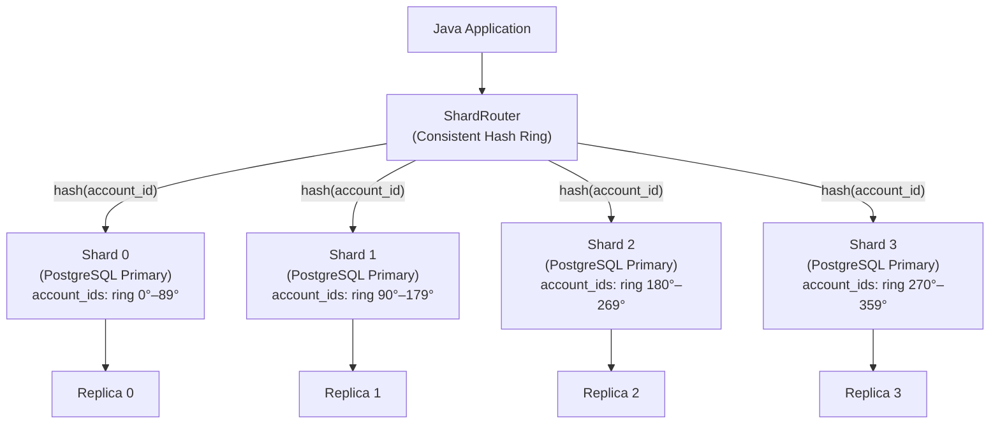

## نظرة عامة

يستطيع خادم PostgreSQL أساسي واحد على عتاد NVMe حديث تحمّل آلاف كثيرة من معاملات الكتابة في الثانية — ويعتمد السقف الدقيق كثيرًا على حجم المعاملة والفهارس وإعدادات الديمومة — قبل أن يصبح المعالج أو إنتاجية WAL أو تنازع الأقفال هو الحد. ولمعالج دفع يتعامل مع عشرات آلاف المعاملات في الثانية في الذروة، يأتي ذلك السقف أسرع مما يتوقع الفريق الهندسي. والتوسع الرأسي يشتري الوقت — فالأجهزة الكبيرة جدًا (مئات الأنوية، وتيرابايتات من الذاكرة) موجودة، لكنها مكلفة وما زالت نقطة توسع واحدة. أما التوسع الأفقي عبر التجزئة الأفقية (sharding) فيوزع البيانات وحمل الكتابة على عقد أصغر كثيرة، كل منها رخيص وقابل للاستبدال والتوسع المستقل.

التجزئة الأفقية ليست مجانية. فهي تُدخل طبقة توجيه، وتلغي القدرة على تشغيل روابط اعتباطية عبر الأجزاء، وتعقّد المعاملات. ويعلّمك هذا الدرس اتخاذ المفاضلات الصحيحة: متى تكون التجزئة مبررة، وكيف تختار مفتاح تجزئة يتجنب البؤر الساخنة، وكيف توجّه الاستعلامات في Java، وكيف تعيد التجزئة لقاعدة بيانات حية بأمان دون توقف.

## أهداف التعلم

بنهاية هذا الدرس ستكون قادرًا على:

- تحديد الإشارات التشغيلية التي تدل على أن PostgreSQL أحادي العقدة بلغ سقف توسعه
- شرح الفرق بين التجزئة بالنطاق والتجزئة بالتجزئة المتسقة ومتى يناسب كل منهما
- اختيار مفتاح تجزئة يوفر توزيعًا متساويًا للكتابات ويتجنب البؤر الساخنة الزمنية
- تنفيذ `ShardRouter` في Java باستخدام التجزئة المتسقة لتوجيه الاستعلامات إلى الجزء الصحيح
- تصميم استراتيجية للاستعلامات عبر الأجزاء باستخدام التوزيع والدمج
- التخطيط لتقسيم جزء أثناء العمل وتنفيذه مع الكتابة المزدوجة لتجنب التوقف أثناء إعادة التجزئة
- وصف كيف يؤتمت Vitess ‏(MySQL) وCitus ‏(PostgreSQL) شؤون التجزئة
- تبرير لماذا يجب تجنب المعاملات الموزعة عبر الأجزاء واستبدالها بأنماط Saga

## سياق العمل

*مثال مركّب:* تشهد منصة تداول للأفراد قفزة في حجم الأوامر إلى أضعاف كثيرة من متوسطها اليومي أثناء جنون في السوق. وتصل طبقة قاعدة بياناتها، المبنية حول عنقود أساسي واحد، إلى حدود الاتصالات وإنتاجية الكتابة خلال الساعة الأولى من التداول. فيبدأ تقديم الأوامر بالفشل تمامًا حين يحتاج العملاء أكثر ما يحتاجون إلى إغلاق مراكزهم — مشكلة ضرر مباشر للعملاء ومشكلة رقابية.

السبب الجذري ليس خطأً برمجيًا. بل افتراض معماري: أن عقدة قاعدة بيانات أساسية واحدة سيكون لديها دائمًا هامش كافٍ. فلدى الفريق فهارس، ونسخ قراءة، وتخزين مؤقت — لكن لا استراتيجية توسع أفقي للكتابة. وحين تأتي القفزة، لا يجد مسار الكتابة مكانًا يذهب إليه.

تجزئة جدولي الأوامر والمراكز أفقيًا حسب معرّف الحساب كانت ستوزع تلك الكتابات على عقد كثيرة وتزيل سقف العقدة الواحدة (مقابل التعقيد المشروح أدناه).

## متى تجزّئ أفقيًا — التعرف على السقف

تضيف التجزئة الأفقية تعقيدًا تشغيليًا كبيرًا. وهي مبررة فقط حين تستنفد الخيارات الأرخص التالية:

| التحسين | الراحة المتوقعة | متى يُستنفد |
|---|---|---|
| ضبط الفهارس | ‏2–10 أضعاف سرعة الاستعلام | الاستعلامات مثالية أصلًا |
| تجميع الاتصالات (PgBouncer) | ‏3 أضعاف الاتصالات الفعلية | المجمع منشور أصلًا |
| نسخ القراءة | تفريغ 60–80% من القراءات | الكتابات هي الاختناق |
| تقسيم الجداول | ‏2–5 أضعاف على الاستعلامات المقلّمة | الكتابات ما زالت تصيب أساسيًا واحدًا |
| التوسع الرأسي | ‏2–4 أضعاف بنسخة أكبر | منحنى الكلفة يصبح غير خطي |
| **التجزئة الأفقية** | توسع كتابة خطي | — |

إشارات أن الأساسي بلغ سقفه:

```
-- WAL generation rate: sample the WAL position twice and divide by the
-- interval (a single reading is just total WAL since the cluster started)
SELECT pg_current_wal_lsn();          -- e.g. at 12:00:00 -> 1A/2B000000
-- ... 60 seconds later ...
SELECT pg_size_pretty(pg_wal_lsn_diff(pg_current_wal_lsn(), '1A/2B000000') / 60)
       AS wal_per_second;
-- Compare with what your disks, replicas and backups can sustain

-- Check average active connections at peak
SELECT count(*) FROM pg_stat_activity WHERE state = 'active';

-- Check top lock wait events
SELECT wait_event_type, wait_event, count(*)
FROM pg_stat_activity
WHERE wait_event IS NOT NULL
GROUP BY 1, 2
ORDER BY 3 DESC
LIMIT 10;
```

> [!WARNING]
> **لا تجزّئ أفقيًا قبل الأوان.** عقدة PostgreSQL واحدة مضبوطة جيدًا مع نسخ قراءة تتحمل حمل الكتابة لمعظم شركات التقنية المالية في مراحل التمويل B وC. وأضف التجزئة الأفقية فقط حين يؤكد التوصيف أن مسار الكتابة هو الاختناق الذي لا يمكن تقليصه.

## اختيار مفتاح التجزئة — أهم قرار

يحدد مفتاح التجزئة كيف تُوزع البيانات عبر الأجزاء. والمفتاح السيئ يسبب بؤرًا ساخنة — جزء واحد يستقبل معظم الكتابات بينما تبقى الأخرى خاملة، فيُبطل غرض التجزئة تمامًا.

**مفتاح جيد: `account_id`**

تنتج معرّفات الحسابات (UUID v4 أو عدد صحيح عالي التعدد) توزيعًا شبه منتظم للكتابات عبر الأجزاء. وانتبه للاستثناءات: فحفنة من الحسابات الكبيرة جدًا (التجار الكبار، وخزائن الشركات) ما زالت قد تجعل جزءًا ساخنًا — وقد تحتاج تلك الحسابات معالجة خاصة.

```sql
-- payments distributed by account_id — even distribution
-- With 8 shards and 1 million accounts, each shard serves ~125,000 accounts
SELECT
    -- hashtext() returns a SIGNED 32-bit value: mask off the sign bit,
    -- or "%" yields negative shard numbers
    (hashtext(account_id::text) & 2147483647) % 8 AS shard_id,
    count(*) AS payment_count
FROM payments
GROUP BY 1
ORDER BY 1;

-- Expected output: each shard_id gets ~12.5% of payments
-- shard_id | payment_count
--        0 |       124,891
--        1 |       125,310
--        2 |       124,567
--        3 |       125,102
--  ...
```

**مفتاح سيئ: `created_at`**

توجّه مفاتيح التجزئة الزمنية كل الكتابات الحالية إلى جزء واحد — الذي يحوي النطاق الزمني الحالي. وكل الأجزاء التاريخية للقراءة فقط. وهذا يعيد خلق اختناق الكتابة في العقدة الواحدة في إعداد أكلف.

```sql
-- Range sharding by date (shown with partition syntax for brevity)
-- — all December 2026 writes go to shard 7
-- Shards 0-6 (older months) receive zero writes — they are cold
-- Shard 7 receives 100% of writes — a severe hotspot
-- This is the worst possible shard key for a write-heavy payment table
CREATE TABLE payments_2026_12 PARTITION OF payments
    FOR VALUES FROM ('2026-12-01') TO ('2027-01-01');
```

| مرشح مفتاح التجزئة | التوزيع | خطر البؤرة الساخنة للكتابة | خطر الاستعلام عبر الأجزاء |
|---|---|---|---|
| ‏`account_id` ‏(UUID v4) | منتظم | لا شيء | متوسط (استعلامات بين الحسابات) |
| ‏`merchant_id` | منحرف (التجار الكبار) | مرتفع | متوسط |
| ‏`created_at` | متتابع | شديد | منخفض |
| ‏`customer_id` | منتظم (إن كان UUID) | لا شيء | متوسط |
| ‏`payment_id` ‏(UUID v4) | منتظم | لا شيء | مرتفع (استعلامات رصيد الحساب) |

## التجزئة بالنطاق مقابل التجزئة بالتجزئة

**التجزئة بالنطاق** تعيّن نطاقات مفاتيح متجاورة للأجزاء. وهي مفيدة حين تكون استعلامات النطاق شائعة — فاستعلام سجل مدفوعات لمعرّفات الحسابات 1–1,000,000 يصيب جزءًا واحدًا.

```
Shard 0: account_id  00000000  –  1FFFFFFF
Shard 1: account_id  20000000  –  3FFFFFFF
Shard 2: account_id  40000000  –  5FFFFFFF
Shard 3: account_id  60000000  –  7FFFFFFF
```

**التجزئة بالتجزئة** تطبق دالة تجزئة على مفتاح التجزئة، فتوزع الصفوف بانتظام بغض النظر عن ترتيب المفاتيح. وتتطلب استعلامات النطاق توزيعًا على كل الأجزاء، لكن توزيع الكتابات يكون متساويًا إحصائيًا.

```
Shard for key k = hash(k) mod N
```

التجزئة المتسقة هي النسخة المفضلة: فحين يُضاف جزء إلى N جزء قائم، لا ينتقل إلا نحو 1/(N+1) من المفاتيح، بدل جلها تقريبًا كما مع `hash mod N` العادي.



## ‏ShardRouter — تنفيذ Java بالتجزئة المتسقة

```java
import com.google.common.hash.Hashing;
import java.nio.charset.StandardCharsets;
import java.util.*;

/**
 * Routes database operations to the correct shard based on a shard key.
 * Uses consistent hashing so that adding a shard minimises data movement.
 *
 * Thread-safe. The hash ring is immutable after construction.
 */
public class ShardRouter {

    private static final int VIRTUAL_NODES_PER_SHARD = 150;
    private final TreeMap<Long, ShardDataSource> ring = new TreeMap<>();
    private final List<ShardDataSource> shards;

    public ShardRouter(List<ShardDataSource> shards) {
        this.shards = List.copyOf(shards);
        for (ShardDataSource shard : shards) {
            for (int v = 0; v < VIRTUAL_NODES_PER_SHARD; v++) {
                long hash = hash(shard.getShardId() + "-vnode-" + v);
                ring.put(hash, shard);
            }
        }
    }

    /**
     * Returns the DataSource responsible for the given shard key.
     * @param shardKey  typically account_id or customer_id as a String
     */
    public ShardDataSource routeFor(String shardKey) {
        if (ring.isEmpty()) {
            throw new IllegalStateException("Shard ring is empty — no shards configured");
        }
        long keyHash = hash(shardKey);
        Map.Entry<Long, ShardDataSource> entry = ring.ceilingEntry(keyHash);
        if (entry == null) {
            // Wrap around: key is beyond the last virtual node — use the first
            entry = ring.firstEntry();
        }
        return entry.getValue();
    }

    /**
     * Returns all shards — used for fan-out queries that must touch every shard.
     */
    public List<ShardDataSource> allShards() {
        return shards;
    }

    private long hash(String input) {
        return Hashing.murmur3_128()
                      .hashString(input, StandardCharsets.UTF_8)
                      .asLong();
    }
}

// Usage in a payment repository
@Repository
public class ShardedPaymentRepository {

    private final ShardRouter shardRouter;

    public ShardedPaymentRepository(ShardRouter shardRouter) {
        this.shardRouter = shardRouter;
    }

    public void insert(Payment payment) {
        ShardDataSource shard = shardRouter.routeFor(payment.getAccountId().toString());
        shard.jdbcTemplate().update("""
            INSERT INTO payments (id, account_id, amount, currency, status, created_at)
            VALUES (?, ?, ?, ?, ?, ?)
            """,
            payment.getId(),
            payment.getAccountId(),
            payment.getAmount(),
            payment.getCurrency().getCode(),
            payment.getStatus().name(),
            payment.getCreatedAt()
        );
    }

    public Optional<Payment> findById(UUID paymentId, UUID accountId) {
        // accountId is the shard key — always route by it, not by paymentId
        ShardDataSource shard = shardRouter.routeFor(accountId.toString());
        return shard.jdbcTemplate().query("""
            SELECT * FROM payments WHERE id = ? AND account_id = ?
            """,
            PaymentRowMapper.INSTANCE,
            paymentId, accountId
        ).stream().findFirst();
    }
}
```

> [!IMPORTANT]
> **ضمّن دائمًا مفتاح التجزئة في كل استعلام.** فإذا لم يتضمن استعلام مفتاح التجزئة، لا يستطيع الموجّه تحديد الجزء المستهدف ويجب أن يوزع الاستعلام على كل الأجزاء — عملية مكلفة. فصمم نموذج بياناتك بحيث يكون مفتاح التجزئة متاحًا دائمًا وقت الاستعلام.

## الاستعلامات عبر الأجزاء — التوزيع والدمج

بعض الاستعلامات لا يمكن تلبيتها من جزء واحد. والنمط: أرسل الاستعلام إلى كل الأجزاء بالتوازي، ثم ادمج النتائج في طبقة التطبيق.

```java
/**
 * Fan-out query: sum all payments for a given merchant across all shards.
 * Used for merchant settlement — merchant_id is not the shard key.
 */
public MerchantSettlementSummary calculateMerchantSettlement(
        UUID merchantId, LocalDate settlementDate) {

    List<CompletableFuture<BigDecimal>> futures = shardRouter.allShards().stream()
        .map(shard -> CompletableFuture.supplyAsync(() ->
            shard.jdbcTemplate().queryForObject("""
                SELECT COALESCE(SUM(amount), 0)
                FROM payments
                WHERE merchant_id = ?
                  AND created_at >= ? AND created_at < ?   -- index-friendly range
                  AND status = 'SETTLED'
                """,
                BigDecimal.class,
                merchantId,
                // settlement day in UTC (DATE(created_at) would depend on the
                // session time zone and prevent index use)
                settlementDate.atStartOfDay(ZoneOffset.UTC).toOffsetDateTime(),
                settlementDate.plusDays(1).atStartOfDay(ZoneOffset.UTC).toOffsetDateTime()
            ), fanOutExecutor
        ))
        .toList();

    BigDecimal total = futures.stream()
        .map(CompletableFuture::join)
        .reduce(BigDecimal.ZERO, BigDecimal::add);

    return new MerchantSettlementSummary(merchantId, settlementDate, total);
}
```

> [!WARNING]
> **الاستعلامات عبر الأجزاء مكلفة.** فالتوزيع على 16 جزءًا ينفذ 16 استعلام قاعدة بيانات ويدمج النتائج في Java. وتجنبها في مسار الكتابة الساخن. واستخدم مخزن تحليلات مدفوعًا بالأحداث (ClickHouse، أو Redshift، أو BigQuery) مُجمّعًا مسبقًا حسب التاجر، تغذيه CDC من الأجزاء الأساسية — انظر الدرس 11 ‏(WAL/CDC).

## إعادة التجزئة أثناء العمل — استراتيجية التقسيم بالكتابة المزدوجة

حين يكبر جزء أكثر من اللازم، يجب تقسيمه دون توقف. وترتيب المراحل مهم: **ابدأ التقاط الكتابات الجديدة قبل نسخ التاريخ**، وإلا تضيع التغييرات التي تحدث أثناء النسخ.

**المرحلة 1 — التقاط الكتابات الجديدة:** من الآن فصاعدًا، كل إدراج وتحديث وحذف للمفاتيح التي ستنتقل يُطبّق أيضًا على الجزء الجديد — بالكتابة المزدوجة من التطبيق (أدناه) أو، بموثوقية أكبر، بالتقاط تغييرات البيانات / النسخ المنطقي من الجزء القديم (الدرس 11).

**المرحلة 2 — الملء الرجعي:** انسخ الصفوف القائمة التي تعيّنها الحلقة الجديدة للجزء الجديد. ومع التجزئة المتسقة، تأتي الملكية من الحلقة، لا من `hash mod N`، فاحسب الجزء الهدف بشيفرة الموجّه نفسها (أو دالة SQL تنفذ التجزئة نفسها) وانسخ بـ upsert، كي لا تُستبدل الصفوف التي كتبتها المرحلة 1 ببيانات أقدم.

```sql
-- On the new shard (shard_4), reading shard_3 through postgres_fdw
-- (or an export/import): copy only rows the NEW ring assigns to shard_4
INSERT INTO payments
SELECT * FROM shard_3_fdw.payments p
WHERE new_ring_owner(p.account_id) = 'shard_4'   -- same hash as the router
ON CONFLICT (id) DO NOTHING;                     -- keep newer dual-written rows
```

**مخطط الكتابة المزدوجة** (على مستوى التطبيق؛ يجب أن يفعل ذلك كل مسار كتابة، بما فيه التحديثات والحذف):

```java
// During the split window: dual-write
public void insert(Payment payment) {
    String key = payment.getAccountId().toString();
    ShardDataSource primary = shardRouter.routeFor(key);
    primary.jdbcTemplate().update(INSERT_SQL, /* params */);

    // If this key belongs to the shard being split, also write to new shard
    if (splitConfig.isInSplitRange(key)) {
        ShardDataSource newShard = shardRouter.newShardFor(key);
        newShard.jdbcTemplate().update(INSERT_SQL, /* params */);
    }
}
```

للكتابة المزدوجة العادية نقطة ضعف: إذا فشلت الكتابة الثانية، يختلف الجزءان. فسجّل الأعطال وأصلحها، أو فضّل CDC، الذي يعيد تشغيل التغييرات الملتزمة في الجزء القديم بالترتيب.

**المرحلة 3 — التحقق:** قارن أعداد الصفوف والمجاميع الاختبارية لكل نطاق مفاتيح بين الجزء القديم والجديد.

**المرحلة 4 — التحويل:** بدّل الموجّه بحيث تُقرأ المفاتيح المنقولة وتُكتب على الجزء الجديد فقط؛ وأوقف الكتابة المزدوجة.

**المرحلة 5 — التنظيف:** بعد فترة أمان، احذف الصفوف المنقولة من الجزء القديم.

## ‏Vitess وCitus — طبقات تجزئة مُدارة

**‏Vitess** وكيل التجزئة الذي بنته YouTube وتستخدمه GitHub وSlack. يقع بين التطبيق وأجزاء MySQL، ويتولى التوجيه، وإعادة التجزئة، وتعدد إرسال الاتصالات بشفافية.

**‏Citus** امتداد لـ PostgreSQL يحوّله إلى منسّق تجزئة مع عقد عاملة. تُعلن الجداول كموزعة، ويتولى Citus التوجيه، وموازاة الاستعلامات عبر العقد العاملة.

```sql
-- Citus: declare payments as a distributed table, sharded by account_id
SELECT create_distributed_table('payments', 'account_id');

-- Citus handles routing transparently — this INSERT goes to the right shard
INSERT INTO payments (id, account_id, amount) VALUES (gen_random_uuid(), $1, $2);

-- Aggregation across shards: Citus executes in parallel and merges
SELECT account_id, SUM(amount) FROM payments GROUP BY account_id;
```

> [!NOTE]
> **تخطيط عدد الأجزاء:** أفرط في التجزئة مبدئيًا. فمع 8 أجهزة اليوم و32 متوقعة عند نمو بخمسة أضعاف، أنشئ 32 جزءًا منطقيًا من اليوم الأول، يستضيف كل جهاز 4 منها. ومع نمو الحمل، انقل أجزاء منطقية كاملة إلى أجهزة جديدة — وهذا ينسخ الجزء كوحدة، لكنه لا يعيد تقسيم المفاتيح أو تجزئتها أبدًا. والتجزئة الناقصة تجبرك على إعادة تجزئة مؤلمة تحت حمل الإنتاج.

## المعاملات الموزعة — لماذا تتجنبها

تحويل يخصم من حساب الدافع على الجزء 2 ويضيف إلى حساب المستفيد على الجزء 7 يتطلب عملية عبر الأجزاء. والالتزام ثنائي المرحلة (2PC) ممكن تقنيًا لكنه يُدخل:

- **خطر التوفر:** إذا تعطل المنسّق بعد التحضير وقبل الالتزام، تبقى المعاملات المُعدّة ممسكة بأقفالها حتى يحسمها أحد
- **الزمن:** يضيف 2PC جولتين — التحضير والالتزام — لكل معاملة
- **التعقيد التشغيلي:** المعاملات المعلقة تتطلب تدخلًا يدويًا

والبديل الصحيح نمط Saga: فكّك العملية عبر الأجزاء إلى تسلسل من المعاملات أحادية الجزء، لكل منها إجراء تعويض. ومنسّق Saga خدمة، لا بروتوكول قاعدة بيانات. انظر المسار 05، الدرس 14.

```java
// Cross-shard transfer: debit payer (shard A) + credit payee (shard B)
// Use a Saga — not 2PC
public PaymentResult processTransfer(TransferRequest req) {
    // Step 1 (shard A, one local transaction): debit the payer and post the
    //         amount to an "in-flight" clearing account, so the books always
    //         balance while the money is between shards
    // Step 2 (shard B): credit the payee, idempotent by transfer id
    // If step 2 fails permanently: compensating step on shard A moves the
    //         amount from the clearing account back to the payer
    // (Audit entries belong in the SAME local transaction as each step, or
    //  in an outbox -- not in a separate saga step.)
    return sagaOrchestrator.execute(
        new DebitToClearingStep(req.getPayerAccountId(), req.getAmount(), req.getTransferId()),
        new CreditFromClearingStep(req.getPayeeAccountId(), req.getAmount(), req.getTransferId())
    );
}
```

## اختبار المعرفة

**س1: لجدول المدفوعات لديك account_id ‏(UUID v4) وmerchant_id. تجزّئ حسب account_id. ويطلب استعلام كل المدفوعات المقدمة لتاجر محدد أمس. كيف يُنفذ هذا؟**

**ج1:** لأن merchant_id ليس مفتاح التجزئة، لا يستطيع الموجّه توجيه هذا الاستعلام إلى جزء واحد. فيجب أن يوزعه على كل الأجزاء بالتوازي (يستقبل كل منها `WHERE merchant_id = ? AND created_at >= ?`)، ويجمع النتائج من كل الأجزاء، ويدمجها في طبقة التطبيق. وهذا مكلف مع أعداد أجزاء كبيرة. والحل الموصى به الحفاظ على عرض ثانوي مُجسّد (أو مخزن OLAP مثل ClickHouse) مفتاحه merchant_id، يُملأ بشكل غير متزامن عبر CDC من الأجزاء الأساسية. فيصبح حساب التسوية استعلامًا سريعًا على عقدة واحدة في مخزن التحليلات بدل توزيع على كل أجزاء الإنتاج.

**س2: يقترح فريقك التجزئة حسب `created_at` (الشهر) كي تُؤرشف البيانات القديمة جزءًا جزءًا. ما الخلل الحاسم وما البديل الذي يحقق هدف الأرشفة دونه؟**

**ج2:** توجّه التجزئة الزمنية 100% من الكتابات الحالية إلى جزء "الشهر الحالي" الوحيد، فتعيد خلق اختناق الكتابة في العقدة الواحدة في إعداد أكلف. والنهج الصحيح التجزئة حسب `account_id` (تجزئة بالتجزئة لتوزيع متساوٍ للكتابات) وتنفيذ تقسيم جداول زمني داخل كل جزء. وهذا يبقي الكتابات موزعة بالتساوي مع تمكين الأرشفة على مستوى القسم: فيمكن فصل قسم شهر قديم على كل جزء ونقله إلى التخزين البارد باستقلال، دون أي أثر على إنتاجية الكتابة.

## التحدي العملي

**السيناريو:** أنت كبير المهندسين في معالج دفع يتوقع النمو من 5,000 إلى 80,000 كتابة في الثانية خلال الأشهر الـ 18 القادمة. وخادم PostgreSQL أحادي العقدة الحالي عند 70% من سعة الكتابة.

1. **تحليل مفتاح التجزئة:** لجدول `payments` لديك الأعمدة `payment_id UUID`، و`account_id UUID`، و`merchant_id UUID`، و`amount NUMERIC`، و`created_at TIMESTAMPTZ`. قيّم كل عمود كمفتاح تجزئة محتمل: اذكر جودة توزيع الكتابات، وخطر الاستعلام عبر الأجزاء، وتوصيتك النهائية مع التبرير.

2. **تنفيذ ShardRouter:** نفّذ صنف `ShardRouter` من هذا الدرس بدالة `routeFor(String shardKey)`. واكتب اختبار JUnit 5 يتحقق من: (أ) أن المفتاح نفسه يُوجه دائمًا إلى الجزء نفسه، (ب) أن المفاتيح تتوزع بتساوٍ تقريبي عبر 8 أجزاء (ضمن 15% من المثالي)، (ج) أن إضافة جزء تاسع تنقل أقل من 15% من المفاتيح (خاصية التجزئة المتسقة).

3. **خطة إعادة التجزئة:** يجب أن ينمو عنقودك من 8 أجزاء إلى 16. اكتب دليل تشغيل خطوة بخطوة: بدء التقاط الكتابات، وSQL الملء الرجعي، وشيفرة Java للكتابة المزدوجة، واستعلام التحقق (مقارنة المجاميع الاختبارية بين الجزء القديم والجديد)، وإجراء التحويل. وضمّن خطوات التراجع لكل مرحلة.

4. **تسوية التجار عبر الأجزاء:** نفّذ دالة `MerchantSettlementService.calculateDailySettlement(UUID merchantId, LocalDate date)` توزع على كل الأجزاء بالتوازي باستخدام `CompletableFuture`، وتدمج الإجماليات، وتتعامل مع أعطال الأجزاء الجزئية برشاقة (سجّل وتابع بالبيانات المتاحة، مع تعليم النتيجة بأنها غير مكتملة).

<!-- KNOWLEDGE-CHECK
{
  "questions": [
    {
      "text": "تجزّئ منصة دفع جدول مدفوعاتها أفقيًا حسب account_id ‏(UUID v4). ويحتاج استعلام تسوية تاجر إجمالي المبلغ المدفوع للتاجر merchant_id = X أمس. كيف يُنفذ هذا الاستعلام في النظام المجزأ؟",
      "options": ["يُوجه مباشرة إلى الجزء الذي يحوي merchant_id X", "يُوزع على كل الأجزاء بالتوازي، فينفذ كل منها مرشح WHERE merchant_id = ?، وتُدمج النتائج في طبقة التطبيق", "يفشل لأن merchant_id ليس مفتاح التجزئة", "يستخدم فهرسًا شاملًا لتحديد الجزء الذي يحمل مدفوعات التاجر X"],
      "correct": 1,
      "explanation": "لأن merchant_id ليس مفتاح التجزئة، لا يستطيع الموجّه تحديد الجزء (أو الأجزاء) التي تحوي مدفوعات تاجر معين. فيجب توزيع الاستعلام على كل الأجزاء بالتوازي. ويرشّح كل جزء محليًا ويعيد إجماليه الجزئي. وتدمج طبقة التطبيق هذه في مبلغ التسوية النهائي."
    },
    {
      "text": "ما المشكلة الجوهرية في استخدام created_at ‏(طابع زمني) كمفتاح تجزئة لجدول مدفوعات كثيف الكتابة؟",
      "options": ["الطوابع الزمنية لها تعدد غير كافٍ للتوزيع المتساوي", "كل الكتابات الحالية تُوجه إلى الجزء الوحيد الذي يغطي النطاق الزمني الحالي، فتخلق بؤرة كتابة ساخنة شديدة بينما لا تستقبل الأجزاء الأخرى أي كتابات", "تصبح استعلامات النطاق مستحيلة عبر الحدود الزمنية", "لا يمكن تطبيق التجزئة المتسقة على قيم الطوابع الزمنية"],
      "correct": 1,
      "explanation": "تخلق مفاتيح التجزئة الزمنية بؤرًا ساخنة زمنية: 100% من الكتابات الحالية تذهب إلى الجزء الذي يحوي النطاق الزمني الحالي. وتصبح كل الأجزاء التاريخية تخزينًا باردًا للقراءة فقط. وهذا يُبطل غرض التجزئة، وهو توزيع حمل الكتابة. فاستخدم account_id ‏(UUID v4) لتوزيع كتابات منتظم."
    },
    {
      "text": "أثناء تقسيم الأجزاء (من 8 أجزاء إلى 16)، ما الغرض من مرحلة الكتابة المزدوجة؟",
      "options": ["إنشاء نسخة احتياطية من بيانات الجزء الأصلي", "التحقق من تطابق بيانات الجزء الجديد مع الجزء الأصلي قبل التحويل", "كتابة السجلات الجديدة إلى الجزء الأصلي والجزء الجديد معًا، لضمان بقاء الجزء الجديد حديثًا بينما تُملأ البيانات التاريخية", "اختبار منطق التوجيه دون التأثير على حركة الإنتاج"],
      "correct": 2,
      "explanation": "أثناء تقسيم الأجزاء، يحتاج الجزء الجديد البيانات التاريخية (تُملأ رجعيًا بنسخ جماعي) وكل كتابة تحدث أثناء الترحيل. وتبقي الكتابة المزدوجة (أو CDC) الجزء الجديد متزامنًا مع الأصلي؛ ويجب أن تبدأ قبل الملء الرجعي، ويجب ألا يستبدل الملء الرجعي الصفوف الأحدث (upsert)، وإلا تضيع التغييرات التي حدثت أثناء النسخ. وحالما يُتحقق من الجزء الجديد، يرسل الموجّه المفاتيح المنقولة إلى الجزء الجديد فقط وتتوقف الكتابة المزدوجة."
    }
  ]
}
-->

<!-- PRACTICAL-CHALLENGE
{
  "title": "بناء مستودع مدفوعات مجزأ أفقيًا بمستوى إنتاجي",
  "difficulty": "advanced",
  "estimatedMinutes": 45,
  "tasks": [
    {"id": "1", "description": "نفّذ صنف ShardRouter باستخدام التجزئة المتسقة مع 150 عقدة افتراضية لكل جزء. واكتب اختبارات JUnit 5 تتحقق من: (أ) أن المفتاح نفسه يُوجه دائمًا إلى الجزء نفسه عبر 10,000 استدعاء، (ب) أن مليون UUID عشوائي تتوزع ضمن 15% من المثالي عبر 8 أجزاء، (ج) أن إضافة جزء تاسع تنقل أقل من 15% من المفاتيح عن تعيينها الأصلي."},
    {"id": "2", "description": "نفّذ ShardedPaymentRepository بدالتي insert(Payment) وfindById(UUID paymentId, UUID accountId). ويجب أن توجّه دالة findById حسب accountId ‏(مفتاح التجزئة)، لا paymentId. واكتب اختبارًا يُدرج 1,000 دفعة عبر 8 أجزاء ويتحقق من إمكانية استرجاع كل منها باستخدام accountId الخاص بها."},
    {"id": "3", "description": "نفّذ MerchantSettlementService.calculateDailySettlement(UUID merchantId, LocalDate date) باستخدام CompletableFuture للتوزيع على كل الأجزاء بالتوازي. ويجب أن تتعامل الدالة مع أعطال الأجزاء الفردية برشاقة: سجّل الخطأ، وعلّم النتيجة بأنها INCOMPLETE، وأعد المجموع الجزئي من الأجزاء المتاحة بدل إفشال الطلب كله."},
    {"id": "4", "description": "صمم ووثّق دليل تشغيل لإعادة التجزئة لتقسيم الجزء 3 من عنقود من 8 أجزاء إلى جزأين (إنشاء الجزء 8). وضمّن: (أ) بدء التقاط الكتابات (كتابة مزدوجة أو CDC) قبل أي نسخ، (ب) SQL لملء الجزء 8 رجعيًا بالصفوف التي تعيّنها الحلقة الجديدة له (upsert)، (ج) شيفرة Java للكتابة المزدوجة تكتشف المفاتيح ضمن نطاق التقسيم، (د) استعلام تحقق بالمجاميع الاختبارية يقارن الصفوف بين الجزء القديم والجديد، (هـ) خطوات التراجع لكل مرحلة إن اكتُشف عدم اتساق."}
  ]
}
-->
