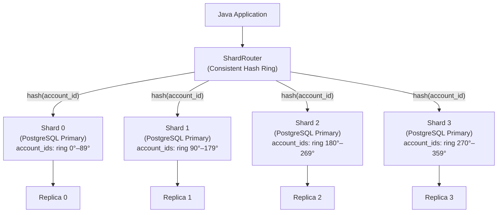

## Overview

A single PostgreSQL primary on modern NVMe hardware can sustain many thousands of write transactions per second — the exact ceiling depends heavily on transaction size, indexes and durability settings — before CPU, WAL throughput, or lock contention becomes the limit. For a payment processor handling tens of thousands of transactions per second at peak, that ceiling arrives faster than the engineering team expects. Vertical scaling buys time — very large machines (hundreds of cores, terabytes of RAM) exist, but they are expensive and still a single point of scale. Horizontal scaling via sharding distributes the data and the write load across many smaller nodes, each of which is cheap, replaceable, and independently scalable.

Sharding is not free. It introduces a routing layer, removes the ability to run arbitrary cross-shard joins, and complicates transactions. This lesson teaches you to make the right trade-offs: when sharding is warranted, how to choose a shard key that avoids hotspots, how to route queries in Java, and how to safely re-shard a live database without downtime.

## Learning Objectives

By the end of this lesson you will be able to:

- Identify the operational signals that indicate a single-node PostgreSQL has reached its scaling ceiling
- Explain the difference between range sharding and consistent-hash sharding and when each is appropriate
- Select a shard key that provides even write distribution and avoids time-based hotspots
- Implement a `ShardRouter` in Java using consistent hashing to route queries to the correct shard
- Design a strategy for cross-shard queries using fan-out and merge
- Plan and execute an online shard split with dual-write to avoid downtime during re-sharding
- Describe how Vitess (MySQL) and Citus (PostgreSQL) automate sharding concerns
- Justify why distributed transactions across shards should be avoided and replaced with Saga patterns

## Business Context

*Composite example:* a retail trading platform sees order volume jump to many times its daily average during a market frenzy. Its database layer, built around a single primary cluster, hits connection and write-throughput limits within the first hour of trading. Order placement starts failing exactly when customers most need to close positions — a direct customer-harm and regulatory problem.

The root cause is not a software bug. It is an architectural assumption: that one primary database node will always have enough headroom. The team has indexes, read replicas, and caching — but no horizontal write-scale strategy. When the surge comes, the write path has nowhere to go.

Sharding the orders and positions tables by account ID would spread those writes across many nodes and remove the single-node ceiling (at the price of the complexity discussed below).

## When to Shard — Recognising the Ceiling

Sharding adds significant operational complexity. It is justified only when you have exhausted the following cheaper options:

| Optimisation | Expected Relief | When Exhausted |
|---|---|---|
| Index tuning | 2–10× query speed | Queries already optimal |
| Connection pooling (PgBouncer) | 3× effective connections | Pool already deployed |
| Read replicas | Offload 60–80% of reads | Writes are the bottleneck |
| Table partitioning | 2–5× on partition-pruned queries | Writes still hit one primary |
| Vertical scaling | 2–4× with larger instance | Cost curve becomes non-linear |
| **Sharding** | Linear write scale | — |

Signals that the primary has hit its ceiling:

```
-- WAL generation rate: sample the WAL position twice and divide by the
-- interval (a single reading is just total WAL since the cluster started)
SELECT pg_current_wal_lsn();          -- e.g. at 12:00:00 -> 1A/2B000000
-- ... 60 seconds later ...
SELECT pg_size_pretty(pg_wal_lsn_diff(pg_current_wal_lsn(), '1A/2B000000') / 60)
       AS wal_per_second;
-- Compare with what your disks, replicas and backups can sustain

-- Check average active connections at peak
SELECT count(*) FROM pg_stat_activity WHERE state = 'active';

-- Check top lock wait events
SELECT wait_event_type, wait_event, count(*)
FROM pg_stat_activity
WHERE wait_event IS NOT NULL
GROUP BY 1, 2
ORDER BY 3 DESC
LIMIT 10;
```

> [!WARNING]
> **Do not shard prematurely.** A well-tuned single PostgreSQL node with read replicas handles the write load of most fintech companies at Series B and C. Add sharding only when profiling confirms that the write path is the irreducible bottleneck.

## Shard Key Selection — The Most Important Decision

The shard key determines how data is distributed across shards. A bad shard key causes hotspots — one shard receives the majority of writes while others sit idle, negating the purpose of sharding entirely.

**Good shard key: `account_id`**

Account IDs (UUID v4 or high-cardinality integer) produce a near-uniform distribution of writes across shards. Watch for exceptions: a few very large accounts (big merchants, corporate treasuries) can still make one shard hot — such accounts may need special handling.

```sql
-- payments distributed by account_id — even distribution
-- With 8 shards and 1 million accounts, each shard serves ~125,000 accounts
SELECT
    -- hashtext() returns a SIGNED 32-bit value: mask off the sign bit,
    -- or "%" yields negative shard numbers
    (hashtext(account_id::text) & 2147483647) % 8 AS shard_id,
    count(*) AS payment_count
FROM payments
GROUP BY 1
ORDER BY 1;

-- Expected output: each shard_id gets ~12.5% of payments
-- shard_id | payment_count
--        0 |       124,891
--        1 |       125,310
--        2 |       124,567
--        3 |       125,102
--  ...
```

**Bad shard key: `created_at`**

Time-based shard keys route all current writes to a single shard — the one containing the current time range. All historical shards are read-only. This recreates the single-node write bottleneck in a more expensive configuration.

```sql
-- Range sharding by date (shown with partition syntax for brevity)
-- — all December 2026 writes go to shard 7
-- Shards 0-6 (older months) receive zero writes — they are cold
-- Shard 7 receives 100% of writes — a severe hotspot
-- This is the worst possible shard key for a write-heavy payment table
CREATE TABLE payments_2026_12 PARTITION OF payments
    FOR VALUES FROM ('2026-12-01') TO ('2027-01-01');
```

| Shard Key Candidate | Distribution | Write Hotspot Risk | Cross-Shard Query Risk |
|---|---|---|---|
| `account_id` (UUID v4) | Uniform | None | Medium (inter-account queries) |
| `merchant_id` | Skewed (large merchants) | High | Medium |
| `created_at` | Sequential | Severe | Low |
| `customer_id` | Uniform (if UUID) | None | Medium |
| `payment_id` (UUID v4) | Uniform | None | High (account balance queries) |

## Range Sharding vs Hash Sharding

**Range sharding** assigns contiguous key ranges to shards. Useful when range queries are common — a payment history query for account IDs 1–1,000,000 hits one shard.

```
Shard 0: account_id  00000000  –  1FFFFFFF
Shard 1: account_id  20000000  –  3FFFFFFF
Shard 2: account_id  40000000  –  5FFFFFFF
Shard 3: account_id  60000000  –  7FFFFFFF
```

**Hash sharding** applies a hash function to the shard key, distributing rows uniformly regardless of key ordering. Range queries require fan-out across all shards, but write distribution is statistically guaranteed to be even.

```
Shard for key k = hash(k) mod N
```

Consistent hashing is the preferred variant: when a shard is added to N existing ones, only about 1/(N+1) of the keys move, instead of almost all of them as with plain `hash mod N`.



## ShardRouter — Java Implementation with Consistent Hashing

```java
import com.google.common.hash.Hashing;
import java.nio.charset.StandardCharsets;
import java.util.*;

/**
 * Routes database operations to the correct shard based on a shard key.
 * Uses consistent hashing so that adding a shard minimises data movement.
 *
 * Thread-safe. The hash ring is immutable after construction.
 */
public class ShardRouter {

    private static final int VIRTUAL_NODES_PER_SHARD = 150;
    private final TreeMap<Long, ShardDataSource> ring = new TreeMap<>();
    private final List<ShardDataSource> shards;

    public ShardRouter(List<ShardDataSource> shards) {
        this.shards = List.copyOf(shards);
        for (ShardDataSource shard : shards) {
            for (int v = 0; v < VIRTUAL_NODES_PER_SHARD; v++) {
                long hash = hash(shard.getShardId() + "-vnode-" + v);
                ring.put(hash, shard);
            }
        }
    }

    /**
     * Returns the DataSource responsible for the given shard key.
     * @param shardKey  typically account_id or customer_id as a String
     */
    public ShardDataSource routeFor(String shardKey) {
        if (ring.isEmpty()) {
            throw new IllegalStateException("Shard ring is empty — no shards configured");
        }
        long keyHash = hash(shardKey);
        Map.Entry<Long, ShardDataSource> entry = ring.ceilingEntry(keyHash);
        if (entry == null) {
            // Wrap around: key is beyond the last virtual node — use the first
            entry = ring.firstEntry();
        }
        return entry.getValue();
    }

    /**
     * Returns all shards — used for fan-out queries that must touch every shard.
     */
    public List<ShardDataSource> allShards() {
        return shards;
    }

    private long hash(String input) {
        return Hashing.murmur3_128()
                      .hashString(input, StandardCharsets.UTF_8)
                      .asLong();
    }
}

// Usage in a payment repository
@Repository
public class ShardedPaymentRepository {

    private final ShardRouter shardRouter;

    public ShardedPaymentRepository(ShardRouter shardRouter) {
        this.shardRouter = shardRouter;
    }

    public void insert(Payment payment) {
        ShardDataSource shard = shardRouter.routeFor(payment.getAccountId().toString());
        shard.jdbcTemplate().update("""
            INSERT INTO payments (id, account_id, amount, currency, status, created_at)
            VALUES (?, ?, ?, ?, ?, ?)
            """,
            payment.getId(),
            payment.getAccountId(),
            payment.getAmount(),
            payment.getCurrency().getCode(),
            payment.getStatus().name(),
            payment.getCreatedAt()
        );
    }

    public Optional<Payment> findById(UUID paymentId, UUID accountId) {
        // accountId is the shard key — always route by it, not by paymentId
        ShardDataSource shard = shardRouter.routeFor(accountId.toString());
        return shard.jdbcTemplate().query("""
            SELECT * FROM payments WHERE id = ? AND account_id = ?
            """,
            PaymentRowMapper.INSTANCE,
            paymentId, accountId
        ).stream().findFirst();
    }
}
```

> [!IMPORTANT]
> **Always include the shard key in every query.** If a query does not include the shard key, the router cannot determine which shard to target and must fan out to all shards — a costly operation. Design your data model so the shard key is always available at query time.

## Cross-Shard Queries — Fan-Out and Merge

Some queries cannot be satisfied by a single shard. The pattern is: issue the query to all shards in parallel, then merge the results in the application layer.

```java
/**
 * Fan-out query: sum all payments for a given merchant across all shards.
 * Used for merchant settlement — merchant_id is not the shard key.
 */
public MerchantSettlementSummary calculateMerchantSettlement(
        UUID merchantId, LocalDate settlementDate) {

    List<CompletableFuture<BigDecimal>> futures = shardRouter.allShards().stream()
        .map(shard -> CompletableFuture.supplyAsync(() ->
            shard.jdbcTemplate().queryForObject("""
                SELECT COALESCE(SUM(amount), 0)
                FROM payments
                WHERE merchant_id = ?
                  AND created_at >= ? AND created_at < ?   -- index-friendly range
                  AND status = 'SETTLED'
                """,
                BigDecimal.class,
                merchantId,
                // settlement day in UTC (DATE(created_at) would depend on the
                // session time zone and prevent index use)
                settlementDate.atStartOfDay(ZoneOffset.UTC).toOffsetDateTime(),
                settlementDate.plusDays(1).atStartOfDay(ZoneOffset.UTC).toOffsetDateTime()
            ), fanOutExecutor
        ))
        .toList();

    BigDecimal total = futures.stream()
        .map(CompletableFuture::join)
        .reduce(BigDecimal.ZERO, BigDecimal::add);

    return new MerchantSettlementSummary(merchantId, settlementDate, total);
}
```

> [!WARNING]
> **Cross-shard queries are expensive.** A fan-out to 16 shards executes 16 database queries and merges results in Java. Avoid them in the hot write path. Use an event-driven analytics store (ClickHouse, Redshift, BigQuery) pre-aggregated by merchant, fed by CDC from the sharded primary — see Lesson 11 (WAL/CDC).

## Online Re-Sharding — Dual-Write Split Strategy

When a shard grows too large, it must be split without downtime. The order of the phases matters: **start capturing new writes before you copy history**, otherwise changes made during the copy are lost.

**Phase 1 — Capture new writes:** from now on, every insert, update and delete for keys that will move is also applied to the new shard — by application dual-write (below) or, more reliably, by change data capture / logical replication from the old shard (Lesson 11).

**Phase 2 — Backfill:** copy the existing rows the new ring assigns to the new shard. With consistent hashing, ownership comes from the ring, not from `hash mod N`, so compute the target shard with the same router code (or a SQL function implementing the same hash) and copy with an upsert, so rows already written by Phase 1 are not overwritten with older data.

```sql
-- On the new shard (shard_4), reading shard_3 through postgres_fdw
-- (or an export/import): copy only rows the NEW ring assigns to shard_4
INSERT INTO payments
SELECT * FROM shard_3_fdw.payments p
WHERE new_ring_owner(p.account_id) = 'shard_4'   -- same hash as the router
ON CONFLICT (id) DO NOTHING;                     -- keep newer dual-written rows
```

**Dual-write sketch** (application-level; every write path, including updates and deletes, must do this):

```java
// During the split window: dual-write
public void insert(Payment payment) {
    String key = payment.getAccountId().toString();
    ShardDataSource primary = shardRouter.routeFor(key);
    primary.jdbcTemplate().update(INSERT_SQL, /* params */);

    // If this key belongs to the shard being split, also write to new shard
    if (splitConfig.isInSplitRange(key)) {
        ShardDataSource newShard = shardRouter.newShardFor(key);
        newShard.jdbcTemplate().update(INSERT_SQL, /* params */);
    }
}
```

Plain dual-write has a weakness: if the second write fails, the shards diverge. Record failures and repair them, or prefer CDC, which replays the old shard's committed changes in order.

**Phase 3 — Verify:** compare row counts and checksums per key range between the old and new shard.

**Phase 4 — Cut over:** switch the router so the moved keys read and write only on the new shard; stop dual-writing.

**Phase 5 — Clean up:** after a safety period, delete the moved rows from the old shard.

## Vitess and Citus — Managed Sharding Layers

**Vitess** is the sharding proxy built by YouTube and used by GitHub and Slack. It sits between the application and MySQL shards, handling routing, resharding, and connection multiplexing transparently.

**Citus** is a PostgreSQL extension that transforms a single PostgreSQL instance into a sharding coordinator. Tables are declared as distributed, and Citus handles routing, parallelising queries across worker nodes.

```sql
-- Citus: declare payments as a distributed table, sharded by account_id
SELECT create_distributed_table('payments', 'account_id');

-- Citus handles routing transparently — this INSERT goes to the right shard
INSERT INTO payments (id, account_id, amount) VALUES (gen_random_uuid(), $1, $2);

-- Aggregation across shards: Citus executes in parallel and merges
SELECT account_id, SUM(amount) FROM payments GROUP BY account_id;
```

> [!NOTE]
> **Shard count planning:** over-shard initially. With 8 machines today and 32 projected at 5× growth, create 32 logical shards from day one, with each machine hosting 4 of them. As load grows, move whole logical shards to new machines — this copies a shard as a unit, but never re-splits or re-hashes keys. Under-sharding forces a painful re-shard under production load.

## Distributed Transactions — Why to Avoid Them

A transfer that debits the payer's account on shard 2 and credits the payee's account on shard 7 requires a cross-shard operation. Two-phase commit (2PC) is technically possible but introduces:

- **Availability risk:** if the coordinator crashes after prepare but before commit, the prepared transactions keep their locks until someone resolves them
- **Latency:** 2PC adds two round trips — prepare and commit — to every transaction
- **Operational complexity:** in-doubt transactions require manual intervention

The correct alternative is the Saga pattern: decompose the cross-shard operation into a sequence of single-shard transactions, each with a compensating rollback action. The Saga coordinator is a service, not a database protocol. See Track 05, Lesson 14.

```java
// Cross-shard transfer: debit payer (shard A) + credit payee (shard B)
// Use a Saga — not 2PC
public PaymentResult processTransfer(TransferRequest req) {
    // Step 1 (shard A, one local transaction): debit the payer and post the
    //         amount to an "in-flight" clearing account, so the books always
    //         balance while the money is between shards
    // Step 2 (shard B): credit the payee, idempotent by transfer id
    // If step 2 fails permanently: compensating step on shard A moves the
    //         amount from the clearing account back to the payer
    // (Audit entries belong in the SAME local transaction as each step, or
    //  in an outbox -- not in a separate saga step.)
    return sagaOrchestrator.execute(
        new DebitToClearingStep(req.getPayerAccountId(), req.getAmount(), req.getTransferId()),
        new CreditFromClearingStep(req.getPayeeAccountId(), req.getAmount(), req.getTransferId())
    );
}
```

## Knowledge Check

**Q1: Your payments table has account_id (UUID v4) and merchant_id. You shard by account_id. A query asks for all payments made to a specific merchant yesterday. How does this execute?**

**A1:** Because merchant_id is not the shard key, the router cannot direct this query to a single shard. It must fan-out the query to all shards in parallel (each receiving `WHERE merchant_id = ? AND created_at >= ?`), collect the results from all shards, and merge them in the application layer. This is expensive at high shard counts. The recommended solution is to maintain a secondary materialised view (or an OLAP store such as ClickHouse) keyed by merchant_id, populated asynchronously via CDC from the sharded primaries. The settlement calculation becomes a fast single-node query against the analytics store rather than a fan-out against all production shards.

**Q2: Your team proposes sharding by `created_at` (month) so that old data can be archived shard by shard. What is the critical flaw and what alternative achieves the archival goal without it?**

**A2:** Time-based sharding routes 100% of current writes to the single "current month" shard, recreating the single-node write bottleneck in a more expensive configuration. The correct approach is to shard by `account_id` (hash sharding for even write distribution) and implement per-shard time-based table partitioning within each shard. This keeps writes evenly distributed while enabling partition-level archival: an old month's partition on each shard can be detached and moved to cold storage independently, with no impact on write throughput.

## Practical Challenge

**Scenario:** You are the principal engineer at a payment processor expecting to grow from 5,000 to 80,000 writes per second over the next 18 months. Your current single-node PostgreSQL is at 70% write capacity.

1. **Shard key analysis:** your `payments` table has columns `payment_id UUID`, `account_id UUID`, `merchant_id UUID`, `amount NUMERIC`, `created_at TIMESTAMPTZ`. Evaluate each column as a potential shard key: state the write distribution quality, the cross-shard query risk, and your final recommendation with justification.

2. **ShardRouter implementation:** implement the `ShardRouter` class from this lesson with a `routeFor(String shardKey)` method. Write a JUnit 5 test that verifies: (a) the same key always routes to the same shard, (b) keys distribute approximately evenly across 8 shards (within 15% of ideal), and (c) adding a 9th shard moves fewer than 15% of keys (consistent hashing property).

3. **Re-sharding plan:** your 8-shard cluster must grow to 16 shards. Write a step-by-step operational runbook: start capturing writes, backfill SQL, dual-write Java code, verification query (checksum comparison between old and new shard), and cut-over procedure. Include rollback steps for each phase.

4. **Cross-shard merchant settlement:** implement a `MerchantSettlementService.calculateDailySettlement(UUID merchantId, LocalDate date)` method that fans out to all shards in parallel using `CompletableFuture`, merges the totals, and handles partial shard failures gracefully (log and continue with available data, flagging the result as incomplete).

<!-- KNOWLEDGE-CHECK
{
  "questions": [
    {
      "text": "A payment platform shards its payments table by account_id (UUID v4). A merchant settlement query needs the total amount paid to merchant_id = X yesterday. How does this query execute in the sharded system?",
      "options": [
        "It routes directly to the shard containing merchant_id X",
        "It fans out to all shards in parallel, each executing the WHERE merchant_id = ? filter, and results are merged in the application layer",
        "It fails because merchant_id is not the shard key",
        "It uses a global index to identify which shard holds merchant X's payments"
      ],
      "correct": 1,
      "explanation": "Because merchant_id is not the shard key, the router cannot determine which shard(s) contain payments for a given merchant. The query must fan out to all shards in parallel. Each shard filters locally and returns its partial total. The application layer merges these into the final settlement amount."
    },
    {
      "text": "What is the fundamental problem with using created_at (timestamp) as a shard key for a write-heavy payments table?",
      "options": [
        "Timestamps have insufficient cardinality for even distribution",
        "All current writes route to the single shard covering the current time range, creating a severe write hotspot while all other shards receive zero writes",
        "Range queries become impossible across time boundaries",
        "Consistent hashing cannot be applied to timestamp values"
      ],
      "correct": 1,
      "explanation": "Time-based shard keys create temporal hotspots: 100% of current writes go to the shard containing the current timestamp range. All historical shards become read-only cold storage. This defeats the purpose of sharding, which is to distribute write load. Use account_id (UUID v4) for uniform write distribution."
    },
    {
      "text": "During a shard split (8 shards → 16 shards), what is the purpose of the dual-write phase?",
      "options": [
        "To create a backup of the original shard data",
        "To verify that the new shard's data matches the original shard before cutover",
        "To write new records to both the original shard and the new shard simultaneously, ensuring the new shard stays current while historical data is being seeded",
        "To test the routing logic without affecting production traffic"
      ],
      "correct": 2,
      "explanation": "During a shard split, the new shard needs both historical data (backfilled by bulk copy) and every write that happens during the migration. Dual-write (or CDC) keeps the new shard in step with the original; it must START BEFORE the backfill, and the backfill must not overwrite newer rows (upsert), or changes made during the copy are lost. Once the new shard is verified, the router sends the moved keys only to the new shard and dual-writing stops."
    }
  ]
}
-->

<!-- PRACTICAL-CHALLENGE
{
  "title": "Build a Production-Grade Sharded Payment Repository",
  "difficulty": "advanced",
  "estimatedMinutes": 45,
  "tasks": [
    {
      "id": "1",
      "description": "Implement the ShardRouter class using consistent hashing with 150 virtual nodes per shard. Write JUnit 5 tests verifying: (a) the same key always routes to the same shard across 10,000 calls, (b) 1 million random UUIDs distribute within 15% of ideal across 8 shards, and (c) adding a 9th shard moves fewer than 15% of keys from their original shard assignment."
    },
    {
      "id": "2",
      "description": "Implement ShardedPaymentRepository with insert(Payment) and findById(UUID paymentId, UUID accountId) methods. The findById method must route by accountId (the shard key), not paymentId. Write a test that inserts 1,000 payments across 8 shards and verifies each can be retrieved using its accountId."
    },
    {
      "id": "3",
      "description": "Implement MerchantSettlementService.calculateDailySettlement(UUID merchantId, LocalDate date) using CompletableFuture to fan out to all shards in parallel. The method must handle individual shard failures gracefully: log the error, mark the result as INCOMPLETE, and return the partial sum from available shards rather than failing the entire request."
    },
    {
      "id": "4",
      "description": "Design and document a re-sharding runbook for splitting shard 3 of an 8-shard cluster into two shards (creating shard 8). Include: (a) starting write capture (dual-write or CDC) before any copying, (b) SQL to backfill shard 8 with the rows the new ring assigns to it (upsert), (c) the dual-write Java code that detects which keys are in the split range, (d) a checksum verification query comparing rows between old and new shards, and (e) rollback steps for each phase if inconsistency is detected."
    }
  ]
}
-->
