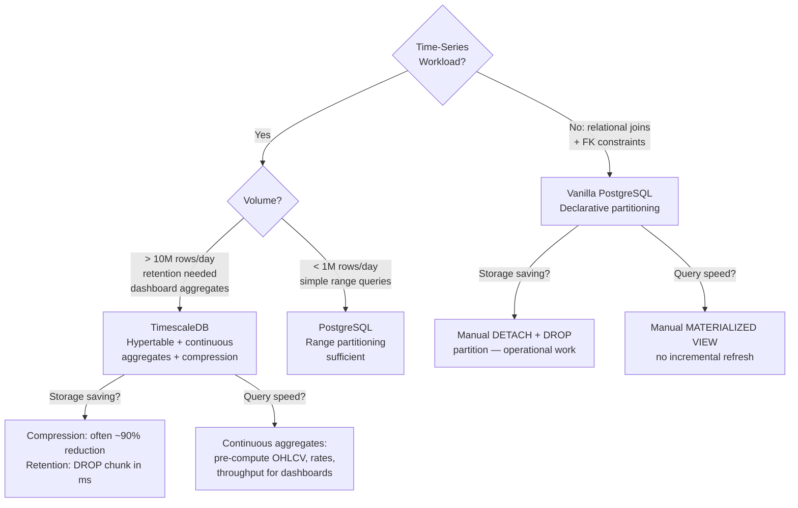

# بيانات السلاسل الزمنية — TimescaleDB والجداول الفائقة

تولّد منصات التقنية المالية كميات هائلة من البيانات المرتبة زمنيًا: مقاييس إنتاجية المدفوعات المأخوذة كل ثانية، وبيانات الشموع OHLCV لكل زوج عملات، وسلاسل درجات الاحتيال الزمنية لكل حساب، ومقاييس صحة الأنظمة المرتبطة بأحداث العمل. ويستطيع PostgreSQL العادي تخزين هذه البيانات، لكنه على نطاق واسع يحتاج عملًا يدويًا كثيرًا (أقسام، وتجميعات، ومهام احتفاظ). ويؤتمت TimescaleDB — امتداد لـ PostgreSQL — هذا العمل ويضيف ميزات السلاسل الزمنية دون التضحية بتوافق SQL أو ضمانات ACID.

> [!NOTE]
> نواة TimescaleDB ‏(الجداول الفائقة، و`time_bucket`) مرخصة بـ Apache-2.0؛ أما الضغط، والتجميعات المستمرة، وملء الفجوات، والسياسات فتخضع لترخيص Timescale ‏(مجاني للاستضافة الذاتية، لكن بعض مزودي السحابة يقدمون مجموعة Apache فقط — تحقق قبل أن تبني تصميمك عليها). وتعيد الإصدارات الحديثة أيضًا تسمية الضغط إلى "columnstore" ‏(`add_columnstore_policy`، إلخ)؛ وما زالت أسماء الدوال الأقدم المستخدمة أدناه تعمل.

---

## 1. خصائص السلاسل الزمنية

فهم ما يجعل بيانات السلاسل الزمنية مختلفة عن البيانات العلائقية العادية أساسي قبل اختيار استراتيجية التخزين.

| الخاصية | الوصف | الأثر |
|----------------|-------------|-------------|
| إلحاق في الغالب | الصفوف الجديدة لا تُحدَّث تقريبًا أبدًا | يمكن تحسين مسار الكتابة للإلحاقات المتتابعة |
| استعلامات مرتبة زمنيًا | كل استعلام تقريبًا يرشّح حسب نطاق زمني | الزمن دائمًا المرشح الأول |
| تعدد عالٍ | ملايين السلاسل الفريدة (واحدة لكل حساب، أو أداة، أو خدمة) | يجب أن تكون الفهارس فعالة على الزمن + مفتاح السلسلة |
| بؤرة البيانات الحديثة | 90% من الاستعلامات تلمس آخر 7 أيام | يجب أن تبقى الأجزاء الحديثة في الذاكرة |
| التجميع الجماعي | لوحات المعلومات تجمّع ملايين الصفوف | التجميعات المُجسّدة أساسية |
| احتفاظ محدود | قيمة البيانات القديمة تتناقص ويجب حذفها | سياسات الاحتفاظ الآلية مطلوبة |

### 1.1 لماذا يعاني PostgreSQL العادي

```sql
-- Without TimescaleDB: a vanilla payments_metrics table
CREATE TABLE payments_metrics (
    recorded_at   TIMESTAMPTZ NOT NULL,
    service       VARCHAR(50) NOT NULL,
    metric_name   VARCHAR(50) NOT NULL,
    value         DOUBLE PRECISION NOT NULL
);

CREATE INDEX idx_payments_metrics_time ON payments_metrics (recorded_at DESC);

-- After months of ingestion at thousands of rows/second, one table holds
-- billions of rows (hundreds of GB to TBs):
-- Secondary indexes such as (service, recorded_at) no longer fit in memory,
--   so every INSERT causes random I/O
-- VACUUM / anti-wraparound freezing must process the whole huge table
-- Dropping old data with DELETE is slow, writes huge amounts of WAL and
--   leaves bloat behind
-- Every dashboard aggregates billions of raw rows again and again
```

---

## 2. الجداول الفائقة في TimescaleDB

الجدول الفائق (hypertable) تجريد في TimescaleDB يبدو كجدول PostgreSQL عادي لكنه مقسّم داخليًا إلى **أجزاء (chunks)** على امتداد البعد الزمني تلقائيًا.

### 2.1 إنشاء جدول فائق

```sql
-- Install TimescaleDB extension
CREATE EXTENSION IF NOT EXISTS timescaledb;

-- Step 1: Create a standard PostgreSQL table
CREATE TABLE payment_throughput (
    recorded_at    TIMESTAMPTZ     NOT NULL,
    service_name   VARCHAR(50)     NOT NULL,
    region         VARCHAR(20)     NOT NULL,
    payments_count INTEGER         NOT NULL DEFAULT 0,
    total_amount   BIGINT          NOT NULL DEFAULT 0,  -- minor units
    error_count    INTEGER         NOT NULL DEFAULT 0,
    p50_latency_ms DOUBLE PRECISION,
    p99_latency_ms DOUBLE PRECISION
);

-- Step 2: Convert to a hypertable with 7-day chunks
-- TimescaleDB automatically creates a new partition (chunk) every 7 days
SELECT create_hypertable(
    'payment_throughput',   -- table name
    'recorded_at',          -- time column
    chunk_time_interval => INTERVAL '7 days'
);

-- Step 3: Create indexes on the hypertable
-- TimescaleDB creates one index per chunk — these are small and fast
CREATE INDEX idx_pt_service_time
    ON payment_throughput (service_name, recorded_at DESC);

CREATE INDEX idx_pt_region_time
    ON payment_throughput (region, recorded_at DESC);
```

### 2.2 الإنشاء التلقائي للأجزاء

```sql
-- TimescaleDB creates chunks automatically as data is inserted
-- Each chunk covers a 7-day time range

-- Inspect existing chunks
-- (sizes come from chunks_detailed_size(); the chunks view has no sizes)
SELECT
    c.chunk_name,
    c.range_start,
    c.range_end,
    c.is_compressed,
    s.total_bytes / (1024*1024) AS size_mb
FROM timescaledb_information.chunks c
JOIN chunks_detailed_size('payment_throughput') s
  ON s.chunk_schema = c.chunk_schema AND s.chunk_name = c.chunk_name
ORDER BY c.range_start DESC;

/*
chunk_name        | range_start          | range_end            | is_compressed | size_mb
_hyper_1_8_chunk  | 2024-01-29 00:00:00 | 2024-02-05 00:00:00 | false         | 450
_hyper_1_7_chunk  | 2024-01-22 00:00:00 | 2024-01-29 00:00:00 | true          | 45
_hyper_1_6_chunk  | 2024-01-15 00:00:00 | 2024-01-22 00:00:00 | true          | 43
*/

-- The most recent chunk is uncompressed (hot, ideally in memory)
-- Older chunks are compressed (here ~10:1)

-- TimescaleDB query planner automatically uses the right chunk(s)
EXPLAIN (ANALYZE)
SELECT * FROM payment_throughput
WHERE recorded_at > NOW() - INTERVAL '1 hour'
  AND service_name = 'payment-processor';
-- Scans only the current 7-day chunk — not the entire table
```

### 2.3 تحجيم فترة الجزء

```sql
-- Choosing chunk_time_interval:
-- Rule of thumb: the recent (uncompressed) chunks of all busy hypertables,
-- including their indexes, fit in ~25% of available RAM
-- Payment metrics at 1,000 rows/second, each row ~200 bytes:
-- Rows per 7 days = 1,000 * 86,400 * 7 = 604,800,000 rows
-- Chunk size = 604,800,000 * 200 bytes = ~115 GB — too large!

-- For 32 GB RAM, target chunk size = 8 GB
-- 8 GB / 200 bytes = 40,000,000 rows
-- 40,000,000 / 86,400 seconds/day / 1,000 rows/second = 0.46 days

-- 12-hour chunks: 1,000 * 43,200 * 200 bytes = ~8.6 GB -- close to target
-- (use 6 hours for more margin; a 1-day chunk would be ~17 GB)
SELECT create_hypertable(
    'payment_throughput_hf',  -- high-frequency table, same columns
    'recorded_at',
    chunk_time_interval => INTERVAL '12 hours'
);

-- Check current chunk sizes
SELECT
    c.chunk_name,
    pg_size_pretty(s.total_bytes) AS total_size
FROM timescaledb_information.chunks c
JOIN chunks_detailed_size('payment_throughput_hf') s
  ON s.chunk_schema = c.chunk_schema AND s.chunk_name = c.chunk_name
ORDER BY c.range_start DESC
LIMIT 5;
```

---

## 3. ‏time_bucket() للتجميع

‏`time_bucket()` هو مكافئ TimescaleDB لـ `date_trunc()` لكنه أكثر مرونة — فهو يدعم عروض فترات اعتباطية مثل 5 أو 15 دقيقة. (ولـ PostgreSQL 14+ العادي دالة مشابهة `date_bin()`.)

```sql
-- Payments per minute for the last hour
SELECT
    time_bucket('1 minute', recorded_at) AS bucket,
    SUM(payments_count)                  AS total_payments,
    SUM(error_count)                     AS total_errors,
    AVG(p99_latency_ms)                  AS avg_p99_ms
FROM payment_throughput
WHERE recorded_at > NOW() - INTERVAL '1 hour'
GROUP BY bucket
ORDER BY bucket;

-- 5-minute buckets with error rate
SELECT
    time_bucket('5 minutes', recorded_at) AS bucket,
    service_name,
    SUM(payments_count)                   AS payments,
    SUM(error_count)                      AS errors,
    ROUND(
        100.0 * SUM(error_count) / NULLIF(SUM(payments_count), 0),
        2
    )                                     AS error_rate_pct
FROM payment_throughput
WHERE recorded_at BETWEEN '2024-01-15 09:00' AND '2024-01-15 17:00'
GROUP BY bucket, service_name
ORDER BY bucket, service_name;

-- Hourly totals with time_bucket for the last 24 hours
SELECT
    time_bucket('1 hour', recorded_at)   AS hour,
    region,
    SUM(payments_count)                  AS payments_per_hour,
    SUM(total_amount) / 100.0            AS total_volume_gbp
FROM payment_throughput
WHERE recorded_at > NOW() - INTERVAL '24 hours'
GROUP BY hour, region
ORDER BY hour DESC, region;
```

---

## 4. التجميعات المستمرة — بيانات الشموع OHLCV

التجميعات المستمرة (continuous aggregates) عروض مُجسّدة يبقيها TimescaleDB محدّثة تدريجيًا مع وصول بيانات جديدة. وهي أساسية للوحات المعلومات والتقارير.

### 4.1 سلسلة أسعار صرف خام

```sql
-- Raw tick data: every FX rate quote from liquidity providers
CREATE TABLE fx_rates (
    quoted_at  TIMESTAMPTZ     NOT NULL,
    pair       VARCHAR(7)      NOT NULL,  -- 'EUR/USD', 'GBP/USD', etc.
    provider   VARCHAR(30)     NOT NULL,
    bid        NUMERIC(16, 6)  NOT NULL,
    ask        NUMERIC(16, 6)  NOT NULL,
    mid        NUMERIC(16, 6)  NOT NULL
);

SELECT create_hypertable('fx_rates', 'quoted_at',
    chunk_time_interval => INTERVAL '1 day');

CREATE INDEX idx_fx_rates_pair_time
    ON fx_rates (pair, quoted_at DESC);
```

### 4.2 تجميع OHLCV مستمر

```sql
-- 1-minute OHLCV candlesticks computed from tick data
CREATE MATERIALIZED VIEW fx_ohlcv_1m
WITH (timescaledb.continuous) AS
SELECT
    time_bucket('1 minute', quoted_at)   AS bucket,
    pair,
    FIRST(mid, quoted_at)                AS open,
    MAX(mid)                             AS high,
    MIN(mid)                             AS low,
    LAST(mid, quoted_at)                 AS close,
    COUNT(*)                             AS tick_count,
    AVG(ask - bid)                       AS avg_spread
FROM fx_rates
GROUP BY bucket, pair
WITH NO DATA;  -- Populate on-demand, not at creation time

-- Configure refresh policy: every minute, re-materialize the window from
-- 10 minutes ago to 1 minute ago (ticks arriving later than 10 minutes
-- are only picked up by a manual refresh)
SELECT add_continuous_aggregate_policy(
    'fx_ohlcv_1m',
    start_offset  => INTERVAL '10 minutes',
    end_offset    => INTERVAL '1 minute',
    schedule_interval => INTERVAL '1 minute'
);

-- Backfill historical data
CALL refresh_continuous_aggregate('fx_ohlcv_1m',
    '2024-01-01', '2024-01-15');

-- Query the materialized view — extremely fast (pre-aggregated)
SELECT
    bucket,
    open,
    high,
    low,
    close,
    tick_count
FROM fx_ohlcv_1m
WHERE pair = 'EUR/USD'
  AND bucket > NOW() - INTERVAL '1 hour'
ORDER BY bucket;
```

### 4.3 التجميعات المستمرة الهرمية

يدعم TimescaleDB 2.9+ إنشاء تجميعات مستمرة فوق تجميعات مستمرة أخرى:

```sql
-- 1-hour OHLCV built from 1-minute OHLCV (not from raw tick data)
CREATE MATERIALIZED VIEW fx_ohlcv_1h
WITH (timescaledb.continuous) AS
SELECT
    time_bucket('1 hour', bucket)        AS bucket,
    pair,
    FIRST(open, bucket)                  AS open,
    MAX(high)                            AS high,
    MIN(low)                             AS low,
    LAST(close, bucket)                  AS close,
    SUM(tick_count)                      AS tick_count
FROM fx_ohlcv_1m
GROUP BY time_bucket('1 hour', bucket), pair
WITH NO DATA;

SELECT add_continuous_aggregate_policy(
    'fx_ohlcv_1h',
    start_offset  => INTERVAL '2 hours',
    end_offset    => INTERVAL '1 hour',
    schedule_interval => INTERVAL '1 hour'
);
```

---

## 5. ‏time_bucket_gapfill() مع locf()

للسلاسل الزمنية الواقعية فجوات: فقد لا يشهد زوج عملات أي صفقات لمدة 3 دقائق في ساعات السيولة المنخفضة. وتملأ `time_bucket_gapfill` الفجوات؛ وتملأ `locf` ‏(حمل آخر ملاحظة إلى الأمام) القيم المفقودة.

```sql
-- Without gapfill: missing buckets are absent from result
SELECT
    time_bucket('1 minute', quoted_at) AS bucket,
    LAST(mid, quoted_at)               AS last_mid
FROM fx_rates
WHERE pair = 'EUR/USD'
  AND quoted_at > NOW() - INTERVAL '1 hour'
GROUP BY bucket
ORDER BY bucket;
-- Some minutes may be missing if no ticks arrived

-- With gapfill + locf: all 60 buckets present, missing filled with last known value
SELECT
    time_bucket_gapfill(
        '1 minute',
        quoted_at,
        start  => NOW() - INTERVAL '1 hour',
        finish => NOW()
    )                                AS bucket,
    pair,
    locf(LAST(mid, quoted_at))       AS mid_price,
    locf(LAST(bid, quoted_at))       AS bid_price,
    locf(LAST(ask, quoted_at))       AS ask_price,
    COUNT(*)                         AS tick_count  -- NULL for filled gaps
FROM fx_rates
WHERE pair = 'EUR/USD'
  AND quoted_at > NOW() - INTERVAL '1 hour'
GROUP BY bucket, pair
ORDER BY bucket;

-- interpolate(): linear interpolation instead of LOCF
SELECT
    time_bucket_gapfill('5 minutes', recorded_at) AS bucket,
    service_name,
    interpolate(AVG(p99_latency_ms))              AS p99_ms_interpolated
FROM payment_throughput
WHERE recorded_at > NOW() - INTERVAL '6 hours'
GROUP BY bucket, service_name
ORDER BY bucket;
```

---

## 6. سياسة الضغط

تُستعلم بيانات السلاسل الزمنية الأقدم بتكرار أقل بكثير. والضغط العمودي الأصلي في TimescaleDB على الأجزاء الباردة كثيرًا ما يقلل التخزين بنسبة 90% أو أكثر (يعتمد على البيانات).

```sql
-- Enable compression on the hypertable
-- orderby: controls how data is sorted within a compressed segment
-- segmentby: creates one segment per unique value — critical for
--            query performance: TimescaleDB can skip entire segments
ALTER TABLE payment_throughput SET (
    timescaledb.compress,
    timescaledb.compress_orderby   = 'recorded_at DESC',
    timescaledb.compress_segmentby = 'service_name, region'
);

-- Add a compression policy: compress chunks older than 7 days
SELECT add_compression_policy(
    'payment_throughput',
    compress_after => INTERVAL '7 days'
);

-- Verify compression status and savings
SELECT
    chunk_name,
    before_compression_total_bytes / (1024*1024)  AS before_mb,
    after_compression_total_bytes  / (1024*1024)  AS after_mb,
    ROUND(
        100.0 * (1 - after_compression_total_bytes::float /
                     before_compression_total_bytes),
        1
    )                                              AS compression_pct
FROM chunk_compression_stats('payment_throughput')
ORDER BY chunk_name;

/*
chunk_name  | before_mb | after_mb | compression_pct
_hyper_1_1  |       450 |       42 |            90.7
_hyper_1_2  |       448 |       41 |            90.8
*/

-- Manually compress a specific chunk (for immediate space recovery)
SELECT compress_chunk(
    '_timescaledb_internal._hyper_1_3_chunk'
);

-- Decompress, e.g. before a LARGE backfill into an old range.
-- (Small writes need no manual step: INSERT into compressed chunks works
--  since TimescaleDB 2.3, UPDATE/DELETE since 2.11.)
SELECT decompress_chunk(
    '_timescaledb_internal._hyper_1_3_chunk'
);
```

---

## 7. سياسة الاحتفاظ

```sql
-- Drop chunks older than 90 days automatically
-- This is a metadata operation (DROP TABLE on a chunk) — nearly instantaneous
-- Compare: DELETE on 500 GB would take hours and generate massive WAL
SELECT add_retention_policy(
    'payment_throughput',
    drop_after => INTERVAL '90 days'
);

-- For the OHLCV continuous aggregate, keep summarized data longer.
-- Careful: if a cagg refresh window ever covers a range whose raw data was
-- already dropped, the refresh would delete those aggregates -- keep the
-- refresh start_offset well inside the raw retention period.
SELECT add_retention_policy(
    'fx_ohlcv_1m',
    drop_after => INTERVAL '1 year'
);

SELECT add_retention_policy(
    'fx_ohlcv_1h',
    drop_after => INTERVAL '5 years'
);

-- View all scheduled jobs (compression + retention policies)
SELECT
    j.job_id,
    j.application_name,
    j.schedule_interval,
    js.next_start,
    js.last_run_status,
    js.last_run_duration
FROM timescaledb_information.jobs j
LEFT JOIN timescaledb_information.job_stats js USING (job_id)
ORDER BY j.job_id;

-- Manual retention execution (useful for immediate cleanup)
SELECT drop_chunks('payment_throughput', older_than => INTERVAL '90 days');

-- View chunk boundaries before dropping (dry run)
SELECT
    c.chunk_name,
    c.range_start,
    c.range_end,
    pg_size_pretty(s.total_bytes) AS size
FROM timescaledb_information.chunks c
JOIN chunks_detailed_size('payment_throughput') s
  ON s.chunk_schema = c.chunk_schema AND s.chunk_name = c.chunk_name
WHERE c.range_end < NOW() - INTERVAL '90 days'
ORDER BY c.range_end;
```

---

## 8. مثال مراقبة إنتاجية المدفوعات

تنفيذ كامل لمراقبة معدلات معالجة المدفوعات في منصة تقنية مالية.

```sql
-- Metric collection table (1-second resolution)
CREATE TABLE payment_metrics_raw (
    recorded_at    TIMESTAMPTZ     NOT NULL,
    service        VARCHAR(50)     NOT NULL,
    region         VARCHAR(20)     NOT NULL,
    metric         VARCHAR(50)     NOT NULL,
    value          DOUBLE PRECISION NOT NULL
);

SELECT create_hypertable('payment_metrics_raw', 'recorded_at',
    chunk_time_interval => INTERVAL '1 day');

ALTER TABLE payment_metrics_raw SET (
    timescaledb.compress,
    timescaledb.compress_orderby   = 'recorded_at DESC',
    timescaledb.compress_segmentby = 'service, metric'
);

SELECT add_compression_policy('payment_metrics_raw',
    compress_after => INTERVAL '3 days');
SELECT add_retention_policy('payment_metrics_raw',
    drop_after => INTERVAL '30 days');

-- 1-minute pre-aggregated view for dashboards
CREATE MATERIALIZED VIEW payment_metrics_1m
WITH (timescaledb.continuous) AS
SELECT
    time_bucket('1 minute', recorded_at) AS bucket,
    service,
    region,
    metric,
    AVG(value)   AS avg_value,
    MIN(value)   AS min_value,
    MAX(value)   AS max_value,
    COUNT(*)     AS sample_count
FROM payment_metrics_raw
GROUP BY time_bucket('1 minute', recorded_at), service, region, metric
WITH NO DATA;

SELECT add_continuous_aggregate_policy('payment_metrics_1m',
    start_offset      => INTERVAL '5 minutes',
    end_offset        => INTERVAL '1 minute',
    schedule_interval => INTERVAL '1 minute');

-- Dashboard query: payment success rate over last 24 hours
WITH success_rate AS (
    SELECT
        bucket,
        service,
        MAX(CASE WHEN metric = 'payments_succeeded' THEN avg_value ELSE 0 END) AS succeeded,
        MAX(CASE WHEN metric = 'payments_failed'    THEN avg_value ELSE 0 END) AS failed
    FROM payment_metrics_1m
    WHERE bucket > NOW() - INTERVAL '24 hours'
      AND metric IN ('payments_succeeded', 'payments_failed')
    GROUP BY bucket, service
)
SELECT
    bucket,
    service,
    succeeded,
    failed,
    ROUND(
        100.0 * succeeded / NULLIF(succeeded + failed, 0),
        2
    ) AS success_rate_pct
FROM success_rate
ORDER BY bucket DESC, service;
```

---

## 9. التجميع الفوري: تجميع مستمر + بيانات حية

للتجميعات المستمرة تأخر صغير (الـ `end_offset`). وللحصول على بيانات فورية حقًا، اجمع العرض المُجسّد مع استعلام على الجدول الخام لأحدث البيانات.

```sql
-- Real-time query: combines pre-aggregated data + live tail
-- (TimescaleDB calls this "real-time aggregation")

-- Enable real-time aggregation. It is OFF by default for continuous
-- aggregates created on TimescaleDB 2.13+ (it was ON in older 2.x versions)
ALTER MATERIALIZED VIEW fx_ohlcv_1m
SET (timescaledb.materialized_only = false);
-- Now queries against fx_ohlcv_1m automatically combine:
-- 1. Pre-computed data from the materialized layer
-- 2. Live aggregation of raw fx_rates rows newer than the last
--    materialized bucket (the "watermark")

-- The query below returns all data including the last 60 seconds
-- without any application-side stitching
SELECT
    bucket,
    open, high, low, close,
    tick_count
FROM fx_ohlcv_1m
WHERE pair = 'EUR/USD'
  AND bucket > NOW() - INTERVAL '1 hour'
ORDER BY bucket;
```

---

## 10. ‏TimescaleDB مقابل التقسيم في PostgreSQL العادي



| الميزة | TimescaleDB | التقسيم في PostgreSQL العادي |
|---------|------------|--------------------------------|
| إنشاء الأجزاء | تلقائي | يدوي (أو pg_partman) |
| الضغط | عمودي أصلي، كثيرًا ما يبلغ ~90% | ضغط TOAST للقيم الكبيرة فقط (pglz/lz4)؛ لا ضغط عمودي |
| الاحتفاظ | ‏`add_retention_policy` — سطر واحد | ‏DETACH + DROP — سكربت تشغيلي |
| التجميعات التدريجية | ‏`CREATE MATERIALIZED VIEW ... continuous` | تحديث كامل فقط (`REFRESH MATERIALIZED VIEW`) |
| ملء الفجوات | ‏`time_bucket_gapfill + locf` | ‏`generate_series` + LEFT JOIN، مكتوب يدويًا |
| توافق SQL | 100% — إنه PostgreSQL | 100% |
| الخدمة السحابية المُدارة | سحابة Timescale الخاصة أو استضافة ذاتية؛ بعض المزودين يقدمون مجموعة Apache فقط، وAmazon RDS مثلًا لا يقدمه | متاح في كل مكان |

---

## 11. مزالق الإنتاج

### المزلق 1: عدم استخدام التجميعات المستمرة — استعلامات لوحات المعلومات تمسح البيانات الخام

```sql
-- WRONG — dashboard query scans raw tick data every time
-- At 10,000 ticks/second for 30 days: 25,920,000,000 rows
SELECT
    time_bucket('1 hour', quoted_at) AS hour,
    pair,
    FIRST(mid, quoted_at)            AS open,
    MAX(mid)                         AS high,
    MIN(mid)                         AS low,
    LAST(mid, quoted_at)             AS close
FROM fx_rates  -- 25 billion rows!
WHERE quoted_at > NOW() - INTERVAL '30 days'
GROUP BY hour, pair;
-- Runtime: 45 minutes (even with hypertable chunk pruning)
-- Causes: high I/O, high CPU, dashboard timeouts

-- CORRECT — pre-aggregate with continuous aggregate
-- Query runs in <100ms
SELECT bucket, pair, open, high, low, close
FROM fx_ohlcv_1h  -- pre-aggregated, only 720 rows per pair for 30 days
WHERE bucket > NOW() - INTERVAL '30 days'
ORDER BY bucket, pair;

-- If you need a timeframe not covered by existing aggregates:
-- Create a new continuous aggregate at the right granularity
CREATE MATERIALIZED VIEW fx_ohlcv_4h
WITH (timescaledb.continuous) AS
SELECT
    time_bucket('4 hours', bucket) AS bucket,
    pair,
    FIRST(open, bucket)             AS open,
    MAX(high)                       AS high,
    MIN(low)                        AS low,
    LAST(close, bucket)             AS close,
    SUM(tick_count)                 AS tick_count
FROM fx_ohlcv_1h
GROUP BY time_bucket('4 hours', bucket), pair
WITH NO DATA;
```

### المزلق 2: فترة جزء صغيرة جدًا تسبب عددًا مفرطًا من الأجزاء

فترة الجزء الصغيرة جدًا تنشئ آلاف الأجزاء، فتثقل كتالوج PostgreSQL وتسبب بطء تخطيط الاستعلامات.

```sql
-- WRONG — 1-minute chunks for a low-volume table
-- 1 year of data = 525,600 chunks
-- PostgreSQL catalog bloat, slow EXPLAIN, slow DROP retention jobs

SELECT create_hypertable('payment_audit_low_volume', 'created_at',
    chunk_time_interval => INTERVAL '1 minute');  -- DO NOT DO THIS
-- After 1 year: pg_class has 525,600+ entries for this table
-- Planning (chunk exclusion) becomes slow, lock tables fill up
-- Keep chunk counts modest: thousands, not hundreds of thousands

-- Calculate the right interval:
-- Expected rows per day: 100,000 (for a low-volume audit table)
-- Target chunk size: 1 GB
-- Row size: ~500 bytes
-- Rows per GB: 2,000,000
-- Days to reach 1 GB: 2,000,000 / 100,000 = 20 days
SELECT create_hypertable('payment_audit_low_volume', 'created_at',
    chunk_time_interval => INTERVAL '30 days');  -- Correct for this volume

-- Check current chunk count
SELECT hypertable_name, num_chunks
FROM timescaledb_information.hypertables;

-- set_chunk_time_interval() changes the interval for NEW chunks only.
-- If you have too many chunks already, recreate the hypertable:
-- 1. Create new table with correct interval
-- 2. INSERT INTO new_table SELECT * FROM old_table (can take hours)
-- 3. Rename tables in a transaction
-- Prevention is better than cure — size your interval at creation time
```

### المزلق 3: كتابات مكلفة على الأجزاء المضغوطة

تخزن الأجزاء المضغوطة البيانات بصيغة عمودية. وكانت إصدارات TimescaleDB القديمة ترفض الكتابة إليها؛ أما الإصدارات الحالية فتقبلها (INSERT منذ 2.3، وUPDATE/DELETE منذ 2.11) لكن كل كتابة أكلف: إذ يجب على UPDATE/DELETE فك ضغط المقاطع المتأثرة، وتبقى الصفوف المُدرجة غير مضغوطة في الجزء حتى تعيد السياسة ضغطه. لذا تحتاج عمليات الملء الرجعي الكبيرة في النطاقات المضغوطة إلى خطة.

```sql
-- Small correction: works directly on TimescaleDB 2.11+
UPDATE payment_throughput
SET error_count = 5
WHERE recorded_at = '2024-01-10 12:00:00'
  AND service_name = 'payment-processor'
  AND region = 'eu-west-1';
-- Decompresses only the affected segment (service_name, region =
-- the segmentby columns), so filtering on them keeps this cheap.
-- On versions before 2.11: ERROR -- UPDATE on compressed chunks unsupported

-- LARGE backfill (e.g. reloading a week of data): decompress, load,
-- recompress -- faster than millions of row-by-row writes into
-- compressed chunks
SELECT decompress_chunk(c, if_compressed => true)
FROM show_chunks('payment_throughput',
        older_than => '2024-01-15'::timestamptz,
        newer_than => '2024-01-10'::timestamptz) AS c;

-- (COPY / INSERT the backfill here)

SELECT compress_chunk(c, if_not_compressed => true)
FROM show_chunks('payment_throughput',
        older_than => '2024-01-15'::timestamptz,
        newer_than => '2024-01-10'::timestamptz) AS c;

-- Design note: metrics belong to the time they describe, so corrections
-- are written at the original timestamp (as above). For LEDGER-like data
-- the rule is different: never rewrite history -- record a correction as
-- a new event (Lesson 14).
```

---

## 12. قائمة التحقق

- [ ] استدعاء `create_hypertable()` مع `chunk_time_interval` محجّم بحيث يبقى عدد الأجزاء خلال فترة الاحتفاظ بالآلاف، لا بمئات الآلاف
- [ ] التحقق من فترة الجزء: الأجزاء الحديثة غير المضغوطة (مع فهارسها) تتسع في ~25% من الذاكرة المتاحة
- [ ] إنشاء تجميعات مستمرة لكل استعلام لوحة معلومات/تقرير يعمل أكثر من مرة في الساعة
- [ ] ضبط `add_continuous_aggregate_policy` مع `end_offset >= 1 minute` (لا تضبطه على صفر)
- [ ] ضبط `timescaledb.materialized_only = false` صراحة حيث يلزم التجميع الفوري (الافتراضي معطّل منذ 2.13)
- [ ] ضبط `compress_segmentby` على العمود (أو الأعمدة) المستخدمة في عبارات WHERE للبيانات المضغوطة
- [ ] ضبط `add_compression_policy`: اضغط بعد نافذة الاحتفاظ الساخنة (مثلًا 7 أيام)
- [ ] ضبط `add_retention_policy`: احذف البيانات الخام بعد فترة الاحتفاظ المطلوبة
- [ ] استخدام `time_bucket_gapfill + locf` في الاستعلامات التي يجب أن تعيد سلسلة زمنية متصلة
- [ ] التخطيط لعمليات الملء الرجعي الكبيرة في النطاقات المضغوطة: فك الضغط، والتحميل، وإعادة الضغط (التصحيحات الصغيرة يمكن أن تُكتب مباشرة على 2.11+)
- [ ] مراقبة عدد الأجزاء عبر `timescaledb_information.hypertables.num_chunks`
- [ ] مراقبة المهام الخلفية في TimescaleDB ‏(`timescaledb_information.job_stats`) بحثًا عن `last_run_status = 'Failed'`

---

<!-- KNOWLEDGE-CHECK
{"questions":[{"text":"لديك جدول فائق يخزن 10,000 صف في الثانية، كل صف 200 بايت. ولديك 64 GB من الذاكرة وتريد أن يتسع الجزء الساخن (غير المضغوط) في ~25% من الذاكرة. ما قيمة chunk_time_interval التي يجب استخدامها؟","options":["أ) يوم واحد — 10,000 * 86,400 * 200 بايت = ~173 GB، كبير جدًا","ب) ساعة واحدة — 10,000 * 3,600 * 200 بايت = ~7.2 GB، يتسع في 16 GB ‏(25% من 64 GB)","ج) 7 أيام — هذه القيمة الافتراضية في TimescaleDB وهي صحيحة دائمًا","د) دقيقة واحدة — الأجزاء الأصغر أسرع دائمًا"],"correct":1,"explanation":"مع 10,000 صف/ثانية و200 بايت/صف: الصفوف في الساعة = 36,000,000؛ والحجم = 36,000,000 * 200 = 7.2 GB ‏(إضافة إلى الفهارس). و25% من 64 GB = 16 GB، فجزء الساعة الواحدة يتسع بارتياح. والقيمة الافتراضية 7 أيام تناسب الأحمال الأقل حجمًا. وأجزاء اليوم الواحد بنحو ~173 GB ستتجاوز الذاكرة كثيرًا، فتسبب إدخالًا/إخراجًا على القرص للبيانات الحديثة. وأجزاء الدقيقة الواحدة (120 MB لكل منها) ستنشئ 525,600 جزء في السنة — انتفاخ في الكتالوج وبطء في التخطيط؛ وحتى أجزاء الساعة تعطي 8,760 في السنة، فاقرنها بسياسة احتفاظ."},{"text":"تجميع مستمر على fx_rates يحسب شموع OHLCV لدقيقة واحدة. والسياسة مضبوطة بـ end_offset = INTERVAL '1 minute'. ويعيد استعلام على عرض التجميع المستمر بيانات حتى ما قبل دقيقتين لكن ليس الدقيقة الأخيرة. كيف تحصل على بيانات محدّثة حتى الثانية من العرض؟","options":["أ) خفّض end_offset إلى صفر ثانية","ب) اضبط timescaledb.materialized_only = false على التجميع المستمر لتفعيل التجميع الفوري، الذي يجمع البيانات المُجمّعة مسبقًا مع البيانات الخام الحية","ج) زِد schedule_interval ليعمل بتكرار أكبر","د) استعلم الجدول الخام بدلًا من ذلك — فالتجميعات المستمرة لها تأخر دائمًا"],"correct":1,"explanation":"يجعل التجميع الفوري (timescaledb.materialized_only = false) عرض التجميع المستمر يجمع بياناته المُجسّدة مع تجميع حي للصفوف الخام الأحدث من آخر فترة مُجسّدة. فيعيد العرض بيانات محدّثة حتى الثانية مع استمرار استخدام البيانات المُجمّعة مسبقًا للنطاقات الأقدم. وهو معطّل افتراضيًا للتجميعات المستمرة المنشأة على TimescaleDB 2.13+، فاضبطه صراحة. ولا يُنصح بضبط end_offset على صفر: إذ ستظل مهمة التحديث تعيد تجسيد الفترة التي ما زالت تستقبل كتابات."},{"text":"ماذا يحدث إذا حاولت إدراج صف بطابع زمني قبل شهرين في جدول فائق في TimescaleDB مفعّل فيه الضغط مع compress_after = INTERVAL '7 days'؟","options":["أ) في الإصدارات الحالية (INSERT مدعوم منذ 2.3) ينجح الإدراج: يُخزن الصف غير مضغوط داخل ذلك الجزء ويُدمج في البيانات المضغوطة في المرة التالية التي يُعاد فيها ضغط الجزء","ب) يفشل الإدراج دائمًا لأن الأجزاء المضغوطة غير قابلة للتغيير؛ ويجب فك ضغط الجزء أولًا","ج) ينشئ الإدراج جزءًا جديدًا غير مضغوط للطابع الزمني القديم","د) يتجاهل TimescaleDB الإدراج بصمت ويعيد النجاح"],"correct":0,"explanation":"منذ TimescaleDB 2.3، تُقبل عمليات الإدراج في الأجزاء المضغوطة: تُحفظ الصفوف الجديدة غير مضغوطة داخل الجزء وتُطوى في البيانات العمودية حين تعيد سياسة الضغط ضغطه. ويعمل UPDATE وDELETE على الأجزاء المضغوطة منذ 2.11 (يفكّان ضغط المقاطع المتأثرة فقط). وكانت الإصدارات القديمة جدًا ترفض هذه الكتابات، ومن هنا جاءت نصيحة 'فك الضغط أولًا'. وللملء الرجعي الكبير ما زال الأسرع فك ضغط الأجزاء المتأثرة وتحميلها وإعادة ضغطها."}]}
-->

<!-- PRACTICAL-CHALLENGE
{"title":"مقاييس الدفع في TimescaleDB: الجداول الفائقة والتجميعات المستمرة والضغط","difficulty":"advanced","estimatedMinutes":85,"tasks":[{"id":"1","description":"ثبّت TimescaleDB ‏(استخدم Docker: timescale/timescaledb-ha:pg16) وأنشئ جدولًا فائقًا payment_throughput بالأعمدة: recorded_at TIMESTAMPTZ، وservice VARCHAR(50)، وregion VARCHAR(20)، وpayments_count INT، وerror_count INT، وp50_latency_ms FLOAT، وp99_latency_ms FLOAT. واضبط chunk_time_interval على يوم واحد. وولّد 30 يومًا من البيانات الاصطناعية بدقة ثانية واحدة (حاكِ 10 خدمات عبر 3 مناطق). وتحقق من إنشاء الأجزاء عبر timescaledb_information.chunks وتأكد من أن EXPLAIN على استعلام نطاقه يوم واحد يُظهر مسح الجزء المستهدف فقط، لا الأجزاء الثلاثين كلها."},{"id":"2","description":"أنشئ تجميعًا مستمرًا payment_throughput_1m يحسب AVG وMIN وMAX لكل أعمدة المقاييس بفترات دقيقة واحدة. واضبط سياسة تحديث بـ start_offset=5 minutes وend_offset=1 minute وschedule_interval=1 minute. وفعّل التجميع الفوري (materialized_only=false). واكتب استعلامًا يقارن زمن الاستجابة بين: (أ) استعلام الجدول الفائق الخام بـ time_bucket() و(ب) استعلام عرض التجميع المستمر، لنطاق 7 أيام. وسجّل الفرق في تعليق SQL."},{"id":"3","description":"فعّل الضغط الأصلي على الجدول الفائق payment_throughput مع compress_segmentby='service,region' وcompress_orderby='recorded_at DESC'. وأضف سياسة ضغط للبيانات الأقدم من 3 أيام. واضغط يدويًا الأجزاء الأقدم من 10 أيام باستخدام compress_chunk(). واستعلم chunk_compression_stats() وأورد الأحجام قبل/بعد ونسبة الضغط في تعليق SQL. ثم أدرج وحدّث بضعة صفوف داخل جزء مضغوط، وافحص كيف يتعامل TimescaleDB معها (الزمن، وحالة الجزء)، وقارن ذلك بنهج decompress_chunk() + التحميل + compress_chunk() لملء رجعي ليوم كامل."},{"id":"4","description":"ابنِ استعلام لوحة معلومات بفجوات مملوءة: استخدم time_bucket_gapfill() بفترة 5 دقائق على آخر 24 ساعة، مع تطبيق locf() على p99_latency_ms وinterpolate() على payments_count. ويجب أن تحوي النتيجة 288 صفًا بالضبط (24 ساعة / 5 دقائق) لكل خدمة، دون قيم NULL في p99_latency_ms. وأضف سياسة احتفاظ تحذف البيانات الخام الأقدم من 30 يومًا، وأخرى تحذف بيانات التجميع المستمر الأقدم من سنة. وتحقق من تسجيل السياسات في timescaledb_information.jobs وشغّل drop_chunks() يدويًا للتأكد من أنه يحذف الأجزاء المتوقعة فقط بينما تستمر الاستعلامات على الأجزاء الحديثة في العمل."}]}
-->
