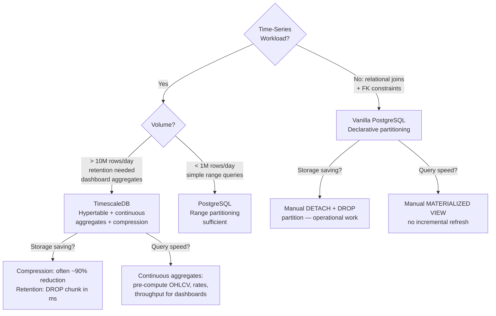

# Time-Series Data — TimescaleDB and Hypertables

Fintech platforms generate enormous volumes of time-ordered data: payment throughput metrics sampled every second, OHLCV candlestick data for every currency pair, fraud score time series per account, and system health metrics tied to business events. Vanilla PostgreSQL can store this data, but at scale it needs a lot of manual work (partitions, rollups, retention jobs). TimescaleDB — a PostgreSQL extension — automates that work and adds time-series features without sacrificing SQL compatibility or ACID guarantees.

> [!NOTE]
> TimescaleDB's core (hypertables, `time_bucket`) is Apache-2.0 licensed; compression, continuous aggregates, gap-filling and the policies are under the Timescale License (free to self-host, but some cloud providers only offer the Apache subset — check before you design around them). Recent versions also rename compression to "columnstore" (`add_columnstore_policy`, etc.); the older function names used below still work.

---

## 1. Time-Series Characteristics

Understanding what makes time-series data different from regular relational data is essential before choosing a storage strategy.

| Characteristic | Description | Implication |
|----------------|-------------|-------------|
| Append-mostly | New rows are almost never updated | Write path can be optimized for sequential appends |
| Time-ordered queries | Almost every query filters by time range | Time is always the first predicate |
| High cardinality | Millions of unique series (one per account, instrument, service) | Indexes must be efficient on time + series key |
| Recent-data hotspot | 90% of queries touch the last 7 days | Recent chunks should stay in memory |
| Bulk aggregation | Dashboards aggregate millions of rows | Materialized aggregations are essential |
| Retention-limited | Old data has diminishing value and must be purged | Automated retention policies are required |

### 1.1 Why Vanilla PostgreSQL Struggles

```sql
-- Without TimescaleDB: a vanilla payments_metrics table
CREATE TABLE payments_metrics (
    recorded_at   TIMESTAMPTZ NOT NULL,
    service       VARCHAR(50) NOT NULL,
    metric_name   VARCHAR(50) NOT NULL,
    value         DOUBLE PRECISION NOT NULL
);

CREATE INDEX idx_payments_metrics_time ON payments_metrics (recorded_at DESC);

-- After months of ingestion at thousands of rows/second, one table holds
-- billions of rows (hundreds of GB to TBs):
-- Secondary indexes such as (service, recorded_at) no longer fit in memory,
--   so every INSERT causes random I/O
-- VACUUM / anti-wraparound freezing must process the whole huge table
-- Dropping old data with DELETE is slow, writes huge amounts of WAL and
--   leaves bloat behind
-- Every dashboard aggregates billions of raw rows again and again
```

---

## 2. TimescaleDB Hypertables

A hypertable is a TimescaleDB abstraction that looks like a regular PostgreSQL table but is internally partitioned into **chunks** along the time dimension automatically.

### 2.1 Creating a Hypertable

```sql
-- Install TimescaleDB extension
CREATE EXTENSION IF NOT EXISTS timescaledb;

-- Step 1: Create a standard PostgreSQL table
CREATE TABLE payment_throughput (
    recorded_at    TIMESTAMPTZ     NOT NULL,
    service_name   VARCHAR(50)     NOT NULL,
    region         VARCHAR(20)     NOT NULL,
    payments_count INTEGER         NOT NULL DEFAULT 0,
    total_amount   BIGINT          NOT NULL DEFAULT 0,  -- minor units
    error_count    INTEGER         NOT NULL DEFAULT 0,
    p50_latency_ms DOUBLE PRECISION,
    p99_latency_ms DOUBLE PRECISION
);

-- Step 2: Convert to a hypertable with 7-day chunks
-- TimescaleDB automatically creates a new partition (chunk) every 7 days
SELECT create_hypertable(
    'payment_throughput',   -- table name
    'recorded_at',          -- time column
    chunk_time_interval => INTERVAL '7 days'
);

-- Step 3: Create indexes on the hypertable
-- TimescaleDB creates one index per chunk — these are small and fast
CREATE INDEX idx_pt_service_time
    ON payment_throughput (service_name, recorded_at DESC);

CREATE INDEX idx_pt_region_time
    ON payment_throughput (region, recorded_at DESC);
```

### 2.2 Automatic Chunk Creation

```sql
-- TimescaleDB creates chunks automatically as data is inserted
-- Each chunk covers a 7-day time range

-- Inspect existing chunks
-- (sizes come from chunks_detailed_size(); the chunks view has no sizes)
SELECT
    c.chunk_name,
    c.range_start,
    c.range_end,
    c.is_compressed,
    s.total_bytes / (1024*1024) AS size_mb
FROM timescaledb_information.chunks c
JOIN chunks_detailed_size('payment_throughput') s
  ON s.chunk_schema = c.chunk_schema AND s.chunk_name = c.chunk_name
ORDER BY c.range_start DESC;

/*
chunk_name        | range_start          | range_end            | is_compressed | size_mb
_hyper_1_8_chunk  | 2024-01-29 00:00:00 | 2024-02-05 00:00:00 | false         | 450
_hyper_1_7_chunk  | 2024-01-22 00:00:00 | 2024-01-29 00:00:00 | true          | 45
_hyper_1_6_chunk  | 2024-01-15 00:00:00 | 2024-01-22 00:00:00 | true          | 43
*/

-- The most recent chunk is uncompressed (hot, ideally in memory)
-- Older chunks are compressed (here ~10:1)

-- TimescaleDB query planner automatically uses the right chunk(s)
EXPLAIN (ANALYZE)
SELECT * FROM payment_throughput
WHERE recorded_at > NOW() - INTERVAL '1 hour'
  AND service_name = 'payment-processor';
-- Scans only the current 7-day chunk — not the entire table
```

### 2.3 Chunk Interval Sizing

```sql
-- Choosing chunk_time_interval:
-- Rule of thumb: the recent (uncompressed) chunks of all busy hypertables,
-- including their indexes, fit in ~25% of available RAM
-- Payment metrics at 1,000 rows/second, each row ~200 bytes:
-- Rows per 7 days = 1,000 * 86,400 * 7 = 604,800,000 rows
-- Chunk size = 604,800,000 * 200 bytes = ~115 GB — too large!

-- For 32 GB RAM, target chunk size = 8 GB
-- 8 GB / 200 bytes = 40,000,000 rows
-- 40,000,000 / 86,400 seconds/day / 1,000 rows/second = 0.46 days

-- 12-hour chunks: 1,000 * 43,200 * 200 bytes = ~8.6 GB -- close to target
-- (use 6 hours for more margin; a 1-day chunk would be ~17 GB)
SELECT create_hypertable(
    'payment_throughput_hf',  -- high-frequency table, same columns
    'recorded_at',
    chunk_time_interval => INTERVAL '12 hours'
);

-- Check current chunk sizes
SELECT
    c.chunk_name,
    pg_size_pretty(s.total_bytes) AS total_size
FROM timescaledb_information.chunks c
JOIN chunks_detailed_size('payment_throughput_hf') s
  ON s.chunk_schema = c.chunk_schema AND s.chunk_name = c.chunk_name
ORDER BY c.range_start DESC
LIMIT 5;
```

---

## 3. time_bucket() for Aggregation

`time_bucket()` is TimescaleDB's equivalent of `date_trunc()` but more flexible — it supports arbitrary bucket widths such as 5 or 15 minutes. (Plain PostgreSQL 14+ has a similar `date_bin()`.)

```sql
-- Payments per minute for the last hour
SELECT
    time_bucket('1 minute', recorded_at) AS bucket,
    SUM(payments_count)                  AS total_payments,
    SUM(error_count)                     AS total_errors,
    AVG(p99_latency_ms)                  AS avg_p99_ms
FROM payment_throughput
WHERE recorded_at > NOW() - INTERVAL '1 hour'
GROUP BY bucket
ORDER BY bucket;

-- 5-minute buckets with error rate
SELECT
    time_bucket('5 minutes', recorded_at) AS bucket,
    service_name,
    SUM(payments_count)                   AS payments,
    SUM(error_count)                      AS errors,
    ROUND(
        100.0 * SUM(error_count) / NULLIF(SUM(payments_count), 0),
        2
    )                                     AS error_rate_pct
FROM payment_throughput
WHERE recorded_at BETWEEN '2024-01-15 09:00' AND '2024-01-15 17:00'
GROUP BY bucket, service_name
ORDER BY bucket, service_name;

-- Hourly totals with time_bucket for the last 24 hours
SELECT
    time_bucket('1 hour', recorded_at)   AS hour,
    region,
    SUM(payments_count)                  AS payments_per_hour,
    SUM(total_amount) / 100.0            AS total_volume_gbp
FROM payment_throughput
WHERE recorded_at > NOW() - INTERVAL '24 hours'
GROUP BY hour, region
ORDER BY hour DESC, region;
```

---

## 4. Continuous Aggregates — OHLCV Candlestick Data

Continuous aggregates are materialized views that TimescaleDB keeps incrementally up to date as new data arrives. They are essential for dashboards and reporting.

### 4.1 Raw FX Rate Time Series

```sql
-- Raw tick data: every FX rate quote from liquidity providers
CREATE TABLE fx_rates (
    quoted_at  TIMESTAMPTZ     NOT NULL,
    pair       VARCHAR(7)      NOT NULL,  -- 'EUR/USD', 'GBP/USD', etc.
    provider   VARCHAR(30)     NOT NULL,
    bid        NUMERIC(16, 6)  NOT NULL,
    ask        NUMERIC(16, 6)  NOT NULL,
    mid        NUMERIC(16, 6)  NOT NULL
);

SELECT create_hypertable('fx_rates', 'quoted_at',
    chunk_time_interval => INTERVAL '1 day');

CREATE INDEX idx_fx_rates_pair_time
    ON fx_rates (pair, quoted_at DESC);
```

### 4.2 OHLCV Continuous Aggregate

```sql
-- 1-minute OHLCV candlesticks computed from tick data
CREATE MATERIALIZED VIEW fx_ohlcv_1m
WITH (timescaledb.continuous) AS
SELECT
    time_bucket('1 minute', quoted_at)   AS bucket,
    pair,
    FIRST(mid, quoted_at)                AS open,
    MAX(mid)                             AS high,
    MIN(mid)                             AS low,
    LAST(mid, quoted_at)                 AS close,
    COUNT(*)                             AS tick_count,
    AVG(ask - bid)                       AS avg_spread
FROM fx_rates
GROUP BY bucket, pair
WITH NO DATA;  -- Populate on-demand, not at creation time

-- Configure refresh policy: every minute, re-materialize the window from
-- 10 minutes ago to 1 minute ago (ticks arriving later than 10 minutes
-- are only picked up by a manual refresh)
SELECT add_continuous_aggregate_policy(
    'fx_ohlcv_1m',
    start_offset  => INTERVAL '10 minutes',
    end_offset    => INTERVAL '1 minute',
    schedule_interval => INTERVAL '1 minute'
);

-- Backfill historical data
CALL refresh_continuous_aggregate('fx_ohlcv_1m',
    '2024-01-01', '2024-01-15');

-- Query the materialized view — extremely fast (pre-aggregated)
SELECT
    bucket,
    open,
    high,
    low,
    close,
    tick_count
FROM fx_ohlcv_1m
WHERE pair = 'EUR/USD'
  AND bucket > NOW() - INTERVAL '1 hour'
ORDER BY bucket;
```

### 4.3 Hierarchical Continuous Aggregates

TimescaleDB 2.9+ supports creating continuous aggregates on top of other continuous aggregates:

```sql
-- 1-hour OHLCV built from 1-minute OHLCV (not from raw tick data)
CREATE MATERIALIZED VIEW fx_ohlcv_1h
WITH (timescaledb.continuous) AS
SELECT
    time_bucket('1 hour', bucket)        AS bucket,
    pair,
    FIRST(open, bucket)                  AS open,
    MAX(high)                            AS high,
    MIN(low)                             AS low,
    LAST(close, bucket)                  AS close,
    SUM(tick_count)                      AS tick_count
FROM fx_ohlcv_1m
GROUP BY time_bucket('1 hour', bucket), pair
WITH NO DATA;

SELECT add_continuous_aggregate_policy(
    'fx_ohlcv_1h',
    start_offset  => INTERVAL '2 hours',
    end_offset    => INTERVAL '1 hour',
    schedule_interval => INTERVAL '1 hour'
);
```

---

## 5. time_bucket_gapfill() with locf()

Real-world time series have gaps: a currency pair might have no trades for 3 minutes during low-liquidity hours. `time_bucket_gapfill` fills gaps; `locf` (Last Observation Carried Forward) fills missing values.

```sql
-- Without gapfill: missing buckets are absent from result
SELECT
    time_bucket('1 minute', quoted_at) AS bucket,
    LAST(mid, quoted_at)               AS last_mid
FROM fx_rates
WHERE pair = 'EUR/USD'
  AND quoted_at > NOW() - INTERVAL '1 hour'
GROUP BY bucket
ORDER BY bucket;
-- Some minutes may be missing if no ticks arrived

-- With gapfill + locf: all 60 buckets present, missing filled with last known value
SELECT
    time_bucket_gapfill(
        '1 minute',
        quoted_at,
        start  => NOW() - INTERVAL '1 hour',
        finish => NOW()
    )                                AS bucket,
    pair,
    locf(LAST(mid, quoted_at))       AS mid_price,
    locf(LAST(bid, quoted_at))       AS bid_price,
    locf(LAST(ask, quoted_at))       AS ask_price,
    COUNT(*)                         AS tick_count  -- NULL for filled gaps
FROM fx_rates
WHERE pair = 'EUR/USD'
  AND quoted_at > NOW() - INTERVAL '1 hour'
GROUP BY bucket, pair
ORDER BY bucket;

-- interpolate(): linear interpolation instead of LOCF
SELECT
    time_bucket_gapfill('5 minutes', recorded_at) AS bucket,
    service_name,
    interpolate(AVG(p99_latency_ms))              AS p99_ms_interpolated
FROM payment_throughput
WHERE recorded_at > NOW() - INTERVAL '6 hours'
GROUP BY bucket, service_name
ORDER BY bucket;
```

---

## 6. Compression Policy

Older time-series data is queried far less frequently. TimescaleDB's native columnar compression on cold chunks often reduces storage by 90% or more (it depends on the data).

```sql
-- Enable compression on the hypertable
-- orderby: controls how data is sorted within a compressed segment
-- segmentby: creates one segment per unique value — critical for
--            query performance: TimescaleDB can skip entire segments
ALTER TABLE payment_throughput SET (
    timescaledb.compress,
    timescaledb.compress_orderby   = 'recorded_at DESC',
    timescaledb.compress_segmentby = 'service_name, region'
);

-- Add a compression policy: compress chunks older than 7 days
SELECT add_compression_policy(
    'payment_throughput',
    compress_after => INTERVAL '7 days'
);

-- Verify compression status and savings
SELECT
    chunk_name,
    before_compression_total_bytes / (1024*1024)  AS before_mb,
    after_compression_total_bytes  / (1024*1024)  AS after_mb,
    ROUND(
        100.0 * (1 - after_compression_total_bytes::float /
                     before_compression_total_bytes),
        1
    )                                              AS compression_pct
FROM chunk_compression_stats('payment_throughput')
ORDER BY chunk_name;

/*
chunk_name  | before_mb | after_mb | compression_pct
_hyper_1_1  |       450 |       42 |            90.7
_hyper_1_2  |       448 |       41 |            90.8
*/

-- Manually compress a specific chunk (for immediate space recovery)
SELECT compress_chunk(
    '_timescaledb_internal._hyper_1_3_chunk'
);

-- Decompress, e.g. before a LARGE backfill into an old range.
-- (Small writes need no manual step: INSERT into compressed chunks works
--  since TimescaleDB 2.3, UPDATE/DELETE since 2.11.)
SELECT decompress_chunk(
    '_timescaledb_internal._hyper_1_3_chunk'
);
```

---

## 7. Retention Policy

```sql
-- Drop chunks older than 90 days automatically
-- This is a metadata operation (DROP TABLE on a chunk) — nearly instantaneous
-- Compare: DELETE on 500 GB would take hours and generate massive WAL
SELECT add_retention_policy(
    'payment_throughput',
    drop_after => INTERVAL '90 days'
);

-- For the OHLCV continuous aggregate, keep summarized data longer.
-- Careful: if a cagg refresh window ever covers a range whose raw data was
-- already dropped, the refresh would delete those aggregates -- keep the
-- refresh start_offset well inside the raw retention period.
SELECT add_retention_policy(
    'fx_ohlcv_1m',
    drop_after => INTERVAL '1 year'
);

SELECT add_retention_policy(
    'fx_ohlcv_1h',
    drop_after => INTERVAL '5 years'
);

-- View all scheduled jobs (compression + retention policies)
SELECT
    j.job_id,
    j.application_name,
    j.schedule_interval,
    js.next_start,
    js.last_run_status,
    js.last_run_duration
FROM timescaledb_information.jobs j
LEFT JOIN timescaledb_information.job_stats js USING (job_id)
ORDER BY j.job_id;

-- Manual retention execution (useful for immediate cleanup)
SELECT drop_chunks('payment_throughput', older_than => INTERVAL '90 days');

-- View chunk boundaries before dropping (dry run)
SELECT
    c.chunk_name,
    c.range_start,
    c.range_end,
    pg_size_pretty(s.total_bytes) AS size
FROM timescaledb_information.chunks c
JOIN chunks_detailed_size('payment_throughput') s
  ON s.chunk_schema = c.chunk_schema AND s.chunk_name = c.chunk_name
WHERE c.range_end < NOW() - INTERVAL '90 days'
ORDER BY c.range_end;
```

---

## 8. Payment Throughput Monitoring Example

A complete implementation for monitoring payment processing rates in a fintech platform.

```sql
-- Metric collection table (1-second resolution)
CREATE TABLE payment_metrics_raw (
    recorded_at    TIMESTAMPTZ     NOT NULL,
    service        VARCHAR(50)     NOT NULL,
    region         VARCHAR(20)     NOT NULL,
    metric         VARCHAR(50)     NOT NULL,
    value          DOUBLE PRECISION NOT NULL
);

SELECT create_hypertable('payment_metrics_raw', 'recorded_at',
    chunk_time_interval => INTERVAL '1 day');

ALTER TABLE payment_metrics_raw SET (
    timescaledb.compress,
    timescaledb.compress_orderby   = 'recorded_at DESC',
    timescaledb.compress_segmentby = 'service, metric'
);

SELECT add_compression_policy('payment_metrics_raw',
    compress_after => INTERVAL '3 days');
SELECT add_retention_policy('payment_metrics_raw',
    drop_after => INTERVAL '30 days');

-- 1-minute pre-aggregated view for dashboards
CREATE MATERIALIZED VIEW payment_metrics_1m
WITH (timescaledb.continuous) AS
SELECT
    time_bucket('1 minute', recorded_at) AS bucket,
    service,
    region,
    metric,
    AVG(value)   AS avg_value,
    MIN(value)   AS min_value,
    MAX(value)   AS max_value,
    COUNT(*)     AS sample_count
FROM payment_metrics_raw
GROUP BY time_bucket('1 minute', recorded_at), service, region, metric
WITH NO DATA;

SELECT add_continuous_aggregate_policy('payment_metrics_1m',
    start_offset      => INTERVAL '5 minutes',
    end_offset        => INTERVAL '1 minute',
    schedule_interval => INTERVAL '1 minute');

-- Dashboard query: payment success rate over last 24 hours
WITH success_rate AS (
    SELECT
        bucket,
        service,
        MAX(CASE WHEN metric = 'payments_succeeded' THEN avg_value ELSE 0 END) AS succeeded,
        MAX(CASE WHEN metric = 'payments_failed'    THEN avg_value ELSE 0 END) AS failed
    FROM payment_metrics_1m
    WHERE bucket > NOW() - INTERVAL '24 hours'
      AND metric IN ('payments_succeeded', 'payments_failed')
    GROUP BY bucket, service
)
SELECT
    bucket,
    service,
    succeeded,
    failed,
    ROUND(
        100.0 * succeeded / NULLIF(succeeded + failed, 0),
        2
    ) AS success_rate_pct
FROM success_rate
ORDER BY bucket DESC, service;
```

---

## 9. Real-Time Aggregation: Continuous Aggregate + Live Data

Continuous aggregates have a small lag (the `end_offset`). For true real-time, combine the materialized view with a query on the raw table for the most recent data.

```sql
-- Real-time query: combines pre-aggregated data + live tail
-- (TimescaleDB calls this "real-time aggregation")

-- Enable real-time aggregation. It is OFF by default for continuous
-- aggregates created on TimescaleDB 2.13+ (it was ON in older 2.x versions)
ALTER MATERIALIZED VIEW fx_ohlcv_1m
SET (timescaledb.materialized_only = false);
-- Now queries against fx_ohlcv_1m automatically combine:
-- 1. Pre-computed data from the materialized layer
-- 2. Live aggregation of raw fx_rates rows newer than the last
--    materialized bucket (the "watermark")

-- The query below returns all data including the last 60 seconds
-- without any application-side stitching
SELECT
    bucket,
    open, high, low, close,
    tick_count
FROM fx_ohlcv_1m
WHERE pair = 'EUR/USD'
  AND bucket > NOW() - INTERVAL '1 hour'
ORDER BY bucket;
```

---

## 10. TimescaleDB vs Vanilla PostgreSQL Partitioning



| Feature | TimescaleDB | Vanilla PostgreSQL Partitioning |
|---------|------------|--------------------------------|
| Chunk creation | Automatic | Manual (or pg_partman) |
| Compression | Native columnar, often ~90% reduction | Only TOAST compression of large values (pglz/lz4); no columnar compression |
| Retention | `add_retention_policy` — one line | DETACH + DROP — operational script |
| Incremental aggregates | `CREATE MATERIALIZED VIEW ... continuous` | Full refresh only (`REFRESH MATERIALIZED VIEW`) |
| Gap filling | `time_bucket_gapfill + locf` | `generate_series` + LEFT JOIN, written by hand |
| SQL compatibility | 100% — it is PostgreSQL | 100% |
| Cloud managed | Timescale's own cloud or self-hosted; some providers offer only the Apache subset, and e.g. Amazon RDS does not offer it | Available everywhere |

---

## 11. Production Pitfalls

### Pitfall 1: Not Using Continuous Aggregates — Dashboard Queries Scan Raw Data

```sql
-- WRONG — dashboard query scans raw tick data every time
-- At 10,000 ticks/second for 30 days: 25,920,000,000 rows
SELECT
    time_bucket('1 hour', quoted_at) AS hour,
    pair,
    FIRST(mid, quoted_at)            AS open,
    MAX(mid)                         AS high,
    MIN(mid)                         AS low,
    LAST(mid, quoted_at)             AS close
FROM fx_rates  -- 25 billion rows!
WHERE quoted_at > NOW() - INTERVAL '30 days'
GROUP BY hour, pair;
-- Runtime: 45 minutes (even with hypertable chunk pruning)
-- Causes: high I/O, high CPU, dashboard timeouts

-- CORRECT — pre-aggregate with continuous aggregate
-- Query runs in <100ms
SELECT bucket, pair, open, high, low, close
FROM fx_ohlcv_1h  -- pre-aggregated, only 720 rows per pair for 30 days
WHERE bucket > NOW() - INTERVAL '30 days'
ORDER BY bucket, pair;

-- If you need a timeframe not covered by existing aggregates:
-- Create a new continuous aggregate at the right granularity
CREATE MATERIALIZED VIEW fx_ohlcv_4h
WITH (timescaledb.continuous) AS
SELECT
    time_bucket('4 hours', bucket) AS bucket,
    pair,
    FIRST(open, bucket)             AS open,
    MAX(high)                       AS high,
    MIN(low)                        AS low,
    LAST(close, bucket)             AS close,
    SUM(tick_count)                 AS tick_count
FROM fx_ohlcv_1h
GROUP BY time_bucket('4 hours', bucket), pair
WITH NO DATA;
```

### Pitfall 2: Too-Small Chunk Interval Causes Excessive Chunk Count

A chunk interval that is too small creates thousands of chunks, overwhelming the PostgreSQL catalog and causing slow query planning.

```sql
-- WRONG — 1-minute chunks for a low-volume table
-- 1 year of data = 525,600 chunks
-- PostgreSQL catalog bloat, slow EXPLAIN, slow DROP retention jobs

SELECT create_hypertable('payment_audit_low_volume', 'created_at',
    chunk_time_interval => INTERVAL '1 minute');  -- DO NOT DO THIS
-- After 1 year: pg_class has 525,600+ entries for this table
-- Planning (chunk exclusion) becomes slow, lock tables fill up
-- Keep chunk counts modest: thousands, not hundreds of thousands

-- Calculate the right interval:
-- Expected rows per day: 100,000 (for a low-volume audit table)
-- Target chunk size: 1 GB
-- Row size: ~500 bytes
-- Rows per GB: 2,000,000
-- Days to reach 1 GB: 2,000,000 / 100,000 = 20 days
SELECT create_hypertable('payment_audit_low_volume', 'created_at',
    chunk_time_interval => INTERVAL '30 days');  -- Correct for this volume

-- Check current chunk count
SELECT hypertable_name, num_chunks
FROM timescaledb_information.hypertables;

-- set_chunk_time_interval() changes the interval for NEW chunks only.
-- If you have too many chunks already, recreate the hypertable:
-- 1. Create new table with correct interval
-- 2. INSERT INTO new_table SELECT * FROM old_table (can take hours)
-- 3. Rename tables in a transaction
-- Prevention is better than cure — size your interval at creation time
```

### Pitfall 3: Expensive Writes to Compressed Chunks

Compressed chunks store data in a columnar format. Old TimescaleDB versions rejected writes to them; current versions accept them (INSERT since 2.3, UPDATE/DELETE since 2.11) but each write is more expensive: UPDATE/DELETE must decompress the affected segments, and inserted rows sit uncompressed in the chunk until the policy recompresses it. Large backfills into compressed ranges therefore need a plan.

```sql
-- Small correction: works directly on TimescaleDB 2.11+
UPDATE payment_throughput
SET error_count = 5
WHERE recorded_at = '2024-01-10 12:00:00'
  AND service_name = 'payment-processor'
  AND region = 'eu-west-1';
-- Decompresses only the affected segment (service_name, region =
-- the segmentby columns), so filtering on them keeps this cheap.
-- On versions before 2.11: ERROR -- UPDATE on compressed chunks unsupported

-- LARGE backfill (e.g. reloading a week of data): decompress, load,
-- recompress -- faster than millions of row-by-row writes into
-- compressed chunks
SELECT decompress_chunk(c, if_compressed => true)
FROM show_chunks('payment_throughput',
        older_than => '2024-01-15'::timestamptz,
        newer_than => '2024-01-10'::timestamptz) AS c;

-- (COPY / INSERT the backfill here)

SELECT compress_chunk(c, if_not_compressed => true)
FROM show_chunks('payment_throughput',
        older_than => '2024-01-15'::timestamptz,
        newer_than => '2024-01-10'::timestamptz) AS c;

-- Design note: metrics belong to the time they describe, so corrections
-- are written at the original timestamp (as above). For LEDGER-like data
-- the rule is different: never rewrite history -- record a correction as
-- a new event (Lesson 14).
```

---

## 12. Checklist

- [ ] `create_hypertable()` called with `chunk_time_interval` sized so the chunk count over the retention period stays in the thousands, not hundreds of thousands
- [ ] Chunk interval validated: recent uncompressed chunks (with indexes) fit in ~25% of available RAM
- [ ] Continuous aggregates created for every dashboard/reporting query that runs more than once per hour
- [ ] `add_continuous_aggregate_policy` configured with `end_offset >= 1 minute` (do not set to zero)
- [ ] `timescaledb.materialized_only = false` set explicitly where real-time aggregation is needed (default is off since 2.13)
- [ ] `compress_segmentby` set to the column(s) used in WHERE clauses for compressed data
- [ ] `add_compression_policy` configured: compress after the hot retention window (e.g., 7 days)
- [ ] `add_retention_policy` configured: drop raw data after the required retention period
- [ ] `time_bucket_gapfill + locf` used in queries that must return a continuous time series
- [ ] Large backfills into compressed ranges planned: decompress, load, recompress (small corrections can go straight in on 2.11+)
- [ ] Chunk count monitored with `timescaledb_information.hypertables.num_chunks`
- [ ] TimescaleDB background jobs (`timescaledb_information.job_stats`) monitored for `last_run_status = 'Failed'`

---

<!-- KNOWLEDGE-CHECK
{"questions": [{"text": "You have a hypertable storing 10,000 rows per second, each row 200 bytes. You have 64 GB of RAM and want the hot (uncompressed) chunk to fit in ~25% of RAM. What chunk_time_interval should you use?", "options": ["a) 1 day — 10,000 * 86,400 * 200 bytes = ~173 GB, too large", "b) 1 hour — 10,000 * 3,600 * 200 bytes = ~7.2 GB, fits in 16 GB (25% of 64 GB)", "c) 7 days — this is TimescaleDB's default and always correct", "d) 1 minute — smaller chunks are always faster"], "correct": 1, "explanation": "With 10,000 rows/second and 200 bytes/row: rows per hour = 36,000,000; size = 36,000,000 * 200 = 7.2 GB (plus indexes). 25% of 64 GB = 16 GB, so a 1-hour chunk fits comfortably. The 7-day default suits lower-volume workloads. 1-day chunks at ~173 GB would far exceed RAM, causing disk I/O on recent data. 1-minute chunks (120 MB each) would create 525,600 chunks per year — catalog bloat and slow planning; even 1-hour chunks give 8,760 per year, so combine them with a retention policy."}, {"text": "A continuous aggregate on fx_rates computes 1-minute OHLCV candles. The policy is configured with end_offset = INTERVAL '1 minute'. A query on the continuous aggregate view returns data up to 2 minutes ago but not the last minute. How do you get truly up-to-the-second data from the view?", "options": ["a) Decrease the end_offset to zero seconds", "b) Set timescaledb.materialized_only = false on the continuous aggregate to enable real-time aggregation, which combines pre-aggregated data with live raw data", "c) Increase the schedule_interval to run more frequently", "d) Query the raw table instead — continuous aggregates always have a lag"], "correct": 1, "explanation": "Real-time aggregation (timescaledb.materialized_only = false) makes the continuous aggregate view combine its materialized data with a live aggregation of the raw rows newer than the last materialized bucket. The view then returns up-to-the-second data while still using pre-aggregated data for older ranges. It is off by default for continuous aggregates created on TimescaleDB 2.13+, so set it explicitly. Setting end_offset to zero is not recommended: the refresh job would keep re-materializing the bucket that is still receiving writes."}, {"text": "What happens if you attempt to INSERT a row with a timestamp 2 months ago into a TimescaleDB hypertable that has compression enabled with compress_after = INTERVAL '7 days'?", "options": ["a) On current versions (INSERT supported since 2.3) the INSERT succeeds: the row is stored uncompressed inside that chunk and merged into the compressed data the next time the chunk is recompressed", "b) The INSERT always fails because compressed chunks are immutable; you must decompress the chunk first", "c) The INSERT creates a new uncompressed chunk for the old timestamp", "d) TimescaleDB silently drops the INSERT and returns success"], "correct": 0, "explanation": "Since TimescaleDB 2.3, INSERTs into compressed chunks are accepted: the new rows are kept uncompressed inside the chunk and folded into the columnar data when the compression policy recompresses it. UPDATE and DELETE on compressed chunks work since 2.11 (they decompress only the affected segments). Very old versions did reject such writes, which is where the 'decompress first' advice comes from. For large backfills it is still faster to decompress, load and recompress the affected chunks."}]}
-->

<!-- PRACTICAL-CHALLENGE
{"title": "TimescaleDB Payment Metrics: Hypertables, Continuous Aggregates, and Compression", "difficulty": "advanced", "estimatedMinutes": 85, "tasks": [{"id": "1", "description": "Install TimescaleDB (use Docker: timescale/timescaledb-ha:pg16) and create a payment_throughput hypertable with columns: recorded_at TIMESTAMPTZ, service VARCHAR(50), region VARCHAR(20), payments_count INT, error_count INT, p50_latency_ms FLOAT, p99_latency_ms FLOAT. Set chunk_time_interval to 1 day. Generate 30 days of synthetic data at 1-second resolution (simulate 10 services across 3 regions). Verify chunk creation with timescaledb_information.chunks and confirm that EXPLAIN on a 1-day range query shows only the target chunk being scanned, not all 30 chunks."}, {"id": "2", "description": "Create a continuous aggregate payment_throughput_1m that computes AVG, MIN, MAX for all metric columns with 1-minute buckets. Set a refresh policy with start_offset=5 minutes, end_offset=1 minute, schedule_interval=1 minute. Enable real-time aggregation (materialized_only=false). Write a query that compares response time between: (a) querying the raw hypertable with time_bucket() and (b) querying the continuous aggregate view, for a 7-day range. Record the difference in a SQL comment."}, {"id": "3", "description": "Enable native compression on the payment_throughput hypertable with compress_segmentby='service,region' and compress_orderby='recorded_at DESC'. Add a compression policy for data older than 3 days. Manually compress chunks older than 10 days using compress_chunk(). Query chunk_compression_stats() and report the before/after sizes and compression percentage in a SQL comment. Then INSERT and UPDATE a few rows inside a compressed chunk, check how TimescaleDB handles them (timing, chunk status), and compare with the decompress_chunk() + load + compress_chunk() approach for a backfill of one full day."}, {"id": "4", "description": "Build a gap-filled dashboard query: use time_bucket_gapfill() with a 5-minute interval over the last 24 hours, applying locf() to p99_latency_ms and interpolate() to payments_count. The result must have exactly 288 rows (24h / 5min) for each service, with no NULL values for p99_latency_ms. Add a retention policy that drops raw data older than 30 days, and one that drops the continuous aggregate's data older than 1 year. Verify the policies are registered in timescaledb_information.jobs and run drop_chunks() manually to confirm it removes only the expected chunks while queries on recent chunks keep running."}]}
-->
