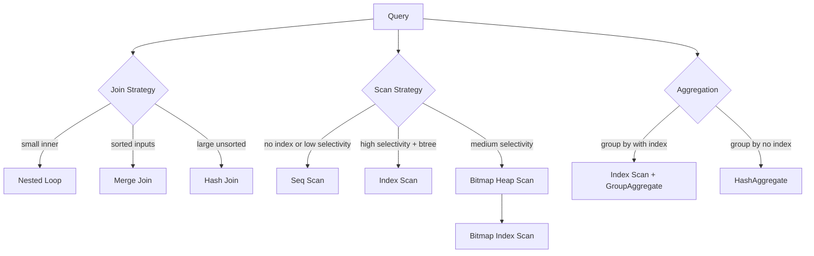

# تحليل خطط الاستعلام — EXPLAIN وANALYZE والتصوير المرئي

فهم ما يفعله PostgreSQL فعلًا حين ينفذ استعلامًا هو أهم مهارة تصحيح لمهندس قواعد البيانات. فاستعلام يعمل في 2 مللي ثانية على جدول من 10,000 صف قد يستغرق 45 ثانية على جدول من 50 مليون صف — لا لأن الاستعلام تغير، بل لأن استراتيجية التنفيذ تغيرت. ويعلّمك هذا الدرس قراءة خطط تنفيذ الاستعلامات وتفسيرها والتصرف بناءً عليها.

---

## 1. المستويات الثلاثة لـ EXPLAIN

يقدم PostgreSQL ثلاثة مستويات متدرجة من الفحص، كل منها يكشف معلومات أكثر بكلفة أكبر.

### ‏EXPLAIN (تقديرات فقط)

```sql
EXPLAIN
SELECT p.id, p.amount, p.status, a.holder_name
FROM   payments p
JOIN   accounts a ON a.id = p.source_account_id
WHERE  p.created_at >= NOW() - INTERVAL '7 days'
  AND  p.status = 'PENDING';
```

المخرج:

```
Hash Join  (cost=1842.55..9201.33 rows=4120 width=52)
  Hash Cond: (p.source_account_id = a.id)
  ->  Seq Scan on payments p  (cost=0.00..6945.20 rows=4120 width=36)
        Filter: ((status = 'PENDING') AND (created_at >= (now() - '7 days'::interval)))
  ->  Hash  (cost=1105.00..1105.00 rows=59004 width=24)
        ->  Seq Scan on accounts a  (cost=0.00..1105.00 rows=59004 width=24)
```

الأرقام **تقديرات** ناتجة عن إحصاءات الجدول — لا يُنفذ أي SQL. ويستخدم المخطِّط `pg_statistic` (المعروض عبر `pg_stats`) لتقدير أعداد الصفوف والكلف.

**صيغة الكلفة:** ‏`cost=startup..total`
- ‏`startup`: كلفة إنتاج أول صف (مثلًا، الترتيب يتطلب قراءة كل الصفوف قبل إعادة أي منها)
- ‏`total`: كلفة إنتاج كل الصفوف
- وحدات الكلفة اعتباطية لكنها متسقة — افتراضيًا 1.0 تساوي قراءة صفحة تتابعية واحدة (`seq_page_cost`)

**العرض (width):** متوسط عرض الصف بالبايت

### ‏EXPLAIN ANALYZE (ينفذ الاستعلام)

```sql
EXPLAIN ANALYZE
SELECT p.id, p.amount, p.status, a.holder_name
FROM   payments p
JOIN   accounts a ON a.id = p.source_account_id
WHERE  p.created_at >= NOW() - INTERVAL '7 days'
  AND  p.status = 'PENDING';
```

المخرج (مختصر):

```
Hash Join  (cost=1842.55..9201.33 rows=4120 width=52)
           (actual time=38.212..412.831 rows=5891 loops=1)
  Hash Cond: (p.source_account_id = a.id)
  ->  Seq Scan on payments p  (cost=0.00..6945.20 rows=4120 width=36)
                               (actual time=0.041..389.342 rows=5891 loops=1)
        Filter: ((status = 'PENDING') AND (created_at >= ...))
        Rows Removed by Filter: 744108
  ->  Hash  (cost=1105.00..1105.00 rows=59004 width=24)
            (actual time=37.814..37.814 rows=59004 loops=1)
        Buckets: 65536  Batches: 1  Memory Usage: 3528kB
        ->  Seq Scan on accounts a  (cost=0.00..1105.00 rows=59004 width=24)
                                    (actual time=0.015..19.223 rows=59004 loops=1)
Planning Time: 1.231 ms
Execution Time: 413.904 ms
```

الفروق الأساسية: يتيح لك `actual time` و`actual rows` مقارنة التقديرات بالواقع. وفرق مثل 4,120 مقدّرًا مقابل 5,891 فعليًا أمر طبيعي. أما الفرق الكبير (10 أضعاف أو أكثر) فيشير إلى إحصاءات قديمة — أو إلى أعمدة مترابطة يعاملها المخطِّط كأنها مستقلة (أصلحها بـ `CREATE STATISTICS`). ولاحظ أن `actual time` بالمللي ثانية، وأنه للعقد ذات `loops > 1` لكل دورة.

### ‏EXPLAIN (ANALYZE, BUFFERS, FORMAT JSON)

```sql
EXPLAIN (ANALYZE, BUFFERS, FORMAT JSON)
SELECT p.id, p.amount
FROM   payments p
WHERE  p.status = 'PENDING'
  AND  p.created_at >= NOW() - INTERVAL '7 days';
```

يكشف خيار `BUFFERS` سلوك الذاكرة المؤقتة:

```json
{
  "Node Type": "Seq Scan",
  "Actual Rows": 5891,
  "Shared Hit Blocks": 342,
  "Shared Read Blocks": 6103,
  "Shared Dirtied Blocks": 0,
  "Shared Written Blocks": 0
}
```

- ‏`Shared Hit Blocks`: صفحات خُدمت من `shared_buffers` (الذاكرة) — سريع
- ‏`Shared Read Blocks`: صفحات قُرئت من القرص (أو ذاكرة نظام التشغيل المؤقتة) — بطيء
- نسبة قراءة إلى إصابة عالية تعني أن مجموعة العمل لديك لا تتسع في `shared_buffers`

**‏FORMAT JSON** ينتج مخرجًا قابلًا للقراءة آليًا لأدوات مثل [explain.dalibo.com](https://explain.dalibo.com) (يقبل JSON أو النص) أو سكربتاتك الخاصة؛ أما [explain.depesz.com](https://explain.depesz.com) فيتوقع الصيغة النصية.

---

## 2. مرجع أنواع العقد



### ‏Seq Scan

يقرأ كل صفحة من الجدول تتابعيًا. وهو سريع لمجموعات النتائج الكبيرة (تقريبًا بضعة في المئة من الجدول أو أكثر، بحسب ترتيب الصفوف والتخزين) لأن الإدخال/الإخراج التتابعي فعال. ويفضله المخطِّط حين:

- لا يوجد فهرس مناسب
- المرشح غير انتقائي (معظم الصفوف تطابق)
- تشير إحصاءات الجدول إلى أن الفهرس سيقرأ صفحات بقدر المسح التتابعي تقريبًا

### ‏Index Scan

يتبع فهرس B-tree لكل مفتاح مطابق، ثم يجلب صفوف الكومة (heap) فرديًا. وهو فعال للانتقائية العالية (صفوف قليلة). وقد يسبب إدخالًا/إخراجًا عشوائيًا على مجموعات النتائج الكبيرة.

### ‏Bitmap Heap Scan

مرحلتان: أولًا يبني خريطة بتات في الذاكرة لمعرّفات الصفوف (TID) المطابقة من الفهرس (`Bitmap Index Scan`)، ثم يجلب صفحات الكومة بترتيبها الفيزيائي. وهو فعال للانتقائية المتوسطة — يتجنب الإدخال/الإخراج العشوائي بترتيب جلب الصفحات.

```
Bitmap Heap Scan on payments  (cost=94.21..2871.45 rows=4120 width=36)
  Recheck Cond: (created_at >= (now() - '7 days'::interval))
  ->  Bitmap Index Scan on idx_payments_created_at
        Index Cond: (created_at >= (now() - '7 days'::interval))
```

### ‏Hash Join

مرحلة البناء: يقرأ الجدول الأصغر ويبني جدول تجزئة في `work_mem`. مرحلة الفحص: يقرأ الجدول الأكبر ويفحص التجزئة. وحين لا يتسع جدول التجزئة في `work_mem`، ينسكب إلى القرص (`Batches > 1`).

### ‏Nested Loop

لكل صف في العلاقة الخارجية، يفحص العلاقة الداخلية. وهو فعال حين يكون للخارجية صفوف قليلة وللداخلية فهرس. وكارثي حين يكون للخارجية صفوف كثيرة دون فهرس على الداخلية.

### ‏Merge Join

يجب أن يكون المدخلان مرتبين على مفتاح الربط. وهو فعال حين يكون المدخلان مرتبين أصلًا (مسح فهرس) أو حين يُجرى ORDER BY على أي حال.

---

## 3. متى يختار PostgreSQL ‏Seq Scan

يحسب المخطِّط كلفة كل مسار وصول ويختار الأرخص. ويختار المسح التتابعي بدل الفهرس حين:

1. **انتقائية منخفضة**: يطابق المرشح جزءًا كبيرًا من الصفوف. فقراءة صفحات الكومة عشوائيًا عبر فهرس أكلف من مسح تتابعي حين تحتاج معظم الصفحات على أي حال.

2. **جدول صغير**: للجداول التي تتسع في صفحات قليلة، يكون المسح التتابعي أرخص دائمًا.

3. **إحصاءات قديمة**: ‏`n_distinct` أو المدرج التكراري في `pg_stats` قديم، فيجعل المخطِّط يقلل أو يبالغ في تقدير أعداد الصفوف.

4. **سوء إعداد الكلفة**: ‏`random_page_cost` مضبوط أعلى من اللازم نسبة إلى `seq_page_cost` (الافتراضي 4.0 مقابل 1.0). وعلى أقراص SSD تكون `random_page_cost = 1.1` أدق.

```sql
-- How closely does the physical row order follow this column's order?
SELECT attname, correlation
FROM   pg_stats
WHERE  tablename = 'payments'
  AND  attname = 'created_at';
```

الارتباط القريب من 1.0 أو ‎-1.0 يعني أن الترتيب الفيزيائي للصفوف يطابق ترتيب الفهرس — فمسوح الفهرس رخيصة. والقريب من 0 يعني إدخالًا/إخراجًا عشوائيًا.

---

## 4. ‏pg_stats — إحصاءات الأعمدة

يجمع PostgreSQL إحصاءات لكل عمود أثناء `ANALYZE`. ويعرضها العرض `pg_stats`:

```sql
SELECT
    attname,
    n_distinct,
    null_frac,
    avg_width,
    most_common_vals,
    most_common_freqs,
    histogram_bounds
FROM pg_stats
WHERE tablename = 'payments'
ORDER BY attname;
```

| العمود | المعنى |
|---|---|
| ‏`n_distinct` | العدد المقدّر للقيم المميزة. والقيمة السالبة = نسبة من الصفوف |
| ‏`null_frac` | نسبة الصفوف التي قيمتها NULL |
| ‏`most_common_vals` | أكثر N قيمة شيوعًا (الافتراضي N=100، يتحكم به `default_statistics_target`) |
| ‏`most_common_freqs` | تكرار كل قيمة من الأكثر شيوعًا |
| ‏`histogram_bounds` | حدود فئات المدرج التكراري للقيم غير الشائعة |

زيادة هدف الإحصاءات لعمود انتقائي:

```sql
-- Increase statistics resolution for the status column
ALTER TABLE payments ALTER COLUMN status SET STATISTICS 500;
ANALYZE payments;
```

---

## 5. ‏ANALYZE — إبقاء الإحصاءات حديثة

```sql
-- Analyze a single table immediately (non-blocking)
ANALYZE payments;

-- Analyze with verbose output
ANALYZE VERBOSE payments;

-- Check when a table was last analyzed
SELECT relname, last_analyze, last_autoanalyze, n_live_tup, n_dead_tup
FROM   pg_stat_user_tables
WHERE  relname = 'payments';
```

يشغّل `autovacuum` ‏`ANALYZE` تلقائيًا، لكنه قد يتأخر بعد:
- الإدراجات الجماعية (ملايين الصفوف المُدرجة في عبارة واحدة)
- عمليات التحميل الأولي للبيانات
- الجداول المقسّمة: يحلل autovacuum كل قسم، لكنه لا يحلل الجدول الأب المقسّم نفسه أبدًا — فشغّل `ANALYZE` على الأب يدويًا (مثلًا بعد عمليات التحميل) كي تحصل الاستعلامات على الجدول كله على تقديرات جيدة

شغّل analyze يدويًا بعد كل تحميل جماعي في خطوط ETL لديك.

---

## 6. أثر work_mem على عمليات الترتيب والتجزئة

يتحكم `work_mem` في مقدار الذاكرة الذي تستطيع عملية ترتيب أو تجزئة واحدة استخدامه قبل الانسكاب إلى القرص. ويستطيع كل استعلام استخدام عدة تخصيصات `work_mem` في الوقت نفسه.

```sql
-- Check current setting
SHOW work_mem;

-- Set per-session for a large analytical query
SET work_mem = '256MB';

EXPLAIN (ANALYZE, BUFFERS)
SELECT account_id, SUM(amount) as total
FROM   payments
WHERE  created_at >= '2024-01-01'
GROUP  BY account_id
ORDER  BY total DESC;
```

**دون work_mem كافٍ:**

```
Sort  (cost=98421.50..98673.50 rows=100800 width=16)
      (actual time=4821.332..5891.221 rows=100800 loops=1)
  Sort Key: (sum(amount)) DESC
  Sort Method: external merge  Disk: 3824kB    -- SPILLING TO DISK
```

**مع work_mem كافٍ:**

```
Sort  (cost=15421.50..15673.50 rows=100800 width=16)
      (actual time=312.441..381.223 rows=100800 loops=1)
  Sort Key: (sum(amount)) DESC
  Sort Method: quicksort  Memory: 10240kB    -- IN MEMORY
```

سطر `Sort Method: external merge Disk` هو الإشارة لزيادة `work_mem` لهذه الفئة من الاستعلامات. ولا تضبط `work_mem` عالميًا عاليًا جدًا أبدًا — فاتصال ينفذ 10 عقد متوازية × 500 MB = ‏5 GB من الذاكرة تستهلكها جلسة واحدة.

---

## 7. ‏pg_stat_statements — تحديد الاستعلامات البطيئة

```sql
-- Needs shared_preload_libraries = 'pg_stat_statements' (restart), then
-- once per database (as a superuser or a role allowed to create it):
CREATE EXTENSION IF NOT EXISTS pg_stat_statements;

-- Find the top 10 slowest queries by total execution time
SELECT
    left(query, 120)                AS query_snippet,
    calls,
    round(total_exec_time::numeric, 2) AS total_ms,
    round(mean_exec_time::numeric, 2)  AS mean_ms,
    round(stddev_exec_time::numeric, 2) AS stddev_ms,
    rows
FROM   pg_stat_statements
ORDER  BY total_exec_time DESC
LIMIT  10;

-- Queries that are slow on average: candidates for EXPLAIN (ANALYZE)
-- (pg_stat_statements has no plan estimates -- compare estimated vs
--  actual rows in the plan itself, or log plans with auto_explain)
SELECT
    left(query, 120) AS query_snippet,
    calls,
    round(mean_exec_time::numeric, 2) AS mean_ms
FROM   pg_stat_statements
WHERE  mean_exec_time > 100
ORDER  BY mean_exec_time DESC;
```

أعد ضبط الإحصاءات بعد تغيير في المخطط أو الفهارس للحصول على خط أساس نظيف:

```sql
SELECT pg_stat_statements_reset();
```

---

## 8. ‏auto_explain — تسجيل الاستعلامات البطيئة تلقائيًا

يلتقط امتداد `auto_explain` خطط الاستعلامات البطيئة دون أدوات يدوية:

```sql
-- In postgresql.conf or via ALTER SYSTEM:
-- shared_preload_libraries = 'auto_explain'
-- auto_explain.log_min_duration = 1000   -- log queries > 1 second
-- auto_explain.log_analyze = on
-- auto_explain.log_buffers = on
-- auto_explain.log_format = json

-- log_analyze adds timing overhead to EVERY query (not just logged ones);
-- auto_explain.log_timing = off keeps row counts but removes most of it

-- Enable per-session for testing (LOAD needs superuser)
LOAD 'auto_explain';
SET auto_explain.log_min_duration = 0;
SET auto_explain.log_analyze = true;
```

بعد التفعيل، تظهر خطط الاستعلامات البطيئة في سجل PostgreSQL:

```
LOG:  duration: 1832.491 ms  plan:
{
  "Node Type": "Hash Join",
  "Total Cost": 9201.33,
  "Actual Total Time": 1831.22,
  ...
}
```

---

## 9. صيغة explain.depesz.com

لصق المخرج في [explain.depesz.com](https://explain.depesz.com) أو [explain.dalibo.com](https://explain.dalibo.com) ينتج تصويرًا تفاعليًا بعقد ملونة تبرز أكلف العمليات. ولخطوط CI، التقط صيغة JSON وافحصها بأدواتك الخاصة. (أما pgBadger فأداة مختلفة: تحلل *ملفات سجل* PostgreSQL، بما فيها الخطط التي يسجلها auto_explain.)

```bash
# Capture JSON plan to file
# -X: ignore .psqlrc  -A: unaligned  -t: rows only  -q: quiet
psql -XAtq -d fintech \
  -c "EXPLAIN (ANALYZE, BUFFERS, FORMAT JSON) SELECT ..." > plan.json
```

---

## 10. مثال حقيقي — استعلام سجل مدفوعات بطيء

### قبل: مسح للجدول على 50 مليون صف

```sql
-- Query: fetch last 90 days of payments for a customer portal
SELECT p.id, p.amount, p.status, p.created_at, a.holder_name
FROM   payments p
JOIN   accounts a ON a.id = p.source_account_id
WHERE  p.customer_id = 42001
  AND  p.created_at >= NOW() - INTERVAL '90 days'
ORDER  BY p.created_at DESC
LIMIT  100;
```

```
EXPLAIN (ANALYZE, BUFFERS):

Limit  (cost=89421.50..89421.75 rows=100 width=60)
       (actual time=14821.33..14821.42 rows=100 loops=1)
  ->  Sort  (cost=89421.50..89441.50 rows=8000 width=60)
            (actual time=14821.33..14821.38 rows=100 loops=1)
        Sort Key: p.created_at DESC
        Sort Method: top-N heapsort  Memory: 52kB
        ->  Hash Join  (cost=1842.55..89101.33 rows=8000 width=60)
                       (actual time=38.21..14801.22 rows=8213 loops=1)
              ->  Seq Scan on payments p
                  (actual time=0.04..14721.33 rows=8213 loops=1)
                  Filter: ((customer_id = 42001) AND (created_at >= ...))
                  Rows Removed by Filter: 49991787
              ->  Hash ... accounts a
```

زمن التنفيذ: **14.8 ثانية** (أرقام توضيحية). فالمسح التتابعي يقرأ كل الـ 50 مليون صف ليجد 8,213.

### أنشئ الفهرس الصحيح

```sql
-- Composite index: equality on customer_id, range + ORDER BY on created_at.
-- INCLUDE covers every other payments column the query reads (id, amount,
-- status, source_account_id), so an index-only scan is possible.
CREATE INDEX CONCURRENTLY idx_payments_customer_created
    ON payments (customer_id, created_at DESC)
    INCLUDE (id, amount, status, source_account_id);

-- VACUUM sets the visibility map, which index-only scans need to skip
-- heap visits; ANALYZE refreshes statistics
VACUUM (ANALYZE) payments;
```

### بعد: مسح فهرس

```
EXPLAIN (ANALYZE, BUFFERS):

Limit  (cost=0.99..412.21 rows=100 width=60)
       (actual time=0.142..1.891 rows=100 loops=1)
  ->  Nested Loop  (actual time=0.141..1.882 rows=100 loops=1)
        ->  Index Only Scan using idx_payments_customer_created on payments p
              (actual time=0.120..0.402 rows=100 loops=1)
              Index Cond: ((customer_id = 42001)
                           AND (created_at >= (now() - '90 days'::interval)))
              Heap Fetches: 0
        ->  Index Scan using accounts_pkey on accounts a
              (actual time=0.012..0.012 rows=1 loops=100)
              Index Cond: (id = p.source_account_id)
```

زمن التنفيذ: **1.9 مللي ثانية**. تحسين بنحو 7,800 ضعف: يعيد الفهرس الصفوف مرتبة أصلًا حسب `created_at DESC`، فيتوقف المسح بعد 100 صف — لا ترتيب، ولا مسح كامل.

---

## 11. مزالق الإنتاج

### المزلق 1 — إحصاءات قديمة بعد تحميل جماعي

بعد استيراد جماعي لبيانات مدفوعات تاريخية، ما زال مخطِّط الاستعلامات يستخدم الإحصاءات القديمة ويختار مسحًا تتابعيًا بدل مسح الفهرس.

```sql
-- BAD: Bulk load without updating statistics
INSERT INTO payments SELECT * FROM payments_staging;
-- Autovacuum has not caught up yet; planner uses stale row counts

-- GOOD: Always ANALYZE after a significant bulk operation
INSERT INTO payments SELECT * FROM payments_staging;
ANALYZE payments;  -- Run immediately after the load

-- For very large tables, check how far behind auto-analyze is.
-- Auto-analyze runs after autovacuum_analyze_threshold +
-- autovacuum_analyze_scale_factor * rows have changed (defaults: 50 + 10%)
SELECT relname, n_live_tup, n_mod_since_analyze, last_analyze, last_autoanalyze
FROM   pg_stat_user_tables
WHERE  relname = 'payments';

SHOW autovacuum_analyze_scale_factor;
SELECT reloptions FROM pg_class WHERE relname = 'payments';  -- per-table overrides
```

قاعدة عملية: شغّل `ANALYZE` صراحة في كل سكربت ETL يعدّل أكثر من 1% من صفوف جدول.

### المزلق 2 — ‏work_mem منخفض يفرض الترتيب على القرص

تمسح تقارير المطابقة لنهاية الشهر ملايين الصفوف وترتبها، لكن `work_mem` مضبوط على القيمة الافتراضية 4 MB. فينسكب الترتيب إلى القرص مرارًا.

```sql
-- BAD: global work_mem too low, disk sorts in reconciliation report
-- postgresql.conf: work_mem = 4MB  (default)

-- Check if sorts/hashes are spilling: temp_blks_written counts temporary
-- file blocks written by a statement (set log_temp_files = 0 to log each)
SELECT left(query, 100) AS query, calls, temp_blks_written
FROM   pg_stat_statements
WHERE  temp_blks_written > 0
ORDER  BY temp_blks_written DESC
LIMIT  10;

-- GOOD: set work_mem at the transaction level for heavy analytical queries
BEGIN;
SET LOCAL work_mem = '512MB';

SELECT
    DATE_TRUNC('day', created_at) AS day,
    currency,
    SUM(amount)                   AS daily_volume,
    COUNT(*)                      AS tx_count
FROM   payments
WHERE  created_at >= '2024-01-01'
  AND  created_at <  '2024-02-01'
GROUP  BY 1, 2
ORDER  BY 1, 2;

COMMIT;
-- work_mem resets to global value after COMMIT/ROLLBACK
```

### المزلق 3 — فهرس غير مستخدم بسبب عدم تطابق النوع

العمود من نوع `BIGINT`، لكن التطبيق يربط قيمة `BigDecimal` (مثلًا رقم حُلّل من JSON). ولا يملك PostgreSQL معامل `bigint = numeric` يستطيع فهرس العمود استخدامه، فيحوّل **العمود** إلى `numeric` في كل صف — ويصبح فهرس B-tree على `customer_id` بلا فائدة.

```sql
-- Table definition
CREATE TABLE payments (
    id           BIGSERIAL PRIMARY KEY,
    customer_id  BIGINT NOT NULL,
    ...
);
CREATE INDEX idx_payments_customer ON payments (customer_id);

-- BAD: numeric parameter -- the column is cast, index cannot be used
EXPLAIN SELECT * FROM payments WHERE customer_id = 42001::numeric;
-- -> Seq Scan  Filter: ((customer_id)::numeric = '42001'::numeric)

-- GOOD: same type as the column
EXPLAIN SELECT * FROM payments WHERE customer_id = 42001;
-- -> Index Scan using idx_payments_customer

-- In Java (Spring JDBC / JPA), always bind the column's Java type:
// BAD (binds as numeric)
jdbcTemplate.queryForList(
    "SELECT * FROM payments WHERE customer_id = ?",
    new BigDecimal("42001"));

// GOOD (binds as bigint)
jdbcTemplate.queryForList(
    "SELECT * FROM payments WHERE customer_id = ?",
    42001L);
```

(أما العكس — مقارنة عمود `VARCHAR` بعدد صحيح — فلا يتدهور بصمت: يرفضه PostgreSQL بالخطأ `operator does not exist: character varying = integer`.) وتظهر المشكلة نفسها حين يغلّف استعلام العمود بدالة، مثل `WHERE date(created_at) = ...` أو `lower(email) = ...`: فإما أعد كتابة الشرط كنطاق على العمود المجرد، أو أنشئ فهرس تعبير.

---

## 12. قائمة التحقق لتحليل خطط الاستعلام

- [ ] شغّل `EXPLAIN (ANALYZE, BUFFERS)` — لا تنشر أبدًا دون رؤية الخطة الفعلية
- [ ] قارن `actual rows` بـ `rows` (التقدير) — فرق 10 أضعاف أو أكثر يعني إحصاءات قديمة
- [ ] ابحث عن `Seq Scan` على الجداول الكبيرة — تحقق من أن انتقائية المرشح تبرره
- [ ] ابحث عن `Sort Method: external merge Disk` — زِد `work_mem` للاستعلام
- [ ] افحص `Shared Read Blocks` — القيم العالية تعني إخفاقًا في الذاكرة المؤقتة، افحص `shared_buffers`
- [ ] ابحث عن `Rows Removed by Filter` بعد المسح — قد تحتاج فهرسًا أفضل
- [ ] ابحث عن `Batches: N > 1` في Hash Join — جدول التجزئة ينسكب إلى القرص
- [ ] شغّل `ANALYZE` بعد أي تحميل جماعي
- [ ] افحص `pg_stat_statements` أسبوعيًا بحثًا عن أنماط استعلامات بطيئة جديدة
- [ ] اضبط `random_page_cost = 1.1` على النسخ المدعومة بـ SSD
- [ ] استخدم `CONCURRENTLY` عند إنشاء الفهارس على الجداول الحية
- [ ] تحقق من استخدام الفهرس بعد إنشائه (`EXPLAIN` مرة أخرى)
- [ ] لمشكلات تحويل الأنواع: تأكد من أن التطبيق يربط النوع نفسه للعمود، وتجنب الدوال على الأعمدة المفهرسة

---

<!-- KNOWLEDGE-CHECK
{"questions":[{"text":"في مخرج EXPLAIN ANALYZE، تُظهر العقدة cost=100..5000 rows=200 وactual time=50..8000 actual rows=12000. علامَ يدل هذا؟","options":["عمل الاستعلام أسرع من المقدّر","الإحصاءات قديمة — قلّل المخطِّط تقدير عدد الصفوف بشدة","الفهرس يُستخدم بشكل صحيح","يجب تقليل work_mem"],"correct":1,"explanation":"حين تتجاوز الصفوف الفعلية (12000) الصفوف المقدّرة (200) بكثير، يكون المخطِّط قد عمل بتقديرات عدد خاطئة. والسبب المعتاد إحصاءات قديمة — شغّل ANALYZE. فإذا بقي التقدير خاطئًا بعد ANALYZE، فابحث عن شروط مترابطة (أصلحها بـ CREATE STATISTICS) أو هدف إحصاءات صغير جدًا."},{"text":"تُظهر عقدة Hash Join القيمة Batches: 8. ما أكثر طريقة فعالية لإصلاح ذلك؟","options":["أضف فهرسًا على عمود الربط","زِد work_mem لجلسة هذا الاستعلام","شغّل VACUUM ANALYZE","غيّر الربط إلى Nested Loop"],"correct":1,"explanation":"‏Batches > 1 تعني أن جدول التجزئة لم يتسع في الذاكرة (work_mem × hash_mem_multiplier) فقُسّم إلى دفعات كُتبت في ملفات مؤقتة. ورفع work_mem لهذا الاستعلام (SET LOCAL work_mem = '256MB' داخل المعاملة) يتيح له البقاء في الذاكرة ويزيل ذلك الإدخال/الإخراج على القرص."},{"text":"يوجد فهرس على payments(customer_id BIGINT)، لكن EXPLAIN يُظهر Seq Scan مع Filter: ((customer_id)::numeric = '42'::numeric). ما السبب الجذري؟","options":["الفهرس تالف ويحتاج REINDEX","إحصاءات الجدول قديمة","يربط التطبيق قيمة numeric (مثل BigDecimal في Java) بدل long، فيحوّل PostgreSQL العمود إلى numeric في كل صف ولا يستطيع استخدام الفهرس","يجب أن يكون الفهرس GIN بدل B-tree"],"correct":2,"explanation":"لا يمكن استخدام فهرس على customer_id إلا حين يقارن الشرط العمود المجرد بقيمة من نوع متوافق. ومع معامل numeric، يحوّل PostgreSQL العمود، (customer_id)::numeric، في كل صف، ما يُبطل فهرس B-tree. وأصلحه بربط نوع العمود (Long / bigint): WHERE customer_id = 42."}]}
-->

<!-- PRACTICAL-CHALLENGE
{"title":"تشخيص استعلام سجل مدفوعات بطيء وإصلاحه","difficulty":"advanced","estimatedMinutes":60,"tasks":[{"id":"1","description":"شغّل EXPLAIN (ANALYZE, BUFFERS, FORMAT JSON) على استعلام سجل المدفوعات: SELECT p.id, p.amount, p.status, p.created_at FROM payments p WHERE p.customer_id = ? AND p.created_at >= NOW() - INTERVAL '90 days' ORDER BY p.created_at DESC LIMIT 100. وحدّد ووثّق: نوع المسح، والصفوف الفعلية مقابل المقدّرة، وهل يحدث انسكاب إلى القرص، ونسبة إصابة الذاكرة المؤقتة."},{"id":"2","description":"أنشئ فهرسًا مركبًا على payments(customer_id, created_at DESC) INCLUDE (id, amount, status) باستخدام CONCURRENTLY. وشغّل VACUUM (ANALYZE) payments. وأعد تشغيل EXPLAIN وتأكد من أن الخطة تتغير من Seq Scan إلى Index Only Scan مع Heap Fetches قريبة من 0. وسجّل زمن التنفيذ قبل وبعد."},{"id":"3","description":"اكتب استعلام SQL على pg_stat_statements لإيجاد أعلى 5 استعلامات حسب متوسط زمن التنفيذ حيث mean_exec_time > 50ms. ولكل منها، حدد هل البطء على الأرجح بسبب فهرس مفقود، أو إحصاءات قديمة، أو work_mem منخفض بناءً على الخطة."},{"id":"4","description":"حاكِ مزلق الإحصاءات القديمة: أدرج 500,000 صف في جدول payments تجريبي في عبارة واحدة دون تشغيل ANALYZE. وشغّل EXPLAIN ANALYZE على استعلام انتقائي ولاحظ فرق عدد الصفوف. ثم شغّل ANALYZE وأعد تشغيل الخطة. ووثّق الفرق في الصفوف المقدّرة مقابل الفعلية والتغير الناتج في خطة التنفيذ."}]}
-->
