# SLOs and Error Budgets — Reliability Engineering for Finance

> [!NOTE]
> Service Level Objectives are the foundational contract of reliability engineering. In financial systems, they translate vague "high availability" requirements into measurable, actionable engineering goals.

## The SLI → SLO → SLA Hierarchy

**Service Level Indicator (SLI)** — A quantitative measure of service behaviour. The raw metric.

**Service Level Objective (SLO)** — A target range for an SLI. The engineering goal.

**Service Level Agreement (SLA)** — A contractual commitment to external parties, with consequences for breach. The business promise.

```
SLI: "Payment API success rate = successful_requests / total_requests"
SLO: "Payment API success rate must be ≥ 99.95% over a 28-day rolling window"
SLA: "Customers are compensated £X per hour of downtime beyond 99.9% monthly uptime"
```

> [!NOTE]
> Your SLO should always be **tighter** than your SLA. The SLO is what you operate to; the SLA is the floor you must never breach.

---

## Defining Meaningful SLIs for Financial Services

Not all metrics make good SLIs. Good SLIs measure what users actually care about.

### The Four Golden Signals Applied to Finance

| Signal | Financial Service SLI | Why It Matters |
|---|---|---|
| **Availability** | `successful_responses / total_responses` | Users can reach the service |
| **Latency** | P50, P95, P99 request duration | Users experience acceptable speed |
| **Error rate** | `5xx_responses / total_responses` | Users receive correct responses |
| **Saturation** | Queue depth, thread pool utilisation | Proxy for approaching failure |

### Latency SLI Design — Percentiles Not Averages

> [!WARNING]
> Never use averages for financial SLIs. Averages hide the tail experience that your most important customers have.

```
Average latency: 45ms  → Sounds great
P95 latency:    180ms  → 1 in 20 requests is slow
P99 latency:    850ms  → 1 in 100 requests is very slow
P99.9 latency: 3,200ms → 1 in 1,000 is unacceptable

For a bank processing 10M payments/day:
  P99.9 = 10,000 customers per day experiencing 3+ second delays
```

### Financial System SLI Examples

```yaml
# Payment authorisation service SLIs
slis:
  - name: payment_success_rate
    description: "Fraction of payment requests that succeed"
    numerator: "sum(rate(payment_requests_total{status='2xx'}[5m]))"
    denominator: "sum(rate(payment_requests_total[5m]))"
    
  - name: payment_p99_latency
    description: "99th percentile end-to-end payment authorisation latency"
    query: "histogram_quantile(0.99, sum(rate(payment_duration_seconds_bucket[5m])) by (le))"
    
  - name: settlement_completeness
    description: "Fraction of initiated settlements that complete within SLA window"
    numerator: "count(settlements{status='completed', age_seconds < 86400})"
    denominator: "count(settlements{status IN ('completed','failed'), age_seconds >= 86400})"
```

---

## Error Budgets — Engineering Time and Reliability

The **error budget** is the allowed amount of unreliability within your SLO window. It is the operational currency of reliability engineering.

```
SLO: 99.95% availability over 28 days
Total window: 28 days × 24 hours × 60 minutes = 40,320 minutes
Allowed downtime: 40,320 × (1 - 0.9995) = 20.16 minutes
Error budget: 20 minutes and 10 seconds
```

### Error Budget Policy

The error budget is the team's permission to take risk. When the budget is healthy, you can:
- Deploy new features
- Run experiments
- Take on operational risk

When the budget is depleted:
- Freeze feature deployments
- Focus entirely on reliability
- Conduct post-incident reviews

```java
// Error budget burn rate alerting (Prometheus recording rules)
// Multi-window burn rate: catch both fast burns and slow drains
//
// 1-hour window burn rate — catches outages
// 6-hour window burn rate — catches degraded performance
// 3-day window burn rate — catches slow reliability erosion

// If your SLO is 99.95% and you're burning at 14x the budget rate,
// you'll exhaust the monthly budget in ~2 days

double burnRate = currentErrorRate / allowedErrorRate;
// burnRate > 14.4 → page on-call immediately (1h window)
// burnRate > 6    → page within 1 hour (6h window)
// burnRate > 1    → create ticket for investigation (3d window)
```

```
// Prometheus alert: fast burn (14x for 1 hour) or slow burn (6x for 6 hours)
// This is the Google SRE multi-window alerting approach
groups:
  - name: payment_slo_alerts
    rules:
      - alert: PaymentSLOBudgetBurnRateCritical
        expr: |
          (
            1 - (
              sum(rate(payment_requests_total{status=~"2xx"}[1h]))
              /
              sum(rate(payment_requests_total[1h]))
            )
          ) / (1 - 0.9995) > 14.4
        for: 2m
        labels:
          severity: page
        annotations:
          summary: "Payment SLO: fast burn detected — budget exhaustion in <2 days"
```

---

## Implementing SLO Tracking in Spring Boot

```java
// SLO tracker — records SLI observations and calculates budget consumption
@Component
public class PaymentSloTracker {
    
    private final MeterRegistry meterRegistry;
    
    // Prometheus counter for success/failure tracking
    private final Counter successCounter;
    private final Counter totalCounter;
    private final Timer latencyTimer;
    
    public PaymentSloTracker(MeterRegistry meterRegistry) {
        this.meterRegistry = meterRegistry;
        
        this.successCounter = Counter.builder("payment.requests.total")
            .tag("status", "success")
            .description("Total successful payment requests")
            .register(meterRegistry);
            
        this.totalCounter = Counter.builder("payment.requests.total")
            .tag("status", "all")
            .description("Total payment requests")
            .register(meterRegistry);
            
        this.latencyTimer = Timer.builder("payment.duration.seconds")
            .description("Payment authorisation latency")
            .publishPercentiles(0.5, 0.95, 0.99, 0.999)
            .publishPercentileHistogram()
            .register(meterRegistry);
    }

    public <T> T track(Supplier<T> operation, Function<T, Boolean> successPredicate) {
        Timer.Sample sample = Timer.start(meterRegistry);
        try {
            T result = operation.get();
            totalCounter.increment();
            if (successPredicate.apply(result)) {
                successCounter.increment();
            }
            return result;
        } catch (Exception e) {
            totalCounter.increment();
            // Exception = failure — do not increment success counter
            throw e;
        } finally {
            sample.stop(latencyTimer);
        }
    }
}

// Usage in payment service
@Service
public class PaymentService {

    private final PaymentSloTracker sloTracker;
    
    public PaymentResult authorise(PaymentRequest request) {
        return sloTracker.track(
            () -> doAuthorise(request),
            result -> result.getStatus() != PaymentStatus.SYSTEM_ERROR
            // Declined payments are NOT errors from SLO perspective
            // (user has insufficient funds — that's correct behaviour)
        );
    }
}
```

---

## SLO Budgets for Financial Compliance Windows

Financial systems have additional constraints beyond continuous availability. Regulatory processes run on fixed schedules.

```mermaid
gantt
    title End-of-Day Processing Window (SLO Consideration)
    dateFormat  HH:mm
    section Retail Payments
    BACS Submission Deadline    :crit, 15:30, 30m
    
    section Settlement
    CHAPS Window                :active, 06:00, 480m
    RTGS Close                  :crit, 16:00, 30m
    
    section Reporting
    Regulatory Report Generation :20:00, 180m
    
    section Maintenance
    Planned Maintenance Window   :23:00, 60m
```



The SLO for a BACS submission system must account for the hard deadline at 15:30. Missing it means payments are delayed by one business day — a regulatory and reputational failure. This is a **hard SLO with zero error budget for the submission function**.

```java
// Hard SLO enforcement: BACS submission deadline
// This job MUST complete before 15:30 BST on each business day
@Scheduled(cron = "0 0 15 * * MON-FRI", zone = "Europe/London")
public void submitBacsFile() {
    Instant deadline = LocalTime.of(15, 30)
        .atDate(LocalDate.now(ZoneId.of("Europe/London")))
        .atZone(ZoneId.of("Europe/London"))
        .toInstant();
    
    Instant startTime = Instant.now();
    
    try {
        BacsSubmission submission = bacsSubmissionService.prepareSubmission();
        bacsGateway.submit(submission, deadline); // throws if deadline cannot be met
        
        auditLog.record(AuditEvent.BACS_SUBMITTED, submission.getFileId(), 
            Duration.between(startTime, Instant.now()));
            
    } catch (BacsDeadlineMissedException e) {
        // This is a P1 incident — wake up on-call immediately
        alertingService.page(OnCallTier.P1, 
            "BACS submission deadline missed — manual intervention required");
    }
}
```

---

## Principal Engineer's SLO Design Checklist

Before publishing SLOs for a financial service:

- [ ] **SLIs measure user-visible behaviour** — not internal metrics like CPU (measure payment success rate, not database connection pool usage)
- [ ] **Latency SLIs use P99 or P99.9** — not average or median
- [ ] **SLO is tighter than SLA** by at least 0.5–1 percentage point
- [ ] **Error budget policy is documented** — what happens when budget is <50%? <0%?
- [ ] **Multi-window burn rate alerts configured** — 1h (page), 6h (ticket), 3d (trend review)
- [ ] **Compliance windows identified** — EOD deadlines, settlement cut-offs have hard SLOs
- [ ] **User journey SLOs defined** — not just individual API calls, but end-to-end flows
- [ ] **SLO review cadence established** — monthly review to tighten or loosen based on data

<!-- KNOWLEDGE-CHECK
{
  "questions": [
    {
      "id": "q1",
      "text": "Your payment API has a 99.95% availability SLO over 28 days. In the first 7 days, 3 incidents consume 18 of your 20-minute error budget. What should your team do?",
      "options": [
        "Nothing — 2 minutes remain and the month resets in 21 days",
        "Freeze feature deployments and focus on reliability; the remaining budget is 2 minutes over 21 days",
        "Extend the SLO window to 60 days to give more budget",
        "File an SLA credit with the operations team"
      ],
      "correct": 1,
      "explanation": "With 2 minutes remaining out of 20 and 21 days left, the burn rate is dangerously high. Continuing normal deployments risks exhausting the remaining budget and breaching the SLA. The error budget policy should trigger a feature freeze and reliability focus. Extending the window retroactively is manipulative, not operational hygiene."
    },
    {
      "id": "q2",
      "text": "An engineer proposes an SLO of 99.999% (five-nines) availability for a payment processing API. What is the monthly error budget and why might this be unwise?",
      "options": [
        "43.8 seconds per month — this is achievable with good on-call practices",
        "4.38 minutes per month — appropriate for a payment API",
        "26.3 seconds per month — this may be tighter than your deployment pipeline can accommodate, as a single deployment could consume the entire budget",
        "1 hour per month — a generous budget that encourages innovation"
      ],
      "correct": 2,
      "explanation": "Five-nines = 26.3 seconds/month. A rolling deployment of 10 pods with 3-second health check intervals can easily consume this. If your deployment takes 5 minutes to roll, you've breached the SLO before you've shipped a single feature. This is why Google SRE recommends starting with achievable SLOs and tightening based on data."
    },
    {
      "id": "q3",
      "text": "A declined payment (insufficient funds) is returned as an HTTP 402. Should this count against your payment API availability SLO?",
      "options": [
        "Yes — any non-200 response means the service is unavailable",
        "No — a 402 is correct behaviour (the service correctly identified insufficient funds), not a service failure",
        "Only if the customer complains",
        "Yes if it's a card payment, no if it's a bank transfer"
      ],
      "correct": 1,
      "explanation": "SLIs should measure whether the service behaved correctly, not whether the user got the outcome they wanted. A 402 for insufficient funds is correct behaviour — the service evaluated the balance and returned the right response. Including business declines in availability SLIs would make it impossible to distinguish service failures from legitimate business logic."
    },
    {
      "id": "q4",
      "text": "What is the advantage of multi-window burn rate alerting (e.g., 1h + 6h windows) over a simple error rate threshold alert?",
      "options": [
        "Multi-window alerts generate fewer pages overall",
        "Multi-window alerts detect both fast-burning outages and slow-draining degradation, while threshold alerts either page too often (low threshold) or miss slow burns (high threshold)",
        "Multi-window alerts are simpler to configure in Prometheus",
        "Single-window alerts don't work with Prometheus"
      ],
      "correct": 1,
      "explanation": "A single error rate threshold can't distinguish a brief spike from sustained degradation. Multi-window burn rate catches: (1) fast burns (14x rate over 1h = outage, page immediately) and (2) slow burns (6x rate over 6h = degradation, page soon). This reduces alert fatigue compared to a fixed threshold while ensuring nothing is missed."
    }
  ]
}
-->

<!-- PRACTICAL-CHALLENGE
## Practical Challenge

**Scenario:** You are the reliability engineer for a payments platform with the following SLA in your customer contract: "99.9% monthly availability for payment submission API."

**Tasks:**

1. **Calculate the error budget**: how many minutes of downtime are allowed per month under 99.9% SLA? What SLO would you set internally (tighter than the SLA)?

2. **Write the SLI Prometheus queries** for: (a) payment success rate excluding business declines (HTTP 402), and (b) P99 payment authorisation latency.

3. **Define the error budget burn rate alert** using the multi-window approach: (a) a critical alert if the budget burns at 14x over 1 hour, (b) a warning alert if it burns at 6x over 6 hours. Write the PromQL expressions.

4. **Design the error budget policy**: document what your team does when the budget is at 75%, 50%, 25%, and 0%.

5. **BACS deadline SLO**: the BACS submission must complete by 15:30 BST every weekday. How do you model this as an SLO? What metric do you track and what alerts do you configure?
-->
