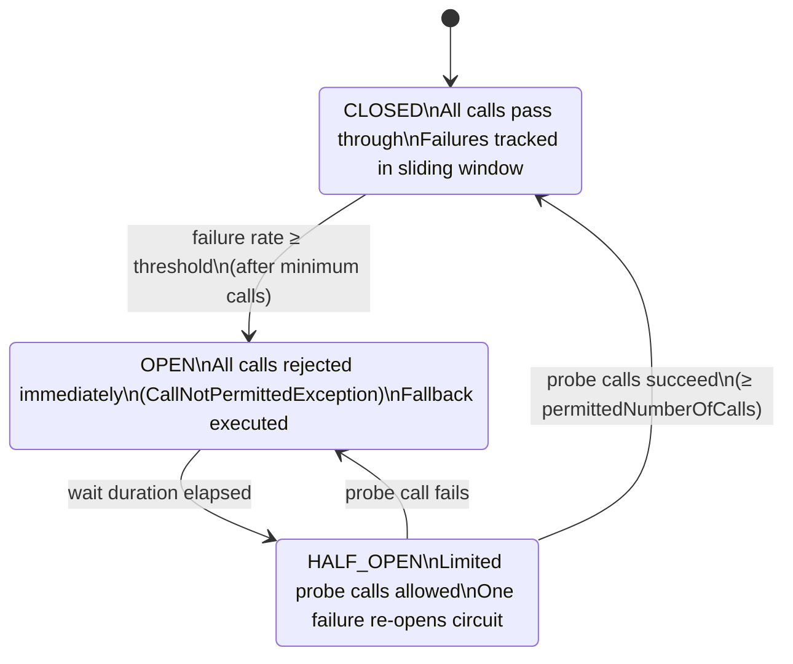

In distributed payment systems, remote dependencies fail. Card network APIs return 504s. Fraud-scoring services go into garbage collection pauses. Core banking connectors time out during batch windows. Without protective patterns, one slow dependency cascades into full service unavailability — the classic thread starvation failure. The **circuit breaker** is the first line of defence: it detects repeated failures on a dependency, stops sending requests while the dependency recovers, and re-admits traffic cautiously once conditions improve. Understanding exactly when and how to open a circuit is the difference between a five-minute incident and a three-hour outage.

## Learning Objectives

By the end of this lesson you will be able to:

- Describe the three circuit breaker states (CLOSED, OPEN, HALF_OPEN) and the transitions between them
- Configure a Resilience4j `CircuitBreaker` for a payment gateway integration, including `slidingWindowType`, `failureRateThreshold`, and `waitDurationInOpenState`
- Implement `@CircuitBreaker` with a typed fallback method in a Spring Boot service
- Distinguish between failures that should open the circuit (5xx, timeout) and those that must not (4xx validation errors)
- Query `CircuitBreakerRegistry` to expose circuit state in Actuator health checks
- Combine a circuit breaker with a bulkhead for defence-in-depth isolation
- Tune circuit breaker thresholds using real traffic percentiles rather than defaults
- Interpret `resilience4j.circuitbreaker.*` Micrometer metrics and set up alerts

## Business Context

In October 2021, a major European payment processor experienced a cascading failure that took their hosted checkout service offline for 4 hours and 20 minutes. The post-incident report revealed a familiar pattern: a card scheme authorisation API began returning intermittent 503 responses due to a database connection exhaustion on their side. The payment processor's checkout service had no circuit breaker — every incoming payment attempt created a new thread that blocked on the failing authorisation call until the 30-second read timeout expired. Within 90 seconds, all 800 available Tomcat threads were occupied waiting on a dead upstream. New checkout requests received connection refused errors from the load balancer, translating directly to lost authorisations. Estimated revenue impact: €2.3 million. The fix — a circuit breaker with a 50% failure threshold opening after 10 requests — was deployed in a two-line configuration change. The same failure mode two weeks later resulted in a 23-second customer impact rather than a 260-minute one.

## Circuit Breaker State Machine

A circuit breaker wraps a function call and tracks recent outcomes. It operates as a finite state machine with three states:



| State | Behaviour | Transition Trigger |
|---|---|---|
| **CLOSED** | Normal operation; all calls pass through | Failure rate ≥ `failureRateThreshold` after `minimumNumberOfCalls` |
| **OPEN** | All calls fail immediately with `CallNotPermittedException`; fallback runs | `waitDurationInOpenState` elapses |
| **HALF_OPEN** | `permittedNumberOfCallsInHalfOpenState` probe calls admitted | All probes succeed → CLOSED; any probe fails → OPEN |

The sliding window can be **count-based** (last N calls) or **time-based** (calls in last N seconds). Count-based is simpler to reason about for most payment services.

## Resilience4j Configuration

### application.yml

```yaml
resilience4j:
  circuitbreaker:
    instances:
      paymentGateway:
        # Count-based sliding window: evaluate last 20 calls
        slidingWindowType: COUNT_BASED
        slidingWindowSize: 20
        minimumNumberOfCalls: 10

        # Open circuit when ≥ 50% of calls fail
        failureRateThreshold: 50

        # Also open when ≥ 30% of calls are slow (> 2 seconds)
        slowCallRateThreshold: 30
        slowCallDurationThreshold: 2000ms

        # Stay OPEN for 30 seconds before trying HALF_OPEN
        waitDurationInOpenState: 30s

        # Allow 5 probe calls in HALF_OPEN
        permittedNumberOfCallsInHalfOpenState: 5

        # Automatically transition OPEN → HALF_OPEN after wait (no trigger needed)
        automaticTransitionFromOpenToHalfOpenEnabled: true

        # 4xx errors (bad request, unauthorized) are NOT failures — don't count them
        recordExceptions:
          - java.io.IOException
          - java.util.concurrent.TimeoutException
          - feign.RetryableException
        ignoreExceptions:
          - com.example.payments.exception.ValidationException
          - com.example.payments.exception.AuthenticationException

      fraudCheck:
        slidingWindowType: COUNT_BASED
        slidingWindowSize: 10
        minimumNumberOfCalls: 5
        failureRateThreshold: 60
        waitDurationInOpenState: 15s
        permittedNumberOfCallsInHalfOpenState: 3
        automaticTransitionFromOpenToHalfOpenEnabled: true
```

> [!IMPORTANT]
> Never record 4xx status codes as circuit breaker failures. A `400 Bad Request` means your request was invalid — the downstream service is working correctly. Opening the circuit on 4xx errors would cause the circuit to open under normal conditions when clients send malformed requests, creating a denial-of-service from your own traffic.

## Spring Boot Service Implementation

```java
// Java 17 — PaymentGatewayService with @CircuitBreaker
@Service
@Slf4j
public class PaymentGatewayService {

    private final PaymentGatewayClient gatewayClient;
    private final PaymentRepository     paymentRepository;

    public PaymentGatewayService(PaymentGatewayClient gatewayClient,
                                  PaymentRepository paymentRepository) {
        this.gatewayClient    = gatewayClient;
        this.paymentRepository = paymentRepository;
    }

    /**
     * Authorise a payment via the external card network gateway.
     * Circuit breaker wraps the remote call; fallback returns PENDING
     * so the payment is queued for async retry rather than failing the customer.
     */
    @CircuitBreaker(name = "paymentGateway", fallbackMethod = "authoriseFallback")
    public AuthorisationResult authorise(AuthorisationRequest request) {
        log.debug("Authorising payment {} via gateway", request.paymentId());
        return gatewayClient.authorise(request);
    }

    /**
     * Fallback: called when the circuit is OPEN or when the gateway throws
     * a recorded exception. Returns PENDING so upstream can retry asynchronously.
     *
     * Fallback method MUST have the same parameters as the guarded method
     * plus a final Throwable parameter.
     */
    private AuthorisationResult authoriseFallback(AuthorisationRequest request,
                                                    Throwable cause) {
        log.warn("Circuit open or gateway failure for payment {}: {}",
                 request.paymentId(), cause.getMessage());

        // Persist PENDING state so batch retry job picks it up
        paymentRepository.markPending(
            request.paymentId(),
            "GATEWAY_UNAVAILABLE: " + cause.getClass().getSimpleName()
        );

        return AuthorisationResult.pending(
            request.paymentId(),
            "Payment queued — gateway temporarily unavailable"
        );
    }

    /**
     * Batch retry: called by a scheduled job every 60 seconds.
     * No circuit breaker here — the circuit will reject if still open.
     */
    @CircuitBreaker(name = "paymentGateway", fallbackMethod = "retryFallback")
    public AuthorisationResult retryPending(UUID paymentId) {
        AuthorisationRequest request = paymentRepository.loadPending(paymentId);
        return gatewayClient.authorise(request);
    }

    private AuthorisationResult retryFallback(UUID paymentId, Throwable cause) {
        log.info("Retry deferred for payment {} — circuit still open", paymentId);
        return AuthorisationResult.deferred(paymentId);
    }
}
```

```java
// Java 21 — Programmatic circuit breaker using CircuitBreakerRegistry
@Service
@Slf4j
public class PaymentGatewayService {

    private final CircuitBreaker    circuitBreaker;
    private final PaymentGatewayClient gatewayClient;

    public PaymentGatewayService(CircuitBreakerRegistry registry,
                                  PaymentGatewayClient gatewayClient) {
        this.circuitBreaker = registry.circuitBreaker("paymentGateway");
        this.gatewayClient  = gatewayClient;

        // Register state transition event listener for alerting
        circuitBreaker.getEventPublisher()
            .onStateTransition(event -> log.warn(
                "Circuit breaker [paymentGateway] transitioned: {} → {}",
                event.getStateTransition().getFromState(),
                event.getStateTransition().getToState()
            ));
    }

    public AuthorisationResult authorise(AuthorisationRequest request) {
        // Decorate the call — Java 21 lambda + var inference
        var decorated = CircuitBreaker.decorateSupplier(
            circuitBreaker,
            () -> gatewayClient.authorise(request)
        );

        return Try.ofSupplier(decorated)
            .recover(CallNotPermittedException.class,
                     ex -> handleOpenCircuit(request, ex))
            .recover(IOException.class,
                     ex -> handleGatewayError(request, ex))
            .get();
    }

    private AuthorisationResult handleOpenCircuit(AuthorisationRequest request,
                                                    CallNotPermittedException ex) {
        log.warn("Circuit OPEN — fast-fail for payment {}", request.paymentId());
        return AuthorisationResult.pending(request.paymentId(), "CIRCUIT_OPEN");
    }

    private AuthorisationResult handleGatewayError(AuthorisationRequest request,
                                                     IOException ex) {
        log.error("Gateway IO error for payment {}: {}", request.paymentId(),
                  ex.getMessage());
        return AuthorisationResult.pending(request.paymentId(), "GATEWAY_ERROR");
    }

    public CircuitBreaker.State getCircuitState() {
        return circuitBreaker.getState();
    }

    public CircuitBreakerMetrics getMetrics() {
        return circuitBreaker.getMetrics();
    }
}
```

## Exposing Circuit State via Actuator

```java
// Custom HealthIndicator publishing circuit state to /actuator/health
@Component
public class PaymentGatewayCircuitHealthIndicator implements HealthIndicator {

    private final CircuitBreakerRegistry registry;

    public PaymentGatewayCircuitHealthIndicator(CircuitBreakerRegistry registry) {
        this.registry = registry;
    }

    @Override
    public Health health() {
        CircuitBreaker cb = registry.circuitBreaker("paymentGateway");
        CircuitBreakerMetrics metrics = cb.getMetrics();

        Health.Builder builder = switch (cb.getState()) {
            case CLOSED     -> Health.up();
            case HALF_OPEN  -> Health.unknown();
            case OPEN       -> Health.down();
            default         -> Health.unknown();
        };

        return builder
            .withDetail("state",            cb.getState())
            .withDetail("failureRate",      metrics.getFailureRate() + "%")
            .withDetail("slowCallRate",     metrics.getSlowCallRate() + "%")
            .withDetail("bufferedCalls",    metrics.getNumberOfBufferedCalls())
            .withDetail("failedCalls",      metrics.getNumberOfFailedCalls())
            .withDetail("successfulCalls",  metrics.getNumberOfSuccessfulCalls())
            .build();
    }
}
```

```yaml
# application.yml — expose circuit breaker in readiness health group
management:
  health:
    circuitbreakers:
      enabled: true
  endpoint:
    health:
      group:
        readiness:
          include: "db,kafka,circuitBreakers"
        liveness:
          include: "ping"
      show-details: when-authorized
```

## Metrics and Alerting

Resilience4j exposes Micrometer metrics automatically when `spring-boot-starter-actuator` and `resilience4j-micrometer` are on the classpath.

| Metric | Description | Alert Threshold |
|---|---|---|
| `resilience4j.circuitbreaker.state` | Current state (0=CLOSED, 1=OPEN, 2=HALF_OPEN) | Alert when state = 1 (OPEN) |
| `resilience4j.circuitbreaker.failure.rate` | Failure rate (%) in sliding window | Alert when > 40% |
| `resilience4j.circuitbreaker.slow.call.rate` | Slow call rate (%) | Alert when > 25% |
| `resilience4j.circuitbreaker.calls` | Tagged by kind: successful, failed, ignored, not_permitted | — |
| `resilience4j.circuitbreaker.buffered.calls` | Calls in the current sliding window | — |

```yaml
# Prometheus alert rule — PagerDuty fires when circuit is OPEN
groups:
  - name: circuit-breaker-alerts
    rules:
      - alert: PaymentGatewayCircuitOpen
        expr: resilience4j_circuitbreaker_state{name="paymentGateway"} == 1
        for: 10s
        labels:
          severity: critical
          team: payments
        annotations:
          summary: "Payment gateway circuit breaker OPEN"
          description: >
            Circuit breaker 'paymentGateway' has been OPEN for > 10s.
            All authorisations are returning PENDING and queuing for retry.
            Check {{ $labels.instance }} gateway health.

      - alert: PaymentGatewayHighFailureRate
        expr: resilience4j_circuitbreaker_failure_rate{name="paymentGateway"} > 40
        for: 60s
        labels:
          severity: warning
          team: payments
        annotations:
          summary: "Payment gateway failure rate elevated"
```

## Bulkhead + Circuit Breaker Combination

Circuit breakers detect failure patterns. Bulkheads limit resource consumption. Used together, they provide defence-in-depth: the bulkhead stops thread exhaustion before the circuit breaker even needs to open.

```java
// Stacked annotations: bulkhead isolates threads, circuit breaker trips on failures
@Service
public class PaymentGatewayService {

    @Bulkhead(name = "paymentGateway",
              type = Bulkhead.Type.THREADPOOL,
              fallbackMethod = "bulkheadFallback")
    @CircuitBreaker(name = "paymentGateway",
                    fallbackMethod = "authoriseFallback")
    public CompletableFuture<AuthorisationResult> authoriseAsync(
            AuthorisationRequest request) {
        return CompletableFuture.supplyAsync(
            () -> gatewayClient.authorise(request)
        );
    }

    private CompletableFuture<AuthorisationResult> bulkheadFallback(
            AuthorisationRequest request, BulkheadFullException ex) {
        log.warn("Thread pool full for payment {} — shedding request",
                 request.paymentId());
        return CompletableFuture.completedFuture(
            AuthorisationResult.rejected(request.paymentId(), "CAPACITY_EXCEEDED")
        );
    }

    private CompletableFuture<AuthorisationResult> authoriseFallback(
            AuthorisationRequest request, Throwable cause) {
        return CompletableFuture.completedFuture(
            AuthorisationResult.pending(request.paymentId(), "GATEWAY_UNAVAILABLE")
        );
    }
}
```

```yaml
# Combined bulkhead + circuit breaker configuration
resilience4j:
  thread-pool-bulkhead:
    instances:
      paymentGateway:
        maxThreadPoolSize: 20
        coreThreadPoolSize: 10
        queueCapacity: 50
        keepAliveDuration: 20ms

  circuitbreaker:
    instances:
      paymentGateway:
        slidingWindowType: COUNT_BASED
        slidingWindowSize: 20
        minimumNumberOfCalls: 10
        failureRateThreshold: 50
        waitDurationInOpenState: 30s
        permittedNumberOfCallsInHalfOpenState: 5
        automaticTransitionFromOpenToHalfOpenEnabled: true
```

## Tuning Guidelines

| Parameter | Starting Point | Rationale |
|---|---|---|
| `slidingWindowSize` | 20–50 | Small enough to react quickly; large enough to avoid noise |
| `minimumNumberOfCalls` | 10 | Don't open on cold start with 2 failures out of 2 |
| `failureRateThreshold` | 50% | Leaves headroom for transient errors; adjust down for critical paths |
| `waitDurationInOpenState` | 15–60s | Match to typical dependency recovery time (check SLA) |
| `permittedNumberOfCallsInHalfOpenState` | 3–10 | Enough probe calls to get a statistically meaningful signal |
| `slowCallDurationThreshold` | p99 of downstream × 1.5 | Catch degraded (not just failed) dependencies |

> [!TIP]
> Run a week of load testing or shadow traffic analysis before setting thresholds. Measure the p99 latency and error rate of your downstream. Set `slowCallDurationThreshold` at 1.5× the p99 latency. Set `failureRateThreshold` at 2× the baseline error rate. This ensures the circuit opens on genuine degradation, not normal variance.

---

<!-- KNOWLEDGE-CHECK [
  {
    "id": "kc-cb-01",
    "question": "A payment gateway returns HTTP 400 Bad Request because the request body is missing a required field. Should this count as a circuit breaker failure?",
    "options": [
      "Yes — any non-2xx response indicates the gateway is unhealthy",
      "No — 4xx errors indicate a problem with the request, not the gateway; they should be in ignoreExceptions",
      "Only if the 400 rate exceeds the failureRateThreshold",
      "Yes — but it should use a separate slowCallRateThreshold instead"
    ],
    "correct": 1,
    "explanation": "4xx errors (400, 401, 403, 404) indicate client-side problems — your request was invalid or unauthorised. The gateway itself is functioning correctly. Counting these as failures would cause the circuit to open whenever clients send bad requests, amplifying the problem rather than protecting against it. Only record exceptions that indicate the downstream is genuinely unavailable or degraded (5xx, IOException, TimeoutException)."
  },
  {
    "id": "kc-cb-02",
    "question": "Your circuit breaker transitioned to HALF_OPEN and allowed 5 probe calls. The first 4 succeeded; the 5th threw an IOException. What happens?",
    "options": [
      "The circuit returns to CLOSED because 80% of probes succeeded",
      "The circuit returns to OPEN and the waitDurationInOpenState timer resets",
      "The circuit remains in HALF_OPEN and waits for more probes",
      "The circuit transitions to CLOSED but records the failure in the sliding window"
    ],
    "correct": 1,
    "explanation": "In HALF_OPEN state, Resilience4j uses a strict rule: a single recorded failure during the probe phase immediately transitions the circuit back to OPEN and resets the wait duration timer. The circuit breaker is conservative — it requires all permitted probe calls to succeed before declaring the dependency recovered. This prevents premature recovery that would immediately re-expose the system to a still-failing dependency."
  }
] -->

---

<!-- PRACTICAL-CHALLENGE {
  "id": "pc-circuit-breaker",
  "title": "Circuit Breaker for Payment Gateway Integration",
  "description": "Implement and tune a circuit breaker for a card network authorisation service.",
  "tasks": [
    {
      "id": "pc-cb-01",
      "description": "Configure a Resilience4j circuit breaker named 'cardNetwork' in application.yml. Requirements: open after 50% failure rate across 20 calls, stay open for 45 seconds, allow 5 probe calls, record IOException and TimeoutException as failures, ignore ValidationException and UnauthorisedException."
    },
    {
      "id": "pc-cb-02",
      "description": "Implement a CardNetworkService with @CircuitBreaker annotation and a fallback method. The fallback must return an AuthorisationResult.pending() so the payment is queued for async retry via a Kafka topic 'payment-retries'."
    },
    {
      "id": "pc-cb-03",
      "description": "Implement a custom HealthIndicator that exposes the circuit breaker state, failure rate, and number of failed calls for the 'cardNetwork' circuit. Register it in the readiness health group."
    },
    {
      "id": "pc-cb-04",
      "description": "Write a Prometheus alert rule that pages the on-call engineer when the 'cardNetwork' circuit has been OPEN for more than 30 seconds. Justify your 'for' duration choice."
    }
  ]
} -->
