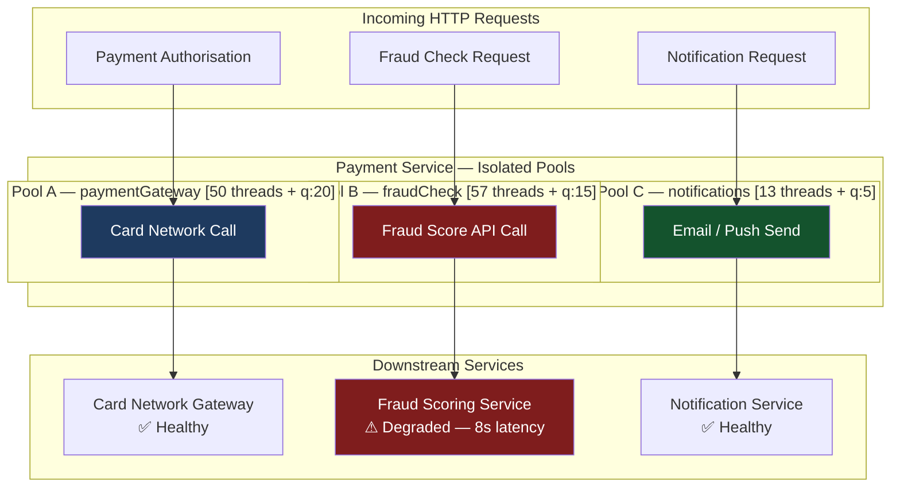
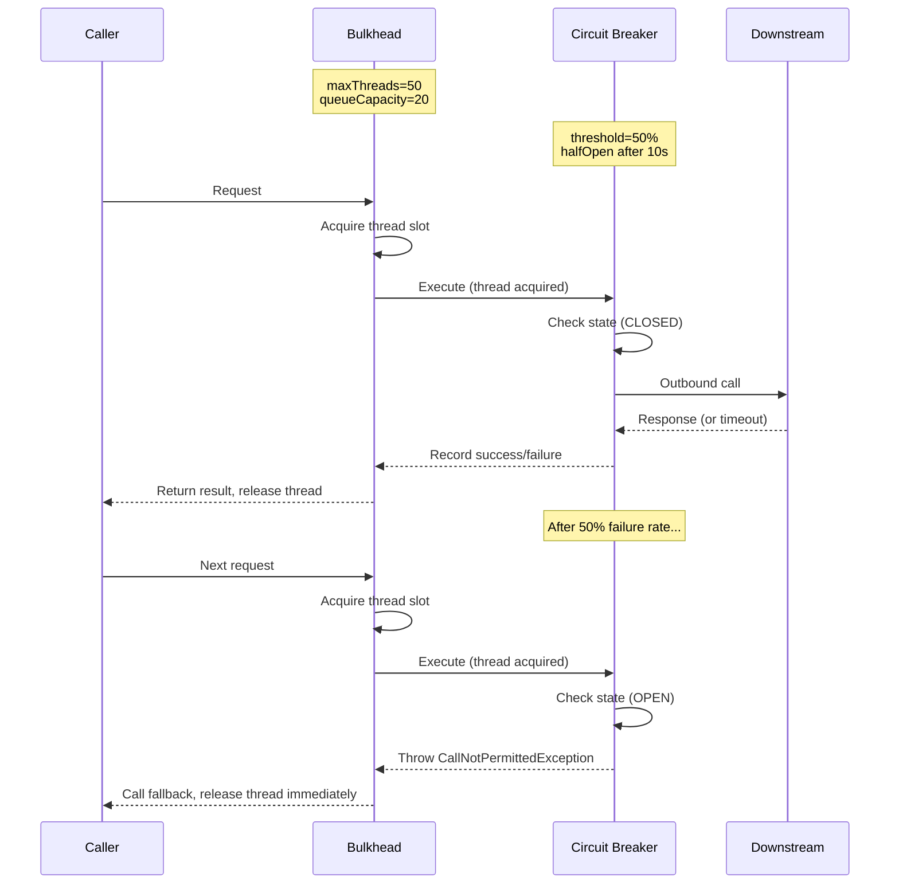

# Bulkhead Pattern — Isolating Failures with Thread Pools

The name comes from shipbuilding: a bulkhead is a watertight partition that prevents flooding in one compartment from sinking the entire hull. In a Java service, the equivalent partition is a dedicated thread pool or concurrency limit that prevents one slow downstream dependency from consuming every available thread and starving all other operations.

Without bulkheads, a 30-second timeout on a fraud-scoring call will eventually occupy every thread in a shared Tomcat pool — and payment authorisations, balance inquiries, and health checks all fail together even though the downstream services they depend on are perfectly healthy. Bulkheads are the structural solution: each dependency gets its own resource allocation, and a failure in one compartment stays there.

```
Ship Hull Cross-Section (Bulkhead Origin)
=========================================

   Before bulkheads:               After bulkheads:
   ┌──────────────────┐            ┌──────┬──────┬──────┐
   │                  │            │  A   │  B   │  C   │
   │    One flooded   │            │      │  ~~~ │      │
   │    compartment   │            │  OK  │FLOOD │  OK  │
   │    = entire ship │            │      │  ~~~ │      │
   │    sinks   ~~~~~ │            │      │      │      │
   └──────────────────┘            └──────┴──────┴──────┘
        CATASTROPHIC                   CONTAINED FAILURE
```

## Learning Objectives

By the end of this lesson you will be able to:

- Explain the difference between a thread pool bulkhead and a semaphore bulkhead and choose the appropriate type for a given scenario
- Configure a `ThreadPoolBulkhead` in Resilience4j for payment processing, fraud checking, and notifications with correct pool sizes
- Use Little's Law to calculate the minimum thread pool size required to meet a TPS target at a given latency
- Handle `BulkheadFullException` gracefully with a typed fallback method
- Design a service architecture where payments, fraud checks, and notifications occupy isolated resource pools
- Configure a semaphore bulkhead for a reactive (WebFlux) service
- Combine bulkheads with circuit breakers for defence-in-depth resilience
- Monitor bulkhead saturation via Micrometer metrics and alert before thread pool exhaustion

## Business Context

A European payments platform processing 2,400 transactions per second experienced a full service outage in March 2022 that lasted 112 minutes. The root cause: a fraud-scoring microservice developed a memory leak after a dependency upgrade, causing individual fraud check calls to degrade from 15ms to 8,000ms over a 20-minute window.

The payment service called both fraud scoring and card-network authorisation from the same shared Spring MVC thread pool (200 threads, Tomcat default). As fraud checks slowed, threads began accumulating. After 18 minutes, all 200 threads were occupied on slow fraud calls. Card-network authorisation calls, which were completing in 45ms, could not be executed — there were no threads available. The service appeared completely down from the load balancer's perspective.

Customer payments failed entirely. The fraud service's memory leak caused the payment authorisation service to fail.

**Post-incident action:** Separate thread pools, separate circuit breakers, separate health checks.

**Estimated revenue loss:** €1.4 million.

## Thread Pool Bulkhead vs Semaphore Bulkhead

Resilience4j provides two bulkhead implementations, each with distinct isolation characteristics:

| Characteristic | Thread Pool Bulkhead | Semaphore Bulkhead |
|---|---|---|
| **Isolation mechanism** | Dedicated thread pool per dependency | Concurrency counter |
| **Async execution** | Yes — call runs on pool's threads | No — caller thread executes, semaphore limits concurrency |
| **Caller thread released** | Immediately (non-blocking) | Blocked until semaphore acquired or wait timeout |
| **Best for** | Blocking I/O (RestTemplate, JDBC) | Reactive code (WebFlux, non-blocking I/O) |
| **Resource overhead** | Higher (dedicated threads) | Low (counter only) |
| **Timeout support** | Yes (`queueCapacity` + `keepAliveDuration`) | Yes (`maxWaitDuration`) |
| **Return type** | `CompletableFuture<T>` | `T` (synchronous) |

> [!NOTE]
> Use **thread pool bulkheads** when calling blocking dependencies from a servlet-based (Spring MVC) service. Use **semaphore bulkheads** when you are already on a reactive stack (Project Reactor / WebFlux) where thread-per-request is not the execution model.

## Bulkhead Architecture for a Payment Service

The following architecture shows the three isolated resource pools in a payment service. Notice that each downstream dependency has its own pool, and a failure in one pool cannot bleed into another.



If the Fraud Scoring Service degrades, Pool B fills up. Pool A (payments) and Pool C (notifications) are unaffected — their threads continue processing independently. This is the structural guarantee of the bulkhead pattern.

## Sizing with Little's Law

Before configuring pool sizes, calculate the required concurrency mathematically. **Little's Law** states:

> **L = λ × W**
>
> Where L = average number of requests in the system (concurrency), λ = arrival rate (TPS), W = average service time (seconds)

**Example calculation — payment gateway pool:**
- Target throughput: 500 payments/second
- Expected average latency: 80ms (0.08s)
- Required pool size: L = 500 × 0.08 = **40 threads**
- Add 25% headroom for spikes: **50 threads**

**Example calculation — fraud check pool:**
- Fraud checks run on 60% of transactions: 300/second
- Expected average latency: 150ms (0.15s)
- Required pool size: L = 300 × 0.15 = **45 threads**
- Add 25% headroom: **57 threads → round to 57**

**Example calculation — notifications pool:**
- Notification sends: 50/second
- Expected average latency: 200ms (0.20s)
- Required pool size: L = 50 × 0.20 = **10 threads**
- Add 25% headroom: **13 threads**

| Pool | TPS | Avg Latency | Little's Law L | +25% Headroom | Queue Capacity |
|---|---|---|---|---|---|
| Payment Gateway | 500 | 80ms | 40 | 50 | 20 |
| Fraud Check | 300 | 150ms | 45 | 57 | 15 |
| Notifications | 50 | 200ms | 10 | 13 | 5 |

> [!WARNING]
> Little's Law assumes a stable system (arrival rate equals departure rate). During a downstream degradation event, W increases sharply. If fraud check latency degrades from 150ms to 8,000ms and you are still receiving 300 TPS, the required concurrency jumps to L = 300 × 8.0 = 2,400 threads — far beyond your configured maximum. This is intentional: the pool should become full and trigger the fallback rather than consuming unbounded resources.

## Resilience4j Configuration

```yaml
# application.yml — thread pool and semaphore bulkheads
resilience4j:
  thread-pool-bulkhead:
    instances:
      paymentGateway:
        maxThreadPoolSize: 50
        coreThreadPoolSize: 30
        # Queue 20 extra requests before rejecting (brief spike buffer)
        queueCapacity: 20
        keepAliveDuration: 20ms

      fraudCheck:
        maxThreadPoolSize: 57
        coreThreadPoolSize: 40
        queueCapacity: 15
        keepAliveDuration: 20ms

      notifications:
        maxThreadPoolSize: 13
        coreThreadPoolSize: 8
        queueCapacity: 5
        keepAliveDuration: 30ms

  bulkhead:
    # Semaphore bulkhead for reactive FX rate calls
    instances:
      fxRateService:
        maxConcurrentCalls: 15
        maxWaitDuration: 10ms
```

## Java Implementation — Thread Pool Bulkhead

```java
// Java 17 — PaymentProcessingService with @Bulkhead (thread pool type)
@Service
@Slf4j
public class PaymentProcessingService {

    private final CardNetworkClient  cardNetworkClient;
    private final FraudScoringClient fraudClient;
    private final NotificationClient notificationClient;

    public PaymentProcessingService(CardNetworkClient cardNetworkClient,
                                     FraudScoringClient fraudClient,
                                     NotificationClient notificationClient) {
        this.cardNetworkClient  = cardNetworkClient;
        this.fraudClient        = fraudClient;
        this.notificationClient = notificationClient;
    }

    /**
     * Card network authorisation — isolated in payment gateway thread pool.
     * Returns CompletableFuture because thread pool bulkhead is inherently async.
     */
    @Bulkhead(name = "paymentGateway",
              type = Bulkhead.Type.THREADPOOL,
              fallbackMethod = "authoriseFallback")
    public CompletableFuture<AuthorisationResult> authorise(PaymentRequest request) {
        return CompletableFuture.completedFuture(
            cardNetworkClient.authorise(request)
        );
    }

    /**
     * Fallback: called when paymentGateway thread pool is saturated.
     * BulkheadFullException means queue is exhausted — shed the request.
     */
    private CompletableFuture<AuthorisationResult> authoriseFallback(
            PaymentRequest request, BulkheadFullException ex) {
        log.warn("Payment gateway bulkhead full for payment {}", request.id());
        return CompletableFuture.completedFuture(
            AuthorisationResult.rejected(request.id(), "CAPACITY_EXCEEDED")
        );
    }

    /**
     * Fraud check — isolated in separate fraudCheck pool.
     * Fraud pool saturation CANNOT block card authorisation pool.
     */
    @Bulkhead(name = "fraudCheck",
              type = Bulkhead.Type.THREADPOOL,
              fallbackMethod = "fraudFallback")
    public CompletableFuture<FraudScore> checkFraud(PaymentRequest request) {
        return CompletableFuture.completedFuture(
            fraudClient.score(request)
        );
    }

    /**
     * Fraud fallback: fail open — allow payment, flag for async manual review.
     * This is a business decision: blocking payments when fraud service is down
     * is worse than allowing potentially fraudulent payments for a brief window.
     */
    private CompletableFuture<FraudScore> fraudFallback(
            PaymentRequest request, BulkheadFullException ex) {
        log.warn("Fraud bulkhead full — failing open for payment {}", request.id());
        return CompletableFuture.completedFuture(
            FraudScore.degraded(request.id())
        );
    }

    /**
     * Notification — lowest priority, isolated, best-effort.
     */
    @Bulkhead(name = "notifications",
              type = Bulkhead.Type.THREADPOOL,
              fallbackMethod = "notificationFallback")
    public CompletableFuture<Void> sendNotification(PaymentResult result) {
        return CompletableFuture.runAsync(
            () -> notificationClient.send(result)
        );
    }

    private CompletableFuture<Void> notificationFallback(
            PaymentResult result, BulkheadFullException ex) {
        log.info("Notification dropped for payment {} — pool full", result.paymentId());
        return CompletableFuture.completedFuture(null);
    }
}
```

## Java Implementation — Programmatic Bulkhead with Event Monitoring

```java
// Java 21 — Programmatic bulkhead with event monitoring
@Service
@Slf4j
public class FraudScoringService {

    private final ThreadPoolBulkhead bulkhead;
    private final FraudScoringClient fraudClient;

    public FraudScoringService(ThreadPoolBulkheadRegistry registry,
                                FraudScoringClient fraudClient) {
        this.bulkhead    = registry.bulkhead("fraudCheck");
        this.fraudClient = fraudClient;

        // Log rejection events for capacity planning
        bulkhead.getEventPublisher()
            .onCallRejected(event -> {
                var metrics = bulkhead.getMetrics();
                log.warn("Fraud bulkhead rejected call. Queue: {}/{}, Threads: {}/{}",
                         metrics.getQueueDepth(),
                         bulkhead.getBulkheadConfig().getQueueCapacity(),
                         metrics.getThreadPoolSize(),
                         bulkhead.getBulkheadConfig().getMaxThreadPoolSize());
            });
    }

    public CompletableFuture<FraudScore> score(PaymentRequest request) {
        return ThreadPoolBulkhead
            .decorateSupplier(bulkhead, () -> fraudClient.score(request))
            .get()
            .exceptionally(ex -> switch (ex) {
                case BulkheadFullException bfe -> FraudScore.degraded(request.id());
                default -> throw new RuntimeException(ex);
            });
    }
}
```

## Semaphore Bulkhead for Reactive Services

When your service uses Project Reactor or WebFlux, the thread-per-request model no longer applies. Use a semaphore bulkhead to bound concurrency without creating dedicated threads.

```java
// Java 17 — Reactive FX rate service with semaphore bulkhead
@Service
public class FxRateService {

    private final Bulkhead     fxBulkhead;
    private final FxRateClient fxClient;
    private final FxRateCache  rateCache;

    public FxRateService(BulkheadRegistry registry,
                          FxRateClient fxClient,
                          FxRateCache rateCache) {
        // Semaphore type — does NOT create threads; limits concurrency count
        this.fxBulkhead = registry.bulkhead("fxRateService");
        this.fxClient   = fxClient;
        this.rateCache  = rateCache;
    }

    /**
     * Semaphore bulkhead: appropriate for reactive (WebFlux) pipeline.
     * Limits concurrent FX rate calls to maxConcurrentCalls (15).
     */
    @Bulkhead(name = "fxRateService",
              type = Bulkhead.Type.SEMAPHORE,
              fallbackMethod = "cachedRateFallback")
    public Mono<ExchangeRate> getRate(String currencyPair) {
        return fxClient.getRate(currencyPair)
            .timeout(Duration.ofMillis(500));
    }

    /**
     * Stale cache fallback — return last known rate with staleness marker.
     * FX risk system will warn traders the rate may be outdated.
     */
    private Mono<ExchangeRate> cachedRateFallback(String currencyPair,
                                                    BulkheadFullException ex) {
        return rateCache.get(currencyPair)
            .map(rate -> rate.withStalenessWarning(true))
            .switchIfEmpty(Mono.error(new FxRateUnavailableException(currencyPair)));
    }
}
```

## Combining Bulkhead with Circuit Breaker

Bulkheads and circuit breakers address different failure modes and are complementary:

- **Bulkhead** prevents one slow dependency from starving thread resources. It limits concurrency.
- **Circuit breaker** stops calling a dependency that is failing. It limits total call attempts.

Use them together: the bulkhead bounds resource usage while the circuit breaker prevents wasted calls to a failing service.



```yaml
# application.yml — bulkhead + circuit breaker for fraudCheck
resilience4j:
  thread-pool-bulkhead:
    instances:
      fraudCheck:
        maxThreadPoolSize: 57
        coreThreadPoolSize: 40
        queueCapacity: 15

  circuitbreaker:
    instances:
      fraudCheck:
        # Ties to same "fraudCheck" name as bulkhead
        slidingWindowType: COUNT_BASED
        slidingWindowSize: 20
        failureRateThreshold: 50
        waitDurationInOpenState: 10s
        permittedNumberOfCallsInHalfOpenState: 5
```

```java
// Java 17 — Combining both patterns on a single method
@Service
@Slf4j
public class FraudCheckOrchestrator {

    // Order matters: bulkhead outer, circuit breaker inner
    // Bulkhead ensures we don't hold too many threads.
    // Circuit breaker short-circuits if service is failing.
    @Bulkhead(name = "fraudCheck",
              type = Bulkhead.Type.THREADPOOL,
              fallbackMethod = "fraudFallback")
    @CircuitBreaker(name = "fraudCheck",
                    fallbackMethod = "fraudFallback")
    public CompletableFuture<FraudScore> checkFraud(PaymentRequest request) {
        return CompletableFuture.completedFuture(
            fraudClient.score(request)
        );
    }

    // This fallback handles BOTH BulkheadFullException AND CallNotPermittedException
    private CompletableFuture<FraudScore> fraudFallback(
            PaymentRequest request, Exception ex) {
        String reason = switch (ex) {
            case BulkheadFullException bfe   -> "BULKHEAD_FULL";
            case CallNotPermittedException c -> "CIRCUIT_OPEN";
            default                          -> "UNKNOWN";
        };
        log.warn("Fraud check skipped for payment {} — reason={}", request.id(), reason);
        return CompletableFuture.completedFuture(
            FraudScore.degraded(request.id())
        );
    }
}
```

## BulkheadRegistry — Programmatic Configuration

For dynamic configuration (e.g., different pool sizes per merchant tier), configure the registry programmatically:

```java
@Configuration
public class BulkheadConfiguration {

    @Bean
    public ThreadPoolBulkheadRegistry threadPoolBulkheadRegistry() {
        ThreadPoolBulkheadConfig paymentConfig = ThreadPoolBulkheadConfig.custom()
            .maxThreadPoolSize(50)
            .coreThreadPoolSize(30)
            .queueCapacity(20)
            .keepAliveDuration(Duration.ofMillis(20))
            .build();

        ThreadPoolBulkheadConfig fraudConfig = ThreadPoolBulkheadConfig.custom()
            .maxThreadPoolSize(57)
            .coreThreadPoolSize(40)
            .queueCapacity(15)
            .keepAliveDuration(Duration.ofMillis(20))
            .build();

        ThreadPoolBulkheadConfig notifConfig = ThreadPoolBulkheadConfig.custom()
            .maxThreadPoolSize(13)
            .coreThreadPoolSize(8)
            .queueCapacity(5)
            .keepAliveDuration(Duration.ofMillis(30))
            .build();

        return ThreadPoolBulkheadRegistry.of(Map.of(
            "paymentGateway", paymentConfig,
            "fraudCheck",     fraudConfig,
            "notifications",  notifConfig
        ));
    }

    @Bean
    public BulkheadRegistry semaphoreBulkheadRegistry() {
        BulkheadConfig fxConfig = BulkheadConfig.custom()
            .maxConcurrentCalls(15)
            .maxWaitDuration(Duration.ofMillis(10))
            .build();

        return BulkheadRegistry.of(Map.of("fxRateService", fxConfig));
    }
}
```

## Health Indicator

Expose bulkhead capacity as a Spring Boot health check so load balancers can remove degraded instances before they exhaust:

```java
@Component
public class BulkheadHealthIndicator implements HealthIndicator {

    private final ThreadPoolBulkheadRegistry registry;

    public BulkheadHealthIndicator(ThreadPoolBulkheadRegistry registry) {
        this.registry = registry;
    }

    @Override
    public Health health() {
        Map<String, Object> details = new LinkedHashMap<>();
        boolean anyDown = false;

        for (ThreadPoolBulkhead bh : registry.getAllBulkheads()) {
            ThreadPoolBulkhead.Metrics m = bh.getMetrics();
            int max       = bh.getBulkheadConfig().getMaxThreadPoolSize();
            int available = max - m.getThreadPoolSize();
            double pct    = (double) available / max * 100.0;

            Map<String, Object> poolDetails = Map.of(
                "maxThreads",       max,
                "activeThreads",    m.getThreadPoolSize(),
                "availableThreads", available,
                "queueDepth",       m.getQueueDepth(),
                "capacityPct",      String.format("%.1f%%", pct)
            );
            details.put(bh.getName(), poolDetails);

            if (pct < 20.0) {
                anyDown = true;
            }
        }

        return anyDown
            ? Health.down().withDetails(details).build()
            : Health.up().withDetails(details).build();
    }
}
```

## Monitoring Bulkhead Saturation

```yaml
# prometheus-rules.yml — bulkhead saturation alerts
groups:
  - name: bulkhead-alerts
    rules:

      - alert: PaymentBulkheadNearSaturation
        expr: |
          (resilience4j_bulkhead_available_concurrent_calls{name="paymentGateway"}
           / resilience4j_bulkhead_max_allowed_concurrent_calls{name="paymentGateway"})
          < 0.20
        for: 30s
        labels:
          severity: warning
        annotations:
          summary: "Payment gateway bulkhead > 80% saturated"
          description: "Available threads below 20%. Rejection risk in next 30s."

      - alert: FraudBulkheadRejecting
        expr: |
          increase(resilience4j_bulkhead_calls_total{
            name="fraudCheck", kind="rejected"
          }[1m]) > 10
        for: 0s
        labels:
          severity: warning
        annotations:
          summary: "Fraud check bulkhead rejecting calls"
          description: "More than 10 bulkhead rejections in the last minute. \
                        Fraud pool may need resizing or fraud service is degrading."

      - alert: AnyBulkheadQueueExhausted
        expr: |
          resilience4j_bulkhead_queue_depth / resilience4j_bulkhead_queue_capacity > 0.90
        for: 15s
        labels:
          severity: critical
        annotations:
          summary: "Bulkhead queue at 90% — rejections imminent"
```

| Metric | Description | Alert Threshold |
|---|---|---|
| `resilience4j.bulkhead.available.concurrent.calls` | Current available capacity | < 20% → Warning |
| `resilience4j.bulkhead.max.allowed.concurrent.calls` | Configured maximum | — |
| `resilience4j.bulkhead.calls` | Successfully executed calls | — |
| `resilience4j.bulkhead.calls` | Rejected (pool full) calls | > 0.5% of total → Review sizing |
| `resilience4j.bulkhead.queue_depth` | Current queue occupancy | > 90% capacity → Critical |

> [!TIP]
> Set up a capacity planning review whenever the `rejected` metric for any bulkhead exceeds 0.5% of total calls over a 24-hour period. This signals that Little's Law assumptions (latency or TPS) have changed and the pool needs resizing.

## Production Pitfalls

### Pitfall 1: Undersizing the Queue — Dropping Legitimate Spikes

A common mistake is setting `queueCapacity` to zero or a very small value to "fail fast," then observing a high rejection rate during normal traffic peaks (e.g., end-of-day settlement runs).

```java
// WRONG — queueCapacity=0 means immediate rejection if all threads busy
ThreadPoolBulkheadConfig badConfig = ThreadPoolBulkheadConfig.custom()
    .maxThreadPoolSize(10)
    .coreThreadPoolSize(10)
    .queueCapacity(0)   // <-- Zero queue: any spike causes rejection
    .build();

// BETTER — model queue to absorb a ~200ms spike at peak TPS
// If peak TPS=200, avg latency=100ms, threads=20:
// In a 200ms spike, up to 200*0.2=40 extra requests can arrive.
// Queue of 20 handles half that burst cleanly.
ThreadPoolBulkheadConfig goodConfig = ThreadPoolBulkheadConfig.custom()
    .maxThreadPoolSize(20)
    .coreThreadPoolSize(15)
    .queueCapacity(20)   // 1–2 seconds of burst absorption
    .keepAliveDuration(Duration.ofMillis(20))
    .build();
```

**Rule of thumb:** Set `queueCapacity` to approximately 25–50% of `maxThreadPoolSize`. A queue that is too large re-introduces the problem you are trying to solve (unbounded resource consumption during prolonged degradation). A queue that is too small increases false rejections during transient spikes.

---

### Pitfall 2: Using Semaphore Bulkhead with Blocking I/O

The semaphore bulkhead does NOT free the calling thread. It merely limits how many callers can proceed concurrently. If you apply a semaphore bulkhead in a Spring MVC (Tomcat) service to a blocking REST call, the Tomcat thread is still occupied for the entire call duration — you gain isolation in name only.

```java
// WRONG — semaphore bulkhead in a Tomcat (blocking) service
// The Tomcat thread is blocked throughout the call even though a
// semaphore slot was "acquired." Tomcat pool will still fill up.
@Bulkhead(name = "fraudCheck",
          type = Bulkhead.Type.SEMAPHORE,  // <-- Wrong type for Tomcat
          fallbackMethod = "fraudFallback")
public FraudScore checkFraud(PaymentRequest request) {
    // RestTemplate is blocking — Tomcat thread held for the full duration
    return restTemplate.postForObject("/score", request, FraudScore.class);
}

// CORRECT — thread pool bulkhead for blocking I/O in Tomcat
@Bulkhead(name = "fraudCheck",
          type = Bulkhead.Type.THREADPOOL,  // <-- Moves call off Tomcat thread
          fallbackMethod = "fraudFallbackAsync")
public CompletableFuture<FraudScore> checkFraud(PaymentRequest request) {
    return CompletableFuture.completedFuture(
        restTemplate.postForObject("/score", request, FraudScore.class)
    );
    // Tomcat thread returns immediately; call runs on fraudCheck pool thread
}

private CompletableFuture<FraudScore> fraudFallbackAsync(
        PaymentRequest request, BulkheadFullException ex) {
    return CompletableFuture.completedFuture(FraudScore.degraded(request.id()));
}
```

**Diagnostic test:** Under load, monitor `jvm.threads.states{state=blocked}`. If this rises when downstream calls are slow despite having a bulkhead, you likely have a semaphore bulkhead where a thread pool bulkhead is needed.

---

### Pitfall 3: Forgetting That Fallback Method Signatures Must Match Exactly

Resilience4j's AOP-based `@Bulkhead` requires the fallback method to have exactly the same parameter types as the primary method plus one additional exception parameter. A signature mismatch silently skips the fallback and rethrows the exception — often causing a 500 error where you expected a graceful degradation.

```java
// WRONG — fallback parameter order incorrect; exception type too broad
@Bulkhead(name = "fraudCheck",
          type = Bulkhead.Type.THREADPOOL,
          fallbackMethod = "fraudFallback")
public CompletableFuture<FraudScore> checkFraud(PaymentRequest request) {
    return CompletableFuture.completedFuture(fraudClient.score(request));
}

// This signature will NOT be matched by Resilience4j AOP:
// - Exception must be LAST parameter
// - Return type must match (CompletableFuture<FraudScore>)
private CompletableFuture<FraudScore> fraudFallback(
        BulkheadFullException ex,     // WRONG: exception must be last
        PaymentRequest request) {
    return CompletableFuture.completedFuture(FraudScore.degraded(request.id()));
}

// CORRECT — primary params first, exception last, return type matches
private CompletableFuture<FraudScore> fraudFallback(
        PaymentRequest request,          // Same params as primary, same order
        BulkheadFullException ex) {      // Exception LAST
    log.warn("Fraud bulkhead full: payment={} reason={}", request.id(), ex.getMessage());
    return CompletableFuture.completedFuture(FraudScore.degraded(request.id()));
}
```

**Verification strategy:** Write an integration test that saturates the pool using a `CountDownLatch` to hold all pool threads, then issue one more request and assert the fallback result is returned — not an exception.

```java
@SpringBootTest
class BulkheadFallbackVerificationTest {

    @Autowired
    FraudCheckOrchestrator orchestrator;

    @Test
    void whenBulkheadFull_fallbackReturnsDegradedScore() throws Exception {
        int maxThreads = 57;
        int queueCapacity = 15;
        CountDownLatch holdThreads = new CountDownLatch(1);
        CountDownLatch allThreadsOccupied = new CountDownLatch(maxThreads + queueCapacity);

        // Fill pool + queue
        for (int i = 0; i < maxThreads + queueCapacity; i++) {
            orchestrator.checkFraud(blockingRequest(holdThreads, allThreadsOccupied));
        }

        // Wait until all threads/queue entries are occupied
        allThreadsOccupied.await(5, TimeUnit.SECONDS);

        // This request should trigger the fallback
        CompletableFuture<FraudScore> result =
            orchestrator.checkFraud(PaymentRequest.sample());

        FraudScore score = result.get(1, TimeUnit.SECONDS);
        assertThat(score.isDegraded()).isTrue();

        holdThreads.countDown(); // Release all held threads
    }
}
```

## Checklist

Before deploying bulkheads to production, verify each item:

- [ ] Pool sizes calculated with Little's Law using measured p95 latency and peak TPS
- [ ] 25% headroom added to Little's Law result for latency spikes
- [ ] `queueCapacity` set to 25–50% of `maxThreadPoolSize`
- [ ] Thread pool bulkhead used for all blocking I/O in Spring MVC services
- [ ] Semaphore bulkhead used only in WebFlux / reactive pipelines
- [ ] Each `@Bulkhead` annotation has a matching `fallbackMethod` with correct signature
- [ ] Fallback method signature: same params as primary + exception last + same return type
- [ ] Fallback return type is `CompletableFuture<T>` for thread pool bulkheads
- [ ] Bulkhead combined with circuit breaker for each downstream dependency
- [ ] `BulkheadHealthIndicator` deployed and exposed via `/actuator/health`
- [ ] Prometheus alert fires when available capacity < 20%
- [ ] Integration test verifies fallback is invoked when pool is saturated (not an exception)
- [ ] `resilience4j.bulkhead.calls` metric visible in Grafana dashboard
- [ ] Pool sizes re-reviewed any time p95 downstream latency increases by > 20%

---

<!-- KNOWLEDGE-CHECK [
  {
    "id": "kc-bh-01",
    "question": "Your service uses Spring MVC (Tomcat) and calls a fraud-scoring REST API using RestTemplate. Which bulkhead type is appropriate and why?",
    "options": [
      "Semaphore bulkhead — it has lower overhead and works with any framework",
      "Thread pool bulkhead — it moves the blocking call off the Tomcat thread, returning the caller thread to the pool immediately",
      "Semaphore bulkhead — thread pool bulkheads only work with WebFlux",
      "Either type — the choice has no meaningful difference for Tomcat services"
    ],
    "correct": 1,
    "explanation": "In a Tomcat servlet application, each HTTP request occupies a Tomcat thread. A semaphore bulkhead limits concurrency but the caller (Tomcat) thread still blocks during the downstream call — it still consumes a Tomcat thread until the call completes. A thread pool bulkhead moves the blocking I/O call to a separate dedicated thread and immediately returns the Tomcat thread so it can serve other requests. This decoupling of request thread lifecycle from downstream call duration is the key advantage of thread pool bulkheads in blocking I/O scenarios."
  },
  {
    "id": "kc-bh-02",
    "question": "Your payment service processes 400 TPS. Card network calls average 100ms. Using Little's Law, what is the minimum thread pool size for the card network bulkhead (before headroom)?",
    "options": [
      "40 threads",
      "400 threads",
      "4 threads",
      "100 threads"
    ],
    "correct": 0,
    "explanation": "Little's Law: L = λ × W. λ = 400 requests/second; W = 0.100 seconds (100ms). L = 400 × 0.100 = 40 threads. This is the average concurrency needed. Add 25–30% headroom for latency spikes to reach approximately 50–52 threads as the final pool size. A pool smaller than 40 threads will cause queue buildup and eventual rejection at the target throughput."
  },
  {
    "id": "kc-bh-03",
    "question": "Your fraud check bulkhead is configured with maxThreadPoolSize=57 and queueCapacity=15. The fraud service degrades from 150ms to 6,000ms per call. Your service receives 300 TPS. What happens within approximately 25 seconds of the degradation beginning?",
    "options": [
      "The bulkhead adapts dynamically and increases thread count to absorb the load",
      "The queue fills, then the pool fills, then all new fraud check requests hit the fallback — the payment gateway pool is unaffected",
      "All threads across all pools are blocked because thread pools share a JVM executor",
      "The circuit breaker prevents any degradation since it fires before the bulkhead fills"
    ],
    "correct": 1,
    "explanation": "With 300 TPS at 6,000ms latency, Little's Law requires L = 300 × 6.0 = 1,800 concurrent threads. The fraud pool only has 57 threads and a queue of 15. Within seconds, all 72 slots (57 threads + 15 queue) fill with slow calls. All subsequent fraud requests hit BulkheadFullException and the fallback immediately. The key insight: Pool B (fraud) becomes saturated, but Pool A (payments) and Pool C (notifications) are completely unaffected — this is the entire point of the bulkhead pattern. The circuit breaker would open only after the pool has been full long enough to register failures — the bulkhead acts as the first line of containment."
  }
] -->

---

<!-- PRACTICAL-CHALLENGE {
  "id": "pc-bulkhead",
  "title": "Bulkhead Isolation for Multi-Dependency Payment Service",
  "description": "Design and implement thread pool bulkheads to prevent cascading failures in a payment service with three downstream dependencies.",
  "difficulty": "advanced",
  "estimatedMinutes": 70,
  "tasks": [
    {
      "id": "pc-bh-01",
      "title": "Size Thread Pools with Little's Law",
      "description": "Using Little's Law, calculate the required thread pool sizes for three downstream calls: (a) card network at 400 TPS with 100ms avg latency, (b) fraud scoring at 120 TPS with 180ms avg latency, (c) notifications at 30 TPS with 250ms avg latency. Add 25% headroom to each. Set queueCapacity to 25% of maxThreadPoolSize. Show your working in comments and configure application.yml with the results."
    },
    {
      "id": "pc-bh-02",
      "title": "Implement Payment Orchestration with Isolated Bulkheads",
      "description": "Implement a PaymentOrchestrationService that calls all three dependencies in parallel using CompletableFuture.allOf(), with @Bulkhead(type=THREADPOOL) on each method. The fraud check fallback must fail open (return FraudScore.LOW_RISK + set a manual review flag). The notification fallback must silently drop. The card network fallback must return AuthorisationResult.PENDING with a reason of CAPACITY_EXCEEDED."
    },
    {
      "id": "pc-bh-03",
      "title": "Combine Bulkhead with Circuit Breaker",
      "description": "Add @CircuitBreaker(name='fraudCheck') to the fraud check method alongside the @Bulkhead annotation. Write a single fallback method that handles both BulkheadFullException and CallNotPermittedException, logging a different message for each. Write a unit test using WireMock to verify: (1) normal path returns real score, (2) bulkhead-full triggers fallback with BULKHEAD_FULL reason, (3) circuit-open triggers fallback with CIRCUIT_OPEN reason."
    },
    {
      "id": "pc-bh-04",
      "title": "Build a BulkheadHealthIndicator",
      "description": "Write a BulkheadHealthIndicator that iterates all registered ThreadPoolBulkheads, computes available capacity percentage for each, and reports Health.down() with details if any pool is below 20% available capacity. Include poolName, activeThreads, maxThreads, queueDepth, and capacityPct in the health details map. Write a unit test with a mock registry that verifies the down state when a pool is at 85% utilisation."
    }
  ]
} -->
