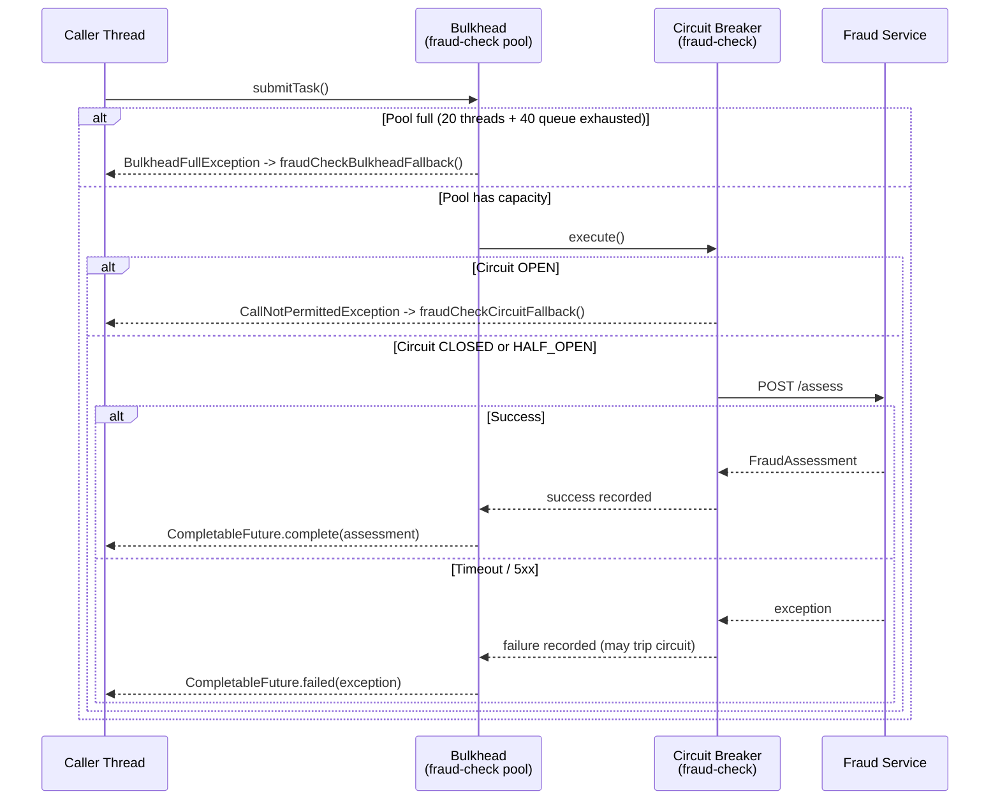

A payment service calls three downstream dependencies: a fraud-scoring API, an account-lookup service, and a notification gateway. The fraud API degrades under load, responding in 8 seconds instead of 200ms. Within two minutes every thread in the shared pool is blocked waiting for fraud responses. Account lookups — which were healthy — now queue indefinitely. Notifications never fire. The entire payment flow collapses because of a single slow dependency.

The **bulkhead pattern** prevents this. Named after the watertight compartments in a ship's hull — where flooding one compartment does not sink the vessel — a bulkhead in software isolates resource pools per dependency. If the fraud API consumes all threads allocated to it, it cannot touch the threads reserved for account lookups or notifications. The rest of the system keeps working.

## The Origin: Ship Compartments to Microservices

```
  SHIP HULL (without bulkheads)        SHIP HULL (with bulkheads)
  +----------------------------+       +--------+-------+----------+
  |                            |       |  FWD   |  MID  |   AFT    |
  |   ONE BREACH = TOTAL LOSS  |       |        | /////  |          |
  |                            |       |  DRY   | FLOOD |   DRY    |
  +----------------------------+       +--------+-------+----------+
                                        One compartment floods; ship survives
```

Michael Nygard introduced the term "bulkhead" in *Release It!* (2007) to describe partitioning thread pools by downstream dependency. Netflix adopted it in Hystrix (2012). Resilience4j provides a modern, non-blocking implementation with both thread-pool and semaphore variants.

The analogy maps precisely to microservices:

| Ship Component | Microservice Equivalent |
|---|---|
| Hull compartment | Thread pool or semaphore partition |
| Water | Blocked threads / latent requests |
| Breach | Slow/failing dependency |
| Watertight door | Bulkhead reject threshold |
| Ship survives | Service degrades partially, not totally |

## Thread Pool Bulkhead vs Semaphore Bulkhead

Resilience4j ships two bulkhead implementations with fundamentally different isolation strategies.

### Semaphore Bulkhead

A semaphore bulkhead uses a counting semaphore to limit the number of concurrent calls. It executes on the **caller's thread** — there is no separate pool. The semaphore is decremented when a call enters and incremented when it exits.

```
  Caller Thread --> acquire(semaphore) --> execute --> release(semaphore)
                         |
                    maxConcurrent = 5
                    (blocks or rejects when 5 slots taken)
```

Use this when the downstream call is inherently async or uses non-blocking I/O (WebClient, R2DBC). You want low overhead without spawning additional threads.

### Thread Pool Bulkhead

A thread pool bulkhead uses a dedicated `ExecutorService`. Calls are submitted to this pool and execute on a **separate thread**. If the pool's queue is full, calls are rejected immediately.

```
  Caller Thread --> submit(task) --> ThreadPool[coreSize=10, queueSize=20]
                         |                     |
                    CompletableFuture    worker-1 --> HTTP call to fraud API
                    returned immediately worker-2 --> HTTP call to fraud API
                                         ...
                                         [QUEUE: up to 20 waiting]
                                         [REJECT when queue full]
```

Use this when the downstream call uses blocking I/O (RestTemplate, JDBC, synchronous SDK). You want true thread isolation so the caller thread is never blocked.

### Comparison Table

| Dimension | Semaphore Bulkhead | Thread Pool Bulkhead |
|---|---|---|
| Execution thread | Caller thread | Dedicated pool thread |
| Overhead | Very low | Moderate (thread context switch) |
| Blocking I/O isolation | Partial — caller thread still blocks | Full — caller thread never blocks |
| Queue support | No — reject immediately | Yes — configurable queue |
| Best for | Non-blocking / reactive | Blocking I/O |
| Configuration class | `BulkheadConfig` | `ThreadPoolBulkheadConfig` |
| Annotation type | `Bulkhead.Type.SEMAPHORE` | `Bulkhead.Type.THREADPOOL` |

## Sizing Bulkheads with Little's Law

Before writing configuration, you need to know **how large** each partition should be. Arbitrary numbers lead to either under-utilisation (wasteful) or under-sizing (unnecessary rejections).

**Little's Law** (from queueing theory, 1961):

```
N = lambda x W
```

Where:
- **N** = average number of requests in the system (threads needed)
- **lambda** = average arrival rate (requests per second)
- **W** = average service time (seconds per request)

### Payment Service Example

| Dependency | Arrival Rate | P99 Response Time | Threads Needed | With 30% Buffer |
|---|---|---|---|---|
| Fraud Check | 50 req/s | 300ms (0.3s) | 50 x 0.3 = 15 | 20 |
| Account Lookup | 50 req/s | 120ms (0.12s) | 50 x 0.12 = 6 | 8 (round to 10) |
| Notification | 10 req/s | 400ms (0.4s) | 10 x 0.4 = 4 | 5 |

The safety buffer of 30% absorbs traffic spikes. Using P99 (not P50) response time is intentional — you are sizing for realistic worst-case latency, not the happy path.

```
Little's Law for Fraud Check:
  lambda = 50 req/s
  W      = 0.300 s (P99)
  N      = 50 x 0.300 = 15 threads

  With 30% buffer: ceil(15 x 1.3) = 20 threads
  Queue depth:     2x thread count = 40
```

Queue depth of 2x the thread count allows bursting while keeping wait times short. A queue of 100x would cause callers to wait far too long before seeing a rejection.

## Resilience4j Bulkhead Configuration

### Maven Dependencies

```xml
<dependency>
    <groupId>io.github.resilience4j</groupId>
    <artifactId>resilience4j-spring-boot3</artifactId>
    <version>2.2.0</version>
</dependency>
<dependency>
    <groupId>io.github.resilience4j</groupId>
    <artifactId>resilience4j-bulkhead</artifactId>
    <version>2.2.0</version>
</dependency>
<dependency>
    <groupId>org.springframework.boot</groupId>
    <artifactId>spring-boot-starter-aop</artifactId>
</dependency>
```

### application.yml — Three Bulkheads for Payment Service

```yaml
resilience4j:
  thread-pool-bulkhead:
    instances:
      fraud-check:
        # Sized by Little's Law: 50 req/s x 300ms P99 = 15, +30% = 20
        core-thread-pool-size: 20
        max-thread-pool-size: 20        # Fixed pool — no elastic sizing surprises
        queue-capacity: 40              # 2x thread count
        keep-alive-duration: 20ms
        writable-stack-trace-enabled: true

      account-lookup:
        core-thread-pool-size: 10
        max-thread-pool-size: 10
        queue-capacity: 20
        keep-alive-duration: 20ms
        writable-stack-trace-enabled: true

      notification:
        core-thread-pool-size: 5
        max-thread-pool-size: 5
        queue-capacity: 10
        keep-alive-duration: 20ms
        writable-stack-trace-enabled: true

  bulkhead:
    # Semaphore bulkhead for reactive/non-blocking paths
    instances:
      fraud-check-reactive:
        max-concurrent-calls: 20
        max-wait-duration: 0ms          # Fail fast — never queue on semaphore

  circuit-breaker:
    instances:
      fraud-check:
        register-health-indicator: true
        sliding-window-size: 10
        failure-rate-threshold: 50
        wait-duration-in-open-state: 10s
        permitted-number-of-calls-in-half-open-state: 3
        slow-call-duration-threshold: 1s
        slow-call-rate-threshold: 70
      account-lookup:
        register-health-indicator: true
        sliding-window-size: 10
        failure-rate-threshold: 50
        wait-duration-in-open-state: 10s
```

## Full Payment Service Implementation

### Domain Model

```java
package com.fintech.payment.domain;

public record PaymentRequest(
    String paymentId,
    String merchantId,
    String accountId,
    java.math.BigDecimal amount,
    String currency
) {}

public record PaymentResult(
    String paymentId,
    PaymentStatus status,
    String message,
    boolean fraudApproved,
    boolean accountVerified,
    boolean notificationSent
) {}

public enum PaymentStatus {
    APPROVED, DECLINED, PENDING, DEGRADED
}
```

### Fraud Check Client with Thread Pool Bulkhead

```java
package com.fintech.payment.client;

import io.github.resilience4j.bulkhead.annotation.Bulkhead;
import io.github.resilience4j.circuitbreaker.annotation.CircuitBreaker;
import org.springframework.stereotype.Component;
import org.springframework.web.client.RestTemplate;

import java.math.BigDecimal;
import java.util.concurrent.CompletableFuture;
import java.util.concurrent.TimeUnit;

@Component
public class FraudCheckClient {

    private final RestTemplate restTemplate;

    public FraudCheckClient(RestTemplate restTemplate) {
        this.restTemplate = restTemplate;
    }

    /**
     * Thread pool bulkhead isolates fraud-check threads.
     * Circuit breaker is the inner decorator (closer to the HTTP call).
     * Returns CompletableFuture because ThreadPoolBulkhead is async.
     */
    @Bulkhead(name = "fraud-check", type = Bulkhead.Type.THREADPOOL,
              fallbackMethod = "fraudCheckBulkheadFallback")
    @CircuitBreaker(name = "fraud-check", fallbackMethod = "fraudCheckCircuitFallback")
    public CompletableFuture<FraudAssessment> assessFraud(
            String paymentId, String merchantId, BigDecimal amount) {

        return CompletableFuture.supplyAsync(() -> {
            String url = "http://fraud-service/api/v1/assess";
            FraudRequest request = new FraudRequest(paymentId, merchantId, amount);
            return restTemplate.postForObject(url, request, FraudAssessment.class);
        }).orTimeout(500, TimeUnit.MILLISECONDS);
    }

    /**
     * Fallback invoked when bulkhead is full (BulkheadFullException).
     * Degrade gracefully: allow low-risk transactions under $500.
     */
    public CompletableFuture<FraudAssessment> fraudCheckBulkheadFallback(
            String paymentId,
            String merchantId,
            BigDecimal amount,
            io.github.resilience4j.bulkhead.BulkheadFullException e) {
        boolean allowThrough = amount.compareTo(new BigDecimal("500")) < 0;
        return CompletableFuture.completedFuture(
            new FraudAssessment(paymentId, allowThrough, "BULKHEAD_DEGRADED", 0.0)
        );
    }

    /**
     * Fallback invoked when circuit breaker is OPEN.
     */
    public CompletableFuture<FraudAssessment> fraudCheckCircuitFallback(
            String paymentId,
            String merchantId,
            BigDecimal amount,
            Exception e) {
        boolean allowThrough = amount.compareTo(new BigDecimal("100")) < 0;
        return CompletableFuture.completedFuture(
            new FraudAssessment(paymentId, allowThrough, "CIRCUIT_OPEN", 0.0)
        );
    }

    public record FraudRequest(String paymentId, String merchantId,
                                BigDecimal amount) {}

    public record FraudAssessment(String paymentId, boolean approved,
                                   String source, double riskScore) {}
}
```

### Account Lookup Client

```java
package com.fintech.payment.client;

import io.github.resilience4j.bulkhead.annotation.Bulkhead;
import io.github.resilience4j.circuitbreaker.annotation.CircuitBreaker;
import org.springframework.stereotype.Component;
import org.springframework.web.client.RestTemplate;

import java.util.concurrent.CompletableFuture;
import java.util.concurrent.TimeUnit;

@Component
public class AccountLookupClient {

    private final RestTemplate restTemplate;

    public AccountLookupClient(RestTemplate restTemplate) {
        this.restTemplate = restTemplate;
    }

    @Bulkhead(name = "account-lookup", type = Bulkhead.Type.THREADPOOL,
              fallbackMethod = "accountLookupFallback")
    @CircuitBreaker(name = "account-lookup", fallbackMethod = "accountCircuitFallback")
    public CompletableFuture<AccountDetails> lookupAccount(String accountId) {
        return CompletableFuture.supplyAsync(() -> {
            String url = "http://account-service/api/v1/accounts/" + accountId;
            return restTemplate.getForObject(url, AccountDetails.class);
        }).orTimeout(300, TimeUnit.MILLISECONDS);
    }

    // Account lookup is mandatory — bulkhead full means payment must pend
    public CompletableFuture<AccountDetails> accountLookupFallback(
            String accountId,
            io.github.resilience4j.bulkhead.BulkheadFullException e) {
        return CompletableFuture.failedFuture(
            new AccountLookupUnavailableException(
                "Account lookup bulkhead full for account: " + accountId)
        );
    }

    public CompletableFuture<AccountDetails> accountCircuitFallback(
            String accountId, Exception e) {
        return CompletableFuture.failedFuture(
            new AccountLookupUnavailableException(
                "Account lookup circuit open for account: " + accountId)
        );
    }

    public record AccountDetails(String accountId, String status,
                                  String currency, boolean verified) {}

    public static class AccountLookupUnavailableException extends RuntimeException {
        public AccountLookupUnavailableException(String message) { super(message); }
    }
}
```

### Notification Client

```java
package com.fintech.payment.client;

import io.github.resilience4j.bulkhead.annotation.Bulkhead;
import org.springframework.stereotype.Component;
import org.springframework.web.client.RestTemplate;

import java.util.concurrent.CompletableFuture;

@Component
public class NotificationClient {

    private final RestTemplate restTemplate;

    public NotificationClient(RestTemplate restTemplate) {
        this.restTemplate = restTemplate;
    }

    /**
     * Notifications are non-critical: bulkhead full means silent discard.
     * No circuit breaker — notification failure must NEVER affect payment outcomes.
     */
    @Bulkhead(name = "notification", type = Bulkhead.Type.THREADPOOL,
              fallbackMethod = "notificationFallback")
    public CompletableFuture<Void> sendNotification(
            String paymentId, String accountId, String status) {
        return CompletableFuture.runAsync(() -> {
            String url = "http://notification-service/api/v1/notify";
            restTemplate.postForObject(url,
                new NotificationRequest(paymentId, accountId, status), Void.class);
        });
    }

    // Best-effort: bulkhead full means silently drop the notification
    public CompletableFuture<Void> notificationFallback(
            String paymentId, String accountId, String status,
            io.github.resilience4j.bulkhead.BulkheadFullException e) {
        return CompletableFuture.completedFuture(null);
    }

    public record NotificationRequest(String paymentId,
                                       String accountId, String status) {}
}
```

### Payment Orchestrator

```java
package com.fintech.payment.service;

import com.fintech.payment.client.AccountLookupClient;
import com.fintech.payment.client.FraudCheckClient;
import com.fintech.payment.client.NotificationClient;
import com.fintech.payment.domain.PaymentRequest;
import com.fintech.payment.domain.PaymentResult;
import com.fintech.payment.domain.PaymentStatus;
import org.springframework.stereotype.Service;

import java.util.concurrent.CompletableFuture;
import java.util.concurrent.TimeUnit;

@Service
public class PaymentOrchestrator {

    private final FraudCheckClient fraudCheckClient;
    private final AccountLookupClient accountLookupClient;
    private final NotificationClient notificationClient;

    public PaymentOrchestrator(FraudCheckClient fraudCheckClient,
                                AccountLookupClient accountLookupClient,
                                NotificationClient notificationClient) {
        this.fraudCheckClient = fraudCheckClient;
        this.accountLookupClient = accountLookupClient;
        this.notificationClient = notificationClient;
    }

    public PaymentResult processPayment(PaymentRequest request) {
        // Execute fraud check and account lookup in parallel.
        // Each runs in its OWN isolated thread pool — fraud slowdown
        // cannot consume account-lookup threads.
        CompletableFuture<FraudCheckClient.FraudAssessment> fraudFuture =
            fraudCheckClient.assessFraud(
                request.paymentId(), request.merchantId(), request.amount());

        CompletableFuture<AccountLookupClient.AccountDetails> accountFuture =
            accountLookupClient.lookupAccount(request.accountId());

        try {
            CompletableFuture.allOf(fraudFuture, accountFuture)
                .get(2, TimeUnit.SECONDS);

            var fraud = fraudFuture.join();
            var account = accountFuture.join();

            if (!fraud.approved()) {
                return new PaymentResult(request.paymentId(), PaymentStatus.DECLINED,
                    "Fraud check declined", false, account.verified(), false);
            }

            if (!account.verified()) {
                return new PaymentResult(request.paymentId(), PaymentStatus.DECLINED,
                    "Account not verified", fraud.approved(), false, false);
            }

            // Both checks passed — fire notification asynchronously
            notificationClient
                .sendNotification(request.paymentId(), request.accountId(), "APPROVED")
                .exceptionally(ex -> null); // notification failure never blocks payment

            return new PaymentResult(request.paymentId(), PaymentStatus.APPROVED,
                "Payment approved", true, true, true);

        } catch (AccountLookupClient.AccountLookupUnavailableException e) {
            return new PaymentResult(request.paymentId(), PaymentStatus.PENDING,
                "Account lookup unavailable, queued for retry", false, false, false);

        } catch (java.util.concurrent.TimeoutException e) {
            fraudFuture.cancel(true);
            accountFuture.cancel(true);
            return new PaymentResult(request.paymentId(), PaymentStatus.PENDING,
                "Processing timeout, queued for retry", false, false, false);

        } catch (Exception e) {
            return new PaymentResult(request.paymentId(), PaymentStatus.PENDING,
                "Unexpected error: " + e.getMessage(), false, false, false);
        }
    }
}
```

## Combining Bulkhead with Circuit Breaker — Order Matters

**Correct order:** Bulkhead (outer) wraps Circuit Breaker (inner) wraps the actual call.

```
Request
  |
  v
[BULKHEAD]           <-- Reject if thread pool full (resource limit)
  |  Accept
  v
[CIRCUIT BREAKER]    <-- Reject if circuit OPEN (dependency health)
  |  Accept
  v
[ACTUAL CALL]        <-- Execute HTTP/DB call
```



**Why bulkhead outside circuit breaker?**

If the circuit breaker is the outer decorator, a CLOSED circuit allows unlimited threads into the bulkhead. The circuit breaker sees failures and trips — but thread exhaustion can happen before enough failures accumulate. Bulkhead outermost means resource limits are enforced unconditionally.

### Programmatic Decoration for Explicit Control

```java
package com.fintech.payment.config;

import io.github.resilience4j.bulkhead.ThreadPoolBulkhead;
import io.github.resilience4j.bulkhead.ThreadPoolBulkheadRegistry;
import io.github.resilience4j.circuitbreaker.CircuitBreaker;
import io.github.resilience4j.circuitbreaker.CircuitBreakerRegistry;
import org.springframework.context.annotation.Bean;
import org.springframework.context.annotation.Configuration;

import java.util.concurrent.CompletableFuture;
import java.util.function.Function;
import java.util.function.Supplier;

@Configuration
public class ResilienceConfig {

    /**
     * Programmatic decoration with explicit ordering:
     * Bulkhead (outer) wraps Circuit Breaker (inner).
     */
    @Bean
    public Function<String, CompletableFuture<String>> decoratedFraudCall(
            ThreadPoolBulkheadRegistry bulkheadRegistry,
            CircuitBreakerRegistry circuitBreakerRegistry) {

        ThreadPoolBulkhead bulkhead = bulkheadRegistry.bulkhead("fraud-check");
        CircuitBreaker circuitBreaker = circuitBreakerRegistry.circuitBreaker("fraud-check");

        return paymentId -> {
            // Inner: circuit breaker decorates the actual call
            Supplier<String> fraudCall = CircuitBreaker.decorateSupplier(
                circuitBreaker,
                () -> callFraudService(paymentId)
            );
            // Outer: bulkhead wraps the circuit-breaker-decorated supplier
            return bulkhead.executeSupplier(fraudCall);
        };
    }

    private String callFraudService(String paymentId) {
        // RestTemplate / HTTP call
        return "APPROVED";
    }
}
```

## Bulkhead Events

Resilience4j emits typed events when bulkhead state changes.

```java
package com.fintech.payment.monitoring;

import io.github.resilience4j.bulkhead.Bulkhead;
import io.github.resilience4j.bulkhead.BulkheadRegistry;
import io.github.resilience4j.bulkhead.ThreadPoolBulkhead;
import io.github.resilience4j.bulkhead.ThreadPoolBulkheadRegistry;
import io.micrometer.core.instrument.Counter;
import io.micrometer.core.instrument.MeterRegistry;
import jakarta.annotation.PostConstruct;
import org.slf4j.Logger;
import org.slf4j.LoggerFactory;
import org.springframework.stereotype.Component;

@Component
public class BulkheadEventListener {

    private static final Logger log = LoggerFactory.getLogger(BulkheadEventListener.class);

    private final ThreadPoolBulkheadRegistry threadPoolRegistry;
    private final BulkheadRegistry semaphoreRegistry;
    private final MeterRegistry meterRegistry;

    public BulkheadEventListener(ThreadPoolBulkheadRegistry threadPoolRegistry,
                                   BulkheadRegistry semaphoreRegistry,
                                   MeterRegistry meterRegistry) {
        this.threadPoolRegistry = threadPoolRegistry;
        this.semaphoreRegistry = semaphoreRegistry;
        this.meterRegistry = meterRegistry;
    }

    @PostConstruct
    public void registerListeners() {
        threadPoolRegistry.getAllBulkheads().forEach(this::attachThreadPoolListeners);
        semaphoreRegistry.getAllBulkheads().forEach(this::attachSemaphoreListeners);
    }

    private void attachThreadPoolListeners(ThreadPoolBulkhead bulkhead) {
        String name = bulkhead.getName();

        Counter rejectedCounter = Counter.builder("bulkhead.rejected.calls")
            .tag("bulkhead", name)
            .tag("type", "thread-pool")
            .description("Calls rejected by thread pool bulkhead")
            .register(meterRegistry);

        bulkhead.getEventPublisher()
            // BulkheadOnCallPermitAcquiredEvent
            .onCallPermitAcquired(event ->
                log.debug("[BULKHEAD] {} permit acquired — queue: {}",
                    name, bulkhead.getMetrics().getQueueDepth()))
            // BulkheadOnCallRejectedEvent
            .onCallRejected(event -> {
                rejectedCounter.increment();
                log.warn("[BULKHEAD] {} REJECTED — pool: {}, queue: {}",
                    name,
                    bulkhead.getMetrics().getThreadPoolSize(),
                    bulkhead.getMetrics().getQueueDepth());
            })
            // BulkheadOnCallFinishedEvent
            .onCallFinished(event ->
                log.debug("[BULKHEAD] {} call finished", name));
    }

    private void attachSemaphoreListeners(Bulkhead bulkhead) {
        String name = bulkhead.getName();

        Counter rejectedCounter = Counter.builder("bulkhead.rejected.calls")
            .tag("bulkhead", name)
            .tag("type", "semaphore")
            .register(meterRegistry);

        bulkhead.getEventPublisher()
            .onCallPermitAcquired(event ->
                log.debug("[SEM BULKHEAD] {} permit acquired", name))
            .onCallRejected(event -> {
                rejectedCounter.increment();
                log.warn("[SEM BULKHEAD] {} REJECTED — available: {}",
                    name, bulkhead.getMetrics().getAvailableConcurrentCalls());
            })
            .onCallFinished(event ->
                log.debug("[SEM BULKHEAD] {} finished", name));
    }
}
```

## Micrometer Metrics and Alerting

```yaml
# application.yml
management:
  health:
    bulkheads:
      enabled: true
  endpoint:
    health:
      show-details: always
  metrics:
    export:
      prometheus:
        enabled: true
```

```
# Key metrics exposed automatically via /actuator/metrics:
resilience4j.bulkhead.available.concurrent.calls{bulkhead="fraud-check"}
resilience4j.bulkhead.max.allowed.concurrent.calls{bulkhead="fraud-check"}

# Custom rejection counter (registered above):
bulkhead.rejected.calls{bulkhead="fraud-check",type="thread-pool"}
```

Prometheus alert rules:

```yaml
groups:
  - name: bulkhead_alerts
    rules:
      - alert: BulkheadHighRejectionRate
        expr: rate(bulkhead_rejected_calls_total[5m]) > 1
        for: 2m
        labels:
          severity: warning
        annotations:
          summary: "Bulkhead {{ $labels.bulkhead }} rejecting calls"
          description: >
            Rejecting > 1 call/second for 2 minutes. Review thread pool sizing
            using Little's Law with current P99 latency metrics.

      - alert: BulkheadPoolExhausted
        expr: resilience4j_bulkhead_available_concurrent_calls{bulkhead="fraud-check"} == 0
        for: 30s
        labels:
          severity: critical
        annotations:
          summary: "Fraud check bulkhead fully exhausted"
```

## Architecture Summary

```
Payment Request
       |
       v
+------------------------------------------------------------------+
|                   Payment Orchestrator                           |
|                                                                  |
|  +----------------------+   +----------------------+            |
|  |   fraud-check pool   |   |  account-lookup pool  |           |
|  |   [20 threads]       |   |  [10 threads]         |           |
|  |   [40 queue]         |   |  [20 queue]           |           |
|  |   + circuit breaker  |   |  + circuit breaker    |           |
|  +----------+-----------+   +----------+------------+           |
|             | parallel                 | parallel               |
|             v                          v                        |
|      Fraud Service              Account Service                  |
|      (may degrade)              (healthy)                        |
|                                                                  |
|  +----------------------+                                        |
|  |  notification pool   |  <-- fire-and-forget after both above |
|  |  [5 threads]         |                                        |
|  |  [10 queue]          |                                        |
|  |  NO circuit breaker  |  <-- notification failure = silent    |
|  +----------------------+                                        |
+------------------------------------------------------------------+

Fraud pool full  --> fraudCheckBulkheadFallback (allow <$500 through)
Account pool full --> PENDING  (mandatory check, cannot skip)
Notification full --> silent discard (best-effort only)
```

## Production Pitfalls

### Pitfall 1: All Thread Pools the Same Size Defeats the Purpose

Giving every bulkhead the same thread count is a common mistake. It eliminates the isolation benefit and wastes JVM resources.

```java
// WRONG: uniform large pools eliminate isolation benefit
//
// application.yml (WRONG):
//   fraud-check:    max-thread-pool-size: 50
//   account-lookup: max-thread-pool-size: 50
//   notification:   max-thread-pool-size: 50
//
// At 150 total threads, you are likely near OS thread limits.
// When fraud degrades to 2000ms response time:
//   50 threads fill in: 50 / (1/2.0) = 25 seconds
//   But account-lookup still holds 50 idle threads, wasting memory.
//   The JVM scheduler becomes unfair under saturation.

// CORRECT: size each pool independently with Little's Law
//   fraud-check:    20  (lambda=50, W=300ms)
//   account-lookup: 10  (lambda=50, W=120ms)
//   notification:    5  (lambda=10, W=400ms)
//   Total:          35 threads — 76% reduction with proper isolation

// Diagnostic: validate sizing on startup
@Component
public class BulkheadSizingValidator {

    private static final Logger log =
        LoggerFactory.getLogger(BulkheadSizingValidator.class);

    @PostConstruct
    public void validate(ThreadPoolBulkheadRegistry registry) {
        registry.getAllBulkheads().forEach(bh -> {
            int pool  = bh.getBulkheadConfig().getCoreThreadPoolSize();
            int queue = bh.getBulkheadConfig().getQueueCapacity();
            log.info("[SIZING] {} — pool={}, queue={}, total={}",
                bh.getName(), pool, queue, pool + queue);
        });
    }
}
```

### Pitfall 2: Not Setting a Timeout Causes Silent Thread Leaks

A thread pool bulkhead limits **concurrency** but not **duration**. A downstream call that hangs indefinitely holds its thread forever. The pool appears full to new callers — but it is not busy processing, just waiting for a dead connection.

```java
// WRONG: no timeout; threads block forever on a hung dependency
@Bulkhead(name = "fraud-check", type = Bulkhead.Type.THREADPOOL)
public CompletableFuture<FraudAssessment> assessFraud(String paymentId) {
    return CompletableFuture.supplyAsync(() ->
        // If fraud-service TCP connection hangs:
        //   - thread blocks indefinitely
        //   - all 20 pool threads fill up over 20 successive requests
        //   - bulkhead shows "full" but dependency is dead, not busy
        restTemplate.postForObject("http://fraud-service/assess",
            new FraudRequest(paymentId), FraudAssessment.class)
    );
}

// CORRECT: timeout at both HTTP client AND CompletableFuture level
@Bulkhead(name = "fraud-check", type = Bulkhead.Type.THREADPOOL,
          fallbackMethod = "fraudCheckBulkheadFallback")
public CompletableFuture<FraudAssessment> assessFraud(String paymentId) {
    return CompletableFuture.supplyAsync(() ->
        restTemplate.postForObject("http://fraud-service/assess",
            new FraudRequest(paymentId), FraudAssessment.class)
    ).orTimeout(500, java.util.concurrent.TimeUnit.MILLISECONDS);
    // orTimeout() cancels the future after 500ms and throws TimeoutException
    // The circuit breaker records this as a slow/failed call
}

// Also configure RestTemplate timeouts (defense-in-depth):
@Bean
public RestTemplate restTemplate() {
    var factory = new org.springframework.http.client.SimpleClientHttpRequestFactory();
    factory.setConnectTimeout(1_000);  // 1s connection timeout
    factory.setReadTimeout(500);       // 500ms read timeout
    return new RestTemplate(factory);
}
```

### Pitfall 3: Bulkhead Without Circuit Breaker Allows Slow Degradation

A bulkhead prevents thread exhaustion from spreading across pools, but without a circuit breaker, calls within that pool still execute and fail one by one. The service degrades slowly rather than failing fast.

```
Timeline: Fraud service starts returning 503s at T=0

WITHOUT circuit breaker (bulkhead only):
  T=0s:   20 threads in pool, 0 failures recorded
  T=10s:  20 threads x 500ms timeout = 40 failed calls, callers waited 500ms each
  T=20s:  80 total failed calls; bulkhead queue now filling
  T=30s:  120 failed calls; queue exhausted; bulkhead finally rejecting
  Result: Every caller waited 500ms per request during the entire degradation period

WITH circuit breaker (bulkhead + CB):
  T=0s:   20 threads in pool, circuit CLOSED
  T=5s:   10 failures hit 50% failure rate threshold
  T=5s:   Circuit OPENS immediately
  T=5s+:  All calls rejected in <1ms via CallNotPermittedException
  Result: Fast failure after only 5s; thread pool drains rapidly

// WRONG: bulkhead only
@Bulkhead(name = "fraud-check", type = Bulkhead.Type.THREADPOOL)
public CompletableFuture<FraudAssessment> assessFraud(String id) { ... }

// CORRECT: always pair thread pool bulkhead with circuit breaker
@Bulkhead(name = "fraud-check", type = Bulkhead.Type.THREADPOOL,
          fallbackMethod = "fraudCheckBulkheadFallback")
@CircuitBreaker(name = "fraud-check", fallbackMethod = "fraudCheckCircuitFallback")
public CompletableFuture<FraudAssessment> assessFraud(String id) { ... }
// Annotation execution: bulkhead (outer) -> circuit breaker (inner) -> HTTP call
```

## Checklist

- [ ] Sized each bulkhead independently using Little's Law (N = lambda x W x 1.3 safety buffer)
- [ ] Used `ThreadPoolBulkhead` for all blocking I/O calls (RestTemplate, JDBC)
- [ ] Used semaphore `Bulkhead` only for non-blocking / reactive calls
- [ ] Applied bulkhead decorator outside (wrapping) circuit breaker decorator
- [ ] Set timeouts at HTTP client level (connect + read) AND CompletableFuture level
- [ ] Implemented meaningful fallback for each bulkhead (not just re-throwing)
- [ ] Registered bulkhead event listeners with Micrometer rejection counters
- [ ] Added Prometheus alert for rejection rate above threshold
- [ ] Tested that fraud service degradation does NOT affect account lookup threads
- [ ] Configured actuator health indicator to show bulkhead status
- [ ] Documented thread pool sizing rationale in comments with current lambda and W values
- [ ] Verified total thread count across all pools fits within JVM thread budget
- [ ] Set up Grafana dashboards showing queue depth and rejection rates per bulkhead

<!-- KNOWLEDGE-CHECK
{"questions":[{"text":"You have a fraud-check service with an arrival rate of 100 requests/second and a P99 response time of 200ms. Using Little's Law with a 30% safety buffer, what is the correct thread pool size?","options":["a) 10 threads","b) 20 threads","c) 26 threads","d) 40 threads"],"correct":2,"explanation":"Little's Law: N = lambda x W = 100 x 0.200 = 20 threads. With 30% safety buffer: ceil(20 x 1.3) = 26 threads. Option c is correct."},{"text":"What happens when you apply @Bulkhead (outer) and @CircuitBreaker (inner) to the same method in Resilience4j Spring AOP?","options":["a) The circuit breaker checks OPEN state first, then the bulkhead checks thread availability","b) The bulkhead checks thread pool availability first; if accepted, the circuit breaker then checks if calls are permitted","c) Both checks happen simultaneously on separate threads","d) The annotations conflict and throw a configuration exception at startup"],"correct":1,"explanation":"With bulkhead as outer decorator, it executes first. If the thread pool has capacity, the call proceeds to the circuit breaker. If the circuit is OPEN, the call is rejected fast. If CLOSED or HALF_OPEN, the actual downstream call executes. Bulkhead outside enforces resource limits unconditionally; circuit breaker inside enforces dependency health."},{"text":"A thread pool bulkhead for an account service is configured with 10 threads and 20 queue capacity. The account service starts hanging (no HTTP response). What is the failure mode without an additional safeguard?","options":["a) The circuit breaker trips immediately and all calls are rejected in under 1ms","b) Threads fill up over time; without a timeout, callers queue and wait indefinitely for threads that never release","c) The bulkhead automatically reduces its pool size to free threads","d) Spring Boot restarts the account service via health check integration"],"correct":1,"explanation":"Without a timeout, threads filling the pool never release because the downstream is hung. New callers queue in the 20-slot queue. Each eventually exhausts the queue depth and gets BulkheadFullException, but only after all 10 threads are permanently stuck. The fix is orTimeout() on the CompletableFuture plus RestTemplate read timeout, ensuring threads are released after a bounded wait."}]}
-->

<!-- PRACTICAL-CHALLENGE
{"title":"Implement Bulkhead Isolation for a Multi-Dependency Payment Service","difficulty":"advanced","estimatedMinutes":70,"tasks":[{"id":"1","description":"Using Little's Law, calculate thread pool sizes for three services: (a) card-network API: 200 req/s, P99=150ms; (b) risk-scoring API: 80 req/s, P99=400ms; (c) ledger-service: 200 req/s, P99=50ms. Apply a 25% safety buffer. Write your calculations as comments in application.yml, then configure Resilience4j ThreadPoolBulkhead for each. Queue depth should be 2x the calculated thread count."},{"id":"2","description":"Implement a PaymentProcessingService that calls all three dependencies in parallel using CompletableFuture. The card-network and ledger calls are mandatory (return PENDING if unavailable). The risk-scoring call is optional (approve transactions under 1000 currency units if the risk service is unavailable). Write a fallback for each bulkhead: BulkheadFullException for card-network returns PENDING, for risk-scoring degrades gracefully by amount threshold, and for ledger returns PENDING."},{"id":"3","description":"Add circuit breakers to card-network and ledger-service (not risk-scoring). Configure: failure rate threshold 40%, slow call threshold 500ms, slow call rate 60%, open state wait 15 seconds. Verify the decorator order: bulkhead annotation wrapping circuit breaker annotation. Write an integration test using WireMock that (a) stubs the card-network to return 503 repeatedly, (b) verifies the circuit opens after the failure threshold, (c) verifies the ledger-service continues to operate normally throughout."},{"id":"4","description":"Implement a BulkheadMetricsCollector that listens to all bulkhead events and publishes metrics to Micrometer: rejection counter per bulkhead name, current queue depth gauge, and thread pool utilisation gauge (threads in use divided by max threads). Write a Prometheus alerting rule that fires when rejection rate exceeds 2 per second for any single bulkhead over a 3-minute window. Expose bulkhead health via Spring Boot Actuator and verify the health endpoint shows all three bulkheads."}]}
-->
