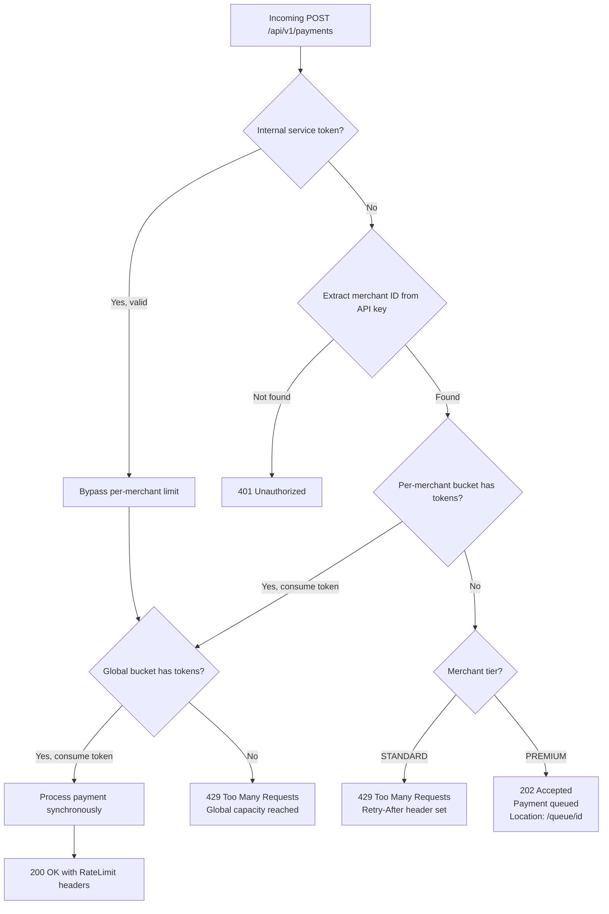

Security teams implement rate limiting to prevent credential stuffing and API abuse. Reliability engineers implement rate limiting for a different reason: to protect downstream services from being overwhelmed by legitimate traffic. A payment processing service that sends 10,000 transaction queries per second to a fraud-scoring API is not attacking it — but the effect is indistinguishable. Rate limiting as a reliability tool is about defining sustainable load, enforcing it at the boundary, and degrading gracefully when limits are reached.

This lesson focuses exclusively on rate limiting as a reliability mechanism. We cover three algorithms, distributed enforcement with Redis, per-tier limits for a payment API, and the operational concern of monitoring limit hits before they become incidents.

## Rate Limiting for Reliability — Not Just Security

The classic justification for rate limiting is security: prevent one client from monopolising a shared resource. The reliability justification is different and equally important:

**Downstream service protection:** Your payment service calls a third-party fraud API. The fraud API's SLA is 500 req/s. If your service sends 2000 req/s during a marketing campaign, the fraud API degrades — slow responses, circuit breaker trips, cascading failure. Rate limiting your own outbound calls protects the dependency you rely on.

**Load shedding under traffic spikes:** When traffic doubles unexpectedly, rate limiting lets you decide which requests to accept and which to defer, rather than letting all requests through until the database melts.

**Fairness across tenants:** In a multi-merchant payment platform, one merchant running a flash sale should not degrade response times for all other merchants sharing the same infrastructure.

```
Without rate limiting:
  Normal: 1,000 req/min -> Fraud API (capacity: 1,000/min)
  Flash sale: 8,000 req/min -> Fraud API
  Fraud API: 429s, timeouts, circuit breaker trips
  All merchants: degraded fraud checks (approve-all fallback)
  Risk: fraud losses during peak traffic

With rate limiting:
  Normal: 1,000 req/min -> passes through
  Flash sale: 8,000 req/min arrives
  Rate limiter: 1,000/min passes through, 7,000/min -> 429 or queue
  Fraud API: healthy (never exceeds capacity)
  Merchant A (flash sale): some payments deferred
  Other merchants: unaffected
```

## Algorithm Comparison

### Fixed Window

Counts requests in fixed time windows (e.g., per minute, starting on the minute boundary).

```
Window 1: 00:00 - 01:00  [limit: 100]
Window 2: 01:00 - 02:00  [limit: 100]

Problem — burst at window boundary:
  00:59: 100 requests arrive (window 1 fills up)
  01:00: 100 requests arrive (window 2 fills up)
  In 2 seconds: 200 requests processed -> 2x the intended rate

ASCII timeline:
  |    Window 1    |    Window 2    |
  |                |                |
  |             [100 req]  [100 req]|
  |                |                |
  00:00          01:00            02:00
                  ^-- 200 req in 2 sec
```

**Use case:** Simple, low-precision limits. Acceptable when bursts at window boundaries are tolerable (e.g., internal batch jobs).

### Token Bucket

A bucket holds tokens. Tokens are added at a fixed rate (the refill rate). Each request consumes one token. If the bucket is empty, the request is rejected (or queued).

```
Bucket capacity: 10 tokens
Refill rate: 2 tokens/second

T=0:   bucket=[10 tokens]
T=0:   5 requests arrive -> bucket=[5 tokens]
T=0:   8 more requests arrive -> 5 accepted, 3 rejected (bucket empty)
T=1s:  refill 2 tokens -> bucket=[2 tokens]
T=1s:  2 requests arrive -> bucket=[0 tokens]

Properties:
  - Allows short bursts up to bucket capacity
  - Sustained rate is capped at refill rate
  - Simple to implement, works well for bursty workloads

ASCII:
  Tokens:
  ||||||||||| (10)   <-- full bucket, burst allowed
  ||||||          (5)   <-- after burst
  ||||            (2)   <-- after 1s refill
```

**Use case:** Payment API endpoints where merchants may burst briefly (checkout spikes) but must not sustain excessive rates. Stripe's rate limiter is token-bucket based.

### Sliding Window (Log-based)

Records the timestamp of each request. When a new request arrives, count the number of requests in the last N seconds. If count >= limit, reject.

```
Limit: 5 requests per 10 seconds

T=0s:  request (log: [0])              count=1  -> ACCEPT
T=2s:  request (log: [0,2])            count=2  -> ACCEPT
T=4s:  request (log: [0,2,4])          count=3  -> ACCEPT
T=6s:  request (log: [0,2,4,6])        count=4  -> ACCEPT
T=8s:  request (log: [0,2,4,6,8])      count=5  -> ACCEPT
T=9s:  request (log: [0,2,4,6,8,9])    count=6  -> REJECT (6 > 5)
T=11s: request (log: [2,4,6,8,9,11])   -- T=0 expires
       (log: [2,4,6,8,9,11])          count=6  -> REJECT
T=12s: request                         -- T=2 expires
       (log: [4,6,8,9,11,12])         count=6  -> REJECT
T=13s: request                         -- T=4 expires, count drops to 5
       (log: [6,8,9,11,12,13])        count=6  -> REJECT
T=14s: request                         -- T=6 expires
       (log: [8,9,11,12,13,14])       count=5+1=6 -> boundary case

Properties:
  - No boundary burst problem (window slides continuously)
  - More memory: must store timestamps of all recent requests
  - Most accurate rate limiting algorithm
```

**Use case:** When exact rate enforcement is critical and memory is available. Good for per-merchant limits where accuracy matters.

### Sliding Window (Counter-based)

Approximation that uses two buckets (current minute, previous minute) and interpolates. Uses O(1) memory per key.

```
limit = 100/min
previous_minute_count = 80
current_minute_count  = 20
time_elapsed_in_current_minute = 30s (50%)

Weighted estimate = (80 * 0.5) + 20 = 60

60 < 100 -> ACCEPT (increment current_minute_count)

This approximation has ~0.003% error rate — acceptable for most rate limiting.
```

This is what Redis implements in its built-in rate limiter modules and what Bucket4j's sliding window uses.

### Algorithm Comparison Table

| Algorithm | Burst Handling | Memory | Accuracy | Complexity | Best For |
|---|---|---|---|---|---|
| Fixed Window | Poor (boundary burst) | O(1) | Low | Very Low | Internal batch |
| Token Bucket | Excellent | O(1) per key | High | Low | Public APIs, payments |
| Sliding Window Log | None (exact) | O(requests) | Exact | Medium | High-precision limits |
| Sliding Window Counter | Good | O(1) per key | Very high (~99.997%) | Low | Most production cases |

## Bucket4j with Redis — Distributed Rate Limiting

For a payment API running multiple instances, in-memory rate limiters (like Resilience4j's RateLimiter) limit per-instance. A merchant sending 1000 requests across 10 instances may receive 100/instance — 10x the intended limit. Distributed rate limiting with Redis enforces limits globally.

### Maven Dependencies

```xml
<dependency>
    <groupId>com.bucket4j</groupId>
    <artifactId>bucket4j-redis</artifactId>
    <version>8.10.1</version>
</dependency>
<dependency>
    <groupId>io.lettuce</groupId>
    <artifactId>lettuce-core</artifactId>
</dependency>
<dependency>
    <groupId>org.springframework.boot</groupId>
    <artifactId>spring-boot-starter-data-redis</artifactId>
</dependency>
```

### Distributed Rate Limiter Configuration

```java
package com.fintech.ratelimit.config;

import com.bucket4j.distributed.ExpirationAfterWriteStrategy;
import com.bucket4j.redis.lettuce.cas.LettuceBasedProxyManager;
import io.lettuce.core.RedisClient;
import io.lettuce.core.api.StatefulRedisConnection;
import io.lettuce.core.codec.ByteArrayCodec;
import org.springframework.beans.factory.annotation.Value;
import org.springframework.context.annotation.Bean;
import org.springframework.context.annotation.Configuration;

import java.time.Duration;

@Configuration
public class RateLimitConfig {

    @Value("${redis.url:redis://localhost:6379}")
    private String redisUrl;

    @Bean
    public RedisClient redisClient() {
        return RedisClient.create(redisUrl);
    }

    @Bean
    public StatefulRedisConnection<byte[], byte[]> redisConnection(RedisClient client) {
        return client.connect(ByteArrayCodec.INSTANCE);
    }

    /**
     * Bucket4j proxy manager backed by Redis.
     * Uses CAS (Compare-And-Set) operations for atomic bucket updates.
     * Keys expire after 2 hours of inactivity to prevent memory leak.
     */
    @Bean
    public LettuceBasedProxyManager<byte[]> proxyManager(
            StatefulRedisConnection<byte[], byte[]> connection) {
        return LettuceBasedProxyManager.builderFor(connection)
            .withExpirationStrategy(
                ExpirationAfterWriteStrategy.basedOnTimeForRefillingBucketUpToMax(
                    Duration.ofHours(2)))
            .build();
    }
}
```

### Rate Limit Definitions

```java
package com.fintech.ratelimit.config;

import com.bucket4j.Bandwidth;
import com.bucket4j.BucketConfiguration;

import java.time.Duration;

/**
 * Rate limit tiers for the payment API.
 *
 * Hierarchy (enforced independently and cumulatively):
 *   Per-merchant limit: protects other merchants from noisy neighbours
 *   Global limit:       protects downstream dependencies (fraud API, core banking)
 *   Internal bypass:    trusted internal services skip per-merchant limits
 */
public class PaymentRateLimitConfig {

    /**
     * Standard merchant: 100 payments/minute with burst to 20 immediately.
     * Token bucket: capacity 20, refill 100/60s = ~1.67/second.
     */
    public static BucketConfiguration merchantLimit() {
        return BucketConfiguration.builder()
            .addLimit(Bandwidth.builder()
                .capacity(20)
                .refillGreedy(100, Duration.ofMinutes(1))
                .build())
            .build();
    }

    /**
     * Premium merchant (enterprise tier): 1000 payments/minute, burst 100.
     */
    public static BucketConfiguration premiumMerchantLimit() {
        return BucketConfiguration.builder()
            .addLimit(Bandwidth.builder()
                .capacity(100)
                .refillGreedy(1000, Duration.ofMinutes(1))
                .build())
            .build();
    }

    /**
     * Global limit: 10,000 payments/minute across ALL merchants combined.
     * This protects fraud API (SLA: 10,000 req/min) and core banking connector.
     * Uses sliding window approximation via two overlapping token buckets.
     */
    public static BucketConfiguration globalLimit() {
        return BucketConfiguration.builder()
            // Primary: 10,000 per minute
            .addLimit(Bandwidth.builder()
                .capacity(500)                           // burst capacity
                .refillGreedy(10_000, Duration.ofMinutes(1))
                .build())
            // Secondary: 200/second (smoothing — prevents 10,000 in first second)
            .addLimit(Bandwidth.builder()
                .capacity(200)
                .refillGreedy(200, Duration.ofSeconds(1))
                .build())
            .build();
    }

    /**
     * Per-IP limit for unauthenticated endpoints (login, token refresh).
     * More restrictive: 10 req/min to prevent credential stuffing.
     */
    public static BucketConfiguration unauthenticatedIpLimit() {
        return BucketConfiguration.builder()
            .addLimit(Bandwidth.builder()
                .capacity(5)
                .refillGreedy(10, Duration.ofMinutes(1))
                .build())
            .build();
    }
}
```

### Rate Limit Service

```java
package com.fintech.ratelimit.service;

import com.bucket4j.Bucket;
import com.bucket4j.BucketConfiguration;
import com.bucket4j.ConsumptionProbe;
import com.bucket4j.distributed.proxy.ProxyManager;
import com.fintech.ratelimit.config.PaymentRateLimitConfig;
import org.springframework.stereotype.Service;

import java.time.Duration;
import java.time.Instant;
import java.util.function.Supplier;

@Service
public class DistributedRateLimitService {

    private static final String GLOBAL_BUCKET_KEY = "global:payment:limit";

    private final ProxyManager<byte[]> proxyManager;
    private final MerchantTierRepository merchantTierRepository;

    public DistributedRateLimitService(ProxyManager<byte[]> proxyManager,
                                        MerchantTierRepository merchantTierRepository) {
        this.proxyManager = proxyManager;
        this.merchantTierRepository = merchantTierRepository;
    }

    /**
     * Checks rate limits for a payment request.
     * Both per-merchant and global limits must pass.
     *
     * @return RateLimitResult with headers and allowed flag
     */
    public RateLimitResult checkPaymentLimit(String merchantId) {
        // Check per-merchant limit first
        RateLimitResult merchantResult = checkMerchantLimit(merchantId);
        if (!merchantResult.allowed()) {
            return merchantResult;
        }

        // Check global limit (protects downstream services)
        return checkGlobalLimit();
    }

    private RateLimitResult checkMerchantLimit(String merchantId) {
        MerchantTier tier = merchantTierRepository.getTier(merchantId);
        BucketConfiguration config = tier == MerchantTier.PREMIUM
            ? PaymentRateLimitConfig.premiumMerchantLimit()
            : PaymentRateLimitConfig.merchantLimit();

        byte[] bucketKey = ("merchant:" + merchantId + ":payment").getBytes();

        Supplier<BucketConfiguration> configSupplier = () -> config;
        Bucket bucket = proxyManager.builder().build(bucketKey, configSupplier);

        ConsumptionProbe probe = bucket.tryConsumeAndReturnRemaining(1);

        if (probe.isConsumed()) {
            return RateLimitResult.allowed(
                getLimitForTier(tier),
                (int) probe.getRemainingTokens(),
                Instant.now().plusSeconds(60).getEpochSecond()
            );
        }

        // Not consumed: calculate retry-after in seconds
        long retryAfterSeconds = probe.getNanosToWaitForRefill() / 1_000_000_000L;
        return RateLimitResult.denied(
            getLimitForTier(tier),
            0,
            Instant.now().plusSeconds(60).getEpochSecond(),
            retryAfterSeconds
        );
    }

    private RateLimitResult checkGlobalLimit() {
        byte[] bucketKey = GLOBAL_BUCKET_KEY.getBytes();
        Bucket bucket = proxyManager.builder().build(
            bucketKey, PaymentRateLimitConfig::globalLimit);

        ConsumptionProbe probe = bucket.tryConsumeAndReturnRemaining(1);

        if (probe.isConsumed()) {
            return RateLimitResult.allowed(10_000, (int) probe.getRemainingTokens(),
                Instant.now().plusSeconds(60).getEpochSecond());
        }

        long retryAfterSeconds = probe.getNanosToWaitForRefill() / 1_000_000_000L;
        return RateLimitResult.denied(10_000, 0,
            Instant.now().plusSeconds(60).getEpochSecond(), retryAfterSeconds);
    }

    private int getLimitForTier(MerchantTier tier) {
        return tier == MerchantTier.PREMIUM ? 1_000 : 100;
    }

    public enum MerchantTier { STANDARD, PREMIUM }

    public record RateLimitResult(
        boolean allowed,
        int limit,
        int remaining,
        long resetEpochSeconds,
        long retryAfterSeconds   // only relevant when allowed=false
    ) {
        public static RateLimitResult allowed(int limit, int remaining, long reset) {
            return new RateLimitResult(true, limit, remaining, reset, 0);
        }
        public static RateLimitResult denied(int limit, int remaining,
                                              long reset, long retryAfter) {
            return new RateLimitResult(false, limit, remaining, reset, retryAfter);
        }
    }
}
```

## Rate Limit Response Headers

RFC 6585 introduced HTTP status 429 (Too Many Requests). The de facto standard headers (not yet formally standardised, but universally adopted by Stripe, GitHub, Twilio):

```
X-RateLimit-Limit: 100
X-RateLimit-Remaining: 73
X-RateLimit-Reset: 1731196800      (Unix timestamp when limit resets)
Retry-After: 47                    (seconds until retry is allowed; only on 429)
```

Clients that respect `Retry-After` will back off automatically. Clients that do not will keep hitting 429s and waste bandwidth. Document `Retry-After` prominently in your API docs.

## Payment API Rate Limiting Spring Filter

```java
package com.fintech.ratelimit.filter;

import com.fintech.ratelimit.service.DistributedRateLimitService;
import com.fintech.ratelimit.service.DistributedRateLimitService.RateLimitResult;
import io.micrometer.core.instrument.Counter;
import io.micrometer.core.instrument.MeterRegistry;
import jakarta.servlet.FilterChain;
import jakarta.servlet.ServletException;
import jakarta.servlet.http.HttpServletRequest;
import jakarta.servlet.http.HttpServletResponse;
import org.slf4j.Logger;
import org.slf4j.LoggerFactory;
import org.springframework.http.HttpStatus;
import org.springframework.stereotype.Component;
import org.springframework.web.filter.OncePerRequestFilter;

import java.io.IOException;
import java.nio.charset.StandardCharsets;

@Component
public class PaymentRateLimitFilter extends OncePerRequestFilter {

    private static final Logger log = LoggerFactory.getLogger(PaymentRateLimitFilter.class);

    // Header name for internal service bypass
    private static final String INTERNAL_SERVICE_HEADER = "X-Internal-Service-Token";

    private final DistributedRateLimitService rateLimitService;
    private final InternalServiceTokenValidator tokenValidator;
    private final MeterRegistry meterRegistry;

    public PaymentRateLimitFilter(DistributedRateLimitService rateLimitService,
                                   InternalServiceTokenValidator tokenValidator,
                                   MeterRegistry meterRegistry) {
        this.rateLimitService = rateLimitService;
        this.tokenValidator = tokenValidator;
        this.meterRegistry = meterRegistry;
    }

    @Override
    protected void doFilterInternal(HttpServletRequest request,
                                     HttpServletResponse response,
                                     FilterChain filterChain)
            throws ServletException, IOException {

        // Only rate-limit the payment creation endpoint
        if (!request.getRequestURI().startsWith("/api/v1/payments")) {
            filterChain.doFilter(request, response);
            return;
        }

        // Internal services (fraud engine calling back, reconciliation jobs)
        // bypass per-merchant rate limits but NOT the global limit
        if (isInternalService(request)) {
            filterChain.doFilter(request, response);
            return;
        }

        String merchantId = extractMerchantId(request);
        if (merchantId == null) {
            response.setStatus(HttpStatus.UNAUTHORIZED.value());
            return;
        }

        RateLimitResult result = rateLimitService.checkPaymentLimit(merchantId);

        // Always set rate limit headers on payment endpoint responses
        setRateLimitHeaders(response, result);

        if (result.allowed()) {
            filterChain.doFilter(request, response);
        } else {
            handleRateLimitExceeded(request, response, merchantId, result);
        }
    }

    private boolean isInternalService(HttpServletRequest request) {
        String token = request.getHeader(INTERNAL_SERVICE_HEADER);
        return token != null && tokenValidator.isValid(token);
    }

    private String extractMerchantId(HttpServletRequest request) {
        // Extract from JWT subject claim or API key lookup
        String apiKey = request.getHeader("X-Api-Key");
        if (apiKey == null) return null;
        return apiKeyToMerchantId(apiKey);
    }

    private void setRateLimitHeaders(HttpServletResponse response, RateLimitResult result) {
        response.setHeader("X-RateLimit-Limit",     String.valueOf(result.limit()));
        response.setHeader("X-RateLimit-Remaining", String.valueOf(result.remaining()));
        response.setHeader("X-RateLimit-Reset",     String.valueOf(result.resetEpochSeconds()));
        if (!result.allowed()) {
            response.setHeader("Retry-After", String.valueOf(result.retryAfterSeconds()));
        }
    }

    private void handleRateLimitExceeded(HttpServletRequest request,
                                          HttpServletResponse response,
                                          String merchantId,
                                          RateLimitResult result) throws IOException {
        // Increment monitoring counter for alerting
        Counter.builder("payment.rate_limit.exceeded")
            .tag("merchant_id", merchantId)
            .register(meterRegistry)
            .increment();

        log.warn("[RATE LIMIT] Merchant {} exceeded limit — remaining: {}, retry after: {}s",
            merchantId, result.remaining(), result.retryAfterSeconds());

        response.setStatus(HttpStatus.TOO_MANY_REQUESTS.value());
        response.setContentType("application/json");
        response.setCharacterEncoding(StandardCharsets.UTF_8.name());

        String body = String.format(
            "{\"error\":\"RATE_LIMIT_EXCEEDED\"," +
            "\"message\":\"Payment rate limit exceeded. Retry after %d seconds.\"," +
            "\"retryAfterSeconds\":%d}",
            result.retryAfterSeconds(),
            result.retryAfterSeconds());

        response.getWriter().write(body);
    }

    private String apiKeyToMerchantId(String apiKey) {
        // In production: Redis lookup with API key -> merchant ID cache
        // For brevity, extract prefix from key format "mk_{merchantId}_{hash}"
        if (apiKey.startsWith("mk_")) {
            String[] parts = apiKey.split("_");
            return parts.length >= 2 ? parts[1] : null;
        }
        return null;
    }
}
```

## Resilience4j RateLimiter — For Outbound Calls

While Bucket4j+Redis is best for inbound API rate limiting, Resilience4j's `RateLimiter` is designed for **outbound calls** — limiting how fast you call a downstream service. This is the reliability use case: protecting the fraud API from being overwhelmed by your service.

```yaml
resilience4j:
  rate-limiter:
    instances:
      fraud-api-outbound:
        # Limit outbound calls to fraud API to 500/second
        # (their SLA: 600/sec; we limit to 500 to leave headroom)
        limit-for-period: 500
        limit-refresh-period: 1s
        timeout-duration: 100ms   # Wait up to 100ms for a permit; then fail fast
        register-health-indicator: true

      core-banking-outbound:
        # Core banking connector: 200/second max
        limit-for-period: 200
        limit-refresh-period: 1s
        timeout-duration: 50ms
        register-health-indicator: true
```

```java
package com.fintech.ratelimit.client;

import io.github.resilience4j.ratelimiter.annotation.RateLimiter;
import org.springframework.stereotype.Component;
import org.springframework.web.client.RestTemplate;

import java.math.BigDecimal;

@Component
public class FraudApiClient {

    private final RestTemplate restTemplate;

    public FraudApiClient(RestTemplate restTemplate) {
        this.restTemplate = restTemplate;
    }

    /**
     * Rate limited outbound call to fraud API.
     * If we have already sent 500 requests this second,
     * this call waits up to 100ms for a permit.
     * If no permit available within 100ms: RequestNotPermitted exception.
     */
    @RateLimiter(name = "fraud-api-outbound", fallbackMethod = "fraudApiFallback")
    public FraudResult checkFraud(String paymentId, BigDecimal amount) {
        return restTemplate.postForObject(
            "http://fraud-api.internal/check",
            new FraudRequest(paymentId, amount),
            FraudResult.class
        );
    }

    /**
     * Fallback when rate limit exceeded.
     * For amounts above $500: decline (conservative approach).
     * For amounts below $500: allow through (acceptable risk during degradation).
     */
    public FraudResult fraudApiFallback(String paymentId, BigDecimal amount,
            io.github.resilience4j.ratelimiter.RequestNotPermitted e) {
        boolean approve = amount.compareTo(new BigDecimal("500")) < 0;
        return new FraudResult(paymentId, approve, "RATE_LIMITED_DEGRADED");
    }

    public record FraudRequest(String paymentId, BigDecimal amount) {}
    public record FraudResult(String paymentId, boolean approved, String source) {}
}
```

## Graceful Degradation vs Hard 429 Reject

When a request is rate-limited, the system has two choices:

**Hard 429:** Reject immediately with a 429 Too Many Requests response. The merchant's system must retry (after `Retry-After` seconds). Simple, predictable, but shifts retry burden to the client.

**Graceful degradation:** Accept the request, queue it internally, and process it when capacity is available. Returns 202 Accepted with a polling URL. More complex but provides a better merchant experience.

```java
package com.fintech.ratelimit.service;

import org.springframework.http.HttpStatus;
import org.springframework.http.ResponseEntity;
import org.springframework.stereotype.Service;

import java.util.UUID;

@Service
public class PaymentSubmissionService {

    private final DistributedRateLimitService rateLimitService;
    private final PaymentQueueService paymentQueue;

    public PaymentSubmissionService(DistributedRateLimitService rateLimitService,
                                     PaymentQueueService paymentQueue) {
        this.rateLimitService = rateLimitService;
        this.paymentQueue = paymentQueue;
    }

    /**
     * Chooses between hard 429 and graceful queuing based on merchant tier.
     *
     * Standard merchants: hard 429 (simple, low infrastructure cost)
     * Premium merchants: graceful queue (they expect near-100% acceptance)
     */
    public ResponseEntity<?> submitPayment(String merchantId, PaymentRequest request) {
        DistributedRateLimitService.RateLimitResult result =
            rateLimitService.checkPaymentLimit(merchantId);

        if (result.allowed()) {
            // Process synchronously
            return ResponseEntity.ok(processPayment(request));
        }

        // Rate limited — decision based on merchant tier
        MerchantTier tier = getTier(merchantId);

        if (tier == MerchantTier.PREMIUM) {
            // Queue for async processing — 202 Accepted with polling URL
            String queueId = paymentQueue.enqueue(merchantId, request);
            return ResponseEntity
                .status(HttpStatus.ACCEPTED)
                .header("Location", "/api/v1/payments/queue/" + queueId)
                .body(new QueuedPaymentResponse(queueId,
                    "Payment queued for processing",
                    result.retryAfterSeconds()));
        }

        // Standard merchant: hard 429
        return ResponseEntity
            .status(HttpStatus.TOO_MANY_REQUESTS)
            .header("Retry-After", String.valueOf(result.retryAfterSeconds()))
            .body(new ErrorResponse("RATE_LIMIT_EXCEEDED",
                "Retry after " + result.retryAfterSeconds() + " seconds"));
    }

    private Object processPayment(PaymentRequest request) { return new Object(); }
    private MerchantTier getTier(String merchantId) { return MerchantTier.STANDARD; }

    public enum MerchantTier { STANDARD, PREMIUM }
    public record PaymentRequest(String paymentId, String merchantId,
                                  java.math.BigDecimal amount) {}
    public record QueuedPaymentResponse(String queueId, String message, long waitSeconds) {}
    public record ErrorResponse(String code, String message) {}
}
```

## Rate Limit Bypass for Internal and Trusted Services

Internal services (reconciliation jobs, fraud-review callbacks, compliance reporting) must not be blocked by rate limits intended for external merchants. A service-to-service token header provides the bypass.

```java
package com.fintech.ratelimit.security;

import org.springframework.beans.factory.annotation.Value;
import org.springframework.stereotype.Component;

import javax.crypto.Mac;
import javax.crypto.spec.SecretKeySpec;
import java.nio.charset.StandardCharsets;
import java.time.Instant;
import java.util.Base64;
import java.util.Set;

/**
 * Validates HMAC-signed internal service tokens.
 * Token format: base64(serviceName + ":" + timestamp + ":" + hmac(secret, serviceName+timestamp))
 * Tokens are time-bounded: valid for 5 minutes to prevent replay attacks.
 *
 * This is NOT a substitute for mTLS between services.
 * Use mTLS as the primary auth mechanism; this token is an additional rate-limit bypass signal.
 */
@Component
public class InternalServiceTokenValidator {

    private static final long MAX_AGE_SECONDS = 300;  // 5 minutes

    private static final Set<String> ALLOWED_SERVICES = Set.of(
        "reconciliation-service",
        "fraud-review-service",
        "compliance-reporting",
        "payment-retry-consumer"
    );

    @Value("${internal.service.hmac.secret}")
    private String hmacSecret;

    public boolean isValid(String token) {
        try {
            byte[] decoded = Base64.getDecoder().decode(token);
            String[] parts = new String(decoded, StandardCharsets.UTF_8).split(":");
            if (parts.length != 3) return false;

            String serviceName = parts[0];
            long timestamp     = Long.parseLong(parts[1]);
            String receivedMac = parts[2];

            // Check token age
            long age = Instant.now().getEpochSecond() - timestamp;
            if (age > MAX_AGE_SECONDS || age < 0) return false;

            // Check service allowlist
            if (!ALLOWED_SERVICES.contains(serviceName)) return false;

            // Verify HMAC
            String expectedMac = computeHmac(serviceName + timestamp);
            return expectedMac.equals(receivedMac);

        } catch (Exception e) {
            return false;
        }
    }

    private String computeHmac(String data) throws Exception {
        Mac mac = Mac.getInstance("HmacSHA256");
        mac.init(new SecretKeySpec(hmacSecret.getBytes(StandardCharsets.UTF_8), "HmacSHA256"));
        return Base64.getEncoder()
            .encodeToString(mac.doFinal(data.getBytes(StandardCharsets.UTF_8)));
    }
}
```

## Monitoring Rate Limit Hits

Rate limit hits are a leading indicator of capacity problems. A sudden increase in 429s from a single merchant means their traffic pattern changed. A sudden increase across all merchants means your downstream capacity assumption is wrong.

```java
package com.fintech.ratelimit.monitoring;

import io.micrometer.core.instrument.Counter;
import io.micrometer.core.instrument.Gauge;
import io.micrometer.core.instrument.MeterRegistry;
import jakarta.annotation.PostConstruct;
import org.springframework.stereotype.Component;

import java.util.concurrent.ConcurrentHashMap;
import java.util.concurrent.atomic.AtomicLong;

@Component
public class RateLimitMetrics {

    private final MeterRegistry meterRegistry;
    private final ConcurrentHashMap<String, AtomicLong> merchantRejections =
        new ConcurrentHashMap<>();

    public RateLimitMetrics(MeterRegistry meterRegistry) {
        this.meterRegistry = meterRegistry;
    }

    @PostConstruct
    public void registerGlobalMetrics() {
        Gauge.builder("rate_limit.global.remaining_tokens",
                this, RateLimitMetrics::getGlobalRemainingTokens)
            .description("Remaining tokens in global payment rate limiter")
            .register(meterRegistry);
    }

    public void recordMerchantRejection(String merchantId) {
        // Per-merchant rejection counter
        Counter.builder("rate_limit.merchant.rejections")
            .tag("merchant_id", sanitizeMerchantId(merchantId))
            .description("Payment requests rejected by merchant rate limit")
            .register(meterRegistry)
            .increment();

        // Also track rolling count for alerting
        merchantRejections
            .computeIfAbsent(merchantId, id -> new AtomicLong(0))
            .incrementAndGet();
    }

    public void recordGlobalRejection() {
        Counter.builder("rate_limit.global.rejections")
            .description("Payment requests rejected by global rate limit")
            .register(meterRegistry)
            .increment();
    }

    private double getGlobalRemainingTokens() {
        // Inject and query the global bucket in production
        return 0.0;
    }

    private String sanitizeMerchantId(String merchantId) {
        // Avoid high-cardinality labels; truncate to prefix only
        return merchantId.length() > 8 ? merchantId.substring(0, 8) : merchantId;
    }
}
```

### Prometheus Alert Rules

```yaml
groups:
  - name: rate_limit_alerts
    rules:
      - alert: MerchantHighRejectionRate
        expr: |
          rate(rate_limit_merchant_rejections_total[5m]) > 10
        for: 3m
        labels:
          severity: warning
          team: payments
        annotations:
          summary: "Merchant {{ $labels.merchant_id }} being heavily rate limited"
          description: >
            Merchant is hitting rate limits at >10 req/sec for 3 minutes.
            This may indicate a runaway integration or unexpected traffic spike.
            Review merchant's integration or consider a temporary limit increase.

      - alert: GlobalRateLimitNearCapacity
        expr: |
          rate_limit_global_remaining_tokens < 500
        for: 1m
        labels:
          severity: critical
          team: payments
        annotations:
          summary: "Global payment rate limit near capacity"
          description: >
            Global remaining tokens below 500. Downstream services (fraud API,
            core banking) may be approaching their capacity. Investigate traffic
            sources and consider emergency capacity increase.

      - alert: RateLimitSuddenSpike
        expr: |
          rate(rate_limit_global_rejections_total[1m]) > 50
        for: 1m
        labels:
          severity: warning
        annotations:
          summary: "Global rate limit rejecting requests at high rate"
          description: >
            More than 50 payments rejected per second by global rate limit.
            This may indicate a DDoS or a misconfigured merchant integration.
```

## Rate Limiting Flow Diagram



## Production Pitfalls

### Pitfall 1: In-Memory Rate Limiter in a Multi-Instance Deployment

Resilience4j's default `RateLimiter` stores state in JVM memory. With 10 instances and a 100 req/min limit per merchant, each instance allows 100/min — the effective limit is 1000/min globally. This renders the rate limit meaningless.

```java
// WRONG: in-memory RateLimiter with multiple instances
// application.yml:
//   resilience4j.rate-limiter.instances.payment-inbound.limit-for-period: 100
//   resilience4j.rate-limiter.instances.payment-inbound.limit-refresh-period: 1m
//
// With 10 pods: effective limit = 100 x 10 = 1000/min per merchant
// A merchant sending 500 req/min appears limited per-pod but is not globally limited.

@RateLimiter(name = "payment-inbound")  // WRONG for inbound multi-instance
public PaymentResult processPayment(PaymentRequest request) { ... }

// CORRECT: use Bucket4j + Redis for inbound rate limiting
// Bucket4j uses atomic Redis CAS operations — single global counter per key

@PostMapping("/payments")
public ResponseEntity<?> createPayment(@RequestBody PaymentRequest request,
                                        HttpServletRequest httpRequest) {
    // PaymentRateLimitFilter (shown above) handles rate limiting before this
    // The filter uses DistributedRateLimitService (Bucket4j + Redis)
    return ResponseEntity.ok(paymentService.process(request));
}

// Keep Resilience4j RateLimiter for OUTBOUND calls only:
// @RateLimiter(name = "fraud-api-outbound")  <-- correct use
// Here, each pod independently limits its own outbound calls.
// If fraud API allows 500/sec total and you have 10 pods,
// configure: limit-for-period: 50, limit-refresh-period: 1s
```

### Pitfall 2: Not Setting Retry-After Causes Thundering Herd

When 1,000 clients are rate-limited simultaneously and get a 429 without a `Retry-After` header, they all retry at their own interval. Many retry in 1 second. The service receives 1,000 requests 1 second later — a thundering herd that generates another round of 429s.

```java
// WRONG: 429 without Retry-After
response.setStatus(429);
response.getWriter().write("{\"error\":\"rate limit exceeded\"}");
// All 1000 clients retry after 1 second (default retry logic) -> thundering herd

// CORRECT: set Retry-After with jitter to spread retries
long baseRetry = probe.getNanosToWaitForRefill() / 1_000_000_000L;
long jitterMs  = (long)(Math.random() * 2000);  // 0-2 second jitter
long retryAfter = baseRetry + (jitterMs / 1000) + 1;  // at least 1 second

response.setStatus(429);
response.setHeader("Retry-After", String.valueOf(retryAfter));
response.getWriter().write(String.format(
    "{\"error\":\"RATE_LIMIT_EXCEEDED\",\"retryAfterSeconds\":%d}", retryAfter));

// Also: document the Retry-After header in your API docs and SDK
// SDKs should read Retry-After and implement exponential backoff
// Never retry on 429 without reading Retry-After first
```

### Pitfall 3: Applying the Same Rate Limit to All Endpoints Blocks Critical Operations

A blanket rate limit that covers all payment operations will block refunds, chargebacks, and dispute responses when the merchant has exhausted their limit. These operations are time-sensitive (chargeback deadlines are real).

```java
// WRONG: single rate limit applies to all payment operations including chargebacks
@RateLimiter(name = "payment-inbound")
public PaymentResult createPayment(...) { ... }

@RateLimiter(name = "payment-inbound")  // WRONG: blocks critical operations
public RefundResult processRefund(...) { ... }

@RateLimiter(name = "payment-inbound")  // WRONG: chargeback deadlines are real
public DisputeResult respondToDispute(...) { ... }

// CORRECT: separate rate limit buckets per operation criticality

// application.yml:
//   bucket4j:
//     filters:
//       - cache-name: payment-creation-limiter
//         url: /api/v1/payments
//         rate-limits: [ {bandwidths: [{capacity:100, time:1, unit:MINUTES}]} ]
//
//       - cache-name: refund-limiter
//         url: /api/v1/refunds
//         rate-limits: [ {bandwidths: [{capacity:500, time:1, unit:MINUTES}]} ]
//         # Refunds get 5x the limit: regulatory deadlines matter
//
//       - cache-name: dispute-limiter
//         url: /api/v1/disputes
//         rate-limits: [ {bandwidths: [{capacity:1000, time:1, unit:MINUTES}]} ]
//         # Disputes: very high limit — Visa/MC have response time SLAs

// Alternatively, in filter:
private BucketConfiguration getConfigForEndpoint(String path) {
    if (path.startsWith("/api/v1/disputes")) {
        return PaymentRateLimitConfig.disputeLimit();  // 1000/min
    }
    if (path.startsWith("/api/v1/refunds")) {
        return PaymentRateLimitConfig.refundLimit();   // 500/min
    }
    return PaymentRateLimitConfig.merchantLimit();     // 100/min (standard)
}
```

## Checklist

- [ ] Rate limiter uses distributed storage (Redis via Bucket4j) for multi-instance deployments
- [ ] Per-merchant limits sized independently (standard vs premium tier)
- [ ] Global limit set below downstream service SLA capacity with 20% headroom
- [ ] Rate limit headers set on every response from rate-limited endpoints (not just 429s)
- [ ] Retry-After header included on all 429 responses with jitter to prevent thundering herd
- [ ] Internal and trusted services bypass per-merchant limits via HMAC-signed token
- [ ] Internal bypass does NOT skip global rate limits (global limit protects infrastructure)
- [ ] Critical operations (refunds, disputes) have separate higher rate limit buckets
- [ ] Outbound calls to downstream services use Resilience4j RateLimiter, sized per pod
- [ ] Prometheus alerts configured for merchant rejection rate and global capacity
- [ ] Merchant dashboard shows current rate limit usage (transparency reduces support tickets)
- [ ] Rate limit configuration is per-environment (staging: relaxed, production: strict)
- [ ] Load test validates rate limits hold under 10x expected peak traffic
- [ ] 429 response body includes actionable information (retryAfterSeconds field in JSON)
- [ ] API documentation explains rate limits, tiers, and how to request increases

<!-- KNOWLEDGE-CHECK
{"questions":[{"text":"You run a payment API on 20 pods. Each pod uses a Resilience4j in-memory RateLimiter configured to 100 req/min per merchant. What is the effective global rate limit per merchant?","options":["a) 100 req/min (the configured limit)","b) 100 req/min divided by 20 pods = 5 req/min effective","c) 100 req/min per pod x 20 pods = 2000 req/min effective","d) The rate limit is undefined because it depends on load balancer distribution"],"correct":2,"explanation":"Resilience4j's default RateLimiter is in-memory, per-JVM. With 20 pods each allowing 100 req/min, the effective global limit is 20x100=2000 req/min. A merchant sending 1500 req/min will never be rate limited because each pod only sees ~75 req/min. The fix is to use Bucket4j with Redis for a distributed counter that is shared across all pods."},{"text":"A merchant is rate limited and receives a 429 response. The service does NOT include a Retry-After header. The merchant's SDK retries after a fixed 1 second. 1000 other merchants are also rate limited simultaneously. What reliability problem occurs?","options":["a) The merchants give up after 3 retries and the traffic decreases","b) All 1000 merchants retry at approximately the same time creating a thundering herd that generates another wave of 429s","c) The Redis rate limit counter resets after 1 second so all retries succeed","d) The load balancer distributes retries evenly so there is no burst"],"correct":1,"explanation":"Without Retry-After, clients retry using their default interval (often 1 second). 1000 rate-limited clients all retry simultaneously 1 second later, creating a request spike equal to the original burst. This generates another wave of 429s, causing periodic thundering herds. The fix: include Retry-After with jitter (base wait + 0-2 seconds random) to spread retries across time."},{"text":"Your payment API has a single rate limiter bucket shared by payment creation, refund processing, and chargeback responses. A merchant runs a large batch job that exhausts their rate limit. What is the operational risk?","options":["a) The batch job is blocked but all other operations continue normally","b) Refund requests and chargeback responses are also blocked; chargebacks have regulatory response deadlines that may be missed","c) The rate limiter detects the batch job pattern and automatically creates a separate bucket","d) Spring Boot circuit breaker activates and routes chargeback traffic to a secondary endpoint"],"correct":1,"explanation":"A single shared rate limit bucket means payment creation, refunds, and chargebacks all draw from the same pool. When a batch job exhausts the limit, time-sensitive operations like chargeback responses are also blocked. Visa and Mastercard impose chargeback response deadlines; missing them results in automatic loss of the dispute. The fix: separate rate limit buckets by operation criticality, with chargebacks and refunds getting higher or unlimited limits."}]}
-->

<!-- PRACTICAL-CHALLENGE
{"title":"Build a Distributed Rate Limiting System for a Multi-Merchant Payment API","difficulty":"advanced","estimatedMinutes":70,"tasks":[{"id":"1","description":"Implement a distributed rate limiting service using Bucket4j and Redis (or Jedis). Configure three tiers: (a) standard merchants: 100 payments/min with burst 20, (b) premium merchants: 1000 payments/min with burst 100, (c) global limit: 10000 payments/min with a secondary smoothing limit of 200/second to prevent bursts. Write a MerchantTierRepository that returns the tier for a merchant ID. Test that two merchant IDs on the same Redis instance are rate limited independently."},{"id":"2","description":"Implement a PaymentRateLimitFilter as a Spring OncePerRequestFilter. It should: (a) skip rate limiting for /actuator/* paths, (b) validate internal service tokens using HMAC-SHA256 and bypass per-merchant limits for valid tokens, (c) extract merchant ID from an X-Api-Key header, (d) set X-RateLimit-Limit, X-RateLimit-Remaining, X-RateLimit-Reset headers on EVERY response from /api/v1/payments, (e) return 429 with Retry-After and a JSON error body when rate limited. Write an integration test that verifies the headers appear on both 200 and 429 responses."},{"id":"3","description":"Add Resilience4j RateLimiter for outbound calls to a fraud API. Configure: 500 permits/second, 100ms timeout. The fraud API limit should be per-pod (not global) because each pod independently throttles its own outbound traffic. Implement a fallback that approves payments under 200 currency units when the outbound rate limit is exceeded and declines payments above 500 currency units. Write a test using WireMock that (a) stubs the fraud API to respond normally, (b) fires 600 requests/second and verifies requests above 500/sec trigger the fallback, (c) verifies the fallback applies the correct threshold logic."},{"id":"4","description":"Implement monitoring for the rate limiting system. Create a RateLimitMetrics component that publishes: (a) a counter per merchant for rejections with merchant_id tag (use only the first 8 characters to control cardinality), (b) a gauge for global remaining tokens, (c) a counter for global rejections. Write a Prometheus alerting rule that fires when any single merchant's rejection rate exceeds 5 per second for 2 minutes. Demonstrate the alert fires in a test by simulating a merchant that continuously exceeds its limit and verify the counter increments correctly."}]}
-->
