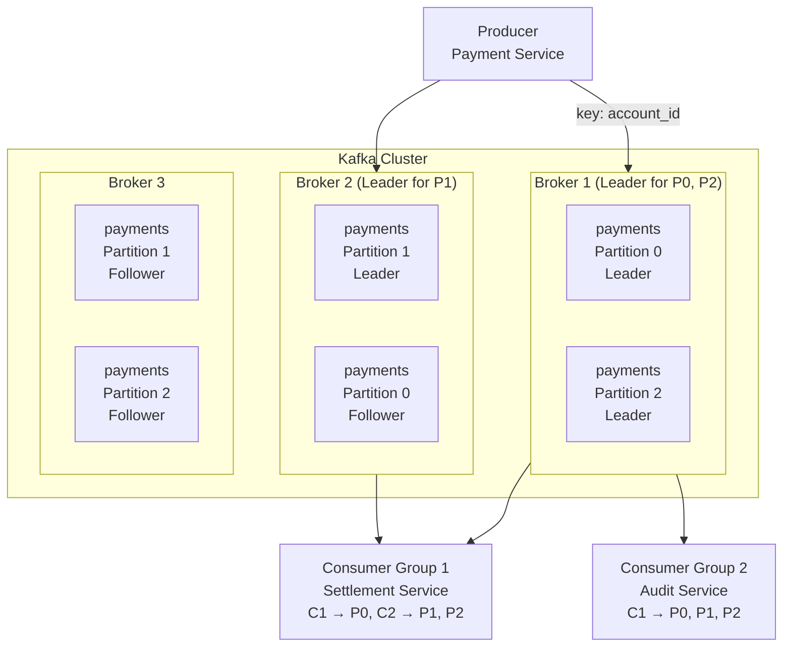
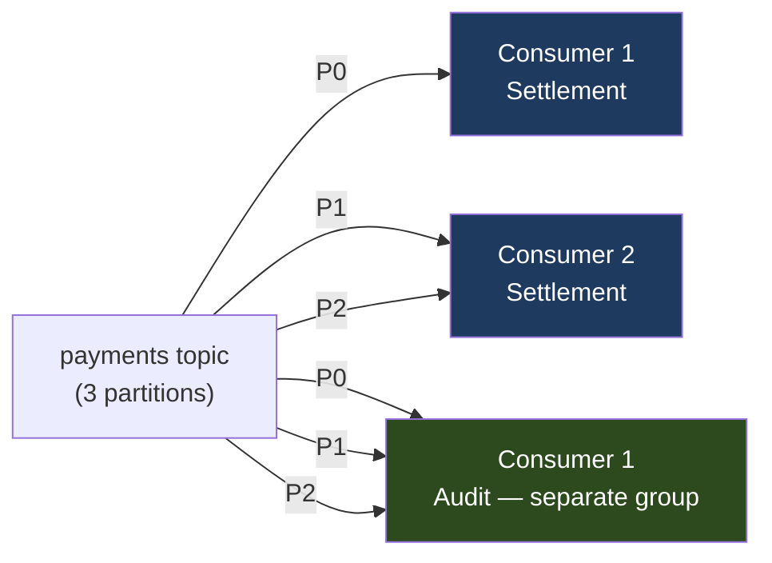
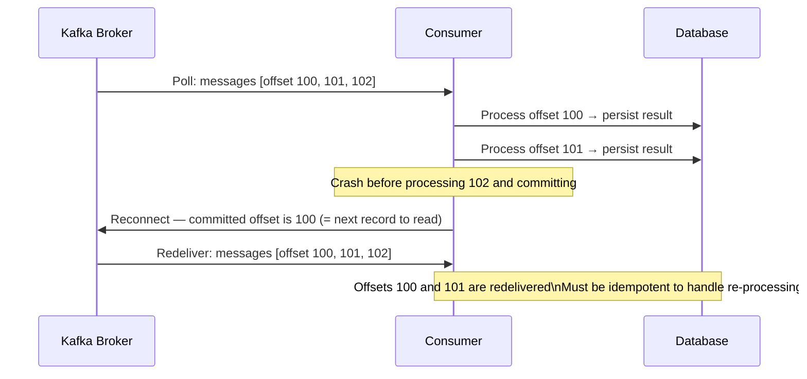

# بنية Kafka — المواضيع والأقسام ومجموعات المستهلكين

> [!NOTE]
> ‏Apache Kafka هي منصة الرسائل المهيمنة في الخدمات المالية — لا لأنها بسيطة، بل لأنها توفر مزيج الديمومة، والإنتاجية، والقدرة على إعادة التشغيل الذي تحتاجه الأنظمة المالية المدفوعة بالأحداث. ويبني هذا الدرس النموذج الذهني المعماري اللازم لاستخدام Kafka بشكل صحيح.

## لماذا وُجدت Kafka — المشكلة التي تحلها

تحذف طوابير الرسائل التقليدية (طوابير RabbitMQ الكلاسيكية، وActiveMQ) الرسائل حالما تُستهلك ويُؤكد استلامها. وهذا يخلق مشكلات للأنظمة المالية:

- **إعادة التشغيل** — إذا كان في المستهلك خطأ، لا تستطيع إعادة معالجة الأحداث التاريخية
- **مستهلكون متعددون** — إضافة خدمة جديدة (تحليلات، امتثال) تتطلب طابورًا خاصًا بها، يُغذّى من لحظة إنشائه فقط (بلا تاريخ)
- **الإنتاجية** — الطابور الواحد محدود عادة بعقدة واحدة؛ والأحجام العالية جدًا تحتاج تجزئة دقيقة
- **الترتيب** — مع مستهلكين متنافسين على طابور واحد، يصعب الحفاظ على ترتيب صارم حين تُعاد الرسائل أو تُعالج بالتوازي

(أضافت RabbitMQ لاحقًا *التدفقات (streams)*، وهي بنية على شكل سجل — ويقارن الدرس 19 بين الاثنين.)

تحل Kafka هذه المشكلات بكونها **سجل التزامات موزعًا، ومقسّمًا، ومنسوخًا**. فتُكتب الرسائل إلى سجل دائم. ويقرأ المستهلكون من السجل بوتيرتهم الخاصة. ولا يُحذف السجل بعد الاستهلاك — بل يُحتفظ به لفترة قابلة للضبط.

## البنية الأساسية



### المواضيع — القناة المنطقية

**الموضوع (topic)** تسلسل مرتب ومسمى من السجلات. والمواضيع دائمة — تُحفظ السجلات بغض النظر عن استهلاكها من عدمه.

```
Topic: payments
  Partition 0: [event1] [event2] [event3] [event4] ...
  Partition 1: [event5] [event6] [event7] ...
  Partition 2: [event8] [event9] ...
```

لكل سجل في القسم **إزاحة (offset) متزايدة باطراد** — موضعه داخل سجل ذلك القسم.

### الأقسام — التوازي والترتيب

الأقسام (partitions) هي وحدة:
- **التوازي** — يعالج المستهلكون الأقسام بالتزامن
- **الترتيب** — الترتيب مضمون داخل القسم، لا عبر الأقسام

**اختيار القسم** يحدد القسم الذي تذهب إليه الرسالة:

```java
// Explicit key — messages with the same key always go to the same partition
// (as long as the partition count does not change)
// This guarantees ordering for a given account
ProducerRecord<String, PaymentEvent> keyed = new ProducerRecord<>(
    "payments",
    payment.getAccountId(),   // partition key — all events for this account go to same partition
    paymentEvent
);

// No key — spread across partitions, no ordering guarantee.
// (Not strict round-robin: since Kafka 2.4 the "sticky" partitioner fills
//  a batch for one partition, then moves on -- bigger batches, same spread)
ProducerRecord<String, PaymentEvent> unkeyed = new ProducerRecord<>(
    "payments",
    null,                     // no key
    paymentEvent
);
```

**اختيار عدد الأقسام** قرار تصميمي حاسم:

| العامل | التوصية |
|---|---|
| توازي المستهلكين | الأقسام ≥ أقصى عدد مستهلكين في المجموعة |
| الإنتاجية | قِس إنتاجية القسم الواحد على عتادك (كثيرًا ما تكون عشرات الميغابايتات في الثانية)؛ وحجّم بهامش 3–5 أضعاف |
| متطلب الترتيب | التوجيه بالمفتاح؛ والترتيب مضمون داخل القسم فقط |
| إعادة التوازن والعبء | أقسام أكثر = عمل أكثر في إعادة التوازن، وانتخاب القادة، والنسخ |
| النمو المستقبلي | إضافة أقسام لاحقًا **تغيّر** ربط المفتاح ← القسم (فينكسر ترتيب المفتاح الواحد أثناء التبديل) — فاختر بسخاء من البداية |

لموضوع مدفوعات بمليون حدث يوميًا (~12 في الثانية في المتوسط، وبضع مئات في الثانية في الذروة)، تحتاج الإنتاجية أقسامًا قليلة جدًا؛ والعدد يحدده توازي المستهلكين والنمو — و12–24 قسمًا اختيار شائع.

### النسخ — الديمومة والتوفر العالي

لكل قسم **قائد (leader)** واحد (يتولى كل القراءات والكتابات) و**تابعون (followers)** متعددون (ينسخون من القائد).

```
Replication factor = 3 (minimum for production financial systems)
min.insync.replicas = 2 (at least 2 replicas must acknowledge a write)
acks = all (producer waits for all in-sync replicas)

This configuration: withstands loss of 1 broker without data loss or availability impact
```

```java
// Producer configuration for financial-grade durability
Properties props = new Properties();
props.put(ProducerConfig.BOOTSTRAP_SERVERS_CONFIG, kafkaBrokers);
props.put(ProducerConfig.ACKS_CONFIG, "all");                     // all ISR must acknowledge
props.put(ProducerConfig.RETRIES_CONFIG, Integer.MAX_VALUE);      // retry forever
props.put(ProducerConfig.ENABLE_IDEMPOTENCE_CONFIG, true);        // no duplicates from retries (per partition)
props.put(ProducerConfig.MAX_IN_FLIGHT_REQUESTS_PER_CONNECTION, 5); // idempotent: safe to have 5
props.put(ProducerConfig.DELIVERY_TIMEOUT_MS_CONFIG, 120_000);    // 2 minutes total delivery timeout
props.put(ProducerConfig.REQUEST_TIMEOUT_MS_CONFIG, 30_000);      // 30 seconds per request attempt
```

## مجموعات المستهلكين — المعالجة المتوازية

**مجموعة المستهلكين (consumer group)** مجموعة من المستهلكين يستهلكون موضوعًا معًا. ويُعيّن كل قسم لمستهلك واحد بالضبط داخل المجموعة.



**خصائص أساسية:**
- مجموعات المستهلكين مستقلة — إضافة مجموعة تدقيق لا تؤثر على مجموعة التسوية
- إذا كان المستهلكون < الأقسام: يعالج بعض المستهلكين أقسامًا متعددة
- إذا كان المستهلكون > الأقسام: يبقى المستهلكون الزائدون خاملين (لا يتلقون أقسامًا)
- إذا تعطل مستهلك: تقوم Kafka **بإعادة التوازن (rebalance)** — تعيد تعيين أقسامه للمستهلكين الباقين

### إعداد المستهلك للأنظمة المالية

```java
Properties props = new Properties();
props.put(ConsumerConfig.BOOTSTRAP_SERVERS_CONFIG, kafkaBrokers);
props.put(ConsumerConfig.GROUP_ID_CONFIG, "settlement-service");
props.put(ConsumerConfig.AUTO_OFFSET_RESET_CONFIG, "earliest");   // start from beginning if no offset
props.put(ConsumerConfig.ENABLE_AUTO_COMMIT_CONFIG, false);       // NEVER auto-commit in finance
props.put(ConsumerConfig.MAX_POLL_RECORDS_CONFIG, 100);           // process 100 records per poll
props.put(ConsumerConfig.MAX_POLL_INTERVAL_MS_CONFIG, 300_000);   // 5 min max between polls
props.put(ConsumerConfig.SESSION_TIMEOUT_MS_CONFIG, 30_000);      // 30s to detect consumer failure
props.put(ConsumerConfig.HEARTBEAT_INTERVAL_MS_CONFIG, 10_000);   // heartbeat every 10s

KafkaConsumer<String, PaymentEvent> consumer = new KafkaConsumer<>(props, 
    new StringDeserializer(), 
    new JsonDeserializer<>(PaymentEvent.class));
```

> [!WARNING]
> **تجنب `enable.auto.commit=true` في الأنظمة المالية.** يلتزم الالتزام التلقائي، على مؤقت أثناء `poll()`، بإزاحات السجلات التي أعادتها عمليات poll سابقة — ولا يعرف هل نجحت معالجتك. فإذا سُلّمت السجلات لخيوط أخرى، أو خُزّنت مؤقتًا، أو كُتبت بشكل غير متزامن، قد تُلتزم الإزاحة قبل أن يصبح العمل دائمًا؛ ثم يُضيّع التعطل تلك الرسائل بصمت. والالتزامات اليدوية تضع نقطة الالتزام بالضبط حيث تنتهي المعالجة. (حاويات المستمعين في Spring Kafka تعطّل أصلًا الالتزام التلقائي في Kafka وتلتزم عنك بحسب `AckMode`.)

### نمط الالتزام اليدوي بالإزاحة

```java
// Commit only after successful processing — at-least-once delivery.
// Failures are NOT handled by "just not acknowledging": the consumer would
// simply continue with the next records, and the next acknowledge() would
// commit past the failed one. Instead, throw -- the container's
// DefaultErrorHandler seeks back, retries with back-off, and finally hands
// the record to a DeadLetterPublishingRecoverer (topic payments.DLT).
@KafkaListener(topics = "payments", groupId = "settlement-service",
               containerFactory = "manualAckKafkaListenerContainerFactory")
public void processPayment(ConsumerRecord<String, PaymentEvent> record,
                           Acknowledgment ack) {
    // Process the payment (idempotent: redelivery must be harmless)
    settlementService.processPayment(record.value());

    // Only commit offset after successful processing
    ack.acknowledge();
    // TransientException (DB timeout, etc.) -> propagates -> retried
    // PermanentException (invalid message) -> registered as not-retryable
    //   -> published to the DLT at once, then the offset moves on
}

@Bean
DefaultErrorHandler errorHandler(KafkaTemplate<Object, Object> template) {
    DefaultErrorHandler handler = new DefaultErrorHandler(
        new DeadLetterPublishingRecoverer(template),
        new ExponentialBackOff(500, 2.0));               // 0.5s, 1s, 2s, ...
    handler.addNotRetryableExceptions(PermanentException.class);
    return handler;
}
```

## نموذج الإزاحة — مرة واحدة بالضبط مقابل مرة واحدة على الأقل

فهم إدارة الإزاحات حاسم لتحقيق دلالات التسليم المطلوبة.



**مرة واحدة على الأقل** (التزام يدوي بعد المعالجة): قد تُعاد الرسائل. ويجب أن تكون المعالجة **idempotent** — آمنة للتنفيذ مرات متعددة.

**مرة واحدة بالضبط** (معاملات Kafka): الاستهلاك، والمعالجة، والإنتاج في معاملة ذرية واحدة. وهي أعقد، وتغطي فقط العمل من Kafka إلى Kafka: تلتزم سجلات المخرجات وإزاحات المستهلك معًا. أما الآثار الجانبية خارج Kafka (كتابات قاعدة البيانات، واستدعاءات HTTP) فليست جزءًا من المعاملة وما زالت تحتاج idempotency. ويجب أن يقرأ المستهلكون اللاحقون بـ `isolation.level=read_committed`.

```java
// Exactly-once: consume from input topic, produce to output topic atomically
// (producer has transactional.id set; consumer has enable.auto.commit=false
//  and isolation.level=read_committed)
producer.initTransactions();
consumer.subscribe(List.of("payment-instructions"));

while (true) {
    ConsumerRecords<String, PaymentInstruction> records = consumer.poll(Duration.ofMillis(100));
    if (records.isEmpty()) continue;

    producer.beginTransaction();
    try {
        for (ConsumerRecord<String, PaymentInstruction> record : records) {
            PaymentResult result = processPayment(record.value());   // pure computation

            // Produce result to output topic
            producer.send(new ProducerRecord<>("payment-results",
                record.key(), result));
        }

        // Commit offsets AND output messages in a single atomic transaction
        // (offset to commit = last processed offset + 1, per partition)
        Map<TopicPartition, OffsetAndMetadata> offsets = calculateOffsets(records);
        producer.sendOffsetsToTransaction(offsets, consumer.groupMetadata());
        producer.commitTransaction();

    } catch (ProducerFencedException e) {
        producer.close();     // another instance took over this transactional.id
        throw e;
    } catch (KafkaException e) {
        producer.abortTransaction();  // rolls back both output messages and offset commit
        // Rewind the consumer: otherwise the next poll() would continue
        // AFTER the aborted batch and those records would be skipped
        for (TopicPartition tp : records.partitions()) {
            OffsetAndMetadata committed = consumer.committed(Set.of(tp)).get(tp);
            consumer.seek(tp, committed != null ? committed.offset() : 0L);
        }
    }
}
```

## تصميم المواضيع للأحداث المالية

### اصطلاحات تسمية الأحداث

```
Domain events (immutable facts):
  payments.submitted        — payment submitted by customer
  payments.authorised       — payment authorisation decision made  
  payments.settled          — settlement confirmed
  payments.failed           — payment permanently failed

Command topics (instructions):
  payment-commands          — instructions to process payments
  
Internal state topics (compacted):
  account-balances          — latest balance per account (log-compacted)
```

### ضغط السجل لمواضيع الحالة

يحتفظ ضغط السجل (log compaction) بآخر سجل فقط لكل مفتاح. واستخدمه لمواضيع الحالة حيث تحتاج القيمة الحالية فقط:

```java
// Topic configuration: account balances (compacted — keep only latest per account)
Map<String, String> accountBalancesConfig = Map.of(
    "cleanup.policy",     "compact",
    "min.cleanable.dirty.ratio", "0.1",
    "segment.ms",         String.valueOf(Duration.ofHours(24).toMillis()),
    // how long delete markers (tombstones) are kept: a consumer offline
    // longer than this can miss deletions -- size it to your longest outage
    "delete.retention.ms", String.valueOf(Duration.ofDays(1).toMillis())
);

// Sending a compacted message: same key = later message replaces earlier
producer.send(new ProducerRecord<>(
    "account-balances",
    accountId.toString(),              // partition and compaction key
    new AccountBalance(accountId, newBalance, Instant.now())
));
```

<!-- KNOWLEDGE-CHECK
{
  "questions": [
    {
      "id": "q1",
      "text": "لموضوع payments ستة أقسام. ولمجموعة مستهلكي التسوية 8 مستهلكين. ماذا يحدث؟",
      "options": [
        "خطأ — تشترط Kafka أن يكون عدد المستهلكين ≤ عدد الأقسام",
        "يُعيّن للمستهلكين الثمانية كلهم أقسام (يحصل كل قسم على مستهلكين متعددين)",
        "يُعيّن لستة مستهلكين قسم واحد لكل منهم؛ ويبقى مستهلكان خاملين",
        "تنشئ Kafka تلقائيًا قسمين إضافيين لمطابقة عدد المستهلكين"
      ],
      "correct": 2,
      "explanation": "يمكن تعيين كل قسم لمستهلك واحد فقط داخل المجموعة. ومع 6 أقسام و8 مستهلكين، يحصل 6 مستهلكين على قسم واحد لكل منهم ولا يتلقى مستهلكان أي قسم (خاملان). وهذا ليس خطأ — فالمستهلكان الخاملان يعملان كاحتياط ويتلقيان أقسامًا إذا تعطل مستهلك آخر."
    },
    {
      "id": "q2",
      "text": "يجب معالجة أحداث الدفع للحساب A بالترتيب. كيف يجب إعداد منتج Kafka؟",
      "options": [
        "اضبط acks=all وreplication-factor=3",
        "استخدم معرّف الحساب A كمفتاح الرسالة — توجّه Kafka كل الرسائل ذات المفتاح نفسه إلى القسم نفسه، فتضمن الترتيب على مستوى القسم",
        "استخدم موضوعًا بقسم واحد لكل أحداث الدفع",
        "اضبط max.in.flight.requests.per.connection=1"
      ],
      "correct": 1,
      "explanation": "تضمن Kafka الترتيب داخل القسم. وباستخدام معرّف الحساب كمفتاح الرسالة، يوجّه المقسّم القائم على التجزئة كل أحداث ذلك الحساب إلى القسم نفسه، فيضمن تسليمها للمستهلكين بالترتيب. والموضوع ذو القسم الواحد سيعمل لكنه يلغي كل التوازي."
    },
    {
      "id": "q3",
      "text": "لماذا يُعد `enable.auto.commit=true` خطرًا على مستهلكي Kafka الماليين؟",
      "options": [
        "يسبب الالتزام التلقائي تسليم الرسائل مرتين",
        "يقدّم الالتزام التلقائي الإزاحة على مؤقت بغض النظر عن نجاح المعالجة — فإذا تعطل المستهلك بعد الالتزام التلقائي وقبل حفظ النتيجة، تُتخطى الرسالة نهائيًا",
        "يقلل الالتزام التلقائي إنتاجية المستهلك بنسبة 50%",
        "الالتزام التلقائي غير متوافق مع تسلسل Avro"
      ],
      "correct": 1,
      "explanation": "يلتزم الالتزام التلقائي بالإزاحات كل auto.commit.interval.ms (افتراضيًا 5 ثوانٍ) أثناء poll()، للسجلات التي أعادتها عمليات poll سابقة — ولا يعرف هل نجحت المعالجة. فإذا عالج التطبيق السجلات بشكل غير متزامن (سلّمها لمجمع خيوط، أو خزّن الكتابات مؤقتًا)، قد تُلتزم إزاحة دفعة بينما معالجتها ما زالت جارية؛ فإذا تعطل المستهلك حينها، لا تُعاد الدفعة أبدًا — وتضيع بصمت. والالتزامات اليدوية بعد المعالجة الدائمة تتجنب هذا."
    },
    {
      "id": "q4",
      "text": "تستهلك أحداث الدفع بمبدأ مرة واحدة على الأقل. وتصل الدفعة نفسها مرتين (تسليم مكرر بعد تعطل مستهلك). كيف يجب تصميم معالجة الدفع؟",
      "options": [
        "يجب أن يفحص المستهلك الإزاحة لكشف التكرارات",
        "يجب أن تكون معالجة الدفع idempotent — معالجة حدث الدفع نفسه مرتين يجب أن يكون لها أثر معالجته مرة واحدة (استخدم معرّف الدفعة كمفتاح idempotency)",
        "التكرارات مستحيلة مع إعداد acks=all",
        "استخدم مستهلكًا واحدًا دون مجموعة مستهلكين لمنع إعادة التوازن"
      ],
      "correct": 1,
      "explanation": "يسمح التسليم مرة واحدة على الأقل بطبيعته بإعادة التسليم. والنهج الآمن الوحيد المعالجة idempotent: تحقق هل عولج معرّف الدفعة من قبل قبل تنفيذ الدفعة. ويمكن ذلك بقيد UNIQUE في قاعدة البيانات على معرّف الدفعة أو مخزن مفاتيح idempotency بمدة صلاحية."
    }
  ]
}
-->

<!-- PRACTICAL-CHALLENGE
{
  "title": "بنية Kafka — المواضيع والأقسام ومجموعات المستهلكين — تنفيذ إنتاجي",
  "difficulty": "advanced",
  "estimatedMinutes": 90,
  "tasks": [
    {
      "id": "1",
      "description": "احسب عدد الأقسام لموضوع مدفوعات: 5 ملايين حدث يوميًا اليوم مع ذروات تبلغ 10 أضعاف المتوسط، ونمو متوقع بثلاثة أضعاف خلال سنتين، وخدمة تسوية تحتاج حتى 24 مستهلكًا متوازيًا. واعرض حساب الإنتاجية، ومتطلب التوازي، واشرح لماذا تكسر إضافة الأقسام لاحقًا ترتيب الحساب الواحد."
    },
    {
      "id": "2",
      "description": "اكتب أمر إنشاء الموضوع (kafka-topics.sh أو AdminClient) لموضوع المدفوعات بعامل نسخ 3، وmin.insync.replicas=2، واحتفاظ 7 أيام، وعدد الأقسام من المهمة 1. وأنشئ أيضًا موضوع account-balances مضغوطًا واشرح كل إعداد اخترته."
    },
    {
      "id": "3",
      "description": "اكتب إعداد المنتج لديمومة بمستوى مالي (acks=all، وidempotence، ومهلة التسليم، وaccount_id كمفتاح) واختبارًا يثبت أن أحداث الحساب الواحد تصل بالترتيب في قسم واحد، بينما تتوزع أحداث الحسابات المختلفة على الأقسام."
    },
    {
      "id": "4",
      "description": "صمم استراتيجية مجموعات المستهلكين للتسوية (معالجة) والتدقيق (قارئ مستقل): معرّفات المجموعات، والالتزامات اليدوية، وDefaultErrorHandler بتراجع زمني وموضوع رسائل ميتة، ومعالجة idempotent قائمة على معرّف الدفعة. واكتب اختبارًا يوقف مستهلكًا في منتصف دفعة ويتحقق من عدم ضياع أي دفعة وعدم تأثير التكرارات."
    }
  ]
}
-->
