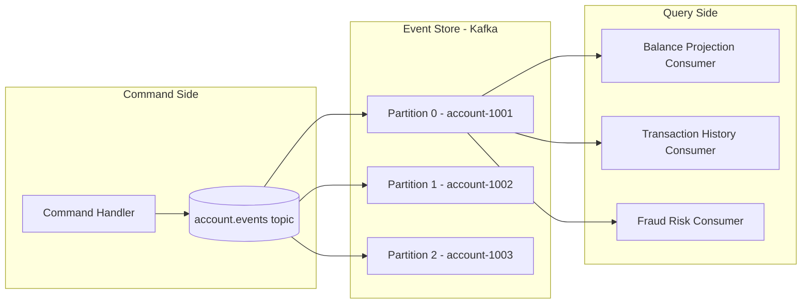

# ‏Event Sourcing مع Kafka — بنية مخزن الأحداث

تخزّن الأنظمة التقليدية الحالة الحالية للكيان — رصيد الحساب 4,250.00. أما event sourcing فيخزّن الحقائق التي أدت إلى تلك الحالة — إيداع 1,000، وسحب 500، واستلام تحويل 3,750. وهذا التمييز جوهري في الأنظمة المالية حيث مسار التدقيق ليس اهتمامًا ثانويًا بل السجل الأساسي. ويغطي هذا الدرس كيف تنفذ Kafka أسلوب event sourcing لتجمّعات الدفع، بما فيه استراتيجيات اللقطات، وآليات إعادة التشغيل، ومستهلكي الإسقاطات (projections).

## 1. أساسيات Event Sourcing

المبدأ الجوهري: **خزّن الحقائق، لا الحالة**. وتُشتق الحالة بإعادة تشغيل الحقائق.

```
Traditional:   Account { balance: 4250.00 }

Event-Sourced: AccountCreated { accountId: 1001, initialBalance: 0 }
               MoneyDeposited { accountId: 1001, amount: 1000.00 }
               MoneyWithdrawn  { accountId: 1001, amount: 500.00 }
               TransferReceived { accountId: 1001, amount: 3750.00 }
               -- replay → balance = 0 + 1000 - 500 + 3750 = 4250.00
```

الفوائد للتقنية المالية:
- مسار تدقيق كامل مدمج في نموذج البيانات (متطلب رقابي)
- استعلامات زمنية: "ما كان الرصيد في 2023-12-31؟" — انتقل إلى ذلك الطابع الزمني وأعد التشغيل
- إعادة تشغيل الأحداث لإصلاح الأخطاء: أصلح منطق الإسقاط وأعد بناء نموذج القراءة
- فصل نموذجي الكتابة والقراءة (CQRS)

الكلف:
- قد تكون إعادة تشغيل الأحداث بطيئة دون لقطات
- يتطلب تطور المخطط محولات ترقية (upcasters)
- اتساق نهائي لنماذج القراءة

## 2. ‏Kafka كمخزن أحداث

يتوافق سجل Kafka للإلحاق فقط وغير القابل للتغيير طبيعيًا مع event sourcing — لكن اعرف فجوتيه قبل استخدامه بوصفه *مخزن* الأحداث:

1. **لا إلحاق مشروط.** يجب أن يرفض مخزن الأحداث "ألحِق الإصدار 8" حين يكون شخص آخر قد ألحق الإصدار 8 أصلًا (التزامن التفاؤلي). ولا تستطيع Kafka فحص ذلك. فتحتاج كاتبًا واحدًا لكل تجمّع (مثلًا كل أوامر الحساب يعالجها المستهلك الوحيد الذي يملك قسمه) أو قاعدة بيانات في المقدمة.
2. **لا قراءات لكل تجمّع.** تحميل حساب واحد يعني مسح قسمه كاملًا، الذي يحمل أيضًا آلاف الحسابات الأخرى.

لذلك يخزن فرق كثيرة الأحداث في جدول قاعدة بيانات بقيد `UNIQUE (aggregate_id, version)` (أو في EventStoreDB/KurrentDB) وينشرونها إلى Kafka عبر outbox ‏(الدرس 06) — فتوزع Kafka الأحداث على الإسقاطات. ويعرض هذا الدرس event sourcing المتمحور حول Kafka؛ وتنطبق تقنيات اللقطات والإسقاطات في الحالتين.

قرارات التصميم الأساسية:

| قرار التصميم | التوصية | المبرر |
|---|---|---|
| موضوع لكل نوع تجمّع | ‏`account.events`، `payment.events` | يتيح احتفاظًا وضغطًا مستقلين لكل تجمّع |
| مفتاح القسم | ‏`aggregateId` | يحفظ الترتيب لكل تجمّع؛ فكل أحداث account-1001 تذهب إلى القسم نفسه |
| الاحتفاظ | غير محدود (أو طويل جدًا) | الأحداث مصدر الحقيقة — احذف فقط بعد لقطة كاملة |
| ضغط السجل | مفعّل على موضوع اللقطات، لا على موضوع الأحداث | الضغط على موضوع الأحداث سيحذف التاريخ |
| صيغة الرسالة | Avro أو Protobuf مع schema registry | دعم تطور المخطط |



### إعداد المواضيع

```bash
# Create the event store topic
# Retention: 10 years for regulatory compliance
# Compaction: disabled — keep all events, not just latest per key
kafka-topics.sh --create \
  --topic account.events \
  --partitions 32 \
  --replication-factor 3 \
  --config retention.ms=315360000000 \
  --config cleanup.policy=delete \
  --config min.insync.replicas=2 \
  --bootstrap-server kafka:9092

# Snapshot topic: compacted — only the latest snapshot per aggregate
kafka-topics.sh --create \
  --topic account.snapshots \
  --partitions 32 \
  --replication-factor 3 \
  --config cleanup.policy=compact \
  --config min.insync.replicas=2 \
  --bootstrap-server kafka:9092
```

## 3. إلحاق الأحداث — ProducerRecord مع الترويسات

تحمل الأحداث بيانات وصفية عبر ترويسات Kafka: إصدار التجمّع، ومعرّف الارتباط، ومعرّف السببية، ونوع الحدث.

```java
public class AccountEventStore {

    private static final String TOPIC = "account.events";
    private final KafkaProducer<String, byte[]> producer;
    private final SchemaRegistryClient schemaRegistry;

    public void append(AccountEvent event, EventMetadata metadata) {
        byte[] serializedEvent = serialize(event);  // Avro serialization

        ProducerRecord<String, byte[]> record = new ProducerRecord<>(
            TOPIC,
            null,              // let Kafka assign partition based on key hash
            event.getAggregateId().toString(),  // key = aggregateId
            serializedEvent
        );

        // Headers carry metadata without inflating the event payload
        record.headers()
            .add("eventType",      event.getClass().getSimpleName().getBytes())
            .add("aggregateType",  "Account".getBytes())
            .add("aggregateVersion", String.valueOf(metadata.getVersion()).getBytes())
            .add("correlationId",  metadata.getCorrelationId().getBytes())
            .add("causationId",    metadata.getCausationId().getBytes())
            .add("schemaVersion",  "1".getBytes());

        try {
            RecordMetadata rm = producer.send(record).get();
            log.info("Event appended: {} offset={} partition={}",
                     event.getClass().getSimpleName(), rm.offset(), rm.partition());
        } catch (ExecutionException e) {
            throw new EventStoreException("Failed to append event", e.getCause());
        }
    }
}
```

### تجمّع الحساب مع التحكم بالإصدار

```java
@Value
public class AccountAggregate {
    UUID accountId;
    BigDecimal balance;
    AccountStatus status;
    int version;

    public static AccountAggregate empty(UUID accountId) {
        return new AccountAggregate(accountId, BigDecimal.ZERO,
                                    AccountStatus.PENDING, 0);
    }

    public AccountAggregate apply(AccountEvent event) {
        return switch (event) {
            case AccountCreated e   -> new AccountAggregate(
                accountId, e.getInitialBalance(), AccountStatus.ACTIVE, version + 1);
            case MoneyDeposited e   -> new AccountAggregate(
                accountId, balance.add(e.getAmount()), status, version + 1);
            case MoneyWithdrawn e   -> new AccountAggregate(
                accountId, balance.subtract(e.getAmount()), status, version + 1);
            case AccountSuspended e -> new AccountAggregate(
                accountId, balance, AccountStatus.SUSPENDED, version + 1);
            default -> throw new UnknownEventException(event.getClass().getSimpleName());
        };
    }
}
```

## 4. إعادة تشغيل الأحداث من موضوع Kafka

```java
public class AccountEventReplay {

    private final KafkaConsumer<String, byte[]> replayConsumer;
    private final String eventTopic = "account.events";

    public AccountAggregate replay(UUID accountId) {
        // Find the partition the PRODUCER used: same murmur2 hash on the
        // serialized key, modulo the topic's CURRENT partition count
        // (Utils.toPositive(Utils.murmur2(keyBytes)) % partitions)
        int partition = computePartition(accountId,
            replayConsumer.partitionsFor(eventTopic).size());
        TopicPartition tp = new TopicPartition(eventTopic, partition);

        replayConsumer.assign(List.of(tp));
        replayConsumer.seekToBeginning(List.of(tp));

        // Read up to the end offset as of NOW. An empty poll() does not mean
        // "end of partition" -- it can simply be a slow fetch.
        long endOffset = replayConsumer.endOffsets(List.of(tp)).get(tp);

        AccountAggregate aggregate = AccountAggregate.empty(accountId);
        while (replayConsumer.position(tp) < endOffset) {
            for (ConsumerRecord<String, byte[]> record :
                    replayConsumer.poll(Duration.ofMillis(500))) {
                // The partition holds MANY accounts: skip the others
                if (!accountId.toString().equals(record.key())) continue;

                AccountEvent event = deserialize(record.value(), record.headers());
                aggregate = aggregate.apply(event);
            }
        }

        return aggregate;
    }

    // Seek to a specific point in time for temporal queries
    public AccountAggregate replayUntil(UUID accountId, Instant asOf) {
        int partition = computePartition(accountId,
            replayConsumer.partitionsFor(eventTopic).size());
        TopicPartition tp = new TopicPartition(eventTopic, partition);

        replayConsumer.assign(List.of(tp));

        // offsetsForTimes: the FIRST offset whose record timestamp >= asOf
        // (null if there is none). Replay from the beginning UP TO that offset.
        OffsetAndTimestamp boundary = replayConsumer
            .offsetsForTimes(Map.of(tp, asOf.toEpochMilli()))
            .get(tp);

        return replayFromBeginningUpTo(accountId, tp, boundary);
    }
}
```

## 5. استراتيجية اللقطات

تصبح إعادة التشغيل الكاملة من البداية مكلفة مع نمو عدد الأحداث. وتخزن اللقطات حالة التجمّع كل N حدث.

```java
public class SnapshotStrategy {

    private static final int SNAPSHOT_THRESHOLD = 100;
    private static final String SNAPSHOT_TOPIC = "account.snapshots";

    private final AccountEventStore eventStore;
    private final KafkaProducer<String, byte[]> snapshotProducer;

    public AccountAggregate loadWithSnapshot(UUID accountId) {
        // 1. Try to load latest snapshot from compacted topic
        AccountSnapshot latestSnapshot = loadLatestSnapshot(accountId);

        if (latestSnapshot == null) {
            // No snapshot — full replay
            return eventStore.replay(accountId);
        }

        // 2. Replay only events after the snapshot (delta replay). Kafka can
        //    only seek by OFFSET, so the snapshot stores the offset of the
        //    last applied event: continue at eventOffset + 1
        return eventStore.replayFromOffset(accountId, latestSnapshot.getEventOffset() + 1,
                                           latestSnapshot.toAggregate());
    }

    public void maybeSnapshot(AccountAggregate aggregate, long kafkaOffset) {
        // Write a snapshot every 100 events
        if (aggregate.getVersion() % SNAPSHOT_THRESHOLD == 0) {
            writeSnapshot(aggregate, kafkaOffset);
        }
    }

    private void writeSnapshot(AccountAggregate aggregate, long eventOffset) {
        AccountSnapshot snapshot = AccountSnapshot.builder()
            .accountId(aggregate.getAccountId())
            .balance(aggregate.getBalance())
            .status(aggregate.getStatus())
            .aggregateVersion(aggregate.getVersion())
            .eventOffset(eventOffset)
            .snapshotTime(Instant.now())
            .schemaVersion(1)
            .build();

        ProducerRecord<String, byte[]> record = new ProducerRecord<>(
            SNAPSHOT_TOPIC,
            aggregate.getAccountId().toString(),
            serialize(snapshot)
        );

        snapshotProducer.send(record);
        log.info("Snapshot written for account={} at version={}",
                 aggregate.getAccountId(), aggregate.getVersion());
    }

    private AccountSnapshot loadLatestSnapshot(UUID accountId) {
        // Scan the (compacted) snapshot partition; the LAST record for this
        // key is the newest snapshot. Note this is a scan of the whole
        // partition, not a key lookup -- at scale, keep snapshots in a
        // key-value store (database table, or a Kafka Streams state store)
        int partition = computePartition(accountId, 32);
        TopicPartition tp = new TopicPartition(SNAPSHOT_TOPIC, partition);

        try (KafkaConsumer<String, byte[]> snapshotConsumer = createConsumer()) {
            snapshotConsumer.assign(List.of(tp));
            snapshotConsumer.seekToBeginning(List.of(tp));

            long endOffset = snapshotConsumer.endOffsets(List.of(tp)).get(tp);
            AccountSnapshot latest = null;

            while (snapshotConsumer.position(tp) < endOffset) {
                for (ConsumerRecord<String, byte[]> r :
                        snapshotConsumer.poll(Duration.ofMillis(300))) {
                    if (accountId.toString().equals(r.key())) {
                        latest = r.value() == null ? null              // tombstone
                                                   : deserializeSnapshot(r.value());
                    }
                }
            }

            return latest;
        }
    }
}
```

## 6. مستهلكو الإسقاطات — إعادة بناء نماذج القراءة

يشترك مستهلكو الإسقاطات في سجل الأحداث ويحافظون على عروض محسّنة للقراءة في PostgreSQL. والتسليم مرة واحدة على الأقل، فيجب أن يكون كل تحديث **idempotent**: هنا يُستخدم إصدار التجمّع في الحدث — فيُطبق الحدث فقط إن كان الصف عند الإصدار السابق بالضبط، فلا يغيّر الحدث المعاد تسليمه شيئًا.

```java
@Component
@Slf4j
public class AccountBalanceProjection {

    private final JdbcTemplate jdbc;

    @KafkaListener(
        topics = "account.events",
        groupId = "projection-account-balance",
        containerFactory = "readCommittedKafkaListenerFactory"
    )
    public void project(ConsumerRecord<String, byte[]> record) {
        AccountEvent event = deserialize(record.value(), record.headers());
        int v = event.getVersion();   // aggregate version carried in the event

        int updated = switch (event) {
            case AccountCreated e -> jdbc.update(
                """
                INSERT INTO account_summary (account_id, balance, status, version, last_updated)
                VALUES (?, ?, 'ACTIVE', ?, NOW())
                ON CONFLICT (account_id) DO NOTHING
                """,
                e.getAccountId(), e.getInitialBalance(), v);

            // Apply only if the row is at version v-1: a duplicate (row is
            // already at v or later) updates 0 rows and is ignored
            case MoneyDeposited e -> jdbc.update(
                """
                UPDATE account_summary
                SET    balance = balance + ?,
                       version = ?,
                       last_updated = NOW()
                WHERE  account_id = ? AND version = ?
                """,
                e.getAmount(), v, e.getAccountId(), v - 1);

            case MoneyWithdrawn e -> jdbc.update(
                """
                UPDATE account_summary
                SET    balance = balance - ?,
                       version = ?,
                       last_updated = NOW()
                WHERE  account_id = ? AND version = ?
                """,
                e.getAmount(), v, e.getAccountId(), v - 1);

            default -> {
                log.debug("Event type not handled by balance projection: {}",
                          event.getClass().getSimpleName());
                yield 1;
            }
        };

        if (updated == 0) {
            Integer current = jdbc.queryForObject(
                "SELECT version FROM account_summary WHERE account_id = ?",
                Integer.class, event.getAggregateId());
            if (current == null || current < v - 1) {
                // a GAP: an earlier event is missing -- never skip silently
                throw new IllegalStateException("Projection gap for " + event.getAggregateId()
                    + ": at version " + current + ", got event version " + v);
            }
            log.debug("Duplicate event version {} for {} ignored", v, event.getAggregateId());
        }
    }
}
```

### إعادة بناء إسقاط

حين يكون في منطق الإسقاط خطأ أو يتغير المخطط، يمكنك إعادة البناء بإعادة تشغيل كل الأحداث:

```java
@Component
@Slf4j
public class ProjectionRebuildService {

    private final JdbcTemplate jdbc;

    public void rebuildAccountSummary() throws Exception {
        log.warn("Starting full projection rebuild for account_summary");

        // 0. STOP the projection consumers first: offsets of a group can only
        //    be changed while the group has no active members.

        // 1. Truncate the read model (do this during a maintenance window
        //    or use a shadow table approach for zero-downtime rebuild:
        //    build account_summary_v2 with a NEW group id, then switch reads)
        jdbc.execute("TRUNCATE TABLE account_summary");

        try (AdminClient adminClient = AdminClient.create(adminProps())) {
            // 2. Find the EARLIEST available offset of every partition (after
            //    retention deleted old segments it is no longer 0)
            Set<TopicPartition> partitions = adminClient
                .describeTopics(List.of("account.events")).allTopicNames().get()
                .get("account.events").partitions().stream()
                .map(p -> new TopicPartition("account.events", p.partition()))
                .collect(Collectors.toSet());

            Map<TopicPartition, ListOffsetsResult.ListOffsetsResultInfo> earliest =
                adminClient.listOffsets(partitions.stream()
                        .collect(Collectors.toMap(tp -> tp, tp -> OffsetSpec.earliest())))
                    .all().get();

            // 3. Reset the consumer group to those offsets
            Map<TopicPartition, OffsetAndMetadata> resetOffsets = new HashMap<>();
            earliest.forEach((tp, info) ->
                resetOffsets.put(tp, new OffsetAndMetadata(info.offset())));

            adminClient.alterConsumerGroupOffsets(
                "projection-account-balance", resetOffsets).all().get();
        }

        log.info("Consumer group offset reset — projection will rebuild on next start");
        // 4. Start the consumers again to trigger the replay
    }
}
```

## 7. ‏EventStoreDB مقابل Kafka مقابل PostgreSQL

| الميزة | EventStoreDB | Kafka | PostgreSQL (إلحاق فقط) |
|---|---|---|---|
| دعم أصلي لـ event sourcing | نعم (تدفقات واشتراكات مدمجة) | لا (يمكن تكييفه) | لا (يمكن تكييفه) |
| التزامن التفاؤلي عند الإلحاق | نعم (الإصدار المتوقع) | لا | نعم (`UNIQUE (aggregate_id, version)`) |
| قراءة أحداث تجمّع واحد | مباشرة (لكل تدفق) | مسح القسم كاملًا | بحث بالفهرس |
| ضمان الترتيب | لكل تدفق، وشامل للعناقيد الصغيرة | لكل قسم لكل مفتاح | بترتيب الإدراج في الجدول |
| دعم اللقطات | إسقاطات أصلية | يدوي (موضوع مضغوط) | يدوي (جدول لقطات) |
| الاستعلامات الزمنية | مدمجة عبر موضع التدفق | عبر `offsetsForTimes` | عبر فهرس `created_at` |
| الإنتاجية | متوسطة (اختناق العقدة الواحدة) | عالية جدًا (توسع أفقي) | متوسطة (كثيفة الكتابة) |
| نموذج المستهلك | دفع (اشتراكات) | سحب (مجموعات مستهلكين) | استطلاع / LISTEN/NOTIFY |
| سجل المخططات | لا شيء مدمج | Confluent/Apicurio | لا شيء |
| التعقيد التشغيلي | منخفض | عالٍ | منخفض |
| ملاءمة حالة الاستخدام | event sourcing للمجال | تدفق عالي الإنتاجية | سجل تدقيق بسيط |

## 8. الاستعلامات الزمنية — الرصيد في تاريخ سابق

```java
public BigDecimal getBalanceAsOf(UUID accountId, LocalDate date) {
    Instant asOf = date.plusDays(1).atStartOfDay(ZoneOffset.UTC).toInstant();

    int partition = computePartition(accountId, 32);
    TopicPartition tp = new TopicPartition("account.events", partition);

    // NOTE: offsetsForTimes uses the Kafka RECORD timestamp (set by the
    // producer), not the business time of the event. For a regulatory
    // "as of" answer, filter on the event's own occurredAt field instead.
    try (KafkaConsumer<String, byte[]> consumer = createReplayConsumer()) {
        consumer.assign(List.of(tp));

        // Find the first offset at/after midnight following the target date
        Map<TopicPartition, OffsetAndTimestamp> offsets =
            consumer.offsetsForTimes(Map.of(tp, asOf.toEpochMilli()));

        OffsetAndTimestamp boundary = offsets.get(tp);
        long endOffset = consumer.endOffsets(List.of(tp)).get(tp);
        long maxOffset = (boundary != null)
            ? Math.min(boundary.offset(), endOffset)
            : endOffset;                       // nothing newer: read to the end

        consumer.seekToBeginning(List.of(tp));

        AccountAggregate aggregate = AccountAggregate.empty(accountId);

        outer:
        while (consumer.position(tp) < maxOffset) {
            for (ConsumerRecord<String, byte[]> r : consumer.poll(Duration.ofMillis(500))) {
                if (r.offset() >= maxOffset) break outer;
                if (!accountId.toString().equals(r.key())) continue;
                aggregate = aggregate.apply(
                    deserialize(r.value(), r.headers()));
            }
        }

        return aggregate.getBalance();
    }
}
```

## 9. أحداث Saga — كل خطوة تُلحق

في Saga، تُلحق كل خطوة تعويض أو إتمام حدثًا بتدفق الـ Saga:

```java
// Each saga step appends an event to the saga topic
public class PaymentSagaEventStore {

    public void appendSagaEvent(UUID sagaId, SagaEvent event) {
        ProducerRecord<String, byte[]> record = new ProducerRecord<>(
            "payment.saga.events",
            sagaId.toString(),       // key = sagaId for ordering
            serialize(event)
        );
        record.headers()
            .add("sagaStepId",   event.getStepId().getBytes())
            .add("sagaStepType", event.getStepType().name().getBytes());

        producer.send(record);
    }

    public PaymentSagaState replaySaga(UUID sagaId) {
        // Seek to partition for sagaId, replay all events
        // Derive current saga state from event sequence
        return replayFromBeginning(sagaId);
    }
}
```

## 10. مزالق الإنتاج

### المزلق 1 — استخدام إزاحات Kafka كأرقام تسلسلية

يستخدم فريق إزاحة Kafka كرقم إصدار الحدث. لكن الإزاحات لكل **قسم**، يتشاركها كل تجمّع عليه — فتقع أحداث حساب واحد عند إزاحات مثل 5، و12، و31، و44 — وتتغير كليًا حين تُنسخ البيانات إلى موضوع أو عنقود آخر (إعادة التقسيم، أو الترحيل، أو التعافي من الكوارث). فينكسر القفل التفاؤلي القائم على الإصدار المبني عليها.

```java
// BAD: using Kafka offset as aggregate version
public void handleRecord(ConsumerRecord<String, byte[]> record) {
    AccountEvent event = deserialize(record.value());
    // WRONG: offset is per-partition, not per-aggregate -- non-consecutive
    // for a given aggregate, and different after copying to another topic
    long version = record.offset();  // DO NOT USE AS VERSION
    aggregateRepository.save(aggregate, version);
}

// GOOD: embed the version in the event payload itself
// Version is managed by the application, not Kafka
public void appendEvent(UUID aggregateId, AccountEvent event, int expectedVersion) {
    // Optimistic concurrency: the CALLER must guarantee that expectedVersion
    // is still current. Kafka cannot check it -- so either one single writer
    // per aggregate (the owner of its partition) produces its events, or the
    // check is done in a database (UNIQUE (aggregate_id, version)) first
    event.setVersion(expectedVersion + 1);
    event.setAggregateId(aggregateId);

    ProducerRecord<String, byte[]> record = new ProducerRecord<>(
        "account.events",
        aggregateId.toString(),
        serialize(event)
    );
    // Version is in the event payload and headers, not the Kafka offset
    record.headers().add("aggregateVersion",
                         String.valueOf(event.getVersion()).getBytes());
    producer.send(record);
}
```

### المزلق 2 — ضغط السجل يحذف أحداثًا تحتاجها الاستعلامات الزمنية

يفعّل فريق `cleanup.policy=compact` على موضوع `account.events` لتوفير التخزين. فيحتفظ الضغط بآخر حدث فقط لكل مفتاح، فيدمر تاريخ الأحداث. وتصبح الاستعلامات الزمنية ("الرصيد في التاريخ X") مستحيلة.

```bash
# BAD: compaction on the event store topic destroys event history
kafka-configs.sh --alter \
  --topic account.events \
  --add-config cleanup.policy=compact \
  --bootstrap-server kafka:9092
# This keeps only the last event per accountId!
# All intermediate events (deposits, withdrawals) are deleted.

# GOOD: use delete retention on event topic, compact only snapshot topic
kafka-configs.sh --alter \
  --topic account.events \
  --add-config "cleanup.policy=delete,retention.ms=315360000000" \
  --bootstrap-server kafka:9092

kafka-configs.sh --alter \
  --topic account.snapshots \
  --add-config "cleanup.policy=compact" \
  --bootstrap-server kafka:9092
# Snapshots: only latest per aggregate → compaction is correct here
```

### المزلق 3 — لقطة بلا إصدار مخطط — تنكسر عند تغيير المخطط

يخزن فريق اللقطات كـ JSON عادي دون إصدار مخطط. وحين يضيف `AccountAggregate` حقلًا جديدًا (`creditLimit`)، لا يمكن فك تسلسل اللقطات القديمة، فيتعطل النظام أثناء إعادة التشغيل.

```java
// BAD: snapshot without schema version
public class AccountSnapshot {
    private UUID accountId;
    private BigDecimal balance;
    private String status;
    // No schemaVersion field — deserialization fails when AccountSnapshot changes
}

// GOOD: snapshot with schema version and migration logic
public class AccountSnapshot {
    private int schemaVersion;    // MUST be first field, always present
    private UUID accountId;
    private BigDecimal balance;
    private String status;
    private BigDecimal creditLimit;   // new field in schema version 2
    private int aggregateVersion;
    private long eventOffset;         // offset of the last applied event

    public AccountAggregate toAggregate() {
        // Handle migration from old schema versions
        return switch (schemaVersion) {
            case 1 -> new AccountAggregate(
                accountId, balance, AccountStatus.valueOf(status),
                BigDecimal.ZERO,   // creditLimit defaults to 0 for old snapshots
                aggregateVersion); // keep the version -- delta replay continues from it
            case 2 -> new AccountAggregate(
                accountId, balance, AccountStatus.valueOf(status),
                creditLimit, aggregateVersion);
            default -> throw new UnknownSnapshotVersionException(schemaVersion);
        };
    }
}
```

## 11. قائمة تحقق Event Sourcing مع Kafka

- [ ] استخدم موضوعًا لكل نوع تجمّع مع key=aggregateId لترتيب الأقسام
- [ ] اضبط `cleanup.policy=delete` على مواضيع الأحداث — لا تضغط تاريخ الأحداث أبدًا
- [ ] استخدم `cleanup.policy=compact` على مواضيع اللقطات فقط
- [ ] ضمّن إصدار المخطط في حمولة كل حدث ولقطة
- [ ] لا تستخدم إزاحات Kafka أبدًا كأرقام إصدار للتجمّع — استخدم إصدارات يديرها التطبيق
- [ ] اكتب لقطات كل N حدث لتحديد زمن إعادة التشغيل
- [ ] ضمّن إصدار مخطط اللقطة واكتب منطق الترحيل في `toAggregate()`
- [ ] استخدم `offsetsForTimes` للاستعلامات الزمنية — واختبره في staging
- [ ] اضبط احتفاظًا غير محدود (أو طويلًا جدًا) على مواضيع الأحداث للامتثال الرقابي
- [ ] اختبر إعادة بناء الإسقاط: أفرغ نموذج القراءة، وأعد ضبط الإزاحة، وأعد تشغيل المستهلك
- [ ] راقب زمن إعادة تشغيل الأحداث — نبّه إن تجاوز زمن إعادة البناء اتفاقية مستوى الخدمة
- [ ] نفّذ التزامنًا تفاؤليًا عند الإلحاق باستخدام إصدار التجمّع (كاتب واحد لكل تجمّع، أو فحص في قاعدة بيانات — Kafka نفسها لا تستطيع فرضه)
- [ ] اجعل الإسقاطات idempotent (طبّق الحدث فقط إن كان نموذج القراءة عند الإصدار السابق)

<!-- KNOWLEDGE-CHECK
{"questions":[{"text":"لماذا يجب ألا يُضبط cleanup.policy=compact على موضوع Kafka ‏account.events في نظام قائم على event sourcing؟","options":["يزيد الضغط كلف التخزين كثيرًا","يحتفظ الضغط بآخر سجل فقط لكل مفتاح، فيدمر الأحداث الوسيطة اللازمة لإعادة التشغيل والاستعلامات الزمنية","الضغط غير مدعوم على المواضيع التي تتجاوز 32 قسمًا","يمنع الضغط المستهلكين من قراءة الموضوع"],"correct":1,"explanation":"يحتفظ ضغط السجل بأحدث رسالة فقط لكل مفتاح. وللحساب القائم على event sourcing، المفتاح هو accountId. فسيحتفظ الضغط بآخر حدث فقط (مثلًا أحدث سحب)، ويحذف كل الأحداث الأسبق. وهذا يجعل إعادة تشغيل الحالة أو الإجابة عن الاستعلامات الزمنية مثل الرصيد في تاريخ معين مستحيلة."},{"text":"لتجمّع AccountAggregate ‏1,500 حدث في Kafka. كيف تقلل استراتيجية اللقطات زمن إعادة التشغيل؟","options":["تحذف الأحداث القديمة بعد أخذ اللقطة","تنتقل مباشرة إلى إزاحة اللقطة وتعيد تشغيل أحداث الفرق فقط (مثلًا الأحداث 1401–1500 بعد لقطة عند الإصدار 1400)","تحسب كل الإسقاطات مسبقًا فلا تلزم إعادة تشغيل","تستخدم فهرسًا ثانويًا في Kafka لتخطي الأحداث غير المطابقة"],"correct":1,"explanation":"تخزن اللقطة حالة التجمّع عند الإصدار 1400 مثلًا مع إزاحة آخر حدث طُبق. وعند التحميل، يقرأ النظام أحدث لقطة، وينتقل إلى الإزاحة التالية، ويعيد تشغيل الأحداث 1401 حتى 1500 فقط — 100 حدث بدل 1500. (وإيجاد اللقطة في موضوع مضغوط ما زال يعني مسح ذلك القسم؛ وعلى نطاق واسع تُحفظ اللقطات غالبًا في مخزن مفتاح-قيمة.) وتحدد اللقطة + الفرق زمن إعادة التشغيل بغض النظر عن العدد الإجمالي للأحداث."},{"text":"يقترح مطوّر استخدام record.offset() كرقم إصدار التجمّع لتنفيذ القفل التفاؤلي. ما الخلل الحاسم؟","options":["إزاحات Kafka ليست متتابعة داخل القسم","إزاحات Kafka شاملة عبر الأقسام — فتتشارك التجمّعات المختلفة العدّاد نفسه","إزاحات Kafka لكل قسم ويتشاركها كل التجمّعات عليه، فتكون لأحداث تجمّع واحد إزاحات غير متتالية — وتتغير الإزاحات كليًا إذا نُسخت البيانات إلى موضوع أو عنقود آخر","إزاحات Kafka متاحة فقط بعد استهلاك الرسالة، لا وقت الإنتاج"],"correct":2,"explanation":"تُعيّن إزاحات Kafka لكل قسم وتزيد مع كل رسالة على ذلك القسم، أيًا كان التجمّع الذي تنتمي إليه. فإذا كانت لأحداث account-1001 الإزاحات 5، و12، و31، و44 (متداخلة مع أحداث حسابات أخرى)، لا يمكنك استخدامها كإصدارات التجمّع 1، و2، و3، و4 — وبعد نسخ البيانات إلى موضوع أو عنقود آخر ستختلف كلها. ويجب تضمين الإصدار في حمولة الحدث وإدارته من التطبيق."}]}
-->

<!-- PRACTICAL-CHALLENGE
{"title":"بناء خدمة حسابات قائمة على Event Sourcing مع Kafka","difficulty":"advanced","estimatedMinutes":75,"tasks":[{"id":"1","description":"أنشئ صنف AccountAggregate بالحقول (accountId، وbalance، وstatus، وversion). ونفّذ دالة apply(AccountEvent) تتعامل مع أحداث AccountCreated، وMoneyDeposited، وMoneyWithdrawn، وAccountSuspended. واكتب دالة replay() تنشئ KafkaConsumer، وتنتقل إلى بداية قسم account.events لمعرّف الحساب المعطى، وترشّح حسب المفتاح، وتعيد بناء التجمّع باستدعاء apply() لكل حدث. واكتب اختبارات وحدة لكل نوع حدث."},{"id":"2","description":"نفّذ صنف SnapshotStrategy الذي يكتب AccountSnapshot إلى موضوع account.snapshots كل 100 حدث. ويجب أن تتضمن اللقطة schemaVersion=1، وكل حقول التجمّع، وإزاحة Kafka لآخر حدث مطبق. ونفّذ loadWithSnapshot() التي تفحص أولًا موضوع اللقطات المضغوط، ثم تعيد تشغيل الأحداث بعد اللقطة فقط. وتحقق باختبار ينشئ 150 حدثًا ويؤكد إعادة تشغيل 50 حدثًا فقط بعد كتابة اللقطة."},{"id":"3","description":"أنشئ AccountBalanceProjection بـ @KafkaListener يحافظ على جدول account_summary في PostgreSQL بالأعمدة (account_id، وbalance، وstatus، وversion، وlast_updated). وتعامل مع AccountCreated بـ INSERT ON CONFLICT DO NOTHING، ومع MoneyDeposited / MoneyWithdrawn بـ UPDATE محمي بالإصدار (WHERE version = إصدار الحدث - 1) كي تُتجاهل التكرارات. ونفّذ دالة rebuildProjection() توقف المستهلكين، وتفرغ الجدول، وتعيد ضبط مجموعة المستهلكين إلى أقدم الإزاحات. واكتب اختبار تكامل ينشر 10 أحداث (أحدها مرتين)، ويتحقق من الإسقاط، ثم يعيد البناء ويتحقق مجددًا."},{"id":"4","description":"نفّذ استعلامًا زمنيًا getBalanceAsOf(UUID accountId, LocalDate date) باستخدام KafkaConsumer.offsetsForTimes() لإيجاد إزاحة القسم المقابلة لمنتصف الليل في التاريخ المعطى. وأعد تشغيل الأحداث من البداية حتى تلك الإزاحة وأعد الرصيد. واكتب اختبارًا ينشر أحداثًا بطوابع زمنية معروفة، ويستدعي getBalanceAsOf() لتاريخ في المنتصف، ويتحقق من مطابقة الرصيد للقيمة المتوقعة في تلك اللحظة."}]}
-->
