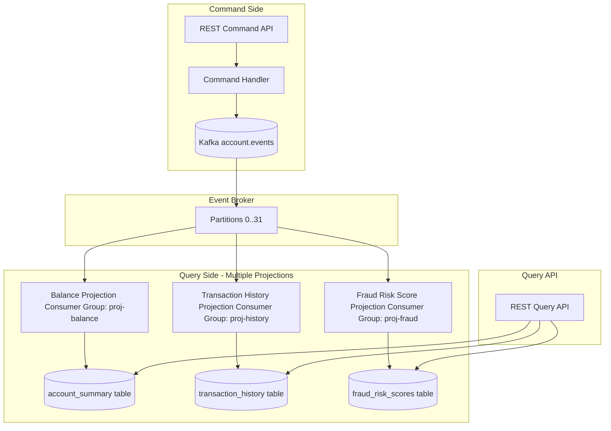

# ‏CQRS مع Kafka — استراتيجيات إسقاط نماذج القراءة

يفصل نمط فصل مسؤولية الأوامر عن الاستعلامات (CQRS) نموذج البيانات المستخدم للكتابة عن نموذج البيانات المستخدم للقراءة. وفي نظام دفع، يُلحق جانب الكتابة الأحداث بـ Kafka؛ ويحافظ جانب القراءة على إسقاطات PostgreSQL محسّنة تُبنى باستهلاك تلك الأحداث. ويغطي هذا الدرس الآليات الكاملة لبناء الإسقاطات ومراقبتها وإعادة بنائها، بما فيها تطور المخططات ومفاضلات الاتساق.

## 1. نظرة عامة على بنية CQRS



لا يلمس جانب الكتابة جداول القراءة أبدًا. ولا يكتب جانب القراءة إلى Kafka أبدًا. وكل إسقاط مجموعة مستهلكين مستقلة، فتتطور باستقلال.

## 2. مستهلك الإسقاط — رصيد الحساب

```java
@Component
public class AccountBalanceProjection {

    private static final Logger log = LoggerFactory.getLogger(AccountBalanceProjection.class);
    private final JdbcTemplate jdbc;

    @KafkaListener(
        topics = "account.events",
        groupId = "proj-account-balance",
        containerFactory = "readCommittedKafkaListenerContainerFactory"
    )
    @Transactional("dataSourceTransactionManager")
    public void project(ConsumerRecord<String, byte[]> record) {
        String eventType = new String(
            record.headers().lastHeader("eventType").value());

        UUID accountId = UUID.fromString(record.key());

        switch (eventType) {
            case "AccountCreated" -> {
                AccountCreated event = deserialize(record.value(), AccountCreated.class);
                jdbc.update("""
                    INSERT INTO account_summary
                        (account_id, holder_name, currency, balance, status,
                         event_offset, last_event_at)
                    VALUES (?, ?, ?, ?, 'ACTIVE', ?, NOW())
                    ON CONFLICT (account_id) DO NOTHING
                    """,
                    accountId, event.getHolderName(), event.getCurrency(),
                    event.getInitialBalance(), record.offset());
            }
            case "MoneyDeposited" -> {
                MoneyDeposited event = deserialize(record.value(), MoneyDeposited.class);
                jdbc.update("""
                    UPDATE account_summary
                    SET    balance = balance + ?,
                           event_offset = ?,
                           last_event_at = NOW()
                    WHERE  account_id = ?
                      AND  event_offset < ?
                    """,
                    event.getAmount(), record.offset(), accountId, record.offset());
            }
            case "MoneyWithdrawn" -> {
                MoneyWithdrawn event = deserialize(record.value(), MoneyWithdrawn.class);
                jdbc.update("""
                    UPDATE account_summary
                    SET    balance = balance - ?,
                           event_offset = ?,
                           last_event_at = NOW()
                    WHERE  account_id = ?
                      AND  event_offset < ?
                    """,
                    event.getAmount(), record.offset(), accountId, record.offset());
            }
            case "AccountSuspended" -> {
                jdbc.update("""
                    UPDATE account_summary
                    SET    status = 'SUSPENDED',
                           event_offset = ?,
                           last_event_at = NOW()
                    WHERE  account_id = ?
                      AND  event_offset < ?
                    """,
                    record.offset(), accountId, record.offset());
            }
            default -> log.debug("Event type {} not handled by balance projection", eventType);
        }
    }
}
```

يجعل الحارس `event_offset < ?` كل UPDATE idempotent: فالحدث المعاد تسليمه له إزاحة تجاوزها الصف أصلًا، فلا يغيّر شيئًا (لا يُطبق إيداع مرتين أبدًا). ويعمل لأن كل أحداث الحساب الواحد في القسم نفسه، فإزاحاتها تتزايد فقط. وإذا نُسخت الأحداث يومًا إلى موضوع أو عنقود آخر، تتغير الإزاحات — وإصدار التجمّع المحمول في الحدث (الدرس 09) هو الحارس الأمتن.

## 3. إسقاطات مستقلة متعددة من التدفق نفسه

كل إسقاط مجموعة مستهلكين منفصلة تستهلك موضوع `account.events` نفسه. وهي مستقلة تمامًا:

```java
// Projection 1: Account Balance Summary
@KafkaListener(topics = "account.events", groupId = "proj-account-balance")
public void projectBalance(ConsumerRecord<String, byte[]> record) { /* ... */ }

// Projection 2: Transaction History (builds searchable history per account)
@KafkaListener(topics = "account.events", groupId = "proj-transaction-history")
public void projectHistory(ConsumerRecord<String, byte[]> record) {
    String eventType = new String(record.headers().lastHeader("eventType").value());

    if (Set.of("MoneyDeposited", "MoneyWithdrawn", "TransferSent",
               "TransferReceived").contains(eventType)) {
        MonetaryEvent event = deserialize(record.value(), MonetaryEvent.class);

        jdbc.update("""
            INSERT INTO transaction_history
                (event_id, account_id, event_type, amount, reference,
                 occurred_at, event_offset)
            VALUES (?, ?, ?, ?, ?, ?, ?)
            ON CONFLICT (event_id) DO NOTHING
            """,
            event.getEventId(), event.getAccountId(), eventType,
            event.getAmount(), event.getReference(),
            Instant.ofEpochMilli(record.timestamp()), record.offset());
    }
}

// Projection 3: Fraud Risk Score (rolling 30-day velocity)
@KafkaListener(topics = "account.events", groupId = "proj-fraud-risk")
public void projectFraudRisk(ConsumerRecord<String, byte[]> record) {
    String eventType = new String(record.headers().lastHeader("eventType").value());

    if ("MoneyWithdrawn".equals(eventType) || "TransferSent".equals(eventType)) {
        MonetaryEvent event = deserialize(record.value(), MonetaryEvent.class);

        jdbc.update("""
            INSERT INTO fraud_risk_velocity
                (account_id, event_id, amount, occurred_at)
            VALUES (?, ?, ?, ?)
            ON CONFLICT (event_id) DO NOTHING
            """,
            event.getAccountId(), event.getEventId(),
            event.getAmount(), Instant.ofEpochMilli(record.timestamp()));

        // Recalculate rolling velocity score
        fraudRiskCalculator.recalculate(event.getAccountId());
    }
}
```

يعني عزل مجموعات المستهلكين:
- يمكن أن يتأخر إسقاط مخاطر الاحتيال دون التأثير على إسقاط الرصيد
- يمكن إعادة بناء كل إسقاط باستقلال دون التأثير على غيره
- يمكن توسيع الإنتاجية باستقلال بإضافة مثيلات لكل مجموعة مستهلكين

## 4. إعادة بناء الإسقاط — إعادة تشغيل كاملة

تلزم إعادة بناء الإسقاط حين:
- يتغير مخطط الإسقاط (مثلًا تُضاف عمود جديد)
- يُكتشف خطأ في منطق الإسقاط
- يُقدّم إسقاط جديد يحتاج بيانات تاريخية

```java
@Service
@Slf4j
public class ProjectionRebuildService {

    private final AdminClient adminClient;
    private final JdbcTemplate jdbc;
    private final TransactionTemplate tx;

    /**
     * Zero-downtime rebuild with a shadow table, in two steps.
     *
     * Step 1 (startShadowRebuild): create the shadow table and let a NEW
     * consumer group (e.g. proj-account-balance-v2) fill it from the earliest
     * offsets. The LIVE group keeps updating the live table meanwhile --
     * do not reset the live group, or the live table stops being updated.
     */
    public void startShadowRebuild() {
        // LIKE ... INCLUDING ALL copies columns, defaults, constraints and
        // indexes -- the primary key is needed for ON CONFLICT.
        // (CREATE TABLE ... AS TABLE ... WITH NO DATA would copy NONE of them.)
        jdbc.execute("CREATE TABLE account_summary_shadow " +
                     "(LIKE account_summary INCLUDING ALL)");
        // Deploy the projection with target table = account_summary_shadow and
        // groupId = proj-account-balance-v2, auto.offset.reset = earliest
        log.warn("Shadow rebuild started -- deploy the v2 projection consumers");
    }

    /**
     * Step 2 (promoteShadow): when the v2 group's lag is ~0, swap the tables
     * in ONE database transaction, then point the v2 consumers at the live
     * table name and stop the old group.
     */
    public void promoteShadow() {
        // JdbcTemplate.execute("BEGIN") / ("COMMIT") would NOT work: each call
        // may run on a different pooled connection. Use a real transaction.
        tx.executeWithoutResult(status -> {
            jdbc.execute("SET LOCAL lock_timeout = '5s'");   // don't queue behind readers forever
            jdbc.execute("ALTER TABLE account_summary RENAME TO account_summary_old");
            jdbc.execute("ALTER TABLE account_summary_shadow RENAME TO account_summary");
        });
        // DROP TABLE account_summary_old after verification
        log.info("Projection rebuild complete — shadow table promoted to live");
    }

    /**
     * Simple rebuild for non-production or small tables.
     * Causes brief unavailability of the read model.
     */
    public void rebuildSimple(String consumerGroupId, String topic) throws Exception {
        // 1. Stop the consumers (outside this method — requires orchestration);
        //    offsets can only be changed while the group has no active members
        // 2. Truncate the read table
        jdbc.execute("TRUNCATE TABLE account_summary");

        // 3. Reset offsets to the EARLIEST available offsets (after retention
        //    removed old segments, that is no longer 0)
        Set<TopicPartition> partitions = adminClient.describeTopics(List.of(topic))
            .allTopicNames().get().get(topic).partitions().stream()
            .map(p -> new TopicPartition(topic, p.partition()))
            .collect(Collectors.toSet());
        Map<TopicPartition, OffsetAndMetadata> resetOffsets = new HashMap<>();
        adminClient.listOffsets(partitions.stream()
                .collect(Collectors.toMap(tp -> tp, tp -> OffsetSpec.earliest())))
            .all().get(30, TimeUnit.SECONDS)
            .forEach((tp, info) -> resetOffsets.put(tp, new OffsetAndMetadata(info.offset())));

        adminClient.alterConsumerGroupOffsets(consumerGroupId, resetOffsets)
                   .all()
                   .get(30, TimeUnit.SECONDS);

        // 4. Restart the consumers — replay from the earliest offsets
    }
}
```

## 5. مراقبة تأخر مجموعات المستهلكين

يقيس تأخر مجموعة المستهلكين مدى تأخر الإسقاط عن رأس الموضوع. ولإسقاطات الدفع، يترجم التأخر مباشرة إلى قِدم البيانات في واجهة المستخدم.

```sql
-- Kafka consumer group lag query (via Kafka Admin API materialized into a table)
-- If you export consumer group lag to your metrics system (Prometheus/CloudWatch):
SELECT
    consumer_group,
    topic,
    partition_num,
    current_offset,
    log_end_offset,
    (log_end_offset - current_offset) AS lag,
    CASE
        WHEN (log_end_offset - current_offset) > 10000 THEN 'CRITICAL'
        WHEN (log_end_offset - current_offset) > 1000  THEN 'WARNING'
        ELSE 'OK'
    END AS lag_status
FROM kafka_consumer_lag_metrics
WHERE consumer_group LIKE 'proj-%'
ORDER BY lag DESC;
```

```java
// Programmatic lag check using AdminClient
@Component
public class ProjectionLagMonitor {

    private final AdminClient adminClient;
    private final MeterRegistry meterRegistry;
    // Gauge registered once per group; the job only updates the holder
    private final Map<String, AtomicLong> lagByGroup = new ConcurrentHashMap<>();

    @Scheduled(fixedDelayString = "${projection.lag.check.interval:30000}")
    public void checkLag() throws Exception {
        List<String> projectionGroups = List.of(
            "proj-account-balance",
            "proj-transaction-history",
            "proj-fraud-risk"
        );

        for (String groupId : projectionGroups) {
            Map<TopicPartition, OffsetAndMetadata> offsets =
                adminClient.listConsumerGroupOffsets(groupId)
                           .partitionsToOffsetAndMetadata()
                           .get(10, TimeUnit.SECONDS);

            // Fetch end offsets for the same partitions
            Map<TopicPartition, Long> endOffsets =
                adminClient.listOffsets(
                    offsets.keySet().stream()
                           .collect(Collectors.toMap(tp -> tp, tp -> OffsetSpec.latest()))
                ).all().get(10, TimeUnit.SECONDS)
                 .entrySet().stream()
                 .collect(Collectors.toMap(
                     Map.Entry::getKey,
                     e -> e.getValue().offset()));

            long totalLag = offsets.entrySet().stream()
                .mapToLong(e -> Math.max(0,
                    endOffsets.getOrDefault(e.getKey(), 0L)
                    - e.getValue().offset()))
                .sum();

            lagByGroup.computeIfAbsent(groupId, g -> {
                AtomicLong holder = new AtomicLong();
                Gauge.builder("kafka.projection.lag", holder, AtomicLong::get)
                    .tag("group", g).register(meterRegistry);
                return holder;
            }).set(totalLag);

            if (totalLag > 50_000) {
                log.error("Projection lag critical: group={} lag={}", groupId, totalLag);
            }
        }
    }
}
```

## 6. الاتساق القوي مقابل النهائي

| نوع الاستعلام | متطلب الاتساق | الاستراتيجية |
|---|---|---|
| تفويض الدفع (هل يمكنني الخصم؟) | قوي — يجب أن يكون حاليًا | قرّر على جانب الكتابة، مع تحكم في التزامن (معالج الأوامر الذي يملك الحساب، أو فحص الإصدار المتوقع، أو قفل صف في قاعدة البيانات) — لا من إسقاط أبدًا |
| رصيد الحساب لبوابة العملاء | شبه فوري (ثوانٍ) | مستهلك إسقاط بهدف تأخر منخفض (< 5 ثوانٍ) |
| سجل المعاملات (آخر 90 يومًا) | اتساق نهائي | مستهلك إسقاط قياسي |
| درجة مخاطر الاحتيال | اتساق نهائي (دقائق) | إسقاط دفعي مخصص |
| لوحة التحليلات (أحجام يومية) | اتساق نهائي (دقائق إلى ساعات) | إسقاط خارج الخط أو مستودع بيانات |

```java
// Payment authorisation: requires strong consistency
// Use command-side aggregate (direct replay or write-through cache)
// NOT the projection
@PostMapping("/payments/authorise")
public ResponseEntity<AuthorisationResult> authorise(@RequestBody PaymentRequest req) {
    // Load the aggregate directly — not from the projection table
    AccountAggregate account = accountEventStore.load(req.getSourceAccountId());

    if (account.getBalance().compareTo(req.getAmount()) < 0) {
        return ResponseEntity.ok(AuthorisationResult.declined("Insufficient funds"));
    }

    // ... proceed with the payment: append the debit WITH an expected-version
    // check (account.getVersion()). Without it, two concurrent requests can
    // both see "sufficient funds" and both debit -- the check above alone is
    // not enough.
}

// Balance for UI: use projection (eventual consistency is acceptable)
@GetMapping("/accounts/{accountId}/balance")
public ResponseEntity<BalanceResponse> getBalance(@PathVariable UUID accountId) {
    // This may be a few seconds behind the write side — acceptable for display
    AccountSummary summary = accountSummaryRepository.findById(accountId)
        .orElseThrow(() -> new AccountNotFoundException(accountId));

    return ResponseEntity.ok(new BalanceResponse(
        summary.getBalance(),
        summary.getLastEventAt(),
        "Data may be up to 5 seconds delayed"));
}
```

## 7. التعامل مع تطور مخططات الأحداث في الإسقاطات

حين يتغير مخطط حدث، يجب أن يتعامل مستهلك الإسقاط مع المخططين القديم والجديد. ويحوّل محوّل الترقية (upcaster) الأحداث القديمة إلى المخطط الجديد.

```java
@Component
public class AccountEventUpcaster {

    /**
     * Upcaster: MoneyDeposited v1 had no 'reference' field.
     * MoneyDeposited v2 adds a mandatory 'reference' field.
     */
    public MoneyDeposited upcast(ConsumerRecord<String, byte[]> record) {
        String schemaVersion = record.headers().lastHeader("schemaVersion") != null
            ? new String(record.headers().lastHeader("schemaVersion").value())
            : "1";

        return switch (schemaVersion) {
            case "1" -> {
                // Old event: no reference field — deserialize v1 and add default
                MoneyDepositedV1 v1 = deserializeV1(record.value());
                yield MoneyDeposited.builder()
                    .accountId(v1.getAccountId())
                    .amount(v1.getAmount())
                    .reference("LEGACY-" + v1.getEventId())  // synthetic reference
                    .eventId(v1.getEventId())
                    .build();
            }
            case "2" -> deserialize(record.value(), MoneyDeposited.class);
            default  -> throw new UnknownSchemaVersionException(schemaVersion);
        };
    }
}

// In the projection consumer, always upcast before applying:
@KafkaListener(topics = "account.events", groupId = "proj-transaction-history")
public void project(ConsumerRecord<String, byte[]> record) {
    String eventType = new String(record.headers().lastHeader("eventType").value());

    if ("MoneyDeposited".equals(eventType)) {
        MoneyDeposited event = upcaster.upcast(record);  // handles v1 and v2
        // apply to projection ...
    }
}
```

## 8. إسقاط سجل المدفوعات — مثال كامل

```java
@Component
public class PaymentHistoryProjection {

    private final JdbcTemplate jdbc;
    private final AccountEventUpcaster upcaster;

    @KafkaListener(
        topics = "account.events",
        groupId = "proj-payment-history",
        containerFactory = "readCommittedKafkaListenerContainerFactory"
    )
    @Transactional
    public void project(ConsumerRecord<String, byte[]> record) {
        String eventType = new String(
            record.headers().lastHeader("eventType").value());

        UUID accountId = UUID.fromString(record.key());
        // Kafka record timestamp as a simple default; prefer the event's own
        // occurredAt field (business time) when the payload carries it
        Instant occurredAt = Instant.ofEpochMilli(record.timestamp());

        switch (eventType) {
            case "MoneyDeposited" -> {
                MoneyDeposited event = upcaster.upcast(record);
                jdbc.update("""
                    INSERT INTO account_transactions
                        (event_id, account_id, tx_type, amount, reference,
                         direction, occurred_at, kafka_offset)
                    VALUES (?, ?, 'DEPOSIT', ?, ?, 'CREDIT', ?, ?)
                    ON CONFLICT (event_id) DO NOTHING
                    """,
                    event.getEventId(), accountId, event.getAmount(),
                    event.getReference(), occurredAt, record.offset());
            }
            case "MoneyWithdrawn" -> {
                MoneyWithdrawn event = deserialize(record.value(), MoneyWithdrawn.class);
                jdbc.update("""
                    INSERT INTO account_transactions
                        (event_id, account_id, tx_type, amount, reference,
                         direction, occurred_at, kafka_offset)
                    VALUES (?, ?, 'WITHDRAWAL', ?, ?, 'DEBIT', ?, ?)
                    ON CONFLICT (event_id) DO NOTHING
                    """,
                    event.getEventId(), accountId, event.getAmount(),
                    event.getReference(), occurredAt, record.offset());
            }
            case "TransferSent" -> {
                TransferSent event = deserialize(record.value(), TransferSent.class);
                jdbc.update("""
                    INSERT INTO account_transactions
                        (event_id, account_id, tx_type, amount, reference,
                         counterpart_account_id, direction, occurred_at, kafka_offset)
                    VALUES (?, ?, 'TRANSFER_OUT', ?, ?, ?, 'DEBIT', ?, ?)
                    ON CONFLICT (event_id) DO NOTHING
                    """,
                    event.getEventId(), accountId, event.getAmount(),
                    event.getReference(), event.getDestAccountId(),
                    occurredAt, record.offset());
            }
            default -> log.trace("Event type {} not relevant to payment history", eventType);
        }
    }
}
```

```sql
-- Supporting table with BRIN index for time-range queries
CREATE TABLE account_transactions (
    event_id              UUID          NOT NULL,
    account_id            UUID          NOT NULL,
    tx_type               VARCHAR(32)   NOT NULL,
    amount                NUMERIC(19,4) NOT NULL,
    reference             VARCHAR(255),
    counterpart_account_id UUID,
    direction             VARCHAR(8)    NOT NULL,  -- CREDIT or DEBIT
    occurred_at           TIMESTAMPTZ   NOT NULL,
    kafka_offset          BIGINT        NOT NULL,
    CONSTRAINT pk_account_transactions PRIMARY KEY (event_id)
);

CREATE INDEX idx_at_account_occurred ON account_transactions
    (account_id, occurred_at DESC);

-- Query: last 90 days of transactions for account dashboard
CREATE INDEX idx_at_occurred_brin ON account_transactions
    USING BRIN (occurred_at) WITH (pages_per_range = 128);
```

## 9. مزالق الإنتاج

### المزلق 1 — عدم التعامل مع إعادة بناء الإسقاط ذريًا

يفرغ فريق جدول `account_summary` ثم يعيد ضبط إزاحة مجموعة المستهلكين. فيصبح الإسقاط غير متاح طوال الدقائق التي تستغرقها إعادة التشغيل. وتعيد طلبات API الرمز 404 أثناء هذه النافذة.

```java
// BAD: truncate first, then replay — table is empty during replay
jdbc.execute("TRUNCATE TABLE account_summary");
adminClient.alterConsumerGroupOffsets(consumerGroupId, resetOffsets).all().get();
// DURING REPLAY: all GET /accounts/{id}/balance return 404 or 0 balance
// Duration of outage: depends on replay time (can be hours for large topics)

// GOOD: shadow table approach — live table is never unavailable
// 1. A NEW consumer group writes to account_summary_rebuild during replay
//    (the live group keeps the live table current meanwhile)
// 2. When its lag reaches 0, rename the tables in ONE real transaction
//    (TransactionTemplate -- not jdbc.execute("BEGIN"), which may run on a
//     different pooled connection than the following statements)
tx.executeWithoutResult(status -> {
    jdbc.execute("ALTER TABLE account_summary RENAME TO account_summary_bak");
    jdbc.execute("ALTER TABLE account_summary_rebuild RENAME TO account_summary");
});
// DROP account_summary_bak after verification
// Zero downtime: the live table is accessible throughout
```

### المزلق 2 — مجموعات مستهلكين كثيرة يعيد كل منها قراءة الموضوع

ينشئ فريق مجموعة مستهلكين منفصلة لكل ميزة صغيرة (12 إسقاطًا، لكل منها 3 مثيلات، كلها تستهلك موضوعًا من 32 قسمًا). فكل مجموعة تقرأ الموضوع كاملًا، فتخدم الوسطاء 12 ضعف حركة الجلب (غالبًا من ذاكرة الصفحات، لكن من القرص أثناء إعادات التشغيل)، وتوجد 12 مجموعة من الإزاحات وإعادات التوازن وتنبيهات التأخر للتشغيل. وتتعامل Kafka مع مجموعات كثيرة جيدًا — فالكلفة حقيقية لكنها متوسطة عادة؛ والمقصود دمج الإسقاطات التي تتشارك دورة الحياة نفسها.

```java
// BAD: 12 separate consumer groups, each with 3 replicas, for a single topic
// @KafkaListener(topics = "account.events", groupId = "proj-balance")
// @KafkaListener(topics = "account.events", groupId = "proj-history")
// @KafkaListener(topics = "account.events", groupId = "proj-velocity")
// ... 9 more groups ...
// = 12x the fetch traffic for the same data, 12 groups to operate

// GOOD OPTION 1: multiplex event types within a single listener
// One consumer group dispatches to multiple projection handlers
@KafkaListener(topics = "account.events", groupId = "proj-combined")
public void dispatchToProjections(ConsumerRecord<String, byte[]> record) {
    String eventType = new String(record.headers().lastHeader("eventType").value());
    projectionRegistry.dispatch(eventType, record);  // fan-out to handlers
}

// GOOD OPTION 2: use topic-level filtering with separate topics per aggregate type
// and only create a consumer group where the projection genuinely needs it
// The key: audit which consumer groups are truly independent in their replay cadence
```

### المزلق 3 — إسقاط فيه منطق عمل يسبب انقسامًا في الحقيقة

يضيف فريق منطق حساب الفائدة إلى مستهلك إسقاط الرصيد. ويعمل المنطق بشكل غير متزامن وينتج نتائج مختلفة قليلًا بحسب وقت استهلاك الحدث، فيخلق عدم اتساق بين سجل الأحداث والإسقاط.

```java
// BAD: business logic embedded in projection
@KafkaListener(topics = "account.events", groupId = "proj-balance")
public void project(ConsumerRecord<String, byte[]> record) {
    if ("MoneyDeposited".equals(eventType)) {
        MoneyDeposited event = deserialize(record.value(), MoneyDeposited.class);
        BigDecimal interestEarned = interestCalculator.calculate(
            event.getAmount(), LocalDate.now());  // depends on CURRENT date!
        jdbc.update("UPDATE account_summary SET balance = balance + ? + ? WHERE ...",
                    event.getAmount(), interestEarned);
        // Interest depends on when the projection runs — not deterministic!
        // Rebuilding the projection on a different day yields different results.
    }
}

// GOOD: projection is a pure, deterministic transformation of events
// Business logic (interest calculation) belongs in the command side;
// it produces an InterestCredited event that the projection then applies deterministically
@KafkaListener(topics = "account.events", groupId = "proj-balance")
public void project(ConsumerRecord<String, byte[]> record) {
    if ("MoneyDeposited".equals(eventType)) {
        MoneyDeposited event = deserialize(record.value(), MoneyDeposited.class);
        jdbc.update("UPDATE account_summary SET balance = balance + ? WHERE ...",
                    event.getAmount());
        // Pure: same event always produces same projection state
    }
    // Interest is handled by InterestCredited event emitted by the command side
}
```

## 10. قائمة تحقق CQRS مع Kafka

- [ ] كل إسقاط مجموعة مستهلكين منفصلة في Kafka
- [ ] مستهلكو الإسقاطات يستخدمون مستوى العزل `read_committed`
- [ ] كل عبارات INSERT تتضمن `ON CONFLICT (event_id) DO NOTHING` من أجل idempotency
- [ ] عبارات UPDATE محمية (بإصدار التجمّع، أو `event_offset < ?`) كي تكون الأحداث المعاد تسليمها بلا أثر
- [ ] تفويض الدفع يستعلم تجمّع جانب الكتابة، لا الإسقاط
- [ ] تأخر مجموعات المستهلكين مراقب ومنبَّه عليه (العتبة: تأخر > 10,000 حدث)
- [ ] إعادة بناء الإسقاط تستخدم جدولًا ظليًا لتجنب عدم الإتاحة
- [ ] محولات الترقية تتعامل مع كل إصدارات المخطط التاريخية
- [ ] منطق الإسقاط تحويل نقي حتمي — بلا منطق عمل يعتمد على الوقت الحالي
- [ ] مراجعة عدد مجموعات المستهلكين — ادمج الإسقاطات المترابطة
- [ ] اختبارات التكامل تغطي إعادة بناء الإسقاط: انشر N حدث، وأعد البناء، وتحقق من النتيجة نفسها
- [ ] لجداول الإسقاطات فهارس مناسبة لأنماط الاستعلام

<!-- KNOWLEDGE-CHECK
{"questions":[{"text":"لماذا يجب أن يستعلم تفويض الدفع (فحص وجود رصيد كافٍ) تجمّع جانب الكتابة بدل إسقاط الرصيد؟","options":["تُخزن الإسقاطات في قاعدة بيانات مختلفة أبطأ في الاستعلام","قد يكون إسقاط الرصيد متأخرًا ثوانٍ عن جانب الكتابة بسبب تأخر مستهلك Kafka، فيبدو حساب خُصم منه مؤخرًا وكأن لديه رصيدًا كافيًا في الإسقاط","لا تخزن الإسقاطات معلومات الرصيد","تجمّع جانب الكتابة أسرع دائمًا في الاستعلام من جدول PostgreSQL"],"correct":1,"explanation":"تُحدّث الإسقاطات بشكل غير متزامن عبر مستهلك Kafka. فإذا تأخر المستهلك ولو ثانية، قد يوافق تفويض قائم على الإسقاط على دفعة لحساب خُصم منه للتو. ويحتاج التفويض الحالة الحالية من جانب الكتابة — ويجب إلحاق الخصم نفسه مع فحص تزامن (الإصدار المتوقع أو قفل صف)، وإلا قد يمر تفويضان متزامنان كلاهما."},{"text":"لمستهلك إسقاط خطأ يجعله يحسب أرصدة الحسابات بشكل خاطئ. بعد إصلاح الخطأ، ما الإجراء الصحيح للحصول على إسقاطات دقيقة؟","options":["انشر الإصلاح وانتظر الحدث التالي ليطلق إعادة الحساب","أفرغ جدول الإسقاط، وأعد ضبط إزاحة مجموعة المستهلكين إلى 0 (أقدم إزاحة)، وأعد تشغيل المستهلك لإعادة تشغيل كل الأحداث","حدّث الصفوف الخاطئة في جدول الإسقاط يدويًا","أنشئ سكربت ترحيل لقاعدة البيانات يصحح حسابات الأرصدة"],"correct":1,"explanation":"يتيح event sourcing هذا السيناريو تمامًا. فلأن كل الأحداث مخزنة في Kafka، يمكنك إعادة بناء الإسقاط بإعادة تشغيل كل حدث (من أقدم إزاحة محفوظة) عبر المنطق المصحح — ببساطة بإفراغ الجدول وإعادة ضبط مجموعة المستهلكين، أو دون توقف بملء جدول ظلي بمجموعة مستهلكين جديدة وتبديل الجداول. والنتيجة إسقاط دقيق تمامًا مشتق حتميًا من سجل الأحداث."},{"text":"يستخدم مستهلك إسقاط INSERT INTO account_transactions ... ON CONFLICT (event_id) DO NOTHING. لماذا هذا حاسم للصحة؟","options":["يحسّن أداء الاستعلام بتجنب إدخالات الفهرس المكررة","يجعل مستهلك الإسقاط idempotent — فإذا استُهلك الحدث نفسه مرتين (بسبب إعادة تشغيل المستهلك قبل الالتزام بالإزاحة)، يُتجاهل التطبيق الثاني بأمان، فيمنع صفوفًا مكررة في سجل المعاملات","يمنع مستهلك Kafka من استطلاع القسم نفسه مرتين","يتطلبه مستوى العزل read_committed"],"correct":1,"explanation":"تضمن Kafka التسليم مرة واحدة على الأقل افتراضيًا — فبعد إعادة تشغيل المستهلك، قد تُعاد الأحداث. ودون ON CONFLICT DO NOTHING على مفتاح idempotency ‏(event_id)، سيدرج حدث MoneyDeposited المعاد تسليمه صفًا ثانيًا في account_transactions، فيظهر الإيداع مرتين في سجل العميل. ويجعل حارس idempotency المستهلك آمنًا لإعادة التشغيل."}]}
-->

<!-- PRACTICAL-CHALLENGE
{"title":"بناء نظام CQRS متعدد الإسقاطات لأحداث الحسابات","difficulty":"advanced","estimatedMinutes":70,"tasks":[{"id":"1","description":"أنشئ ثلاثة مستهلكي إسقاط مستقلين لموضوع account.events: ‏(أ) AccountBalanceProjection بـ groupId=proj-balance يحافظ على جدول account_summary، ‏(ب) PaymentHistoryProjection بـ groupId=proj-history يحافظ على جدول account_transactions، ‏(ج) FraudVelocityProjection بـ groupId=proj-fraud يحافظ على جدول fraud_velocity. ويجب أن يستخدم كل منها عزل read_committed، وidempotency عبر ON CONFLICT DO NOTHING، ويتعامل مع 4 أنواع أحداث على الأقل. واكتب اختبارات تكامل باستخدام EmbeddedKafka تنشر 20 حدثًا وتتحقق من اتساق الإسقاطات الثلاثة."},{"id":"2","description":"نفّذ ProjectionLagMonitor يستخدم AdminClient لحساب تأخر مجموعات المستهلكين للإسقاطات الثلاثة كل 30 ثانية. واكشف التأخر كمقياس Prometheus من نوع Gauge ‏(kafka_projection_lag بتسمية group). واكتب اختبارًا يوقف مستهلكًا مؤقتًا، وينشر 100 حدث، ويتحقق من تجاوز مقياس التأخر 100 قبل استئناف المستهلك."},{"id":"3","description":"نفّذ استراتيجية إعادة البناء بالجدول الظلي لـ AccountBalanceProjection: أنشئ account_summary_rebuild بـ LIKE account_summary INCLUDING ALL، وشغّل مجموعة مستهلكين جديدة (proj-balance-v2، ‏auto.offset.reset=earliest) تكتب إلى الجدول الظلي بينما تبقي المجموعة الحية الجدول الحي محدّثًا، وحين يبلغ تأخر v2 الصفر، أعد تسمية الجداول في معاملة قاعدة بيانات واحدة. واكتب اختبارًا يتحقق من أن GET /accounts/{id}/balance يعيد ردودًا غير فارغة طوال إعادة البناء."},{"id":"4","description":"نفّذ AccountEventUpcaster يتعامل مع الإصدار 1 لمخطط MoneyDeposited (بلا حقل reference) والإصدار 2 (بحقل reference). ويقرأ محوّل الترقية ترويسة schemaVersion ويعيد MoneyDeposited مكتمل الحقول بغض النظر عن الإصدار. وادمجه في مستهلك PaymentHistoryProjection. واكتب اختبارًا ينشر أحداث MoneyDeposited بالإصدارين ويتحقق من ظهورهما بشكل صحيح في account_transactions مع مراجع اصطناعية لأحداث الإصدار 1."}]}
-->
