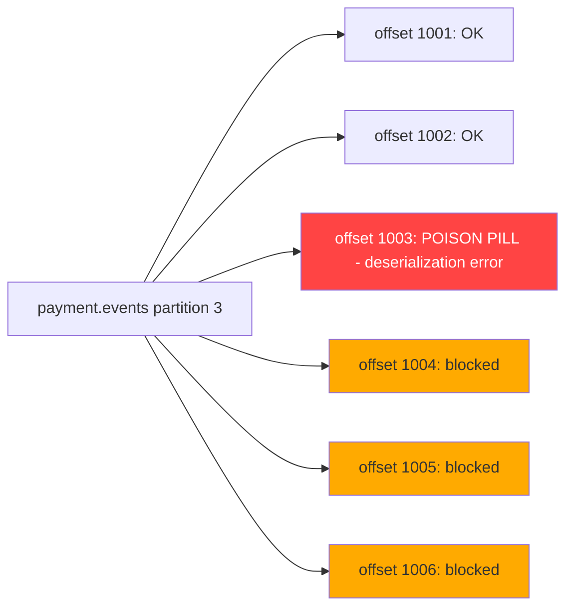

# طوابير الرسائل الميتة — التعامل مع الرسائل السامة وإعادة المحاولة

يمكن لحدث دفع واحد مشوّه أن يوقف كل المعالجة لقسم Kafka. ودون استراتيجية لطابور الرسائل الميتة (DLQ)، قد تحجب رسالة سيئة واحدة بصمت آلاف المستهلكين اللاحقين. ويغطي هذا الدرس كشف الرسائل السامة، وطوبولوجيا إعادة المحاولة غير الحاجبة، وتصنيف الأعطال، وإعادة الإرسال من DLQ.

---

## 1. مشكلة الرسالة السامة

الرسالة السامة (poison pill) رسالة تجعل المستهلك يرمي استثناء في كل مرة يحاول معالجتها. ولأن مستهلكي Kafka يعالجون القسم بالتتابع، فإن رسالة سامة عند الإزاحة N تحجب كل معالجة الإزاحات N+1، وN+2، ... لذلك القسم.



دون معالجة DLQ، المستهلك الذي يعيد المحاولة بلا نهاية سوف:
1. لا يتقدم أبدًا بعد الرسالة السامة
2. يراكم التأخر لكل الرسائل اللاحقة على ذلك القسم
3. قد يسبب أعطالًا متتالية لاحقًا

---

## 2. طوبولوجيا إعادة المحاولة وDLQ

يوجد خياران:

- **إعادة محاولة حاجبة** (`DefaultErrorHandler` + تراجع زمني، ثم DLT): ينتظر القسم بينما يُعاد محاولة سجل واحد. بسيطة، و**تحفظ الترتيب لكل مفتاح** — لكن التراجع الطويل يؤخر كل سجل خلفه.
- **إعادة محاولة غير حاجبة** (مواضيع إعادة المحاولة): ينتقل السجل الفاشل إلى موضوع إعادة محاولة ويواصل القسم. فتُحفظ الإنتاجية، لكن **يضيع الترتيب لكل مفتاح**: فقد يُعالج حدث لاحق للدفعة نفسها قبل الحدث الأسبق المنتظر في موضوع إعادة المحاولة. ولتغييرات حالة الدفع هذا مهم — فاستخدم إعادة المحاولة الحاجبة، أو اجعل المستهلكين يتحملون إعادة الترتيب (فحوص الإصدار، الدرس 09).

ينشئ نمط إعادة المحاولة غير الحاجبة مواضيع إعادة محاولة مخصصة بتأخيرات:

```
payment.events
    |
    +--(failure, attempt 1)--> payment.events.RETRY_0  (delay: 1s)
                                    |
                                    +--(failure, attempt 2)--> payment.events.RETRY_1  (delay: 10s)
                                                                    |
                                                                    +--(failure, attempt 3)--> payment.events.RETRY_2  (delay: 60s)
                                                                                                    |
                                                                                                    +--(still failing)--> payment.events.DLT
```

```bash
# Create the retry and dead letter topics
# Retry topics have short retention — messages are re-processed quickly or die
kafka-topics.sh --create --topic payment.events.RETRY_0 \
  --partitions 32 --replication-factor 3 \
  --config retention.ms=3600000 \
  --bootstrap-server kafka:9092

kafka-topics.sh --create --topic payment.events.RETRY_1 \
  --partitions 32 --replication-factor 3 \
  --config retention.ms=3600000 \
  --bootstrap-server kafka:9092

kafka-topics.sh --create --topic payment.events.RETRY_2 \
  --partitions 32 --replication-factor 3 \
  --config retention.ms=3600000 \
  --bootstrap-server kafka:9092

# Dead letter topic: long retention for investigation and re-driving
kafka-topics.sh --create --topic payment.events.DLT \
  --partitions 32 --replication-factor 3 \
  --config retention.ms=2592000000 \
  --bootstrap-server kafka:9092
```

---

## 3. إعادة المحاولة الحاجبة: DefaultErrorHandler مع تراجع أسي

```java
@Configuration
public class KafkaConsumerConfig {

    @Bean
    public DefaultErrorHandler errorHandler(
            DeadLetterPublishingRecoverer recoverer) {

        // Blocking retries in the consumer: 1s, 2s, 4s (3 retries), then the
        // recoverer publishes the record to the DLT and the partition moves on.
        // Keep the total back-off well below max.poll.interval.ms.
        ExponentialBackOffWithMaxRetries backoff =
            new ExponentialBackOffWithMaxRetries(3);
        backoff.setInitialInterval(1_000L);   // 1 second initial delay
        backoff.setMultiplier(2.0);           // double each retry
        backoff.setMaxInterval(8_000L);       // cap at 8 seconds

        DefaultErrorHandler handler = new DefaultErrorHandler(recoverer, backoff);

        // Classify non-retryable exceptions — go directly to DLT, no retry
        // (DeserializationException and several others are already in the
        //  default not-retryable list)
        handler.addNotRetryableExceptions(
            DeserializationException.class,
            MessageConversionException.class,
            MethodArgumentResolutionException.class,
            NonRetryablePaymentException.class    // our own permanent failures
        );

        return handler;
    }

    @Bean
    public DeadLetterPublishingRecoverer deadLetterRecoverer(
            KafkaTemplate<Object, Object> kafkaTemplate) {

        // Default destination: <topic>-dlt (Spring Kafka 3.x) with the same
        // partition number. Here: <topic>.DLT -- the DLT needs at least as
        // many partitions as the source topic. The recoverer adds headers
        // with the original topic/partition/offset and the exception.
        return new DeadLetterPublishingRecoverer(kafkaTemplate,
            (record, exception) -> new TopicPartition(
                record.topic() + ".DLT", record.partition()));
    }

    @Bean
    public ConcurrentKafkaListenerContainerFactory<String, String>
            kafkaListenerContainerFactory(
                ConsumerFactory<String, String> cf,
                DefaultErrorHandler errorHandler) {

        ConcurrentKafkaListenerContainerFactory<String, String> factory =
            new ConcurrentKafkaListenerContainerFactory<>();
        factory.setConsumerFactory(cf);
        factory.setCommonErrorHandler(errorHandler);
        return factory;
    }
}
```

---

## 4. لماذا مستمعو مواضيع إعادة المحاولة المكتوبون يدويًا فخ

من المغري إضافة `@KafkaListener` لكل موضوع إعادة محاولة. لكن المستمع العادي على `payment.events.RETRY_0` يستهلك فورًا — فلا شيء يفرض التأخير — وكل مستمع يحتاج توجيهه الخاص للطبقة التالية (فالفشل على `payment.events.RETRY_0` يجب أن يذهب إلى `RETRY_1`، لا إلى `payment.events.RETRY_0.RETRY_0`). ويفعل **`@RetryableTopic`** في Spring Kafka (القسم التالي) كل هذا بشكل صحيح: ينشئ المواضيع والمستمعين، ويؤخر كل محاولة بإيقاف القسم مؤقتًا حتى موعد السجل، ويعدّ المحاولات في الترويسات، ويوجّه إلى DLT. ويبدو منطق المعالجة المشترك وتصنيف الأخطاء هكذا:

```java
@Component
public class PaymentEventConsumer {

    private final PaymentProcessingService paymentService;

    private void processWithContext(ConsumerRecord<String, String> record) {
        try {
            PaymentEvent event = objectMapper.readValue(record.value(),
                                                        PaymentEvent.class);
            paymentService.process(event);
        } catch (JsonProcessingException e) {
            // Non-retryable: schema mismatch or corrupt payload
            throw new MessageConversionException("Cannot deserialize payment event", e);
        } catch (TransientPaymentException e) {
            // Retryable: downstream service unavailable -> rethrow as is
            throw e;
        } catch (PermanentPaymentException e) {
            // Non-retryable: business rule violation — straight to the DLT.
            // Use a dedicated exception type registered as not-retryable
            // (not MessageConversionException, which means "bad message format")
            throw new NonRetryablePaymentException("Permanent business failure", e);
        }
    }
}
```

---

## 5. استخدام RetryTopicConfiguration في Spring Kafka (إعداد تلقائي)

يوفر Spring Kafka 2.7+ نهجًا تصريحيًا:

```java
@Configuration
public class RetryTopicConfig {

    // Option A: global configuration as a bean (use EITHER this OR the
    // @RetryableTopic annotation below for a given listener)
    @Bean
    public RetryTopicConfiguration retryTopicConfig(
            KafkaTemplate<String, String> kafkaTemplate) {

        return RetryTopicConfigurationBuilder
            .newInstance()
            .fixedBackOff(1_000)             // 1 second between retries
            .maxAttempts(4)                  // 3 retries + 1 original = 4 total attempts
            .retryTopicSuffix("-RETRY")
            .dltSuffix("-DLT")
            // retryOn(...) and notRetryOn(...) are alternatives -- use one
            .notRetryOn(List.of(DeserializationException.class,
                                MessageConversionException.class,
                                NonRetryablePaymentException.class))
            .dltHandlerMethod("paymentEventConsumer", "handleDlt")  // bean name + method
            .create(kafkaTemplate);
    }
}

// Option B: the annotation-driven approach:
@Component
public class PaymentEventConsumer {

    @RetryableTopic(
        backoff = @Backoff(delay = 1000, multiplier = 2.0, maxDelay = 60_000),
        attempts = "4",
        topicSuffixingStrategy = TopicSuffixingStrategy.SUFFIX_WITH_INDEX_VALUE,
        exclude = {DeserializationException.class, MessageConversionException.class}
    )
    @KafkaListener(topics = "payment.events", groupId = "payment-processor")
    public void consume(PaymentEvent event,
                        @Header(KafkaHeaders.RECEIVED_TOPIC) String topic) {
        paymentService.process(event);
    }

    @DltHandler
    public void handleDlt(PaymentEvent event,
                          @Header(KafkaHeaders.RECEIVED_TOPIC) String topic) {
        log.error("Payment event in DLT: {} from topic: {}",
                  event.getPaymentId(), topic);
        alertingService.sendCriticalAlert(event);
    }
}
```

---

## 6. تصنيف الأعطال — عابرة مقابل دائمة

يمنع التصنيف الصحيح حلقات إعادة المحاولة اللانهائية على الأخطاء غير القابلة للتعافي:

```java
public enum FailureType { TRANSIENT, PERMANENT }

public FailureType classify(Exception e) {
    // PERMANENT failures — retry is futile
    if (e instanceof DeserializationException)        return PERMANENT; // corrupt message
    if (e instanceof MessageConversionException)      return PERMANENT; // schema mismatch
    if (e instanceof ConstraintViolationException)    return PERMANENT; // invalid business data
    if (e instanceof FraudBlacklistException)         return PERMANENT; // business rule
    if (e instanceof AccountClosedException)          return PERMANENT; // business rule

    // TRANSIENT failures — retry may succeed
    if (e instanceof TransientDataAccessException)    return TRANSIENT; // DB timeouts etc.
    if (e instanceof ConcurrencyFailureException)     return TRANSIENT; // deadlock, serialization failure, lock timeout
    if (e instanceof ResourceAccessException)         return TRANSIENT; // HTTP timeout
    if (e instanceof RedisConnectionException)        return TRANSIENT; // cache unavailable
    // Spring maps deadlocks / serialization failures to ConcurrencyFailureException
    // subclasses (checked above) -- a DataIntegrityViolationException is a real
    // constraint violation (FK, unique, NOT NULL): retrying will not help
    if (e instanceof DataIntegrityViolationException) return PERMANENT;

    // Default: treat unknown exceptions as transient (conservative)
    log.warn("Unknown exception type, treating as transient: {}",
             e.getClass().getSimpleName());
    return TRANSIENT;
}
```

---

## 7. مراقبة DLQ — الوصول إلى DLT

الإشارة ليست تأخر معالج DLT — فـ `@DltHandler` يستهلك السجلات ويخزنها فورًا تقريبًا، فيبقى تأخره قرب الصفر بينما تتراكم الأعطال. فراقب **الوصول**: نمو إزاحات النهاية لموضوع DLT، وعدد الصفوف غير المحلولة في جدول `dlt_messages`.

```java
@Component
public class DltArrivalMonitor {

    private final AdminClient adminClient;
    private final AlertingService alertingService;
    private final AtomicLong dltEndOffsetTotal = new AtomicLong();
    private final AtomicLong unresolved = new AtomicLong();
    private final DltMessageRepository dltMessageRepository;
    private long lastSeenTotal = -1;

    public DltArrivalMonitor(AdminClient adminClient, AlertingService alertingService,
                             DltMessageRepository dltMessageRepository,
                             MeterRegistry meterRegistry) {
        this.adminClient = adminClient;
        this.alertingService = alertingService;
        this.dltMessageRepository = dltMessageRepository;
        // Registered once; scheduled job only updates the holders.
        // Alert in Prometheus on increase(kafka_dlt_end_offset_total[5m]) > 0
        Gauge.builder("kafka.dlt.end.offset.total", dltEndOffsetTotal, AtomicLong::get)
            .tag("topic", "payment.events.DLT").register(meterRegistry);
        Gauge.builder("kafka.dlt.unresolved", unresolved, AtomicLong::get)
            .register(meterRegistry);
    }

    @Scheduled(fixedDelayString = "${dlt.monitor.interval:60000}")
    public void monitorDlt() throws Exception {
        long total = endOffsetTotal("payment.events.DLT");
        dltEndOffsetTotal.set(total);
        unresolved.set(dltMessageRepository.countByStatus(DltStatus.OPEN));

        if (lastSeenTotal >= 0 && total > lastSeenTotal) {
            alertingService.sendAlert(
                "New messages in payment DLT",
                (total - lastSeenTotal) + " new failed payment events",
                AlertSeverity.WARNING);
        }
        lastSeenTotal = total;
    }

    private long endOffsetTotal(String topic) throws Exception {
        Set<TopicPartition> partitions = adminClient.describeTopics(List.of(topic))
            .allTopicNames().get(10, TimeUnit.SECONDS).get(topic).partitions().stream()
            .map(p -> new TopicPartition(topic, p.partition()))
            .collect(Collectors.toSet());

        return adminClient.listOffsets(partitions.stream()
                .collect(Collectors.toMap(tp -> tp, tp -> OffsetSpec.latest())))
            .all().get(10, TimeUnit.SECONDS)
            .values().stream()
            .mapToLong(ListOffsetsResult.ListOffsetsResultInfo::offset)
            .sum();
    }
}
```

---

## 8. إعادة الإرسال من DLQ

حين تُحل مشكلة في المنبع (مثلًا تُستعاد خدمة لاحقة)، أعد إرسال الرسائل من DLT:

```java
@Service
public class DltRedriveService {

    private final KafkaTemplate<String, String> kafkaTemplate;
    private final DltMessageRepository dltMessageRepository;

    /**
     * Re-drive all OPEN DLT records for one original topic, in small batches
     * and at a limited rate -- the downstream that failed may still be fragile.
     * Records are read from the dlt_messages table (filled by the @DltHandler),
     * so we know which ones were already re-driven.
     */
    public void redriveAll(String originalTopic, int batchSize, Duration pause)
            throws InterruptedException {
        List<DltMessage> batch;
        while (!(batch = dltMessageRepository
                    .findOpenByTopic(originalTopic, batchSize)).isEmpty()) {
            for (DltMessage m : batch) {
                redrive(m, originalTopic);
            }
            Thread.sleep(pause.toMillis());   // simple rate limit
        }
    }

    /**
     * Re-inject a specific message from the DLT back into the original topic.
     * Use for targeted replay of a single payment event after root cause fix.
     */
    public void redriveMessage(String messageKey, String originalTopic) {
        DltMessage dltMessage = dltMessageRepository.findByMessageKey(messageKey)
            .orElseThrow(() -> new DltMessageNotFoundException(messageKey));
        redrive(dltMessage, originalTopic);
    }

    private void redrive(DltMessage dltMessage, String originalTopic) {
        // Same KEY -> same partition as the original (no explicit partition
        // number needed); the consumer must be idempotent (event id)
        ProducerRecord<String, String> record = new ProducerRecord<>(
            originalTopic, dltMessage.getMessageKey(), dltMessage.getPayload());

        // Add header to indicate this is a re-driven message
        record.headers()
            .add("kafka_redrive_from_dlt", "true".getBytes(StandardCharsets.UTF_8))
            .add("kafka_original_dlt_offset",
                 String.valueOf(dltMessage.getOffset()).getBytes(StandardCharsets.UTF_8));

        // Mark as re-driven only AFTER the broker acknowledged the send
        kafkaTemplate.send(record).join();
        dltMessageRepository.markAsRedriven(dltMessage.getId());

        log.info("Re-drove message: key={} to topic={}", dltMessage.getMessageKey(), originalTopic);
    }
}
```

---

## 9. مزالق الإنتاج

### المزلق 1 — إعادة محاولة الأعطال الدائمة بلا نهاية

يحتوي حدث دفع رمز عملة غير صالح. فيرمي التحقق من العملة `ValidationException` في كل محاولة. ودون تصنيفه كدائم، تدور الرسالة عبر كل طبقات إعادة المحاولة وتعود إلى RETRY_0 للأبد.

```java
// BAD: all exceptions trigger retry, including permanent validation failures
@KafkaListener(topics = "payment.events", groupId = "payment-processor")
public void consume(PaymentEvent event) {
    // If this throws ValidationException, Spring Kafka retries 3 times
    // then sends to RETRY_0, then RETRY_1, then RETRY_2, then DLT
    // But if something keeps re-driving from DLT, this loops forever
    validateCurrency(event.getCurrency());  // throws ValidationException for "XYZ"
    paymentService.process(event);
}

// GOOD: classify exceptions so permanent failures skip retries
@KafkaListener(topics = "payment.events", groupId = "payment-processor")
public void consume(PaymentEvent event) {
    try {
        validateCurrency(event.getCurrency());
        paymentService.process(event);
    } catch (ValidationException e) {
        // Permanent: re-wrapping in an exception type registered as
        // not-retryable makes the error handler route it straight to the DLT
        throw new NonRetryablePaymentException(
            "Invalid currency code: " + event.getCurrency()
            + " — no retry, routing to DLT", e);
    }
}

// In DefaultErrorHandler configuration:
// handler.addNotRetryableExceptions(NonRetryablePaymentException.class);
// handler.addNotRetryableExceptions(ValidationException.class);  // also direct
```

### المزلق 2 — عدم ضبط احتفاظ موضوع DLT

يستخدم موضوع DLT احتفاظ الوسيط الافتراضي (7 أيام). ويكتشف فريق رسائل DLT بعد 10 أيام فيجدها قد حُذفت، فيفقد القدرة على التحقيق وإعادة الإرسال.

```bash
# BAD: default retention (7 days) on DLT — messages expire before investigation
# No explicit retention set for payment.events.DLT

# GOOD: set long retention on DLT topics — 30 days minimum for financial messages
kafka-configs.sh --alter \
  --topic payment.events.DLT \
  --add-config retention.ms=2592000000 \
  --bootstrap-server kafka:9092
# 2592000000 ms = 30 days

# In Terraform / Helm values, enforce retention for DLT topics:
# kafka_topic_configs:
#   "payment.events.DLT":
#     retention_ms: "2592000000"
#     min_insync_replicas: "2"

# Also check retention.bytes: the default (-1) means NO size-based deletion.
# Setting a size limit (e.g. 10 GB) INTRODUCES size-based deletion -- during
# a big outage the oldest DLT records could then be deleted. Leave it at -1
# unless disk is a real constraint, and alert well before it fills.
kafka-configs.sh --describe \
  --topic payment.events.DLT \
  --bootstrap-server kafka:9092
```

### المزلق 3 — عدم مراقبة الوصول إلى DLT

ينشر فريق بنية DLQ التحتية لكنه لا يراقب ما يصل إلى DLT. وبعد انقطاع خدمة لاحقة، تصل 50,000 حدث دفع إلى DLT. ولا يُطلق أي تنبيه. وتُكتشف المشكلة بعد 48 ساعة أثناء تدقيق يدوي.

```java
// BAD: no DLT monitoring
// Operations team only discovers the issue when customers complain

// GOOD: alert as soon as failed payments ARRIVE in the DLT -- ANY message
// in the DLT is a failed payment that needs attention
@Component
public class DltAlerts {

    @Scheduled(fixedDelay = 60_000)
    public void alertOnDltMessages() {
        long open = dltMessageRepository.countByStatus(DltStatus.OPEN);

        // Any unresolved record in a payment DLT is a P2 incident
        if (open > 0) {
            alertingService.page(
                "P2: Payment DLT has " + open + " unresolved messages",
                "payment-oncall-rotation");
        }

        // Also check the last retry topic — high lag there means
        // something is consistently failing
        long retry2Lag = calculateTotalLag("payment-processor", "payment.events.RETRY_2");
        if (retry2Lag > 100) {
            alertingService.page(
                "P2: Payment RETRY_2 has " + retry2Lag + " messages",
                "payment-oncall-rotation");
        }
    }
}
```

---

## 10. قائمة تحقق DLQ

- [ ] طوبولوجيا إعادة المحاولة معرّفة: الأصلي ← RETRY_0 ← RETRY_1 ← RETRY_2 ← DLT
- [ ] ‏`DefaultErrorHandler` مُعدّ بـ `ExponentialBackOffWithMaxRetries`
- [ ] ‏`addNotRetryableExceptions()` يتضمن `DeserializationException` و`MessageConversionException`
- [ ] طبقات إعادة المحاولة منفذة بـ `@RetryableTopic` (لا بمستمعين مكتوبين يدويًا)؛ وأثر إعادة المحاولة غير الحاجبة على الترتيب مقبول أو معالَج
- [ ] لموضوع DLT احتفاظ 30 يومًا على الأقل (`retention.ms=2592000000`)
- [ ] يبقي موضوع DLT ‏`retention.bytes=-1` (بلا حذف قائم على الحجم) أو حدًا محجّمًا بوعي مع تنبيهات
- [ ] ‏`@DltHandler` يحفظ رسائل DLT في قاعدة بيانات للتحقيق
- [ ] الوصول إلى DLT مراقب (نمو إزاحة النهاية، وصفوف `dlt_messages` غير المحلولة) وينبّه فورًا (حادث P2)
- [ ] تأخر مواضيع إعادة المحاولة مراقب أيضًا (العتبة: > 100 حدث على RETRY_2)
- [ ] إجراء إعادة الإرسال موثّق ومختبر (اختبره قبل أن تحتاجه)
- [ ] منطق تصنيف الأعطال يُراجع لكل نوع استثناء جديد يُضاف
- [ ] اختبارات التكامل تغطي: فشلًا عابرًا (يعيد المحاولة وينجح)، وفشلًا دائمًا (يذهب مباشرة إلى DLT)، وإعادة الإرسال من DLT (تظهر الرسالة مجددًا في الموضوع الأصلي)

<!-- KNOWLEDGE-CHECK
{"questions":[{"text":"يصادف مستهلك PaymentEvent استثناء DeserializationException على رسالة. ومع DefaultErrorHandler مُعدّ لعدم إعادة محاولة DeserializationException، ماذا يحدث؟","options":["يعيد المستهلك المحاولة 3 مرات بتراجع أسي قبل الإرسال إلى DLT","يتخطى المستهلك الرسالة بصمت ويتقدم إلى الإزاحة التالية","تُوجه الرسالة فورًا إلى موضوع DLT دون أي محاولات إعادة","يتوقف المستهلك عن المعالجة وينتظر إصلاح الرسالة يدويًا"],"correct":2,"explanation":"‏DeserializationException فشل دائم — فحمولة الرسالة تالفة أو تستخدم مخططًا غير متوافق. ولن يصلحها أي قدر من إعادة المحاولة. وحين يُضاف إلى addNotRetryableExceptions()، يتجاوز DefaultErrorHandler كل طبقات إعادة المحاولة ويستدعي فورًا DeadLetterPublishingRecoverer، فيوجّه الرسالة إلى موضوع DLT."},{"text":"لماذا يهم isolation.level=read_committed لمستهلكي مواضيع إعادة المحاولة وDLT؟","options":["يمنع مستهلك إعادة المحاولة من قراءة رسائل ما زال المستهلك الأصلي يعالجها","يمنع مستهلكي إعادة المحاولة من رؤية رسائل من معاملات مُجهضة إذا استخدم المنتج الأصلي المعاملات","يسرّع معالجة إعادة المحاولة بتجميع القراءات","تتطلبه آلية إعادة المحاولة غير الحاجبة في Spring Kafka"],"correct":1,"explanation":"إذا استخدم المنتج الأصلي معاملات Kafka (كما في إعداد مرة واحدة بالضبط)، قد تظهر رسائل غير ملتزمة أو مُجهضة في الموضوع. ودون read_committed، قد يعالج مستهلك إعادة المحاولة رسالة من معاملة مُجهضة — دفعة تم التراجع عنها صراحة. ويضمن read_committed رؤية الرسائل الملتزمة فقط."},{"text":"يكتشف فريق أن payment.events.DLT فيه 10,000 رسالة من انقطاع لمدة 3 ساعات في خدمة الاحتيال. وقد استُعيدت خدمة الاحتيال الآن. ما أكثر استراتيجيات إعادة الإرسال أمانًا؟","options":["احذف رسائل DLT — فهي أقدم من أن تُعالج","أعد ضبط إزاحة مجموعة المستهلكين الأصلية إلى 0 لإعادة تشغيل كل الأحداث من البداية","أعد حقن رسائل DLT في الموضوع الأصلي واحدة تلو الأخرى، متحققًا من أن مفاتيح idempotency تمنع المعالجة المكررة، ثم راقب نجاح المعالجة","شغّل ترحيل SQL يدويًا لمعالجة المدفوعات مباشرة في قاعدة البيانات"],"correct":2,"explanation":"إعادة الحقن من DLT إلى الموضوع الأصلي تتيح لخط المعالجة العادي التعامل معها. ويمنع مفتاح idempotency ‏(معرّف حدث الدفع) في المستهلك أي رسالة عولجت جزئيًا من قبل من التطبيق مرتين. والمعالجة واحدة تلو الأخرى (أو بدفعات صغيرة) مع المراقبة تتيح كشف ما إذا كانت خدمة الاحتيال ما زالت متقطعة قبل إغراقها بـ 10,000 رسالة."}]}
-->

<!-- PRACTICAL-CHALLENGE
{"title":"تنفيذ نظام إعادة محاولة غير حاجبة وDLQ لأحداث الدفع","difficulty":"advanced","estimatedMinutes":60,"tasks":[{"id":"1","description":"اضبط إعادة المحاولة الحاجبة: DefaultErrorHandler بـ ExponentialBackOffWithMaxRetries(3) يبدأ من ثانية، بمضاعف 2.0، وحد أقصى 8 ثوانٍ، وDeadLetterPublishingRecoverer إلى payment.events.DLT. وأضف DeserializationException وMessageConversionException وNonRetryablePaymentException كغير قابلة لإعادة المحاولة. ثم اضبط المستمع نفسه بـ @RetryableTopic (غير حاجب، 4 محاولات) واشرح مفاضلة الترتيب. واكتب اختبار وحدة يتحقق من أن DeserializationException يذهب مباشرة إلى DLT دون أي تأخير إعادة محاولة."},{"id":"2","description":"نفّذ دالة @DltHandler تستقبل رسائل DLT، وتسجل الخطأ، وتحفظ سجل DltMessage ‏(topic، وpartition، وoffset، وmessageKey، وpayload، وerrorMessage، وarrivedAt، والحالة OPEN) في جدول dlt_messages، وترسل تنبيه PagerDuty أو بريدًا. واكتب مراقبًا @Scheduled يتتبع إزاحات النهاية لموضوع DLT وعدد صفوف dlt_messages ذات الحالة OPEN كل 60 ثانية وينبّه فور وصول مدفوعات فاشلة جديدة."},{"id":"3","description":"نفّذ DltRedriveService بدالتين: redriveAll(originalTopic, batchSize, pause) تعيد نشر كل سجلات DLT ذات الحالة OPEN بدفعات محدودة المعدل، وredriveByKey(String messageKey) تعيد نشر رسالة DLT محددة إلى الموضوع الأصلي بترويسة kafka_redrive_from_dlt=true، معلّمة إياها كمعاد إرسالها فقط بعد تأكيد الإرسال. ويجب أن يكون المستهلك idempotent (استخدم ON CONFLICT DO NOTHING) كي لا تسبب الرسائل المعاد إرسالها تكرارات."},{"id":"4","description":"اكتب اختبار تكامل شامل باستخدام EmbeddedKafka: (أ) ينشر 5 أحداث دفع يرمي الحدثان 2 و4 منها TransientException في المحاولة الأولى، (ب) يتحقق من نجاح الحدثين 2 و4 عند إعادة المحاولة عبر RETRY_0، (ج) ينشر حدثين يرميان دائمًا ValidationException، (د) يتحقق من ظهور هذين الحدثين في DLT دون أي تأخير إعادة محاولة، (هـ) يستدعي redriveByKey() لرسالة DLT واحدة ويتحقق من ظهورها مجددًا في الموضوع الأصلي ومعالجتها بنجاح."}]}
-->
