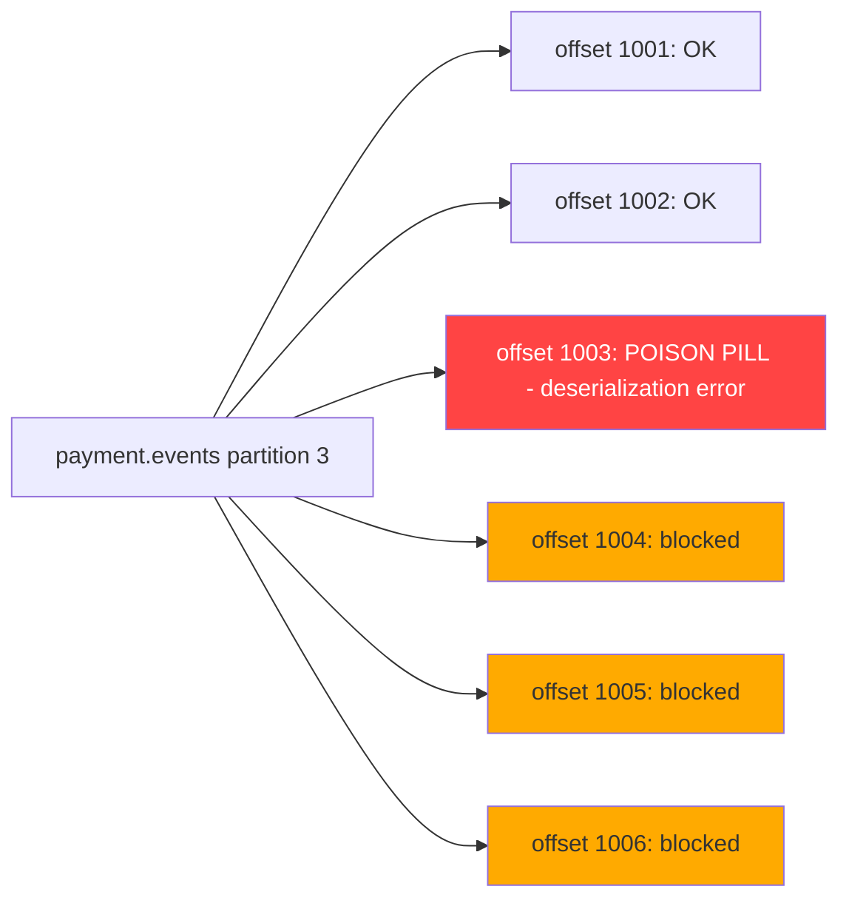

# Dead Letter Queues — Poison Pill Handling and Retry

A single malformed payment event can halt all processing for a Kafka partition. Without a dead letter queue strategy, one bad message can silently block thousands of downstream consumers. This lesson covers poison pill detection, non-blocking retry topology, failure classification, and re-driving from the DLQ.

---

## 1. The Poison Pill Problem

A poison pill is a message that causes the consumer to throw an exception every time it attempts processing. Because Kafka consumers process a partition sequentially, a poison pill at offset N blocks all processing of offsets N+1, N+2, ... for that partition.



Without DLQ handling, a consumer that retries indefinitely will:
1. Never advance past the poison pill
2. Accumulate lag for all subsequent messages on that partition
3. Potentially cause cascading failures downstream

---

## 2. DLQ Retry Topology

Two options exist:

- **Blocking retries** (`DefaultErrorHandler` + back-off, then a DLT): the partition waits while one record is retried. Simple, and **keeps per-key ordering** — but a long back-off delays every record behind it.
- **Non-blocking retries** (retry topics): the failed record moves to a retry topic and the partition continues. Throughput is preserved, but **per-key ordering is lost**: a later event for the same payment can be processed before the earlier one that is waiting in a retry topic. For payment state changes this matters — use blocking retries, or make consumers tolerate reordering (version checks, Lesson 09).

The non-blocking retry pattern creates dedicated retry topics with delays:

```
payment.events
    |
    +--(failure, attempt 1)--> payment.events.RETRY_0  (delay: 1s)
                                    |
                                    +--(failure, attempt 2)--> payment.events.RETRY_1  (delay: 10s)
                                                                    |
                                                                    +--(failure, attempt 3)--> payment.events.RETRY_2  (delay: 60s)
                                                                                                    |
                                                                                                    +--(still failing)--> payment.events.DLT
```

```bash
# Create the retry and dead letter topics
# Retry topics have short retention — messages are re-processed quickly or die
kafka-topics.sh --create --topic payment.events.RETRY_0 \
  --partitions 32 --replication-factor 3 \
  --config retention.ms=3600000 \
  --bootstrap-server kafka:9092

kafka-topics.sh --create --topic payment.events.RETRY_1 \
  --partitions 32 --replication-factor 3 \
  --config retention.ms=3600000 \
  --bootstrap-server kafka:9092

kafka-topics.sh --create --topic payment.events.RETRY_2 \
  --partitions 32 --replication-factor 3 \
  --config retention.ms=3600000 \
  --bootstrap-server kafka:9092

# Dead letter topic: long retention for investigation and re-driving
kafka-topics.sh --create --topic payment.events.DLT \
  --partitions 32 --replication-factor 3 \
  --config retention.ms=2592000000 \
  --bootstrap-server kafka:9092
```

---

## 3. Blocking Retries: DefaultErrorHandler with Exponential Backoff

```java
@Configuration
public class KafkaConsumerConfig {

    @Bean
    public DefaultErrorHandler errorHandler(
            DeadLetterPublishingRecoverer recoverer) {

        // Blocking retries in the consumer: 1s, 2s, 4s (3 retries), then the
        // recoverer publishes the record to the DLT and the partition moves on.
        // Keep the total back-off well below max.poll.interval.ms.
        ExponentialBackOffWithMaxRetries backoff =
            new ExponentialBackOffWithMaxRetries(3);
        backoff.setInitialInterval(1_000L);   // 1 second initial delay
        backoff.setMultiplier(2.0);           // double each retry
        backoff.setMaxInterval(8_000L);       // cap at 8 seconds

        DefaultErrorHandler handler = new DefaultErrorHandler(recoverer, backoff);

        // Classify non-retryable exceptions — go directly to DLT, no retry
        // (DeserializationException and several others are already in the
        //  default not-retryable list)
        handler.addNotRetryableExceptions(
            DeserializationException.class,
            MessageConversionException.class,
            MethodArgumentResolutionException.class,
            NonRetryablePaymentException.class    // our own permanent failures
        );

        return handler;
    }

    @Bean
    public DeadLetterPublishingRecoverer deadLetterRecoverer(
            KafkaTemplate<Object, Object> kafkaTemplate) {

        // Default destination: <topic>-dlt (Spring Kafka 3.x) with the same
        // partition number. Here: <topic>.DLT -- the DLT needs at least as
        // many partitions as the source topic. The recoverer adds headers
        // with the original topic/partition/offset and the exception.
        return new DeadLetterPublishingRecoverer(kafkaTemplate,
            (record, exception) -> new TopicPartition(
                record.topic() + ".DLT", record.partition()));
    }

    @Bean
    public ConcurrentKafkaListenerContainerFactory<String, String>
            kafkaListenerContainerFactory(
                ConsumerFactory<String, String> cf,
                DefaultErrorHandler errorHandler) {

        ConcurrentKafkaListenerContainerFactory<String, String> factory =
            new ConcurrentKafkaListenerContainerFactory<>();
        factory.setConsumerFactory(cf);
        factory.setCommonErrorHandler(errorHandler);
        return factory;
    }
}
```

---

## 4. Why Hand-Written Retry-Topic Listeners Are a Trap

It is tempting to add one `@KafkaListener` per retry topic. But a plain listener on `payment.events.RETRY_0` consumes immediately — nothing enforces the delay — and every listener needs its own routing to the next tier (a failure on `payment.events.RETRY_0` must go to `RETRY_1`, not to `payment.events.RETRY_0.RETRY_0`). Spring Kafka's **`@RetryableTopic`** (next section) does all of this correctly: it creates the topics and listeners, delays each attempt by pausing the partition until the record's due time, counts attempts in headers, and routes to the DLT. The shared processing logic and error classification look like this:

```java
@Component
public class PaymentEventConsumer {

    private final PaymentProcessingService paymentService;

    private void processWithContext(ConsumerRecord<String, String> record) {
        try {
            PaymentEvent event = objectMapper.readValue(record.value(),
                                                        PaymentEvent.class);
            paymentService.process(event);
        } catch (JsonProcessingException e) {
            // Non-retryable: schema mismatch or corrupt payload
            throw new MessageConversionException("Cannot deserialize payment event", e);
        } catch (TransientPaymentException e) {
            // Retryable: downstream service unavailable -> rethrow as is
            throw e;
        } catch (PermanentPaymentException e) {
            // Non-retryable: business rule violation — straight to the DLT.
            // Use a dedicated exception type registered as not-retryable
            // (not MessageConversionException, which means "bad message format")
            throw new NonRetryablePaymentException("Permanent business failure", e);
        }
    }
}
```

---

## 5. Using Spring Kafka RetryTopicConfiguration (Auto-setup)

Spring Kafka 2.7+ provides a declarative approach:

```java
@Configuration
public class RetryTopicConfig {

    // Option A: global configuration as a bean (use EITHER this OR the
    // @RetryableTopic annotation below for a given listener)
    @Bean
    public RetryTopicConfiguration retryTopicConfig(
            KafkaTemplate<String, String> kafkaTemplate) {

        return RetryTopicConfigurationBuilder
            .newInstance()
            .fixedBackOff(1_000)             // 1 second between retries
            .maxAttempts(4)                  // 3 retries + 1 original = 4 total attempts
            .retryTopicSuffix("-RETRY")
            .dltSuffix("-DLT")
            // retryOn(...) and notRetryOn(...) are alternatives -- use one
            .notRetryOn(List.of(DeserializationException.class,
                                MessageConversionException.class,
                                NonRetryablePaymentException.class))
            .dltHandlerMethod("paymentEventConsumer", "handleDlt")  // bean name + method
            .create(kafkaTemplate);
    }
}

// Option B: the annotation-driven approach:
@Component
public class PaymentEventConsumer {

    @RetryableTopic(
        backoff = @Backoff(delay = 1000, multiplier = 2.0, maxDelay = 60_000),
        attempts = "4",
        topicSuffixingStrategy = TopicSuffixingStrategy.SUFFIX_WITH_INDEX_VALUE,
        exclude = {DeserializationException.class, MessageConversionException.class}
    )
    @KafkaListener(topics = "payment.events", groupId = "payment-processor")
    public void consume(PaymentEvent event,
                        @Header(KafkaHeaders.RECEIVED_TOPIC) String topic) {
        paymentService.process(event);
    }

    @DltHandler
    public void handleDlt(PaymentEvent event,
                          @Header(KafkaHeaders.RECEIVED_TOPIC) String topic) {
        log.error("Payment event in DLT: {} from topic: {}",
                  event.getPaymentId(), topic);
        alertingService.sendCriticalAlert(event);
    }
}
```

---

## 6. Failure Classification — Transient vs Permanent

Correct classification prevents infinite retry loops on unrecoverable errors:

```java
public enum FailureType { TRANSIENT, PERMANENT }

public FailureType classify(Exception e) {
    // PERMANENT failures — retry is futile
    if (e instanceof DeserializationException)        return PERMANENT; // corrupt message
    if (e instanceof MessageConversionException)      return PERMANENT; // schema mismatch
    if (e instanceof ConstraintViolationException)    return PERMANENT; // invalid business data
    if (e instanceof FraudBlacklistException)         return PERMANENT; // business rule
    if (e instanceof AccountClosedException)          return PERMANENT; // business rule

    // TRANSIENT failures — retry may succeed
    if (e instanceof TransientDataAccessException)    return TRANSIENT; // DB timeouts etc.
    if (e instanceof ConcurrencyFailureException)     return TRANSIENT; // deadlock, serialization failure, lock timeout
    if (e instanceof ResourceAccessException)         return TRANSIENT; // HTTP timeout
    if (e instanceof RedisConnectionException)        return TRANSIENT; // cache unavailable
    // Spring maps deadlocks / serialization failures to ConcurrencyFailureException
    // subclasses (checked above) -- a DataIntegrityViolationException is a real
    // constraint violation (FK, unique, NOT NULL): retrying will not help
    if (e instanceof DataIntegrityViolationException) return PERMANENT;

    // Default: treat unknown exceptions as transient (conservative)
    log.warn("Unknown exception type, treating as transient: {}",
             e.getClass().getSimpleName());
    return TRANSIENT;
}
```

---

## 7. DLQ Monitoring — Arrivals in the DLT

The signal is not the lag of the DLT handler — the `@DltHandler` consumes and stores records almost immediately, so its lag stays near zero while failures pile up. Watch **arrivals**: growth of the DLT topic's end offsets, and the number of unresolved rows in the `dlt_messages` table.

```java
@Component
public class DltArrivalMonitor {

    private final AdminClient adminClient;
    private final AlertingService alertingService;
    private final AtomicLong dltEndOffsetTotal = new AtomicLong();
    private final AtomicLong unresolved = new AtomicLong();
    private final DltMessageRepository dltMessageRepository;
    private long lastSeenTotal = -1;

    public DltArrivalMonitor(AdminClient adminClient, AlertingService alertingService,
                             DltMessageRepository dltMessageRepository,
                             MeterRegistry meterRegistry) {
        this.adminClient = adminClient;
        this.alertingService = alertingService;
        this.dltMessageRepository = dltMessageRepository;
        // Registered once; scheduled job only updates the holders.
        // Alert in Prometheus on increase(kafka_dlt_end_offset_total[5m]) > 0
        Gauge.builder("kafka.dlt.end.offset.total", dltEndOffsetTotal, AtomicLong::get)
            .tag("topic", "payment.events.DLT").register(meterRegistry);
        Gauge.builder("kafka.dlt.unresolved", unresolved, AtomicLong::get)
            .register(meterRegistry);
    }

    @Scheduled(fixedDelayString = "${dlt.monitor.interval:60000}")
    public void monitorDlt() throws Exception {
        long total = endOffsetTotal("payment.events.DLT");
        dltEndOffsetTotal.set(total);
        unresolved.set(dltMessageRepository.countByStatus(DltStatus.OPEN));

        if (lastSeenTotal >= 0 && total > lastSeenTotal) {
            alertingService.sendAlert(
                "New messages in payment DLT",
                (total - lastSeenTotal) + " new failed payment events",
                AlertSeverity.WARNING);
        }
        lastSeenTotal = total;
    }

    private long endOffsetTotal(String topic) throws Exception {
        Set<TopicPartition> partitions = adminClient.describeTopics(List.of(topic))
            .allTopicNames().get(10, TimeUnit.SECONDS).get(topic).partitions().stream()
            .map(p -> new TopicPartition(topic, p.partition()))
            .collect(Collectors.toSet());

        return adminClient.listOffsets(partitions.stream()
                .collect(Collectors.toMap(tp -> tp, tp -> OffsetSpec.latest())))
            .all().get(10, TimeUnit.SECONDS)
            .values().stream()
            .mapToLong(ListOffsetsResult.ListOffsetsResultInfo::offset)
            .sum();
    }
}
```

---

## 8. Re-Driving from the DLQ

When an upstream issue is resolved (e.g., a downstream service is restored), re-drive messages from the DLT:

```java
@Service
public class DltRedriveService {

    private final KafkaTemplate<String, String> kafkaTemplate;
    private final DltMessageRepository dltMessageRepository;

    /**
     * Re-drive all OPEN DLT records for one original topic, in small batches
     * and at a limited rate -- the downstream that failed may still be fragile.
     * Records are read from the dlt_messages table (filled by the @DltHandler),
     * so we know which ones were already re-driven.
     */
    public void redriveAll(String originalTopic, int batchSize, Duration pause)
            throws InterruptedException {
        List<DltMessage> batch;
        while (!(batch = dltMessageRepository
                    .findOpenByTopic(originalTopic, batchSize)).isEmpty()) {
            for (DltMessage m : batch) {
                redrive(m, originalTopic);
            }
            Thread.sleep(pause.toMillis());   // simple rate limit
        }
    }

    /**
     * Re-inject a specific message from the DLT back into the original topic.
     * Use for targeted replay of a single payment event after root cause fix.
     */
    public void redriveMessage(String messageKey, String originalTopic) {
        DltMessage dltMessage = dltMessageRepository.findByMessageKey(messageKey)
            .orElseThrow(() -> new DltMessageNotFoundException(messageKey));
        redrive(dltMessage, originalTopic);
    }

    private void redrive(DltMessage dltMessage, String originalTopic) {
        // Same KEY -> same partition as the original (no explicit partition
        // number needed); the consumer must be idempotent (event id)
        ProducerRecord<String, String> record = new ProducerRecord<>(
            originalTopic, dltMessage.getMessageKey(), dltMessage.getPayload());

        // Add header to indicate this is a re-driven message
        record.headers()
            .add("kafka_redrive_from_dlt", "true".getBytes(StandardCharsets.UTF_8))
            .add("kafka_original_dlt_offset",
                 String.valueOf(dltMessage.getOffset()).getBytes(StandardCharsets.UTF_8));

        // Mark as re-driven only AFTER the broker acknowledged the send
        kafkaTemplate.send(record).join();
        dltMessageRepository.markAsRedriven(dltMessage.getId());

        log.info("Re-drove message: key={} to topic={}", dltMessage.getMessageKey(), originalTopic);
    }
}
```

---

## 9. Production Pitfalls

### Pitfall 1 — Retrying Permanent Failures Infinitely

A payment event contains an invalid currency code. The currency validation throws a `ValidationException` on every attempt. Without classifying this as permanent, the message cycles through all retry tiers and re-enters RETRY_0 forever.

```java
// BAD: all exceptions trigger retry, including permanent validation failures
@KafkaListener(topics = "payment.events", groupId = "payment-processor")
public void consume(PaymentEvent event) {
    // If this throws ValidationException, Spring Kafka retries 3 times
    // then sends to RETRY_0, then RETRY_1, then RETRY_2, then DLT
    // But if something keeps re-driving from DLT, this loops forever
    validateCurrency(event.getCurrency());  // throws ValidationException for "XYZ"
    paymentService.process(event);
}

// GOOD: classify exceptions so permanent failures skip retries
@KafkaListener(topics = "payment.events", groupId = "payment-processor")
public void consume(PaymentEvent event) {
    try {
        validateCurrency(event.getCurrency());
        paymentService.process(event);
    } catch (ValidationException e) {
        // Permanent: re-wrapping in an exception type registered as
        // not-retryable makes the error handler route it straight to the DLT
        throw new NonRetryablePaymentException(
            "Invalid currency code: " + event.getCurrency()
            + " — no retry, routing to DLT", e);
    }
}

// In DefaultErrorHandler configuration:
// handler.addNotRetryableExceptions(NonRetryablePaymentException.class);
// handler.addNotRetryableExceptions(ValidationException.class);  // also direct
```

### Pitfall 2 — Not Setting DLT Topic Retention

The DLT topic uses the default broker retention (7 days). A team discovers DLT messages after 10 days and finds they have been deleted, losing the ability to investigate and re-drive.

```bash
# BAD: default retention (7 days) on DLT — messages expire before investigation
# No explicit retention set for payment.events.DLT

# GOOD: set long retention on DLT topics — 30 days minimum for financial messages
kafka-configs.sh --alter \
  --topic payment.events.DLT \
  --add-config retention.ms=2592000000 \
  --bootstrap-server kafka:9092
# 2592000000 ms = 30 days

# In Terraform / Helm values, enforce retention for DLT topics:
# kafka_topic_configs:
#   "payment.events.DLT":
#     retention_ms: "2592000000"
#     min_insync_replicas: "2"

# Also check retention.bytes: the default (-1) means NO size-based deletion.
# Setting a size limit (e.g. 10 GB) INTRODUCES size-based deletion -- during
# a big outage the oldest DLT records could then be deleted. Leave it at -1
# unless disk is a real constraint, and alert well before it fills.
kafka-configs.sh --describe \
  --topic payment.events.DLT \
  --bootstrap-server kafka:9092
```

### Pitfall 3 — Not Monitoring DLT Arrivals

A team deploys the DLQ infrastructure but does not monitor what arrives in the DLT. After a downstream outage, 50,000 payment events land in the DLT. No alert fires. The issue is discovered 48 hours later during a manual audit.

```java
// BAD: no DLT monitoring
// Operations team only discovers the issue when customers complain

// GOOD: alert as soon as failed payments ARRIVE in the DLT -- ANY message
// in the DLT is a failed payment that needs attention
@Component
public class DltAlerts {

    @Scheduled(fixedDelay = 60_000)
    public void alertOnDltMessages() {
        long open = dltMessageRepository.countByStatus(DltStatus.OPEN);

        // Any unresolved record in a payment DLT is a P2 incident
        if (open > 0) {
            alertingService.page(
                "P2: Payment DLT has " + open + " unresolved messages",
                "payment-oncall-rotation");
        }

        // Also check the last retry topic — high lag there means
        // something is consistently failing
        long retry2Lag = calculateTotalLag("payment-processor", "payment.events.RETRY_2");
        if (retry2Lag > 100) {
            alertingService.page(
                "P2: Payment RETRY_2 has " + retry2Lag + " messages",
                "payment-oncall-rotation");
        }
    }
}
```

---

## 10. DLQ Checklist

- [ ] Retry topology is defined: original → RETRY_0 → RETRY_1 → RETRY_2 → DLT
- [ ] `DefaultErrorHandler` configured with `ExponentialBackOffWithMaxRetries`
- [ ] `addNotRetryableExceptions()` includes `DeserializationException` and `MessageConversionException`
- [ ] Retry tiers implemented with `@RetryableTopic` (not hand-written listeners); ordering impact of non-blocking retries accepted or handled
- [ ] DLT topic has minimum 30-day retention (`retention.ms=2592000000`)
- [ ] DLT topic keeps `retention.bytes=-1` (no size-based deletion) or a consciously sized limit with alerts
- [ ] `@DltHandler` persists DLT messages to a database for investigation
- [ ] DLT arrivals are monitored (end-offset growth, unresolved `dlt_messages` rows) and alert at once (P2 incident)
- [ ] Retry topic lag is also monitored (threshold: > 100 events on RETRY_2)
- [ ] Re-drive procedure is documented and tested (test before you need it)
- [ ] Failure classification logic is reviewed for every new exception type added
- [ ] Integration tests cover: transient failure (retries and succeeds), permanent failure (goes directly to DLT), DLT redrive (message re-appears in original topic)

---

<!-- KNOWLEDGE-CHECK
{"questions": [{"text": "A PaymentEvent consumer encounters a DeserializationException on a message. With DefaultErrorHandler configured to not retry DeserializationException, what happens?", "options": ["The consumer retries 3 times with exponential backoff before sending to DLT", "The consumer skips the message silently and advances to the next offset", "The message is immediately routed to the DLT topic without any retry attempts", "The consumer stops processing and waits for the message to be manually fixed"], "correct": 2, "explanation": "DeserializationException is a permanent failure — the message payload is corrupt or uses an incompatible schema. No amount of retrying will fix it. When added to addNotRetryableExceptions(), the DefaultErrorHandler bypasses all retry tiers and immediately invokes the DeadLetterPublishingRecoverer, routing the message to the DLT topic."}, {"text": "Why is isolation.level=read_committed important for retry topic and DLT consumers?", "options": ["It prevents the retry consumer from reading messages that are still being processed by the original consumer", "It prevents retry consumers from seeing messages from aborted transactions if the original producer used transactions", "It speeds up retry processing by batching reads", "It is required by the non-blocking retry implementation in Spring Kafka"], "correct": 1, "explanation": "If the original producer uses Kafka transactions (which is the case in an exactly-once setup), uncommitted or aborted messages may appear in the topic. Without read_committed, the retry consumer could process a message from an aborted transaction — a payment that was explicitly rolled back. read_committed ensures only committed messages are visible."}, {"text": "A team discovers that payment.events.DLT has 10,000 messages from a 3-hour outage of the fraud service. The fraud service is now restored. What is the safest re-drive strategy?", "options": ["Delete the DLT messages — they are too old to process", "Reset the original consumer group offset to 0 to replay all events from the beginning", "Re-inject DLT messages back to the original topic one at a time, verifying idempotency keys prevent duplicate processing, then monitor for successful processing", "Run a manual SQL migration to process the payments directly in the database"], "correct": 2, "explanation": "Re-injecting from DLT to the original topic allows the normal processing pipeline to handle them. The idempotency key (payment event ID) in the consumer prevents any message that was already partially processed from being applied twice. Processing one at a time (or in small batches) with monitoring lets you detect if the fraud service is still intermittent before flooding it with 10,000 messages."}]}
-->

<!-- PRACTICAL-CHALLENGE
{"title": "Implement a Non-Blocking Retry and DLQ System for Payment Events", "difficulty": "advanced", "estimatedMinutes": 60, "tasks": [{"id": "1", "description": "Configure blocking retries: a DefaultErrorHandler with ExponentialBackOffWithMaxRetries(3) starting at 1 second, multiplier 2.0, max 8 seconds, and a DeadLetterPublishingRecoverer to payment.events.DLT. Add DeserializationException, MessageConversionException and NonRetryablePaymentException as non-retryable. Then configure the same listener with @RetryableTopic (non-blocking, 4 attempts) and explain the ordering trade-off. Write a unit test that verifies a DeserializationException goes directly to the DLT without any retry delay."}, {"id": "2", "description": "Implement a @DltHandler method that receives DLT messages, logs the error, persists a DltMessage record (topic, partition, offset, messageKey, payload, errorMessage, arrivedAt, status OPEN) to a dlt_messages table, and sends a PagerDuty or email alert. Write a @Scheduled monitor that tracks the DLT topic's end offsets and the number of OPEN dlt_messages rows every 60 seconds and alerts as soon as new failed payments arrive."}, {"id": "3", "description": "Implement a DltRedriveService with two methods: redriveAll(originalTopic, batchSize, pause) that re-publishes all OPEN DLT records in rate-limited batches, and redriveByKey(String messageKey) that re-publishes a specific DLT message back to the original topic with a kafka_redrive_from_dlt=true header, marking it as re-driven only after the send was acknowledged. The consumer must be idempotent (use ON CONFLICT DO NOTHING) so re-driven messages do not cause duplicates."}, {"id": "4", "description": "Write an end-to-end integration test using EmbeddedKafka that: (a) publishes 5 payment events where events 2 and 4 will throw a TransientException on first attempt, (b) verifies events 2 and 4 succeed on retry via RETRY_0, (c) publishes 2 events that always throw ValidationException, (d) verifies those 2 events appear in the DLT without any retry delay, (e) calls redriveByKey() for one DLT message and verifies it re-appears in the original topic and is processed successfully."}]}
-->
