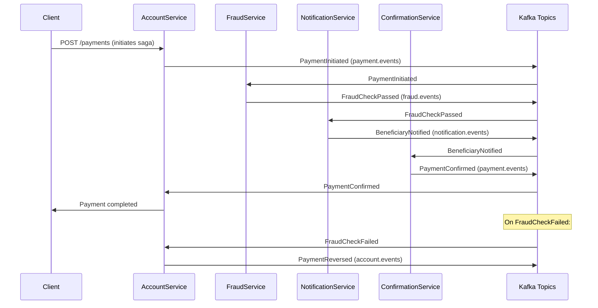
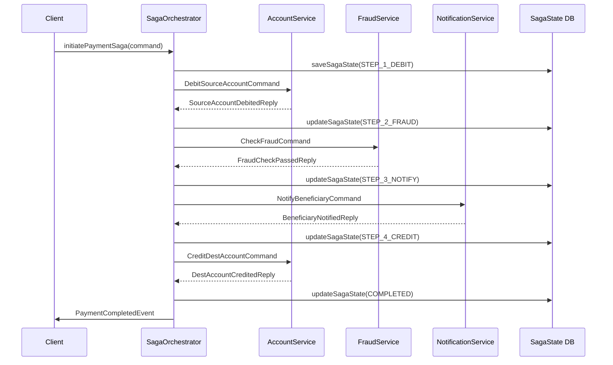

# نمط Saga — التنسيق الذاتي والتنسيق المركزي

لا يمكن تغليف دفعة تمتد عبر خدمات مصغّرة متعددة — خصم المصدر، وفحص الاحتيال، وإشعار المستفيد، وإضافة المبلغ للوجهة — في معاملة قاعدة بيانات واحدة. ويستبدل نمط Saga الالتزام ثنائي المرحلة الموزع بتسلسل من المعاملات المحلية والمعاملات التعويضية. ويغطي هذا الدرس النوعين (التنسيق الذاتي choreography والتنسيق المركزي orchestration)، ودورة حياة Saga الدفع الكاملة، وكيف تجعل التعويضات idempotent ودائمة.

---

## 1. لماذا لا الالتزام ثنائي المرحلة؟

الالتزام ثنائي المرحلة (2PC) غير عملي في بنية الخدمات المصغّرة:

| المشكلة | الأثر في الخدمات المصغّرة |
|---|---|
| المنسّق نقطة فشل واحدة | المنسّق المتعطل يترك المشاركين المُعدّين ممسكين بأقفالهم حتى يتعافى |
| مدة الأقفال الحاجبة | كل الموارد مقفلة من التحضير حتى الالتزام — عادة 100ms–1s، وهذا غير مقبول على نطاق المدفوعات |
| دعم محدود للمشاركين | ليس كل مخزن يستطيع الانضمام لمعاملة XA ‏(MongoDB، وKafka، ومعظم واجهات HTTP/gRPC لا تستطيع) |
| انقسامات الشبكة تحجب المشاركين | المشارك الذي صوّت "مُعدّ" لا يستطيع القرار وحده؛ وأثناء الانقسام يجب أن ينتظر (يبقى محجوبًا) ليبقى متسقًا |
| التعقيد التشغيلي | تتطلب معاملات XA أن تنفذ كل الخدمات بروتوكول XA؛ ومعظم خدمات REST/gRPC لا تفعل |

يتجنب نمط Saga كل هذه المشكلات باستخدام معاملات محلية فقط. فإذا فشلت خطوة، تتراجع المعاملات التعويضية عن عمل الخطوات المكتملة.

---

## 2. تعريف Saga

الـ Saga تسلسل من المعاملات المحلية حيث:
1. تحدّث كل معاملة محلية بيانات خدمة واحدة وتنشر حدثًا (أو ترسل أمرًا)
2. إذا فشلت معاملة محلية، تعكس المعاملات التعويضية آثار كل المعاملات الملتزمة سابقًا

```
Payment Saga:
  Step 1: Debit source account      (compensation: Reverse debit)
  Step 2: Reserve fraud check slot  (compensation: Release fraud check slot)
  Step 3: Notify beneficiary        (compensation: Send cancellation notification)
  Step 4: Credit destination        (compensation: Reverse credit)
  Step 5: Confirm payment           (compensation: N/A — final step)
```

**خاصية أساسية**: يجب أن تكون المعاملات التعويضية **idempotent** لأنها قد تُستدعى مرات متعددة عند الفشل/إعادة المحاولة.

**ملاحظة تصميمية على ترتيب الخطوات:** يبقى هذا المثال الكلاسيكي بسيطًا، لكن في التصميم الحقيقي ضع الفحوص التي ما زالت تستطيع قول "لا" (فحص الاحتيال) **قبل** تحرك المال، والخطوات التي لا يمكن التراجع عنها فعلًا (الإشعارات) **أخيرًا**، بعد الإضافة للوجهة. فالإشعار المرسل لا يمكن "تعويضه" إلا برسالة اعتذار — لذا يجب ألا يُرسل إلا حين تتأكد النتيجة.

---

## 3. ‏Saga بالتنسيق الذاتي

في التنسيق الذاتي، تتفاعل كل خدمة مع الأحداث وتنشر الحدث التالي. ولا يوجد منسّق مركزي. فكل خدمة تعرف دورها المحلي لا التدفق الكلي.



### معالجات أحداث التنسيق الذاتي

```java
// AccountService: starts the saga and handles compensation.
// eventPublisher writes to an OUTBOX table in the same DB transaction
// (Lesson 06) -- publishing straight to Kafka here would be a dual write.
// The balance check + debit should be one atomic, idempotent update
// (UPDATE ... SET balance = balance - ? WHERE id = ? AND balance >= ?).
@KafkaListener(topics = "payment.commands", groupId = "account-service")
@Transactional
public void handlePaymentCommand(PaymentInitiateCommand command) {
    // Local transaction: debit source account
    Account source = accountRepository.findById(command.getSourceAccountId())
        .orElseThrow(() -> new AccountNotFoundException(command.getSourceAccountId()));

    if (source.getBalance().compareTo(command.getAmount()) < 0) {
        // Publish failure event immediately
        eventPublisher.publish("payment.events",
            new PaymentFailed(command.getPaymentId(), "Insufficient funds"));
        return;
    }

    source.debit(command.getAmount());
    accountRepository.save(source);

    // Publish event to trigger next saga step
    eventPublisher.publish("payment.events",
        new PaymentInitiated(
            command.getPaymentId(),
            command.getSourceAccountId(),
            command.getDestAccountId(),
            command.getAmount(),
            command.getCorrelationId()));
}

// AccountService: handles compensation (reverse debit)
@KafkaListener(topics = "fraud.events", groupId = "account-service-fraud")
@Transactional
public void handleFraudCheckResult(FraudCheckEvent event) {
    if (event instanceof FraudCheckFailed failed) {
        // COMPENSATION: reverse the debit (must be idempotent -- see
        // "Idempotent Compensation" below; Kafka may deliver this twice)
        Account source = accountRepository.findById(failed.getSourceAccountId())
            .orElseThrow();
        source.credit(failed.getAmount());  // reversal
        accountRepository.save(source);

        eventPublisher.publish("payment.events",
            new PaymentReversed(
                failed.getPaymentId(),
                "Fraud check failed: " + failed.getReason()));
    }
}

// FraudService: reacts to PaymentInitiated
@KafkaListener(topics = "payment.events", groupId = "fraud-service")
@Transactional
public void handlePaymentInitiated(PaymentInitiated event) {
    FraudCheckResult result = fraudEngine.check(
        event.getSourceAccountId(),
        event.getAmount(),
        event.getCorrelationId());

    if (result.isPassed()) {
        eventPublisher.publish("fraud.events",
            new FraudCheckPassed(event.getPaymentId(), event.getSourceAccountId(),
                                 event.getDestAccountId(), event.getAmount()));
    } else {
        eventPublisher.publish("fraud.events",
            new FraudCheckFailed(event.getPaymentId(), event.getSourceAccountId(),
                                 event.getAmount(), result.getReason()));
    }
}
```

---

## 4. ‏Saga بالتنسيق المركزي

في التنسيق المركزي، يرسل `SagaOrchestrator` مركزي الأوامر لكل خدمة ويستقبل الردود. ويملك المنسّق آلة حالة الـ Saga.



### تنفيذ المنسّق

```java
@Component
public class PaymentSagaOrchestrator {

    private final SagaStateRepository sagaStateRepository;
    private final KafkaTemplate<String, String> commandBus;

    // Note: saving the saga state and sending the command are two writes.
    // Write the command to an OUTBOX table in the same DB transaction as the
    // state (Lesson 06), or rely on resume-on-restart + idempotent handlers
    // to re-send it if the process dies in between.
    @Transactional
    public UUID initiatePayment(PaymentInitiateCommand command) {
        UUID sagaId = UUID.randomUUID();

        // Persist initial saga state before sending any commands
        SagaState state = SagaState.builder()
            .sagaId(sagaId)
            .paymentId(command.getPaymentId())
            .sourceAccountId(command.getSourceAccountId())
            .destAccountId(command.getDestAccountId())
            .amount(command.getAmount())
            .currentStep(SagaStep.DEBIT_SOURCE)
            .status(SagaStatus.IN_PROGRESS)
            .createdAt(Instant.now())
            .build();

        sagaStateRepository.save(state);

        // Send step 1 command
        commandBus.send("account.commands",
            command.getSourceAccountId().toString(),
            toJson(new DebitSourceAccountCommand(sagaId, command.getSourceAccountId(),
                                                  command.getAmount())));

        return sagaId;
    }

    // Reply handler for step 1
    @KafkaListener(topics = "account.replies", groupId = "payment-saga-orchestrator")
    @Transactional
    public void handleAccountReply(ConsumerRecord<String, String> record) {
        AccountReply reply = fromJson(record.value(), AccountReply.class);
        SagaState state = sagaStateRepository.findBySagaId(reply.getSagaId())
            .orElseThrow(() -> new SagaNotFoundException(reply.getSagaId()));

        if (reply instanceof SourceAccountDebitedReply debitedReply
                && state.getCurrentStep() == SagaStep.DEBIT_SOURCE) {

            // Advance to step 2
            state.setCurrentStep(SagaStep.FRAUD_CHECK);
            sagaStateRepository.save(state);

            commandBus.send("fraud.commands",
                state.getSagaId().toString(),
                toJson(new CheckFraudCommand(state.getSagaId(),
                                              state.getSourceAccountId(),
                                              state.getAmount())));

        } else if (reply instanceof DebitFailedReply failedReply) {
            // Step 1 failed — no compensation needed (nothing was committed)
            state.setStatus(SagaStatus.FAILED);
            state.setFailureReason(failedReply.getReason());
            sagaStateRepository.save(state);
        }
    }

    // Reply handler for step 2 (fraud check)
    @KafkaListener(topics = "fraud.replies", groupId = "payment-saga-orchestrator")
    @Transactional
    public void handleFraudReply(ConsumerRecord<String, String> record) {
        FraudReply reply = fromJson(record.value(), FraudReply.class);
        SagaState state = sagaStateRepository.findBySagaId(reply.getSagaId())
            .orElseThrow();

        if (reply instanceof FraudCheckPassedReply
                && state.getCurrentStep() == SagaStep.FRAUD_CHECK) {

            state.setCurrentStep(SagaStep.NOTIFY_BENEFICIARY);
            sagaStateRepository.save(state);

            commandBus.send("notification.commands",
                state.getSagaId().toString(),
                toJson(new NotifyBeneficiaryCommand(state.getSagaId(),
                                                     state.getDestAccountId(),
                                                     state.getAmount())));

        } else if (reply instanceof FraudCheckFailedReply failedReply) {
            // Step 2 failed — compensate step 1
            state.setCurrentStep(SagaStep.COMPENSATING_DEBIT);
            sagaStateRepository.save(state);

            commandBus.send("account.commands",
                state.getSourceAccountId().toString(),
                toJson(new ReverseDebitCommand(state.getSagaId(),
                                               state.getSourceAccountId(),
                                               state.getAmount())));
        }
    }
}
```

---

## 5. سلسلة التعويض

حين تفشل خطوة، يجب تعويض كل الخطوات المكتملة سابقًا بترتيب عكسي:

```java
public enum SagaStep {
    DEBIT_SOURCE,          // compensation: REVERSE_DEBIT
    FRAUD_CHECK,           // compensation: RELEASE_FRAUD_SLOT
    NOTIFY_BENEFICIARY,    // compensation: SEND_CANCELLATION
    CREDIT_DESTINATION,    // compensation: REVERSE_CREDIT
    COMPLETED,             // no compensation needed (terminal success)
    COMPENSATING,
    FAILED                 // terminal failure
}

public class SagaCompensationService {

    public void compensate(SagaState state) {
        // Compensate exactly the steps that COMPLETED, newest first.
        // (Deriving this from enum ordinals is fragile: states such as
        //  COMPENSATING have higher ordinals than the business steps and
        //  would trigger reversals that never had a forward step.)
        List<SagaStep> done = new ArrayList<>(state.getCompletedSteps());
        Collections.reverse(done);

        for (SagaStep step : done) {
            switch (step) {
                case CREDIT_DESTINATION -> issueCommand(new ReverseDestinationCreditCommand(state));
                case NOTIFY_BENEFICIARY -> issueCommand(new SendCancellationNotificationCommand(state));
                case FRAUD_CHECK        -> issueCommand(new ReleaseFraudSlotCommand(state));
                case DEBIT_SOURCE       -> issueCommand(new ReverseSourceDebitCommand(state));
                default -> { /* not a business step */ }
            }
        }
        // Failure at step 1: completedSteps is empty -> nothing to compensate
    }
}
```

### التعويض idempotent

يتضمن كل أمر تعويض sagaId كمفتاح idempotency:

```java
@KafkaListener(topics = "account.commands", groupId = "account-command-handler")
@Transactional
public void handleReverseDebit(ReverseDebitCommand command) {
    // Idempotency: CLAIM the (sagaId, step) first -- an INSERT into a table
    // with PRIMARY KEY (saga_id, step), ON CONFLICT DO NOTHING. A separate
    // "exists?" check followed by a later insert would race with a duplicate
    // delivery processed at the same time.
    boolean firstTime = compensationLog.tryRecord(
        command.getSagaId(), "REVERSE_DEBIT");   // false = already recorded

    if (!firstTime) {
        log.info("Compensation already applied, skipping: sagaId={} step=REVERSE_DEBIT",
                 command.getSagaId());
        return;
    }

    Account source = accountRepository.findById(command.getSourceAccountId())
        .orElseThrow();
    source.credit(command.getAmount());  // reverse the debit
    accountRepository.save(source);

    // Reply to orchestrator (via the outbox, same DB transaction)
    replyBus.send("account.replies",
        toJson(new DebitReversedReply(command.getSagaId())));
}
```

---

## 6. مقارنة التنسيق الذاتي والتنسيق المركزي

| البعد | التنسيق الذاتي | التنسيق المركزي |
|---|---|---|
| الاقتران | منخفض — تعرف الخدمات الأحداث فقط، لا بعضها | متوسط — تعرف الخدمات المنسّق |
| الوضوح | منخفض — التدفق ضمني عبر مواضيع كثيرة | عالٍ — التدفق صريح في المنسّق |
| قابلية الاختبار | صعبة — تتطلب كل الخدمات للاختبار الشامل | سهلة — يمكن اختبار منطق المنسّق كوحدة |
| المنسّق المركزي | لا شيء — لا نقطة فشل واحدة | المنسّق نقطة فشل واحدة ما لم يكن عالي التوفر |
| إضافة خطوة | تتطلب تعديل خدمات متعددة | تعديل المنسّق فقط |
| تصحيح الأعطال | صعب — يجب تتبع الأحداث عبر المواضيع | أسهل — حالة الـ Saga في قاعدة بيانات واحدة |
| اقتران المخططات | تقترن الخدمات عبر مخططات الأحداث | تقترن الخدمات عبر مخططات الأوامر/الردود |
| ملاءمة حالة الاستخدام | تدفقات خطية بسيطة، وخطوط قائمة على الأحداث | تدفقات معقدة بتفرعات وتعويض |

---

## 7. ‏Idempotency لكل خطوة في Saga

تستخدم كل خطوة في Saga ‏`sagaId + stepName` كمفتاح idempotency:

```sql
CREATE TABLE saga_step_idempotency (
    saga_id    UUID         NOT NULL,
    step_name  VARCHAR(64)  NOT NULL,
    executed_at TIMESTAMPTZ NOT NULL DEFAULT NOW(),
    result     VARCHAR(16)  NOT NULL,  -- SUCCESS, COMPENSATED
    CONSTRAINT pk_saga_step_idempotency PRIMARY KEY (saga_id, step_name)
);
```

```java
// Generic idempotent step executor
@Transactional
public <T> T executeStep(UUID sagaId, String stepName, Class<T> resultType,
                          Supplier<T> stepLogic) {
    // Claim the step first (PRIMARY KEY (saga_id, step_name)); if the row
    // already exists, this step ran before -- return its stored result.
    boolean claimed = sagaStepIdempotencyRepository.insertIfAbsent(sagaId, stepName);
    if (!claimed) {
        log.info("Step already executed: sagaId={} step={}", sagaId, stepName);
        return fromJson(sagaStepIdempotencyRepository
            .findResult(sagaId, stepName), resultType);
    }

    // Same DB transaction as the claim: if the step logic fails, the claim
    // rolls back too and a retry can run the step again
    T result = stepLogic.get();
    sagaStepIdempotencyRepository.saveResult(sagaId, stepName, "SUCCESS", toJson(result));
    return result;
}
```

---

## 8. مثال Saga في Axon Framework

يوفر Axon Framework دعمًا تصريحيًا لـ Saga:

```java
@Saga
public class PaymentSaga {

    @Autowired
    @Transient
    private CommandGateway commandGateway;

    private UUID paymentId;
    private UUID sourceAccountId;
    private BigDecimal amount;
    private boolean debitApplied = false;

    @StartSaga
    @SagaEventHandler(associationProperty = "paymentId")
    public void on(PaymentInitiatedEvent event) {
        this.paymentId = event.getPaymentId();
        this.sourceAccountId = event.getSourceAccountId();
        this.amount = event.getAmount();

        // Send step 1 command
        commandGateway.send(new DebitSourceAccountCommand(
            event.getSourceAccountId(), event.getAmount(), event.getPaymentId()));
    }

    @SagaEventHandler(associationProperty = "paymentId")
    public void on(SourceAccountDebitedEvent event) {
        this.debitApplied = true;

        // Send step 2 command
        commandGateway.send(new CheckFraudCommand(
            event.getSourceAccountId(), event.getAmount(), event.getPaymentId()));
    }

    @SagaEventHandler(associationProperty = "paymentId")
    public void on(FraudCheckFailedEvent event) {
        if (debitApplied) {
            // Compensate step 1 -- and keep the saga alive until the
            // reversal is confirmed (ending now would lose track of it)
            commandGateway.send(new ReverseDebitCommand(
                sourceAccountId, amount, paymentId));
        } else {
            SagaLifecycle.end();
        }
    }

    @EndSaga
    @SagaEventHandler(associationProperty = "paymentId")
    public void on(DebitReversedEvent event) {
        // Saga ends in failure, compensation confirmed — Axon persists saga state
        log.info("Payment saga compensated: paymentId={}", paymentId);
    }

    @EndSaga
    @SagaEventHandler(associationProperty = "paymentId")
    public void on(PaymentCompletedEvent event) {
        // Final step — saga ends successfully
        log.info("Payment saga completed: paymentId={}", paymentId);
    }
}
```

---

## 9. مزالق الإنتاج

### المزلق 1 — الخطوة الأولى ليست idempotent

يعامل فريق الخطوة الأولى (خصم حساب المصدر) كأمر تافه: إذا فشل الخصم، لم يحدث شيء. لكنه ينسى سيناريو نجاح الخصم وضياع الرد (انقسام الشبكة): فيعيد المنسّق محاولة الخصم ويُخصم من الحساب مرتين.

```java
// BAD: first step has no idempotency guard
@KafkaListener(topics = "account.commands", groupId = "account-service")
@Transactional
public void handleDebit(DebitSourceAccountCommand command) {
    Account account = accountRepository.findById(command.getSourceAccountId()).orElseThrow();
    account.debit(command.getAmount());  // no check if already debited for this sagaId
    accountRepository.save(account);
    // If reply is lost and orchestrator retries, account is debited TWICE
}

// GOOD: every step — including the first — is idempotent via sagaId
@KafkaListener(topics = "account.commands", groupId = "account-service")
@Transactional
public void handleDebit(DebitSourceAccountCommand command) {
    // Claim the step (INSERT ... ON CONFLICT DO NOTHING on (saga_id, step));
    // false = this saga step was already applied
    if (!sagaStepLog.tryRecord(command.getSagaId(), "DEBIT_SOURCE")) {
        log.info("Debit already applied, returning cached reply: sagaId={}",
                 command.getSagaId());
        replyBus.send("account.replies",
            toJson(new SourceAccountDebitedReply(command.getSagaId())));
        return;
    }

    Account account = accountRepository.findById(command.getSourceAccountId()).orElseThrow();
    account.debit(command.getAmount());
    accountRepository.save(account);

    replyBus.send("account.replies",
        toJson(new SourceAccountDebitedReply(command.getSagaId())));
}
```

### المزلق 2 — ضياع حالة Saga عند إعادة التشغيل

يخزن منسّق Saga في الذاكرة حالة الـ Saga في `ConcurrentHashMap`. وحين تُعاد تشغيل الخدمة (تعطل، نشر)، تضيع كل الـ Sagas الجارية. فتعلق المدفوعات التي كانت جارية أثناء إعادة التشغيل — طُبق الخصم لكن الـ Saga لا تكتمل أبدًا.

```java
// BAD: saga state in memory — lost on restart
@Component
public class PaymentSagaOrchestrator {
    // ALL SAGA STATE IS LOST ON ANY RESTART
    private final Map<UUID, SagaState> activeSagas = new ConcurrentHashMap<>();

    public void startSaga(PaymentInitiateCommand command) {
        UUID sagaId = UUID.randomUUID();
        activeSagas.put(sagaId, new SagaState(...));  // in memory only!
    }
}

// GOOD: persist saga state to PostgreSQL before sending any commands
@Component
public class PaymentSagaOrchestrator {

    private final SagaStateRepository sagaStateRepository;  // JPA repository

    public void startSaga(PaymentInitiateCommand command) {
        SagaState state = new SagaState(UUID.randomUUID(), command);
        sagaStateRepository.save(state);  // persisted BEFORE any command is sent

        commandBus.send("account.commands",
            toJson(new DebitSourceAccountCommand(state.getSagaId(), ...)));
    }

    // On startup: find and resume all in-progress sagas from the DB.
    // Use ApplicationReadyEvent, not @PostConstruct (Kafka and transactions
    // may not be ready yet). With several instances, claim each saga first
    // (e.g. SELECT ... FOR UPDATE SKIP LOCKED) -- duplicate re-sends are
    // harmless only because every step handler is idempotent.
    @EventListener(ApplicationReadyEvent.class)
    public void resumeInFlightSagas() {
        List<SagaState> inProgress = sagaStateRepository
            .findByStatus(SagaStatus.IN_PROGRESS);
        inProgress.forEach(this::resume);
        log.info("Resumed {} in-flight sagas on startup", inProgress.size());
    }
}
```

### المزلق 3 — التعويض ليس idempotent

ينفذ فريق تعويضًا لخطوة الخصم لكنه لا يضيف حارس idempotency. فيُسلّم أمر التعويض مرتين (Kafka مرة واحدة على الأقل)، ويُضاف المبلغ للحساب مرتين — فيتحول عكس دفعة بقيمة 100 يورو إلى إضافة 200 يورو.

```java
// BAD: compensation without idempotency
@KafkaListener(topics = "account.commands", groupId = "account-service")
@Transactional
public void handleReverseDebit(ReverseDebitCommand command) {
    Account account = accountRepository.findById(command.getSourceAccountId())
        .orElseThrow();
    account.credit(command.getAmount());  // applied again on duplicate delivery!
    accountRepository.save(account);
}

// GOOD: compensation with idempotency guard using saga_compensations table
@KafkaListener(topics = "account.commands", groupId = "account-service")
@Transactional
public void handleReverseDebit(ReverseDebitCommand command) {
    // Claim the compensation first: INSERT into saga_compensations with
    // PRIMARY KEY (saga_id, compensation_type), ON CONFLICT DO NOTHING.
    // (Find-then-save would race with a concurrent duplicate delivery.)
    if (!compensationRepository.tryInsert(command.getSagaId(), "REVERSE_DEBIT")) {
        log.info("Compensation already applied, skipping: sagaId={}", command.getSagaId());
        return;
    }

    // Same DB transaction as the claim: a failure rolls both back
    Account account = accountRepository.findById(command.getSourceAccountId())
        .orElseThrow();
    account.credit(command.getAmount());
    accountRepository.save(account);

    replyBus.send("account.replies",
        toJson(new DebitReversedReply(command.getSagaId())));
}
```

---

## 10. قائمة تحقق نمط Saga

- [ ] كل خطوة Saga (بما فيها الأولى) idempotent باستخدام `sagaId + stepName` كمفتاح
- [ ] تُحفظ حالة Saga في مخزن دائم قبل إرسال أي أمر
- [ ] يستأنف بدء الخدمة الـ Sagas الجارية من مخزن الحالة
- [ ] كل تعويض idempotent — محمي بجدول `saga_compensations`، يُحجز بـ INSERT على مفتاح فريد (لا فحص ثم إدراج)
- [ ] تُكتب الأوامر والردود والأحداث عبر outbox في معاملة قاعدة البيانات نفسها لتغيير الحالة
- [ ] تغطي سلسلة التعويض كل الخطوات بترتيب عكسي
- [ ] يطلق الفشل عند الخطوة N تعويض الخطوات المكتملة من N-1 نزولًا حتى 1 (متتبعة صراحة في حالة الـ Saga)
- [ ] التنسيق الذاتي: لكل خدمة DLQ لمعالجة الأحداث الفاشلة
- [ ] التنسيق المركزي: للمنسّق مهلة لكل خطوة — نبّه وعوّض عند انتهاء المهلة
- [ ] مهلات خطوات Saga مُعدّة ومختبرة
- [ ] اكتمال الـ Saga من الطرف إلى الطرف مراقب (مدرج تكراري لمدة الـ Saga)
- [ ] الـ Sagas العالقة (IN_PROGRESS بعد عتبة) يُنبّه عليها وتُراجع يدويًا
- [ ] تغطي اختبارات التكامل المسار السعيد، والفشل عند كل خطوة، وإعادة محاولة التعويض
- [ ] جدول حالة الـ Saga مفهرس على `(status, created_at)` لاستعلامات المهلة

<!-- KNOWLEDGE-CHECK
{"questions":[{"text":"في Saga بالتنسيق الذاتي لدفعة، تنشر FraudService حدث FraudCheckFailed. أي خدمة يجب أن تتعامل مع هذا الحدث وتصدر التعويض؟","options":["‏FraudService نفسها — فهي تعرف أن الـ Saga فشلت","‏AccountService — تستمع إلى FraudCheckFailed وتعكس الخصم الذي طبقته سابقًا","خدمة SagaOrchestrator مخصصة تنسق كل التعويضات","لا يلزم تعويض — FraudService تحجب الدفعة فقط"],"correct":1,"explanation":"في التنسيق الذاتي، كل خدمة مسؤولة عن التفاعل مع الأحداث التي تتطلب منها تعويض تغييراتها المحلية. فقد طبقت AccountService الخصم في الخطوة 1. وحين تستهلك FraudCheckFailed من موضوع fraud.events، تعرف أنها يجب أن تعكس ذلك الخصم. ولا يوجد منسّق مركزي — فكل خدمة تملك منطق تعويضها."},{"text":"يرسل منسّق Saga الأمر DebitSourceAccountCommand ولا يتلقى ردًا أبدًا بسبب انقسام شبكة. فتنتهي مهلة المنسّق ويعيد المحاولة. وكانت AccountService قد استلمت الأمر الأصلي وعالجته لكن الرد ضاع. ما الذي يمنع الخصم من الحساب مرتين؟","options":["ضمان مستهلك Kafka مرة واحدة على الأكثر يمنع التسليم المكرر","يجب أن تفحص AccountService هل نُفذ مزيج sagaId+step من قبل قبل تطبيق الخصم، فتجعل الخطوة idempotent","يكتشف المنسّق التكرار تلقائيًا بفحص إزاحات Kafka","يتضمن DebitSourceAccountCommand مدة صلاحية تنتهي قبل إعادة المحاولة"],"correct":1,"explanation":"يجب أن تكون كل خطوة Saga idempotent باستخدام sagaId + stepName كمفتاح idempotency. وحين يعيد المنسّق محاولة DebitSourceAccountCommand، تفحص AccountService جدول saga_step_idempotency. فتجد سجل SUCCESS لـ sagaId+DEBIT_SOURCE وتعيد ردًا ناجحًا مخزنًا دون تطبيق الخصم مجددًا."},{"text":"ما الميزة الجوهرية لـ Saga بالتنسيق المركزي على التنسيق الذاتي لتدفق دفع معقد من 5 خطوات بتفرع شرطي؟","options":["التنسيق المركزي أسرع دائمًا لعدم وجود تأخر في انتشار الأحداث","يجعل التنسيق المركزي تدفق الـ Saga صريحًا ومرئيًا في مكان واحد، هو المنسّق، فيجعل التصحيح والاختبار وإضافة الخطوات الشرطية أسهل بكثير من تتبع التدفقات الضمنية عبر 5 مواضيع أحداث","يتطلب التنسيق المركزي مواضيع Kafka أقل","يتجنب التنسيق المركزي الحاجة إلى المعاملات التعويضية"],"correct":1,"explanation":"في التنسيق الذاتي، يكون التدفق ضمنيًا — فيجب تتبع الأحداث عبر مواضيع وخدمات متعددة لفهم ما حدث. ويتطلب التفرع الشرطي (مثل نتائج احتيال مختلفة تطلق خطوات تالية مختلفة) ترشيحًا معقدًا للأحداث في كل خدمة. أما المنسّق فيركّز منطق التدفق، فيجعله صريحًا، وقابلًا للاختبار بمعزل، وأسهل في التصحيح حين تعلق Saga."}]}
-->

<!-- PRACTICAL-CHALLENGE
{"title":"تنفيذ Saga دفع بالتنسيق المركزي والتعويض","difficulty":"advanced","estimatedMinutes":75,"tasks":[{"id":"1","description":"نفّذ PaymentSagaOrchestrator مع جدول saga_state في PostgreSQL. ويجب أن يحفظ المنسّق SagaState ‏(sagaId، وpaymentId، وsourceAccountId، وdestAccountId، وamount، وcurrentStep، وcompletedSteps، وstatus، وfailureReason، وcreatedAt، وupdatedAt) في قاعدة البيانات قبل إرسال أي أمر (والأفضل مع الأمر في جدول outbox، في المعاملة نفسها). ونفّذ مستمعًا لـ ApplicationReadyEvent يجد كل الـ Sagas ذات الحالة SagaStatus.IN_PROGRESS الأقدم من 30 ثانية ويستأنفها بإعادة إرسال أمر الخطوة الحالية. واكتب اختبارًا يحاكي إعادة تشغيل في منتصف الـ Saga ويتحقق من استئنافها بشكل صحيح."},{"id":"2","description":"نفّذ معالجات أوامر idempotent في AccountService لـ DebitSourceAccountCommand وReverseDebitCommand. ويجب أن يحجز كل معالج أولًا (saga_id، وstep_name) في جدول saga_step_idempotency بـ INSERT ... ON CONFLICT DO NOTHING، في المعاملة نفسها لتغيير الرصيد. وإذا طُبقت الخطوة من قبل، أعد الرد المخزن. واكتب اختبارًا يستدعي كل معالج مرتين (وبالتزامن أيضًا) بـ sagaId نفسه ويتحقق من تغير رصيد الحساب مرة واحدة بالضبط."},{"id":"3","description":"نفّذ سلسلة التعويض الكاملة: حين يُستقبل FraudCheckFailed، يجب أن يعوّض المنسّق بترتيب عكسي: (1) SendCancellationNotification، (2) ReverseSourceDebit. ويجب أن تكون كل خطوة تعويض idempotent عبر جدول saga_compensations. واكتب اختبار تكامل يحاكي FraudCheckFailed عند الخطوة 2 ويتحقق من: استعادة رصيد الحساب كاملًا، واحتواء سجل التعويض على إدخالين، وأن حالة الـ Saga هي FAILED."},{"id":"4","description":"أضف مراقبة مهلات خطوات Saga: مهمة @Scheduled تستعلم عن SagaState حيث status=IN_PROGRESS وupdatedAt < NOW() - 5 دقائق. ولكل Saga منتهية المهلة، سجّل sagaId وcurrentStep، وأطلق سلسلة التعويض، واضبط status=TIMED_OUT. واكتب اختبارًا ينشئ Saga، وينتظر عتبة المهلة، ويتحقق من أن مراقب المهلة يلتقطها ويعوّض بشكل صحيح."}]}
-->
