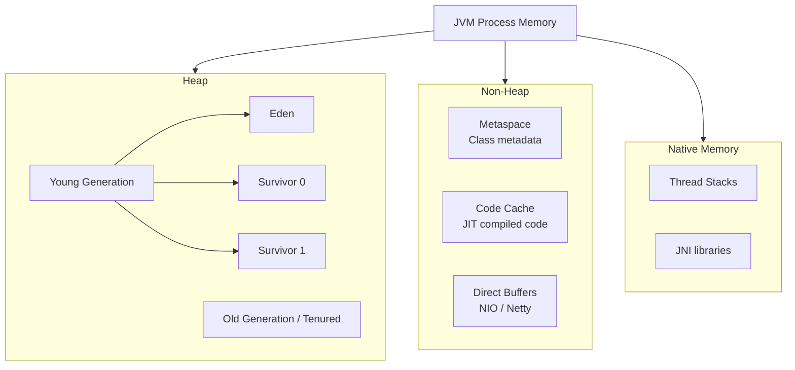
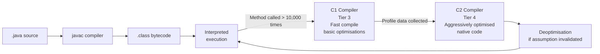

# JVM Internals — Memory Model, Class Loading, and JIT

> [!NOTE]
> Understanding JVM internals is prerequisite to meaningful performance engineering. Without a mental model of how Java allocates memory, compiles code, and manages threads, you are guessing at optimisations.

## The JVM Memory Model

The JVM partitions memory into distinct regions, each with different lifecycle and garbage collection behaviour.



### Heap Regions — Where Your Objects Live

**Eden Space** — New objects are allocated here. Fast bump-pointer allocation. Collected frequently (Minor GC).

**Survivor Spaces (S0/S1)** — Objects that survive Minor GC are moved here. Copied between S0 and S1 on each Minor GC. Objects are promoted to Old Generation after a configurable number of GC cycles (default: 15 for G1GC).

**Old Generation (Tenured)** — Long-lived objects. Collected less frequently (Major/Full GC). The primary source of GC pause latency in financial systems.

**Metaspace** — Class metadata (method descriptors, field metadata, bytecode). Unlike PermGen (removed in Java 8), Metaspace grows dynamically and is bounded by `-XX:MaxMetaspaceSize`. Class loader leaks cause Metaspace OOM.

---

## Object Allocation — What Happens When You Write `new`

```java
// This one line triggers several JVM mechanisms
PaymentEvent event = new PaymentEvent(txnId, amount, timestamp);
```

1. **TLAB allocation (Thread-Local Allocation Buffer)** — Each thread has a private chunk of Eden to allocate into without synchronisation. `new` does a simple pointer bump within the TLAB — essentially free.

2. **If TLAB is full** — Request a new TLAB from Eden. If Eden is full → trigger Minor GC.

3. **Large object handling** — Objects exceeding a threshold (`-XX:G1HeapRegionSize / 2`) are allocated directly into Old Generation, skipping Eden entirely. This is a performance trap for large `byte[]` buffers common in payment message parsing.

```java
// Performance trap: large message buffers go directly to Old Gen
// 50 KB SWIFT message → allocated directly in Old Gen → survives longer → GC pressure
byte[] swiftMessage = new byte[51_200];  // 50 KB — above G1 large object threshold (default ~1MB region/2)

// Better: pre-allocate a fixed buffer pool to avoid per-message allocation
// (Netty's ByteBuf pool does exactly this)
ByteBuf pooledBuf = allocator.buffer(51_200);  // from pool, not heap
try {
    // use buffer
} finally {
    pooledBuf.release();  // return to pool, not GC
}
```

---

## Garbage Collection — G1GC and ZGC

### G1GC — The Default for Financial Systems (Java 9+)

G1 (Garbage First) divides the heap into equal-sized **regions** (~1-32MB). It aims to meet a configurable pause time goal by collecting the regions with the most garbage first (hence "Garbage First").

```
Heap: 8GB, divided into 2048 regions of 4MB each
Regions labelled: Eden, Survivor, Old, Humongous (large objects)

G1 Minor GC: collect all Eden regions → ~5-50ms pause
G1 Mixed GC: collect Eden + some Old regions → ~10-100ms pause
G1 Full GC: collect everything → ~500ms-5s pause (avoid at all costs)
```

**Key tuning parameters:**
```
-XX:MaxGCPauseMillis=50          # G1 targets 50ms pauses (best effort)
-XX:G1HeapRegionSize=4m          # 4MB regions for 8GB heap
-XX:G1NewSizePercent=20          # Young gen minimum 20% of heap
-XX:G1MaxNewSizePercent=40       # Young gen maximum 40% of heap
-XX:InitiatingHeapOccupancyPercent=45  # Start concurrent marking at 45% full
```

### ZGC — Sub-Millisecond Pauses (Java 15+ Production Ready)

ZGC uses load barriers and concurrent compaction to achieve pause times under 1ms regardless of heap size. It is the right choice for latency-sensitive payment processors.

```
ZGC pause times: < 1ms (independent of heap size)
ZGC throughput: ~5-15% lower than G1GC (concurrent work has CPU cost)
ZGC heap overhead: ~10-20% more memory than G1GC

When to use ZGC:
✓ Payment authorisation latency SLO < 50ms P99
✓ Heap > 32GB (G1GC pause times grow with heap)
✓ You can tolerate slightly lower throughput for guaranteed low latency
```

---

## The JIT Compiler — How Java Gets Fast

Java is both interpreted (at startup) and compiled (at runtime). The JIT (Just-In-Time) compiler progressively optimises hot code paths.



### JIT Compilation Tiers

| Tier | Compilation | When | Use |
|---|---|---|---|
| 0 | Interpreted | Always | Startup |
| 1 | C1, no profiling | Rarely called | Utility code |
| 2 | C1, limited profiling | Occasionally called | Most code |
| 3 | C1, full profiling | Hot code | Profiling for C2 |
| 4 | C2, optimised | Very hot code | Payment critical path |

**JIT warmup** is a performance trap in financial systems. A payment processor that restarts under load will serve slow requests until JIT has re-compiled the hot paths. This takes 1-5 minutes at production traffic.

```java
// JVM flags to accelerate warmup for financial services
// -XX:CompileThreshold=1000       # Compile methods at 1,000 calls (default: 10,000)
// -XX:+TieredCompilation          # Enable all tiers (default: on Java 8+)
// -XX:+UseStringDeduplication     # Reduce heap for String-heavy workloads (SWIFT messages)

// Application-level warmup: pre-execute critical paths before serving traffic
@PostConstruct
public void warmUpCriticalPaths() {
    // Execute payment authorisation path with synthetic data
    // This triggers JIT compilation before real traffic arrives
    for (int i = 0; i < 15_000; i++) {
        try {
            paymentService.authorise(PaymentRequest.synthetic());
        } catch (Exception ignored) {
            // Expected — synthetic requests may fail validation
        }
    }
    log.info("JIT warmup complete — critical payment paths compiled");
}
```

---

## Class Loading — Memory Leaks from ClassLoader

Class loading is the mechanism by which JVM loads `.class` files into Metaspace. In applications that dynamically load classes (OSGi, plugin systems, hot-reload), ClassLoader leaks cause Metaspace OOM.

```java
// ClassLoader leak pattern (common in Spring Boot DevTools, OSGi, Groovy DSLs)
// Each new ClassLoader creates a new Class instance for every class it loads
// If the ClassLoader is not GC'd, all its loaded classes remain in Metaspace

// Example: Groovy script evaluation that leaks classloaders
GroovyShell shell = new GroovyShell();  // creates a new ClassLoader
Script script = shell.parse(ruleScript); // loads classes into new classloader
script.run();
// If 'shell' is never GC'd, all Groovy-generated classes remain in Metaspace
// In a rule engine evaluating 100 scripts/second: Metaspace fills in minutes

// Fix: use a shared script cache with explicit ClassLoader lifecycle management
@Component
public class GroovyRuleCache {
    private final LoadingCache<String, Script> cache = CacheBuilder.newBuilder()
        .maximumSize(500)
        .expireAfterAccess(1, TimeUnit.HOURS)
        .removalListener(notification -> {
            // When evicted, the ClassLoader becomes eligible for GC
        })
        .build(CacheLoader.from(this::compileScript));

    private Script compileScript(String source) {
        // Reuse the same GroovyShell to share the ClassLoader
        return sharedShell.parse(source);
    }
}
```

---

## Reading GC Logs — Diagnosing Production Issues

Enable GC logging in every financial service. It is the first tool for diagnosing latency spikes.

```bash
# Java 17 GC log flags
-Xlog:gc*:file=/var/log/app/gc.log:time,uptime,level,tags:filecount=10,filesize=50m
```

A healthy G1GC log looks like:
```
[2024-11-07T14:23:01.123+0000] GC(42) Pause Young (Normal) (G1 Evacuation Pause) 
  512M->128M(8192M) 18.432ms
```

A problematic log shows:
```
[2024-11-07T14:23:45.456+0000] GC(43) Pause Full (Ergonomics) 
  7680M->512M(8192M) 4823.167ms   ← 4.8 second Full GC → P1 incident
```

**Root causes of Full GC in financial systems:**

1. **Humongous allocation failure** — Large objects (payment message batches, report buffers) overwhelm G1
2. **Promotion failure** — Old generation fills before concurrent GC can reclaim it
3. **Metaspace exhaustion** — ClassLoader leak (Groovy, reflection, bytecode generation)
4. **Explicit System.gc()** — Called by libraries (use `-XX:+DisableExplicitGC`)

<!-- KNOWLEDGE-CHECK
{
  "questions": [
    {
      "id": "q1",
      "text": "Your payment service processes 500 TPS. After deploying a new version, you observe that P99 latency is 800ms for the first 3 minutes, then drops to normal 45ms. What is the most likely cause?",
      "options": [
        "The new version has a bug that takes 3 minutes to stabilise",
        "JIT compilation warmup — the payment critical path is being interpreted until JVM compiles it, then drops to compiled native performance",
        "The database connection pool takes 3 minutes to warm up",
        "The load balancer takes 3 minutes to route traffic evenly"
      ],
      "correct": 1,
      "explanation": "This is classic JIT warmup behaviour. The JVM interprets code at startup; after the payment path is called ~10,000 times (default compilation threshold), C2 compiles it to native code and latency drops dramatically. The fix is application-level warmup: execute synthetic requests before opening to live traffic."
    },
    {
      "id": "q2",
      "text": "You observe frequent Full GC pauses of 3-5 seconds in a Kafka consumer that processes SWIFT payment messages (each message ~200KB). What is the likely root cause?",
      "options": [
        "The Kafka consumer is not committing offsets frequently enough",
        "SWIFT message byte arrays (200KB) exceed the G1 humongous object threshold, causing direct Old Generation allocation, filling it faster than concurrent GC can reclaim it",
        "The GC pause goal is set too aggressively at -XX:MaxGCPauseMillis=10",
        "SWIFT messages contain Unicode characters that Java handles slowly"
      ],
      "correct": 1,
      "explanation": "200KB objects are humongous for a G1 heap with 4MB regions (threshold = region size / 2 = 2MB, but 200KB can still cause issues with many concurrent allocations). These go directly to Old Generation, bypassing young collection, and fill Old Gen faster. The fix: use a pooled ByteBuf (Netty), Byte Buffer pool (JDK), or increase G1 region size."
    },
    {
      "id": "q3",
      "text": "When should you choose ZGC over G1GC for a financial service?",
      "options": [
        "Always — ZGC is strictly better than G1GC",
        "When your P99 latency SLO is very tight (< 50ms) and you can accept 5-15% lower throughput for guaranteed sub-millisecond GC pauses",
        "When your heap is small (< 4GB) and you need fast startup",
        "When you are running on Windows Server"
      ],
      "correct": 1,
      "explanation": "ZGC trades throughput (~5-15% lower) for guaranteed sub-millisecond pauses. For a payment authorisation API with a 50ms P99 SLO, a 100ms G1 GC pause breaches the SLO — ZGC eliminates this. For a batch processing job with no latency SLO, G1GC's higher throughput is preferable. The choice depends on the latency profile of your SLO."
    },
    {
      "id": "q4",
      "text": "A Groovy-based business rules engine in a fraud detection service causes Metaspace OOM after 24 hours of operation. What is the most likely root cause?",
      "options": [
        "Groovy generates too much bytecode, filling up the heap",
        "Each rule evaluation creates a new GroovyShell (ClassLoader), loading classes into Metaspace; since the ClassLoaders are never freed, Metaspace fills up over time",
        "Metaspace needs to be increased with -XX:MaxMetaspaceSize",
        "Groovy is incompatible with modern JVM versions"
      ],
      "correct": 1,
      "explanation": "Groovy script evaluation through GroovyShell creates a new ClassLoader for each compilation. Each ClassLoader holds references to its compiled classes in Metaspace. If GroovyShell instances are not GC'd (or reused), all their classes accumulate. The fix is caching compiled scripts and reusing ClassLoaders, not just increasing Metaspace size."
    }
  ]
}
-->

<!-- PRACTICAL-CHALLENGE
{
  "title": "JVM Internals \u2014 Memory Model, Class Loading, and JIT \u2014 Production Implementation",
  "difficulty": "advanced",
  "estimatedMinutes": 90,
  "tasks": [
    {
      "id": "1",
      "description": "Diagnose the root cause"
    },
    {
      "id": "2",
      "description": "Analyse the GC log"
    },
    {
      "id": "3",
      "description": "Write the heap dump command"
    },
    {
      "id": "4",
      "description": "Propose three JVM flag changes"
    }
  ]
}
-->
