Garbage collection pauses are among the most insidious performance problems in JVM-based fintech applications. They are intermittent, they are invisible in APM dashboards unless you correlate carefully, and their root causes are buried in raw GC log output that most engineers never open. A single 400 ms stop-the-world pause during a payment authorization flow looks identical to a network timeout from the caller's perspective — but the fix is completely different. This lesson teaches you to read GC logs fluently, identify the pause causes that matter most in payment systems, and extract quantitative signal from raw log output before reaching for a tuning knob.

## Learning Objectives

By the end of this lesson you will be able to:

- Configure the JVM to emit structured GC logs using the Unified Logging (`-Xlog`) framework
- Parse a G1GC log entry and identify heap before/after, pause duration, and pause cause
- Classify pause causes (Allocation Failure, Metadata GC Threshold, Humongous Allocation, Ergonomics) and explain the remediation for each
- Use GCEasy or GCViewer to visualise pause frequency, throughput, and heap utilisation trends
- Identify a high-pause-frequency pattern (> 1 pause/sec) from raw log output
- Estimate the JVM's live set from GC log data and use it to right-size heap
- Correlate GC pause timestamps with p99 latency spikes from your APM or access logs
- Interpret `-XX:+PrintAdaptiveSizePolicy` output to understand how the JVM adjusts generation sizes

## Business Context

A European payment processor ran a Java 17 / G1GC order-matching service on 16 GB heap. During peak trading hours (09:00–10:30 CET) the platform's p99 order acknowledgement latency spiked from 4 ms to 380–520 ms every 90–120 seconds. The on-call team escalated to the database team, who found no slow queries. Network team found no packet loss. After two weeks of inconclusive investigation an SRE enabled GC logging and uploaded the log to GCEasy.

The analysis revealed:
- **Average GC pause: 310 ms** (G1 Mixed GC)
- **Pause frequency: 1.2 pauses/sec** during peak — 72 pauses per minute
- **Root cause: G1 Humongous Allocations** — the service was deserialising 32 MB FIX messages into `byte[]` arrays, each triggering a synchronous humongous region allocation
- **Resolution**: chunked streaming deserialisation reduced individual allocations below the 8 MB region threshold; p99 dropped to 6 ms within one deploy

The incident cost €240,000 in SLA breach penalties. GC logging was available the whole time — it just was not enabled.

## Enabling GC Logging

The JVM's Unified Logging framework (`-Xlog`, introduced JDK 9) replaces the patchwork of old `-XX:+PrintGCDetails`, `-XX:+PrintGCDateStamps` flags. A single flag expression covers everything you need in production:

```bash
# Production-safe GC logging — minimal overhead (~1% CPU)
-Xlog:gc*:file=/var/log/app/gc.log:time,uptime,level,tags:filecount=10,filesize=50m
```

| Component | Meaning |
|---|---|
| `gc*` | All GC-related log topics (gc, gc+heap, gc+phases, gc+age, gc+humongous, etc.) |
| `file=/var/log/app/gc.log` | Write to file (not stdout) to avoid interleaving with app logs |
| `time,uptime,level,tags` | Decorators: wall-clock time, JVM uptime, log level, topic tags |
| `filecount=10,filesize=50m` | Rotate: keep 10 files × 50 MB = 500 MB max on disk |

For more surgical detail during tuning (not production):

```bash
# Extended tuning flags — higher overhead, use in staging only
-Xlog:gc*,gc+heap=debug,gc+age=trace,gc+phases=debug:file=gc-detailed.log:time,uptime,level,tags
-XX:+PrintAdaptiveSizePolicy
-XX:+PrintTenuringDistribution
```

> [!NOTE]
> `-Xlog:gc*` with the decorators above adds less than 1% CPU overhead in production. The file rotation prevents unbounded disk consumption. There is no valid reason to run a production JVM without GC logging enabled.

## GC Log Anatomy — Reading a G1GC Entry

A G1GC Young Collection log entry looks like this:

```
[2026-11-08T09:14:33.221+0000][12.456s][info][gc] GC(42) Pause Young (Normal) (G1 Evacuation Pause) 2048M->1536M(8192M) 18.743ms
[2026-11-08T09:14:33.221+0000][12.456s][info][gc,cpu] GC(42) User=0.14s Sys=0.01s Real=0.019s
```

Annotated breakdown:

```
[2026-11-08T09:14:33.221+0000]  ← Wall-clock timestamp (ISO-8601)
[12.456s]                        ← JVM uptime at pause start
[info][gc]                       ← Log level and topic
GC(42)                           ← GC event sequence number
Pause Young (Normal)             ← Pause type and subtype
(G1 Evacuation Pause)            ← Pause CAUSE — most important field
2048M->1536M(8192M)              ← Heap before → after (heap capacity)
18.743ms                         ← Stop-the-world pause duration
```

A G1 Mixed GC (the expensive one that also collects old-gen regions):

```
[2026-11-08T09:16:45.332+0000][144.567s][info][gc] GC(97) Pause Mixed (G1 Evacuation Pause) 6144M->5888M(8192M) 287.441ms
[2026-11-08T09:16:45.332+0000][144.567s][info][gc,heap] GC(97) Eden regions: 512->0(512)
[2026-11-08T09:16:45.332+0000][144.567s][info][gc,heap] GC(97) Survivor regions: 32->24(64)
[2026-11-08T09:16:45.332+0000][144.567s][info][gc,heap] GC(97) Old regions: 1024->986(2048)
[2026-11-08T09:16:45.332+0000][144.567s][info][gc,heap] GC(97) Humongous regions: 48->48(48)
```

The 287 ms pause here is a warning sign: Mixed GC pauses above 200 ms in a payment system indicate either heap is too small or old-gen occupancy grows faster than G1 can reclaim.

## Pause Cause Taxonomy

Understanding *why* the GC paused is more important than knowing how long it paused.

| Pause Cause | What It Means | Typical Fix |
|---|---|---|
| **G1 Evacuation Pause** | Eden full — scheduled young collection | Usually benign; tune `-XX:MaxGCPauseMillis` |
| **Allocation Failure** | Eden full AND survivor/old cannot absorb survivors | Heap too small; increase `-Xmx` or reduce allocation rate |
| **G1 Humongous Allocation** | Object > 50% region size, cannot fit in Eden | Reduce object size or increase `-XX:G1HeapRegionSize` |
| **Metadata GC Threshold** | Metaspace full — class loading triggered GC | Set `-XX:MetaspaceSize` and `-XX:MaxMetaspaceSize` |
| **Ergonomics** | GC self-tunes based on `MaxGCPauseMillis` target | Expected; watch if it triggers too frequently |
| **G1 Compaction Pause** | Full GC fallback — G1 cannot reclaim enough space | Severe: heap too small or humongous leak |

```java17
// Detecting humongous allocation candidates — objects > half region size
// G1HeapRegionSize defaults: 1–32 MB based on heap size
// With 8 GB heap → 8 MB regions → humongous threshold = 4 MB

// PROBLEM: This allocates a humongous object per message
public FIXMessage parseMessage(byte[] rawPayload) {
    // rawPayload may be 5–40 MB — lands in humongous region, triggers GC
    return FIXMessageParser.parse(rawPayload);
}

// SOLUTION: Stream-parse, never materialise the full payload
public void parseMessageStreaming(InputStream rawStream,
                                   FIXMessageHandler handler) throws IOException {
    // Parse in chunks of ≤ 1 MB — fits in Eden, GC-friendly
    FIXStreamParser.parseChunked(rawStream, 1 << 20, handler);
}
```

## GCEasy and GCViewer Analysis

GCEasy (gc-easy.io) and GCViewer are the standard tools for visualising GC log data. Upload the log file and they produce:

- **GC pause duration histogram** — identify p99 pause
- **Pause frequency over time** — identify periodic patterns
- **Heap utilisation chart** — see if heap is growing (leak) or stable (bounded)
- **GC throughput** — percentage of time NOT in GC (target > 95%)
- **Live set estimate** — heap size after full GC = live set

> [!IMPORTANT]
> **GC throughput < 95%** means your application is spending more than 5% of CPU time doing garbage collection. For a payment processing service this is unacceptable — it means every 20 ms of work is accompanied by 1 ms of GC overhead at minimum. At throughput < 90%, the service is in GC crisis.

Key GCEasy metrics to check immediately:

```
GC Throughput:        98.3%     ← GOOD (target > 95%)
Avg GC Pause:         22 ms     ← ACCEPTABLE for G1
Max GC Pause:         310 ms    ← INVESTIGATE
GC Pause Frequency:   0.18/sec  ← GOOD (target < 1/sec)
Heap After Full GC:   3.2 GB    ← Live set = 3.2 GB
```

## Pause Frequency — The 1-per-Second Rule

For a low-latency payment service, **more than one GC pause per second is a problem**. At that frequency, virtually every request will be affected by at least one pause.

```mermaid
gantt
    title GC Pause Frequency Timeline — Peak Hour Analysis
    dateFormat  HH:mm:ss
    axisFormat  %H:%M:%S
    section 09:00–09:05 (Healthy)
    Young GC 18ms   : done, 09:00:12, 1s
    Young GC 21ms   : done, 09:01:45, 1s
    Young GC 19ms   : done, 09:03:08, 1s
    section 09:05–09:10 (Degraded)
    Young GC 25ms   : active, 09:05:00, 1s
    Young GC 29ms   : active, 09:05:08, 1s
    Young GC 31ms   : active, 09:05:15, 1s
    Young GC 28ms   : active, 09:05:22, 1s
    Mixed GC 287ms  : crit, 09:06:14, 3s
    section 09:10–09:15 (Critical — > 1/sec)
    Young GC 35ms   : crit, 09:10:00, 1s
    Humongous 44ms  : crit, 09:10:00, 1s
    Young GC 38ms   : crit, 09:10:01, 1s
    Alloc Fail 412ms: crit, 09:10:02, 5s
```



To count pauses per second from a raw GC log using shell tools:

```bash
# Count pauses per second (Unix shell)
grep "Pause" gc.log \
  | awk '{print $1}' \
  | sed 's/\[//;s/\..*//' \
  | sort | uniq -c \
  | awk '$1 > 1 {print "HIGH FREQUENCY at " $2 ": " $1 " pauses/sec"}'

# Extract all pause durations for statistical analysis
grep "Pause" gc.log \
  | grep -oP '\d+\.\d+ms' \
  | sed 's/ms//' \
  | awk '{ sum+=$1; count++; if($1>max) max=$1 }
         END { printf "Count: %d, Avg: %.1fms, Max: %.1fms\n", count, sum/count, max }'
```

## Live Set Estimation from GC Logs

The **live set** is the minimum amount of heap the application actually needs. It equals the heap occupancy immediately after a full GC or a successful G1 Remark phase.

```
# Live set = heap size after old-gen collection stabilises
# Look for the minimum "after" value across all GC events:

[09:00:15.332][gc] GC(102) Pause Young (Normal) 4096M->3812M(8192M) 22ms
                                                        ^^^^
                                               Heap after = 3,812 MB

# Track the "after" trendline over 30 minutes:
# Flat line = live set is bounded = no memory leak
# Rising line = live set grows = memory leak

# After Full GC specifically gives clearest live set signal:
[09:12:44.001][gc] GC(201) Pause Full (Allocation Failure) 8190M->3201M(8192M) 4432ms
                                                                   ^^^^
                                                 Live set ≈ 3.2 GB
```

> [!TIP]
> Heap sizing rule of thumb for G1GC: set `-Xmx` to **live set × 2.5** at minimum. With a 3.2 GB live set, use at least 8 GB heap. Under-sizing forces G1 to run Mixed GC too aggressively, increasing pause frequency and duration.

## Correlating GC Pauses with p99 Latency

GC pause timestamps let you cross-reference against your APM (Datadog, Grafana, etc.) to confirm that GC is the cause of latency spikes — not network, not DB:

```java17
// GC notification listener — record pause start/end for correlation
import com.sun.management.GarbageCollectionNotificationInfo;

public class GCPauseMetrics {

    public static void install(MeterRegistry registry) {
        for (GarbageCollectorMXBean bean :
                ManagementFactory.getGarbageCollectorMXBeans()) {

            if (!(bean instanceof NotificationEmitter emitter)) continue;

            emitter.addNotificationListener((notification, handback) -> {
                if (!notification.getType().equals(
                        GarbageCollectionNotificationInfo.GARBAGE_COLLECTION_NOTIFICATION))
                    return;

                var info = GarbageCollectionNotificationInfo
                    .from((CompositeData) notification.getUserData());
                var gcInfo = info.getGcInfo();

                long durationMs = gcInfo.getDuration();
                String cause    = info.getGcCause();
                String action   = info.getGcAction();

                // Emit to Micrometer — shows up in Grafana alongside p99
                registry.timer("jvm.gc.pause",
                    "cause",  cause,
                    "action", action)
                    .record(durationMs, TimeUnit.MILLISECONDS);

                if (durationMs > 100) {
                    log.warn("GC pause {}ms — cause={} action={}", durationMs, cause, action);
                }
            }, null, null);
        }
    }
}
```

```yaml
# Grafana panel: overlay GC pauses on p99 latency
# Alert: p99 spike AND GC pause within same 5s window → GC root cause confirmed
panels:
  - title: "p99 Latency + GC Pauses"
    targets:
      - expr: histogram_quantile(0.99, rate(http_server_requests_seconds_bucket[1m]))
        legendFormat: "p99 latency"
      - expr: rate(jvm_gc_pause_seconds_sum[1m])
        legendFormat: "GC pause rate"
```

## PrintAdaptiveSizePolicy for Tuning Guidance

`-XX:+PrintAdaptiveSizePolicy` (or `-Xlog:gc+ergo=debug` in Unified Logging) shows the JVM's internal reasoning about generation sizing:

```
[gc+ergo] GC(42) Heap expansion:
  capacity: 4096M → 5120M
  reason: allocation rate 850 MB/s exceeds GC throughput
  eden new size: 1024M → 1280M

[gc+ergo] GC(97) Pauses are too long (287ms > MaxGCPauseMillis 200ms)
  Reducing CSet size from 24 regions to 16 regions
  Next mixed GC will be less ambitious
```

This tells you:
- Heap is expanding under load — size it larger upfront with `-XX:+AlwaysPreTouch`
- Pauses exceed `MaxGCPauseMillis` — G1 is backing off, which means reclamation will fall behind
- The JVM is trying to self-tune but failing — manual tuning is needed

## GC Log Rotation and Operational Practice

```bash
# Full JVM startup flags for a payment service (Java 17, G1GC)
java \
  -Xms8g -Xmx8g \
  -XX:+UseG1GC \
  -XX:MaxGCPauseMillis=200 \
  -XX:G1HeapRegionSize=8m \
  -XX:+AlwaysPreTouch \
  -Xlog:gc*,gc+heap=debug,gc+ergo=debug:file=/var/log/app/gc-%t.log:time,uptime,level,tags:filecount=10,filesize=50m \
  -XX:+HeapDumpOnOutOfMemoryError \
  -XX:HeapDumpPath=/var/log/app/heap-dump.hprof \
  -jar payment-service.jar
```

> [!WARNING]
> Do not log to stdout (`-Xlog:gc*::stdout`). Stdout is typically consumed by a Docker/systemd log driver that buffers writes and can introduce latency or drop messages under I/O pressure. Write GC logs to a dedicated file on a volume that is not on the application's critical I/O path.

---

<!-- KNOWLEDGE-CHECK [
  {
    "id": "kc-gc02-01",
    "question": "A GC log line shows: `Pause Young (Normal) (G1 Humongous Allocation) 4096M->3840M(8192M) 44ms`. What does this tell you and what is the most likely fix?",
    "options": [
      "The JVM paused because Eden was full during a normal young collection; fix by increasing Eden size",
      "The JVM paused to allocate an object larger than 50% of the G1 region size; fix by reducing object sizes or increasing the region size",
      "The JVM is running low on Metaspace; fix by increasing -XX:MaxMetaspaceSize",
      "The JVM triggered a full GC because heap is exhausted; fix by increasing -Xmx"
    ],
    "correct": 1,
    "explanation": "G1 Humongous Allocation means an object exceeded 50% of the G1 region size and had to be allocated directly into the old generation in humongous regions, bypassing Eden entirely. This is synchronous and stops the world. The fix is either to reduce the object size below the humongous threshold (e.g., stream-parse large payloads instead of materialising them) or to increase -XX:G1HeapRegionSize (e.g., to 16 MB so the threshold becomes 8 MB)."
  },
  {
    "id": "kc-gc02-02",
    "question": "You observe 1.8 GC pauses per second during peak hours. The pauses are only 20–25ms each, so an engineer argues there is no problem. What is the correct response?",
    "options": [
      "Agree — 20ms pauses are acceptable for a payment service",
      "Disagree — 1.8 pauses/sec means virtually every request lasting more than 500ms will be affected by at least one pause; the allocation rate is too high",
      "Agree — only Mixed GC pauses above 200ms are worth investigating",
      "Disagree — but only because the pauses should be correlated with Metaspace usage first"
    ],
    "correct": 1,
    "explanation": "Pause duration and pause frequency are independent problems. At 1.8 pauses/sec, any request with p99 latency above ~600ms will statistically encounter at least one pause. More importantly, high pause frequency indicates an unsustainable allocation rate — the application is creating garbage faster than G1 can comfortably collect it. This is a warning that Mixed GC pauses will worsen as the old generation fills. The allocation rate must be reduced."
  }
] -->

---

<!-- PRACTICAL-CHALLENGE {
  "id": "pc-gc-analysis",
  "title": "GC Log Analysis: Diagnose a Latency Incident",
  "description": "Given a 30-minute GC log from a payment service experiencing p99 latency spikes, perform a full root-cause analysis.",
  "tasks": [
    {
      "id": "pc-gca-01",
      "description": "Write the exact JVM flag string to enable GC logging with file rotation (10 files × 50 MB) capturing all gc topics plus gc+ergo=debug, with time, uptime, level, and tags decorators. The log file should be at /var/log/app/gc.log."
    },
    {
      "id": "pc-gca-02",
      "description": "Parse the following GC log snippet and extract: (a) pause cause, (b) heap before/after/capacity, (c) pause duration, (d) whether this indicates a problem. Snippet: `[2026-11-08T10:15:22.441+0000][3722.1s][info][gc] GC(1204) Pause Mixed (G1 Evacuation Pause) 7936M->7680M(8192M) 341.2ms`"
    },
    {
      "id": "pc-gca-03",
      "description": "Implement a GCPauseAlertListener class that registers a NotificationListener on all GarbageCollectorMXBeans. It should emit a Micrometer counter `gc.pause.alert` with tag `severity=critical` when any single pause exceeds 200ms, and log a warning including the GC cause, action, and duration."
    },
    {
      "id": "pc-gca-04",
      "description": "A GCEasy report shows: GC Throughput 91%, Average Pause 55ms, Max Pause 620ms, Heap After Full GC 5.1 GB, current -Xmx 6 GB. Write your diagnosis (which metric is most alarming and why) and your recommended JVM flag changes with justification."
    }
  ]
} -->
