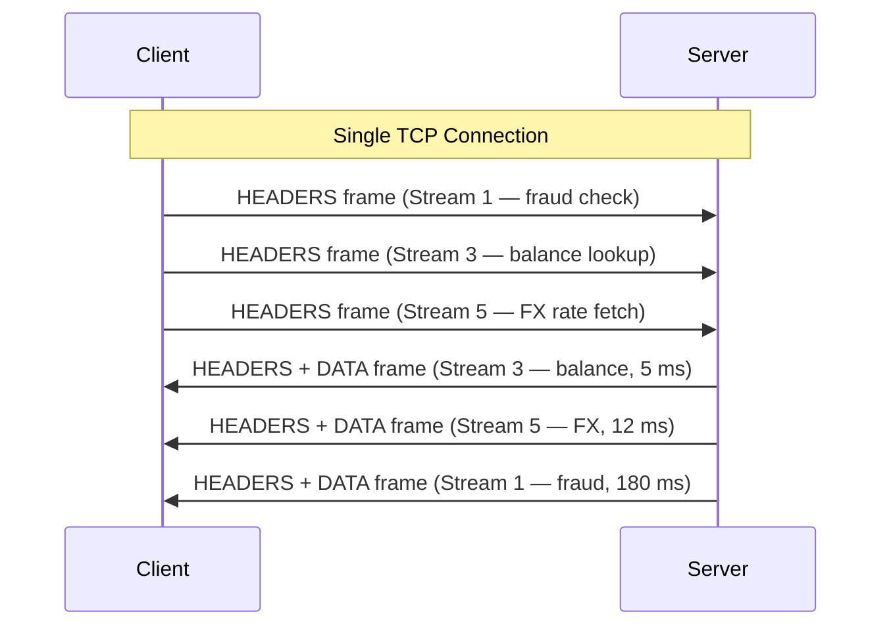

# HTTP/2 and gRPC Performance — Connection Multiplexing

Modern fintech systems move enormous volumes of small messages between microservices: payment authorisations, fraud signals, balance inquiries, settlement confirmations. HTTP/1.1 was not designed for this workload. HTTP/2, and gRPC sitting on top of it, fundamentally change the performance profile of service-to-service communication. This lesson examines the protocol mechanics, the Java integration path, and the production trade-offs you must understand before rolling gRPC into a payment platform.

---

## 1. HTTP/1.1 Limitations

Before understanding HTTP/2 gains, you must internalise what HTTP/1.1 costs you.

### 1.1 Head-of-Line Blocking

HTTP/1.1 is a request-response protocol over a single ordered TCP stream. If a slow response (say, a fraud-score lookup) occupies the connection, every subsequent request behind it must wait. Browsers work around this by opening six connections per origin. Services do the same with connection pools, but that just multiplies TCP overhead.

```
HTTP/1.1 timeline on a single connection:

Client          Server
  |--[REQ A]-->  |
  |              |  (Server processing A — 200 ms)
  |--[REQ B]-->  |   <--- queued, cannot proceed
  |              |
  |<--[RES A]--  |
  |<--[RES B]--  |
```

Each additional concurrent request requires a separate TCP connection (3-way handshake, slow-start, TLS handshake). For a payment gateway making 20 downstream calls per transaction, this is catastrophic.

### 1.2 Verbose Headers

HTTP/1.1 sends headers as plain text on every request. A typical Authorization header alone can be 500 bytes. At 50,000 requests per second, that is 25 MB/s of pure overhead just for a JWT you have already seen a thousand times.

### 1.3 No Server Push

The server cannot proactively send data the client will predictably need. Every interaction is strictly client-initiated.

---

## 2. HTTP/2 Mechanics

HTTP/2 solves all three problems with a binary framing layer over the same TCP connection.

### 2.1 Multiplexed Streams

HTTP/2 introduces the concept of a **stream**: a bidirectional sequence of frames within a single TCP connection. Multiple streams are interleaved at the frame level.



Streams are independent. A slow stream (Stream 1) does not block fast streams (Streams 3 and 5). This eliminates HTTP/1.1 head-of-line blocking at the application layer.

**Note on TCP-level HOL:** TCP itself is an ordered byte stream, so a lost packet still blocks all HTTP/2 streams until retransmission. HTTP/3 (QUIC) solves this at the transport layer, but HTTP/2 is sufficient for intra-datacenter communication where packet loss is rare.

### 2.2 HPACK Header Compression

HPACK maintains a dynamic table of previously seen header name-value pairs on both sides. Subsequent requests reference table entries by index (1-2 bytes) rather than repeating the full string.

```
Request 1: Authorization: Bearer eyJhbGc...  → 512 bytes
Request 2: Authorization: Bearer eyJhbGc...  → 2 bytes (index reference)
           Content-Type: application/grpc    → 2 bytes (index reference)
```

In a payment service making thousands of calls per second to the same downstream, HPACK compression reduces header overhead by 85-95%.

### 2.3 HTTP/2 Flow Control

Each stream and the overall connection has a receive window (default 65535 bytes). Senders must not exceed the window. Receivers issue WINDOW_UPDATE frames to increase capacity. This prevents a fast producer from overwhelming a slow consumer — the same concept as TCP flow control but at the HTTP layer.

---

## 3. gRPC Architecture

gRPC is a high-performance RPC framework from Google that uses HTTP/2 as its transport and Protocol Buffers (protobuf) as its default serialisation format.

### 3.1 Communication Patterns

gRPC supports four communication patterns:

| Pattern | Description | Fintech Use Case |
|---|---|---|
| Unary | One request, one response | Payment authorisation |
| Server Streaming | One request, stream of responses | Real-time fraud alerts |
| Client Streaming | Stream of requests, one response | Batch settlement upload |
| Bidirectional Streaming | Full-duplex stream | Live order book feed |

### 3.2 Protocol Buffer Serialisation

Protobuf is a language-neutral binary serialisation format. Compared to JSON:

- **Size:** Protobuf messages are typically 3-10x smaller. A payment message with 15 fields: JSON ~450 bytes, Protobuf ~90 bytes.
- **Speed:** Protobuf parse/serialise is 5-10x faster than JSON. No string parsing, no field name lookup.
- **Schema enforcement:** The `.proto` file is the contract. Breaking changes are detected at compile time.

**Benchmark (1 million payment message encode/decode cycles, Java):**

```
JSON (Jackson):
  Serialise:   1,240 ms  (1.24 µs/msg)
  Deserialise: 1,890 ms  (1.89 µs/msg)
  Average message size: 423 bytes

Protobuf 3:
  Serialise:    190 ms  (0.19 µs/msg)  → 6.5x faster
  Deserialise:  210 ms  (0.21 µs/msg)  → 9.0x faster
  Average message size:  87 bytes      → 4.9x smaller
```

---

## 4. Defining the Payment Service Proto

Create `src/main/proto/payment/v1/payment_service.proto`:

```protobuf
syntax = "proto3";

package payment.v1;

option java_package = "com.fintech.payment.grpc";
option java_outer_classname = "PaymentServiceProto";
option java_multiple_files = true;

import "google/protobuf/timestamp.proto";

// ---- Messages ----

message PaymentRequest {
  string payment_id       = 1;
  string source_account   = 2;
  string target_account   = 3;
  int64  amount_cents      = 4;   // avoid floating point
  string currency          = 5;   // ISO 4217
  string idempotency_key   = 6;
  map<string, string> metadata = 7;
}

message PaymentResponse {
  string payment_id    = 1;
  PaymentStatus status = 2;
  string auth_code     = 3;
  google.protobuf.Timestamp processed_at = 4;
  string failure_reason = 5;
}

enum PaymentStatus {
  PAYMENT_STATUS_UNSPECIFIED = 0;
  PAYMENT_STATUS_APPROVED    = 1;
  PAYMENT_STATUS_DECLINED    = 2;
  PAYMENT_STATUS_PENDING     = 3;
}

message StreamPaymentRequest {
  string account_id = 1;
  google.protobuf.Timestamp since = 2;
}

message PaymentEvent {
  string payment_id    = 1;
  PaymentStatus status = 2;
  int64  amount_cents   = 3;
  google.protobuf.Timestamp event_time = 4;
}

// ---- Service ----

service PaymentService {
  // Unary: authorise a single payment
  rpc AuthorisePayment(PaymentRequest) returns (PaymentResponse);

  // Server streaming: stream payment events for an account
  rpc StreamAccountPayments(StreamPaymentRequest) returns (stream PaymentEvent);

  // Client streaming: upload a batch of payments, receive summary
  rpc UploadBatch(stream PaymentRequest) returns (BatchSummary);

  // Bidirectional: live payment feed with acknowledgements
  rpc PaymentFeed(stream PaymentRequest) returns (stream PaymentResponse);
}

message BatchSummary {
  int32 total_received = 1;
  int32 approved       = 2;
  int32 declined       = 3;
  int64 total_amount_cents = 4;
}
```

---

## 5. Spring Boot gRPC Setup

### 5.1 Dependencies (Maven)

```xml
<dependencies>
    <!-- gRPC Spring Boot Starter -->
    <dependency>
        <groupId>net.devh</groupId>
        <artifactId>grpc-spring-boot-starter</artifactId>
        <version>2.15.0.RELEASE</version>
    </dependency>

    <!-- Protobuf runtime -->
    <dependency>
        <groupId>com.google.protobuf</groupId>
        <artifactId>protobuf-java</artifactId>
        <version>3.25.3</version>
    </dependency>

    <!-- gRPC stubs -->
    <dependency>
        <groupId>io.grpc</groupId>
        <artifactId>grpc-stub</artifactId>
        <version>1.63.0</version>
    </dependency>
    <dependency>
        <groupId>io.grpc</groupId>
        <artifactId>grpc-protobuf</artifactId>
        <version>1.63.0</version>
    </dependency>
</dependencies>

<build>
    <extensions>
        <extension>
            <groupId>kr.motd.maven</groupId>
            <artifactId>os-maven-plugin</artifactId>
            <version>1.7.1</version>
        </extension>
    </extensions>
    <plugins>
        <plugin>
            <groupId>org.xolstice.maven.plugins</groupId>
            <artifactId>protobuf-maven-plugin</artifactId>
            <version>0.6.1</version>
            <configuration>
                <protocArtifact>com.google.protobuf:protoc:3.25.3:exe:${os.detected.classifier}</protocArtifact>
                <pluginId>grpc-java</pluginId>
                <pluginArtifact>io.grpc:protoc-gen-grpc-java:1.63.0:exe:${os.detected.classifier}</pluginArtifact>
            </configuration>
            <executions>
                <execution>
                    <goals>
                        <goal>compile</goal>
                        <goal>compile-custom</goal>
                    </goals>
                </execution>
            </executions>
        </plugin>
    </plugins>
</build>
```

### 5.2 Server Configuration

```yaml
# application.yml
grpc:
  server:
    port: 9090
    max-inbound-message-size: 10MB
    max-inbound-metadata-size: 8KB
    keep-alive-time: 30s
    keep-alive-timeout: 10s
    permit-keep-alive-without-calls: true
```

### 5.3 Server Implementation

```java
package com.fintech.payment.grpc;

import com.fintech.payment.grpc.PaymentServiceGrpc.PaymentServiceImplBase;
import io.grpc.Status;
import io.grpc.StatusRuntimeException;
import io.grpc.stub.StreamObserver;
import net.devh.boot.grpc.server.service.GrpcService;
import org.slf4j.Logger;
import org.slf4j.LoggerFactory;
import org.springframework.beans.factory.annotation.Autowired;

import java.time.Instant;

@GrpcService
public class PaymentGrpcService extends PaymentServiceImplBase {

    private static final Logger log = LoggerFactory.getLogger(PaymentGrpcService.class);

    private final PaymentProcessor paymentProcessor;
    private final PaymentEventRepository eventRepository;

    @Autowired
    public PaymentGrpcService(PaymentProcessor paymentProcessor,
                              PaymentEventRepository eventRepository) {
        this.paymentProcessor = paymentProcessor;
        this.eventRepository = eventRepository;
    }

    @Override
    public void authorisePayment(PaymentRequest request,
                                  StreamObserver<PaymentResponse> responseObserver) {
        try {
            // Input validation
            validatePaymentRequest(request);

            // Process payment
            PaymentResult result = paymentProcessor.authorise(
                request.getPaymentId(),
                request.getSourceAccount(),
                request.getTargetAccount(),
                request.getAmountCents(),
                request.getCurrency(),
                request.getIdempotencyKey()
            );

            PaymentResponse response = PaymentResponse.newBuilder()
                .setPaymentId(result.paymentId())
                .setStatus(result.approved()
                    ? PaymentStatus.PAYMENT_STATUS_APPROVED
                    : PaymentStatus.PAYMENT_STATUS_DECLINED)
                .setAuthCode(result.authCode())
                .setProcessedAt(toProtoTimestamp(result.processedAt()))
                .build();

            responseObserver.onNext(response);
            responseObserver.onCompleted();

        } catch (ValidationException e) {
            responseObserver.onError(
                Status.INVALID_ARGUMENT
                    .withDescription(e.getMessage())
                    .asRuntimeException()
            );
        } catch (InsufficientFundsException e) {
            responseObserver.onError(
                Status.FAILED_PRECONDITION
                    .withDescription("Insufficient funds")
                    .asRuntimeException()
            );
        } catch (Exception e) {
            log.error("Unexpected error processing payment {}", request.getPaymentId(), e);
            responseObserver.onError(
                Status.INTERNAL
                    .withDescription("Payment processing failed")
                    .asRuntimeException()
            );
        }
    }

    @Override
    public void streamAccountPayments(StreamPaymentRequest request,
                                       StreamObserver<PaymentEvent> responseObserver) {
        String accountId = request.getAccountId();
        Instant since = toInstant(request.getSince());

        // Stream events — each onNext() sends one HTTP/2 DATA frame
        try (var eventStream = eventRepository.streamByAccount(accountId, since)) {
            eventStream.forEach(event -> {
                // Check if the client has cancelled (deadline exceeded, etc.)
                // gRPC will throw StatusRuntimeException if the call is already done
                PaymentEvent protoEvent = PaymentEvent.newBuilder()
                    .setPaymentId(event.paymentId())
                    .setStatus(toProtoStatus(event.status()))
                    .setAmountCents(event.amountCents())
                    .setEventTime(toProtoTimestamp(event.eventTime()))
                    .build();
                responseObserver.onNext(protoEvent);
            });
            responseObserver.onCompleted();
        } catch (StatusRuntimeException e) {
            // Client cancelled — this is normal, do not log as error
            log.debug("Client cancelled stream for account {}", accountId);
        } catch (Exception e) {
            log.error("Stream error for account {}", accountId, e);
            responseObserver.onError(
                Status.INTERNAL.withDescription("Stream interrupted").asRuntimeException()
            );
        }
    }

    @Override
    public StreamObserver<PaymentRequest> uploadBatch(
            StreamObserver<BatchSummary> responseObserver) {

        return new StreamObserver<>() {
            private int totalReceived = 0;
            private int approved = 0;
            private int declined = 0;
            private long totalAmountCents = 0;

            @Override
            public void onNext(PaymentRequest request) {
                totalReceived++;
                totalAmountCents += request.getAmountCents();
                try {
                    PaymentResult result = paymentProcessor.authorise(
                        request.getPaymentId(),
                        request.getSourceAccount(),
                        request.getTargetAccount(),
                        request.getAmountCents(),
                        request.getCurrency(),
                        request.getIdempotencyKey()
                    );
                    if (result.approved()) approved++; else declined++;
                } catch (Exception e) {
                    declined++;
                    log.warn("Batch payment {} failed: {}", request.getPaymentId(), e.getMessage());
                }
            }

            @Override
            public void onError(Throwable t) {
                log.error("Client stream error during batch upload", t);
            }

            @Override
            public void onCompleted() {
                responseObserver.onNext(
                    BatchSummary.newBuilder()
                        .setTotalReceived(totalReceived)
                        .setApproved(approved)
                        .setDeclined(declined)
                        .setTotalAmountCents(totalAmountCents)
                        .build()
                );
                responseObserver.onCompleted();
            }
        };
    }

    private void validatePaymentRequest(PaymentRequest request) {
        if (request.getPaymentId().isBlank()) {
            throw new ValidationException("payment_id is required");
        }
        if (request.getAmountCents() <= 0) {
            throw new ValidationException("amount_cents must be positive");
        }
        if (request.getCurrency().length() != 3) {
            throw new ValidationException("currency must be ISO 4217 (3 chars)");
        }
    }

    // helper methods omitted for brevity
    private com.google.protobuf.Timestamp toProtoTimestamp(Instant instant) {
        return com.google.protobuf.Timestamp.newBuilder()
            .setSeconds(instant.getEpochSecond())
            .setNanos(instant.getNano())
            .build();
    }

    private Instant toInstant(com.google.protobuf.Timestamp ts) {
        return Instant.ofEpochSecond(ts.getSeconds(), ts.getNanos());
    }

    private PaymentStatus toProtoStatus(String status) {
        return switch (status) {
            case "APPROVED" -> PaymentStatus.PAYMENT_STATUS_APPROVED;
            case "DECLINED" -> PaymentStatus.PAYMENT_STATUS_DECLINED;
            default          -> PaymentStatus.PAYMENT_STATUS_PENDING;
        };
    }
}
```

---

## 6. gRPC Interceptors

Interceptors are the gRPC equivalent of servlet filters. They execute before and after each RPC call.

### 6.1 Authentication Interceptor

```java
package com.fintech.payment.grpc.interceptor;

import io.grpc.*;
import net.devh.boot.grpc.server.interceptor.GrpcGlobalServerInterceptor;
import org.springframework.beans.factory.annotation.Autowired;

@GrpcGlobalServerInterceptor
public class AuthenticationInterceptor implements ServerInterceptor {

    // Metadata key for the JWT token
    public static final Metadata.Key<String> AUTHORIZATION_KEY =
        Metadata.Key.of("authorization", Metadata.ASCII_STRING_MARSHALLER);

    // Context key to pass the authenticated principal downstream
    public static final Context.Key<AuthPrincipal> AUTH_PRINCIPAL =
        Context.key("authPrincipal");

    @Autowired
    private JwtValidator jwtValidator;

    @Override
    public <ReqT, RespT> ServerCall.Listener<ReqT> interceptCall(
            ServerCall<ReqT, RespT> call,
            Metadata headers,
            ServerCallHandler<ReqT, RespT> next) {

        String authHeader = headers.get(AUTHORIZATION_KEY);

        if (authHeader == null || !authHeader.startsWith("Bearer ")) {
            call.close(
                Status.UNAUTHENTICATED.withDescription("Missing Authorization header"),
                new Metadata()
            );
            return new ServerCall.Listener<>() {};
        }

        String token = authHeader.substring(7);
        try {
            AuthPrincipal principal = jwtValidator.validate(token);
            Context ctx = Context.current().withValue(AUTH_PRINCIPAL, principal);
            return Contexts.interceptCall(ctx, call, headers, next);
        } catch (TokenExpiredException e) {
            call.close(
                Status.UNAUTHENTICATED.withDescription("Token expired"),
                new Metadata()
            );
            return new ServerCall.Listener<>() {};
        } catch (InvalidTokenException e) {
            call.close(
                Status.UNAUTHENTICATED.withDescription("Invalid token"),
                new Metadata()
            );
            return new ServerCall.Listener<>() {};
        }
    }
}
```

### 6.2 Tracing Interceptor

```java
@GrpcGlobalServerInterceptor
public class TracingInterceptor implements ServerInterceptor {

    public static final Metadata.Key<String> TRACE_ID_KEY =
        Metadata.Key.of("x-trace-id", Metadata.ASCII_STRING_MARSHALLER);

    @Override
    public <ReqT, RespT> ServerCall.Listener<ReqT> interceptCall(
            ServerCall<ReqT, RespT> call,
            Metadata headers,
            ServerCallHandler<ReqT, RespT> next) {

        String traceId = Optional.ofNullable(headers.get(TRACE_ID_KEY))
            .orElse(UUID.randomUUID().toString());

        // Inject into MDC for log correlation
        MDC.put("traceId", traceId);

        // Propagate trace ID in response headers
        Metadata responseHeaders = new Metadata();
        responseHeaders.put(TRACE_ID_KEY, traceId);
        call.sendHeaders(responseHeaders);

        try {
            return next.startCall(call, headers);
        } finally {
            MDC.remove("traceId");
        }
    }
}
```

---

## 7. gRPC Channel and Connection Pooling

A gRPC `ManagedChannel` already multiplexes streams over a single HTTP/2 connection. However, for extremely high throughput you may need multiple underlying connections.

```java
package com.fintech.payment.grpc.client;

import io.grpc.ManagedChannel;
import io.grpc.ManagedChannelBuilder;
import net.devh.boot.grpc.client.channelfactory.GrpcChannelFactory;
import org.springframework.context.annotation.Bean;
import org.springframework.context.annotation.Configuration;

import java.util.concurrent.TimeUnit;

@Configuration
public class GrpcClientConfiguration {

    @Bean
    public ManagedChannel fraudServiceChannel() {
        return ManagedChannelBuilder
            .forAddress("fraud-service.internal", 9090)
            // TLS in production — use .useTransportSecurity() with proper certs
            .useTransportSecurity()
            // HTTP/2 keep-alive: send PING frame every 30s to keep the connection alive
            .keepAliveTime(30, TimeUnit.SECONDS)
            .keepAliveTimeout(10, TimeUnit.SECONDS)
            .keepAliveWithoutCalls(true)
            // Max message size
            .maxInboundMessageSize(10 * 1024 * 1024)
            // Connection pool: use multiple sub-channels for very high throughput
            // Each sub-channel is one HTTP/2 connection
            // Default is 1; increase only if single connection CPU is saturated
            .build();
    }

    @Bean(destroyMethod = "shutdown")
    public PaymentServiceGrpc.PaymentServiceBlockingStub paymentServiceBlockingStub(
            ManagedChannel fraudServiceChannel) {
        return PaymentServiceGrpc.newBlockingStub(fraudServiceChannel)
            // Default deadline for all calls from this stub
            .withDeadlineAfter(5, TimeUnit.SECONDS);
    }

    @Bean(destroyMethod = "shutdown")
    public PaymentServiceGrpc.PaymentServiceStub paymentServiceAsyncStub(
            ManagedChannel fraudServiceChannel) {
        return PaymentServiceGrpc.newStub(fraudServiceChannel);
    }
}
```

---

## 8. Deadlines and Cancellation Propagation

Deadlines in gRPC are propagated end-to-end. If the upstream client sets a 5-second deadline, all downstream RPC calls inherit the remaining budget.

```java
@Service
public class PaymentOrchestrator {

    private final FraudServiceGrpc.FraudServiceBlockingStub fraudStub;
    private final LedgerServiceGrpc.LedgerServiceBlockingStub ledgerStub;

    public PaymentResult process(PaymentRequest request) {
        // The deadline is set on the stub — it propagates to all downstream calls
        // automatically if you use the same context.
        // Here we set a per-call deadline explicitly.

        try {
            FraudCheckResponse fraud = fraudStub
                .withDeadlineAfter(1500, TimeUnit.MILLISECONDS)
                .checkFraud(FraudCheckRequest.newBuilder()
                    .setPaymentId(request.getPaymentId())
                    .setAmountCents(request.getAmountCents())
                    .build());

            if (fraud.getRiskScore() > 80) {
                return PaymentResult.declined("HIGH_FRAUD_RISK");
            }

            LedgerResponse ledger = ledgerStub
                .withDeadlineAfter(2000, TimeUnit.MILLISECONDS)
                .debitAccount(DebitRequest.newBuilder()
                    .setAccountId(request.getSourceAccount())
                    .setAmountCents(request.getAmountCents())
                    .build());

            return PaymentResult.approved(ledger.getAuthCode());

        } catch (StatusRuntimeException e) {
            return switch (e.getStatus().getCode()) {
                case DEADLINE_EXCEEDED -> {
                    log.warn("Downstream timeout for payment {}", request.getPaymentId());
                    yield PaymentResult.declined("TIMEOUT");
                }
                case UNAVAILABLE -> {
                    log.error("Downstream service unavailable for payment {}", request.getPaymentId());
                    yield PaymentResult.declined("SERVICE_UNAVAILABLE");
                }
                default -> {
                    log.error("gRPC error for payment {}", request.getPaymentId(), e);
                    yield PaymentResult.declined("PROCESSING_ERROR");
                }
            };
        }
    }
}
```

### 8.1 gRPC Status Code Reference

| Code | Meaning | Typical Cause |
|---|---|---|
| OK | Success | — |
| INVALID_ARGUMENT | Bad request | Validation failure |
| NOT_FOUND | Resource missing | Unknown account |
| ALREADY_EXISTS | Duplicate | Idempotency key collision |
| FAILED_PRECONDITION | Business rule violation | Insufficient funds |
| UNAUTHENTICATED | Missing/invalid credentials | Expired JWT |
| PERMISSION_DENIED | Authorised but not allowed | Wrong scope |
| RESOURCE_EXHAUSTED | Rate limit exceeded | Too many requests |
| DEADLINE_EXCEEDED | Timeout | Slow downstream |
| UNAVAILABLE | Service down | Network/crash |
| INTERNAL | Server error | Unexpected exception |

---

## 9. Multiplexed Streams Architecture Diagram

```
+----------------------------------+
|          Payment Gateway         |
+----------------------------------+
         |
         | Single TCP Connection (TLS)
         | HTTP/2 Multiplexed
         |
+--------+---------------------------+
|  Stream 1: AuthorisePayment (5ms)  |
|  Stream 3: FraudCheck (180ms)      |
|  Stream 5: BalanceLookup (3ms)     |
|  Stream 7: FXRateLookup (12ms)     |
|  Stream 9: LedgerDebit (8ms)       |
+------------------------------------+
         |
+--------+---------------------------+
|       Downstream gRPC Service      |
|   (fraud-service:9090)             |
+------------------------------------+

Without HTTP/2 (HTTP/1.1 + 5 connections):
  Total time = 5 + 180 + 3 + 12 + 8 = 208ms (best case with 5 parallel conns)
  TCP overhead = 5 × (3-way HS + TLS HS) = ~25ms extra on cold start

With HTTP/2 (1 connection, 5 streams):
  Total time = max(5, 180, 3, 12, 8) = 180ms
  TCP overhead = 1 × (3-way HS + TLS HS) = ~5ms, amortised to near zero
```

---

## 10. Production Pitfalls

### Pitfall 1: Not Setting Deadlines — Creating Zombie RPCs

**The problem:** Without a deadline, a hung downstream service causes the calling goroutine/thread to wait indefinitely. Under load, thread pools exhaust and the entire service freezes.

**Wrong approach:**

```java
// No deadline — this call can hang forever
PaymentResponse response = paymentStub.authorisePayment(request);
```

**Correct approach:**

```java
// Always set a deadline. Budget: total SLA minus processing overhead.
// If your SLA is 500ms and local processing takes 50ms, allow 400ms downstream.
PaymentResponse response = paymentStub
    .withDeadlineAfter(400, TimeUnit.MILLISECONDS)
    .authorisePayment(request);
```

**Deadline budget rule:** Set deadlines at every hop. If your API SLA is 500ms and you have three sequential RPC calls (fraud: 150ms, ledger: 100ms, notification: 50ms), budget each with margin and set them explicitly. The gRPC context propagates the remaining deadline to nested calls automatically within the same thread context.

---

### Pitfall 2: Sharing a Single Channel for Blocking and Async Calls

**The problem:** gRPC channels have a default executor (the shared `ForkJoinPool`). If you do long-running blocking work in a streaming callback on the same executor that handles the event loop, you can starve the event loop.

**Wrong approach:**

```java
// Using the default channel executor for blocking database calls inside a streaming observer
paymentStub.streamAccountPayments(request, new StreamObserver<PaymentEvent>() {
    @Override
    public void onNext(PaymentEvent event) {
        // BAD: blocking DB call on the gRPC executor thread
        database.save(event);  // may block for 50ms
    }
});
```

**Correct approach:**

```java
// Offload blocking work to a dedicated executor
ExecutorService dbExecutor = Executors.newFixedThreadPool(20);

paymentStub.streamAccountPayments(request, new StreamObserver<PaymentEvent>() {
    @Override
    public void onNext(PaymentEvent event) {
        dbExecutor.submit(() -> database.save(event));
    }
});
```

Or use the async stub with a custom executor on the channel:

```java
ManagedChannel channel = ManagedChannelBuilder
    .forAddress("payment-service", 9090)
    .executor(Executors.newFixedThreadPool(50))  // dedicated executor
    .build();
```

---

### Pitfall 3: Ignoring gRPC-Web and Load Balancer Compatibility

**The problem:** Standard gRPC uses HTTP/2 trailers to signal call completion. Many load balancers (AWS ALB, nginx in proxy mode, Cloudflare) do not forward HTTP/2 trailers correctly, causing calls to hang or fail silently. Additionally, gRPC uses chunked encoding that some LBs do not handle well.

**Symptoms:**
- gRPC calls succeed in direct service-to-service tests but fail when routed through the LB.
- `DEADLINE_EXCEEDED` or `UNAVAILABLE` errors from the LB, not the service.

**Solutions:**

```yaml
# Option 1: Use an LB that supports gRPC natively
# AWS ALB with target group protocol gRPC (supported since 2020)
# annotation on Service in Kubernetes:
# alb.ingress.kubernetes.io/backend-protocol-version: GRPC

# Option 2: Use Envoy or nginx-plus as the gRPC-aware proxy
# nginx.conf for gRPC:
server {
    listen 443 http2 ssl;
    location / {
        grpc_pass grpc://upstream_grpc;
    }
}

# Option 3: Use gRPC-Web for browser clients
# Add grpc-web transcoder in Envoy or use grpc-web-proxy
```

```java
// For internal service-to-service: always use h2 (TLS) not h2c (cleartext)
// unless you have a service mesh (Istio/Linkerd) handling mTLS.
ManagedChannel channel = ManagedChannelBuilder
    .forAddress("payment-service.internal", 9090)
    .useTransportSecurity()  // TLS — do not use usePlaintext() in production
    .build();
```

---

## 11. Performance Comparison Summary

```
Scenario: Payment Gateway calling 5 downstream services per transaction
Throughput target: 10,000 transactions/second

HTTP/1.1 (connection pool, 10 conns per service):
  Connections: 5 services × 10 = 50 TCP connections per gateway instance
  Header overhead at 10k TPS: ~200 MB/s (uncompressed headers)
  P99 latency: ~350ms (HOL blocking under load)

gRPC/HTTP/2:
  Connections: 5 services × 1-2 TCP connections per gateway instance
  Header overhead at 10k TPS: ~8 MB/s (HPACK compressed)
  P99 latency: ~95ms (parallel streams, no HOL blocking)
  Payload reduction: 4.9x (protobuf vs JSON)
```

---

## Checklist

- [ ] `.proto` file defines all messages and services with field numbers that are stable (never reuse a field number)
- [ ] All gRPC stubs have explicit deadlines set
- [ ] Authentication interceptor validates JWT on every call
- [ ] Tracing interceptor propagates `x-trace-id` through the call chain
- [ ] Streaming observers offload blocking work to a separate executor
- [ ] Load balancer is configured to support HTTP/2 trailers (gRPC-compatible LB)
- [ ] Proto field names use `snake_case`; generated Java uses `camelCase` (protobuf handles this automatically)
- [ ] Money amounts are represented as integer cents, not floating-point
- [ ] `INTERNAL` status codes do not leak internal error messages to callers
- [ ] gRPC reflection is disabled in production (exposes your API surface)
- [ ] Keep-alive settings are consistent between client and server to prevent silent connection drops
- [ ] Protobuf `reserved` keyword used for deprecated field numbers to prevent accidental reuse

---

<!-- KNOWLEDGE-CHECK {"questions":[{"text":"What is the primary mechanism by which HTTP/2 eliminates HTTP/1.1 head-of-line blocking at the application layer?","options":["Using multiple TCP connections per host","Multiplexing independent streams over a single TCP connection so a slow stream does not block others","Compressing response bodies with gzip","Pipelining requests on the same connection in strict order"],"correct":1,"explanation":"HTTP/2 introduces the concept of streams — independent bidirectional byte sequences multiplexed over one TCP connection. Each stream gets its own flow control, so a slow stream (e.g., a fraud check taking 200ms) does not delay a fast stream (e.g., a balance lookup taking 3ms). HTTP/1.1 pipelining still requires responses in order, which reintroduces HOL blocking."},{"text":"In gRPC, which status code should be returned when a payment is declined due to insufficient funds (a valid, expected business outcome)?","options":["INTERNAL","NOT_FOUND","FAILED_PRECONDITION","INVALID_ARGUMENT"],"correct":2,"explanation":"FAILED_PRECONDITION indicates that the operation was rejected because the system is not in the required state — in this case, the account does not have sufficient funds. INVALID_ARGUMENT is for malformed requests. INTERNAL is for unexpected server errors. NOT_FOUND is for missing resources. FAILED_PRECONDITION is the correct code for business rule violations on otherwise valid requests."},{"text":"Why should money amounts in protobuf messages be represented as integer cents (int64) rather than a double or float field?","options":["Protobuf does not support floating-point types","Floating-point arithmetic is slower to serialise in protobuf","Floating-point types cannot represent all decimal values exactly, leading to rounding errors in financial calculations","Integer fields compress better with HPACK"],"correct":2,"explanation":"IEEE 754 floating-point cannot represent many decimal fractions exactly (e.g., 0.1 + 0.2 != 0.3). In financial systems this causes accumulating rounding errors. The standard solution is to store amounts as the smallest currency unit (cents, pence, etc.) in an integer field. HPACK compresses HTTP headers, not protobuf body. Protobuf supports double and float but their use in money fields is a known source of financial bugs."}]} -->

<!-- PRACTICAL-CHALLENGE {"title":"gRPC Payment Service Implementation","difficulty":"advanced","estimatedMinutes":90,"tasks":[{"id":"task-1","description":"Define a complete payment.proto file with a PaymentService that supports unary AuthorisePayment, server-streaming StreamAccountPayments, and client-streaming UploadBatch RPCs. Include a PaymentRequest with idempotency_key, PaymentResponse with an enum PaymentStatus, and proper proto3 package/option declarations. Compile the proto with protoc and verify generated Java stubs are present in target/generated-sources."},{"id":"task-2","description":"Implement the PaymentGrpcService server with the AuthorisePayment RPC. Add input validation that returns INVALID_ARGUMENT for missing payment_id or non-positive amount, FAILED_PRECONDITION for insufficient funds, and INTERNAL (without leaking internals) for unexpected errors. Write an integration test using the grpc-testing InProcessChannelBuilder to verify each error path."},{"id":"task-3","description":"Implement a GrpcGlobalServerInterceptor that extracts a Bearer JWT from the Authorization metadata header, validates it using a JwtValidator, stores the principal in a gRPC Context key, and closes the call with UNAUTHENTICATED if the token is missing or invalid. Write a unit test with a mock ServerCall that asserts the call is closed with UNAUTHENTICATED when no header is present."},{"id":"task-4","description":"Configure a ManagedChannel pointing to a local InProcessServer. Create a PaymentServiceBlockingStub with a 400ms default deadline. Demonstrate cancellation propagation by injecting an artificial 500ms delay in the server implementation and verifying that the client receives DEADLINE_EXCEEDED. Measure the difference in payload size between a JSON-serialised PaymentRequest (Jackson) and the protobuf-serialised equivalent with 15 fields populated and document the size ratio."}]} -->
