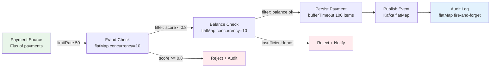
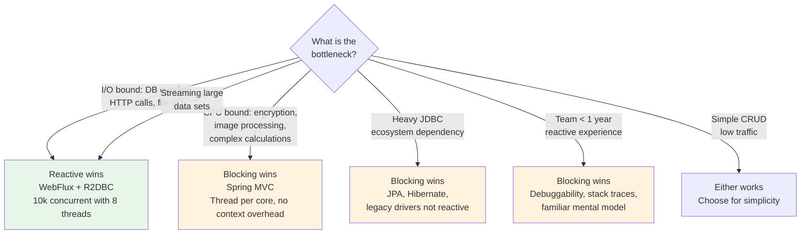

# Reactive vs Blocking — Performance Profile Comparison

Choosing between a blocking and a reactive programming model is one of the most consequential architectural decisions in a high-throughput fintech system. This lesson provides a detailed, benchmark-driven comparison of both models so you can make the right choice for each service in your platform — not just follow a trend.

---

## 1. The Thread-Per-Request Model

Spring MVC (Servlet-based) assigns one thread to each incoming HTTP request for the entire duration of the request lifecycle. The thread blocks while waiting for I/O: database queries, HTTP calls to downstream services, or file reads.

```
Incoming request → Thread A acquired from pool
  Thread A: validate input    (CPU, 0.1ms)
  Thread A: query DB          (BLOCKING I/O, 80ms) ← thread sleeps here
  Thread A: call fraud API    (BLOCKING I/O, 15ms) ← thread sleeps here
  Thread A: write audit log   (BLOCKING I/O, 5ms)  ← thread sleeps here
  Thread A: serialize response (CPU, 0.2ms)
Thread A released to pool     (total: ~100ms, thread held 100ms)
```

The critical observation: a thread holding for 100ms, 80ms of which was spent sleeping waiting for the database, is wasting a valuable OS resource.

### 1.1 Thread Pool Sizing and the Concurrency Ceiling

```java
// Typical Spring MVC thread pool configuration
server:
  tomcat:
    threads:
      max: 200          # Max concurrent requests
      min-spare: 10

// With 200 threads and 100ms average response time:
// Max theoretical throughput = 200 / 0.1s = 2,000 requests/second
// At 2,001 req/s, the 201st request waits for a thread

// Reality check: a payment service under Black Friday load
// 10,000 concurrent users × 100ms response time
// = 10,000 threads required
// At 1MB stack per thread = 10 GB RAM just for thread stacks
// OS context switching overhead degrades throughput further
```

The 200-thread default is not arbitrary — it is the maximum before thread scheduling overhead dominates on a typical JVM/OS. Beyond ~300 threads, throughput plateaus or drops.

---

## 2. The Event Loop Model

Reactive/event-loop systems use a small, fixed number of threads (typically 2× CPU cores) and handle thousands of concurrent operations through non-blocking I/O and callbacks.

```
Event Loop Thread 1:
  t=0ms: Accept request A, start DB query (non-blocking, registers callback)
  t=0ms: Accept request B, start DB query (non-blocking, registers callback)
  t=0ms: Accept request C, start fraud API call (non-blocking, registers callback)
  t=80ms: DB result for A arrives → continue processing A
  t=80ms: DB result for B arrives → continue processing B
  t=95ms: Fraud API result for C arrives → continue processing C
  t=80ms: Send response A
  t=81ms: Send response B
  t=96ms: Send response C

One thread serviced 3 requests that together took 255ms of I/O wait
using zero blocking and minimal CPU overhead
```

### 2.1 Benchmark: 10,000 Concurrent Connections

Scenario: 10,000 concurrent clients each making a request with 100ms of I/O delay (simulating a database query).

```
Blocking (Spring MVC, Tomcat):
  Threads needed:     10,000 (one per concurrent request)
  Thread stack RAM:   10,000 × 1MB = 10 GB
  Context switches:   ~500,000/second (catastrophic overhead)
  Actual throughput:  ~2,000 req/s (thread pool saturated at 200)
  P99 latency:        5,000ms+ (queuing behind thread pool)

Reactive (Spring WebFlux, Netty):
  Threads used:       8 (2 × 4 cores)
  Thread stack RAM:   8 × 1MB = 8 MB
  Context switches:   ~400/second (negligible)
  Actual throughput:  10,000 req/s
  P99 latency:        ~105ms (no queuing)
```

---

## 3. Project Reactor: Mono and Flux

Project Reactor is the reactive library underlying Spring WebFlux. It models asynchronous sequences as two types:

- `Mono<T>`: 0 or 1 element (like a `CompletableFuture<T>`)
- `Flux<T>`: 0 to N elements (like an async `Stream<T>`)

```java
// Mono: single payment lookup
Mono<Payment> payment = paymentRepository.findById(paymentId);

// Flux: stream of incoming payments
Flux<Payment> payments = paymentRepository.findByAccountId(accountId);

// Composing operations
Mono<PaymentResponse> response = paymentRepository
    .findById(paymentId)
    .switchIfEmpty(Mono.error(new PaymentNotFoundException(paymentId)))
    .flatMap(payment -> fraudCheckService.evaluate(payment))
    .flatMap(checkedPayment -> paymentProcessor.submit(checkedPayment))
    .map(result -> new PaymentResponse(result.getId(), result.getStatus()));
```

The key difference from `CompletableFuture`: Reactor pipelines are **lazy** — nothing executes until a subscriber subscribes. This enables composition without side effects.

---

## 4. Spring WebFlux vs Spring MVC

```java
// Spring MVC — blocking controller
@RestController
@RequestMapping("/api/v1/payments")
public class PaymentControllerMvc {

    private final PaymentService paymentService; // Uses JDBC, blocking

    @PostMapping
    public ResponseEntity<PaymentResponse> submit(
            @RequestBody @Valid PaymentRequest request) {
        // Thread blocks here for the entire duration
        PaymentResult result = paymentService.process(request);
        return ResponseEntity.ok(new PaymentResponse(result));
    }
}

// Spring WebFlux — non-blocking controller
@RestController
@RequestMapping("/api/v1/payments")
public class PaymentControllerWebFlux {

    private final ReactivePaymentService paymentService; // Uses R2DBC

    @PostMapping
    public Mono<ResponseEntity<PaymentResponse>> submit(
            @RequestBody @Valid PaymentRequest request) {
        return paymentService.process(request)
            .map(result -> ResponseEntity.ok(new PaymentResponse(result)))
            .onErrorResume(ValidationException.class,
                e -> Mono.just(ResponseEntity.badRequest()
                    .body(new PaymentResponse(e.getMessage()))))
            .onErrorResume(InsufficientFundsException.class,
                e -> Mono.just(ResponseEntity.unprocessableEntity()
                    .body(new PaymentResponse(e.getMessage()))));
    }

    // Server-Sent Events: stream of real-time payment updates
    @GetMapping(value = "/stream/{accountId}",
                produces = MediaType.TEXT_EVENT_STREAM_VALUE)
    public Flux<PaymentStatusUpdate> streamUpdates(@PathVariable String accountId) {
        return paymentService.getUpdateStream(accountId)
            .limitRate(100); // Backpressure: request 100 items at a time
    }
}
```

---

## 5. R2DBC: Reactive PostgreSQL

JDBC is fundamentally blocking — it cannot work in an event-loop model. R2DBC (Reactive Relational Database Connectivity) provides a non-blocking API for relational databases.

```xml
<!-- pom.xml -->
<dependency>
    <groupId>org.springframework.boot</groupId>
    <artifactId>spring-boot-starter-data-r2dbc</artifactId>
</dependency>
<dependency>
    <groupId>org.postgresql</groupId>
    <artifactId>r2dbc-postgresql</artifactId>
</dependency>
```

```java
// application.yml
spring:
  r2dbc:
    url: r2dbc:postgresql://localhost:5432/payments
    username: payments_app
    password: ${DB_PASSWORD}
    pool:
      initial-size: 5
      max-size: 20
      # R2DBC pool is much smaller than JDBC pool
      # 20 non-blocking connections can serve 10,000 concurrent requests
      # vs JDBC where you need 1 connection per concurrent thread

// ReactivePaymentRepository.java
public interface ReactivePaymentRepository extends R2dbcRepository<Payment, UUID> {

    // Spring Data R2DBC generates reactive implementation
    Flux<Payment> findByAccountIdAndStatusOrderByCreatedAtDesc(
        String accountId, PaymentStatus status);

    @Query("SELECT * FROM payments WHERE account_id = :accountId " +
           "AND created_at > :since LIMIT :limit")
    Flux<Payment> findRecentByAccount(
        @Param("accountId") String accountId,
        @Param("since") Instant since,
        @Param("limit") int limit);

    @Modifying
    @Query("UPDATE payments SET status = :status, updated_at = NOW() " +
           "WHERE id = :id")
    Mono<Integer> updateStatus(@Param("id") UUID id,
                               @Param("status") String status);
}

// ReactivePaymentService.java
@Service
@Slf4j
public class ReactivePaymentService {

    private final ReactivePaymentRepository paymentRepository;
    private final ReactiveFraudCheckClient fraudCheckClient;
    private final ReactiveAuditService auditService;

    public Mono<PaymentResult> process(PaymentRequest request) {
        return Mono.just(request)
            .flatMap(this::validate)
            .flatMap(validated -> fraudCheckClient.check(validated)
                .timeout(Duration.ofSeconds(2))
                .onErrorResume(TimeoutException.class,
                    e -> Mono.just(FraudCheckResult.defaultAllow())))
            .flatMap(this::persistPayment)
            .flatMap(payment -> auditService.log(payment)
                // Audit log failure must NOT fail the payment
                .thenReturn(payment))
            .map(PaymentResult::fromPayment)
            .doOnSuccess(r -> log.info("Payment {} processed: {}",
                r.getPaymentId(), r.getStatus()))
            .doOnError(e -> log.error("Payment processing failed", e));
    }
}
```

---

## 6. Backpressure with Flux.limitRate

Backpressure is the mechanism by which a subscriber signals to a publisher how many items it can consume. Without backpressure, a fast producer can overwhelm a slow consumer and cause OOM.

```java
// Processing a large batch of payments reactively
public Flux<PaymentResult> processBatch(Flux<PaymentRequest> payments) {
    return payments
        // Request 50 items at a time — backpressure to upstream
        .limitRate(50)
        // Process up to 10 payments concurrently
        .flatMap(payment -> process(payment), 10)
        // Buffer results in groups of 100 for bulk DB inserts
        .bufferTimeout(100, Duration.ofMillis(50))
        .flatMap(batch -> paymentRepository.saveAll(batch)
            .thenMany(Flux.fromIterable(batch).map(PaymentResult::fromPayment)));
}

// Flux.limitRate controls the demand signal sent upstream:
// Without limitRate: subscriber requests Long.MAX_VALUE items immediately
// (unbounded demand — producer floods the pipeline)
// With limitRate(50): subscriber requests 50, then 37 more when 75% consumed
// (bounded demand — producer paces itself)

// Measuring backpressure effectiveness
payments
    .limitRate(50)
    .doOnRequest(n -> log.debug("Downstream requested {} items", n))
    .flatMap(this::process, 10)
    .doOnNext(r -> log.debug("Processed payment {}", r.getPaymentId()))
    .subscribe();
```

---

## 7. Reactive Payment Pipeline



```java
// Full reactive payment pipeline
@Service
public class ReactivePaymentPipeline {

    public Flux<PaymentResult> run(Flux<PaymentRequest> source) {
        return source
            .limitRate(50)

            // Fraud check: up to 10 concurrent, 2s timeout, default to allow on timeout
            .flatMap(request ->
                fraudService.check(request)
                    .timeout(Duration.ofSeconds(2))
                    .onErrorReturn(FraudCheckResult.defaultAllow()),
                10 // max concurrency
            )

            // Filter out high-risk payments
            .filter(result -> result.getRiskScore() < 0.8)

            // Balance check
            .flatMap(result ->
                accountService.checkBalance(
                    result.getRequest().getFromAccount(),
                    result.getRequest().getAmountMinor())
                .map(sufficient -> Tuples.of(result, sufficient)),
                10
            )
            .filter(tuple -> tuple.getT2()) // only sufficient balance
            .map(Tuple2::getT1)

            // Persist payments in batches
            .bufferTimeout(100, Duration.ofMillis(50))
            .flatMap(batch -> paymentRepository.saveAll(batch))

            // Publish to Kafka (fire)
            .flatMap(payment ->
                eventBus.publish("payments.processed", payment)
                    .thenReturn(PaymentResult.success(payment)))

            // Error handling: log and continue on individual payment failure
            .onErrorContinue(
                PaymentProcessingException.class,
                (error, payment) -> log.error("Failed to process payment {}", payment, error)
            );
    }
}
```

---

## 8. Error Handling in Reactive Pipelines

```java
// onErrorResume: recover by switching to an alternative Mono/Flux
public Mono<ExchangeRate> getExchangeRate(String pair) {
    return primaryRateProvider.getRate(pair)
        .onErrorResume(ServiceUnavailableException.class,
            e -> fallbackRateProvider.getRate(pair))
        .onErrorResume(Exception.class,
            e -> cachedRateService.getLastKnownRate(pair)
                .switchIfEmpty(Mono.error(
                    new NoRateAvailableException("No rate for " + pair))));
}

// retryWhen: retry with exponential backoff
public Mono<PaymentStatus> pollPaymentStatus(String paymentId) {
    return paymentGateway.getStatus(paymentId)
        .filter(status -> status != PaymentStatus.PENDING)
        .repeatWhenEmpty(flux -> flux
            .zipWith(Flux.range(1, 5), (emission, attempt) -> attempt)
            .flatMap(attempt -> Mono.delay(
                Duration.ofMillis(100L * (long) Math.pow(2, attempt)))))
        .retryWhen(Retry.backoff(3, Duration.ofMillis(200))
            .filter(e -> e instanceof TransientException)
            .doBeforeRetry(signal ->
                log.warn("Retrying payment status check, attempt {}",
                    signal.totalRetries() + 1)));
}
```

---

## 9. MDC Context Propagation in Reactive

ThreadLocal (which MDC uses internally) does not work in reactive pipelines because a single request hops between threads. Use Reactor's `Context` instead.

```java
// WRONG — MDC is ThreadLocal and will be empty on reactor threads
public Mono<PaymentResult> processWithLogging(PaymentRequest request) {
    MDC.put("paymentId", request.getPaymentId()); // Set on calling thread
    return paymentRepository.findById(request.getId())
        .map(payment -> {
            // This runs on a different thread — MDC is EMPTY here
            log.info("Processing payment"); // No paymentId in log!
            return process(payment);
        });
}

// CORRECT — use Reactor Context + contextWrite
public Mono<PaymentResult> processWithLogging(PaymentRequest request) {
    return paymentRepository.findById(request.getId())
        .map(payment -> {
            // Read from Reactor Context, set MDC for this callback
            return process(payment);
        })
        .doOnEach(signal -> {
            // signal.getContextView() is available on every signal
            String paymentId = signal.getContextView()
                .getOrDefault("paymentId", "unknown");
            if (signal.isOnNext()) {
                MDC.put("paymentId", paymentId);
                log.info("Processing payment");
                MDC.remove("paymentId");
            }
        })
        // Inject context values at the subscription point
        .contextWrite(Context.of("paymentId", request.getPaymentId(),
                                 "correlationId", request.getCorrelationId()));
}

// Better approach: use reactor-extra's MdcContextLifter
// (registers a hook that propagates Context to MDC on every operator)
// In your Spring Boot application startup:
Hooks.onEachOperator("MDC", Operators.lift(
    (scannable, subscriber) -> new MdcContextLifter<>(subscriber)));
```

---

## 10. When Reactive Wins vs When Blocking Wins



| Scenario | Recommendation | Reason |
|----------|----------------|--------|
| 10k concurrent I/O-bound requests | Reactive | 8 threads vs 10k threads |
| Payment calculation engine | Blocking | CPU-bound, no I/O wait |
| Existing JPA/Hibernate codebase | Blocking | No R2DBC equivalents for all features |
| Real-time event streaming | Reactive | Flux + SSE is natural fit |
| Batch processing (overnight) | Blocking | Spring Batch, throughput not concurrency |
| Team new to reactive | Blocking | Bugs in reactive code are hard to debug |

---

## 11. Production Pitfalls

### Pitfall 1: Blocking Call Inside a Reactive Pipeline

This is the single most common and dangerous mistake. Calling a blocking API (JDBC, synchronous HTTP client) on an event-loop thread starves all other requests on that thread.

```java
// WRONG — JdbcTemplate.query() blocks the event-loop thread
@GetMapping("/payments/{id}")
public Mono<Payment> getPayment(@PathVariable String id) {
    return Mono.fromCallable(() ->
        // jdbcTemplate is blocking — this parks the event-loop thread
        // for the duration of the DB query
        jdbcTemplate.queryForObject(
            "SELECT * FROM payments WHERE id = ?",
            paymentRowMapper, id)
    );
    // Mono.fromCallable with no scheduler change still runs on the event-loop!
}

// CORRECT — wrap blocking work in a bounded elastic scheduler
@GetMapping("/payments/{id}")
public Mono<Payment> getPayment(@PathVariable String id) {
    return Mono.fromCallable(() ->
        jdbcTemplate.queryForObject(
            "SELECT * FROM payments WHERE id = ?",
            paymentRowMapper, id)
    )
    // subscribeOn moves the execution to a separate thread pool
    // The event-loop thread is immediately freed
    .subscribeOn(Schedulers.boundedElastic());
}

// BEST — migrate to R2DBC entirely for true non-blocking DB access
@GetMapping("/payments/{id}")
public Mono<Payment> getPayment(@PathVariable String id) {
    return reactivePaymentRepository.findById(UUID.fromString(id));
}
```

Detecting this problem: use BlockHound in tests:

```java
@SpringBootTest
class ReactiveBlockingDetectionTest {

    @BeforeAll
    static void installBlockHound() {
        BlockHound.install();
    }

    @Test
    void paymentServiceMustNotBlock() {
        // BlockHound throws BlockingOperationError if any blocking call
        // is made on a reactor thread during this test
        StepVerifier.create(paymentService.process(aPaymentRequest()))
            .expectNextCount(1)
            .verifyComplete();
    }
}
```

### Pitfall 2: Missing Backpressure on High-Volume Streams

Publishing events without backpressure to a slow consumer causes unbounded buffering.

```java
// WRONG — no backpressure, publisher floods subscriber
Flux<Payment> allPayments = paymentRepository.findAll();
allPayments
    .flatMap(payment -> expensiveProcessor.process(payment)) // may be slow
    .subscribe(result -> results.add(result));
// If expensiveProcessor processes 100/s and DB emits 10,000/s,
// 9,900 payments/s pile up in memory → OOM

// CORRECT — bounded concurrency and limitRate
paymentRepository.findAll()
    .limitRate(200)       // request 200 items at a time from DB
    .flatMap(payment -> expensiveProcessor.process(payment),
             20)          // max 20 concurrent processing tasks
    .subscribe(
        result -> results.add(result),
        error -> log.error("Pipeline error", error),
        () -> log.info("Processing complete")
    );

// For streaming from Kafka or external sources, use Flux.create with
// a FluxSink.OverflowStrategy:
Flux<Payment> kafkaFlux = Flux.create(sink -> {
    kafkaConsumer.subscribe(records -> {
        records.forEach(record -> sink.next(toPayment(record)));
    });
}, FluxSink.OverflowStrategy.ERROR); // Throw if buffer overflows
// vs OverflowStrategy.DROP (drop new items)
// vs OverflowStrategy.LATEST (keep only latest)
// vs OverflowStrategy.BUFFER (unbounded — risky!)
```

### Pitfall 3: MDC Context Not Propagated — Silent Log Correlation Failure

Logs lose their correlation IDs in reactive pipelines, making production incident investigation nearly impossible.

```java
// WRONG — MDC.put on calling thread, lost on reactor threads
@PostMapping("/payments")
public Mono<PaymentResponse> submit(@RequestBody PaymentRequest request,
                                    @RequestHeader("X-Correlation-Id") String correlationId) {
    MDC.put("correlationId", correlationId);  // Set on HTTP thread

    return paymentService.process(request)
        .map(result -> {
            // Runs on reactor-http-nio-3 — MDC is EMPTY
            log.info("Payment processed"); // No correlationId in log output!
            return new PaymentResponse(result);
        });
    // MDC.remove() is never called — MDC leaks if thread is reused!
}

// CORRECT — contextWrite + doOnEach for MDC propagation
@PostMapping("/payments")
public Mono<PaymentResponse> submit(@RequestBody PaymentRequest request,
                                    @RequestHeader("X-Correlation-Id") String correlationId) {
    return paymentService.process(request)
        .map(result -> new PaymentResponse(result))
        .doOnEach(signal -> {
            if (!signal.isOnComplete() && !signal.isOnSubscribe()) {
                try (MDC.MDCCloseable ignored =
                        MDC.putCloseable("correlationId",
                            signal.getContextView().getOrDefault(
                                "correlationId", "unknown"))) {
                    // Log statements inside here have correlationId set
                }
            }
        })
        .contextWrite(Context.of("correlationId", correlationId));
}
```

---

## 12. Checklist

- [ ] No blocking calls (JDBC, synchronous RestTemplate, Thread.sleep) on reactor threads
- [ ] BlockHound installed in test suite to detect accidental blocking
- [ ] All blocking I/O wrapped with `.subscribeOn(Schedulers.boundedElastic())`
- [ ] `limitRate()` applied to any Flux that sources from a database or message queue
- [ ] `flatMap` concurrency parameter set explicitly (do not rely on default of 256)
- [ ] `bufferTimeout` or `window` used for batch DB inserts, not `flatMap` per item
- [ ] `onErrorResume` or `onErrorContinue` present — naked errors terminate the whole Flux
- [ ] `retryWhen` with exponential backoff for transient failures, not bare `retry(3)`
- [ ] Reactor Context used for correlation ID and MDC propagation, not ThreadLocal
- [ ] `MdcContextLifter` hook registered at startup for automatic MDC propagation
- [ ] R2DBC connection pool sized for reactive (5-20), not JDBC scale (100-500)
- [ ] `StepVerifier` used in all unit tests — do not block with `.block()` in tests

---

<!-- KNOWLEDGE-CHECK
{"questions":[{"text":"A Spring WebFlux service makes a JDBC call inside a Mono.fromCallable() without a subscribeOn(). What is the consequence?","options":["a) The Mono will fail with a BlockingNotPermittedException immediately","b) The JDBC call executes on the event-loop thread, blocking it and starving all other concurrent requests on that thread","c) Spring automatically detects the blocking call and offloads it to a thread pool","d) The Mono will complete normally with slightly higher latency"],"correct":1,"explanation":"Without subscribeOn(), Mono.fromCallable() executes its supplier on whatever thread subscribes to it — in WebFlux, this is the event-loop (Netty NIO) thread. JDBC is synchronous and blocks the thread until the query completes. During this time, the event-loop thread cannot process any other events, degrading throughput for ALL concurrent requests on that thread. subscribeOn(Schedulers.boundedElastic()) moves execution to a thread pool designed for blocking work."},{"text":"Why does ThreadLocal-based MDC fail in a reactive pipeline, and what is the correct alternative?","options":["a) MDC is not thread-safe and should never be used in production","b) Reactive operators can execute callbacks on different threads than the one that set the MDC context, so the ThreadLocal value is absent; use Reactor Context with contextWrite and doOnEach instead","c) MDC requires a servlet container and is incompatible with Netty","d) MDC works correctly but requires explicit MDC.clear() after each operator"],"correct":1,"explanation":"MDC uses ThreadLocal to store key-value pairs. In a reactive pipeline, a single request is processed by callbacks that may execute on different threads (e.g., the HTTP thread, a scheduler thread, the DB callback thread). When execution moves to a new thread, the ThreadLocal is empty on that thread. Reactor's Context is a per-subscription immutable map that flows downstream through the operator chain regardless of thread switching. contextWrite() injects values, getContextView() reads them, and doOnEach() can bridge Context values to MDC for log statements."},{"text":"In the benchmark scenario of 10,000 concurrent connections with 100ms I/O delay, what is the primary resource that blocking threading exhausts before reactive threading does?","options":["a) CPU cycles — blocking threads consume more CPU due to constant polling","b) Network sockets — blocking I/O opens more sockets per request","c) OS threads and their associated memory (stack space) — 10,000 threads require ~10 GB of stack RAM","d) Heap memory — reactive objects are more memory-efficient than thread stacks"],"correct":2,"explanation":"Each JVM thread requires a stack (typically 512KB to 1MB). 10,000 threads = 5-10 GB of RAM just for stacks, before any heap objects. The OS must also schedule 10,000 threads, causing massive context-switching overhead that degrades throughput. A reactive service handling the same 10,000 concurrent connections uses 8 event-loop threads (2 × 4 cores) with 8MB of stack, and relies on the OS's efficient non-blocking I/O notifications rather than per-thread blocking."}]}
-->

<!-- PRACTICAL-CHALLENGE
{"title":"Reactive Payment Pipeline with Backpressure and Context Propagation","difficulty":"advanced","estimatedMinutes":90,"tasks":[{"id":"1","description":"Build a Spring WebFlux payment API with two endpoints: POST /payments (returns Mono<PaymentResponse>) and GET /payments/stream/{accountId} (returns Flux<PaymentStatusUpdate> as text/event-stream). Use R2DBC with an in-memory H2 database. Confirm that the POST endpoint handles both ValidationException (400) and InsufficientFundsException (422) via onErrorResume without exposing stack traces. Write a WebTestClient integration test for each error case."},{"id":"2","description":"Implement a ReactivePaymentPipeline that accepts a Flux<PaymentRequest> and applies: (1) limitRate(50), (2) flatMap to a mock fraud check with max concurrency 10 and a 2-second timeout that defaults to allow on timeout, (3) filter for risk score < 0.7, (4) bufferTimeout(100, 50ms) for batch persistence. Install BlockHound and write a StepVerifier test proving no blocking call is made on the reactor thread during pipeline execution."},{"id":"3","description":"Demonstrate and fix the MDC propagation pitfall. First write a test showing that MDC.get('correlationId') returns null inside a map() operator when set on the calling thread. Then fix it using contextWrite(Context.of('correlationId', id)) and doOnEach with signal.getContextView(). Optionally register the MdcContextLifter hook and verify that the correlation ID appears in log output during the reactive pipeline execution."},{"id":"4","description":"Write a benchmark using JMH (or a simple timed loop) comparing throughput of: (a) a Spring MVC controller using JDBC with Thread.sleep(50) to simulate I/O, with a Tomcat thread pool of 50 threads; versus (b) a Spring WebFlux controller using Mono.delay(Duration.ofMillis(50)) with 8 event-loop threads. Run 500 concurrent virtual threads (or connections) for 30 seconds and record the requests/second and P99 latency for each. Document your findings in a comment explaining when each model is preferable."}]}
-->
