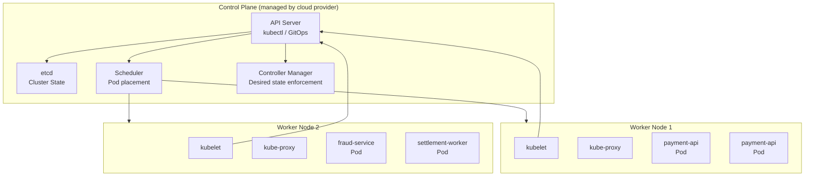

# ‏Kubernetes للخدمات المالية — البنية وأحمال العمل

> [!NOTE]
> أصبح Kubernetes منصة النشر القياسية للخدمات المالية، لكن تشغيل أحمال عمل خاضعة للتنظيم على K8s يتطلب أنماطًا مختلفة عن تطوير التطبيقات العامة. ويغطي هذا الدرس نموذج K8s وتطبيقه على بيئات الإنتاج المالية.

## لماذا Kubernetes للخدمات المالية

تنتقل مؤسسات التقنية المالية إلى Kubernetes لثلاثة أسباب:

1. **البنية التحتية التصريحية** — الحالة المرغوبة تحت إدارة الإصدارات؛ والتراجع مجرد git revert
2. **الاتساق التشغيلي** — آلية نشر متطابقة للتطوير والتجهيز والإنتاج
3. **أدوات المرونة الأساسية** — فحوص الصحة، وإعادة تشغيل الحاويات، والتحديثات المتدرجة، والتوسع الأفقي مدمجة

والتحدي أن للخدمات المالية متطلبات إضافية: إقامة البيانات، وتقسيم الشبكة، وإدارة الأسرار، ومسارات تدقيق لكل تغيير في الإعدادات.

## بنية Kubernetes



### مفاهيم مستوى التحكم الأساسية

يخزن **etcd** كل حالة العنقود — عمليات النشر، والخدمات، والأسرار، وconfigmaps. ولعناقيد K8s المالية، تشفير etcd أثناء التخزين إلزامي.

**خادم الواجهة (API Server)** نقطة الدخول الوحيدة لكل عمليات العنقود. وكل التغييرات تمر عبره، فمع تفعيل سجل تدقيق خادم الواجهة (يجب ضبط سياسة تدقيق؛ وتكشفها العناقيد المُدارة كإعداد) تحصل على مسار تدقيق كامل لمن غيّر ماذا.

**المُجدول (Scheduler)** يضع الحاويات على العقد بناءً على طلبات الموارد، وقواعد التقارب، والـ taints.

## الحاويات (Pods) — وحدة النشر

الـ **pod** أصغر وحدة قابلة للنشر في Kubernetes. يغلّف حاوية أو أكثر تتشارك الشبكة والتخزين. وعمليًا لا تنشئ pods منفردة أبدًا — فالـ Deployment (القسم التالي) ينشئها من قالبه؛ والمواصفة الكاملة أدناه تُظهر ما يحويه كل pod.

```yaml
# payment-api pod specification
apiVersion: v1
kind: Pod
metadata:
  name: payment-api-7b4f9d
  namespace: payments-prod
  labels:
    app: payment-api
    version: "2.4.1"
    tier: "frontend"
  annotations:
    # Compliance: record who deployed this and when
    deploy.bank.internal/deployed-by: "ci-pipeline"
    deploy.bank.internal/deployed-at: "2024-11-07T14:30:00Z"
    deploy.bank.internal/change-ref: "CHG-20241107-003"
spec:
  serviceAccountName: payment-api-sa  # least-privilege service account
  
  containers:
  - name: payment-api
    image: bank-registry.internal/payment-api:2.4.1
    
    ports:
    - containerPort: 8080
      name: http
    - containerPort: 8081
      name: actuator   # separate port for health/metrics — not exposed externally
      
    # Resource requests and limits — REQUIRED for financial workloads
    resources:
      requests:
        memory: "512Mi"
        cpu: "250m"
      limits:
        memory: "1Gi"
        cpu: "1000m"
        
    # Health checks
    # startupProbe covers JVM start-up (up to 30 x 5s = 150s); liveness and
    # readiness only start after it succeeds -- no guessed initialDelaySeconds
    startupProbe:
      httpGet:
        path: /actuator/health/liveness
        port: 8081
      periodSeconds: 5
      failureThreshold: 30

    livenessProbe:
      httpGet:
        path: /actuator/health/liveness
        port: 8081
      periodSeconds: 10
      failureThreshold: 3
      
    readinessProbe:
      httpGet:
        path: /actuator/health/readiness
        port: 8081
      periodSeconds: 5
      failureThreshold: 3
      
    # Secret synced from Vault by External Secrets Operator — never hardcoded.
    # (An env var is read once at start-up: a rotated password reaches the
    # pod only after a restart -- or mount the secret as a file and reload)
    env:
    - name: DB_PASSWORD
      valueFrom:
        secretKeyRef:
          name: payment-api-db-secret
          key: password
          
    # Security context — run as non-root
    securityContext:
      runAsNonRoot: true
      runAsUser: 1000
      readOnlyRootFilesystem: true
      allowPrivilegeEscalation: false
      capabilities:
        drop: ["ALL"]
```

## الـ Deployments — إدارة دورة حياة الـ Pods

يدير **Deployment** مجموعة من الـ pods المتطابقة، ويتولى التحديثات المتدرجة والتراجع.

```yaml
apiVersion: apps/v1
kind: Deployment
metadata:
  name: payment-api
  namespace: payments-prod
spec:
  replicas: 6         # 6 pods across nodes for HA
  
  selector:
    matchLabels:
      app: payment-api
      
  strategy:
    type: RollingUpdate
    rollingUpdate:
      maxUnavailable: 1    # at most 1 pod down during update
      maxSurge: 2          # at most 2 extra pods during update
      # With 6 replicas: update removes 1, adds 2 → never below 5 pods serving traffic
      
  template:
    metadata:
      labels:
        app: payment-api
        version: "2.4.1"
    spec:
      # Spread pods across availability zones and nodes.
      # (A REQUIRED hostname anti-affinity would need one node per pod:
      # with maxSurge=2 and an HPA max of 24, pods would stay Pending
      # whenever there are fewer nodes than pods. Spread constraints
      # spread evenly without that hard limit.)
      topologySpreadConstraints:
      - maxSkew: 1
        topologyKey: topology.kubernetes.io/zone
        whenUnsatisfiable: DoNotSchedule      # zones must stay balanced
        labelSelector:
          matchLabels:
            app: payment-api
      - maxSkew: 1
        topologyKey: kubernetes.io/hostname
        whenUnsatisfiable: ScheduleAnyway     # prefer different nodes
        labelSelector:
          matchLabels:
            app: payment-api

      # Graceful shutdown — give in-flight requests 30 seconds to complete
      terminationGracePeriodSeconds: 30
      
      containers:
      - name: payment-api
        image: bank-registry.internal/payment-api:2.4.1
        # resources, probes, env and securityContext as in the pod spec above
        lifecycle:
          preStop:
            # Give the load balancer time to stop routing traffic before the
            # pod terminates. Native sleep action (Kubernetes 1.30+) -- works
            # in distroless images that have no /bin/sh. On older clusters:
            # exec: {command: ["sleep", "5"]}
            sleep:
              seconds: 5
```

## مساحات الأسماء (Namespaces) — تعدد المستأجرين والعزل

توفر مساحات الأسماء عزلًا منطقيًا بين الفرق والبيئات داخل العنقود.

```yaml
# Production namespace with resource quotas
apiVersion: v1
kind: ResourceQuota
metadata:
  name: payments-prod-quota
  namespace: payments-prod
spec:
  hard:
    # Compute resources
    requests.cpu: "32"
    requests.memory: "64Gi"
    limits.cpu: "64"
    limits.memory: "128Gi"
    
    # Object counts
    pods: "50"
    services: "20"
    persistentvolumeclaims: "20"
    
    # Prevent runaway secret/configmap creation
    secrets: "50"
    configmaps: "50"
```

```yaml
# Network policy: payments namespace can only talk to database and kafka namespaces
apiVersion: networking.k8s.io/v1
kind: NetworkPolicy
metadata:
  name: payments-egress-policy
  namespace: payments-prod
spec:
  podSelector: {}  # applies to all pods in namespace
  policyTypes:
  - Egress
  egress:
  # Allow traffic to database namespace only
  - to:
    - namespaceSelector:
        matchLabels:
          kubernetes.io/metadata.name: database   # label set automatically on every namespace
    ports:
    - protocol: TCP
      port: 5432  # PostgreSQL
  # Allow traffic to Kafka namespace
  - to:
    - namespaceSelector:
        matchLabels:
          kubernetes.io/metadata.name: kafka
    ports:
    - protocol: TCP
      port: 9092
  # Allow DNS (cluster DNS only -- UDP and TCP)
  - to:
    - namespaceSelector:
        matchLabels:
          kubernetes.io/metadata.name: kube-system
      podSelector:
        matchLabels:
          k8s-app: kube-dns
    ports:
    - protocol: UDP
      port: 53
    - protocol: TCP
      port: 53
```

لا تُطبَّق NetworkPolicies إلا إذا كانت إضافة الشبكة في العنقود (CNI) تدعمها — مثل Calico أو Cilium؛ فتحقق قبل الاعتماد عليها.

## ‏Horizontal Pod Autoscaler — التوسع لذروات المدفوعات

تشهد الأنظمة المالية ذروات متوقعة: أيام صرف الرواتب، ونوافذ دفع الفواتير، ونهاية الشهر. ويوسّع HPA الـ pods بناءً على المقاييس المرصودة — فهو يتفاعل *بعد* ارتفاع الحمل، والـ pods الجديدة بـ JVM تحتاج وقتًا للإحماء. فللذروات المعروفة، وسّع مسبقًا أيضًا (مثل رفع `minReplicas` وفق جدول، أو مُطلِق cron في KEDA).

```yaml
apiVersion: autoscaling/v2
kind: HorizontalPodAutoscaler
metadata:
  name: payment-api-hpa
  namespace: payments-prod
spec:
  scaleTargetRef:
    apiVersion: apps/v1
    kind: Deployment
    name: payment-api
    
  minReplicas: 6    # never below 6 — always HA
  maxReplicas: 24   # sized for 4x peak traffic
  
  metrics:
  # Scale on CPU — standard metric
  - type: Resource
    resource:
      name: cpu
      target:
        type: Utilization
        averageUtilization: 60   # scale up when average CPU > 60%
        
  # Scale on custom metric — payment queue depth (served through the custom
  # metrics API, e.g. by Prometheus Adapter. KEDA is an alternative that
  # creates and manages its own HPA -- don't combine both on one Deployment)
  - type: Pods
    pods:
      metric:
        name: payment_queue_depth
      target:
        type: AverageValue
        averageValue: "100"      # scale up when each pod has >100 queued payments
        
  behavior:
    scaleUp:
      stabilizationWindowSeconds: 0     # scale up immediately — don't wait
      policies:
      - type: Pods
        value: 4
        periodSeconds: 60              # add up to 4 pods per minute
    scaleDown:
      stabilizationWindowSeconds: 300   # wait 5 minutes before scaling down
      policies:
      - type: Pods
        value: 1
        periodSeconds: 60              # remove at most 1 pod per minute
```

## ‏ConfigMaps والأسرار — إدارة الإعدادات

```yaml
# ConfigMap — non-sensitive configuration
apiVersion: v1
kind: ConfigMap
metadata:
  name: payment-api-config
  namespace: payments-prod
data:
  application.yml: |
    payment:
      timeout-ms: 5000
      max-retries: 3
      currency-conversion-service: https://fx.internal.bank:8443
    kafka:
      bootstrap-servers: kafka.kafka.svc.cluster.local:9092
      consumer-group: payment-api-prod
```

```yaml
# External Secrets Operator: sync secrets from HashiCorp Vault.
# Vault stays the source of truth (rotation, access policy, audit). ESO
# still writes a normal K8s Secret -- base64 is not encryption -- so also
# enable etcd encryption at rest (KMS) and restrict RBAC on Secrets.
# Never put secret values in ConfigMaps or in Git.
apiVersion: external-secrets.io/v1      # v1beta1 in older ESO releases
kind: ExternalSecret
metadata:
  name: payment-api-db-secret
  namespace: payments-prod
spec:
  refreshInterval: 1h    # re-sync from Vault every hour (picks up rotations)
  secretStoreRef:
    name: vault-backend
    kind: ClusterSecretStore
  target:
    name: payment-api-db-secret
    creationPolicy: Owner
  data:
  - secretKey: password
    remoteRef:
      key: secret/payments-prod/database
      property: password
```

## قائمة تحقق Kubernetes للمهندس الرئيسي

قبل نشر خدمة مالية على Kubernetes الإنتاجي:

- [ ] **طلبات الموارد وحدودها** مضبوطة على كل الحاويات — لا استهلاك موارد غير محدود
- [ ] **توزيع الطوبولوجيا** (أو anti-affinity مفضّلة) مضبوط — النسخ موزعة عبر المناطق والعقد
- [ ] **سياق أمني بلا root** — `runAsNonRoot: true`، و`readOnlyRootFilesystem: true`
- [ ] **أسرار خارجية** عبر Vault ESO — لا قيم أسرار في configmaps أو Git؛ وتشفير etcd أثناء التخزين وRBAC محكم على الأسرار
- [ ] **سياسة شبكة** تقصر الخروج على وجهات معروفة فقط
- [ ] **فحوص الصحة** — البدء، والحيوية، والجاهزية. وإذا كان actuator يعمل على منفذ إدارة منفصل، فتذكّر أن الفحوص حينها لا تختبر منفذ الخادم الرئيسي (ويمكن لـ Spring Boot كشفها أيضًا على المنفذ الرئيسي: `management.endpoint.health.probes.add-additional-paths=true` ← `/livez`، و`/readyz`)
- [ ] **إيقاف لطيف** بـ `preStop` sleep + ‏`terminationGracePeriodSeconds`
- [ ] **HPA مضبوط** بمقاييس المعالج ومقاييس العمل معًا، مع توسيع مسبق للذروات المعروفة
- [ ] **حصص الموارد** مطبقة على مساحة الأسماء
- [ ] **سجل تدقيق K8s** مفعّل — كل تفاعلات خادم الواجهة مسجلة

<!-- KNOWLEDGE-CHECK
{
  "questions": [
    {
      "id": "q1",
      "text": "لدى Deployment ‏payment-api ست نسخ وrollingUpdate.maxUnavailable=1، وmaxSurge=2. أثناء تحديث متدرج، ما الحد الأدنى لعدد الـ pods التي تخدم الحركة في أي لحظة؟",
      "options": [
        "4 pods — يزيل Kubernetes كل الـ pods القديمة قبل إضافة الجديدة",
        "5 pods — يمكن أن يتوقف واحد فقط في كل مرة",
        "6 pods — يضمن surge ألا ننزل تحت عدد النسخ الحالي",
        "7 pods — يضيف surge اثنين قبل إزالة أي منها"
      ],
      "correct": 1,
      "explanation": "‏maxUnavailable=1 يعني أن pod واحدًا على الأكثر يمكن أن يكون غير متاح (متوقفًا أو غير جاهز) في أي وقت. ومع 6 نسخ، يكون الحد الأدنى للخدمة في أي لحظة 6-1=5 pods. ويعني maxSurge=2 أن ما يصل إلى 8 pods إجمالًا يمكن أن توجد أثناء التحديث (6+2)، لكن أرضية التوفر يحددها maxUnavailable."
    },
    {
      "id": "q2",
      "text": "لماذا يجب ألا تُستخدم أسرار Kubernetes لتخزين كلمات مرور قواعد البيانات مباشرة لخدمة مالية خاضعة للتنظيم؟",
      "options": [
        "أسرار Kubernetes محدودة بحجم 1MB",
        "أسرار Kubernetes مرمّزة بـ base64، لا مشفرة — فأي شخص له صلاحية قراءة مساحة الأسماء أو الوصول إلى etcd يستطيع قراءة القيمة؛ ويوفر نظام إدارة أسرار مثل Vault التشفير، وضبط الوصول، وسجل التدقيق",
        "لا يمكن تحميل أسرار Kubernetes كمتغيرات بيئة",
        "تنتهي صلاحية أسرار Kubernetes بعد 90 يومًا"
      ],
      "correct": 1,
      "explanation": "‏Base64 ترميز، لا تشفير. ودون تشفير etcd أثناء التخزين وRBAC صارم، تكون أسرار K8s فعليًا نصًا صريحًا لأي شخص له وصول إلى مساحة الأسماء أو إلى etcd. وللخدمات المالية يجب أن يكون مصدر الحقيقة مدير أسرار مثل Vault: مشفرًا أثناء التخزين، ومضبوط الوصول بسياسات أقل صلاحية، وكل قراءة مدققة، والتدوير مُدار مركزيًا. ويزامن External Secrets Operator القيمة إلى العنقود — والسر الناتج في K8s ما زال يحتاج تشفير etcd وRBAC محكمًا، ويجب أن يعيد التطبيق قراءته (إعادة تشغيل، أو ملف محمّل يُعاد تحميله) ليلتقط التدوير."
    },
    {
      "id": "q3",
      "text": "في يوم صرف الرواتب، يرتفع معالج pods ‏payment-api إلى 90% ويوسّع HPA. وتستغرق الـ pods الجديدة 90 ثانية لتصبح جاهزة (وقت إحماء JVM). ماذا يحدث للحركة خلال نافذة الـ 90 ثانية هذه؟",
      "options": [
        "تُصف الحركة في طابور — ينتظر Kubernetes الـ pods الجديدة قبل التوجيه",
        "تتولى الـ pods الموجودة الحركة بمعالج مرتفع — ولا تتلقى الـ pods الجديدة حركة إلا بعد نجاح فحص جاهزيتها",
        "تُسقط الحركة — يرفض Kubernetes الاتصالات الجديدة أثناء التوسع",
        "تُقسم الحركة بالتناسب على الـ pods المتاحة"
      ],
      "correct": 1,
      "explanation": "لا يرسل Kubernetes حركة إلا للـ pods التي تجتاز فحص الجاهزية. وخلال الإحماء البالغ 90 ثانية، لا تكون الـ pods الجديدة جاهزة ولا تتلقى حركة. وتتولى الـ pods الموجودة كل الحركة بمعالج مرتفع. وهذا سلوك صحيح — فالخدمة البطيئة أفضل من التوجيه إلى pods غير جاهزة. والحل إحماء على مستوى التطبيق قبل نجاح فحص الجاهزية."
    },
    {
      "id": "q4",
      "text": "تمنع NetworkPolicy كل الدخول إلى مساحة الأسماء payments-prod عدا من مساحة الأسماء api-gateway. وتحتاج خدمة امتثال جديدة في مساحة الأسماء compliance-prod الاستعلام من واجهة الدفع. ماذا يجب أن تفعل؟",
      "options": [
        "احذف NetworkPolicy — فهي مقيّدة أكثر من اللازم",
        "أضف قاعدة دخول إلى NetworkPolicy في payments-prod تسمح بالحركة من مساحة الأسماء compliance-prod ‏(namespaceSelector على kubernetes.io/metadata.name: compliance-prod)، ويُفضّل أن تكون من pods خدمة الامتثال فقط",
        "انقل خدمة الامتثال إلى مساحة الأسماء payments-prod",
        "استخدم مورد Ingress لتجاوز NetworkPolicy"
      ],
      "correct": 1,
      "explanation": "‏NetworkPolicies قوائم سماح تراكمية — فتضيف قاعدة سماح بدل إزالة المنع الشامل. والحل الصحيح قاعدة دخول في payments-prod تسمح بالحركة من مساحة الأسماء compliance-prod (التسمية kubernetes.io/metadata.name تُضبط تلقائيًا على كل مساحة أسماء)، مضيّقة بـ podSelector على خدمة الامتثال وعلى منفذ الواجهة. وهذا يحافظ على أقل صلاحية مع تمكين الوصول المطلوب بالضبط."
    }
  ]
}
-->

<!-- PRACTICAL-CHALLENGE
{
  "title": "ملفات Kubernetes جاهزة للإنتاج لواجهة دفع",
  "difficulty": "advanced",
  "estimatedMinutes": 90,
  "tasks": [
    {
      "id": "1",
      "description": "اكتب ملف Deployment لـ payment-api: ست نسخ، وتحديث متدرج بـ maxUnavailable=1 وmaxSurge=2، وتوزيع طوبولوجي عبر المناطق والعقد، وفحوص البدء/الحيوية/الجاهزية، وطلبات الموارد وحدودها، وسياق أمني بلا root ونظام ملفات للقراءة فقط، وتأخير preStop مع terminationGracePeriodSeconds مناسب."
    },
    {
      "id": "2",
      "description": "اكتب ملف HPA: ‏minReplicas 6، وmaxReplicas 24، والتوسع على المعالج (60%) وعلى مقياس مخصص payment_queue_depth، وتوسع سريع للأعلى وبطيء للأسفل. واشرح كيف ستوسّع مسبقًا قبل ذروة يوم رواتب معروفة."
    },
    {
      "id": "3",
      "description": "اكتب مجموعة NetworkPolicy لـ payments-prod: منع افتراضي للدخول والخروج، ودخول فقط من مساحة الأسماء api-gateway على المنفذ 8080، وخروج فقط إلى PostgreSQL ‏(5432)، وKafka ‏(9092)، وDNS العنقود (UDP وTCP 53). واختبرها بـ pod تصحيح من مساحة أسماء غير ذات صلة."
    },
    {
      "id": "4",
      "description": "اكتب ملف ExternalSecret يزامن كلمة مرور قاعدة البيانات من Vault إلى payment-api-db-secret، وصِف كيف تصل كلمة مرور مُدوَّرة إلى الـ pods العاملة (إعادة تشغيل عبر rollout، أو ملف محمّل يعيد التطبيق تحميله)."
    }
  ]
}
-->
