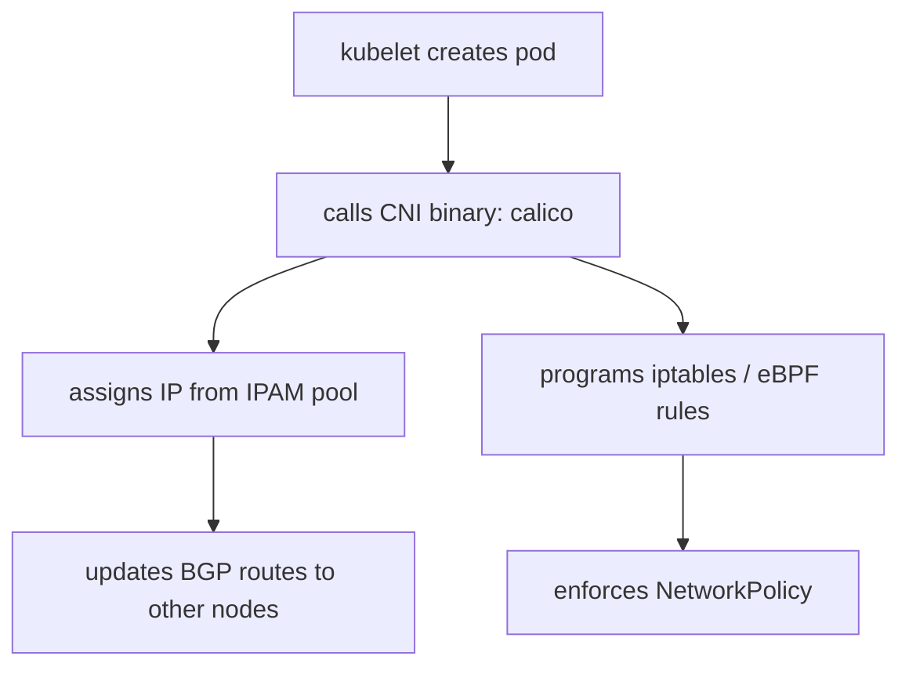
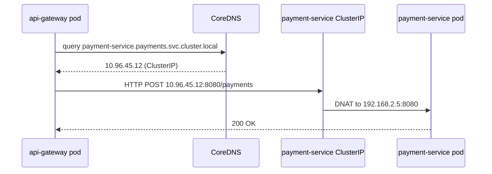
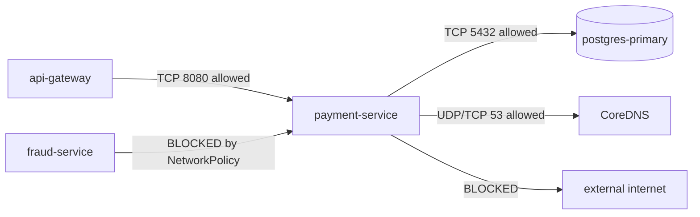
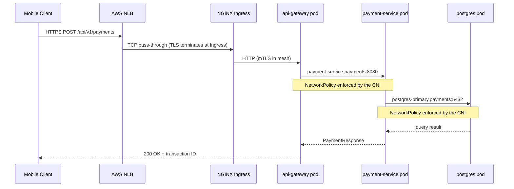

# شبكات Kubernetes — ‏CNI، والخدمات، والـ Ingress

شبكات Kubernetes من أكثر قرارات التصميم أثرًا في منصة تقنية مالية. فخدمات الدفع، ومحركات كشف الاحتيال، وواجهات الأنظمة المصرفية الأساسية كلها تتشارك شبكة العنقود، فيصبح العزل، وقابلية الاكتشاف، والأداء أمورًا غير قابلة للتفاوض. ويغطي هذا الدرس كل طبقة شبكية من الشبكة المسطحة على مستوى CNI مرورًا بالخدمات، والـ Ingress، وفرض NetworkPolicy.

---

## 1. نموذج شبكة الـ Pods في Kubernetes

يفرض Kubernetes شبكة مسطحة: يحصل كل pod على عنوان IP فريد قابل للتوجيه، ويمكن لأي pod التواصل مع أي pod آخر على أي عقدة دون NAT. ويبسّط ضمان "IP لكل pod" اكتشاف الخدمات ويلغي تعارضات المنافذ بين الحاويات في الـ pod نفسه.

```
┌────────────────────────────────────────────────────────────┐
│  Node A (10.0.1.10)          Node B (10.0.1.11)            │
│  ┌────────────┐               ┌────────────┐               │
│  │ Pod A      │               │ Pod B      │               │
│  │ 192.168.1.5│ ──── CNI ──── │ 192.168.2.7│               │
│  └────────────┘               └────────────┘               │
└────────────────────────────────────────────────────────────┘
```

تحكم هذا النموذج ثلاث قواعد:

1. كل الـ pods تتواصل مع كل الـ pods الأخرى دون NAT.
2. كل العقد تتواصل مع كل الـ pods دون NAT.
3. عنوان IP الذي يراه الـ pod لنفسه هو العنوان نفسه الذي تراه به الـ pods الأخرى.

ويعني هذا التصميم أن pod خدمة الدفع على `192.168.1.5` يستطيع الوصول إلى pod قاعدة بيانات على `192.168.2.7` مباشرة. والأثر الأمني خطير — فدون NetworkPolicy يستطيع أي pod مخترق الوصول إلى أي قاعدة بيانات في العنقود.

---

## 2. إضافات CNI

واجهة شبكة الحاويات (CNI) طبقة الإضافات التي توفر عناوين IP للـ pods، وتبرمج المسارات، وتفرض NetworkPolicy اختياريًا. وتهيمن إضافتان على نشرات التقنية المالية الإنتاجية.

### 2.1 ‏Calico

يبرمج Calico الشبكة باستخدام توزيع مسارات BGP (أو VXLAN في البيئات التي لا يصلح فيها BGP). وأهم خصائصه للخدمات المالية فرض NetworkPolicy أصليًا على مستوى النواة باستخدام iptables أو eBPF.



ويدعم Calico أيضًا CRD خاصًا به `GlobalNetworkPolicy`، ينطبق على مستوى العنقود قبل NetworkPolicy في Kubernetes. ولعنقود تقنية مالية، أنشئ `GlobalNetworkPolicy` بمنع شامل افتراضيًا ثم أضف قواعد السماح فوقه.

### 2.2 ‏Cilium ‏(eBPF)

يستبدل Cilium ‏iptables كليًا ببرامج eBPF تُحمّل في نواة Linux. ومن فوائده:

- **الأداء**: تحل خرائط eBPF محل سلاسل iptables الطويلة، فيبقى البحث عن الخدمات وفحص السياسات سريعًا مع نمو الخدمات والاتصالات — مفيد للخدمات ذات معدل الاتصالات العالي مثل معالجات الدفع.
- **رؤية L7**: يستطيع Cilium فرض السياسات على طبقة HTTP/gRPC دون sidecar.
- **‏Hubble**: رصد شبكي مدمج — سجلات تدفق على مستوى النواة.

تختار عناقيد كبيرة كثيرة Cilium لهذه الأسباب؛ وCalico (مع مستوى بيانات eBPF أيضًا) خيار راسخ بالقدر نفسه. وكثيرًا ما تأتي العناقيد المُدارة بخيار افتراضي (مثل AWS VPC CNI على EKS، مع محرك سياسات).

```yaml
# Cilium Helm values for a fintech cluster (values.yaml)
kubeProxyReplacement: true      # Cilium handles Services; no kube-proxy
                                # ("strict" in releases before 1.14)
hubble:
  enabled: true
  relay:
    enabled: true
encryption:
  enabled: true
  type: wireguard               # encrypt pod-to-pod traffic between nodes
l7Proxy: true
```

---

## 3. أنواع خدمات Kubernetes

تعطي الخدمة (Service) الـ pods عنوان IP افتراضيًا ثابتًا (ClusterIP) واسم DNS، فتفصل المستهلكين عن مجموعة عناوين الـ pods المتغيرة باستمرار.

### 3.1 ‏ClusterIP

‏ClusterIP هو الافتراضي. ينشئ عنوان IP افتراضيًا يمكن الوصول إليه داخل العنقود فقط.

```yaml
apiVersion: v1
kind: Service
metadata:
  name: payment-service
  namespace: payments
  labels:
    app: payment-service
    tier: backend
spec:
  type: ClusterIP
  selector:
    app: payment-service
  ports:
    - name: http
      port: 8080
      targetPort: 8080
      protocol: TCP
```

يبرمج kube-proxy قواعد (iptables أو nftables، أو IPVS في العناقيد الأقدم) كي تُحوّل الحركة المتجهة إلى ClusterIP بـ DNAT إلى أحد عناوين الـ pods المطابقة. والخدمة متاحة على `payment-service.payments.svc.cluster.local:8080`.

### 3.2 ‏NodePort

يفتح NodePort منفذًا (30000–32767) على كل عقدة في العنقود. مفيد للتطوير؛ وتجنّبه كنقطة دخول إنتاجية لأن المنفذ مفتوح على كل عناوين IP للعقد (والعامة منها أيضًا إن وُجدت) ويتجاوز طبقة الدخول لديك.

```yaml
apiVersion: v1
kind: Service
metadata:
  name: payment-service-nodeport
  namespace: payments
spec:
  type: NodePort
  selector:
    app: payment-service
  ports:
    - port: 8080
      targetPort: 8080
      nodePort: 31080
```

### 3.3 ‏LoadBalancer

يوفّر LoadBalancer موازن حمل سحابيًا (AWS NLB، وGCP Network LB). ويُستخدم للخدمات التي يجب الوصول إليها من خارج العنقود دون متحكم Ingress.

```yaml
apiVersion: v1
kind: Service
metadata:
  name: payment-gateway-lb
  namespace: payments
  annotations:
    # AWS Load Balancer Controller annotations
    service.beta.kubernetes.io/aws-load-balancer-type: "external"
    service.beta.kubernetes.io/aws-load-balancer-nlb-target-type: "instance"
    service.beta.kubernetes.io/aws-load-balancer-scheme: "internal"
    service.beta.kubernetes.io/aws-load-balancer-cross-zone-load-balancing-enabled: "true"
spec:
  type: LoadBalancer
  selector:
    app: payment-gateway
  ports:
    - port: 443
      targetPort: 8443
  externalTrafficPolicy: Local  # preserve source IP for audit logs
```

يضمن تعليق المخطط `internal` ألا يكون NLB مواجهًا للإنترنت — وهذا حاسم لتقسيم شبكة PCI-DSS. ويحافظ `externalTrafficPolicy: Local` على عنوان IP الأصلي للعميل لمسارات التدقيق (مع أهداف instance؛ أما مع أهداف `ip` فيرسل NLB الحركة مباشرة إلى عناوين الـ pods). والمفاضلة: مع `Local` تفشل العقد التي لا تحوي pod جاهزًا في فحص الصحة ولا تتلقى حركة.

### 3.4 ‏ExternalName

يربط ExternalName خدمةً باسم DNS خارجي، فيعطي معالجي الدفع الخارجيين اسم خدمة أصليًا في Kubernetes.

```yaml
apiVersion: v1
kind: Service
metadata:
  name: visa-processor
  namespace: payments
spec:
  type: ExternalName
  externalName: api.visanet.example.com
```

---

## 4. ‏kube-proxy: ‏iptables، وIPVS، وnftables، وeBPF

يبرمج kube-proxy مستوى البيانات للخدمات على كل عقدة.

| الوضع     | التنفيذ          | قابلية التوسع          | خوارزميات موازنة الحمل    |
|----------|-------------------------|----------------------|------------------------------|
| iptables | سلاسل قواعد خطية      | كلفة مزامنة القواعد والبحث تنمو مع الخدمات/النقاط الطرفية (تحسنت كثيرًا بالمزامنة الجزئية منذ 1.28) | عشوائية |
| IPVS     | جدول تجزئة في النواة       | بحث سريع          | تناوب، وأقل اتصالات، إلخ — **مُهمل** في Kubernetes 1.35 |
| nftables | خرائط/مجموعات nftables      | بحث سريع وتحديثات تزايدية؛ مستقر (GA) في Kubernetes 1.33 | عشوائية |
| eBPF     | خرائط BPF في النواة (Cilium، وCalico eBPF) | سريع، ويستبدل kube-proxy | بحسب CNI |

للعناقيد الكبيرة على إصدار Kubernetes حالي، استخدم وضع **nftables** (أو مستوى بيانات eBPF يستبدل kube-proxy). كان IPVS الإجابة المعتادة لسنوات وستقابله في العناقيد الأقدم، لكنه مُهمل الآن. وتضبط الخدمات المُدارة (EKS، وGKE، وAKS) الوضع نيابة عنك أو تكشفه كخيار — فتحقق قبل تغييره.

```yaml
# kube-proxy ConfigMap (kube-system namespace) -- self-managed clusters
apiVersion: v1
kind: ConfigMap
metadata:
  name: kube-proxy
  namespace: kube-system
data:
  config.conf: |
    apiVersion: kubeproxy.config.k8s.io/v1alpha1
    kind: KubeProxyConfiguration
    mode: "nftables"        # requires Linux kernel 5.13+ on the nodes
    nftables:
      syncPeriod: "30s"
      minSyncPeriod: "1s"
```

أعد تشغيل kube-proxy بعد تغيير الـ ConfigMap:

```bash
kubectl rollout restart daemonset/kube-proxy -n kube-system
# On a node: verify the nftables rules exist
nft list table ip kube-proxy | head -20
```

---

## 5. اكتشاف الخدمات عبر CoreDNS

يوفر CoreDNS اكتشاف الخدمات القائم على DNS داخل العنقود. ونمط الاسم الكامل (FQDN):

```
<service-name>.<namespace>.svc.cluster.local
```

لخدمة الدفع: `payment-service.payments.svc.cluster.local`

يمكن للـ pods في مساحة الأسماء نفسها استخدام الاسم القصير `payment-service`. أما الـ pods في مساحات أسماء أخرى فيجب أن تستخدم على الأقل `payment-service.payments`.



يحقن kubelet ملف `/etc/resolv.conf` للـ pod بـ `ndots:5`. فأي اسم مضيف بأقل من 5 نقاط يُجرَّب مع كل نطاق بحث قبل البحث المطلق — فيسبب `api.psp.example.com` ‏(3 نقاط) عدة عمليات بحث فاشلة (كل منها لسجلات A وAAAA) قبل الحقيقية. ولاحظ أن `payment-service.payments.svc.cluster.local` فيه 4 نقاط فقط، فيُبحث فيه عبر نطاقات البحث أولًا أيضًا. وهناك حلّان:

- إنهاء الاسم بنقطة (`api.psp.example.com.`) لجعله مطلقًا — لكن النقطة الأخيرة تظهر حينها أيضًا في ترويسة HTTP ‏`Host` وفي فحوص اسم TLS، وبعض الخوادم ترفضها؛
- أو خفض `ndots` للـ pod، وهو عادةً الأنظف:

```yaml
spec:
  dnsConfig:
    options:
      - name: ndots
        value: "2"    # names with 2+ dots are looked up as-is first
```

### 5.1 الاكتشاف القائم على DNS في Java

```java
import java.net.URI;
import java.net.http.HttpClient;
import java.net.http.HttpRequest;
import java.net.http.HttpResponse;
import java.time.Duration;

@Service
public class PaymentClient {

    // Fully qualified service name (with the pod's ndots lowered to 2,
    // it resolves without trying the search domains first)
    private static final String PAYMENT_SVC_BASE =
        "http://payment-service.payments.svc.cluster.local:8080";

    private final HttpClient httpClient;
    private final ObjectMapper objectMapper;

    public PaymentClient(ObjectMapper objectMapper) {
        this.objectMapper = objectMapper;
        this.httpClient = HttpClient.newBuilder()
            .connectTimeout(Duration.ofSeconds(2))
            .build();
    }

    public PaymentResponse submitPayment(PaymentRequest req) throws Exception {
        HttpRequest request = HttpRequest.newBuilder()
            .uri(URI.create(PAYMENT_SVC_BASE + "/api/v1/payments"))
            .header("Content-Type", "application/json")
            .header("X-Idempotency-Key", req.getIdempotencyKey())
            .POST(HttpRequest.BodyPublishers.ofString(
                objectMapper.writeValueAsString(req)))
            .timeout(Duration.ofSeconds(5))
            .build();

        HttpResponse<String> response =
            httpClient.send(request, HttpResponse.BodyHandlers.ofString());

        if (response.statusCode() / 100 != 2) {
            throw new PaymentException("Payment failed: " + response.statusCode());
        }
        return objectMapper.readValue(response.body(), PaymentResponse.class);
    }
}
```

لا يتغير ClusterIP أبدًا طالما الخدمة موجودة، فلا يهم ذاكرة DNS المؤقتة في JVM لأسماء الخدمات داخل العنقود. لكنها تهم للأسماء الخارجية التي قد تتحول عند الفشل (انظر المزلق 3).

---

## 6. متحكم Ingress

يعرّف مورد Ingress قواعد توجيه HTTP. ويراقب متحكم Ingress ‏(NGINX، وTraefik، وContour، وHAProxy، ومتحكمات موازنات الحمل السحابية) هذه الموارد ويبرمج الوكيل العكسي.

> [!NOTE]
> متحكم **ingress-nginx** المجتمعي في طور الإيقاف (أعلنت SIG Network في Kubernetes نهاية صيانته في 2026). ما زال المثال أدناه يعرض واجهة Ingress المنتشرة بتعليقات ingress-nginx، لكن للمنصات الجديدة خطّط لـ **Gateway API** ‏(`Gateway` + ‏`HTTPRoute`) مع تنفيذ مُصان.

### 6.1 ‏NGINX Ingress لتوجيه واجهات التقنية المالية مع TLS

```yaml
apiVersion: networking.k8s.io/v1
kind: Ingress
metadata:
  name: fintech-api-ingress
  namespace: payments
  annotations:
    nginx.ingress.kubernetes.io/ssl-redirect: "true"
    nginx.ingress.kubernetes.io/proxy-body-size: "1m"
    nginx.ingress.kubernetes.io/proxy-read-timeout: "10"
    nginx.ingress.kubernetes.io/proxy-send-timeout: "10"
    nginx.ingress.kubernetes.io/limit-rps: "100"
    nginx.ingress.kubernetes.io/limit-burst-multiplier: "5"
    # Security headers: NOT via configuration-snippet annotations -- snippet
    # annotations are disabled by default (they allowed injecting arbitrary
    # NGINX config, a source of serious CVEs). HSTS is on by default in the
    # controller; set other headers in the controller ConfigMap (add-headers)
    # or in the application.
    cert-manager.io/cluster-issuer: "letsencrypt-prod"
spec:
  ingressClassName: nginx
  tls:
    - hosts:
        - api.payments.example.com
      secretName: payments-tls
  rules:
    - host: api.payments.example.com
      http:
        paths:
          # Order does not matter: for Prefix paths the LONGEST matching
          # path wins (/api/v1/fraud beats /api/v1)
          - path: /api/v1/fraud
            pathType: Prefix
            backend:
              service:
                name: fraud-detection-service
                port:
                  number: 8080
          - path: /api/v1/payments
            pathType: Prefix
            backend:
              service:
                name: payment-service
                port:
                  number: 8080
          - path: /api/v1/accounts
            pathType: Prefix
            backend:
              service:
                name: account-service
                port:
                  number: 8080
```

تفرض التعليقات إعادة التوجيه إلى TLS، وتحديد المعدل عند 100 طلب/ثانية لكل IP عميل، وتقييد حجم جسم الطلب لمنع هجمات الحمولات الكبيرة. أما ترويسات الأمان (HSTS وأخواتها) فتأتي من إعدادات المتحكم — وهي جزء من تقوية PCI-DSS لنقاط النهاية العامة.

---

## 7. ‏NetworkPolicy — شبكة عنقود بثقة صفرية

تتحكم موارد NetworkPolicy في أي الـ pods يمكنها التواصل مع أي pods أخرى. ودونها، يستطيع كل pod الوصول إلى كل pod آخر — وهي مخالفة حرجة لـ PCI-DSS.

### 7.1 المنع الشامل الافتراضي (على مستوى مساحة الأسماء)

طبّق هذا على كل مساحة أسماء قبل إنشاء قواعد السماح:

```yaml
apiVersion: networking.k8s.io/v1
kind: NetworkPolicy
metadata:
  name: default-deny-all
  namespace: payments
spec:
  podSelector: {}       # matches all pods in namespace
  policyTypes:
    - Ingress
    - Egress
```

يمنع هذا كل الدخول والخروج لكل pod في مساحة الأسماء `payments`.

### 7.2 السماح بالدخول إلى payment-service من api-gateway فقط

```yaml
apiVersion: networking.k8s.io/v1
kind: NetworkPolicy
metadata:
  name: allow-api-gateway-to-payment-service
  namespace: payments
spec:
  podSelector:
    matchLabels:
      app: payment-service
  policyTypes:
    - Ingress
  ingress:
    - from:
        - namespaceSelector:
            matchLabels:
              kubernetes.io/metadata.name: api-gateway
          podSelector:
            matchLabels:
              app: api-gateway
      ports:
        - protocol: TCP
          port: 8080
```

### 7.3 السماح بخروج payment-service إلى PostgreSQL وDNS فقط

```yaml
apiVersion: networking.k8s.io/v1
kind: NetworkPolicy
metadata:
  name: payment-service-egress
  namespace: payments
spec:
  podSelector:
    matchLabels:
      app: payment-service
  policyTypes:
    - Egress
  egress:
    - to:
        - podSelector:
            matchLabels:
              app: postgres-primary
      ports:
        - protocol: TCP
          port: 5432
    # DNS egress is ALWAYS required after default-deny-all
    - to:
        - namespaceSelector:
            matchLabels:
              kubernetes.io/metadata.name: kube-system
          podSelector:
            matchLabels:
              k8s-app: kube-dns
      ports:
        - protocol: UDP
          port: 53
        - protocol: TCP
          port: 53
```



---

## 8. تدفق شبكة الدفع من الطرف إلى الطرف



---

## مزالق الإنتاج

### المزلق 1: عدم ضبط NetworkPolicy افتراضية يترك نطاق الضرر مفتوحًا

**المشكلة**: تطبق الفرق NetworkPolicy على خدمات فردية لكنها تنسى ضبط منع شامل افتراضي. فأي pod جديد يُنشر دون سياسة صريحة يرث وصولًا كاملًا — فيستطيع pod مخترق واحد الوصول إلى كل قاعدة بيانات في العنقود.

**النهج الخاطئ**: إضافة NetworkPolicy فقط للخدمات الحساسة المعروفة، وترك الخدمات الجديدة بلا قيود.

**النهج الصحيح**: طبّق المنع الشامل الافتراضي على كل مساحة أسماء عند إنشائها عبر قالب GitOps. وأدرج دائمًا قاعدة خروج DNS كسياسة مرافقة.

```yaml
# Part of every namespace's base Helm chart
---
apiVersion: networking.k8s.io/v1
kind: NetworkPolicy
metadata:
  name: default-deny-all
  namespace: "{{ .Values.namespace }}"
spec:
  podSelector: {}
  policyTypes:
    - Ingress
    - Egress
---
apiVersion: networking.k8s.io/v1
kind: NetworkPolicy
metadata:
  name: allow-dns-egress
  namespace: "{{ .Values.namespace }}"
spec:
  podSelector: {}
  policyTypes:
    - Egress
  egress:
    - to:
        - namespaceSelector:
            matchLabels:
              kubernetes.io/metadata.name: kube-system
      ports:
        - protocol: UDP
          port: 53
        - protocol: TCP
          port: 53
---
apiVersion: networking.k8s.io/v1
kind: NetworkPolicy
metadata:
  name: allow-prometheus-scrape
  namespace: "{{ .Values.namespace }}"
spec:
  podSelector: {}
  policyTypes:
    - Ingress
  ingress:
    - from:
        - namespaceSelector:
            matchLabels:
              kubernetes.io/metadata.name: monitoring
          podSelector:
            matchLabels:
              app: prometheus
      ports:
        - protocol: TCP
          port: 8081    # the pods' METRICS port (actuator), not Prometheus' own 9090
```

**التحقق**:
```bash
# Verify no pod can reach another without explicit policy
kubectl exec -n payments test-pod -- curl -s --max-time 2 http://fraud-service:8080/health
# Expected: command terminated with exit code 28 (timeout — connection blocked)
```

---

### المزلق 2: تدهور kube-proxy بوضع iptables مع كثرة الخدمات

**المشكلة**: في وضع iptables تنمو مزامنات القواعد مع عدد الخدمات والنقاط الطرفية. وفي العناقيد الكبيرة قد تستغرق المزامنة ثوانٍ؛ وحتى تكتمل، تستمر العقد في إرسال الحركة إلى نقاط طرفية لـ pods اختفت بالفعل، ولا تتلقى الـ pods الجديدة حركة — فتحدث مهل الدفع أثناء النشر. (قللت المزامنات الجزئية، المستقرة في Kubernetes 1.28، هذا كثيرًا.)

**التشخيص**:
```bash
# Check kube-proxy sync latency via its metrics (port 10249 on each node)
#   kubeproxy_sync_proxy_rules_duration_seconds  (histogram)
# Alert if p99 is above ~1s

# Count current iptables rules — over 20,000 is a risk signal
iptables-save | wc -l
```

**الحل**: حوّل kube-proxy إلى وضع nftables ‏(Kubernetes 1.33+)، أو إلى مستوى بيانات eBPF يستبدل kube-proxy. (توصي الأدلة الأقدم بـ IPVS؛ وهو مُهمل الآن.)

```yaml
apiVersion: v1
kind: ConfigMap
metadata:
  name: kube-proxy
  namespace: kube-system
data:
  config.conf: |
    apiVersion: kubeproxy.config.k8s.io/v1alpha1
    kind: KubeProxyConfiguration
    mode: "nftables"
```

بعد تطبيق الـ ConfigMap، أعد تشغيل الـ DaemonSet وتحقق:
```bash
kubectl rollout restart daemonset/kube-proxy -n kube-system
nft list table ip kube-proxy | head -20     # on a node
```

---

### المزلق 3: ذاكرة DNS المؤقتة في JVM والاتصالات المجمّعة تكسر التحول عند الفشل

**المشكلة**: تخزن JVM عمليات بحث DNS الناجحة مؤقتًا — 30 ثانية افتراضيًا في إصدارات JDK الحالية، لكن **إلى الأبد** إذا رُكّب مدير أمان أو ضُبط `networkaddress.cache.ttl=-1` في ملف `java.security` (تفعل ذلك بعض الصور الأساسية المقوّاة). وحتى مع TTL قصير، تستمر **الاتصالات المجمّعة الدائمة (keep-alive)** في التحدث إلى العنوان القديم: فالبحث الجديد لا يحدث إلا عند فتح اتصال جديد. وحين يتغير سجل DNS خارجي (مثل التحول إلى معالج دفع ثانوي أو نقطة نهاية قاعدة بيانات)، تستمر الـ pods في استخدام العنوان القديم.

**الأعراض**: بعد تحول قاعدة بيانات عند الفشل أو تغيير نقطة نهاية خارجية، يستمر pod أو أكثر في التوجيه إلى العنوان القديم، فتنتج أخطاء تستمر حتى تُعاد الاتصالات أو يُعاد تشغيل الـ pod.

**الحل**: اضبط TTL لذاكرة DNS صراحة، وأعطِ الاتصالات المجمّعة عمرًا أقصى (مثل `maxLifetime` في HikariCP، وTTL الاتصال في عميل HTTP) كي تُعاد فتحها وحلّ أسمائها.

```java
// PaymentApplication.java — static initializer runs before Spring context
static {
    // Cache successful DNS lookups for 10 seconds
    java.security.Security.setProperty(
        "networkaddress.cache.ttl", "10");
    // Cache failed lookups for 5 seconds only
    java.security.Security.setProperty(
        "networkaddress.cache.negative.ttl", "5");
}
```

أو عبر وسائط JVM في مواصفة الحاوية (المفضّل للاتساق عبر كل الخدمات). و`networkaddress.cache.ttl` خاصية *أمان* — فـ `-Dnetworkaddress.cache.ttl` في سطر الأوامر لا تفعل شيئًا؛ وخصائص النظام المقابلة هي `sun.net.inetaddr.ttl` و`sun.net.inetaddr.negative.ttl`:

```yaml
# deployment.yaml - container env section
env:
  - name: JAVA_TOOL_OPTIONS
    value: >-
      -Dsun.net.inetaddr.ttl=10
      -Dsun.net.inetaddr.negative.ttl=5
```

**التحقق**:
```bash
# Inspect the RUNNING JVM (PID 1 in the container), not a new java process
kubectl exec -n payments payment-service-xxx -- \
  jcmd 1 VM.system_properties | grep inetaddr
# Expected output: sun.net.inetaddr.ttl=10
```

---

## قائمة التحقق

### ‏CNI وشبكة الـ Pods
- [ ] اختيار إضافة CNI: ‏Calico ‏(iptables/eBPF) أو Cilium ‏(eBPF) — موثق في مستودع البنية التحتية
- [ ] نطاقات Pod CIDR وService CIDR لا تتداخل مع نطاقات VPC CIDR
- [ ] وضع kube-proxy مضبوط على `nftables` أو مستبدل بـ eBPF في العناقيد الكبيرة (IPVS مُهمل)
- [ ] نظير BGP أو VXLAN مضبوط بين العقد (خاص بـ Calico)
- [ ] سعة عناوين IP للـ pods لكل عقدة محسوبة (مثل /24 لكل عقدة؛ والحد الافتراضي 110 pods لكل عقدة؛ وعلى EKS يحدّ VPC CNI الـ pods بعدد ENIs/العناوين)

### ‏DNS واكتشاف الخدمات
- [ ] موارد CoreDNS وعدد نسخه مضبوطة لمعدل الاستعلامات المتوقع (فكّر في NodeLocal DNSCache)
- [ ] نسخ CoreDNS اثنتان على الأقل للتوفر العالي
- [ ] TTL لـ DNS في JVM مضبوط صراحة (10–30 ثانية) وللاتصالات المجمّعة عمر أقصى
- [ ] خدمات ExternalName موثقة مع اختبار إجراء التحول عند فشل DNS
- [ ] ‏`ndots` مخفّض (dnsConfig) أو أسماء مطلقة مستخدمة لتجنب كلفة بحث ndots:5

### ‏NetworkPolicy
- [ ] ‏NetworkPolicy ‏`default-deny-all` مطبقة على كل مساحات أسماء الإنتاج
- [ ] ‏NetworkPolicy ‏`allow-dns-egress` ‏(UDP/TCP 53) مطبقة مع default-deny-all
- [ ] سياسات دخول صريحة لكل خدمة تستقبل حركة
- [ ] سياسات خروج صريحة لكل خدمة (بأضيق نطاق ممكن)
- [ ] التحقق من NetworkPolicy باختبارات اتصال `kubectl exec` في بيئة التجهيز
- [ ] السماح بدخول جمع Prometheus من مساحة أسماء المراقبة

### ‏Ingress
- [ ] متحكم Ingress / Gateway منشور بنسختين على الأقل موزعتين على المناطق (مع خطة انتقال بعيدًا عن ingress-nginx)
- [ ] فرض TLS 1.2+؛ وتعطيل TLS 1.0/1.1 في ConfigMap المتحكم
- [ ] تعليقات تحديد المعدل مطبقة على كل مسارات Ingress المواجهة للخارج
- [ ] حدود حجم جسم الطلب مضبوطة لمنع هجمات الحمولات الكبيرة
- [ ] ترويسات الأمان (HSTS، وX-Content-Type-Options، وX-Frame-Options) مضافة عبر إعدادات المتحكم — وتعليقات snippet تبقى معطلة
- [ ] اختبار توجيه المسارات (مسارات Prefix: الأطول مطابقة يفوز)

### الأمان والامتثال
- [ ] كل الخدمات الداخلية في نطاق PCI-DSS تستخدم `type: ClusterIP` فقط
- [ ] ‏AWS NLB (إن استُخدم) بـ `scheme: internal` لكل الخدمات غير المواجهة للعامة
- [ ] ‏`externalTrafficPolicy: Local` مضبوط على كل خدمات LoadBalancer التي تتطلب تسجيل IP المصدر
- [ ] مخطط طوبولوجيا الشبكة محدّث ومراجَع لامتثال تقسيم شبكة PCI-DSS
- [ ] خطاف دورة حياة `preStop` بانتظار 5 ثوانٍ على كل pods الدفع للإيقاف اللطيف

---

<!-- KNOWLEDGE-CHECK
{"questions":[{"text":"ما الغرض من NetworkPolicy ‏'default-deny-all' في عنقود Kubernetes إنتاجي؟","options":["أ) تمنع Kubernetes من جدولة pods جديدة حتى تُطبق NetworkPolicy صراحة","ب) تمنع كل الدخول والخروج لكل pod في مساحة الأسماء، فتتطلب قواعد سماح صريحة لكل مسار تواصل","ج) تضبط إضافة CNI الافتراضية على Calico لمساحة الأسماء","د) تعطل قواعد iptables في kube-proxy وتفرض وضع IPVS"],"correct":1,"explanation":"تمنع NetworkPolicy ‏default-deny-all ‏(podSelector: {}) كل حركة الدخول والخروج لكل pod في مساحة الأسماء. ويجب على الفرق بعدها إنشاء كائنات NetworkPolicy سماح صريحة لكل مسار تواصل مطلوب، فتُفرض شبكة بثقة صفرية. ودون سياسة allow-dns-egress المرافقة، يفشل حتى حل أسماء DNS."},{"text":"لماذا قد يصبح وضع iptables في kube-proxy مشكلة في عناقيد التقنية المالية الكبيرة جدًا، وما التوصية الحالية؟","options":["أ) لا يستطيع وضع iptables فرض NetworkPolicy، فيجب استبداله لـ PCI-DSS","ب) تشكّل قواعد iptables سلاسل خطية طويلة ينمو زمن مزامنتها مع الخدمات والنقاط الطرفية، فتصل تغييرات النقاط الطرفية إلى العقد متأخرة؛ ووضع nftables (مستقر في Kubernetes 1.33) أو مستوى بيانات eBPF يستخدمان بحثًا بالخرائط وتحديثات تزايدية","ج) يعطل وضع iptables ‏kube-proxy كليًا ويوجّه الحركة عبر وكلاء Envoy الجانبيين","د) وضع iptables مطلوب لـ mTLS بين الخدمات في مساحة الأسماء payments"],"correct":1,"explanation":"في وضع iptables، القواعد سلاسل خطية طويلة والمزامنة تعيد كتابة أجزاء كبيرة منها؛ ومع آلاف الخدمات والنقاط الطرفية قد تستغرق المزامنة ثوانٍ، فتستمر العقد في التوجيه إلى pods اختفت بالفعل. ويستخدم وضع nftables (مستقر في Kubernetes 1.33) خرائط وتحديثات تزايدية، وتستبدل مستويات بيانات eBPF ‏(Cilium، وCalico eBPF) ‏kube-proxy ببحث في خرائط BPF. وكان IPVS الإجابة الكلاسيكية لكنه مُهمل في إصدارات Kubernetes الحديثة. أما NetworkPolicy فتفرضها إضافة CNI، لا kube-proxy."},{"text":"يتوقف عميل دفع بـ Java عن توجيه الطلبات إلى نقطة نهاية التحول عند الفشل بعد تغيير سجل DNS خارجي. ما السبب الجذري الأرجح؟","options":["أ) تمنع NetworkPolicy في Kubernetes الخروج إلى عنوان IP الجديد","ب) ‏TTL في CoreDNS مضبوط بقيمة عالية جدًا في ConfigMap مساحة الأسماء kube-system","ج) ذاكرة DNS المؤقتة في JVM (إلى الأبد عند وجود مدير أمان أو TTL بقيمة -1 في java.security) والاتصالات المجمّعة طويلة العمر تستمر في استخدام العنوان القديم — ولم يُضبط TTL ولا عمر للاتصالات","د) يجب حذف خدمة ExternalName وإعادة إنشائها كي تسري تغييرات DNS"],"correct":2,"explanation":"تخزن إصدارات JDK الحالية عمليات البحث الناجحة 30 ثانية افتراضيًا، لكن إلى الأبد عند تركيب مدير أمان أو ضبط networkaddress.cache.ttl=-1 في java.security، كما تفعل بعض الصور المقوّاة. وحتى مع TTL قصير، لا تعيد الاتصالات المجمّعة الدائمة حل الأسماء أبدًا: فتستمر في التحدث إلى العنوان القديم حتى تُغلق. اضبط TTL صراحة (خاصية الأمان networkaddress.cache.ttl، أو خاصية النظام sun.net.inetaddr.ttl عبر JAVA_TOOL_OPTIONS) وأعطِ مجمّعات الاتصالات عمرًا أقصى للاتصال كي تُلتقط حالات التحول عند الفشل."}]}
-->

<!-- PRACTICAL-CHALLENGE
{"title":"شبكات عنقود دفع آمنة متعددة الطبقات","difficulty":"advanced","estimatedMinutes":90,"tasks":[{"id":"1","description":"انشر عنقودًا بثلاث مساحات أسماء (api-gateway، وpayments، وdata). وطبّق NetworkPolicy ‏default-deny-all على كل مساحة أسماء مع سياسة allow-dns-egress مرافقة. وتحقق من أن pod اختبار في api-gateway لا يستطيع الوصول إلى pod اختبار في payments قبل إنشاء قواعد السماح — متوقعًا انتهاء المهلة برمز خروج 28."},{"id":"2","description":"أنشئ كائنات NetworkPolicy تسمح: لـ pods ‏api-gateway بالوصول إلى payment-service على المنفذ 8080، ولـ pods ‏payment-service بالوصول إلى postgres-primary على المنفذ 5432. وتحقق من عمل كل مسار بـ kubectl exec ومن بقاء المسارات المتقاطعة (مثل fraud-service إلى payment-service) ممنوعة."},{"id":"3","description":"انشر متحكم ingress (أو تنفيذًا لـ Gateway API) بشهادة TLS باستخدام cert-manager وClusterIssuer موقّع ذاتيًا. ووجّه /api/v1/payments إلى payment-service و/api/v1/accounts إلى account-service. وأضف تحديد معدل 50 طلبًا/ثانية لكل IP عميل، وتحقق من فرض إعادة التوجيه إلى TLS، وتأكد من وجود ترويسة HSTS في الاستجابات — دون استخدام تعليقات snippet."},{"id":"4","description":"في عنقود kind محلي، انشر 100 خدمة بنقاط طرفية. وقِس زمن مزامنة kube-proxy بوضع iptables عبر مقياس kubeproxy_sync_proxy_rules_duration_seconds، ثم حوّل kube-proxy إلى وضع nftables، وقِس مجددًا. ووثّق الفرق وتأكد بـ nft list table ip kube-proxy من وجود مدخلات الخدمات."}]}
-->
