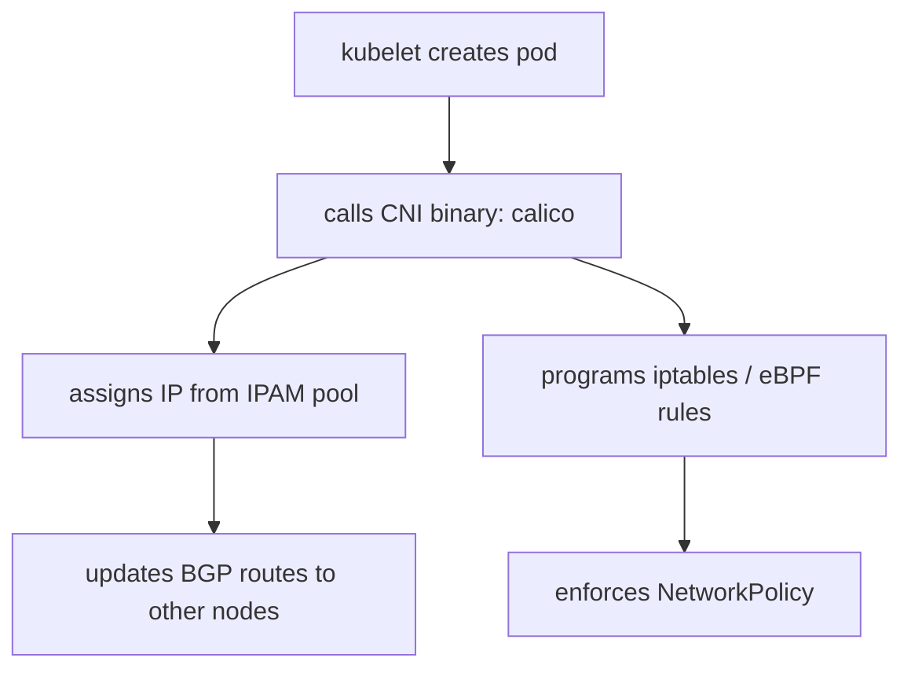
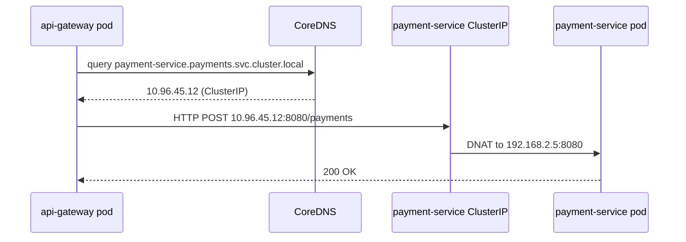
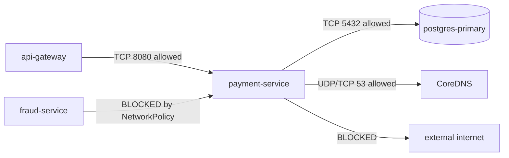
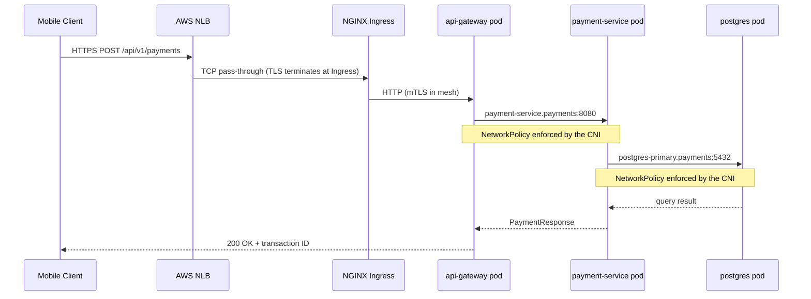

# Kubernetes Networking — CNI, Services, and Ingress

Kubernetes networking is one of the most consequential design decisions in a fintech platform. Payment services, fraud detection engines, and core banking APIs all share the cluster network, making isolation, discoverability, and performance non-negotiable. This lesson covers every networking layer from the CNI-level flat network through Services, Ingress, and NetworkPolicy enforcement.

---

## 1. The Kubernetes Pod Networking Model

Kubernetes mandates a flat network: every pod receives a unique, routable IP address, and any pod can communicate with any other pod on any node without NAT. This "IP-per-pod" guarantee simplifies service discovery and eliminates port conflicts between containers in the same pod.

```
┌────────────────────────────────────────────────────────────┐
│  Node A (10.0.1.10)          Node B (10.0.1.11)            │
│  ┌────────────┐               ┌────────────┐               │
│  │ Pod A      │               │ Pod B      │               │
│  │ 192.168.1.5│ ──── CNI ──── │ 192.168.2.7│               │
│  └────────────┘               └────────────┘               │
└────────────────────────────────────────────────────────────┘
```

Three rules govern this model:

1. All pods can communicate with all other pods without NAT.
2. All nodes can communicate with all pods without NAT.
3. The IP a pod sees for itself is the same IP other pods see it as.

This design means a payment-service pod at `192.168.1.5` can reach a database pod at `192.168.2.7` directly. The implication for security is severe — without NetworkPolicy, any compromised pod can reach any database in the cluster.

---

## 2. CNI Plugins

The Container Network Interface (CNI) is the plugin layer that provisions pod IPs, programs routes, and optionally enforces NetworkPolicy. Two CNI plugins dominate production fintech deployments.

### 2.1 Calico

Calico programs the network using BGP route distribution (or VXLAN in environments where BGP is not feasible). Its most important property for financial services is native NetworkPolicy enforcement at the kernel level using iptables or eBPF.



Calico also supports its own `GlobalNetworkPolicy` CRD, which applies cluster-wide before Kubernetes NetworkPolicy. For a fintech cluster, create a `GlobalNetworkPolicy` that defaults to deny-all and then layer allow rules on top.

### 2.2 Cilium (eBPF)

Cilium replaces iptables entirely with eBPF programs loaded into the Linux kernel. Benefits include:

- **Performance**: eBPF maps replace long iptables chains, so service lookup and policy checks stay fast as services and connections grow — helpful for high-connection-rate services like payment processors.
- **L7 visibility**: Cilium can enforce policy at HTTP/gRPC layer without a sidecar.
- **Hubble**: built-in network observability — flow logs at the kernel level.

Many large clusters choose Cilium for these reasons; Calico (also with an eBPF data plane) is an equally established choice. Managed clusters often come with a default (e.g. the AWS VPC CNI on EKS, combined with a policy engine).

```yaml
# Cilium Helm values for a fintech cluster (values.yaml)
kubeProxyReplacement: true      # Cilium handles Services; no kube-proxy
                                # ("strict" in releases before 1.14)
hubble:
  enabled: true
  relay:
    enabled: true
encryption:
  enabled: true
  type: wireguard               # encrypt pod-to-pod traffic between nodes
l7Proxy: true
```

---

## 3. Kubernetes Service Types

A Service gives pods a stable virtual IP (ClusterIP) and DNS name, decoupling consumers from the constantly changing set of pod IPs.

### 3.1 ClusterIP

ClusterIP is the default. It creates a virtual IP reachable only within the cluster.

```yaml
apiVersion: v1
kind: Service
metadata:
  name: payment-service
  namespace: payments
  labels:
    app: payment-service
    tier: backend
spec:
  type: ClusterIP
  selector:
    app: payment-service
  ports:
    - name: http
      port: 8080
      targetPort: 8080
      protocol: TCP
```

kube-proxy programs iptables (or IPVS) rules so that traffic to the ClusterIP is DNAT'd to one of the matching pod IPs. The service is reachable at `payment-service.payments.svc.cluster.local:8080`.

### 3.2 NodePort

NodePort opens a port (30000–32767) on every cluster node. Useful for development; avoid it for production entry points because the port is open on every node's IP addresses (public ones too, if nodes have them) and bypasses your ingress layer.

```yaml
apiVersion: v1
kind: Service
metadata:
  name: payment-service-nodeport
  namespace: payments
spec:
  type: NodePort
  selector:
    app: payment-service
  ports:
    - port: 8080
      targetPort: 8080
      nodePort: 31080
```

### 3.3 LoadBalancer

LoadBalancer provisions a cloud load balancer (AWS NLB, GCP Network LB). Used for services that must be reachable from outside the cluster without an Ingress controller.

```yaml
apiVersion: v1
kind: Service
metadata:
  name: payment-gateway-lb
  namespace: payments
  annotations:
    # AWS Load Balancer Controller annotations
    service.beta.kubernetes.io/aws-load-balancer-type: "external"
    service.beta.kubernetes.io/aws-load-balancer-nlb-target-type: "instance"
    service.beta.kubernetes.io/aws-load-balancer-scheme: "internal"
    service.beta.kubernetes.io/aws-load-balancer-cross-zone-load-balancing-enabled: "true"
spec:
  type: LoadBalancer
  selector:
    app: payment-gateway
  ports:
    - port: 443
      targetPort: 8443
  externalTrafficPolicy: Local  # preserve source IP for audit logs
```

The `internal` scheme annotation ensures the NLB is not internet-facing — critical for PCI-DSS segmentation. `externalTrafficPolicy: Local` preserves the original client IP for audit trails (with instance targets; with `ip` targets the NLB sends traffic straight to pod IPs). Trade-off: with `Local`, nodes without a ready pod fail the health check and receive no traffic.

### 3.4 ExternalName

ExternalName maps a Service to an external DNS name, giving third-party payment processors a Kubernetes-native service name.

```yaml
apiVersion: v1
kind: Service
metadata:
  name: visa-processor
  namespace: payments
spec:
  type: ExternalName
  externalName: api.visanet.example.com
```

---

## 4. kube-proxy: iptables, IPVS, nftables and eBPF

kube-proxy programs the data plane for Services on every node.

| Mode     | Implementation          | Scalability          | Load Balancing Algorithms    |
|----------|-------------------------|----------------------|------------------------------|
| iptables | linear rule chains      | rule sync and lookup cost grow with services/endpoints (much improved by partial syncs since 1.28) | random |
| IPVS     | kernel hash table       | fast lookup          | round-robin, least-conn, etc — **deprecated** in Kubernetes 1.35 |
| nftables | nftables maps/sets      | fast lookup and incremental updates; GA in Kubernetes 1.33 | random |
| eBPF     | kernel BPF maps (Cilium, Calico eBPF) | fast, replaces kube-proxy | depends on CNI |

For large clusters on a current Kubernetes version, use **nftables** mode (or an eBPF data plane that replaces kube-proxy). IPVS was the usual answer for years and you will still meet it on older clusters, but it is now deprecated. Managed services (EKS, GKE, AKS) set the mode for you or expose it as an option — check before changing it.

```yaml
# kube-proxy ConfigMap (kube-system namespace) -- self-managed clusters
apiVersion: v1
kind: ConfigMap
metadata:
  name: kube-proxy
  namespace: kube-system
data:
  config.conf: |
    apiVersion: kubeproxy.config.k8s.io/v1alpha1
    kind: KubeProxyConfiguration
    mode: "nftables"        # requires Linux kernel 5.13+ on the nodes
    nftables:
      syncPeriod: "30s"
      minSyncPeriod: "1s"
```

Restart kube-proxy after the ConfigMap change:

```bash
kubectl rollout restart daemonset/kube-proxy -n kube-system
# On a node: verify the nftables rules exist
nft list table ip kube-proxy | head -20
```

---

## 5. CoreDNS Service Discovery

CoreDNS provides DNS-based service discovery inside the cluster. The FQDN pattern is:

```
<service-name>.<namespace>.svc.cluster.local
```

For the payment service: `payment-service.payments.svc.cluster.local`

Pods in the same namespace can use the short name `payment-service`. Pods in other namespaces must use at least `payment-service.payments`.



A pod's `/etc/resolv.conf` is injected by kubelet with `ndots:5`. Any hostname with fewer than 5 dots is tried against each search domain before an absolute lookup — so `api.psp.example.com` (3 dots) causes several failed lookups (each for A and AAAA records) before the real one. Note that `payment-service.payments.svc.cluster.local` has only 4 dots, so it is also searched first. Two fixes:

- end the name with a dot (`api.psp.example.com.`) to make it absolute — but the trailing dot then also appears in the HTTP `Host` header and TLS name checks, which some servers reject;
- or lower `ndots` for the pod, which is usually cleaner:

```yaml
spec:
  dnsConfig:
    options:
      - name: ndots
        value: "2"    # names with 2+ dots are looked up as-is first
```

### 5.1 DNS-Based Discovery in Java

```java
import java.net.URI;
import java.net.http.HttpClient;
import java.net.http.HttpRequest;
import java.net.http.HttpResponse;
import java.time.Duration;

@Service
public class PaymentClient {

    // Fully qualified service name (with the pod's ndots lowered to 2,
    // it resolves without trying the search domains first)
    private static final String PAYMENT_SVC_BASE =
        "http://payment-service.payments.svc.cluster.local:8080";

    private final HttpClient httpClient;
    private final ObjectMapper objectMapper;

    public PaymentClient(ObjectMapper objectMapper) {
        this.objectMapper = objectMapper;
        this.httpClient = HttpClient.newBuilder()
            .connectTimeout(Duration.ofSeconds(2))
            .build();
    }

    public PaymentResponse submitPayment(PaymentRequest req) throws Exception {
        HttpRequest request = HttpRequest.newBuilder()
            .uri(URI.create(PAYMENT_SVC_BASE + "/api/v1/payments"))
            .header("Content-Type", "application/json")
            .header("X-Idempotency-Key", req.getIdempotencyKey())
            .POST(HttpRequest.BodyPublishers.ofString(
                objectMapper.writeValueAsString(req)))
            .timeout(Duration.ofSeconds(5))
            .build();

        HttpResponse<String> response =
            httpClient.send(request, HttpResponse.BodyHandlers.ofString());

        if (response.statusCode() / 100 != 2) {
            throw new PaymentException("Payment failed: " + response.statusCode());
        }
        return objectMapper.readValue(response.body(), PaymentResponse.class);
    }
}
```

A ClusterIP never changes while the Service exists, so the JVM's DNS cache does not matter for in-cluster Service names. It matters for external names that can fail over (see Pitfall 3).

---

## 6. Ingress Controller

An Ingress resource defines HTTP routing rules. An Ingress controller (NGINX, Traefik, Contour, HAProxy, cloud load balancer controllers) watches these resources and programs the reverse proxy.

> [!NOTE]
> The community **ingress-nginx** controller is being retired (Kubernetes SIG Network announced the end of its maintenance in 2026). The example below still shows the widely deployed Ingress API with ingress-nginx annotations, but for new platforms plan for the **Gateway API** (`Gateway` + `HTTPRoute`) with a maintained implementation.

### 6.1 NGINX Ingress for Fintech API Routing with TLS

```yaml
apiVersion: networking.k8s.io/v1
kind: Ingress
metadata:
  name: fintech-api-ingress
  namespace: payments
  annotations:
    nginx.ingress.kubernetes.io/ssl-redirect: "true"
    nginx.ingress.kubernetes.io/proxy-body-size: "1m"
    nginx.ingress.kubernetes.io/proxy-read-timeout: "10"
    nginx.ingress.kubernetes.io/proxy-send-timeout: "10"
    nginx.ingress.kubernetes.io/limit-rps: "100"
    nginx.ingress.kubernetes.io/limit-burst-multiplier: "5"
    # Security headers: NOT via configuration-snippet annotations -- snippet
    # annotations are disabled by default (they allowed injecting arbitrary
    # NGINX config, a source of serious CVEs). HSTS is on by default in the
    # controller; set other headers in the controller ConfigMap (add-headers)
    # or in the application.
    cert-manager.io/cluster-issuer: "letsencrypt-prod"
spec:
  ingressClassName: nginx
  tls:
    - hosts:
        - api.payments.example.com
      secretName: payments-tls
  rules:
    - host: api.payments.example.com
      http:
        paths:
          # Order does not matter: for Prefix paths the LONGEST matching
          # path wins (/api/v1/fraud beats /api/v1)
          - path: /api/v1/fraud
            pathType: Prefix
            backend:
              service:
                name: fraud-detection-service
                port:
                  number: 8080
          - path: /api/v1/payments
            pathType: Prefix
            backend:
              service:
                name: payment-service
                port:
                  number: 8080
          - path: /api/v1/accounts
            pathType: Prefix
            backend:
              service:
                name: account-service
                port:
                  number: 8080
```

The annotations enforce TLS redirect, rate-limit at 100 req/s per client IP, and constrain request body size to prevent large payload attacks. Security headers (HSTS and friends) come from the controller configuration — part of PCI-DSS hardening of public endpoints.

---

## 7. NetworkPolicy — Zero-Trust Cluster Networking

NetworkPolicy resources control which pods can communicate with which other pods. Without them, every pod can reach every other pod — a critical PCI-DSS violation.

### 7.1 Default Deny All (Namespace-Level)

Apply this to every namespace before creating allow rules:

```yaml
apiVersion: networking.k8s.io/v1
kind: NetworkPolicy
metadata:
  name: default-deny-all
  namespace: payments
spec:
  podSelector: {}       # matches all pods in namespace
  policyTypes:
    - Ingress
    - Egress
```

This blocks all ingress and egress for every pod in the `payments` namespace.

### 7.2 Allow payment-service Ingress from api-gateway Only

```yaml
apiVersion: networking.k8s.io/v1
kind: NetworkPolicy
metadata:
  name: allow-api-gateway-to-payment-service
  namespace: payments
spec:
  podSelector:
    matchLabels:
      app: payment-service
  policyTypes:
    - Ingress
  ingress:
    - from:
        - namespaceSelector:
            matchLabels:
              kubernetes.io/metadata.name: api-gateway
          podSelector:
            matchLabels:
              app: api-gateway
      ports:
        - protocol: TCP
          port: 8080
```

### 7.3 Allow payment-service Egress to PostgreSQL and DNS Only

```yaml
apiVersion: networking.k8s.io/v1
kind: NetworkPolicy
metadata:
  name: payment-service-egress
  namespace: payments
spec:
  podSelector:
    matchLabels:
      app: payment-service
  policyTypes:
    - Egress
  egress:
    - to:
        - podSelector:
            matchLabels:
              app: postgres-primary
      ports:
        - protocol: TCP
          port: 5432
    # DNS egress is ALWAYS required after default-deny-all
    - to:
        - namespaceSelector:
            matchLabels:
              kubernetes.io/metadata.name: kube-system
          podSelector:
            matchLabels:
              k8s-app: kube-dns
      ports:
        - protocol: UDP
          port: 53
        - protocol: TCP
          port: 53
```



---

## 8. Payment Network Flow End-to-End



---

## Production Pitfalls

### Pitfall 1: Not Setting NetworkPolicy Defaults Leaves Blast Radius Wide Open

**Problem**: Teams apply NetworkPolicy to individual services but forget to set a default-deny-all. Any new pod deployed without an explicit policy inherits full mesh access — a single compromised pod can reach every database in the cluster.

**Wrong approach**: Only adding NetworkPolicy for known sensitive services, leaving new services unrestricted.

**Correct approach**: Apply default-deny-all to every namespace at namespace creation time via a GitOps template. Always include the DNS egress rule as a companion policy.

```yaml
# Part of every namespace's base Helm chart
---
apiVersion: networking.k8s.io/v1
kind: NetworkPolicy
metadata:
  name: default-deny-all
  namespace: "{{ .Values.namespace }}"
spec:
  podSelector: {}
  policyTypes:
    - Ingress
    - Egress
---
apiVersion: networking.k8s.io/v1
kind: NetworkPolicy
metadata:
  name: allow-dns-egress
  namespace: "{{ .Values.namespace }}"
spec:
  podSelector: {}
  policyTypes:
    - Egress
  egress:
    - to:
        - namespaceSelector:
            matchLabels:
              kubernetes.io/metadata.name: kube-system
      ports:
        - protocol: UDP
          port: 53
        - protocol: TCP
          port: 53
---
apiVersion: networking.k8s.io/v1
kind: NetworkPolicy
metadata:
  name: allow-prometheus-scrape
  namespace: "{{ .Values.namespace }}"
spec:
  podSelector: {}
  policyTypes:
    - Ingress
  ingress:
    - from:
        - namespaceSelector:
            matchLabels:
              kubernetes.io/metadata.name: monitoring
          podSelector:
            matchLabels:
              app: prometheus
      ports:
        - protocol: TCP
          port: 8081    # the pods' METRICS port (actuator), not Prometheus' own 9090
```

**Validation**:
```bash
# Verify no pod can reach another without explicit policy
kubectl exec -n payments test-pod -- curl -s --max-time 2 http://fraud-service:8080/health
# Expected: command terminated with exit code 28 (timeout — connection blocked)
```

---

### Pitfall 2: kube-proxy iptables Degradation Under Large Service Count

**Problem**: In iptables mode, rule syncs grow with the number of Services and endpoints. In large clusters a sync can take seconds; until it completes, nodes keep sending traffic to endpoints of pods that are already gone, and new pods receive no traffic — causing payment timeouts during rollouts. (Partial syncs, GA in Kubernetes 1.28, reduced this a lot.)

**Diagnosis**:
```bash
# Check kube-proxy sync latency via its metrics (port 10249 on each node)
#   kubeproxy_sync_proxy_rules_duration_seconds  (histogram)
# Alert if p99 is above ~1s

# Count current iptables rules — over 20,000 is a risk signal
iptables-save | wc -l
```

**Fix**: Switch kube-proxy to nftables mode (Kubernetes 1.33+), or to an eBPF data plane that replaces kube-proxy. (Older guides recommend IPVS; it is deprecated now.)

```yaml
apiVersion: v1
kind: ConfigMap
metadata:
  name: kube-proxy
  namespace: kube-system
data:
  config.conf: |
    apiVersion: kubeproxy.config.k8s.io/v1alpha1
    kind: KubeProxyConfiguration
    mode: "nftables"
```

After applying the ConfigMap, restart the DaemonSet and verify:
```bash
kubectl rollout restart daemonset/kube-proxy -n kube-system
nft list table ip kube-proxy | head -20     # on a node
```

---

### Pitfall 3: JVM DNS Caching and Pooled Connections Breaking Failover

**Problem**: The JVM caches successful DNS lookups — 30 seconds by default in current JDKs, but **forever** if a security manager is installed or `networkaddress.cache.ttl=-1` is set in the `java.security` file (some hardened base images do this). Even with a short TTL, **pooled keep-alive connections** keep talking to the old IP: a new lookup only happens when a new connection is opened. When an external DNS entry changes (e.g., failover to a secondary payment processor or a database endpoint), pods keep using the stale address.

**Symptoms**: After a database failover or external endpoint change, one or more pods continue routing to the old IP, producing errors that persist until the connections are recycled or the pod restarts.

**Fix**: Set the DNS cache TTL explicitly, and give pooled connections a maximum lifetime (e.g. HikariCP `maxLifetime`, HTTP client connection TTL) so they are re-opened and re-resolved.

```java
// PaymentApplication.java — static initializer runs before Spring context
static {
    // Cache successful DNS lookups for 10 seconds
    java.security.Security.setProperty(
        "networkaddress.cache.ttl", "10");
    // Cache failed lookups for 5 seconds only
    java.security.Security.setProperty(
        "networkaddress.cache.negative.ttl", "5");
}
```

Or via JVM arguments in the container spec (preferred for consistency across all services). `networkaddress.cache.ttl` is a *security* property — `-Dnetworkaddress.cache.ttl` on the command line does nothing; the matching system properties are `sun.net.inetaddr.ttl` and `sun.net.inetaddr.negative.ttl`:

```yaml
# deployment.yaml - container env section
env:
  - name: JAVA_TOOL_OPTIONS
    value: >-
      -Dsun.net.inetaddr.ttl=10
      -Dsun.net.inetaddr.negative.ttl=5
```

**Verification**:
```bash
# Inspect the RUNNING JVM (PID 1 in the container), not a new java process
kubectl exec -n payments payment-service-xxx -- \
  jcmd 1 VM.system_properties | grep inetaddr
# Expected output: sun.net.inetaddr.ttl=10
```

---

## Checklist

### CNI and Pod Networking
- [ ] CNI plugin chosen: Calico (iptables/eBPF) or Cilium (eBPF) — documented in infrastructure repo
- [ ] Pod CIDR and Service CIDR do not overlap with VPC CIDR ranges
- [ ] kube-proxy mode set to `nftables` or replaced by eBPF in large clusters (IPVS is deprecated)
- [ ] BGP peering or VXLAN configured between nodes (Calico-specific)
- [ ] Pod IP capacity per node calculated (e.g. a /24 per node; default max 110 pods per node; on EKS the VPC CNI limits pods by ENIs/IPs)

### DNS and Service Discovery
- [ ] CoreDNS resources and replica count tuned for the expected query rate (consider NodeLocal DNSCache)
- [ ] CoreDNS replicas set to at least 2 for high availability
- [ ] JVM DNS TTL set explicitly (10–30 s) and pooled connections have a maximum lifetime
- [ ] ExternalName services documented with DNS failover procedure tested
- [ ] `ndots` lowered (dnsConfig) or absolute names used to avoid the ndots:5 search overhead

### NetworkPolicy
- [ ] `default-deny-all` NetworkPolicy applied to all production namespaces
- [ ] `allow-dns-egress` NetworkPolicy (UDP/TCP 53) applied alongside default-deny-all
- [ ] Explicit Ingress policies created for every service accepting traffic
- [ ] Explicit Egress policies created for every service (narrowest possible)
- [ ] NetworkPolicy validated with `kubectl exec` connectivity tests in staging
- [ ] Prometheus scrape ingress allowed from monitoring namespace

### Ingress
- [ ] Ingress / Gateway controller deployed with minimum 2 replicas spread across zones (migration plan off ingress-nginx)
- [ ] TLS 1.2+ enforced; TLS 1.0/1.1 disabled in controller ConfigMap
- [ ] Rate limiting annotations applied to all external-facing Ingress paths
- [ ] Request body size limits configured to prevent large payload attacks
- [ ] Security headers (HSTS, X-Content-Type-Options, X-Frame-Options) added via controller config — snippet annotations stay disabled
- [ ] Path routing tested (Prefix paths: longest match wins)

### Security and Compliance
- [ ] All Services internal to PCI-DSS scope use `type: ClusterIP` only
- [ ] AWS NLB (if used) is `scheme: internal` for all non-public-facing services
- [ ] `externalTrafficPolicy: Local` set on all LoadBalancer services requiring source IP logging
- [ ] Network topology diagram updated and reviewed for PCI-DSS network segmentation compliance
- [ ] `preStop` lifecycle hook with 5-second sleep on all payment pods for graceful shutdown

---

<!-- KNOWLEDGE-CHECK
{"questions": [{"text": "What is the purpose of a 'default-deny-all' NetworkPolicy in a production Kubernetes cluster?", "options": ["a) It prevents Kubernetes from scheduling new pods until a NetworkPolicy is explicitly applied", "b) It blocks all ingress and egress for every pod in the namespace, requiring explicit allow rules for each communication path", "c) It sets the default CNI plugin to Calico for the namespace", "d) It disables kube-proxy iptables rules and forces IPVS mode"], "correct": 1, "explanation": "A default-deny-all NetworkPolicy (podSelector: {}) blocks all ingress and egress traffic for every pod in the namespace. Teams must then create explicit allow NetworkPolicy objects for each required communication path, enforcing zero-trust networking. Without the companion allow-dns-egress policy, even DNS resolution fails."}, {"text": "Why can kube-proxy's iptables mode become a problem in very large fintech clusters, and what is the current recommendation?", "options": ["a) iptables mode cannot enforce NetworkPolicy, so it must be replaced for PCI-DSS", "b) iptables rules form long linear chains whose sync time grows with services and endpoints, so endpoint changes reach nodes late; nftables mode (GA in Kubernetes 1.33) or an eBPF data plane use map lookups and incremental updates", "c) iptables mode disables kube-proxy entirely and routes traffic through Envoy sidecar proxies", "d) iptables mode is required for mTLS between services in the payments namespace"], "correct": 1, "explanation": "In iptables mode, rules are long linear chains and a sync rewrites large parts of them; with thousands of Services and endpoints a sync can take seconds, so nodes keep routing to pods that are already gone. nftables mode (GA in Kubernetes 1.33) uses maps and incremental updates, and eBPF data planes (Cilium, Calico eBPF) replace kube-proxy with BPF map lookups. IPVS was the classic answer but is deprecated in recent Kubernetes versions. NetworkPolicy is enforced by the CNI, not by kube-proxy."}, {"text": "A Java payment client stops routing requests to a failover endpoint after an external DNS record changes. What is the most likely root cause?", "options": ["a) The Kubernetes NetworkPolicy is blocking egress to the new IP address", "b) CoreDNS TTL is set too high in the kube-system ConfigMap", "c) The JVM's DNS cache (forever when a security manager or a java.security TTL of -1 is in effect) and long-lived pooled connections keep using the old IP — no TTL or connection lifetime was configured", "d) The ExternalName service must be deleted and recreated for DNS changes to take effect"], "correct": 2, "explanation": "Current JDKs cache successful lookups for 30 seconds by default, but forever when a security manager is installed or networkaddress.cache.ttl=-1 is set in java.security, as some hardened images do. And even with a short TTL, pooled keep-alive connections never re-resolve: they keep talking to the old IP until they are closed. Set the TTL explicitly (security property networkaddress.cache.ttl, or system property sun.net.inetaddr.ttl via JAVA_TOOL_OPTIONS) and give connection pools a maximum connection lifetime so failovers are picked up."}]}
-->

<!-- PRACTICAL-CHALLENGE
{"title": "Secure Multi-Tier Payment Cluster Networking", "difficulty": "advanced", "estimatedMinutes": 90, "tasks": [{"id": "1", "description": "Deploy a 3-namespace cluster (api-gateway, payments, data). Apply a default-deny-all NetworkPolicy to each namespace along with an allow-dns-egress companion policy. Verify that a test pod in api-gateway cannot reach a test pod in payments before allow rules are created — expect timeout with exit code 28."}, {"id": "2", "description": "Create NetworkPolicy objects that allow: api-gateway pods to reach payment-service on port 8080, payment-service pods to reach postgres-primary on port 5432. Verify each path works with kubectl exec and that cross-paths (e.g., fraud-service to payment-service) remain blocked."}, {"id": "3", "description": "Deploy an ingress controller (or a Gateway API implementation) with a TLS certificate using cert-manager and a self-signed ClusterIssuer. Route /api/v1/payments to payment-service and /api/v1/accounts to account-service. Add rate limiting of 50 rps per client IP, verify the TLS redirect is enforced, and confirm the HSTS header is present in responses — without using snippet annotations."}, {"id": "4", "description": "In a local kind cluster, deploy 100 Services with endpoints. Measure kube-proxy sync time in iptables mode via the kubeproxy_sync_proxy_rules_duration_seconds metric, switch kube-proxy to nftables mode, then measure again. Document the difference and confirm with nft list table ip kube-proxy that the service entries exist."}]}
-->
