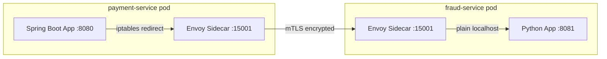
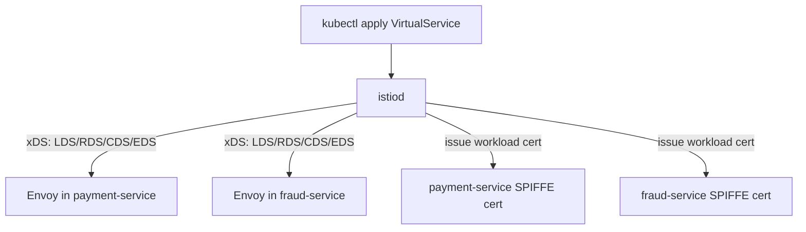
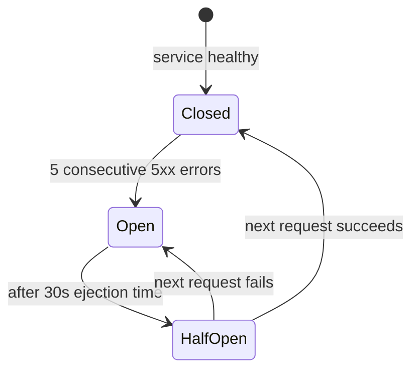

# شبكة الخدمات (Service Mesh) — إدارة الحركة والرصد في Istio

تضيف شبكة الخدمات طبقة بنية تحتية مخصصة للتواصل بين الخدمات، تتولى التشفير، وإعادة المحاولات، وقطع الدائرة، والتتبع الموزع بشفافية — دون تغيير شيفرة التطبيق. ولمنصات التقنية المالية حيث يحمل كل استدعاء بين الخدمات بيانات مالية، يوفر فرض TLS المتبادل في Istio وسياسات التفويض الدقيقة ضوابط أمنية تدعم متطلبات PCI-DSS للتشفير أثناء النقل (المتطلب 4) وضبط الوصول (المتطلب 7) — كأدلة إلى جانب ضوابطك الأخرى، لا كإجابة كاملة وحدها.

(تستخدم الأمثلة واجهات Istio بإصدار `v1`، المتاحة منذ Istio 1.22؛ وتعرض الأدلة الأقدم `v1alpha3`/`v1beta1`.)

---

## 1. بنية شبكة الخدمات

تفصل بنية Istio **مستوى البيانات** (الوكلاء الذين يتولون الحركة) عن **مستوى التحكم** (المكونات التي تضبط الوكلاء).

### 1.1 نموذج الوكيل الجانبي (Sidecar)

يُحقن في كل pod داخل الشبكة وكيل Envoy كحاوية جانبية. وهذا الحقن شفاف للتطبيق — فالتطبيق يرسل الحركة كالمعتاد، ويعترضها الوكيل الجانبي، ويطبق السياسات، ويمررها إلى الوجهة.



تعيد قواعد iptables التي تحقنها حاوية البدء `istio-init` (أو إضافة Istio CNI) توجيه كل الحركة الواردة والصادرة عبر وكيل Envoy على المنفذ 15001 (صادر) و15006 (وارد). ولا يرى التطبيق هذا أبدًا — فما زال يتصل بـ `fraud-service:8081` كالمعتاد.

> [!NOTE]
> يقدم Istio أيضًا **الوضع المحيطي (ambient mode)** (مستقر منذ Istio 1.24): بلا وكيل جانبي لكل pod؛ إذ يوفر `ztunnel` لكل عقدة mTLS وسياسات L4، وتضيف وكلاء *waypoint* اختيارية لكل مساحة أسماء ميزات L7. وهو يقلل كلفة الموارد لكل pod ومشكلات ترتيب البدء الموصوفة أدناه. ويستخدم هذا الدرس نموذج الوكيل الجانبي، الذي ما زال الأوسع انتشارًا.

### 1.2 مستوى تحكم Istio ‏(istiod)

يدمج `istiod` ثلاث وظائف كانت مكونات منفصلة قبل Istio 1.5 (وما زالت الأسماء القديمة تُستخدم في التوثيق والمحاضرات):

| المكوّن | الوظيفة |
|-----------|----------|
| Pilot     | اكتشاف الخدمات، وقواعد إدارة الحركة ← إعدادات Envoy عبر xDS |
| Citadel   | سلطة الشهادات — تصدر شهادات SPIFFE X.509 لكل هوية حمل عمل |
| Galley    | التحقق من الإعدادات وتوزيعها |



---

## 2. ‏mTLS تلقائي بين الخدمات

أثمن ميزة أمنية في Istio هي TLS المتبادل (mTLS) التلقائي بين كل الخدمات في الشبكة. ولا يلزم أي تغيير في شيفرة التطبيق — إذ تتفاوض الوكلاء الجانبية على TLS بشفافية باستخدام شهادات X.509 بصيغة SPIFFE تصدرها سلطة الشهادات المدمجة في istiod (ويمكن توصيل سلطة خارجية، أو SPIRE، بدلًا منها)، وتُدوَّر تلقائيًا كل 24 ساعة افتراضيًا.

### 2.1 ‏PeerAuthentication — فرض mTLS الصارم

```yaml
# Enforce mTLS in the entire payments namespace
# Any service calling payment-service without a valid cert is rejected
apiVersion: security.istio.io/v1
kind: PeerAuthentication
metadata:
  name: payments-mtls-strict
  namespace: payments
spec:
  mtls:
    mode: STRICT
```

مع الوضع `STRICT`، يُرفض أي اتصال نصي صريح بخدمة في مساحة الأسماء `payments` — حتى من pods أخرى في العنقود نفسه ليست جزءًا من الشبكة. وتشفير كل الحركة الداخلية دليل قوي لضوابط PCI-DSS في التشفير أثناء النقل والتقسيم. وانشره بالبدء بوضع `PERMISSIVE`، والتحقق (مثلًا في Kiali) من أن كل العملاء يستخدمون mTLS بالفعل، ثم التحويل إلى `STRICT`.

### 2.2 التحقق من mTLS

```bash
# Check sidecar injection and the effective mTLS / policy setup of a pod
istioctl x check-inject -n payments
istioctl x describe pod payment-service-7d9f8-abcde -n payments

# Expected (excerpt):
# Pod: payment-service-7d9f8-abcde
#    Pod Ports: 8080 (payment-service), 15090 (istio-proxy)
# Service: payment-service
#    Port: http 8080/HTTP targets pod port 8080
# Effective PeerAuthentication:
#    Workload mTLS mode: STRICT
# (The old "istioctl authn tls-check" command was removed in Istio 1.5+)
```

---

## 3. إدارة الحركة

تستخدم إدارة الحركة في Istio موردين مخصصين معًا: `VirtualService` (قواعد التوجيه) و`DestinationRule` (موازنة الحمل وإعداد المجموعات الفرعية).

### 3.1 ‏VirtualService — توجيه موزون لعمليات نشر الكناري

```yaml
# Route 90% to stable v1, 10% to canary v2
apiVersion: networking.istio.io/v1
kind: VirtualService
metadata:
  name: payment-service-vs
  namespace: payments
spec:
  hosts:
    - payment-service
  http:
    - match:
        # Pin internal testers to canary via header
        - headers:
            x-canary:
              exact: "true"
      route:
        - destination:
            host: payment-service
            subset: v2
    - route:
        # Production traffic split
        - destination:
            host: payment-service
            subset: v1
          weight: 90
        - destination:
            host: payment-service
            subset: v2
          weight: 10
      timeout: 5s
      retries:
        # POST /payments is NOT idempotent by itself: retry only failures
        # where the request certainly did not reach the app -- or rely on
        # an idempotency key. (Istio retries by default -- 2 attempts on
        # connect-failure, refused-stream, unavailable... -- so set this
        # explicitly for payment routes.)
        attempts: 2
        perTryTimeout: 2s
        retryOn: "connect-failure,refused-stream"
```

### 3.2 ‏DestinationRule — المجموعات الفرعية وموازنة الحمل

```yaml
apiVersion: networking.istio.io/v1
kind: DestinationRule
metadata:
  name: payment-service-dr
  namespace: payments
spec:
  host: payment-service
  trafficPolicy:
    connectionPool:
      tcp:
        maxConnections: 100
        connectTimeout: 2s
      http:
        h2UpgradePolicy: UPGRADE
        http1MaxPendingRequests: 100
        http2MaxRequests: 1000
    loadBalancer:
      simple: LEAST_CONN     # least connections for payment processing
    outlierDetection:
      # Circuit breaking: eject pods with 5 consecutive 5xx errors for 30s
      consecutive5xxErrors: 5
      interval: 10s
      baseEjectionTime: 30s
      maxEjectionPercent: 50
  subsets:
    - name: v1
      labels:
        version: v1
      trafficPolicy:
        connectionPool:
          tcp:
            maxConnections: 80
    - name: v2
      labels:
        version: v2
      trafficPolicy:
        connectionPool:
          tcp:
            maxConnections: 20
```

---

## 4. قطع الدائرة بـ OutlierDetection

يُضبط قطع الدائرة في Istio في `DestinationRule.outlierDetection`. فحين يعيد pod عدد `consecutive5xxErrors` من استجابات 5xx متتالية (أو `consecutiveGatewayErrors` — لـ 502/503/504 فقط)، يُخرج من مجموعة موازنة الحمل لمدة `baseEjectionTime` (مضروبة في عدد مرات إخراجه). ويجري التحليل كل `interval`. ويربط المخطط أدناه هذا بحالات قاطع الدائرة الكلاسيكية — وبدقة، يعود المضيف المُخرج ببساطة إلى المجموعة بعد مدة الإخراج ويُخرج مجددًا إن استمر في الفشل.



```yaml
# Dedicated circuit breaker for external payment gateway
apiVersion: networking.istio.io/v1
kind: DestinationRule
metadata:
  name: visa-gateway-cb
  namespace: payments
spec:
  host: visa-gateway.payments.svc.cluster.local
  trafficPolicy:
    outlierDetection:
      consecutiveGatewayErrors: 5
      interval: 10s
      baseEjectionTime: 30s
      maxEjectionPercent: 100   # eject ALL if all pods fail (failfast)
    connectionPool:
      http:
        http1MaxPendingRequests: 50  # backpressure — reject early
```

---

## 5. إعادة المحاولات والمهل في VirtualService

يمنع الجمع بين إعادة المحاولات والمهل الإخفاقات المتتالية في سلاسل معالجة المدفوعات.

```yaml
apiVersion: networking.istio.io/v1
kind: VirtualService
metadata:
  name: fraud-service-vs
  namespace: payments
spec:
  hosts:
    - fraud-service
  http:
    - route:
        - destination:
            host: fraud-service
      timeout: 3s
      retries:
        attempts: 2
        perTryTimeout: 1s
        retryOn: "gateway-error,connect-failure,refused-stream"
        # gateway-error (502/503/504) is acceptable here because a fraud
        # SCORE request has no side effects. Do NOT retry on 5xx for
        # requests that change state unless they carry an idempotency key
```

**قاعدة للتقنية المالية**: لا تُعد أبدًا محاولة تعديلات الدفع غير متساوية القوة دون مفاتيح تساوي القوة. وأعد المحاولة فقط عند إخفاقات الاتصال (`connect-failure`، و`reset`) أو للقراءات متساوية القوة.

---

## 6. التتبع الموزع مع Jaeger

تنشئ الوكلاء الجانبية امتدادات (spans) لكل طلب وتضيف ترويسات التتبع إن لم تكن موجودة. ويجمع Jaeger (أو أي واجهة خلفية متوافقة مع OpenTelemetry) هذه التتبعات ويعرضها.

### 6.1 نشر سياق التتبع

بحسب إعداد المتتبع، يستخدم Envoy ترويسات B3 (بأسلوب Zipkin) أو W3C ‏`traceparent`. وينشئ الوكيل الجانبي الامتدادات تلقائيًا، لكنه لا يعرف أي استدعاء صادر ينتمي لأي طلب وارد — فيجب على **التطبيق** نسخ ترويسات التتبع (و`x-request-id`) من الطلب الوارد إلى استدعاءاته الصادرة.

في Spring Boot 3، يفعل Micrometer Tracing (أو عامل OpenTelemetry لـ Java) ذلك تلقائيًا لـ `RestTemplate`، و`RestClient`، و`WebClient`، وKafka — فاضبط نوع النشر ليطابق الشبكة (`management.tracing.propagation.type=b3,w3c`). وتُظهر النسخة اليدوية أدناه ما يحدث تحت الغطاء:

```java
// TraceContextPropagationFilter.java
// Extract incoming B3 headers and forward them to downstream calls
@Component
public class TraceContextPropagationFilter implements Filter {

    private static final List<String> B3_HEADERS = List.of(
        "x-request-id",
        "x-b3-traceid",
        "x-b3-spanid",
        "x-b3-parentspanid",
        "x-b3-sampled",
        "x-b3-flags",
        "b3"
    );

    @Override
    public void doFilter(ServletRequest req, ServletResponse res,
                         FilterChain chain) throws IOException, ServletException {
        HttpServletRequest httpReq = (HttpServletRequest) req;

        // Store B3 headers in request-scoped context for downstream calls
        Map<String, String> traceHeaders = new HashMap<>();
        for (String header : B3_HEADERS) {
            String value = httpReq.getHeader(header);
            if (value != null) {
                traceHeaders.put(header, value);
            }
        }
        TraceContext.set(traceHeaders);
        try {
            chain.doFilter(req, res);
        } finally {
            TraceContext.clear();   // thread-pool threads are reused
        }
    }
}
```

```java
// PaymentClient.java — propagate trace headers on outbound calls
public FraudResponse callFraudService(FraudRequest request) throws Exception {
    Map<String, String> traceHeaders = TraceContext.get();

    HttpRequest.Builder builder = HttpRequest.newBuilder()
        .uri(URI.create(FRAUD_SERVICE_URL + "/api/v1/fraud/score"))
        .POST(HttpRequest.BodyPublishers.ofString(request.toJson()));

    // Forward all B3 trace headers
    traceHeaders.forEach(builder::header);

    HttpResponse<String> response =
        httpClient.send(builder.build(), HttpResponse.BodyHandlers.ofString());
    return FraudResponse.fromJson(response.body());
}
```

### 6.2 مورد Telemetry لأخذ العينات

```yaml
apiVersion: telemetry.istio.io/v1
kind: Telemetry
metadata:
  name: payment-tracing
  namespace: payments
spec:
  tracing:
    - providers:
        - name: otel-tracing     # extension provider defined in MeshConfig
                                 # (OpenTelemetry collector -> Jaeger)
      randomSamplingPercentage: 10.0
```

التتبعات أداة تصحيح، لا سجل تدقيق: فمسار تدقيق المدفوعات يعيش في سجلات تدقيق التطبيق وقاعدة البيانات. وأخذ عينات بنسبة 100% عند أحجام المدفوعات مكلف؛ فخذ نسبة مئوية وافرض أخذ العينات لطلبات محددة (مثل `x-b3-sampled: 1`، أو أخذ العينات من الذيل في مُجمّع OpenTelemetry الذي يحتفظ بكل التتبعات ذات الأخطاء). ولا تضع بيانات البطاقات أبدًا في سمات الامتدادات.

---

## 7. رسم الخدمات في Kiali

يوفر Kiali رسمًا حيًا لطوبولوجيا الخدمات، يُظهر تدفق الحركة، ومعدلات الأخطاء، وحالة mTLS بين الخدمات.

```
Payment Platform Service Graph (Kiali):

[api-gateway] --100%mTLS--> [payment-service v1] --90%-->
                                                   --10%--> [payment-service v2]
[payment-service] --100%mTLS--> [fraud-service]
[payment-service] --100%mTLS--> [postgres (external)]
[payment-service] --100%mTLS--> [kafka]

Error rates:
  payment-service v1: 0.02%
  payment-service v2: 1.4%  <-- canary alert threshold exceeded
```

الوصول إلى Kiali عبر port-forward:
```bash
kubectl port-forward svc/kiali 20001:20001 -n istio-system
# Open http://localhost:20001/kiali
```

---

## 8. ‏AuthorizationPolicy — صلاحيات بين الخدمات

تفرض AuthorizationPolicy أي الخدمات يمكنها استدعاء أي خدمات أخرى، بناءً على هويات SPIFFE (لا عناوين IP).

```yaml
# Only api-gateway can call payment-service
# All other callers receive HTTP 403 RBAC denied
apiVersion: security.istio.io/v1
kind: AuthorizationPolicy
metadata:
  name: payment-service-authz
  namespace: payments
spec:
  selector:
    matchLabels:
      app: payment-service
  action: ALLOW
  rules:
    - from:
        - source:
            # SPIFFE identity: system:serviceaccount:api-gateway:api-gateway-sa
            principals:
              - "cluster.local/ns/api-gateway/sa/api-gateway-sa"
      to:
        - operation:
            methods: ["POST", "GET"]
            paths: ["/api/v1/payments/*", "/api/v1/payments"]
---
# payment-service can call fraud-service, but only the /score endpoint
apiVersion: security.istio.io/v1
kind: AuthorizationPolicy
metadata:
  name: fraud-service-authz
  namespace: payments
spec:
  selector:
    matchLabels:
      app: fraud-service
  action: ALLOW
  rules:
    - from:
        - source:
            principals:
              - "cluster.local/ns/payments/sa/payment-service-sa"
      to:
        - operation:
            methods: ["POST"]
            paths: ["/api/v1/fraud/score"]
---
# Default deny all -- policy order does not matter: a request is allowed
# only if some ALLOW policy matches it (and no DENY policy does)
apiVersion: security.istio.io/v1
kind: AuthorizationPolicy
metadata:
  name: default-deny
  namespace: payments
spec:
  {}  # empty spec: ALLOW action with no rules -> matches nothing -> deny all
```

---

## مزالق الإنتاج

### المزلق 1: وضع mTLS الصارم يكسر فحوص صحة Kubernetes

**المشكلة**: حين يُضبط `PeerAuthentication` على `STRICT`، تُرفض فحوص الحيوية والجاهزية في Kubernetes (المرسلة من kubelet، الذي ليس جزءًا من الشبكة) لأنها اتصالات نصية صريحة. فتفشل الخدمات في فحوص الصحة وتُعاد تشغيلها في حلقة. ومنذ Istio 1.10 يعيد حاقن الوكلاء **كتابة فحوص HTTP افتراضيًا** (خيار الحل 2)، فاليوم يظهر هذا أساسًا حين يُعطّل إعادة كتابة الفحوص أو مع فحوص TCP/gRPC والإعدادات المخصصة.

**التشخيص**:
```bash
kubectl describe pod payment-service-xxx -n payments
# Events: Liveness probe failed: Get http://10.244.1.5:8080/health: EOF
# (EOF = connection closed by Envoy because kubelet has no client cert)
```

**خيار الحل 1**: استخدم استثناءً قائمًا على المنفذ لمنفذ فحص الصحة في تعليق الوكيل الجانبي:

```yaml
# deployment.yaml annotations
annotations:
  traffic.sidecar.istio.io/excludeInboundPorts: "8081"
  # probe on 8081 bypasses Envoy; application logic on 8080 uses mTLS
```

**خيار الحل 2**: أعد كتابة الفحوص باستخدام إعادة كتابة الفحوص المدمجة في Istio (مفعّلة افتراضيًا منذ Istio 1.10):

```yaml
# Istio automatically rewrites HTTP probes using the sidecar agent port
# Verify it is enabled in istiod config:
kubectl get configmap istio -n istio-system -o yaml | grep rewriteAppHTTPProbe
# Expected: rewriteAppHTTPProbe: true
```

**خيار الحل 3**: استخدم فحوص exec بدل فحوص HTTP — فحوص exec تعمل داخل الحاوية وتتجاوز الوكيل الجانبي:

```yaml
livenessProbe:
  exec:
    command:
      - /bin/sh
      - -c
      - wget -qO- http://localhost:8080/health || exit 1
  initialDelaySeconds: 30
  periodSeconds: 10
```

---

### المزلق 2: عدم مطابقة VirtualService لأن بروتوكول منفذ الخدمة غير مصرّح به

**المشكلة**: يوجّه Istio حركة HTTP وTCP بشكل مختلف. ويأتي البروتوكول من حقل `appProtocol` لمنفذ الخدمة أو من بادئة اسمه (`http`، و`http2`، و`grpc`، و`tcp`، و`tls`، ...). والمنفذ المصرّح به كـ TCP (مثل المسمى `tcp-api`) لا يحصل على معالجة L7: فلا أثر لقواعد HTTP في VirtualService — وتُتجاهل أوزان الكناري بصمت. وللمنافذ بلا بروتوكول معروف، يرجع Istio إلى *استشعار* البروتوكول تلقائيًا، الذي يكتشف HTTP/1.1 وHTTP/2 لكنه يعامل ما لا يستطيع اكتشافه كـ TCP عادي. فصرّح بالبروتوكول لكل منفذ.

**تعريف الخدمة المعطوب**:
```yaml
apiVersion: v1
kind: Service
metadata:
  name: payment-service
  namespace: payments
spec:
  ports:
    - name: tcp-api      # declared as TCP — no HTTP routing
      port: 8080
      targetPort: 8080
```

**تعريف الخدمة المُصلح**:
```yaml
apiVersion: v1
kind: Service
metadata:
  name: payment-service
  namespace: payments
spec:
  ports:
    - name: http         # name prefix 'http' ...
      appProtocol: http  # ... or appProtocol (preferred, explicit)
      port: 8080
      targetPort: 8080
    - name: grpc-internal
      appProtocol: grpc
      port: 9090
      targetPort: 9090
```

**التحقق**:
```bash
# Confirm Istio detects the protocol correctly
istioctl proxy-config cluster payment-service-pod-xxx.payments | grep payment-service
# Expected: payment-service.payments.svc.cluster.local 8080 - outbound EDS http
# BAD output: ... TCP (not http)
```

---

### المزلق 3: ترتيب بدء وكيل Envoy الجانبي يسبب رفض الاتصال عند الإقلاع

**المشكلة**: يبدأ وكيل Envoy الجانبي وحاوية التطبيق في الوقت نفسه. فإذا أجرى التطبيق استدعاءً صادرًا أثناء البدء (مثل الاتصال بخدمة إعدادات أو قاعدة بيانات) قبل جاهزية Envoy، يفشل الاتصال لأن iptables يعيد توجيه الحركة إلى Envoy لم يبدأ الاستماع بعد.

**الأعراض**: تُظهر سجلات التطبيق `Connection refused` خلال أول 2–5 ثوانٍ من بدء الـ pod.

**الحل**: اضبط `holdApplicationUntilProxyStarts` في إعدادات الشبكة:

```yaml
# MeshConfig in istio-system ConfigMap
apiVersion: v1
kind: ConfigMap
metadata:
  name: istio
  namespace: istio-system
data:
  mesh: |
    defaultConfig:
      holdApplicationUntilProxyStarts: true
      # Envoy must be ready before the app container starts
```

أو بتعليق لكل pod:
```yaml
# deployment.yaml annotations
annotations:
  proxy.istio.io/config: |
    holdApplicationUntilProxyStarts: true
```

يعمل هذا بوضع حاوية istio-proxy أولًا والانتظار في خطاف `postStart` الخاص بها حتى يجهز Envoy — فلا يبدأ kubelet الحاوية التالية إلا بعد ذلك. (وخطاف `postStart` على حاوية *التطبيق* لن يساعد: فعملية التطبيق تعمل بالفعل أثناء تنفيذ خطافها.)

**بديل**: على Kubernetes 1.29+ يستطيع Istio حقن الوكيل كـ **وكيل جانبي أصلي (native sidecar)** (حاوية بدء بـ `restartPolicy: Always`، مفعّلة افتراضيًا في إصدارات Istio الحديثة). فالوكلاء الجانبيون الأصليون يبدؤون قبل حاويات التطبيق ويتوقفون بعدها، فيحلّون ترتيب البدء والإيقاف معًا.

---

## قائمة التحقق

### تثبيت Istio وإعداد مساحات الأسماء
- [ ] تثبيت Istio بملف `default` مع تجاوزات الإنتاج (istiod عالي التوفر، وPodDisruptionBudgets، وطلبات الموارد) — فلا يوجد ملف "production"
- [ ] تطبيق تسمية الحقن على مساحة الأسماء: `kubectl label namespace payments istio-injection=enabled`
- [ ] ضبط `holdApplicationUntilProxyStarts: true` في MeshConfig
- [ ] كل منفذ خدمة يصرّح ببروتوكوله (`appProtocol` أو بادئة اسم مثل `http`، و`grpc`، و`tls`)
- [ ] نشر istiod بنسختين على الأقل للتوفر العالي

### ‏mTLS والأمان
- [ ] تطبيق `PeerAuthentication` بوضع STRICT على كل مساحات الأسماء ضمن نطاق PCI
- [ ] توافق فحوص صحة Kubernetes مع mTLS (إعادة كتابة الفحوص مفعّلة أو استخدام فحوص exec)
- [ ] تطبيق `AuthorizationPolicy` بمنع افتراضي على كل مساحات أسماء الإنتاج
- [ ] قواعد ALLOW صريحة في `AuthorizationPolicy` لكل مسار استدعاء بين الخدمات
- [ ] التحقق من mTLS وهويات SPIFFE بـ `istioctl x describe pod` / Kiali

### إدارة الحركة
- [ ] إعادة المحاولات في `VirtualService` مضبوطة صراحة — إخفاقات الاتصال فقط لطلبات POST غير متساوية القوة (يعيد Istio المحاولة افتراضيًا)
- [ ] المهل مضبوطة على مستوى VirtualService (لا على مستوى التطبيق فقط)
- [ ] ‏`outlierDetection` في `DestinationRule` مضبوط لكل الاعتماديات الخارجية
- [ ] التحقق من أوزان الكناري في التجهيز قبل النشر في الإنتاج
- [ ] ضبط `maxEjectionPercent` بشكل مناسب لمنع إخراج كل الـ pods في آن واحد

### الرصد
- [ ] نشر واجهة تتبع خلفية Jaeger أو Zipkin وربطها بـ Istio
- [ ] التطبيق ينشر ترويسات التتبع (B3 أو W3C، زائد `x-request-id`) على كل الاستدعاءات الصادرة
- [ ] ضبط مورد `Telemetry` بمعدل أخذ عينات معقول التكلفة مع أخذ عينات مفروض/من الذيل للأخطاء
- [ ] نشر Kiali ومراجعة رسم الخدمات أسبوعيًا
- [ ] شحن سجلات وصول Envoy إلى مُجمّع سجلات مركزي (Fluentd/Loki)

### الامتثال
- [ ] توثيق وضع mTLS ‏STRICT كضابط للتشفير أثناء النقل / التقسيم
- [ ] توثيق قواعد `AuthorizationPolicy` كضابط وصول بأقل صلاحية (متطلب PCI-DSS رقم 7)
- [ ] الاحتفاظ بسجلات الوصول وفق PCI-DSS 10.5.1 ‏(12 شهرًا، وآخر 3 أشهر متاحة فورًا)؛ والتتبعات لا تحوي بيانات حاملي البطاقات

---

<!-- KNOWLEDGE-CHECK
{"questions":[{"text":"لماذا يسبب ضبط PeerAuthentication على الوضع STRICT أحيانًا فشل فحوص الحيوية في Kubernetes؟","options":["أ) يعطل الوضع STRICT كل اتصالات TCP بما فيها فحوص الصحة","ب) فحوص صحة kubelet في Kubernetes طلبات HTTP نصية صريحة يرفضها Envoy لأن kubelet لا يملك شهادة الشبكة","ج) يتطلب الوضع STRICT أن ينفذ التطبيق mTLS في شيفرته الخاصة","د) تمنع AuthorizationPolicy ذات المنع الافتراضي فحوص الحيوية"],"correct":1,"explanation":"يرسل kubelet في Kubernetes فحوص الحيوية والجاهزية مباشرة إلى عنوان الـ pod كطلبات HTTP نصية صريحة. ومع وضع mTLS ‏STRICT، يرفض Envoy هذه الاتصالات غير الموثقة. والحل إعادة كتابة الفحوص في Istio ‏(rewriteAppHTTPProbe — مفعّلة افتراضيًا منذ Istio 1.10)، التي تعيد توجيه الفحوص عبر عامل الوكيل الجانبي، أو فحوص exec تعمل داخل الحاوية، أو استثناء منفذ صحة مخصص من الاعتراض. (أما holdApplicationUntilProxyStarts فلا علاقة له: فهو يتحكم في ترتيب بدء الحاويات.)"},{"text":"نُشر VirtualService بتوجيه كناري بأوزان 90/10 لكن كل الحركة تستمر في الذهاب إلى v1. ما السبب الأرجح؟","options":["أ) تفتقد المجموعات الفرعية في DestinationRule إعداد OutlierDetection","ب) منفذ خدمة Kubernetes مصرّح به كـ TCP (مثل المسمى 'tcp-api'، أو ببروتوكول لا يستطيع Istio اكتشافه)، فيعامل Istio الحركة كـ TCP ويتجاهل قواعد توجيه L7","ج) لنشر الكناري pods أقل من النشر المستقر","د) وضع PeerAuthentication هو PERMISSIVE بدل STRICT"],"correct":1,"explanation":"يحدد Istio بروتوكول الحركة من حقل appProtocol لمنفذ الخدمة أو من بادئة اسمه ('http'، و'grpc'، و'tcp'، و'tls'، ...)، ويرجع إلى استشعار البروتوكول للمنافذ غير المصرّح بها. فإذا صُرّح بالمنفذ كـ TCP — أو لم يستطع الاستشعار اكتشاف HTTP — يعامل Istio الحركة كـ TCP، وتُتجاوز قواعد توجيه HTTP في VirtualService بصمت، بما فيها أوزان الكناري. فصرّح بالبروتوكول على كل منفذ."},{"text":"ما الذي يجب أن تفعله خدمات Java Spring Boot لضمان ظهور التتبعات الموزعة كتتبع واحد عبر خدمات متعددة في Jaeger؟","options":["أ) تسجيل كل خدمة لدى عامل Jaeger باسم خدمة فريد","ب) استدعاء istioctl proxy-config لتصدير سياق التتبع","ج) نسخ ترويسات التتبع الواردة (B3 أو W3C traceparent، زائد x-request-id) إلى كل الاستدعاءات الصادرة — تلقائيًا عبر Micrometer Tracing أو عامل OpenTelemetry، أو يدويًا","د) تفعيل واجهة telemetry في Istio بأخذ عينات 100% — لا حاجة لتغييرات في الشيفرة"],"correct":2,"explanation":"تنشئ وكلاء Envoy الجانبية في Istio الامتدادات تلقائيًا، لكنها لا تستطيع ربط استدعاء صادر للتطبيق بالطلب الوارد الذي سببه. فيجب أن يحمل التطبيق ترويسات التتبع من الطلبات الواردة إلى الاستدعاءات الصادرة. وفي Spring Boot 3، يفعل Micrometer Tracing أو عامل OpenTelemetry لـ Java ذلك للعملاء المجهّزين؛ وإلا وجب كتابته يدويًا. ودونه، يعرض Jaeger تتبعات منفصلة لقفزة واحدة بدل تتبعات تدفق الدفع من الطرف إلى الطرف."}]}
-->

<!-- PRACTICAL-CHALLENGE
{"title":"نشر شبكة خدمات Istio لمنصة دفع مالية","difficulty":"advanced","estimatedMinutes":100,"tasks":[{"id":"1","description":"ثبّت Istio بالملف default على عنقود محلي (kind أو minikube). وفعّل حقن الوكيل الجانبي لمساحة أسماء 'payments'. وطبّق PeerAuthentication بالوضع STRICT وتحقق من أن curl من pod خارج الشبكة يتلقى خطأ اتصال بينما ينجح pod داخل الشبكة. وتأكد من وضع mTLS الفعلي بـ istioctl x describe pod."},{"id":"2","description":"انشر payment-service بنسختين (v1 وv2). وأنشئ DestinationRule بمجموعات فرعية لكل نسخة. وأنشئ VirtualService يوجّه 90% من الحركة إلى v1 و10% إلى v2. وأرسل 1000 طلب باستخدام hey أو wrk وتحقق من وصول نحو 100 (10%) إلى v2 بفحص Kiali أو سجلات وصول Envoy."},{"id":"3","description":"أضف OutlierDetection إلى DestinationRule: أخرج pod بعد 3 أخطاء 5xx متتالية (consecutive5xxErrors)، بمدة إخراج أساسية 30 ثانية. واحقن إخفاقات في v2 (باستخدام حقن الأعطال في Istio أو نقطة /fail). ولاحظ في Kiali إخراج v2 من المجموعة. وتحقق من تحول الحركة تلقائيًا إلى v1 أثناء الإخراج."},{"id":"4","description":"أعدّ نشر سياق التتبع في خدمة دفع Spring Boot ‏(Micrometer Tracing بنوع نشر يطابق الشبكة، أو مرشّح ترويسات يدوي). وانشر payment-service وfraud-service مع تتبع Jaeger. وأجرِ استدعاء دفع يطلق فحص احتيال. وفي واجهة Jaeger، تحقق من أن التتبع الكامل يُظهر امتدادات payment-service وfraud-service في تتبع واحد. ووثّق نمط النشر المستخدم."}]}
-->
