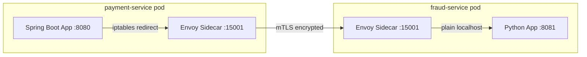
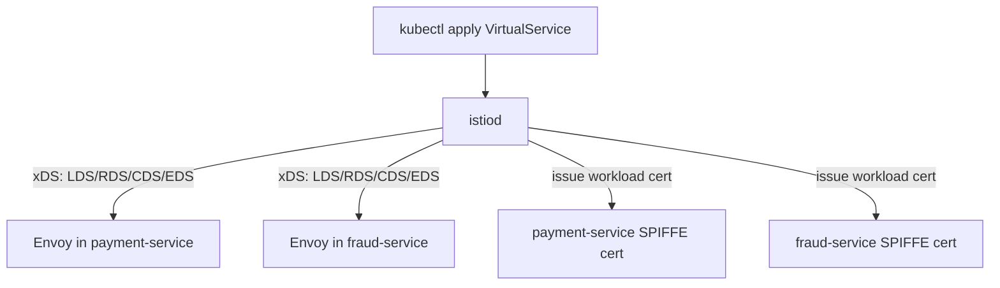
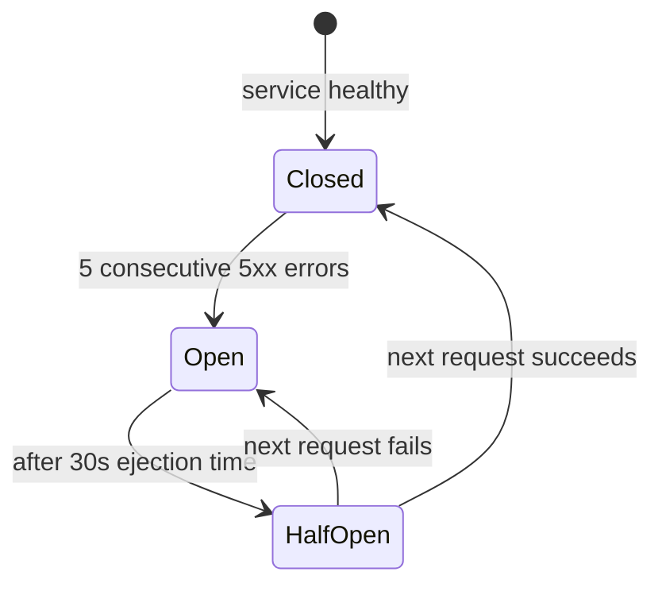

# Service Mesh — Istio Traffic Management and Observability

A service mesh adds a dedicated infrastructure layer for service-to-service communication, handling encryption, retries, circuit breaking, and distributed tracing transparently — without changing application code. For fintech platforms where every inter-service call carries financial data, Istio's mutual TLS enforcement and fine-grained authorization policies provide security controls that support PCI-DSS requirements on encryption in transit (Requirement 4) and access control (Requirement 7) — as evidence alongside your other controls, not as a complete answer on their own.

(The examples use the `v1` Istio APIs, available since Istio 1.22; older guides show `v1alpha3`/`v1beta1`.)

---

## 1. Service Mesh Architecture

Istio's architecture separates the **data plane** (proxies that handle traffic) from the **control plane** (components that configure proxies).

### 1.1 Sidecar Proxy Model

Every pod in the mesh gets an Envoy proxy injected as a sidecar container. This injection is transparent to the application — the application sends traffic to `localhost`, and the sidecar intercepts it, applies policies, and forwards it to the destination.



The iptables rules injected by the `istio-init` init container (or the Istio CNI plugin) redirect all inbound and outbound traffic through the Envoy proxy on port 15001 (outbound) and 15006 (inbound). The application never sees this — it still connects to `fraud-service:8081` as normal.

> [!NOTE]
> Istio also offers **ambient mode** (GA since Istio 1.24): no sidecar per pod; a per-node `ztunnel` provides mTLS and L4 policy, and optional per-namespace *waypoint* proxies add L7 features. It cuts the per-pod resource cost and the start-up ordering problems described below. This lesson uses the sidecar model, which is still the most widely deployed.

### 1.2 Istio Control Plane (istiod)

`istiod` consolidates three functions that were separate components before Istio 1.5 (the old names are still used in docs and talks):

| Component | Function |
|-----------|----------|
| Pilot     | Service discovery, traffic management rules → Envoy xDS config |
| Citadel   | Certificate authority — issues SPIFFE X.509 certs for each workload identity |
| Galley    | Configuration validation and distribution |



---

## 2. Automatic mTLS Between Services

Istio's most valuable security feature is automatic mutual TLS (mTLS) between all services in the mesh. No application code changes are required — Envoy sidecars negotiate TLS transparently using SPIFFE-format X.509 certificates issued by istiod's built-in CA (an external CA, or SPIRE, can be plugged in instead), rotated automatically every 24 hours by default.

### 2.1 PeerAuthentication — Enforce STRICT mTLS

```yaml
# Enforce mTLS in the entire payments namespace
# Any service calling payment-service without a valid cert is rejected
apiVersion: security.istio.io/v1
kind: PeerAuthentication
metadata:
  name: payments-mtls-strict
  namespace: payments
spec:
  mtls:
    mode: STRICT
```

With `STRICT` mode, any plaintext connection to a service in the `payments` namespace is rejected — even from other pods in the same cluster that are not part of the mesh. Encrypting all internal traffic is strong evidence for PCI-DSS encryption-in-transit and segmentation controls. Roll it out by starting in `PERMISSIVE` mode, checking (e.g. in Kiali) that all clients already use mTLS, then switching to `STRICT`.

### 2.2 Verifying mTLS

```bash
# Check sidecar injection and the effective mTLS / policy setup of a pod
istioctl x check-inject -n payments
istioctl x describe pod payment-service-7d9f8-abcde -n payments

# Expected (excerpt):
# Pod: payment-service-7d9f8-abcde
#    Pod Ports: 8080 (payment-service), 15090 (istio-proxy)
# Service: payment-service
#    Port: http 8080/HTTP targets pod port 8080
# Effective PeerAuthentication:
#    Workload mTLS mode: STRICT
# (The old "istioctl authn tls-check" command was removed in Istio 1.5+)
```

---

## 3. Traffic Management

Istio's traffic management uses two CRDs working together: `VirtualService` (routing rules) and `DestinationRule` (load balancing and subset configuration).

### 3.1 VirtualService — Weighted Routing for Canary Deployments

```yaml
# Route 90% to stable v1, 10% to canary v2
apiVersion: networking.istio.io/v1
kind: VirtualService
metadata:
  name: payment-service-vs
  namespace: payments
spec:
  hosts:
    - payment-service
  http:
    - match:
        # Pin internal testers to canary via header
        - headers:
            x-canary:
              exact: "true"
      route:
        - destination:
            host: payment-service
            subset: v2
    - route:
        # Production traffic split
        - destination:
            host: payment-service
            subset: v1
          weight: 90
        - destination:
            host: payment-service
            subset: v2
          weight: 10
      timeout: 5s
      retries:
        # POST /payments is NOT idempotent by itself: retry only failures
        # where the request certainly did not reach the app -- or rely on
        # an idempotency key. (Istio retries by default -- 2 attempts on
        # connect-failure, refused-stream, unavailable... -- so set this
        # explicitly for payment routes.)
        attempts: 2
        perTryTimeout: 2s
        retryOn: "connect-failure,refused-stream"
```

### 3.2 DestinationRule — Subsets and Load Balancing

```yaml
apiVersion: networking.istio.io/v1
kind: DestinationRule
metadata:
  name: payment-service-dr
  namespace: payments
spec:
  host: payment-service
  trafficPolicy:
    connectionPool:
      tcp:
        maxConnections: 100
        connectTimeout: 2s
      http:
        h2UpgradePolicy: UPGRADE
        http1MaxPendingRequests: 100
        http2MaxRequests: 1000
    loadBalancer:
      simple: LEAST_CONN     # least connections for payment processing
    outlierDetection:
      # Circuit breaking: eject pods with 5 consecutive 5xx errors for 30s
      consecutive5xxErrors: 5
      interval: 10s
      baseEjectionTime: 30s
      maxEjectionPercent: 50
  subsets:
    - name: v1
      labels:
        version: v1
      trafficPolicy:
        connectionPool:
          tcp:
            maxConnections: 80
    - name: v2
      labels:
        version: v2
      trafficPolicy:
        connectionPool:
          tcp:
            maxConnections: 20
```

---

## 4. Circuit Breaking with OutlierDetection

Istio's circuit breaking is configured in `DestinationRule.outlierDetection`. When a pod returns `consecutive5xxErrors` 5xx responses in a row (or `consecutiveGatewayErrors` — only 502/503/504), it is ejected from the load-balancing pool for `baseEjectionTime` (multiplied by the number of times it has been ejected). The analysis runs every `interval`. The diagram below maps this onto the classic circuit-breaker states — strictly, an ejected host simply returns to the pool after the ejection time and is ejected again if it keeps failing.



```yaml
# Dedicated circuit breaker for external payment gateway
apiVersion: networking.istio.io/v1
kind: DestinationRule
metadata:
  name: visa-gateway-cb
  namespace: payments
spec:
  host: visa-gateway.payments.svc.cluster.local
  trafficPolicy:
    outlierDetection:
      consecutiveGatewayErrors: 5
      interval: 10s
      baseEjectionTime: 30s
      maxEjectionPercent: 100   # eject ALL if all pods fail (failfast)
    connectionPool:
      http:
        http1MaxPendingRequests: 50  # backpressure — reject early
```

---

## 5. Retries and Timeouts in VirtualService

Combining retries with timeouts prevents cascading failures in payment processing chains.

```yaml
apiVersion: networking.istio.io/v1
kind: VirtualService
metadata:
  name: fraud-service-vs
  namespace: payments
spec:
  hosts:
    - fraud-service
  http:
    - route:
        - destination:
            host: fraud-service
      timeout: 3s
      retries:
        attempts: 2
        perTryTimeout: 1s
        retryOn: "gateway-error,connect-failure,refused-stream"
        # gateway-error (502/503/504) is acceptable here because a fraud
        # SCORE request has no side effects. Do NOT retry on 5xx for
        # requests that change state unless they carry an idempotency key
```

**Rule for fintech**: Never retry non-idempotent payment mutations without idempotency keys. Retry only on connection failures (`connect-failure`, `reset`) or idempotent reads.

---

## 6. Distributed Tracing with Jaeger

The sidecars create spans for every request and add trace headers if none are present. Jaeger (or any OpenTelemetry-compatible backend) collects and visualizes these traces.

### 6.1 Trace Context Propagation

Depending on the tracer configuration, Envoy uses B3 (Zipkin-style) or W3C `traceparent` headers. The sidecar creates spans automatically, but it cannot know which outgoing call belongs to which incoming request — the **application** must copy the trace headers (and `x-request-id`) from the incoming request to its outbound calls.

In Spring Boot 3, Micrometer Tracing (or the OpenTelemetry Java agent) does this automatically for `RestTemplate`, `RestClient`, `WebClient` and Kafka — configure the propagation type to match the mesh (`management.tracing.propagation.type=b3,w3c`). The manual version below shows what happens underneath:

```java
// TraceContextPropagationFilter.java
// Extract incoming B3 headers and forward them to downstream calls
@Component
public class TraceContextPropagationFilter implements Filter {

    private static final List<String> B3_HEADERS = List.of(
        "x-request-id",
        "x-b3-traceid",
        "x-b3-spanid",
        "x-b3-parentspanid",
        "x-b3-sampled",
        "x-b3-flags",
        "b3"
    );

    @Override
    public void doFilter(ServletRequest req, ServletResponse res,
                         FilterChain chain) throws IOException, ServletException {
        HttpServletRequest httpReq = (HttpServletRequest) req;

        // Store B3 headers in request-scoped context for downstream calls
        Map<String, String> traceHeaders = new HashMap<>();
        for (String header : B3_HEADERS) {
            String value = httpReq.getHeader(header);
            if (value != null) {
                traceHeaders.put(header, value);
            }
        }
        TraceContext.set(traceHeaders);
        try {
            chain.doFilter(req, res);
        } finally {
            TraceContext.clear();   // thread-pool threads are reused
        }
    }
}
```

```java
// PaymentClient.java — propagate trace headers on outbound calls
public FraudResponse callFraudService(FraudRequest request) throws Exception {
    Map<String, String> traceHeaders = TraceContext.get();

    HttpRequest.Builder builder = HttpRequest.newBuilder()
        .uri(URI.create(FRAUD_SERVICE_URL + "/api/v1/fraud/score"))
        .POST(HttpRequest.BodyPublishers.ofString(request.toJson()));

    // Forward all B3 trace headers
    traceHeaders.forEach(builder::header);

    HttpResponse<String> response =
        httpClient.send(builder.build(), HttpResponse.BodyHandlers.ofString());
    return FraudResponse.fromJson(response.body());
}
```

### 6.2 Telemetry Resource for Sampling

```yaml
apiVersion: telemetry.istio.io/v1
kind: Telemetry
metadata:
  name: payment-tracing
  namespace: payments
spec:
  tracing:
    - providers:
        - name: otel-tracing     # extension provider defined in MeshConfig
                                 # (OpenTelemetry collector -> Jaeger)
      randomSamplingPercentage: 10.0
```

Traces are a debugging tool, not an audit record: the audit trail of payments lives in the application's audit logs and database. 100% sampling at payment volumes is expensive; sample a percentage and force sampling for specific requests (e.g. `x-b3-sampled: 1`, or tail-based sampling in the OpenTelemetry collector that keeps all traces with errors). Never put card data in span attributes.

---

## 7. Kiali Service Graph

Kiali provides a real-time service topology graph, showing traffic flow, error rates, and mTLS status between services.

```
Payment Platform Service Graph (Kiali):

[api-gateway] --100%mTLS--> [payment-service v1] --90%-->
                                                   --10%--> [payment-service v2]
[payment-service] --100%mTLS--> [fraud-service]
[payment-service] --100%mTLS--> [postgres (external)]
[payment-service] --100%mTLS--> [kafka]

Error rates:
  payment-service v1: 0.02%
  payment-service v2: 1.4%  <-- canary alert threshold exceeded
```

Access Kiali via port-forward:
```bash
kubectl port-forward svc/kiali 20001:20001 -n istio-system
# Open http://localhost:20001/kiali
```

---

## 8. AuthorizationPolicy — Service-to-Service RBAC

AuthorizationPolicy enforces which services can call which other services, based on SPIFFE identities (not IP addresses).

```yaml
# Only api-gateway can call payment-service
# All other callers receive HTTP 403 RBAC denied
apiVersion: security.istio.io/v1
kind: AuthorizationPolicy
metadata:
  name: payment-service-authz
  namespace: payments
spec:
  selector:
    matchLabels:
      app: payment-service
  action: ALLOW
  rules:
    - from:
        - source:
            # SPIFFE identity: system:serviceaccount:api-gateway:api-gateway-sa
            principals:
              - "cluster.local/ns/api-gateway/sa/api-gateway-sa"
      to:
        - operation:
            methods: ["POST", "GET"]
            paths: ["/api/v1/payments/*", "/api/v1/payments"]
---
# payment-service can call fraud-service, but only the /score endpoint
apiVersion: security.istio.io/v1
kind: AuthorizationPolicy
metadata:
  name: fraud-service-authz
  namespace: payments
spec:
  selector:
    matchLabels:
      app: fraud-service
  action: ALLOW
  rules:
    - from:
        - source:
            principals:
              - "cluster.local/ns/payments/sa/payment-service-sa"
      to:
        - operation:
            methods: ["POST"]
            paths: ["/api/v1/fraud/score"]
---
# Default deny all -- policy order does not matter: a request is allowed
# only if some ALLOW policy matches it (and no DENY policy does)
apiVersion: security.istio.io/v1
kind: AuthorizationPolicy
metadata:
  name: default-deny
  namespace: payments
spec:
  {}  # empty spec: ALLOW action with no rules -> matches nothing -> deny all
```

---

## Production Pitfalls

### Pitfall 1: mTLS STRICT Mode Breaking Kubernetes Health Checks

**Problem**: When `PeerAuthentication` is set to `STRICT`, Kubernetes liveness and readiness probes (sent from kubelet, which is not part of the mesh) are rejected because they are plaintext connections. Services fail health checks and are restarted in a loop. Since Istio 1.10 the sidecar injector **rewrites HTTP probes by default** (fix option 2), so today this shows up mainly when probe rewriting was disabled or with TCP/gRPC probes and custom setups.

**Diagnosis**:
```bash
kubectl describe pod payment-service-xxx -n payments
# Events: Liveness probe failed: Get http://10.244.1.5:8080/health: EOF
# (EOF = connection closed by Envoy because kubelet has no client cert)
```

**Fix Option 1**: Use a port-based exclusion for the health check port in the sidecar annotation:

```yaml
# deployment.yaml annotations
annotations:
  traffic.sidecar.istio.io/excludeInboundPorts: "8081"
  # probe on 8081 bypasses Envoy; application logic on 8080 uses mTLS
```

**Fix Option 2**: Rewrite probes to use Istio's built-in probe rewrite (enabled by default since Istio 1.10):

```yaml
# Istio automatically rewrites HTTP probes using the sidecar agent port
# Verify it is enabled in istiod config:
kubectl get configmap istio -n istio-system -o yaml | grep rewriteAppHTTPProbe
# Expected: rewriteAppHTTPProbe: true
```

**Fix Option 3**: Use exec probes instead of HTTP probes — exec probes run inside the container and bypass the sidecar:

```yaml
livenessProbe:
  exec:
    command:
      - /bin/sh
      - -c
      - wget -qO- http://localhost:8080/health || exit 1
  initialDelaySeconds: 30
  periodSeconds: 10
```

---

### Pitfall 2: VirtualService Not Matching Because Service Port Name Does Not Match Protocol

**Problem**: Istio routes HTTP vs TCP traffic differently. The protocol comes from the Service port's `appProtocol` field or its name prefix (`http`, `http2`, `grpc`, `tcp`, `tls`, ...). A port declared as TCP (e.g. named `tcp-api`) gets no L7 processing: VirtualService HTTP rules have no effect — canary weights are silently ignored. For ports with no recognised protocol, Istio falls back to automatic protocol *sniffing*, which detects HTTP/1.1 and HTTP/2 but treats anything it cannot detect as plain TCP. Declare the protocol explicitly for every port.

**Broken Service definition**:
```yaml
apiVersion: v1
kind: Service
metadata:
  name: payment-service
  namespace: payments
spec:
  ports:
    - name: tcp-api      # declared as TCP — no HTTP routing
      port: 8080
      targetPort: 8080
```

**Fixed Service definition**:
```yaml
apiVersion: v1
kind: Service
metadata:
  name: payment-service
  namespace: payments
spec:
  ports:
    - name: http         # name prefix 'http' ...
      appProtocol: http  # ... or appProtocol (preferred, explicit)
      port: 8080
      targetPort: 8080
    - name: grpc-internal
      appProtocol: grpc
      port: 9090
      targetPort: 9090
```

**Validation**:
```bash
# Confirm Istio detects the protocol correctly
istioctl proxy-config cluster payment-service-pod-xxx.payments | grep payment-service
# Expected: payment-service.payments.svc.cluster.local 8080 - outbound EDS http
# BAD output: ... TCP (not http)
```

---

### Pitfall 3: Envoy Sidecar Startup Order Causing Connection Refused at Boot

**Problem**: The Envoy sidecar and the application container start concurrently. If the application makes an outbound call during startup (e.g., connecting to a config service or database) before Envoy is ready, the connection fails because iptables redirects traffic to a not-yet-listening Envoy.

**Symptoms**: Application logs show `Connection refused to localhost:15001` during the first 2–5 seconds of pod startup.

**Fix**: Configure `holdApplicationUntilProxyStarts` in the mesh config:

```yaml
# MeshConfig in istio-system ConfigMap
apiVersion: v1
kind: ConfigMap
metadata:
  name: istio
  namespace: istio-system
data:
  mesh: |
    defaultConfig:
      holdApplicationUntilProxyStarts: true
      # Envoy must be ready before the app container starts
```

Or per-pod annotation:
```yaml
# deployment.yaml annotations
annotations:
  proxy.istio.io/config: |
    holdApplicationUntilProxyStarts: true
```

This works by placing the istio-proxy container first and blocking in its `postStart` hook until Envoy is ready — the kubelet starts the next container only after that. (A `postStart` hook on the *application* container would not help: the application process is already running while its own hook executes.)

**Alternative**: On Kubernetes 1.29+ Istio can inject the proxy as a **native sidecar** (an init container with `restartPolicy: Always`, enabled by default in recent Istio releases). Native sidecars start before and stop after the application containers, which solves both the start-up and the shutdown ordering.

---

## Checklist

### Istio Installation and Namespace Configuration
- [ ] Istio installed with the `default` profile plus production overrides (istiod HA, PodDisruptionBudgets, resource requests) — there is no "production" profile
- [ ] Namespace injection label applied: `kubectl label namespace payments istio-injection=enabled`
- [ ] `holdApplicationUntilProxyStarts: true` set in MeshConfig
- [ ] Every Service port declares its protocol (`appProtocol` or a name prefix such as `http`, `grpc`, `tls`)
- [ ] istiod deployed with at least 2 replicas for HA

### mTLS and Security
- [ ] `PeerAuthentication` STRICT mode applied to all PCI-scope namespaces
- [ ] Kubernetes health check probes compatible with mTLS (probe rewrite enabled or exec probes used)
- [ ] `AuthorizationPolicy` default-deny applied to all production namespaces
- [ ] Explicit `AuthorizationPolicy` ALLOW rules for each service-to-service call path
- [ ] mTLS and SPIFFE identities verified with `istioctl x describe pod` / Kiali

### Traffic Management
- [ ] `VirtualService` retries set explicitly — connection failures only for non-idempotent POSTs (Istio retries by default)
- [ ] Timeouts set at VirtualService level (not only at application level)
- [ ] `DestinationRule` `outlierDetection` configured for all external dependencies
- [ ] Canary weights validated in staging before production deployment
- [ ] `maxEjectionPercent` set appropriately to prevent ejecting all pods simultaneously

### Observability
- [ ] Jaeger or Zipkin tracing backend deployed and connected to Istio
- [ ] Application propagates trace headers (B3 or W3C, plus `x-request-id`) on all outbound calls
- [ ] `Telemetry` resource configured with an affordable sampling rate plus forced/tail sampling for errors
- [ ] Kiali deployed and service graph reviewed weekly
- [ ] Envoy access logs shipping to centralized log aggregator (Fluentd/Loki)

### Compliance
- [ ] mTLS STRICT mode documented as an encryption-in-transit / segmentation control
- [ ] `AuthorizationPolicy` rules documented as least-privilege access control (PCI-DSS Requirement 7)
- [ ] Access logs retained per PCI-DSS 10.5.1 (12 months, last 3 months immediately available); traces contain no cardholder data

---

<!-- KNOWLEDGE-CHECK
{"questions": [{"text": "Why does setting PeerAuthentication to STRICT mode sometimes cause Kubernetes liveness probe failures?", "options": ["a) STRICT mode disables all TCP connections including health check probes", "b) Kubernetes kubelet health check probes are plaintext HTTP and are rejected by Envoy because kubelet does not have a mesh certificate", "c) STRICT mode requires the application to implement mTLS in its own code", "d) Liveness probes are blocked by the default-deny AuthorizationPolicy"], "correct": 1, "explanation": "Kubernetes kubelet sends liveness and readiness probes directly to the pod IP as plaintext HTTP. With mTLS STRICT mode, Envoy rejects these unauthenticated connections. The fix is Istio's probe rewrite (rewriteAppHTTPProbe — on by default since Istio 1.10), which redirects probes through the sidecar agent, or exec probes that run inside the container, or excluding a dedicated health port from interception. (holdApplicationUntilProxyStarts is unrelated: it controls container start-up order.)"}, {"text": "A VirtualService with 90/10 canary weight routing is deployed but all traffic continues going to v1. What is the most likely cause?", "options": ["a) The DestinationRule subsets are missing OutlierDetection configuration", "b) The Kubernetes Service port is declared as TCP (e.g. named 'tcp-api', or a protocol Istio cannot detect), so Istio treats the traffic as TCP and ignores L7 routing rules", "c) The canary deployment has fewer pods than the stable deployment", "d) The PeerAuthentication mode is PERMISSIVE instead of STRICT"], "correct": 1, "explanation": "Istio determines the traffic protocol from the Service port's appProtocol field or name prefix ('http', 'grpc', 'tcp', 'tls', ...), and falls back to protocol sniffing for undeclared ports. If the port is declared as TCP — or sniffing cannot detect HTTP — Istio treats the traffic as TCP, and VirtualService HTTP routing rules, including canary weights, are silently bypassed. Declare the protocol explicitly on every port."}, {"text": "What must Java Spring Boot services do to ensure distributed traces appear as a single trace across multiple services in Jaeger?", "options": ["a) Register each service with the Jaeger agent using a unique service name", "b) Call istioctl proxy-config to export the trace context", "c) Copy the incoming trace headers (B3 or W3C traceparent, plus x-request-id) onto all outbound calls — done automatically by Micrometer Tracing or the OpenTelemetry agent, or manually", "d) Enable Istio's telemetry API with 100% sampling — no code changes are needed"], "correct": 2, "explanation": "Istio's Envoy sidecars create spans automatically, but they cannot link an application's outgoing call to the incoming request that caused it. The application must carry the trace headers from incoming requests to outbound calls. In Spring Boot 3, Micrometer Tracing or the OpenTelemetry Java agent does this for instrumented clients; otherwise it must be coded by hand. Without it, Jaeger shows disconnected single-hop traces rather than end-to-end payment flow traces."}]}
-->

<!-- PRACTICAL-CHALLENGE
{"title": "Deploy Istio Service Mesh for Fintech Payment Platform", "difficulty": "advanced", "estimatedMinutes": 100, "tasks": [{"id": "1", "description": "Install Istio with the default profile on a local cluster (kind or minikube). Enable sidecar injection for a 'payments' namespace. Apply PeerAuthentication STRICT mode and verify that a curl from a non-mesh pod receives a connection error while a mesh pod succeeds. Confirm the effective mTLS mode with istioctl x describe pod."}, {"id": "2", "description": "Deploy payment-service with two versions (v1 and v2). Create a DestinationRule with subsets for each version. Create a VirtualService routing 90% traffic to v1 and 10% to v2. Send 1000 requests using hey or wrk and verify approximately 100 (10%) reach v2 by checking Kiali or Envoy access logs."}, {"id": "3", "description": "Add OutlierDetection to the DestinationRule: eject a pod after 3 consecutive 5xx errors (consecutive5xxErrors), with a 30-second base ejection time. Inject failures into v2 (use Istio fault injection or a /fail endpoint). Observe in Kiali that v2 is ejected from the pool. Verify traffic automatically shifts to v1 during ejection."}, {"id": "4", "description": "Set up trace context propagation in a Spring Boot payment service (Micrometer Tracing with the propagation type matching the mesh, or a manual header filter). Deploy payment-service and fraud-service with Jaeger tracing. Make a payment call that triggers a fraud check. In Jaeger UI, verify the full trace shows both payment-service and fraud-service spans in a single trace. Document the propagation pattern used."}]}
-->
