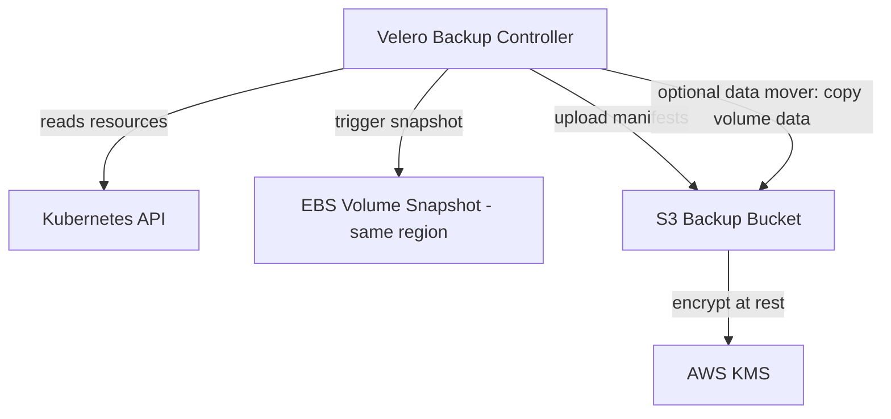

# التخزين السحابي الأصلي — المجلدات الدائمة والـ StatefulSets

تتطلب أحمال العمل ذات الحالة في عنقود تقنية مالية — PostgreSQL لسجلات المعاملات، وKafka لتدفقات أحداث الدفع، وRedis لبيانات الجلسات — تخزينًا دائمًا عالي الأداء بضمانات توفر صارمة. ويوفر Kubernetes التجريدات (PersistentVolume، وPersistentVolumeClaim، وStorageClass، وStatefulSet) لكن الانضباط التشغيلي — فئة التخزين الصحيحة، وسياسة الاسترداد الصحيحة، والجدولة الواعية بمناطق التوفر، والنسخ الاحتياطي الآلي — هو ما يحدد هل تنجو بياناتك من فشل عقدة، أو انقطاع منطقة توفر، أو حذف عرضي.

---

## 1. طبقات تجريد التخزين

```
┌──────────────────────────────────────────────────────────┐
│  Application (PostgreSQL, Kafka)                          │
├──────────────────────────────────────────────────────────┤
│  PersistentVolumeClaim (PVC) — developer request         │
├──────────────────────────────────────────────────────────┤
│  StorageClass — provisioner + parameters                  │
├──────────────────────────────────────────────────────────┤
│  PersistentVolume (PV) — dynamically provisioned          │
├──────────────────────────────────────────────────────────┤
│  CSI Driver (aws-ebs-csi-driver)                          │
├──────────────────────────────────────────────────────────┤
│  Cloud Block Storage (AWS EBS gp3 / io2)                  │
└──────────────────────────────────────────────────────────┘
```

### 1.1 ‏PersistentVolume ‏(PV)

الـ PV مورد تخزين على مستوى العنقود يوفّره مسؤول أو StorageClass ديناميكيًا. وله دورة حياة مستقلة عن الـ pods.

```yaml
# Manually provisioned PV (rare in modern clusters — prefer dynamic)
apiVersion: v1
kind: PersistentVolume
metadata:
  name: postgres-primary-pv
  labels:
    app: postgres
    tier: database
spec:
  capacity:
    storage: 500Gi
  volumeMode: Filesystem
  accessModes:
    - ReadWriteOnce
  persistentVolumeReclaimPolicy: Retain   # NEVER Delete in production
  storageClassName: gp3-encrypted
  csi:
    driver: ebs.csi.aws.com
    volumeHandle: vol-0a1b2c3d4e5f67890   # EBS volume ID
    fsType: ext4
  nodeAffinity:
    required:
      nodeSelectorTerms:
        - matchExpressions:
            - key: topology.kubernetes.io/zone
              operator: In
              values:
                - us-east-1a   # pin to same AZ as EBS volume
```

### 1.2 ‏PersistentVolumeClaim ‏(PVC)

الـ PVC طلب تخزين محصور بمساحة أسماء من مستخدم أو StatefulSet. وحين تُحدد StorageClass، يُوفّر الـ PV ديناميكيًا.

```yaml
apiVersion: v1
kind: PersistentVolumeClaim
metadata:
  name: postgres-primary-data
  namespace: data
  labels:
    app: postgres
    pci-scope: "true"
spec:
  accessModes:
    - ReadWriteOnce
  volumeMode: Filesystem
  storageClassName: io2-encrypted   # high-IOPS for production DB
  resources:
    requests:
      storage: 500Gi
  # (A PVC with a label selector can only bind to an EXISTING PV -- it is
  #  never dynamically provisioned. Leave the selector out for dynamic PVs.)
```

### 1.3 ‏StorageClass

تعرّف StorageClass فئة التخزين — المزوّد، والمعاملات، وسياسة الاسترداد.

```yaml
# AWS EBS gp3 — cost-effective, baseline 3000 IOPS
apiVersion: storage.k8s.io/v1
kind: StorageClass
metadata:
  name: gp3-encrypted
  annotations:
    # Default class: every PVC without a class gets Retain volumes -- deleted
    # test PVCs then leave orphaned (billed) EBS volumes behind. Some teams
    # make a Delete class the default and require Retain classes explicitly
    # for regulated data.
    storageclass.kubernetes.io/is-default-class: "true"
provisioner: ebs.csi.aws.com
parameters:
  type: gp3
  iops: "3000"
  throughput: "125"
  encrypted: "true"
  kmsKeyId: "arn:aws:kms:us-east-1:123456789:key/abc123"
reclaimPolicy: Retain        # NEVER Delete for financial data
allowVolumeExpansion: true   # required for online resize
volumeBindingMode: WaitForFirstConsumer  # wait for pod AZ before provisioning
---
# AWS EBS io2 — high-IOPS for latency-sensitive workloads
apiVersion: storage.k8s.io/v1
kind: StorageClass
metadata:
  name: io2-encrypted
provisioner: ebs.csi.aws.com
parameters:
  type: io2
  iops: "16000"       # io2 Block Express scales far higher (up to 256,000 IOPS)
  encrypted: "true"
  kmsKeyId: "arn:aws:kms:us-east-1:123456789:key/abc123"
reclaimPolicy: Retain
allowVolumeExpansion: true
volumeBindingMode: WaitForFirstConsumer
```

---

## 2. أنماط الوصول

| النمط            | الاختصار | الوصف                                    | الاستخدام المعتاد              |
|-----------------|--------------|------------------------------------------------|--------------------------|
| ReadWriteOnce   | RWO          | قراءة/كتابة من عقدة واحدة                         | PostgreSQL، وMySQL         |
| ReadOnlyMany    | ROX          | قراءة فقط من عقد متعددة                       | إعدادات مشتركة، ومخرجات بناء  |
| ReadWriteMany   | RWX          | قراءة/كتابة من عقد متعددة                      | NFS، وEFS للسجلات المشتركة  |
| ReadWriteOncePod| RWOP         | قراءة/كتابة من pod واحد (Kubernetes 1.22+)        | وصول حصري لقاعدة البيانات |

**قاعدة أساسية**: تدعم مجلدات EBS ‏`ReadWriteOnce` فقط. ولـ `ReadWriteMany` على AWS، استخدم EFS مع `aws-efs-csi-driver`. ويتطلب PostgreSQL وKafka كلاهما `ReadWriteOnce` — فكل pod يحتاج مجلده المخصص.

---

## 3. مشغّلات CSI لأحمال التقنية المالية

واجهة تخزين الحاويات (CSI) المعيار لدمج أنظمة التخزين مع Kubernetes. وتوفر AWS مشغّلي CSI أساسيين.

### 3.1 مشغّل AWS EBS CSI

```yaml
# Install via Helm
# helm install aws-ebs-csi-driver aws-ebs-csi-driver/aws-ebs-csi-driver \
#   --namespace kube-system \
#   --set controller.serviceAccount.annotations."eks.amazonaws.com/role-arn"=arn:aws:iam::123:role/EBSCSIRole

# Verify installation
# kubectl get pods -n kube-system -l app=ebs-csi-controller
```

اختيار فئة التخزين لأحمال التقنية المالية:

| حمل العمل                   | فئة التخزين | IOPS     | المبرر                           |
|----------------------------|---------------|----------|-------------------------------------|
| PostgreSQL (إنتاج)    | io2-encrypted | 16,000+  | معاملات OLTP حساسة للزمن |
| سجلات Kafka                 | gp3-encrypted | 3,000    | كتابات تسلسلية، فعّالة التكلفة   |
| PostgreSQL (تطوير/تجهيز)   | gp3-encrypted | 3,000    | كافية لتزامن أقل      |
| لقطات Redis ‏(AOF)      | gp3-encrypted | 3,000    | كتابات تسلسلية دورية           |

**مقارنة تكلفة gp3 مقابل io2** (أسعار القائمة في us-east-1 وقت الكتابة — راجع الأسعار الحالية):
- ‏gp3: ‏$0.08/GB/شهر + ‏$0.005 لكل IOPS مُوفَّر فوق 3000
- ‏io2: ‏$0.125/GB/شهر + ‏$0.065 لكل IOPS مُوفَّر (حتى 32,000؛ وشرائح أرخص فوقها)
- لـ PostgreSQL بحجم 500GB عند 16,000 IOPS: ‏gp3 ≈ ‏$105/شهر، وio2 ≈ ‏$1,100/شهر
- يستطيع gp3 تقديم 16,000 IOPS أيضًا؛ وما يضيفه io2 ديمومة أعلى (99.999%) وزمن أقل من ملي ثانية أكثر اتساقًا. استخدم io2 لقواعد البيانات الأساسية الحرجة حيث يهم ذلك؛ وgp3 للنسخ المتماثلة، وKafka، والتطوير

---

## 4. ‏StatefulSet لـ Kafka وPostgreSQL

توفر الـ StatefulSets أربعة ضمانات لا تستطيعها الـ Deployments:

1. **هوية شبكية ثابتة**: يحصل كل pod على اسم DNS متوقع: `kafka-0.kafka.payments.svc.cluster.local`
2. **بدء مرتب**: تبدأ الـ pods بالتتابع (kafka-0 ← kafka-1 ← kafka-2)
3. **إيقاف مرتب**: تُنهى الـ pods بترتيب عكسي عند التصغير (kafka-2 ← kafka-1 ← kafka-0)
4. **‏PVC مخصص لكل pod**: يرتبط كل pod بـ PVC خاص به ينجو من إعادة تشغيل الـ pod

### 4.1 ‏StatefulSet لـ Kafka

يُظهر المثال ما يتطلبه StatefulSet مكتوب يدويًا لـ Kafka. وفي الإنتاج، تشغّل أغلب الفرق Kafka على Kubernetes عبر مشغّل (operator) مثل **Strimzi** (أو تستخدم خدمة مُدارة)، يتولى إعداد نصاب KRaft، والشهادات، وإعادة التشغيل المتدرجة، وإعادة التوازن.

```yaml
apiVersion: apps/v1
kind: StatefulSet
metadata:
  name: kafka
  namespace: kafka
spec:
  serviceName: kafka          # headless service for stable DNS
  replicas: 3
  selector:
    matchLabels:
      app: kafka
  podManagementPolicy: OrderedReady   # sequential startup
  updateStrategy:
    type: RollingUpdate
    rollingUpdate:
      partition: 0            # update all pods in a rolling fashion
  template:
    metadata:
      labels:
        app: kafka
    spec:
      terminationGracePeriodSeconds: 60
      affinity:
        podAntiAffinity:
          requiredDuringSchedulingIgnoredDuringExecution:
            - labelSelector:
                matchLabels:
                  app: kafka
              topologyKey: topology.kubernetes.io/zone   # spread across AZs
      containers:
        - name: kafka
          image: apache/kafka:4.0.0     # KRaft only -- ZooKeeper was removed in Kafka 4.0
          ports:
            - name: kafka
              containerPort: 9092
            - name: controller
              containerPort: 9093
          env:
            # Numeric node id from the pod's ordinal (label set by Kubernetes
            # 1.28+). The pod NAME ("kafka-0") is not a valid numeric id.
            - name: KAFKA_NODE_ID
              valueFrom:
                fieldRef:
                  fieldPath: metadata.labels['apps.kubernetes.io/pod-index']
            - name: KAFKA_PROCESS_ROLES
              value: "broker,controller"
            - name: KAFKA_CONTROLLER_QUORUM_VOTERS
              value: "0@kafka-0.kafka:9093,1@kafka-1.kafka:9093,2@kafka-2.kafka:9093"
            # (plus listeners, advertised listeners, TLS/SASL settings ...)
            - name: KAFKA_LOG_DIRS
              value: "/data/kafka"
          volumeMounts:
            - name: kafka-data
              mountPath: /data/kafka
          resources:
            requests:
              cpu: "2"
              memory: 8Gi
            limits:
              cpu: "4"
              memory: 16Gi
          # Cheap TCP check: starting a JVM CLI tool every 30s per broker
          # costs CPU and can time out under load
          livenessProbe:
            tcpSocket:
              port: 9092
            initialDelaySeconds: 60
            periodSeconds: 30
  volumeClaimTemplates:
    - metadata:
        name: kafka-data
        labels:
          app: kafka
      spec:
        accessModes:
          - ReadWriteOnce
        storageClassName: gp3-encrypted
        resources:
          requests:
            storage: 500Gi
---
# Headless service for stable DNS
apiVersion: v1
kind: Service
metadata:
  name: kafka
  namespace: kafka
spec:
  clusterIP: None          # headless — no ClusterIP, direct pod DNS
  selector:
    app: kafka
  ports:
    - name: kafka
      port: 9092
```

ينشئ هذا PVCs باسم `kafka-data-kafka-0`، و`kafka-data-kafka-1`، و`kafka-data-kafka-2` — كل منها مربوط بمجلد EBS gp3 مخصص بحجم 500Gi.

### 4.2 ‏StatefulSet لـ PostgreSQL مع النسخ المتماثل

```yaml
apiVersion: apps/v1
kind: StatefulSet
metadata:
  name: postgres
  namespace: data
spec:
  serviceName: postgres
  replicas: 2              # primary (index 0) + replica (index 1)
  selector:
    matchLabels:
      app: postgres
  template:
    metadata:
      labels:
        app: postgres
    spec:
      terminationGracePeriodSeconds: 120
      containers:
        - name: postgres
          image: postgres:15.4
          env:
            - name: POSTGRES_DB
              value: payments
            - name: POSTGRES_USER
              valueFrom:
                secretKeyRef:
                  name: postgres-credentials
                  key: username
            - name: POSTGRES_PASSWORD
              valueFrom:
                secretKeyRef:
                  name: postgres-credentials
                  key: password
            - name: PGDATA
              value: /var/lib/postgresql/data/pgdata
          volumeMounts:
            - name: postgres-data
              mountPath: /var/lib/postgresql/data
          resources:
            requests:
              cpu: "4"
              memory: 16Gi
            limits:
              cpu: "8"
              memory: 32Gi
  volumeClaimTemplates:
    - metadata:
        name: postgres-data
      spec:
        accessModes:
          - ReadWriteOnce
        storageClassName: io2-encrypted   # high-IOPS for primary DB
        resources:
          requests:
            storage: 500Gi
```

يحصل الـ pod ‏`postgres-0` على اسم DNS الثابت `postgres-0.postgres.data.svc.cluster.local`. ولاحظ ما **لا** يفعله هذا الملف: صورة `postgres` العادية لا تُعدّ النسخ المتماثل — فيبدأ الـ podان كأساسيين مستقلين. ويحتاج النسخ المتماثل المتدفق، والتحول التلقائي عند الفشل، والنسخ الاحتياطي، والترقيات الآمنة مشغّلًا مثل **CloudNativePG**، أو Zalando Postgres Operator، أو Crunchy PGO — أو قاعدة بيانات مُدارة (RDS/Aurora)، وهو ما تختاره أغلب فرق المدفوعات.

---

## 5. سياسات الاسترداد في StorageClass

| السياسة  | ما يحدث للـ PV حين يُحذف الـ PVC | حالة الاستخدام              |
|---------|----------------------------------------|-----------------------|
| Retain  | يبقى الـ PV؛ ويجب استرداده يدويًا   | قواعد بيانات الإنتاج  |
| Delete  | يُحذف الـ PV والمجلد الأساسي   | بيانات اختبار مؤقتة   |
| Recycle | تُمسح بيانات الـ PV ويُتاح مجددًا | مُهمل؛ لا تستخدمه |

**القاعدة الذهبية للتقنية المالية**: يجب أن تستخدم كل فئات التخزين الإنتاجية `Retain`. فمع `Delete`، سيدمّر مطوّر ينفذ `kubectl delete pvc` بالخطأ بيانات معاملات الدفع نهائيًا. (يحمي Retain من حذف *المجلد* — لا من `DROP TABLE` أو التلف؛ فلذلك النسخ الاحتياطية.)

---

## 6. النسخ الاحتياطي بـ Velero

ينسخ Velero موارد Kubernetes وبيانات المجلدات الدائمة احتياطيًا. ولعنقود تقنية مالية، هو خط الاسترداد الأول من الحذف العرضي وأساس دليل التعافي من الكوارث.

### 6.1 بنية Velero



### 6.2 مورد Schedule في Velero — نسخ احتياطي يومي

```yaml
apiVersion: velero.io/v1
kind: Schedule
metadata:
  name: daily-backup
  namespace: velero
spec:
  schedule: "0 2 * * *"      # 2 AM UTC daily
  useOwnerReferencesInBackup: false
  template:
    includedNamespaces:
      - payments
      - kafka
      - data
    includedResources:        # explicit list to avoid backing up ephemeral resources
      - persistentvolumeclaims
      - persistentvolumes
      - deployments
      - statefulsets
      - services
      - configmaps
      - secrets               # MUST include secrets for complete restore
      - ingresses
      - networkpolicies
    excludedResources:
      - events                # never useful in a backup
    snapshotVolumes: true     # snapshot EBS volumes via VolumeSnapshot API
    ttl: 720h                 # retain 30 days (720h = 30 * 24)
    storageLocation: default  # BackupStorageLocation referencing S3
    volumeSnapshotLocations:
      - default
    # Careful with filters: combined with the allowlist above, a label
    # selector would silently skip every resource that lacks the label.
    # Prefer whole namespaces without a selector for regulated data.
```

### 6.3 ‏BackupStorageLocation — إعداد S3

```yaml
apiVersion: velero.io/v1
kind: BackupStorageLocation
metadata:
  name: default
  namespace: velero
spec:
  provider: aws
  objectStorage:
    bucket: fintech-cluster-backups
    prefix: prod-cluster
  config:
    region: us-east-1
    kmsKeyId: "arn:aws:kms:us-east-1:123456789:key/backup-key"
    serverSideEncryption: aws:kms
  credential:
    name: velero-credentials
    key: cloud
---
# Second region BSL for DR. Note: EBS snapshots stay in the source region.
# For a usable cross-region copy, either copy the snapshots (AWS Backup /
# DLM) or use Velero's data mover, which uploads volume DATA to the bucket.
# A schedule must also be pointed at this location (storageLocation).
apiVersion: velero.io/v1
kind: BackupStorageLocation
metadata:
  name: dr-region
  namespace: velero
spec:
  provider: aws
  objectStorage:
    bucket: fintech-cluster-backups-dr
    prefix: prod-cluster
  config:
    region: us-west-2        # DR region
    kmsKeyId: "arn:aws:kms:us-west-2:123456789:key/backup-key-dr"
    serverSideEncryption: aws:kms
  credential:
    name: velero-credentials
    key: cloud
```

### 6.4 إجراء الاستعادة

```bash
# List available backups
velero backup get

# Restore from a specific backup
velero restore create payments-restore-20241101 \
  --from-backup daily-backup-20241101020000 \
  --include-namespaces payments \
  --wait

# Check restore status
velero restore describe payments-restore-20241101
velero restore logs payments-restore-20241101
```

---

## 7. تغيير حجم PVC أثناء التشغيل

تغيير حجم PVC أثناء التشغيل مدعوم حين يكون لـ StorageClass ‏`allowVolumeExpansion: true` ونوع المجلد يدعم التوسيع (EBS gp3/io2 يدعمانه).

```bash
# Step 1: Patch the PVC to request more storage
kubectl patch pvc postgres-data-postgres-0 -n data \
  --type='merge' \
  -p '{"spec":{"resources":{"requests":{"storage":"1000Gi"}}}}'

# Step 2: Watch for the resize to complete (STATUS stays Bound; the
# conditions show Resizing, then FileSystemResizePending, then disappear)
kubectl describe pvc postgres-data-postgres-0 -n data

# Step 3: Verify the filesystem was expanded (the EBS CSI driver and kubelet
# grow ext4/xfs online while the pod runs)
kubectl exec -n data postgres-0 -- df -h /var/lib/postgresql/data
# Expected: 1000G total capacity
```

يزول `FileSystemResizePending` عادةً من تلقاء نفسه بمجرد أن يغيّر kubelet حجم نظام ملفات المجلد المحمّل. ولا يحتاج الـ pod إعادة تشغيل إلا مع مشغّلات أو إعدادات لا تدعم التوسيع أثناء التشغيل. ولاحظ أيضًا أن مجلد EBS لا يمكن تعديله إلا مرة كل 6 ساعات — فحدّد الحجم بسخاء.

---

## مزالق الإنتاج

### المزلق 1: استخدام سياسة الاسترداد Delete في الإنتاج

**المشكلة**: تعني سياسة الاسترداد `Delete` أن حذف PVC يحذف فورًا ونهائيًا مجلد EBS الأساسي وكل بياناته. وفي بيئة قاعدة بيانات إنتاجية، يسبب أي أمر `kubectl delete pvc` — مقصودًا أو عرضيًا — فقدان بيانات لا رجعة فيه.

**‏StorageClass خاطئة (خطرة)**:
```yaml
apiVersion: storage.k8s.io/v1
kind: StorageClass
metadata:
  name: standard        # many cloud defaults use Delete
provisioner: ebs.csi.aws.com
parameters:
  type: gp3
reclaimPolicy: Delete   # NEVER use in production financial systems
```

**‏StorageClass صحيحة (آمنة للإنتاج)**:
```yaml
apiVersion: storage.k8s.io/v1
kind: StorageClass
metadata:
  name: gp3-encrypted
provisioner: ebs.csi.aws.com
parameters:
  type: gp3
  encrypted: "true"
reclaimPolicy: Retain   # PV persists after PVC deletion; must be manually cleaned
allowVolumeExpansion: true
volumeBindingMode: WaitForFirstConsumer
```

إضافة إلى ذلك، صعّب حذف الـ PVCs. ولاحظ أن التعليق الشائع `helm.sh/resource-policy=keep` يمنع **Helm** فقط من حذف الـ PVC عند إلغاء التثبيت/الترقية — ولا يفعل شيئًا ضد `kubectl delete pvc`. فاستخدم RBAC (لا صلاحية `delete` على PVCs للبشر في الإنتاج) و/أو سياسة قبول:
```bash
# Keep Helm from deleting the PVC when the release is removed
kubectl annotate pvc postgres-data-postgres-0 -n data \
  "helm.sh/resource-policy=keep"
# And: remove "delete" on persistentvolumeclaims from production RBAC roles;
# optionally a Kyverno policy that blocks DELETE of PVCs labelled pci-scope=true
```

---

### المزلق 2: جدولة pods الـ StatefulSet في منطقة توفر مختلفة عن مجلد EBS

**المشكلة**: مجلدات EBS محصورة بمنطقة توفر. فإذا جُدول pod من StatefulSet على عقدة في `us-east-1b` لكن الـ PVC الخاص به أُنشئ في `us-east-1a` (لأن StorageClass استخدمت ربطًا `Immediate`)، سيفشل الـ pod بالخطأ `volume is not available in the node's AZ`.

**‏StorageClass خاطئة** (ربط فوري):
```yaml
apiVersion: storage.k8s.io/v1
kind: StorageClass
metadata:
  name: gp3-immediate    # binds volume before pod AZ is known
provisioner: ebs.csi.aws.com
parameters:
  type: gp3
volumeBindingMode: Immediate   # volume created in a random AZ
```

**‏StorageClass صحيحة** (WaitForFirstConsumer):
```yaml
apiVersion: storage.k8s.io/v1
kind: StorageClass
metadata:
  name: gp3-encrypted
provisioner: ebs.csi.aws.com
parameters:
  type: gp3
  encrypted: "true"
volumeBindingMode: WaitForFirstConsumer
# Volume is provisioned only after a pod is scheduled,
# in the same AZ as the node — no cross-AZ failures possible
```

تحقق من توافق مناطق التوفر للـ PVCs الموجودة:
```bash
kubectl get pv -o=custom-columns='NAME:.metadata.name,ZONE:.metadata.labels.topology\.kubernetes\.io/zone,CLAIM:.spec.claimRef.name'
kubectl get node -o=custom-columns='NAME:.metadata.name,ZONE:.metadata.labels.topology\.kubernetes\.io/zone'
```

---

### المزلق 3: نسخ Velero الاحتياطي لا يشمل الأسرار

**المشكلة**: تستبعد بعض إعدادات Velero افتراضيًا الأسرار لتجنب تخزين بيانات اعتماد حساسة في النسخ الاحتياطي. وإذا استُبعدت الأسرار ونُفذت استعادة كاملة لمساحة أسماء بعد كارثة، فإن كل الخدمات المعتمدة على أسرار بيانات الاعتماد (كلمات مرور قواعد البيانات، ومفاتيح الواجهات، وشهادات TLS) تفشل في البدء.

**‏Schedule معطوب في Velero** (يستبعد الأسرار):
```yaml
# DANGEROUS — restoring this backup will leave services unable to authenticate
spec:
  template:
    excludedResources:
      - events
      - secrets           # DO NOT exclude secrets from production backup
```

**النهج الصحيح**: أدرج الأسرار في النسخ الاحتياطي لكن تأكد من أن حاوية S3 للنسخ مشفرة بـ KMS، ومضبوطة الوصول بسياسات IAM، ومفعّلة الإصدارات. (وإذا كانت الأسرار مولّدة بـ External Secrets Operator، فما يجب أن يكون قابلًا للاستعادة هو موارد ExternalSecret وVault يمكن الوصول إليه — فيعيد ESO إنشاء الأسرار.)

```yaml
spec:
  template:
    includedNamespaces:
      - payments
      - data
    excludedResources:
      - events            # only exclude truly worthless resources
    snapshotVolumes: true
    # Secrets ARE included by default when using includedResources: []
    # Explicitly add them if using an allowlist:
    includedResources:
      - persistentvolumeclaims
      - statefulsets
      - deployments
      - services
      - configmaps
      - secrets           # MUST be included for complete restore capability
      - ingresses
      - networkpolicies
      - serviceaccounts
```

تحقق من إدراج الأسرار في نسخة احتياطية تجريبية:
```bash
velero backup describe daily-backup-20241101020000 --details | grep -A5 'v1/Secret'
# Expected: the resource list contains v1/Secret entries for the namespaces
```

---

## قائمة التحقق

### إعداد StorageClass والـ PVC
- [ ] كل فئات التخزين الإنتاجية تستخدم `reclaimPolicy: Retain`
- [ ] كل فئات التخزين الإنتاجية تستخدم `volumeBindingMode: WaitForFirstConsumer`
- [ ] ‏`allowVolumeExpansion: true` مضبوط على كل فئات التخزين
- [ ] تشفير StorageClass مفعّل بمفتاح KMS يديره العميل (CMK) (لا مفتاح تديره AWS)
- [ ] فئة io2 مستخدمة لقواعد البيانات الحرجة للزمن (PostgreSQL الأساسي)
- [ ] فئة gp3 مستخدمة لسجلات Kafka والنسخ المتماثلة للقراءة (تحسين التكلفة)
- [ ] الفئة الافتراضية (`is-default-class: "true"`) مراجَعة ومناسبة

### إعداد StatefulSet
- [ ] ‏`podAntiAffinity` بـ `topologyKey: topology.kubernetes.io/zone` على كل الـ StatefulSets
- [ ] ‏`podManagementPolicy: OrderedReady` لقواعد البيانات (لا Parallel)
- [ ] قواعد البيانات تعمل عبر مشغّل (CloudNativePG، وStrimzi، ...) أو خدمة مُدارة — لا StatefulSets مكتوبة يدويًا
- [ ] ‏`terminationGracePeriodSeconds` ≥ 60 ثانية لكل أحمال العمل ذات الحالة
- [ ] ‏`volumeClaimTemplates` تستخدم StorageClass الصحيحة لكل حمل عمل
- [ ] خدمة بلا رأس (`clusterIP: None`) منشأة لكل StatefulSet

### النسخ الاحتياطي والاستعادة
- [ ] ‏Schedule في Velero منشور بجدول يومي واحتفاظ 30 يومًا
- [ ] نسخ Velero الاحتياطي يشمل الأسرار
- [ ] حاوية S3 للنسخ مشفرة بـ KMS ومفعّلة الإصدارات
- [ ] نسخ احتياطي عبر المناطق مضبوط (BackupStorageLocation في منطقة التعافي)
- [ ] تمرين استعادة شهري مجدول ونتائجه موثقة
- [ ] إجراء `velero restore create` مختبر وموثق في دليل التشغيل

### التشغيل
- [ ] حذف الـ PVCs مقيّد (RBAC / سياسة قبول؛ و`helm.sh/resource-policy=keep` ضد حذف Helm)
- [ ] تنبيه مراقبة سعة الـ PVC عند 80% استخدام (يطلق عملية تغيير الحجم)
- [ ] سياسة استرداد StorageClass مراجَعة في قائمة مراجعة شيفرة البنية التحتية
- [ ] كل مجلدات StatefulSet في منطقة التوفر نفسها مع عقدها (متحقق منها بفحص التسميات)

---

<!-- KNOWLEDGE-CHECK
{"questions":[{"text":"يفشل pod من StatefulSet لـ Kafka في البدء بالخطأ 'volume is not available in the node's AZ'. ما السبب الجذري والحل؟","options":["أ) نوع مجلد EBS هو gp3 لكن Kafka يتطلب io2 — غيّر معامل النوع في StorageClass","ب) تستخدم StorageClass ‏volumeBindingMode: Immediate، فأنشأت مجلد EBS في منطقة توفر مختلفة عن مكان جدولة الـ pod — غيّرها إلى WaitForFirstConsumer","ج) حقل replicas في StatefulSet مضبوط بأعلى من عدد العقد المتاحة","د) قاعدة podAntiAffinity تمنع جدولة الـ pod في أي منطقة توفر"],"correct":1,"explanation":"مجلدات EBS محصورة بمنطقة توفر. ومع وضع الربط Immediate، يُوفّر المجلد قبل جدولة الـ pod، وربما في منطقة توفر مختلفة. ويؤخر WaitForFirstConsumer التوفير إلى ما بعد اختيار عقدة الـ pod، فيضمن إنشاء المجلد في منطقة التوفر الصحيحة."},{"text":"ما خطر استخدام reclaimPolicy: Delete على StorageClass إنتاجية في عنقود تقنية مالية؟","options":["أ) لا يمكن إعادة تشغيل الـ pods دون إعادة توفير المجلد يدويًا","ب) لا يمكن استخدام StorageClass مع الـ StatefulSets","ج) حذف PVC (عرضيًا أو عمدًا) يدمّر فورًا ونهائيًا مجلد EBS الأساسي وكل البيانات — ولا تُستعاد إلا من اللقطات أو النسخ الاحتياطية إن وُجدت","د) لن تحترم pods الـ StatefulSet البدء المرتب حين تكون سياسة Delete نشطة"],"correct":2,"explanation":"تتسبب سياسة الاسترداد Delete في حذف الـ PersistentVolume والتخزين السحابي الأساسي نهائيًا حين يُحذف الـ PVC. وفي نظام مالي إنتاجي، يعني هذا أن أمر kubectl delete pvc عرضيًا واحدًا يدمّر المجلد؛ ولا يعيد البيانات إلا لقطة أو نسخة احتياطية موجودة. وسياسة Retain إلزامية لقواعد بيانات الإنتاج."},{"text":"ينفذ فريق velero restore بعد كارثة في العنقود لكن payment-service يفشل في المصادقة على PostgreSQL. ما الذي كان غالبًا مفقودًا من نسخة Velero الاحتياطية؟","options":["أ) استُبعد StatefulSet ‏PostgreSQL من قائمة مساحات أسماء النسخ الاحتياطي","ب) استُبعدت الأسرار صراحة من النسخ الاحتياطي، فلم يُستعد سر postgres-credentials","ج) لا يدعم Velero النسخ الاحتياطي للـ StatefulSets","د) لم تُدرج لقطات الـ PersistentVolumeClaim في VolumeSnapshotLocation"],"correct":1,"explanation":"تُستبعد الأسرار أحيانًا من نسخ Velero الاحتياطية لتجنب تخزين بيانات الاعتماد في تخزين النسخ. ودون سر postgres-credentials، لا يستطيع payment-service المصادقة على قاعدة البيانات بعد الاستعادة. ويجب إدراج الأسرار في النسخ الاحتياطي (مع تشفير حاوية النسخ بـ KMS بشكل صحيح) لتمكين استعادة كاملة لمساحة الأسماء."}]}
-->

<!-- PRACTICAL-CHALLENGE
{"title":"تخزين ذو حالة بجودة إنتاجية لـ PostgreSQL وKafka في التقنية المالية","difficulty":"advanced","estimatedMinutes":90,"tasks":[{"id":"1","description":"أنشئ فئتي تخزين: 'gp3-encrypted' (لـ Kafka، مع WaitForFirstConsumer وسياسة Retain) و'io2-encrypted' (لـ PostgreSQL، ‏16000 IOPS). وانشر StatefulSet لـ Kafka بثلاث نسخ يستخدم volumeClaimTemplates مع gp3-encrypted. وتحقق من إنشاء ثلاثة PVCs منفصلة (kafka-data-kafka-0، وkafka-data-kafka-1، وkafka-data-kafka-2)."},{"id":"2","description":"انشر عنقود PostgreSQL من نسختين (أساسي + نسخة متماثلة متدفقة) بمشغّل مثل CloudNativePG، باستخدام فئة التخزين io2-encrypted وتوزيع النسخ عبر مناطق التوفر. وتحقق من حصول كل نسخة على PVC خاص بها بفئة io2. واحذف pod الأساسي وتحقق من تحويل المشغّل إلى النسخة المتماثلة وعودة الأساسي القديم بـ PVC الخاص به."},{"id":"3","description":"ثبّت Velero بواجهة S3 خلفية (استخدم MinIO محليًا كبديل متوافق مع S3). وأنشئ Schedule يعمل كل دقيقة (للاختبار) ينسخ مساحة الأسماء data احتياطيًا بما فيها الأسرار. وأطلق نسخة احتياطية يدوية، وتحقق من اكتمالها، ثم حاكِ فقدان البيانات بحذف مساحة الأسماء. واستعد من النسخة وتحقق من عودة PostgreSQL وKafka إلى العمل طبيعيًا."},{"id":"4","description":"اختبر تغيير حجم PVC أثناء التشغيل: وسّع PVC بيانات PostgreSQL من حجمه الأولي إلى الضعف. وراقب حالات الـ PVC ‏(Resizing، وFileSystemResizePending) وتحقق بـ df داخل الـ pod العامل من نمو نظام الملفات دون إعادة تشغيل. ووثّق أوامر kubectl الدقيقة، وأي توقف لوحظ، وحد EBS بتعديل واحد كل 6 ساعات."}]}
-->
