# خطوط CI/CD — تسليم آمن للخدمات المالية

خط CI/CD في شركة خدمات مالية ليس مجرد راحة أتمتة — بل ضابط من ضوابط PCI-DSS. فالمتطلب 6 يفرض حماية كل مكونات النظام والبرمجيات من الثغرات المعروفة، ودمج الأمان في دورة حياة التطوير. ويبني هذا الدرس خطًا كاملًا مربوطًا بمتطلبات PCI-DSS من commit الشيفرة حتى النشر في الإنتاج.

---

## 1. نظرة عامة على بنية الخط

```mermaid
graph LR
    dev[Developer Push] --> ci[CI Pipeline]
    ci --> build[Build JAR]
    build --> unit[Unit Tests]
    unit --> sast[SAST - SonarQube]
    sast --> integration[Integration Tests]
    integration --> publish[Build and push image to ECR - once]
    publish --> scan[Scan pushed digest - Trivy]
    scan --> sign[Sign digest - Cosign]
    sign --> sbom[SBOM attestation - Syft]
    sbom --> cd[CD - ArgoCD]
    cd --> dev_env[dev namespace]
    dev_env --> staging[staging namespace]
    staging --> approval[Manual Approval Gate]
    approval --> prod[production namespace]
```



### ربط متطلبات PCI-DSS (ترقيم v4.0)

| مرحلة الخط         | متطلب PCI-DSS v4.0 | وصف الضابط                               |
|------------------------|---------------------|---------------------------------------------------|
| ‏SAST ‏(SonarQube)       | 6.2.3، و6.2.4        | مراجعة الشيفرة المخصصة بحثًا عن ثغرات قبل الإصدار؛ وتقنيات البرمجة الآمنة |
| فحص الأسرار بـ Gitleaks   | 8.6.2 (و6.2.4)   | لا كلمات مرور مكتوبة في الشيفرة أو الإعدادات لحسابات النظام/التطبيقات |
| فحص الحاويات بـ Trivy   | 6.3.1، و6.3.3        | تحديد الثغرات المعروفة؛ وتثبيت التصحيحات الحرجة سريعًا |
| بوابة مراجعة الشيفرة       | 6.2.3.1             | مراجعة تغييرات الشيفرة من شخص غير كاتبها قبل الإصدار |
| توقيع الصور بـ Cosign   | يدعم 6.5.1      | يثبت أن الأداة المنشورة هي البناء المعتمد والمختبر |
| بوابة الموافقة (الإنتاج)   | 6.5.1               | تغييرات الإنتاج تتبع ضبط تغيير موثقًا (موافقة، واختبار، وتراجع) |

يُظهر الربط أي ضابط تقدم كل مرحلة دليلًا عليه؛ ويقرر المدقق المعتمد (QSA) ما يُعد دليلًا كافيًا.

---

## 2. خط CI كامل في GitHub Actions

```yaml
# .github/workflows/ci.yml
name: Payment Service CI Pipeline

on:
  push:
    branches: [main, 'release/**']
  pull_request:
    branches: [main]

env:
  IMAGE_REGISTRY: 123456789.dkr.ecr.us-east-1.amazonaws.com
  IMAGE_NAME: payment-service
  JAVA_VERSION: "21"

jobs:
  # ─────────────────────────────────────────────────
  # Stage 1: Build and Unit Test
  # ─────────────────────────────────────────────────
  build:
    name: Build and Unit Test
    runs-on: ubuntu-latest
    permissions:
      contents: read
      checks: write
    steps:
      - name: Checkout code
        uses: actions/checkout@v4
        with:
          fetch-depth: 0    # full history for SonarQube blame analysis

      - name: Set up JDK ${{ env.JAVA_VERSION }}
        uses: actions/setup-java@v4
        with:
          java-version: ${{ env.JAVA_VERSION }}
          distribution: temurin
          cache: maven

      - name: Build with Maven
        run: mvn --batch-mode --no-transfer-progress clean package -DskipTests

      - name: Run unit tests
        run: mvn --batch-mode surefire:test

      - name: Publish test results
        uses: dorny/test-reporter@v1
        if: always()
        with:
          name: JUnit Test Results
          path: target/surefire-reports/*.xml
          reporter: java-junit

      - name: Upload JAR artifact
        uses: actions/upload-artifact@v4
        with:
          name: payment-service-jar
          path: target/payment-service-*.jar
          retention-days: 7

  # ─────────────────────────────────────────────────
  # Stage 2: SAST — SonarQube Analysis
  # PCI-DSS 6.2.3 / 6.2.4: automated security review of custom code
  # ─────────────────────────────────────────────────
  sast:
    name: SAST Analysis (SonarQube)
    runs-on: ubuntu-latest
    needs: build
    permissions:
      contents: read
    steps:
      - uses: actions/checkout@v4
        with:
          fetch-depth: 0

      - uses: actions/setup-java@v4
        with:
          java-version: ${{ env.JAVA_VERSION }}
          distribution: temurin
          cache: maven

      - name: Run SonarQube scan
        env:
          SONAR_TOKEN: ${{ secrets.SONAR_TOKEN }}
          SONAR_HOST_URL: ${{ secrets.SONAR_HOST_URL }}
        # "verify" runs the tests so the JaCoCo report exists -- the build
        # job's reports are not available in this job's fresh workspace
        run: |
          mvn --batch-mode verify sonar:sonar \
            -Dsonar.projectKey=payment-service \
            -Dsonar.qualitygate.wait=true \
            -Dsonar.coverage.jacoco.xmlReportPaths=target/site/jacoco/jacoco.xml

      - name: Scan Git history for secrets (Gitleaks)
        uses: gitleaks/gitleaks-action@v2
        env:
          GITHUB_TOKEN: ${{ secrets.GITHUB_TOKEN }}
          GITLEAKS_LICENSE: ${{ secrets.GITLEAKS_LICENSE }}
        # Fails the pipeline if any secrets are found in Git history
        # PCI-DSS 8.6.2: no hard-coded credentials in source code

  # ─────────────────────────────────────────────────
  # Stage 3: Integration Tests (before any image is published)
  # ─────────────────────────────────────────────────
  integration-test:
    name: Integration Tests
    runs-on: ubuntu-latest
    needs: sast
    permissions:
      contents: read
    services:
      postgres:
        image: postgres:16
        env:
          POSTGRES_DB: payments_test
          POSTGRES_USER: test
          POSTGRES_PASSWORD: test
        ports:
          - 5432:5432
        options: >-
          --health-cmd pg_isready
          --health-interval 10s
          --health-timeout 5s
          --health-retries 5
    steps:
      - uses: actions/checkout@v4
      - uses: actions/setup-java@v4
        with:
          java-version: ${{ env.JAVA_VERSION }}
          distribution: temurin
          cache: maven
      # "verify" compiles, packages and runs unit + integration tests.
      # (Calling failsafe:integration-test directly on a fresh checkout
      #  would find no compiled classes.)
      - name: Run integration tests
        run: mvn --batch-mode verify
        env:
          DB_URL: jdbc:postgresql://localhost:5432/payments_test
          DB_USER: test
          DB_PASSWORD: test

  # ─────────────────────────────────────────────────
  # Stage 4: Build ONCE, push, scan the pushed digest
  # PCI-DSS 6.3.1 / 6.3.3: known vulnerability scanning
  # Building twice (once to scan, once to push) can produce a different
  # image than the one scanned -- and signing the digest of a local build
  # signs something that was never pushed.
  # ─────────────────────────────────────────────────
  container-scan:
    name: Build, Push and Scan Container
    runs-on: ubuntu-latest
    needs: integration-test
    if: github.event_name != 'pull_request'   # PRs: build/test only
    permissions:
      contents: read
      id-token: write     # OIDC for AWS
      security-events: write
    outputs:
      image-digest: ${{ steps.build.outputs.digest }}
    steps:
      - uses: actions/checkout@v4

      - name: Download JAR artifact
        uses: actions/download-artifact@v4
        with:
          name: payment-service-jar
          path: target/

      - name: Set up Docker Buildx
        uses: docker/setup-buildx-action@v3

      - name: Configure AWS credentials (OIDC — no long-lived keys)
        uses: aws-actions/configure-aws-credentials@v4
        with:
          role-to-assume: arn:aws:iam::123456789:role/GitHubActionsECRRole
          aws-region: us-east-1

      - name: Login to Amazon ECR
        uses: aws-actions/amazon-ecr-login@v2

      - name: Extract image metadata
        id: meta
        uses: docker/metadata-action@v5
        with:
          images: ${{ env.IMAGE_REGISTRY }}/${{ env.IMAGE_NAME }}
          tags: |
            type=sha,prefix=sha-
            type=semver,pattern={{version}}

      - name: Build and push image (once)
        id: build
        uses: docker/build-push-action@v6
        with:
          context: .
          push: true
          tags: ${{ steps.meta.outputs.tags }}
          cache-from: type=gha
          cache-to: type=gha,mode=max
          provenance: mode=max  # SLSA provenance attestation
          sbom: true            # SBOM attestation in the registry

      # Scan exactly the pushed digest. A failure stops the pipeline before
      # signing -- and the admission policy only runs SIGNED images, so an
      # unscanned/failed image can never reach production.
      - name: Scan image with Trivy
        uses: aquasecurity/trivy-action@0.28.0   # pin (better: commit SHA)
        with:
          image-ref: ${{ env.IMAGE_REGISTRY }}/${{ env.IMAGE_NAME }}@${{ steps.build.outputs.digest }}
          format: sarif
          output: trivy-results.sarif
          exit-code: 1          # FAIL pipeline on CRITICAL or HIGH CVEs
          severity: CRITICAL,HIGH
          vuln-type: os,library
          ignore-unfixed: true  # only fixable CVEs block; track the rest separately

      - name: Upload Trivy results to GitHub Security tab
        uses: github/codeql-action/upload-sarif@v3
        if: always()
        with:
          sarif_file: trivy-results.sarif

  # ─────────────────────────────────────────────────
  # Stage 5: Sign Image and Attach SBOM
  # Supports PCI-DSS 6.5.1: deployed artifact = approved build
  # ─────────────────────────────────────────────────
  sign-and-publish:
    name: Sign Image and Attest SBOM
    runs-on: ubuntu-latest
    needs: container-scan
    if: github.ref == 'refs/heads/main'
    permissions:
      contents: read
      id-token: write     # required for keyless Cosign signing
    steps:
      - name: Configure AWS credentials
        uses: aws-actions/configure-aws-credentials@v4
        with:
          role-to-assume: arn:aws:iam::123456789:role/GitHubActionsECRRole
          aws-region: us-east-1

      - name: Login to Amazon ECR       # cosign pushes signatures to ECR
        uses: aws-actions/amazon-ecr-login@v2

      - name: Install Cosign
        uses: sigstore/cosign-installer@v3

      - name: Install Syft (SBOM generator)
        uses: anchore/sbom-action/download-syft@v0

      # Keyless signing records an entry in the PUBLIC Rekor log (image
      # name, workflow identity) -- consider a private Sigstore or KMS keys
      - name: Sign image with Cosign (keyless OIDC)
        run: |
          cosign sign --yes \
            ${{ env.IMAGE_REGISTRY }}/${{ env.IMAGE_NAME }}@${{ needs.container-scan.outputs.image-digest }}

      - name: Generate SBOM with Syft
        run: |
          syft \
            ${{ env.IMAGE_REGISTRY }}/${{ env.IMAGE_NAME }}@${{ needs.container-scan.outputs.image-digest }} \
            --output spdx-json=sbom.spdx.json \
            --output cyclonedx-json=sbom.cdx.json

      # A signed attestation instead of the deprecated "cosign attach sbom"
      - name: Attest SBOM
        run: |
          cosign attest --yes \
            --type spdxjson \
            --predicate sbom.spdx.json \
            ${{ env.IMAGE_REGISTRY }}/${{ env.IMAGE_NAME }}@${{ needs.container-scan.outputs.image-digest }}

      - name: Upload SBOM artifacts
        uses: actions/upload-artifact@v4
        with:
          name: sbom
          path: |
            sbom.spdx.json
            sbom.cdx.json
```

---

## 3. التسليم المستمر مع ArgoCD — تسليم GitOps

يراقب ArgoCD مستودع Git ويوفّق حالة عنقود Kubernetes مع الملفات المعلنة.

### 3.1 مورد Application في ArgoCD

```yaml
# deploy/argocd/payment-service-app.yaml
apiVersion: argoproj.io/v1alpha1
kind: Application
metadata:
  name: payment-service-prod
  namespace: argocd
  annotations:
    # Change management: link to change ticket
    change-ticket: "CHG-20241101-0042"
  finalizers:
    - resources-finalizer.argocd.argoproj.io
spec:
  project: payments-prod

  source:
    repoURL: https://github.com/fintech/k8s-manifests.git
    targetRevision: HEAD
    path: environments/prod/payment-service
    helm:
      releaseName: payment-service
      valueFiles:
        - values-prod.yaml

  destination:
    server: https://kubernetes.default.svc
    namespace: payments

  syncPolicy:
    # Production here: manual sync by the prod-deployer role. (Auto-sync is
    # also acceptable IF the GitOps repo enforces reviewed PRs -- then the
    # approved merge is the change approval. See Pitfall 2.)
    syncOptions:
      - CreateNamespace=false
      - PrunePropagationPolicy=foreground
      - RespectIgnoreDifferences=true
    retry:
      limit: 3
      backoff:
        duration: 5s
        factor: 2
        maxDuration: 3m

  revisionHistoryLimit: 10

  ignoreDifferences:
    - group: apps
      kind: Deployment
      jsonPointers:
        - /spec/replicas    # HPA manages replicas; ignore drift
```

### 3.2 نمط التطبيق الجامع للتطبيقات (App-of-Apps)

```yaml
# deploy/argocd/payments-apps.yaml — the "app of apps"
apiVersion: argoproj.io/v1alpha1
kind: Application
metadata:
  name: payments-platform
  namespace: argocd
spec:
  project: payments-prod       # never leave the default (unrestricted) project
  source:
    repoURL: https://github.com/fintech/k8s-manifests.git
    targetRevision: HEAD
    path: environments/prod/apps   # directory containing individual Application YAMLs
  destination:
    server: https://kubernetes.default.svc
    namespace: argocd
  syncPolicy:
    automated:
      prune: true
      selfHeal: true
```

### 3.3 تدفق ترقية البيئات

```mermaid
graph LR
    commit[Git commit to main] --> deploy_dev[ArgoCD auto-sync → dev]
    deploy_dev --> tests_dev[Automated smoke tests]
    tests_dev --> pr_staging[PR: promote SHA to staging]
    pr_staging --> review[Team review + approval]
    review --> deploy_staging[ArgoCD auto-sync → staging]
    deploy_staging --> tests_staging[Integration + performance tests]
    tests_staging --> change_ticket[Open change ticket]
    change_ticket --> approval[Change Advisory Board approval]
    approval --> pr_prod[PR: promote SHA to prod]
    pr_prod --> deploy_prod[ArgoCD manual sync → prod]
```



```yaml
# environments/dev/payment-service/values.yaml
image:
  repository: 123456789.dkr.ecr.us-east-1.amazonaws.com/payment-service
  tag: sha-abc123def456    # pinned SHA for reproducibility
  pullPolicy: IfNotPresent
replicaCount: 1
---
# environments/prod/payment-service/values.yaml
image:
  repository: 123456789.dkr.ecr.us-east-1.amazonaws.com/payment-service
  tag: sha-abc123def456    # same SHA — promoted from staging
  # stricter: pin the digest (sha256:...), which cannot be re-pointed
replicaCount: 3
resources:
  requests:
    cpu: "2"
    memory: 4Gi
  limits:
    cpu: "4"
    memory: 8Gi
```

---

## 4. التوقيع بلا مفاتيح بـ Cosign وSBOM

يستخدم Cosign بالتوقيع بلا مفاتيح رمز OIDC من GitHub Actions لتوقيع الصورة وتسجيلها في سجل الشفافية العام Rekor. فلا توجد مفاتيح توقيع طويلة العمر تُدار.

```bash
# Verify an image signature before deployment
cosign verify \
  --certificate-identity "https://github.com/fintech/payment-service/.github/workflows/ci.yml@refs/heads/main" \
  --certificate-oidc-issuer "https://token.actions.githubusercontent.com" \
  123456789.dkr.ecr.us-east-1.amazonaws.com/payment-service@sha256:abc123...

# Verify the SBOM attestation and list its packages
cosign verify-attestation --type spdxjson \
  --certificate-identity "https://github.com/fintech/payment-service/.github/workflows/ci.yml@refs/heads/main" \
  --certificate-oidc-issuer "https://token.actions.githubusercontent.com" \
  123456789.dkr.ecr.us-east-1.amazonaws.com/payment-service@sha256:abc123... \
  | jq -r '.payload | @base64d | fromjson | .predicate.packages[].name' | head -20
```

افرض التحقق من التوقيعات عند القبول باستخدام `policy-controller` من Sigstore (يفحص فقط مساحات الأسماء المسماة `policy.sigstore.dev/include=true`):

```yaml
# ClusterImagePolicy — only signed images from our CI pipeline are admitted
apiVersion: policy.sigstore.dev/v1beta1
kind: ClusterImagePolicy
metadata:
  name: require-signed-images
spec:
  images:
    - glob: "123456789.dkr.ecr.us-east-1.amazonaws.com/**"
  authorities:
    - keyless:
        url: https://fulcio.sigstore.dev
        identities:
          - issuer: https://token.actions.githubusercontent.com
            subject: >-
              https://github.com/fintech/payment-service/.github/workflows/ci.yml@refs/heads/main
```

---

## مزالق الإنتاج

### المزلق 1: فحص طبقة التطبيق فقط، لا الصورة الكاملة

**المشكلة**: يمكن إعداد Trivy والفاحصات المشابهة خطأً لفحص طبقة التطبيق فقط في صورة الحاوية، فتفوتها الثغرات في صورة نظام التشغيل الأساسية (مثل `glibc` قديم في `ubuntu:20.04`). وثغرات الصورة الأساسية تمثل أغلب الثغرات في النشرات الحقيقية.

**إعداد Trivy خاطئ** (فحص ملفات التطبيق فقط):
```yaml
# This is NOT a valid Trivy flag but represents a common conceptual mistake:
# Running trivy on the JAR only (not the container image)
- name: Scan JAR only (WRONG)
  run: trivy fs --scanners vuln target/payment-service.jar
  # Misses: OS CVEs, transitive native deps, base image issues
```

**إعداد Trivy صحيح** (فحص الصورة الكاملة):
```yaml
- name: Scan full container image (CORRECT)
  uses: aquasecurity/trivy-action@master
  with:
    image-ref: ${{ env.IMAGE_REGISTRY }}/${{ env.IMAGE_NAME }}@${{ steps.build.outputs.digest }}
    format: sarif
    output: trivy-results.sarif
    exit-code: 1
    severity: CRITICAL,HIGH
    vuln-type: os,library    # scan BOTH OS packages AND application libraries
    ignore-unfixed: true     # block on fixable CVEs; report unfixed ones in
                             # a separate, non-blocking scan to track the debt
```

إضافة إلى ذلك، استخدم صورة أساس مصغّرة لتقليل سطح الهجوم:
```dockerfile
# Dockerfile — runtime stage on distroless for minimal attack surface
# (instead of a full OS image such as eclipse-temurin:21-jre-jammy)
FROM gcr.io/distroless/java21-debian12:nonroot AS runtime
COPY --from=build /app/target/payment-service.jar /app/payment-service.jar
ENTRYPOINT ["java", "-jar", "/app/payment-service.jar"]
```

---

### المزلق 2: تفعيل المزامنة التلقائية في ArgoCD للإنتاج دون موافقة

**المشكلة**: حين تُفعّل المزامنة التلقائية في ArgoCD لتطبيق الإنتاج **ومستودع GitOps يقبل commits غير مراجَعة** (دفع مباشر، بلا حماية للفروع)، فإن أي دفع — حتى العرضي — يُطبّق فورًا على الإنتاج. وهذا يتجاوز ضبط التغيير (PCI-DSS 6.5.1).

وهناك حلّان صالحان: (أ) إبقاء المزامنة التلقائية مع جعل طلب السحب المراجَع والمعتمد هو موافقة التغيير — حماية الفروع مع مراجعات إلزامية، وبلا دفع مباشر، وبلا تجاوز للمسؤولين (النموذج المستخدم في درس Helm/GitOps)؛ أو (ب) تعطيل المزامنة التلقائية للإنتاج كي يطلق دور مسمى كل مزامنة. وتستخدم بنوك كثيرة (أ) للسرعة وتضيف (ب) أثناء فترات تجميد التغييرات.

**خطر** حين لا يفرض المستودع المراجعات:
```yaml
syncPolicy:
  automated:
    prune: true
    selfHeal: true    # ANY git change auto-deploys to production — DANGEROUS
  syncOptions:
    - CreateNamespace=true
```

**إعداد إنتاج بمزامنة يدوية** (الخيار ب):
```yaml
syncPolicy:
  # NO automated section in production — human approval required
  syncOptions:
    - CreateNamespace=false
    - PrunePropagationPolicy=foreground
  retry:
    limit: 3
    backoff:
      duration: 5s
      factor: 2
      maxDuration: 3m
```

افرض هذا بـ `AppProject` في ArgoCD يقيّد صلاحيات المزامنة:
```yaml
apiVersion: argoproj.io/v1alpha1
kind: AppProject
metadata:
  name: payments-prod
  namespace: argocd
spec:
  sourceRepos:
    - https://github.com/fintech/k8s-manifests.git
  destinations:
    - namespace: payments
      server: https://kubernetes.default.svc
  # Only users with the prod-deployer role can sync production
  roles:
    - name: prod-deployer
      policies:
        - p, proj:payments-prod:prod-deployer, applications, sync, payments-prod/*, allow
      groups:
        - fintech:platform-engineers
```

---

### المزلق 3: أسرار مكتوبة في متغيرات بيئة CI

**المشكلة**: كثيرًا ما تخزن الفرق كلمات مرور قواعد البيانات، ومفاتيح الواجهات، ومفاتيح التوقيع في أسرار GitHub Actions وتحقنها كمتغيرات `env:` في خطوات سير العمل. ورغم أن GitHub يخفيها في السجلات، فالقيم متاحة لأي خطوة في سير العمل وقد تتسرب عبر إجراءات طرف ثالث.

**النهج الخطر**:
```yaml
# .github/workflows/ci.yml — secrets in env variables accessible to all steps
env:
  DB_PASSWORD: ${{ secrets.DB_PASSWORD }}     # accessible to ALL steps
  SIGNING_KEY: ${{ secrets.COSIGN_KEY }}     # accessible to ALL steps
  SONAR_TOKEN: ${{ secrets.SONAR_TOKEN }}    # fine, but scope it

steps:
  - name: Some third-party action
    uses: some-org/some-action@v1
    # This action can read all env vars including DB_PASSWORD
```

**النهج الآمن**: استخدم OIDC لبيانات الاعتماد السحابية (بلا مفاتيح ثابتة)، واحصر الأسرار في الخطوة المحددة، واستخدم فحص الأسرار في GitHub:

```yaml
jobs:
  deploy:
    permissions:
      id-token: write     # for OIDC — no static AWS credentials needed
      contents: read
    steps:
      - name: Configure AWS credentials via OIDC (no stored keys)
        uses: aws-actions/configure-aws-credentials@v4
        with:
          role-to-assume: ${{ vars.AWS_ROLE_ARN }}   # non-secret variable
          aws-region: us-east-1
        # AWS credentials are environment-scoped to this action's context
        # and expire after the job; they are never stored as secrets

      - name: Run database migration (scope secret to this step only)
        env:
          # Inject only in the step that needs it, not globally
          FLYWAY_PASSWORD: ${{ secrets.DB_MIGRATION_PASSWORD }}
        run: |
          flyway -url=${{ vars.DB_URL }} migrate
        # the variable exists only in this step's process environment
```

فعّل فحص الأسرار في إعدادات المستودع وأضف Gitleaks إلى الخط كما في المرحلة 2.

---

## قائمة التحقق

### أمان خط CI
- [ ] ‏Trivy يفحص صورة الحاوية الكاملة (ثغرات نظام التشغيل والمكتبات)، لا ملف JAR فقط
- [ ] أداة SAST ‏(SonarQube) مدمجة مع بوابة جودة — يفشل الخط عند المشكلات الجديدة
- [ ] ‏Gitleaks يفحص تاريخ Git كاملًا في كل طلب سحب
- [ ] لا مفاتيح وصول AWS ثابتة في أسرار GitHub — يُستخدم افتراض الدور عبر OIDC
- [ ] الأسرار محصورة في خطوات فردية، لا في كتلة `env:` عامة
- [ ] صورة الحاوية الأساسية distroless أو مصغّرة (لا `ubuntu:latest`)
- [ ] إجراءات GitHub الخارجية مثبتة على SHA محدد (لا وسوم `@v1`)

### توقيع الأدوات وسلسلة التوريد
- [ ] توقيع Cosign بلا مفاتيح على كل صورة تُدمج في main
- [ ] ‏SBOM يُولّد (Syft) ويُرفق بالصورة في كل إصدار
- [ ] ‏`ClusterImagePolicy` تفرض قبول الصور الموقعة فقط في الإنتاج
- [ ] ‏digest الصورة (SHA256) مستخدم في ملفات النشر (لا وسوم متحركة مثل `latest`)
- [ ] شهادة منشأ SLSA مولّدة (`provenance: mode=max`)؛ ومستويات بناء SLSA الأعلى تحتاج بيئة بناء مقوّاة ومعزولة (مثل مولّد SLSA لـ GitHub)
- [ ] الصورة تُبنى مرة واحدة؛ والـ digest المفحوص هو نفسه الموقع والمنشور

### التسليم المستمر وGitOps
- [ ] مزامنة الإنتاج مضبوطة: إما بلا سياسة `automated:`، أو مزامنة تلقائية خلف مستودع GitOps بمراجعات طلبات سحب مفروضة وبلا دفع مباشر
- [ ] ‏`AppProject` في ArgoCD يقصر صلاحيات المزامنة على دور مسمى
- [ ] ترقية البيئات تتطلب طلب سحب في Git بموافقة واحدة على الأقل
- [ ] نشرات الإنتاج مربوطة بتذكرة إدارة التغيير في تعليق
- [ ] مراجعة فروق ArgoCD قبل كل مزامنة للإنتاج
- [ ] ‏`revisionHistoryLimit` مضبوط للاحتفاظ بـ 10 إصدارات على الأقل للتراجع

### الامتثال (متطلبا PCI-DSS رقم 6 و8)
- [ ] نتائج SAST محفوظة كدليل لـ PCI-DSS 6.2.3 / 6.2.4
- [ ] نتائج فحص الحاويات محفوظة كدليل لـ PCI-DSS 6.3.1 / 6.3.3
- [ ] توقيعات الصور والموافقات محفوظة كدليل ضبط تغيير لـ PCI-DSS 6.5.1
- [ ] شيفرة الخط مراجَعة ومعتمدة من فريق الأمان سنويًا
- [ ] كل إخفاقات الخط تطلق تنبيه PagerDuty (لا إخفاقات صامتة)

---

<!-- KNOWLEDGE-CHECK
{"questions":[{"text":"يجتاز فحص Trivy بلا أي نتائج لكن حادثًا إنتاجيًا يكشف ثغرة glibc حرجة في الحاوية. ما الإعداد الخاطئ الأرجح؟","options":["أ) لم يُضبط Trivy لإفشال الخط عند الخطورة CRITICAL","ب) شُغّل الفحص على ملف JAR أو طبقة التطبيق فقط، لا على صورة الحاوية الكاملة بما فيها طبقة نظام التشغيل الأساسية","ج) كانت الصورة الأساسية distroless وTrivy لا يدعمها","د) كان Trivy يعمل في بيئة GitHub Actions دون وصول إلى مقبس Docker"],"correct":1,"explanation":"يجب أن يفحص Trivy صورة الحاوية الكاملة (vuln-type: os,library) لاكتشاف الثغرات في طبقة نظام التشغيل الأساسية (glibc، وopenssl، إلخ) واعتماديات التطبيق معًا. وفحص JAR أو ملفات التطبيق فقط يفوّت أغلب الثغرات الواقعية التي تنشأ من حزم نظام التشغيل في الصورة الأساسية."},{"text":"لماذا قد يكون تفعيل المزامنة التلقائية في ArgoCD مع selfHeal: true خطرًا في بيئة إنتاج خاضعة لـ PCI-DSS؟","options":["أ) يجعل selfHeal ‏ArgoCD يحذف كل الموارد ويعيد إنشاءها من الصفر في كل مزامنة","ب) إذا قبل مستودع GitOps commits غير مراجَعة، فإن أي commit ينشر فورًا في الإنتاج دون موافقة بشرية، متجاوزًا ضبط التغيير (PCI-DSS 6.5.1) — فالمزامنة التلقائية آمنة فقط خلف مراجعات طلبات سحب مفروضة، وإلا فاستخدم المزامنة اليدوية","ج) يمنع وضع selfHeal ‏ArgoCD من احترام تجاوزات قيم مخطط Helm","د) تتجاوز المزامنة التلقائية متحكمات القبول في Kubernetes بما فيها OPA Gatekeeper"],"correct":1,"explanation":"يتطلب PCI-DSS 6.5.1 أن تتبع تغييرات الإنتاج ضبط تغيير موثقًا، بما فيه الموافقة. ومع المزامنة التلقائية يصبح مستودع GitOps مُطلِق النشر: فإذا أمكن الدفع المباشر أو غير المراجَع، يذهب تغيير عرضي مباشرة إلى الإنتاج. فإما اجعل طلب السحب المراجَع والمعتمد هو موافقة التغيير (حماية الفروع، ومراجعات إلزامية، وبلا دفع مباشر أو تجاوز للمسؤولين)، أو عطّل المزامنة التلقائية للإنتاج كي يطلق دور مسمى كل مزامنة."},{"text":"ما الميزة الأمنية لاستخدام توقيع Cosign بلا مفاتيح عبر OIDC مقارنة بالتوقيع التقليدي القائم على المفاتيح؟","options":["أ) ينتج التوقيع بلا مفاتيح ملفات تعريف صور أصغر، فتقل تكاليف تخزين ECR","ب) يربط التوقيع القائم على OIDC التوقيع بهوية سير عمل CI بدل مفتاح توقيع طويل العمر يجب إدارته وتدويره وتأمينه كسر","ج) يتيح التوقيع بلا مفاتيح نشر الصور دون ClusterImagePolicy","د) يعمل التوقيع بلا مفاتيح مع الصور العامة فقط ولا يمكن استخدامه في سجلات ECR الخاصة"],"correct":1,"explanation":"يتطلب التوقيع التقليدي مفتاحًا خاصًا طويل العمر مخزنًا كسر في CI — سر يجب تدويره، وقد يتسرب، ويمثل خطرًا دائمًا. ويستخدم التوقيع بلا مفاتيح في Cosign رمز OIDC من GitHub Actions للحصول على شهادة قصيرة العمر من Fulcio، فيربط التوقيع بسير العمل والـ commit المحددين. فلا يوجد مفتاح طويل العمر يُدار أو يُخترق."}]}
-->

<!-- PRACTICAL-CHALLENGE
{"title":"بناء خط CI/CD ممتثل لـ PCI-DSS لخدمة دفع","difficulty":"advanced","estimatedMinutes":120,"tasks":[{"id":"1","description":"أنشئ سير عمل CI في GitHub Actions بهذه المراحل بالترتيب: (1) بناء Maven واختبارات الوحدة، (2) فحص SAST بـ SonarQube يفشل عند فشل بوابة الجودة، (3) فحص الأسرار بـ Gitleaks لتاريخ Git الكامل، (4) فحص الصورة بـ Trivy يفشل عند الثغرات CRITICAL/HIGH. وأدخل عمدًا ثغرة حرجة (استخدم صورة أساسية قديمة) وتحقق من فشل الخط في مرحلة Trivy. ثم أصلح الصورة الأساسية وتحقق من نجاحه."},{"id":"2","description":"أضف توقيع Cosign بلا مفاتيح وتوليد SBOM بـ Syft إلى الخط. وبعد بناء ناجح على فرع main، تحقق من: (أ) وجود توقيع الصورة في السجل، (ب) نجاح cosign verify بهوية OIDC من GitHub Actions، (ج) إرفاق SBOM بالصورة، (د) قدرة syft على سرد كل الحزم من SBOM المرفق."},{"id":"3","description":"أعدّ ArgoCD بموردي Application: واحد للتجهيز (مزامنة تلقائية مفعّلة) وواحد للإنتاج (مزامنة يدوية فقط). وأنشئ AppProject يقصر مزامنة الإنتاج على دور 'prod-deployer'. واعرض تدفق الترقية: الدمج في main يطلق نشر التجهيز تلقائيًا، ثم الموافقة والمزامنة اليدوية للإنتاج. وتحقق من أن دفعًا مباشرًا إلى git دون موافقة طلب سحب لا يستطيع النشر تلقائيًا في الإنتاج."},{"id":"4","description":"أضف ClusterImagePolicy ‏(باستخدام policy-controller من Cosign) تمنع نشر الصور غير الموقعة. وحاول نشر صورة غير موقعة في مساحة الأسماء payments وتحقق من رفضها بخطأ قبول. ثم انشر صورة موقعة وتحقق من قبولها. ووثّق سلسلة أدلة التوريد الكاملة: commit الشيفرة ← منشأ البناء ← توقيع الصورة ← SBOM ← النشر."}]}
-->
