# CI/CD Pipelines — Secure Delivery for Financial Services

A CI/CD pipeline in a financial services company is not just an automation convenience — it is a PCI-DSS control. Requirement 6 mandates that all system components and software are protected from known vulnerabilities, and that security is integrated into the development lifecycle. This lesson builds a complete, PCI-DSS-mapped pipeline from code commit to production deployment.

---

## 1. Pipeline Architecture Overview

```mermaid
graph LR
    dev[Developer Push] --> ci[CI Pipeline]
    ci --> build[Build JAR]
    build --> unit[Unit Tests]
    unit --> sast[SAST - SonarQube]
    sast --> integration[Integration Tests]
    integration --> publish[Build and push image to ECR - once]
    publish --> scan[Scan pushed digest - Trivy]
    scan --> sign[Sign digest - Cosign]
    sign --> sbom[SBOM attestation - Syft]
    sbom --> cd[CD - ArgoCD]
    cd --> dev_env[dev namespace]
    dev_env --> staging[staging namespace]
    staging --> approval[Manual Approval Gate]
    approval --> prod[production namespace]
```



### PCI-DSS Requirement Mapping (v4.0 numbering)

| Pipeline Stage         | PCI-DSS v4.0 Requirement | Control Description                               |
|------------------------|---------------------|---------------------------------------------------|
| SAST (SonarQube)       | 6.2.3, 6.2.4        | Custom code reviewed for vulnerabilities before release; secure coding techniques |
| Gitleaks secret scan   | 8.6.2 (and 6.2.4)   | No hard-coded passwords for system/application accounts in code or config |
| Trivy container scan   | 6.3.1, 6.3.3        | Identify known vulnerabilities; install critical patches promptly |
| Code review gate       | 6.2.3.1             | Code changes reviewed by someone other than the author before release |
| Cosign image signing   | supports 6.5.1      | Proves the deployed artifact is the approved, tested build |
| Approval gate (prod)   | 6.5.1               | Changes to production follow documented change control (approval, testing, rollback) |

The mapping shows which control each stage provides evidence for; your QSA decides what counts as sufficient evidence.

---

## 2. Full GitHub Actions CI Pipeline

```yaml
# .github/workflows/ci.yml
name: Payment Service CI Pipeline

on:
  push:
    branches: [main, 'release/**']
  pull_request:
    branches: [main]

env:
  IMAGE_REGISTRY: 123456789.dkr.ecr.us-east-1.amazonaws.com
  IMAGE_NAME: payment-service
  JAVA_VERSION: "21"

jobs:
  # ─────────────────────────────────────────────────
  # Stage 1: Build and Unit Test
  # ─────────────────────────────────────────────────
  build:
    name: Build and Unit Test
    runs-on: ubuntu-latest
    permissions:
      contents: read
      checks: write
    steps:
      - name: Checkout code
        uses: actions/checkout@v4
        with:
          fetch-depth: 0    # full history for SonarQube blame analysis

      - name: Set up JDK ${{ env.JAVA_VERSION }}
        uses: actions/setup-java@v4
        with:
          java-version: ${{ env.JAVA_VERSION }}
          distribution: temurin
          cache: maven

      - name: Build with Maven
        run: mvn --batch-mode --no-transfer-progress clean package -DskipTests

      - name: Run unit tests
        run: mvn --batch-mode surefire:test

      - name: Publish test results
        uses: dorny/test-reporter@v1
        if: always()
        with:
          name: JUnit Test Results
          path: target/surefire-reports/*.xml
          reporter: java-junit

      - name: Upload JAR artifact
        uses: actions/upload-artifact@v4
        with:
          name: payment-service-jar
          path: target/payment-service-*.jar
          retention-days: 7

  # ─────────────────────────────────────────────────
  # Stage 2: SAST — SonarQube Analysis
  # PCI-DSS 6.2.3 / 6.2.4: automated security review of custom code
  # ─────────────────────────────────────────────────
  sast:
    name: SAST Analysis (SonarQube)
    runs-on: ubuntu-latest
    needs: build
    permissions:
      contents: read
    steps:
      - uses: actions/checkout@v4
        with:
          fetch-depth: 0

      - uses: actions/setup-java@v4
        with:
          java-version: ${{ env.JAVA_VERSION }}
          distribution: temurin
          cache: maven

      - name: Run SonarQube scan
        env:
          SONAR_TOKEN: ${{ secrets.SONAR_TOKEN }}
          SONAR_HOST_URL: ${{ secrets.SONAR_HOST_URL }}
        # "verify" runs the tests so the JaCoCo report exists -- the build
        # job's reports are not available in this job's fresh workspace
        run: |
          mvn --batch-mode verify sonar:sonar \
            -Dsonar.projectKey=payment-service \
            -Dsonar.qualitygate.wait=true \
            -Dsonar.coverage.jacoco.xmlReportPaths=target/site/jacoco/jacoco.xml

      - name: Scan Git history for secrets (Gitleaks)
        uses: gitleaks/gitleaks-action@v2
        env:
          GITHUB_TOKEN: ${{ secrets.GITHUB_TOKEN }}
          GITLEAKS_LICENSE: ${{ secrets.GITLEAKS_LICENSE }}
        # Fails the pipeline if any secrets are found in Git history
        # PCI-DSS 8.6.2: no hard-coded credentials in source code

  # ─────────────────────────────────────────────────
  # Stage 3: Integration Tests (before any image is published)
  # ─────────────────────────────────────────────────
  integration-test:
    name: Integration Tests
    runs-on: ubuntu-latest
    needs: sast
    permissions:
      contents: read
    services:
      postgres:
        image: postgres:16
        env:
          POSTGRES_DB: payments_test
          POSTGRES_USER: test
          POSTGRES_PASSWORD: test
        ports:
          - 5432:5432
        options: >-
          --health-cmd pg_isready
          --health-interval 10s
          --health-timeout 5s
          --health-retries 5
    steps:
      - uses: actions/checkout@v4
      - uses: actions/setup-java@v4
        with:
          java-version: ${{ env.JAVA_VERSION }}
          distribution: temurin
          cache: maven
      # "verify" compiles, packages and runs unit + integration tests.
      # (Calling failsafe:integration-test directly on a fresh checkout
      #  would find no compiled classes.)
      - name: Run integration tests
        run: mvn --batch-mode verify
        env:
          DB_URL: jdbc:postgresql://localhost:5432/payments_test
          DB_USER: test
          DB_PASSWORD: test

  # ─────────────────────────────────────────────────
  # Stage 4: Build ONCE, push, scan the pushed digest
  # PCI-DSS 6.3.1 / 6.3.3: known vulnerability scanning
  # Building twice (once to scan, once to push) can produce a different
  # image than the one scanned -- and signing the digest of a local build
  # signs something that was never pushed.
  # ─────────────────────────────────────────────────
  container-scan:
    name: Build, Push and Scan Container
    runs-on: ubuntu-latest
    needs: integration-test
    if: github.event_name != 'pull_request'   # PRs: build/test only
    permissions:
      contents: read
      id-token: write     # OIDC for AWS
      security-events: write
    outputs:
      image-digest: ${{ steps.build.outputs.digest }}
    steps:
      - uses: actions/checkout@v4

      - name: Download JAR artifact
        uses: actions/download-artifact@v4
        with:
          name: payment-service-jar
          path: target/

      - name: Set up Docker Buildx
        uses: docker/setup-buildx-action@v3

      - name: Configure AWS credentials (OIDC — no long-lived keys)
        uses: aws-actions/configure-aws-credentials@v4
        with:
          role-to-assume: arn:aws:iam::123456789:role/GitHubActionsECRRole
          aws-region: us-east-1

      - name: Login to Amazon ECR
        uses: aws-actions/amazon-ecr-login@v2

      - name: Extract image metadata
        id: meta
        uses: docker/metadata-action@v5
        with:
          images: ${{ env.IMAGE_REGISTRY }}/${{ env.IMAGE_NAME }}
          tags: |
            type=sha,prefix=sha-
            type=semver,pattern={{version}}

      - name: Build and push image (once)
        id: build
        uses: docker/build-push-action@v6
        with:
          context: .
          push: true
          tags: ${{ steps.meta.outputs.tags }}
          cache-from: type=gha
          cache-to: type=gha,mode=max
          provenance: mode=max  # SLSA provenance attestation
          sbom: true            # SBOM attestation in the registry

      # Scan exactly the pushed digest. A failure stops the pipeline before
      # signing -- and the admission policy only runs SIGNED images, so an
      # unscanned/failed image can never reach production.
      - name: Scan image with Trivy
        uses: aquasecurity/trivy-action@0.28.0   # pin (better: commit SHA)
        with:
          image-ref: ${{ env.IMAGE_REGISTRY }}/${{ env.IMAGE_NAME }}@${{ steps.build.outputs.digest }}
          format: sarif
          output: trivy-results.sarif
          exit-code: 1          # FAIL pipeline on CRITICAL or HIGH CVEs
          severity: CRITICAL,HIGH
          vuln-type: os,library
          ignore-unfixed: true  # only fixable CVEs block; track the rest separately

      - name: Upload Trivy results to GitHub Security tab
        uses: github/codeql-action/upload-sarif@v3
        if: always()
        with:
          sarif_file: trivy-results.sarif

  # ─────────────────────────────────────────────────
  # Stage 5: Sign Image and Attach SBOM
  # Supports PCI-DSS 6.5.1: deployed artifact = approved build
  # ─────────────────────────────────────────────────
  sign-and-publish:
    name: Sign Image and Attest SBOM
    runs-on: ubuntu-latest
    needs: container-scan
    if: github.ref == 'refs/heads/main'
    permissions:
      contents: read
      id-token: write     # required for keyless Cosign signing
    steps:
      - name: Configure AWS credentials
        uses: aws-actions/configure-aws-credentials@v4
        with:
          role-to-assume: arn:aws:iam::123456789:role/GitHubActionsECRRole
          aws-region: us-east-1

      - name: Login to Amazon ECR       # cosign pushes signatures to ECR
        uses: aws-actions/amazon-ecr-login@v2

      - name: Install Cosign
        uses: sigstore/cosign-installer@v3

      - name: Install Syft (SBOM generator)
        uses: anchore/sbom-action/download-syft@v0

      # Keyless signing records an entry in the PUBLIC Rekor log (image
      # name, workflow identity) -- consider a private Sigstore or KMS keys
      - name: Sign image with Cosign (keyless OIDC)
        run: |
          cosign sign --yes \
            ${{ env.IMAGE_REGISTRY }}/${{ env.IMAGE_NAME }}@${{ needs.container-scan.outputs.image-digest }}

      - name: Generate SBOM with Syft
        run: |
          syft \
            ${{ env.IMAGE_REGISTRY }}/${{ env.IMAGE_NAME }}@${{ needs.container-scan.outputs.image-digest }} \
            --output spdx-json=sbom.spdx.json \
            --output cyclonedx-json=sbom.cdx.json

      # A signed attestation instead of the deprecated "cosign attach sbom"
      - name: Attest SBOM
        run: |
          cosign attest --yes \
            --type spdxjson \
            --predicate sbom.spdx.json \
            ${{ env.IMAGE_REGISTRY }}/${{ env.IMAGE_NAME }}@${{ needs.container-scan.outputs.image-digest }}

      - name: Upload SBOM artifacts
        uses: actions/upload-artifact@v4
        with:
          name: sbom
          path: |
            sbom.spdx.json
            sbom.cdx.json
```

---

## 3. CD with ArgoCD — GitOps Delivery

ArgoCD watches a Git repository and reconciles the Kubernetes cluster state with the declared manifests.

### 3.1 ArgoCD Application CRD

```yaml
# deploy/argocd/payment-service-app.yaml
apiVersion: argoproj.io/v1alpha1
kind: Application
metadata:
  name: payment-service-prod
  namespace: argocd
  annotations:
    # Change management: link to change ticket
    change-ticket: "CHG-20241101-0042"
  finalizers:
    - resources-finalizer.argocd.argoproj.io
spec:
  project: payments-prod

  source:
    repoURL: https://github.com/fintech/k8s-manifests.git
    targetRevision: HEAD
    path: environments/prod/payment-service
    helm:
      releaseName: payment-service
      valueFiles:
        - values-prod.yaml

  destination:
    server: https://kubernetes.default.svc
    namespace: payments

  syncPolicy:
    # Production here: manual sync by the prod-deployer role. (Auto-sync is
    # also acceptable IF the GitOps repo enforces reviewed PRs -- then the
    # approved merge is the change approval. See Pitfall 2.)
    syncOptions:
      - CreateNamespace=false
      - PrunePropagationPolicy=foreground
      - RespectIgnoreDifferences=true
    retry:
      limit: 3
      backoff:
        duration: 5s
        factor: 2
        maxDuration: 3m

  revisionHistoryLimit: 10

  ignoreDifferences:
    - group: apps
      kind: Deployment
      jsonPointers:
        - /spec/replicas    # HPA manages replicas; ignore drift
```

### 3.2 App-of-Apps Pattern

```yaml
# deploy/argocd/payments-apps.yaml — the "app of apps"
apiVersion: argoproj.io/v1alpha1
kind: Application
metadata:
  name: payments-platform
  namespace: argocd
spec:
  project: payments-prod       # never leave the default (unrestricted) project
  source:
    repoURL: https://github.com/fintech/k8s-manifests.git
    targetRevision: HEAD
    path: environments/prod/apps   # directory containing individual Application YAMLs
  destination:
    server: https://kubernetes.default.svc
    namespace: argocd
  syncPolicy:
    automated:
      prune: true
      selfHeal: true
```

### 3.3 Environment Promotion Flow

```mermaid
graph LR
    commit[Git commit to main] --> deploy_dev[ArgoCD auto-sync → dev]
    deploy_dev --> tests_dev[Automated smoke tests]
    tests_dev --> pr_staging[PR: promote SHA to staging]
    pr_staging --> review[Team review + approval]
    review --> deploy_staging[ArgoCD auto-sync → staging]
    deploy_staging --> tests_staging[Integration + performance tests]
    tests_staging --> change_ticket[Open change ticket]
    change_ticket --> approval[Change Advisory Board approval]
    approval --> pr_prod[PR: promote SHA to prod]
    pr_prod --> deploy_prod[ArgoCD manual sync → prod]
```



```yaml
# environments/dev/payment-service/values.yaml
image:
  repository: 123456789.dkr.ecr.us-east-1.amazonaws.com/payment-service
  tag: sha-abc123def456    # pinned SHA for reproducibility
  pullPolicy: IfNotPresent
replicaCount: 1
---
# environments/prod/payment-service/values.yaml
image:
  repository: 123456789.dkr.ecr.us-east-1.amazonaws.com/payment-service
  tag: sha-abc123def456    # same SHA — promoted from staging
  # stricter: pin the digest (sha256:...), which cannot be re-pointed
replicaCount: 3
resources:
  requests:
    cpu: "2"
    memory: 4Gi
  limits:
    cpu: "4"
    memory: 8Gi
```

---

## 4. Cosign Keyless Signing and SBOM

Cosign with keyless signing uses the GitHub Actions OIDC token to sign the image against the public Rekor transparency log. No long-lived signing keys are managed.

```bash
# Verify an image signature before deployment
cosign verify \
  --certificate-identity "https://github.com/fintech/payment-service/.github/workflows/ci.yml@refs/heads/main" \
  --certificate-oidc-issuer "https://token.actions.githubusercontent.com" \
  123456789.dkr.ecr.us-east-1.amazonaws.com/payment-service@sha256:abc123...

# Verify the SBOM attestation and list its packages
cosign verify-attestation --type spdxjson \
  --certificate-identity "https://github.com/fintech/payment-service/.github/workflows/ci.yml@refs/heads/main" \
  --certificate-oidc-issuer "https://token.actions.githubusercontent.com" \
  123456789.dkr.ecr.us-east-1.amazonaws.com/payment-service@sha256:abc123... \
  | jq -r '.payload | @base64d | fromjson | .predicate.packages[].name' | head -20
```

Enforce signature verification at admission using Sigstore's `policy-controller` (it only checks namespaces labelled `policy.sigstore.dev/include=true`):

```yaml
# ClusterImagePolicy — only signed images from our CI pipeline are admitted
apiVersion: policy.sigstore.dev/v1beta1
kind: ClusterImagePolicy
metadata:
  name: require-signed-images
spec:
  images:
    - glob: "123456789.dkr.ecr.us-east-1.amazonaws.com/**"
  authorities:
    - keyless:
        url: https://fulcio.sigstore.dev
        identities:
          - issuer: https://token.actions.githubusercontent.com
            subject: >-
              https://github.com/fintech/payment-service/.github/workflows/ci.yml@refs/heads/main
```

---

## Production Pitfalls

### Pitfall 1: Scanning Only the App Layer, Not the Full Image

**Problem**: Trivy and similar scanners can be misconfigured to scan only the application layer of a container image, missing CVEs in the OS base image (e.g., outdated `glibc` in `ubuntu:20.04`). Base image vulnerabilities represent the majority of CVEs in real deployments.

**Wrong Trivy configuration** (scan only application files):
```yaml
# This is NOT a valid Trivy flag but represents a common conceptual mistake:
# Running trivy on the JAR only (not the container image)
- name: Scan JAR only (WRONG)
  run: trivy fs --scanners vuln target/payment-service.jar
  # Misses: OS CVEs, transitive native deps, base image issues
```

**Correct Trivy configuration** (scan the full image):
```yaml
- name: Scan full container image (CORRECT)
  uses: aquasecurity/trivy-action@master
  with:
    image-ref: ${{ env.IMAGE_REGISTRY }}/${{ env.IMAGE_NAME }}@${{ steps.build.outputs.digest }}
    format: sarif
    output: trivy-results.sarif
    exit-code: 1
    severity: CRITICAL,HIGH
    vuln-type: os,library    # scan BOTH OS packages AND application libraries
    ignore-unfixed: true     # block on fixable CVEs; report unfixed ones in
                             # a separate, non-blocking scan to track the debt
```

Additionally, use a minimal base image to reduce attack surface:
```dockerfile
# Dockerfile — runtime stage on distroless for minimal attack surface
# (instead of a full OS image such as eclipse-temurin:21-jre-jammy)
FROM gcr.io/distroless/java21-debian12:nonroot AS runtime
COPY --from=build /app/target/payment-service.jar /app/payment-service.jar
ENTRYPOINT ["java", "-jar", "/app/payment-service.jar"]
```

---

### Pitfall 2: ArgoCD Auto-Sync Enabled in Production Without Approval

**Problem**: When ArgoCD automated sync is enabled for the production Application **and the GitOps repository accepts unreviewed commits** (direct pushes, no branch protection), any push — including an accidental one — immediately applies to production. That bypasses change control (PCI-DSS 6.5.1).

There are two valid fixes: (a) keep auto-sync but make the reviewed, approved PR the change approval — branch protection with required reviews, no direct pushes, no admin bypass (the model used in the Helm/GitOps lesson); or (b) disable auto-sync for production so a named role must trigger each sync. Many banks use (a) for speed and add (b) during change freezes.

**Dangerous** when the repo has no enforced reviews:
```yaml
syncPolicy:
  automated:
    prune: true
    selfHeal: true    # ANY git change auto-deploys to production — DANGEROUS
  syncOptions:
    - CreateNamespace=true
```

**Manual-sync production configuration** (option b):
```yaml
syncPolicy:
  # NO automated section in production — human approval required
  syncOptions:
    - CreateNamespace=false
    - PrunePropagationPolicy=foreground
  retry:
    limit: 3
    backoff:
      duration: 5s
      factor: 2
      maxDuration: 3m
```

Enforce this with an ArgoCD `AppProject` that restricts sync permissions:
```yaml
apiVersion: argoproj.io/v1alpha1
kind: AppProject
metadata:
  name: payments-prod
  namespace: argocd
spec:
  sourceRepos:
    - https://github.com/fintech/k8s-manifests.git
  destinations:
    - namespace: payments
      server: https://kubernetes.default.svc
  # Only users with the prod-deployer role can sync production
  roles:
    - name: prod-deployer
      policies:
        - p, proj:payments-prod:prod-deployer, applications, sync, payments-prod/*, allow
      groups:
        - fintech:platform-engineers
```

---

### Pitfall 3: Hardcoded Secrets in CI Environment Variables

**Problem**: Teams frequently store database passwords, API keys, and signing keys in GitHub Actions secrets and inject them as `env:` variables in workflow steps. While GitHub masks them in logs, the values are accessible to any step in the workflow and can leak through third-party actions.

**Dangerous approach**:
```yaml
# .github/workflows/ci.yml — secrets in env variables accessible to all steps
env:
  DB_PASSWORD: ${{ secrets.DB_PASSWORD }}     # accessible to ALL steps
  SIGNING_KEY: ${{ secrets.COSIGN_KEY }}     # accessible to ALL steps
  SONAR_TOKEN: ${{ secrets.SONAR_TOKEN }}    # fine, but scope it

steps:
  - name: Some third-party action
    uses: some-org/some-action@v1
    # This action can read all env vars including DB_PASSWORD
```

**Secure approach**: Use OIDC for cloud credentials (no static keys), scope secrets to the specific step, and use GitHub's secret scanning:

```yaml
jobs:
  deploy:
    permissions:
      id-token: write     # for OIDC — no static AWS credentials needed
      contents: read
    steps:
      - name: Configure AWS credentials via OIDC (no stored keys)
        uses: aws-actions/configure-aws-credentials@v4
        with:
          role-to-assume: ${{ vars.AWS_ROLE_ARN }}   # non-secret variable
          aws-region: us-east-1
        # AWS credentials are environment-scoped to this action's context
        # and expire after the job; they are never stored as secrets

      - name: Run database migration (scope secret to this step only)
        env:
          # Inject only in the step that needs it, not globally
          FLYWAY_PASSWORD: ${{ secrets.DB_MIGRATION_PASSWORD }}
        run: |
          flyway -url=${{ vars.DB_URL }} migrate
        # the variable exists only in this step's process environment
```

Enforce secret scanning in the repository settings and add Gitleaks to the pipeline as shown in Stage 2.

---

## Checklist

### CI Pipeline Security
- [ ] Trivy scans full container image (both OS and library vulnerabilities), not just the JAR
- [ ] SAST tool (SonarQube) integrated with Quality Gate — pipeline fails on new issues
- [ ] Gitleaks scans full Git history on every PR
- [ ] No static AWS access keys in GitHub secrets — OIDC role assumption used
- [ ] Secrets scoped to individual steps, not global `env:` block
- [ ] Container base image uses distroless or minimal image (not `ubuntu:latest`)
- [ ] Third-party GitHub Actions pinned to specific SHA (not `@v1` tags)

### Artifact Signing and Supply Chain
- [ ] Cosign keyless signing on every image merged to main
- [ ] SBOM generated (Syft) and attached to image on every release
- [ ] `ClusterImagePolicy` enforces that only signed images are admitted to production
- [ ] Image digest (SHA256) used in deployment manifests (not floating tags like `latest`)
- [ ] SLSA provenance attestation generated (`provenance: mode=max`); higher SLSA build levels need a hardened, isolated builder (e.g. the SLSA GitHub generator)
- [ ] Image built once; the scanned digest is the signed and deployed digest

### CD and GitOps
- [ ] Production sync is controlled: either no `automated:` policy, or auto-sync behind a GitOps repo with enforced PR reviews and no direct pushes
- [ ] ArgoCD `AppProject` restricts sync permissions to named role
- [ ] Environment promotion requires a Git PR with at least one approval
- [ ] Production deployments linked to change management ticket in annotation
- [ ] ArgoCD diff review conducted before every production sync
- [ ] `revisionHistoryLimit` set to retain at least 10 versions for rollback

### Compliance (PCI-DSS Requirements 6 and 8)
- [ ] SAST results retained as PCI-DSS 6.2.3 / 6.2.4 evidence
- [ ] Container scan results retained as PCI-DSS 6.3.1 / 6.3.3 evidence
- [ ] Image signatures and approvals retained as PCI-DSS 6.5.1 change-control evidence
- [ ] Pipeline code reviewed and approved by security team annually
- [ ] All pipeline failures trigger PagerDuty alert (no silent failures)

---

<!-- KNOWLEDGE-CHECK
{"questions": [{"text": "A Trivy scan passes with zero findings but a production incident reveals a critical glibc vulnerability in the container. What was the most likely misconfiguration?", "options": ["a) Trivy was not configured to fail the pipeline on CRITICAL severity", "b) The scan was run against the JAR file or application layer only, not the full container image including the OS base layer", "c) The base image was distroless which Trivy does not support", "d) Trivy was running in a GitHub Actions environment without Docker socket access"], "correct": 1, "explanation": "Trivy must scan the full container image (vuln-type: os,library) to detect CVEs in both the OS base layer (glibc, openssl, etc.) and application dependencies. Scanning only the JAR or application files misses the majority of real-world CVEs which originate in OS packages of the base image."}, {"text": "Why can enabling ArgoCD automated sync with selfHeal: true be dangerous in a production PCI-DSS environment?", "options": ["a) selfHeal causes ArgoCD to delete all resources and recreate them from scratch on every sync", "b) If the GitOps repository accepts unreviewed commits, any commit immediately deploys to production without human approval, bypassing change control (PCI-DSS 6.5.1) — auto-sync is only safe behind enforced PR reviews, otherwise use manual sync", "c) selfHeal mode prevents ArgoCD from respecting Helm chart values overrides", "d) Automated sync bypasses Kubernetes admission controllers including OPA Gatekeeper"], "correct": 1, "explanation": "PCI-DSS 6.5.1 requires that changes to production follow documented change control, including approval. With automated sync, the GitOps repository becomes the deployment trigger: if direct or unreviewed pushes are possible, an accidental change goes straight to production. Either make the reviewed, approved pull request the change approval (branch protection, required reviews, no direct pushes or admin bypass), or disable auto-sync for production so a named role must trigger each sync."}, {"text": "What is the security advantage of using Cosign keyless signing with OIDC over traditional key-based signing?", "options": ["a) Keyless signing produces smaller image manifests, reducing ECR storage costs", "b) OIDC-based signing ties the signature to the CI workflow identity rather than a long-lived signing key that must be managed, rotated, and secured as a secret", "c) Keyless signing allows images to be deployed without a ClusterImagePolicy", "d) Keyless signing only works with public images and cannot be used in private ECR registries"], "correct": 1, "explanation": "Traditional signing requires a long-lived private key stored as a CI secret — a secret that must be rotated, can be leaked, and represents a persistent risk. Cosign keyless signing uses the OIDC token from GitHub Actions to get a short-lived certificate from Fulcio, binding the signature to the specific workflow and commit. There is no long-lived key to manage or compromise."}]}
-->

<!-- PRACTICAL-CHALLENGE
{"title":"Build a PCI-DSS-Compliant CI/CD Pipeline for a Payment Service","difficulty":"advanced","estimatedMinutes":120,"tasks":[{"id":"1","description":"Create a GitHub Actions CI workflow with these stages in order: (1) Maven build and unit tests, (2) SonarQube SAST scan that fails on Quality Gate failure, (3) Gitleaks secret scanning of full Git history, (4) Trivy image scan that fails on CRITICAL/HIGH CVEs. Intentionally introduce a critical CVE (use an old base image) and verify the pipeline fails at the Trivy stage. Then fix the base image and verify it passes."},{"id":"2","description":"Add Cosign keyless signing and Syft SBOM generation to the pipeline. After a successful build on main branch, verify: (a) the image signature exists in the registry, (b) cosign verify succeeds with the GitHub Actions OIDC identity, (c) the SBOM is attached to the image, and (d) syft can list all packages from the attached SBOM."},{"id":"3","description":"Set up ArgoCD with two Application resources: one for staging (automated sync enabled) and one for production (manual sync only). Create an AppProject that restricts production sync to a 'prod-deployer' role. Demonstrate the promotion flow: merge to main triggers staging deploy automatically, then manually approve and sync production. Verify that a direct git push without PR approval cannot auto-deploy to production."},{"id":"4","description":"Add a ClusterImagePolicy (using Cosign policy-controller) that blocks deployment of unsigned images. Attempt to deploy an unsigned image to the payments namespace and verify it is rejected with an admission error. Then deploy a signed image and verify it is admitted. Document the full supply chain evidence chain: code commit → build provenance → image signature → SBOM → deployment."}]}
-->
