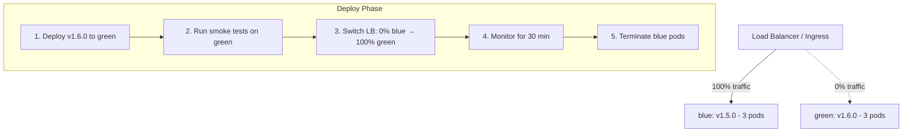

# نشرات الكناري والأزرق-الأخضر — إصدارات دون توقف

لا تحتمل خدمات الدفع التوقف أثناء النشر. فدقيقة واحدة من انقطاع معالجة المدفوعات في بنك مُصدِر للبطاقات قد تعني ملايين في معاملات ضائعة وتعرضًا رقابيًا. وتوفر استراتيجيتا النشر الأزرق-الأخضر والكناري آليات التحكم لإصدار نسخ جديدة بأمان، والتحقق منها تحت حركة إنتاج حقيقية، والتراجع فورًا عند رصد شذوذ.

---

## 1. النشر الأزرق-الأخضر

يحافظ الأزرق-الأخضر على بيئتين متطابقتين — الأزرق (الإنتاج الحالي) والأخضر (النسخة الجديدة). وتتحول الحركة من الأزرق إلى الأخضر بتحديث موازن الحمل أو مؤشر DNS. والتراجع فوري: أعد التحويل إلى الأزرق.



### 1.1 الأزرق-الأخضر بخدمات Kubernetes

أبسط تنفيذ للأزرق-الأخضر يستخدم تبديل محدد الخدمة (selector):

```yaml
# blue deployment: payment-service v1.5.0
apiVersion: apps/v1
kind: Deployment
metadata:
  name: payment-service-blue
  namespace: payments
  labels:
    slot: blue
spec:
  replicas: 3
  selector:
    matchLabels:
      app: payment-service
      slot: blue
  template:
    metadata:
      labels:
        app: payment-service
        slot: blue
        version: v1.5.0
    spec:
      containers:
        - name: payment-service
          image: 123456789.dkr.ecr.us-east-1.amazonaws.com/payment-service:v1.5.0
---
# green deployment: payment-service v1.6.0 (pre-warmed, 0 traffic)
apiVersion: apps/v1
kind: Deployment
metadata:
  name: payment-service-green
  namespace: payments
  labels:
    slot: green
spec:
  replicas: 3
  selector:
    matchLabels:
      app: payment-service
      slot: green
  template:
    metadata:
      labels:
        app: payment-service
        slot: green
        version: v1.6.0
    spec:
      containers:
        - name: payment-service
          image: 123456789.dkr.ecr.us-east-1.amazonaws.com/payment-service:v1.6.0
---
# Service: initially pointing to blue
apiVersion: v1
kind: Service
metadata:
  name: payment-service
  namespace: payments
spec:
  selector:
    app: payment-service
    slot: blue       # switch to 'green' to cut over
  ports:
    - port: 8080
      targetPort: 8080
```

تحويل الحركة. تغيير المحدد نفسه تحديث واحد للواجهة، لكنه يصل إلى kube-proxy في كل عقدة خلال ثوانٍ، وتبقى الاتصالات الدائمة (keep-alive) القائمة على الأزرق حتى تُغلق — فأبقِ الأزرق عاملًا (وجاهزًا) حتى تُصرَّف حركته:
```bash
# Switch to green
kubectl patch service payment-service -n payments \
  --type=merge \
  -p '{"spec":{"selector":{"slot":"green"}}}'

# Instant rollback if needed
kubectl patch service payment-service -n payments \
  --type=merge \
  -p '{"spec":{"selector":{"slot":"blue"}}}'
```

---

## 2. نشر الكناري

يُصدر الكناري النسخة الجديدة لنسبة صغيرة من المستخدمين أولًا، ثم يزيد الحركة تدريجيًا مع نمو الثقة. وبخلاف التحويل الثنائي في الأزرق-الأخضر، يتيح الكناري المراقبة تحت حركة إنتاج حقيقية قبل الإطلاق الكامل.

```
Traffic Split Progression:
  Deploy canary → 1% → observe → 10% → observe → 50% → observe → 100%
                  5 min          15 min           30 min
```

### 2.1 الكناري مع VirtualService في Istio

```yaml
# 90% stable v1, 10% canary v2
apiVersion: networking.istio.io/v1
kind: VirtualService
metadata:
  name: payment-service-canary
  namespace: payments
spec:
  hosts:
    - payment-service
  http:
    - route:
        - destination:
            host: payment-service
            subset: stable
          weight: 90
        - destination:
            host: payment-service
            subset: canary
          weight: 10
---
apiVersion: networking.istio.io/v1
kind: DestinationRule
metadata:
  name: payment-service-subsets
  namespace: payments
spec:
  host: payment-service
  subsets:
    - name: stable
      labels:
        version: v1.5.0
    - name: canary
      labels:
        version: v1.6.0
```

---

## 3. ‏Argo Rollouts

يوسّع Argo Rollouts ‏Kubernetes بمورد `Rollout` يؤتمت التسليم التدريجي — خطوات الكناري، والتحليل، والتراجع التلقائي.

### 3.1 مورد Rollout بخطوات كناري

```yaml
apiVersion: argoproj.io/v1alpha1
kind: Rollout
metadata:
  name: payment-service
  namespace: payments
spec:
  replicas: 10
  revisionHistoryLimit: 5
  selector:
    matchLabels:
      app: payment-service
  template:
    metadata:
      labels:
        app: payment-service
    spec:
      containers:
        - name: payment-service
          image: 123456789.dkr.ecr.us-east-1.amazonaws.com/payment-service:v1.6.0
          ports:
            - containerPort: 8080
          resources:
            requests:
              cpu: "1"
              memory: 2Gi
            limits:
              cpu: "2"
              memory: 4Gi
          readinessProbe:
            httpGet:
              path: /actuator/health/readiness
              port: 8080
            initialDelaySeconds: 15
            periodSeconds: 5
  strategy:
    canary:
      canaryService: payment-service-canary    # Service for canary pods
      stableService: payment-service-stable    # Service for stable pods
      trafficRouting:
        istio:
          virtualService:
            name: payment-service-vs
            routes:
              - primary          # the VirtualService http route to manage
      # (canary pods are reached via payment-service-canary, stable pods via
      #  payment-service-stable; Argo Rollouts rewrites the weights of the
      #  two routes in the VirtualService -- host-level traffic splitting)
      steps:
        - setWeight: 5          # Step 1: route 5% to canary
        - pause:
            duration: 5m        # wait 5 minutes; allow metrics to populate
        - analysis:
            templates:
              - templateName: payment-error-rate
            args:
              - name: service-name
                value: payment-service-canary
        - setWeight: 20         # Step 2: increase to 20%
        - pause:
            duration: 10m
        - analysis:
            templates:
              - templateName: payment-error-rate
              - templateName: payment-latency-p99
            args:                 # both templates require service-name
              - name: service-name
                value: payment-service-canary
        - setWeight: 50         # Step 3: increase to 50%
        - pause: {}             # Step 4: indefinite pause — requires manual promotion
                                # (kubectl argo rollouts promote payment-service)
        - setWeight: 100        # Step 5: full rollout (after manual approval)
      # (autoPromotionEnabled is a blue-green setting; in a canary the
      #  indefinite pause above is the manual gate. With trafficRouting,
      #  pod counts follow the weights, so maxSurge/maxUnavailable matter
      #  only for the final scale-up.)
```

---

## 4. تحليل الكناري الآلي

تستعلم قوالب AnalysisTemplate من Prometheus لتحديد ما إذا كان الكناري يحقق عتبات الجودة. فإذا فشل التحليل، يتراجع الـ Rollout تلقائيًا.

### 4.1 ‏AnalysisTemplate — معدل الأخطاء

```yaml
apiVersion: argoproj.io/v1alpha1
kind: AnalysisTemplate
metadata:
  name: payment-error-rate
  namespace: payments
spec:
  args:
    - name: service-name
  metrics:
    - name: error-rate
      interval: 60s
      count: 5                 # run 5 measurements
      failureLimit: 1          # allow at most 1 failure before aborting rollout
      # With no traffic the division yields NaN (no data): neither condition
      # is met and the measurement is "Inconclusive" -- make sure the canary
      # actually receives traffic during analysis
      successCondition: result[0] < 0.01   # error rate < 1%
      failureCondition: result[0] >= 0.05  # abort if error rate >= 5%
      provider:
        prometheus:
          address: http://prometheus.monitoring.svc.cluster.local:9090
          # "service" label: added by the Prometheus scrape config from the
          # Kubernetes Service name (Micrometer itself does not set it)
          query: |
            sum(rate(
              http_server_requests_seconds_count{
                service="{{ args.service-name }}",
                status=~"5.."
              }[2m]
            )) /
            sum(rate(
              http_server_requests_seconds_count{
                service="{{ args.service-name }}"
              }[2m]
            ))
```

### 4.2 ‏AnalysisTemplate — زمن P99

```yaml
apiVersion: argoproj.io/v1alpha1
kind: AnalysisTemplate
metadata:
  name: payment-latency-p99
  namespace: payments
spec:
  args:
    - name: service-name
  metrics:
    - name: p99-latency
      interval: 60s
      count: 5
      failureLimit: 1
      successCondition: result[0] < 0.5    # p99 latency < 500ms
      failureCondition: result[0] >= 1.0   # abort if p99 >= 1 second
      provider:
        prometheus:
          address: http://prometheus.monitoring.svc.cluster.local:9090
          query: |
            histogram_quantile(0.99,
              sum(rate(
                http_server_requests_seconds_bucket{
                  service="{{ args.service-name }}"
                }[2m]
              )) by (le)
            )
```

### 4.3 التراجع التلقائي عند فشل التحليل

حين يفشل AnalysisRun (تحقق شرط الفشل أكثر من `failureLimit` مرة، أو أكثر من `consecutiveErrorLimit` خطأ قياس — 4 افتراضيًا)، يُجهض Argo Rollouts الـ Rollout تلقائيًا:
1. يوقف توجيه الحركة إلى الكناري
2. يزيل pods الكناري
3. يعلّم الـ Rollout كـ `Degraded`
4. يرسل إشعارًا (إن ضُبط)

```bash
# Monitor rollout progress
kubectl argo rollouts get rollout payment-service -n payments --watch

# Example output:
# Name:            payment-service
# Namespace:       payments
# Status:          ✖ Degraded
# Strategy:        Canary
# Step:            2/8
# SetWeight:       5
# ActualWeight:    0
# Ready:           10/10
# ...
# AnalysisRun:     payment-service-5-error-rate - ✖ Failed
# Message:         AnalysisRun "payment-service-5-error-rate" has failed with message: Metric "error-rate" assessed Failed due to failureCondition.

# Manual rollback (if auto-rollback did not trigger)
kubectl argo rollouts abort rollout/payment-service -n payments
kubectl argo rollouts undo rollout/payment-service -n payments
```

---

## 5. مفاتيح الميزات مقابل استراتيجيات النشر

تحل مفاتيح الميزات (feature toggles) واستراتيجيات النشر مشكلات مختلفة وكثيرًا ما تُستخدم معًا.

```
┌─────────────────────────────────────────────────────────────────┐
│  Deployment Strategies solve: when to route traffic to new code │
│  Feature Toggles solve: when to activate new behavior in code   │
└─────────────────────────────────────────────────────────────────┘
```

| السيناريو                                              | استخدم                        |
|-------------------------------------------------------|----------------------------|
| خوارزمية معالجة دفع جديدة — اختبار مع 10% من المستخدمين | نشر كناري           |
| ميزة واجهة جديدة — تفعيلها لمستخدمي النسخة التجريبية فقط           | مفتاح ميزة              |
| تغيير مخطط قاعدة البيانات — إطلاق متوافق مع السابق  | توسيع-انكماش + أزرق-أخضر|
| حاجة إلى قدرة تراجع فوري                    | أزرق-أخضر                  |
| زيادة تدريجية للحركة مع فحص صحة آلي  | كناري + AnalysisTemplate   |
| مفتاح إيقاف لميزة إشكالية دون نشر  | مفتاح ميزة              |

```java
// Feature toggle for new payment routing algorithm
// LaunchDarkly Java SDK v6+ (contexts replace the old LDUser); Unleash,
// Flagsmith or OpenFeature work the same way
@Service
public class PaymentRouter {

    private final LDClient ldClient;

    public PaymentProcessingResult route(PaymentRequest request) {
        LDContext context = LDContext.builder(request.getCustomerId())
            .set("country", request.getCountry())
            .build();

        // default false: if the flag service is unreachable, use the old path
        boolean useNewRouter = ldClient.boolVariation(
            "new-payment-routing-algorithm", context, false);

        if (useNewRouter) {
            return newRoutingAlgorithm.process(request);
        } else {
            return legacyRouter.process(request);
        }
    }
}
```

---

## 6. توافق ترحيل قاعدة البيانات

تتطلب نشرات الأزرق-الأخضر والكناري أن تكون نسخة التطبيق الجديدة متوافقة مع مخطط قاعدة البيانات الحالي، لأن النسختين تعملان في وقت واحد.

### 6.1 نمط التوسيع-الانكماش (Expand-Contract)

```
Phase 1 — Expand (run with old + new code simultaneously):
  - Add column: ALTER TABLE payments ADD COLUMN new_processor_id VARCHAR(50);
  - v1.5.0 keeps using processor_id; v1.6.0 WRITES BOTH columns and reads
    COALESCE(new_processor_id, processor_id) -- rows written by v1.5.0
    during the overlap only have the old column

Phase 2 — Migrate (backfill data, in batches on a large table):
  - UPDATE payments SET new_processor_id = processor_id WHERE new_processor_id IS NULL;

Phase 3 — Contract (after full rollout to v1.6.0):
  - ALTER TABLE payments DROP COLUMN processor_id;
  - Only safe after v1.5.0 is fully retired
```

```sql
-- V3__add_new_processor_id.sql — Flyway migration (Phase 1: Expand)
-- This migration is safe to run while v1.5.0 is still in production
ALTER TABLE payments
ADD COLUMN IF NOT EXISTS new_processor_id VARCHAR(50);

-- Backfill for existing rows. On a big payments table run this as a
-- separate batched job (e.g. 10,000 rows per transaction) -- one huge
-- UPDATE holds locks and bloats the table
UPDATE payments
SET new_processor_id = processor_id
WHERE new_processor_id IS NULL
  AND processor_id IS NOT NULL;

-- Add NOT NULL constraint only after all rows are backfilled
-- and v1.5.0 is fully retired (Phase 3: Contract)
-- ALTER TABLE payments ALTER COLUMN new_processor_id SET NOT NULL;
```

---

## مزالق الإنتاج

### المزلق 1: مخطط قاعدة بيانات الأزرق-الأخضر غير متوافق مع السابق

**المشكلة**: يعمل الأزرق-الأخضر فقط لمنطق التطبيق عديم الحالة. فإذا طبّقت النسخة الجديدة (الأخضر) تغييرًا في مخطط قاعدة البيانات يحذف عمودًا أو يعيد تسميته قبل تصريف النسخة القديمة (الأزرق) كليًا، تفشل كل الطلبات الجارية التي تعالجها pods الأزرق بأخطاء قاعدة بيانات.

**النهج الخاطئ**: تشغيل ترحيلات Flyway عند بدء التطبيق دون مراعاة التوافق مع السابق.

```sql
-- V3__rename_column.sql — DANGEROUS for blue-green
-- This rename immediately breaks all blue (v1.5.0) pods
-- because v1.5.0 still SELECT processor_id which no longer exists
ALTER TABLE payments RENAME COLUMN processor_id TO legacy_processor_id;
```

**النهج الصحيح**: نمط التوسيع-الانكماش. أضف العمود الجديد، وانسخ البيانات، واجعل العمودين يعملان بالتوازي، ثم أزل القديم فقط بعد التحويل الكامل.

```sql
-- Phase 1 (safe to deploy while blue is still active):
ALTER TABLE payments ADD COLUMN legacy_processor_id VARCHAR(50);
UPDATE payments SET legacy_processor_id = processor_id;

-- Application v1.6.0 writes BOTH columns and reads:
SELECT COALESCE(legacy_processor_id, processor_id) AS effective_processor_id
FROM payments WHERE id = ?;

-- Phase 2: backfill rows written by blue during the overlap, then release
-- a version that reads only legacy_processor_id

-- Phase 3 (after blue is fully drained and retired):
ALTER TABLE payments DROP COLUMN processor_id;
-- (Do NOT rename legacy_processor_id back to processor_id here: the running
--  version reads legacy_processor_id, and a rename would break it -- that
--  would need another full expand-contract cycle)
```

---

### المزلق 2: تقسيم حركة الكناري لا يعمل لخدمات gRPC

**المشكلة**: يفتح عملاء gRPC اتصال HTTP/2 واحدًا طويل العمر ويمررون كل الاستدعاءات عبره. فإذا وُزّع ذلك الاتصال على مستوى L4 فقط — عند الاتصال — تذهب كل الاستدعاءات عليه إلى الخلفية نفسها، ويُتجاهل وزن الكناري فعليًا. ويحدث هذا حين **لا** يعالج الحركةَ وكيلٌ على مستوى L7: الـ pod المستدعي بلا وكيل جانبي، أو منفذ الخدمة غير مصرّح به كـ gRPC/HTTP2 (فيعامله Istio كـ TCP عادي)، أو تمر الحركة عبر موازن حمل يمرر TCP. ومع وكيل Envoy جانبي لدى العميل ومنفذ مصرّح به كـ gRPC، يوجّه Envoy **كل طلب** ويزنه باستقلال، فيعمل التقسيم.

**الأعراض**: تبقى أغلب حركة gRPC على المستقر (أو على الخلفية التي اتصل بها كل عميل أولًا) رغم ضبط وزن كناري 10%.

**التشخيص**:
```bash
# Is the calling pod in the mesh, and does Istio see the port as gRPC?
istioctl x describe pod <client-pod> -n payments
istioctl proxy-config cluster <client-pod> -n payments | grep payment-service
# "TCP" instead of "http2"/"grpc" -> the port protocol is not declared
# Kiali: Graph -> payment-service -> compare canary vs stable request rates
```

**الحل**: صرّح بالبروتوكول على منفذ الخدمة وتأكد من أن المستدعين داخل الشبكة:

```yaml
apiVersion: v1
kind: Service
metadata:
  name: payment-service
  namespace: payments
spec:
  selector:
    app: payment-service
  ports:
    - name: grpc
      appProtocol: grpc        # Istio applies L7 (per-request) routing
      port: 9090
      targetPort: 9090
```

للمستدعين خارج الشبكة، استخدم موازنة الحمل من جهة العميل في gRPC (التناوب على خدمة بلا رأس) أو أعد تدوير الاتصالات بانتظام (`MAX_CONNECTION_AGE` من جهة الخادم)، كي تحدث اتصالات جديدة — ومن ثم قرارات توجيه جديدة — بما يكفي لسريان الأوزان.

---

### المزلق 3: عدم اختبار AnalysisTemplate قبل كناري الإنتاج

**المشكلة**: قالب AnalysisTemplate به خطأ في استعلام Prometheus (اسم مقياس خاطئ، أو محدد تسميات خاطئ) يخطئ في كل قياس بمجرد إنشاء أول AnalysisRun؛ وبعد `consecutiveErrorLimit` خطأ (4 افتراضيًا) يفشل التشغيل. وهذا يجعل إطلاق الكناري يتراجع قبل تحليل أي حركة فعلًا — فيبدو كفشل نشر زائف. والأسوأ، إذا ضُبط `failureLimit` على 0، يكون التراجع فوريًا ويفترض الفريق أن شيفرة الكناري معيبة بينما المشكلة الحقيقية في استعلام التحليل.

**التشخيص**:
```bash
kubectl get analysisrun -n payments
# payment-service-5-error-rate   Error

kubectl describe analysisrun payment-service-5-error-rate -n payments
# Message: Error evaluating query: ...
# Prometheus error: "unknown metric name: http_server_requests_seconds_coun"
#                                           (typo: "coun" instead of "count")
```

**الوقاية**: اختبر استعلام AnalysisTemplate يدويًا قبل تشغيل الكناري.

```bash
# Step 1: Test the Prometheus query directly
kubectl port-forward svc/prometheus -n monitoring 9090:9090
# In browser or curl:
curl 'http://localhost:9090/api/v1/query' \
  --data-urlencode 'query=sum(rate(http_server_requests_seconds_count{service="payment-service"}[2m]))'
# Verify: returns a valid numeric result, not an error

# Step 2: Run the template once on its own (an AnalysisRun created from
# the template) to validate it end to end
kubectl argo rollouts create analysisrun \
  --from payment-error-rate \
  --name payment-analysis-test \
  --argument service-name=payment-service \
  -n payments

# Watch for success or error
kubectl get analysisrun payment-analysis-test -n payments --watch
```

**أفضل ممارسة**: خزّن قوالب AnalysisTemplate في مستودع GitOps واختبرها في التجهيز ببيانات Prometheus حقيقية قبل النشر في الإنتاج. وأضف اختبار تكامل يشغّل AnalysisTemplate في التجهيز ويتأكد من أنه ينتج نتيجة رقمية.

---

## قائمة التحقق

### نشرات الأزرق-الأخضر
- [ ] نشر البيئتين الأزرق والأخضر قبل تحويل الحركة
- [ ] تشغيل اختبارات الدخان على البيئة الخضراء قبل تحويل الحركة (لا بعده)
- [ ] ترحيلات قاعدة البيانات متوافقة مع السابق — تطبيق نمط التوسيع-الانكماش
- [ ] اختبار سكربت تبديل محدد الخدمة؛ ومراقبة انتشار النقاط الطرفية وتصريف الاتصالات (ثوانٍ، لا فوري)
- [ ] توثيق إجراء التراجع واختباره (إعادة المحدد إلى الأزرق)
- [ ] الاحتفاظ بـ pods الأزرق 30 دقيقة على الأقل بعد التحويل إلى الأخضر قبل إنهائها

### نشرات الكناري
- [ ] اختبار استعلامات AnalysisTemplate يدويًا على Prometheus قبل استخدامها في الإنتاج
- [ ] إنشاء AnalysisRun تجريبي في التجهيز للتحقق من القالب قبل كناري الإنتاج
- [ ] خدمات gRPC: المنفذ مصرّح به كـ gRPC والمستدعون داخل الشبكة (توجيه لكل طلب)، أو موازنة حمل من جهة العميل / إعادة تدوير الاتصالات
- [ ] كل خطوة تحليل تمرر المعاملات (args) التي تتطلبها قوالبها
- [ ] خطوة `pause: {}` غير محددة المدة قبل 100% لكل Rollouts الإنتاج التي تتطلب موافقة بشرية
- [ ] ‏`failureLimit` في AnalysisTemplate مضبوط ليسمح بفجوات المقاييس العابرة (لا `failureLimit: 0`)

### ‏Argo Rollouts
- [ ] متحكم Argo Rollouts مثبت بتوفر عالٍ (نسختان أو أكثر)
- [ ] إشعارات Rollout مضبوطة (Slack/PagerDuty عند أحداث التراجع)
- [ ] ‏`revisionHistoryLimit` مضبوط للاحتفاظ بـ 5 مراجعات على الأقل للتراجع
- [ ] مراقبة حالة Rollout أثناء كل نشر كناري (`kubectl argo rollouts get rollout`)
- [ ] تضمين خطوة ترقية يدوية لإطلاقات الإنتاج (`pause: {}` غير محددة المدة)

### ترحيلات قاعدة البيانات
- [ ] مراجعة كل تغييرات المخطط للتوافق مع السابق قبل النشر
- [ ] ترحيلات Flyway/Liquibase في مرحلة التوسيع فقط أثناء إصدارات الأزرق-الأخضر
- [ ] تأجيل ترحيلات الانكماش (إزالة العمود القديم) إلى نشر منفصل بعد الإطلاق الكامل
- [ ] اختبار ترحيل قاعدة البيانات في التجهيز بحجم بيانات مكافئ للإنتاج

---

<!-- KNOWLEDGE-CHECK
{"questions":[{"text":"لماذا يهم نمط ترحيل قاعدة البيانات توسيع-انكماش لنشرات الأزرق-الأخضر؟","options":["أ) يمنع Flyway من تشغيل الترحيلات على نسختي قاعدة البيانات الزرقاء والخضراء في وقت واحد","ب) لأن نسختي التطبيق القديمة والجديدة تعملان في وقت واحد خلال نافذة التحويل، يجب أن يبقى مخطط قاعدة البيانات متوافقًا مع كلتيهما؛ فحذف الأعمدة أو إعادة تسميتها قبل تصريف الأزرق يكسر الطلبات الجارية","ج) يجب تشغيل مرحلة الانكماش قبل تحويل الأزرق-الأخضر لضمان امتلاك الأخضر المخطط الصحيح","د) التوسيع-الانكماش مطلوب فقط لنشرات الكناري، لا للأزرق-الأخضر"],"correct":1,"explanation":"خلال تحويل الأزرق-الأخضر، قد تعالج v1 (الأزرق) وv2 (الأخضر) الطلبات في وقت واحد (طلبات قديمة جارية تستمر على الأزرق بينما تذهب الطلبات الجديدة إلى الأخضر). فإذا كسر تغيير في المخطط استعلامات v1 (مثل إعادة تسمية عمود تقرؤه v1)، تفشل تلك الطلبات الجارية على pods الأزرق. ويضمن نمط التوسيع-الانكماش توافق المخطط مع النسختين طوال نافذة التحويل."},{"text":"يتراجع كناري Argo Rollouts فورًا في كل مرة يبدأ. ويُظهر kubectl describe analysisrun ‏'Prometheus error: unknown metric name'. ما السبب الأرجح والحل؟","options":["أ) خادم Prometheus غير قابل للوصول من مساحة الأسماء payments — أضف قاعدة خروج في NetworkPolicy","ب) لم يُختبر AnalysisTemplate قبل النشر في الإنتاج؛ واستعلام Prometheus يحوي خطأ إملائيًا أو يشير إلى اسم مقياس غير موجود — اختبره بـ AnalysisRun تجريبي في التجهيز أولًا","ج) لم تولّد pods الكناري حركة كافية لوجود المقياس بعد — ارفع failureLimit إلى 10","د) لا تدعم قوالب AnalysisTemplate الاستعلامات بمعاملات عبر args؛ استخدم محددات مقاييس ثابتة"],"correct":1,"explanation":"قالب AnalysisTemplate به خطأ في استعلام Prometheus يفشل من القياسات الأولى، فيسبب تراجعًا سريعًا يبدو كعيب في الشيفرة. والحل اختبار استعلام AnalysisTemplate مباشرة على Prometheus قبل كناري الإنتاج، والتحقق منه بـ AnalysisRun تجريبي في التجهيز."},{"text":"لماذا قد يفشل توجيه الكناري القائم على الأوزان في Istio في إنتاج تقسيم الحركة المتوقع لخدمات gRPC؟","options":["أ) لا يدعم Istio توجيه حركة gRPC — فـ VirtualService يدعم HTTP/1.1 فقط","ب) يبقي عملاء gRPC اتصال HTTP/2 واحدًا طويل العمر؛ فإذا وُزّع على مستوى L4 فقط (مستدعٍ بلا وكيل جانبي، أو منفذ يعامله Istio كـ TCP)، تُختار الخلفية مرة واحدة عند الاتصال وتذهب كل الاستدعاءات على ذلك الاتصال إليها","ج) يجب أن تستخدم تسميات المجموعات الفرعية في DestinationRule ‏'grpc' كاسم بروتوكول لتوجيه gRPC","د) تتطلب خدمات gRPC مرشحات Envoy بدل VirtualService لتوجيه الكناري"],"correct":1,"explanation":"يمرر gRPC استدعاءات كثيرة عبر اتصال HTTP/2 واحد. وحين يعالج وكيل Envoy جانبي لدى المستدعي الحركة على مستوى L7 (المنفذ مصرّح به كـ grpc/http2)، يطبّق Envoy أوزان التوجيه على كل طلب فيعمل التقسيم. أما حين يُوزّع الاتصال على مستوى L4 فقط — المستدعي خارج الشبكة، أو المنفذ يُعامل كـ TCP، أو موازن حمل يمرر TCP في الطريق — فتُختار الخلفية مرة لكل اتصال وتُتجاهل الأوزان فعليًا. والحل: صرّح ببروتوكول المنفذ، وأدخل المستدعين في الشبكة، أو استخدم موازنة الحمل من جهة العميل / إعادة تدوير الاتصالات."}]}
-->

<!-- PRACTICAL-CHALLENGE
{"title":"نشر كناري دون توقف مع تراجع آلي","difficulty":"advanced","estimatedMinutes":90,"tasks":[{"id":"1","description":"انشر payment-service v1 كـ Rollout مستقر في Argo. واضبط خطوات الكناري: 5% لمدة 5 دقائق، ثم 20%، ثم 50% مع إيقاف غير محدد المدة، ثم 100%. وانشر تحديثًا (صورة v2). وراقب تقدم الإطلاق عبر أول خطوتين تلقائيًا وتأكد من توقفه عند 50%. ورقِّه يدويًا وتأكد من الإطلاق الكامل."},{"id":"2","description":"أنشئ قالبي AnalysisTemplate: واحد لمعدل الأخطاء (عتبة < 1%) وواحد لزمن p99 ‏(< 500ms). أولًا، اختبر الاستعلامين يدويًا على Prometheus للتأكد من إرجاعهما نتائج صالحة. ثم أنشئ AnalysisRun تجريبيًا وتحقق من اكتماله بنجاح. وأرفق القالبين بخطوات الكناري في الـ Rollout."},{"id":"3","description":"حاكِ نشر كناري سيئًا: انشر صورة v3 تعيد 10% أخطاء HTTP 500 (احقن الأعطال في التطبيق أو استخدم سياسة حقن أعطال في Istio). وراقب AnalysisRun وهو يكتشف مخالفة معدل الأخطاء ويطلق التراجع التلقائي. وتحقق من أنه بعد التراجع تعود 100% من الحركة إلى v2 ولا تعمل أي pods من v3."},{"id":"4","description":"اعرض نمط ترحيل قاعدة البيانات توسيع-انكماش: ابدأ بجدول 'payments' به عمود 'processor_code'. وانشر v1 التي تقرأ من processor_code. وأضف ترحيلًا (المرحلة 1: التوسيع) يضيف 'new_processor_code' ويملؤه. وانشر v2 التي تقرأ COALESCE(new_processor_code, processor_code). ونفّذ تحويل أزرق-أخضر. ثم شغّل ترحيل الانكماش الذي يحذف العمود القديم. وتحقق من عدم حدوث أخطاء في أي مرحلة."}]}
-->
