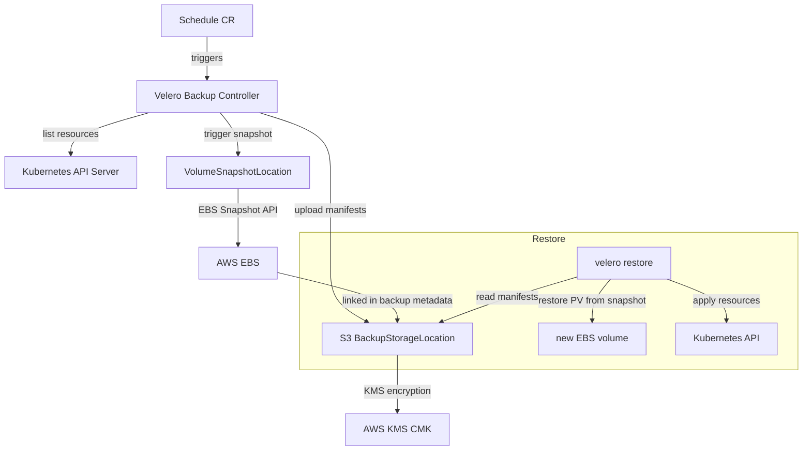
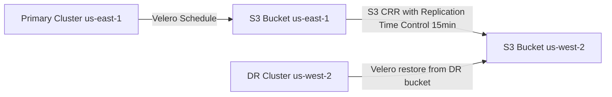

# التعافي من الكوارث على Kubernetes — النسخ الاحتياطي والاستعادة

عنقود Kubernetes دون خطة تعافٍ من الكوارث مختبرة عبء تشغيلي. وللخدمات المالية الخاضعة للتنظيم، اختبار الاستعادة ليس اختياريًا: يتطلب PCI-DSS 12.10 خطة استجابة للحوادث — تشمل إجراءات استمرارية الأعمال والتعافي وعمليات النسخ الاحتياطي — تُختبر سنويًا على الأقل، وتتطلب لوائح المرونة مثل DORA في الاتحاد الأوروبي اختبارًا منتظمًا للنسخ الاحتياطي والاستعادة. ويجب توثيق النتائج. ويغطي هذا الدرس ما يجب نسخه احتياطيًا، وكيف، وكيف تتحقق من أن الاستعادة تعمل فعلًا قبل أن تحتاجها.

---

## 1. أهداف التعافي لـ Kubernetes

### 1.1 تعريفا RTO وRPO

**هدف زمن الاستعادة (RTO)**: أقصى زمن مقبول بين الكارثة والاستعادة الكاملة للخدمة.

**هدف نقطة الاستعادة (RPO)**: أقصى فقدان مقبول للبيانات، معبرًا عنه كنافذة زمنية (مثلًا RPO ساعة يعني أنك قد تفقد ساعة بيانات على الأكثر).

أهداف نموذجية لمنصة دفع مالية:

| المكوّن                | هدف RTO  | هدف RPO  | استراتيجية الاستعادة              |
|--------------------------|-------------|-------------|-------------------------------|
| واجهة معالجة الدفع   | < 15 دقيقة    | 0 (بلا فقدان) | تعدد مناطق التوفر مع تحول تلقائي    |
| ‏PostgreSQL الأساسي       | < 30 دقيقة    | < 5 دقائق     | نسخ متدفق + استعادة لنقطة زمنية (PITR)   |
| أحداث الدفع في Kafka     | < ساعة    | < 15 دقيقة    | ‏Kafka متعدد مناطق التوفر + نسخ إلى S3     |
| العنقود كاملًا (فقدان etcd) | < 4 ساعات   | < ساعة    | لقطة etcd + نسخة Velero  |
| تعافٍ عبر المناطق          | < 8 ساعات   | < ساعة    | استعادة Velero عبر المناطق    |

### 1.2 ما يحتاج نسخًا احتياطيًا في Kubernetes

يتكون النسخ الاحتياطي الكامل لـ Kubernetes من:

```
┌─────────────────────────────────────────────────────────────┐
│  What must be backed up                                      │
├──────────────────────────────┬──────────────────────────────┤
│  etcd                        │  All Kubernetes API objects: │
│  (cluster state)             │  Deployments, Services,      │
│                              │  ConfigMaps, Secrets,        │
│                              │  NetworkPolicies, RBAC       │
├──────────────────────────────┼──────────────────────────────┤
│  PersistentVolumes           │  Actual application data:    │
│  (stateful data)             │  PostgreSQL, Kafka logs,     │
│                              │  Redis snapshots             │
├──────────────────────────────┼──────────────────────────────┤
│  Helm values                 │  Chart versions and          │
│  (deployment config)         │  override values per env     │
├──────────────────────────────┼──────────────────────────────┤
│  Certificates and PKI        │  TLS certificates, CA roots, │
│                              │  Sealed Secrets master key   │
└──────────────────────────────┴──────────────────────────────┘
```

---

## 2. بنية Velero

‏Velero أداة النسخ الاحتياطي الفعلية القياسية لـ Kubernetes. ينسخ كل كائنات واجهة Kubernetes إلى تخزين الكائنات (S3) ويستخدم واجهة VolumeSnapshot لبيانات المجلدات الدائمة.



### 2.1 مورد Schedule في Velero — نسخ يومي عند الثانية صباحًا

```yaml
apiVersion: velero.io/v1
kind: Schedule
metadata:
  name: daily-cluster-backup
  namespace: velero
spec:
  schedule: "0 2 * * *"       # 2 AM UTC every day
  useOwnerReferencesInBackup: false
  template:
    includedNamespaces:
      - payments
      - fraud-detection
      - account-management
      - kafka
      - data
    excludedResources:
      - events.events.k8s.io
      - events
      - endpointslices
    snapshotVolumes: true       # trigger EBS VolumeSnapshots
    ttl: 720h                   # each backup kept 30 days
    storageLocation: primary
    volumeSnapshotLocations:
      - primary
    includeClusterResources: true   # include RBAC, StorageClasses, CRDs
    metadata:
      labels:
        backup-type: scheduled
        pci-evidence: "true"        # flag for PCI-DSS audit evidence
---
# BackupStorageLocation — primary S3 bucket
apiVersion: velero.io/v1
kind: BackupStorageLocation
metadata:
  name: primary
  namespace: velero
spec:
  provider: aws
  default: true
  objectStorage:
    bucket: fintech-k8s-backups-prod
    prefix: cluster-backups
  config:
    region: us-east-1
    kmsKeyId: "arn:aws:kms:us-east-1:123456789:key/backup-cmk"
    serverSideEncryption: aws:kms
  credential:
    name: velero-credentials
    key: cloud
---
# VolumeSnapshotLocation — EBS
apiVersion: velero.io/v1
kind: VolumeSnapshotLocation
metadata:
  name: primary
  namespace: velero
spec:
  provider: aws
  config:
    region: us-east-1
```

### 2.2 إجراء الاستعادة

```bash
# Step 1: List available backups
velero backup get -n velero
# NAME                               STATUS     ERRORS   EXPIRES
# daily-cluster-backup-20241101...   Completed  0        29d

# Step 2: Describe backup to verify contents
velero backup describe daily-cluster-backup-20241101020012 \
  --details -n velero
# Verify: Phase: Completed, no errors; the resource list contains
# v1/Secret and v1/PersistentVolumeClaim entries; volume snapshots listed

# Step 3: Restore a full namespace
velero restore create payments-dr-restore \
  --from-backup daily-cluster-backup-20241101020012 \
  --include-namespaces payments \
  --restore-volumes=true \
  --include-cluster-resources=true \
  --wait

# Step 4: Monitor restore progress
velero restore describe payments-dr-restore -n velero
velero restore logs payments-dr-restore -n velero

# Step 5: Verify restored resources
kubectl get all -n payments
kubectl get pvc -n payments
kubectl get secrets -n payments     # verify Secrets are present

# Step 6: Run smoke tests
kubectl exec -n payments deploy/payment-api -- \
  curl -sf http://localhost:8080/actuator/health/readiness
```

---

## 3. النسخ الاحتياطي لـ etcd واستعادته

‏etcd قاعدة بيانات مستوى التحكم في Kubernetes. يخزن كل كائنات الواجهة — الـ Deployments، والخدمات، وConfigMaps، والأسرار، وكل مورد آخر في Kubernetes. وفقدان etcd دون نسخة احتياطية يعني فقدان إعدادات العنقود كاملة.

### 3.1 النسخ الاحتياطي لـ etcd بـ etcdctl

```bash
#!/bin/bash
# etcd-backup.sh — run on a control plane node every 6 hours
set -euo pipefail   # stop on any error -- never delete the local copy
                    # if the upload failed

ETCD_ENDPOINT="https://127.0.0.1:2379"
BACKUP_DIR="/opt/etcd-backups"
BACKUP_FILE="${BACKUP_DIR}/etcd-snapshot-$(date +%Y%m%d-%H%M%S).db"
# client certificate of the API server (a client cert for etcd)
ETCD_CERT="/etc/kubernetes/pki/apiserver-etcd-client.crt"
ETCD_KEY="/etc/kubernetes/pki/apiserver-etcd-client.key"
ETCD_CA="/etc/kubernetes/pki/etcd/ca.crt"

mkdir -p "${BACKUP_DIR}"

# Take snapshot — a consistent point-in-time copy of the whole keyspace;
# safe while the API server keeps running
etcdctl \
  --endpoints="${ETCD_ENDPOINT}" \
  --cert="${ETCD_CERT}" \
  --key="${ETCD_KEY}" \
  --cacert="${ETCD_CA}" \
  snapshot save "${BACKUP_FILE}"

# Verify snapshot integrity (etcd 3.5+: etcdutl; etcdctl's version is deprecated)
etcdutl snapshot status "${BACKUP_FILE}" --write-out=table

# Encrypt and upload to S3 (offsite — NEVER keep only local)
aws s3 cp "${BACKUP_FILE}" \
  "s3://fintech-etcd-backups/prod-cluster/$(basename "${BACKUP_FILE}")" \
  --sse aws:kms \
  --sse-kms-key-id "arn:aws:kms:us-east-1:123456789:key/etcd-backup-key"

# Remove local copy only after the upload succeeded (set -e)
rm -f "${BACKUP_FILE}"
echo "etcd backup completed: $(basename "${BACKUP_FILE}")"
```

### 3.2 إجراء استعادة etcd

تتطلب استعادة etcd إيقاف kube-apiserver لمنع الكتابة أثناء الاستعادة. والمثال لـ etcd بعضو واحد؛ وفي مستوى تحكم عالي التوفر، يُستعاد كل عضو من اللقطة نفسها (لكل منها `--name` خاص بها وقائمة `--initial-cluster` كاملة) قبل تشغيل أي منها.

```bash
#!/bin/bash
# etcd-restore.sh — CAUTION: disrupts the cluster control plane

SNAPSHOT_FILE="/tmp/etcd-snapshot-20241101-020000.db"
RESTORE_DIR="/var/lib/etcd-restore"
ETCD_DATA_DIR="/var/lib/etcd"

# Step 1: Download snapshot from S3
aws s3 cp \
  "s3://fintech-etcd-backups/prod-cluster/etcd-snapshot-20241101-020000.db" \
  "${SNAPSHOT_FILE}"

# Step 2: Stop the API server and etcd by moving static pod manifests
mv /etc/kubernetes/manifests/kube-apiserver.yaml /tmp/
mv /etc/kubernetes/manifests/etcd.yaml /tmp/
sleep 10    # wait for containers to terminate

# Step 3: Restore snapshot to new data directory (etcdutl in etcd 3.5+)
etcdutl snapshot restore "${SNAPSHOT_FILE}" \
  --data-dir="${RESTORE_DIR}" \
  --name=master-0 \
  --initial-cluster="master-0=https://127.0.0.1:2380" \
  --initial-cluster-token=etcd-cluster-prod \
  --initial-advertise-peer-urls="https://127.0.0.1:2380"

# Step 4: Replace etcd data directory (keep the old one until verified)
mv "${ETCD_DATA_DIR}" "${ETCD_DATA_DIR}.old"
mkdir -p "${ETCD_DATA_DIR}"
mv "${RESTORE_DIR}/member" "${ETCD_DATA_DIR}/member"

# Step 5: Restart control plane
mv /tmp/etcd.yaml /etc/kubernetes/manifests/
sleep 15
mv /tmp/kube-apiserver.yaml /etc/kubernetes/manifests/

# Step 6: Verify cluster health. The cluster is now back at the snapshot
# time: objects created later are gone, and controllers/kubelets reconcile
# the difference -- restart kubelets and controllers if they act on stale state
kubectl get nodes
kubectl get pods -n kube-system
```

---

## 4. التعافي متعدد المناطق

لأهداف RTO أقل من 8 ساعات، جهّز عنقودًا احتياطيًا مسبقًا في منطقة AWS ثانية وأوصل النسخ الاحتياطية إليها. ويجب أن يصل أمران إلى منطقة التعافي: كائنات نسخ Velero (الملفات) **وبيانات المجلدات** — فلقطات EBS تبقى في المنطقة التي أُخذت فيها. فاستخدم النسخ المتماثل عبر المناطق في S3 (CRR) للحاوية (مع S3 Replication Time Control لاتفاقية 15 دقيقة)، وإما انسخ لقطات EBS عبر المناطق (AWS Backup / DLM) أو استخدم ناقل البيانات في Velero، الذي يرفع بيانات المجلدات إلى الحاوية نفسها.



```yaml
# Second region BackupStorageLocation (bucket kept in sync by S3 CRR).
# Velero writes each backup to exactly ONE location -- there is no
# "additional locations" setting. On the DR cluster, register this bucket
# (read-only) and restore from it.
apiVersion: velero.io/v1
kind: BackupStorageLocation
metadata:
  name: dr-region
  namespace: velero
spec:
  provider: aws
  accessMode: ReadOnly          # on the DR cluster: never write into it
  objectStorage:
    bucket: fintech-k8s-backups-dr
    prefix: cluster-backups
  config:
    region: us-west-2
    kmsKeyId: "arn:aws:kms:us-west-2:123456789:key/backup-cmk-dr"
    serverSideEncryption: aws:kms
---
# Schedule with the data mover: volume data is copied into the (replicated)
# bucket instead of staying only in region-bound EBS snapshots
apiVersion: velero.io/v1
kind: Schedule
metadata:
  name: daily-backup-with-dr
  namespace: velero
spec:
  schedule: "0 2 * * *"
  template:
    includedNamespaces:
      - payments
      - data
    snapshotMoveData: true      # CSI snapshot -> data mover -> object storage
    ttl: 720h
    storageLocation: primary
```

---

## 5. دليل تشغيل اختبار التعافي

شغّل تمارين التعافي ربع سنويًا — سياسة شركة لمنصة دفع؛ ويطلب PCI-DSS 12.10.2 اختبار خطة الاستجابة سنويًا على الأقل، بما فيها الاستعادة. ونفّذها على عنقود اختبار غير إنتاجي، لا على الإنتاج.

```
┌─────────────────────────────────────────────────────────────────┐
│  Quarterly DR Restore Drill — Step by Step                       │
├──────────────────────────────────────────────────────────────────┤
│                                                                   │
│  1. Pre-drill preparation (T-1 day)                              │
│     - velero backup get: identify most recent Completed backup   │
│     - Provision a clean test cluster (same size as production)   │
│     - Install Velero on test cluster with DR S3 bucket access    │
│     - Document baseline: pod count, service versions, DB rows    │
│                                                                   │
│  2. Cluster restore (T=0, record start time)                     │
│     - velero restore create drill-restore \                      │
│         --from-backup <backup-name> \                            │
│         --include-namespaces payments,data \                     │
│         --restore-volumes=true \                                 │
│         --wait                                                    │
│                                                                   │
│  3. Verification (T+30 min)                                      │
│     - kubectl get all -n payments → all pods Running             │
│     - kubectl get pvc -n payments → all PVCs Bound               │
│     - kubectl get secrets -n payments → credentials present      │
│     - Smoke test: payment API health check returns HTTP 200      │
│     - DB verification: row count matches pre-disaster baseline   │
│     - Record actual RTO vs target RTO                            │
│                                                                   │
│  4. PCI-DSS Evidence Collection                                  │
│     - Screenshot: velero restore describe output                 │
│     - Screenshot: kubectl get all -n payments → Running pods     │
│     - Smoke test results (pass/fail with timestamps)             │
│     - Actual RTO vs target signed by security officer            │
│                                                                   │
│  5. Post-drill cleanup                                           │
│     - Delete test cluster (never keep DR drill data in prod)     │
│     - File report in compliance documentation system             │
│     - Open P2 remediation tickets for any failures               │
│     - Schedule next drill: T+90 days                             │
│                                                                   │
└──────────────────────────────────────────────────────────────────┘
```

أتمت خطوة التحقق:

```bash
#!/bin/bash
# dr-verify.sh — run after every restore to validate completeness
NAMESPACE=payments

echo "DR Restore Verification — $(date -u)"

# 1. Wait for pods to become Ready
kubectl wait pod --all -n "${NAMESPACE}" \
  --for=condition=Ready --timeout=300s

# 2. Check all expected Deployments are available
kubectl get deployments -n "${NAMESPACE}" \
  -o=custom-columns='NAME:.metadata.name,AVAILABLE:.status.availableReplicas,DESIRED:.spec.replicas'

# 3. Verify Secrets are present
SECRET_COUNT=$(kubectl get secrets -n "${NAMESPACE}" \
  --no-headers | grep -v default-token | wc -l)
echo "Secrets restored: ${SECRET_COUNT}"

# 4. Run application health check
kubectl exec -n "${NAMESPACE}" \
  "$(kubectl get pod -n ${NAMESPACE} -l app=payment-service \
     -o jsonpath='{.items[0].metadata.name}')" \
  -- curl -sf http://localhost:8080/actuator/health

echo "Verification complete — $(date -u)"
```

---

## مزالق الإنتاج

### المزلق 1: عدم اختبار الاستعادة حتى تقع الكارثة

**المشكلة**: تنشئ المؤسسات جداول Velero، وتتحقق من ظهور كائنات النسخ في S3، وتعتبر استراتيجية النسخ الاحتياطي مكتملة. وأول مرة تحاول فيها الاستعادة تكون أثناء حادث فعلي — حين يجتمع ضغط الوقت، والتوتر، وأنماط الفشل غير المألوفة لتعظيم احتمال الخطأ.

**إخفاقات شائعة لا تُكتشف إلا في أول استعادة على الإطلاق**:
- الأسرار مستبعدة من النسخ الاحتياطي (انظر المزلق 3)
- يجب إعادة تثبيت الـ CRDs ‏(ArgoCD، وCert-Manager) قبل الموارد المحصورة بمساحة أسماء
- نجحت لقطات الـ PVC لكن بيانات التطبيق تالفة
- لم تُستعد ClusterRoleBindings التي تحتاجها حسابات الخدمة
- صور ECR موجودة في المنطقة المعطلة — لا تستطيع الـ pods سحب الصور في منطقة التعافي

**الحل**: جدوِل تمارين تعافٍ ربع سنوية كحدث إلزامي في التقويم وعامل إخفاقات الاستعادة كحوادث P1.

```bash
# Minimal automated restore verification — run after every drill
#!/bin/bash
NAMESPACE=payments
BACKUP_NAME=$1
DRILL_START=$(date +%s)

echo "Starting DR drill from backup: ${BACKUP_NAME}"

velero restore create "drill-$(date +%Y%m%d%H%M)" \
  --from-backup "${BACKUP_NAME}" \
  --include-namespaces "${NAMESPACE}" \
  --restore-volumes=true \
  --wait

kubectl wait pod --all -n "${NAMESPACE}" \
  --for=condition=Ready --timeout=300s

kubectl exec -n "${NAMESPACE}" \
  "$(kubectl get pod -n ${NAMESPACE} -l app=payment-service \
     -o jsonpath='{.items[0].metadata.name}')" \
  -- curl -sf http://localhost:8080/actuator/health

DRILL_END=$(date +%s)
RTO_MINUTES=$(( (DRILL_END - DRILL_START) / 60 ))
echo "Actual RTO: ${RTO_MINUTES} minutes (target: 240)"

if [ "${RTO_MINUTES}" -gt 240 ]; then
  echo "FAIL: RTO target exceeded — open P1 remediation ticket"
  exit 1
fi
echo "PASS: RTO target achieved"
```

---

### المزلق 2: إيقاف kube-apiserver لأخذ لقطات etcd

**المشكلة**: توقف بعض أدلة التشغيل خادم الواجهة قبل كل لقطة etcd، اعتقادًا بأن لقطة تؤخذ أثناء الكتابة قد تلتقط كائنات Kubernetes "نصف منشأة". وهذا يسبب انقطاعًا في مستوى التحكم مع كل نسخة احتياطية — وهو غير ضروري.

**ما يحدث فعلًا**: ينتج `etcdctl snapshot save` نسخة متسقة في لحظة زمنية لكامل مفاتيح etcd. ولا توجد في Kubernetes معاملات متعددة الكائنات: فالـ Deployment والـ ReplicaSet الخاص به والـ Pods كائنات منفصلة، تنشئها متحكمات مختلفة واحدًا تلو الآخر. وقد تحتوي لقطة الـ Deployment دون الـ ReplicaSet بعد — وهي بالضبط حالة العنقود نفسه في تلك اللحظة، وبعد الاستعادة تواصل المتحكمات ببساطة التوفيق وتنشئ الناقص.

**المخاطر الحقيقية لاستعادة etcd** مختلفة:
- يقفز العنقود إلى الوراء في الزمن: كل ما أُنشئ بعد اللقطة (Deployments، وأسرار، وشهادات، وLeases) يختفي، بينما تعكس العقد والـ pods العاملة الحالة الأحدث — فأعد تشغيل kubelets والمتحكمات ودعها توفّق؛
- في مستوى تحكم عالي التوفر، يجب استعادة كل أعضاء etcd من اللقطة نفسها؛
- تستعيد لقطة etcd العنقود الذي كان لديك — ولا تستطيع نقل أحمال العمل إلى عنقود أو منطقة جديدة (يستطيع ذلك Velero أو GitOps).

```bash
# Take snapshots online -- no API server downtime
etcdctl snapshot save /opt/backups/etcd-$(date +%Y%m%d-%H%M).db \
  --endpoints=https://127.0.0.1:2379 \
  --cert=/etc/kubernetes/pki/apiserver-etcd-client.crt \
  --key=/etc/kubernetes/pki/apiserver-etcd-client.key \
  --cacert=/etc/kubernetes/pki/etcd/ca.crt

# For GitOps clusters: Git holds the desired state; after a restore,
# Argo CD / Flux re-applies anything the snapshot was missing
```

**لـ EKS / GKE / AKS**: يشغّل المزوّد etcd ولا وصول لك إليه. وما زلت تحتاج نسخًا احتياطيًا على مستوى الكائنات (Velero و/أو GitOps) ونسخًا للمجلدات — فالمزوّد يحمي مستوى تحكمه، لا مساحة الأسماء التي حذفتها عرضيًا.

---

### المزلق 3: عدم تشفير تخزين النسخ الاحتياطي

**المشكلة**: تحتوي نسخ Velero المخزنة في S3 كل أسرار Kubernetes كـ JSON مرمّز بـ base64 — أي نص صريح فعليًا: كلمات مرور قواعد البيانات، ومفاتيح الواجهات، والمفاتيح الخاصة لـ TLS، وشهادات التوقيع. ودون تشفير أثناء التخزين والنقل وضبط وصول محكم، تمنح حاوية S3 مخترقة وصولًا كاملًا لكل بيانات اعتماد التطبيقات. وهذا يتعارض مع PCI-DSS 8.3.2 (جعل عوامل المصادقة غير مقروءة أثناء التخزين والنقل) ومتطلبات حماية المفاتيح في 3.6.

**إعداد تخزين نسخ خاطئ**:
```yaml
apiVersion: velero.io/v1
kind: BackupStorageLocation
metadata:
  name: default
  namespace: velero
spec:
  provider: aws
  objectStorage:
    bucket: fintech-backups-prod     # NO encryption configured
  config:
    region: us-east-1
    # Missing: kmsKeyId — data stored without encryption
    # Missing: serverSideEncryption — no at-rest protection
```

**إعداد صحيح بتشفير KMS بمفتاح يديره العميل**:
```yaml
apiVersion: velero.io/v1
kind: BackupStorageLocation
metadata:
  name: default
  namespace: velero
spec:
  provider: aws
  objectStorage:
    bucket: fintech-k8s-backups-encrypted
  config:
    region: us-east-1
    kmsKeyId: "arn:aws:kms:us-east-1:123456789:key/backup-cmk"
    serverSideEncryption: aws:kms    # AES-256 with customer-managed key
```

افرض التشفير على مستوى سياسة حاوية S3 (يرفض أي رفع دون KMS):

```json
{
  "Version": "2012-10-17",
  "Statement": [
    {
      "Sid": "DenyUnencryptedObjectUploads",
      "Effect": "Deny",
      "Principal": "*",
      "Action": "s3:PutObject",
      "Resource": "arn:aws:s3:::fintech-k8s-backups-encrypted/*",
      "Condition": {
        "StringNotEquals": {
          "s3:x-amz-server-side-encryption": "aws:kms"
        }
      }
    },
    {
      "Sid": "DenyHTTP",
      "Effect": "Deny",
      "Principal": "*",
      "Action": "s3:*",
      "Resource": [
        "arn:aws:s3:::fintech-k8s-backups-encrypted",
        "arn:aws:s3:::fintech-k8s-backups-encrypted/*"
      ],
      "Condition": {
        "Bool": {
          "aws:SecureTransport": "false"
        }
      }
    }
  ]
}
```

تفرض هذه السياسة أن كل عمليات الرفع تستخدم تشفير KMS وأن كل استدعاءات الواجهة تستخدم TLS. واضبط أيضًا التشفير الافتراضي للحاوية على SSE-KMS، وفعّل S3 Object Lock كي لا يستطيع مهاجم (برمجيات فدية) حذف النسخ الاحتياطية أو تشفيرها قبل تاريخ الاحتفاظ بها.

---

## قائمة التحقق

### إعداد Velero
- [ ] نشر Schedule في Velero: يوميًا عند الثانية صباحًا، احتفاظ 30 يومًا (TTL ‏720h)
- [ ] ‏`includedNamespaces` تغطي كل مساحات أسماء التطبيقات والبيانات
- [ ] ‏`snapshotVolumes: true` مفعّل لنسخ الـ PVC عبر لقطات EBS
- [ ] ‏`includeClusterResources: true` لالتقاط RBAC، وStorageClasses، وCRDs
- [ ] الأسرار غير مستبعدة صراحة من النسخ الاحتياطي
- [ ] النسخ مخزنة في حاوية S3 مشفرة بـ KMS (مفتاح يديره العميل، لا مفتاح تديره AWS)
- [ ] سياسة حاوية S3 تفرض تشفير KMS (ترفض الرفع دون KMS)
- [ ] إصدارات حاوية S3 وObject Lock مفعّلة للحماية من التلف والحذف وبرمجيات الفدية
- [ ] النسخ المتماثل عبر المناطق إلى حاوية S3 في منطقة التعافي مضبوط ومختبر — بما فيه بيانات المجلدات (نسخ اللقطات أو ناقل البيانات)
- [ ] التحقق من ‏`BackupStorageLocation`: يُظهر `velero backup-location get` الحالة Available
- [ ] تنبيهات نجاح/فشل نسخ Velero مضبوطة في Prometheus (استدعاء عند الفشل)

### النسخ الاحتياطي لـ etcd (العناقيد المُدارة ذاتيًا فقط)
- [ ] مهمة CronJob لـ etcd تعمل كل 6 ساعات على الأقل
- [ ] اللقطات تُرفع إلى حاوية S3 منفصلة عن Velero (بمفتاح KMS مختلف)
- [ ] ‏`etcdutl snapshot status` يتحقق من السلامة بعد كل نسخة
- [ ] إجراء استعادة etcd موثق ومختبر سنويًا (كل الأعضاء من اللقطة نفسها)
- [ ] اللقطات تؤخذ أثناء التشغيل — دون إيقاف خادم الواجهة
- [ ] ‏EKS/GKE/AKS: لا وصول إلى etcd؛ الاعتماد على Velero + GitOps لنسخ الكائنات

### اختبار التعافي (PCI-DSS 12.10، وسياسة التعافي في الشركة)
- [ ] تمرين تعافٍ ربع سنوي مجدول كحدث في التقويم بمالك مسمى
- [ ] تنفيذ تمرين التعافي على عنقود اختبار (لا على عنقود الإنتاج أبدًا)
- [ ] قياس RTO الفعلي ومقارنته بالهدف في كل تمرين
- [ ] نتائج تمرين التعافي موقعة من مسؤول الأمان ومحفوظة في نظام الامتثال
- [ ] فتح تذاكر معالجة P2 لأي إخفاقات مكتشفة
- [ ] توثيق ترتيب تثبيت الـ CRDs ‏(ArgoCD، وCert-Manager أولًا)
- [ ] التحقق من النسخ المتماثل لصور ECR عبر المناطق أثناء التمرين (تستطيع الـ pods سحب الصور)

### التعافي متعدد المناطق
- [ ] ‏`BackupStorageLocation` مضبوط في منطقة AWS ثانوية
- [ ] البنية التحتية لعنقود التعافي كشيفرة (Terraform/eksctl) ومتحقق من قابليتها للتشغيل
- [ ] ‏Velero على عنقود التعافي متحقق منه بصلاحية قراءة لحاوية S3 في منطقة التعافي
- [ ] تنفيذ تمرين استعادة عبر المناطق مرة سنويًا على الأقل

### الأمان والامتثال
- [ ] حاوية S3 غير متاحة للعامة (AWS S3 Block Public Access مفعّل)
- [ ] الوصول إلى مفتاح KMS للنسخ مضبوط — فقط حساب خدمة Velero يستطيع استخدامه
- [ ] سجلات الوصول للنسخ مفعّلة (S3 server access logging) لمسار تدقيق PCI-DSS
- [ ] مفاتيح تشفير النسخ محمية بشكل منفصل (سياسة مفتاح KMS + مفتاح في منطقة أخرى)
- [ ] تقارير تمارين التعافي محفوظة وفق سياسة الاحتفاظ بالأدلة لديك كدليل لـ PCI-DSS 12.10 / اختبار المرونة التنظيمي

---

<!-- KNOWLEDGE-CHECK
{"questions":[{"text":"يتطلب PCI-DSS 12.10 اختبار خطة الاستجابة للحوادث — بما فيها عمليات الاستعادة والنسخ الاحتياطي. ما أخطر خطأ يُبطل برنامج النسخ الاحتياطي ولا يُكتشف إلا وقت الكارثة؟","options":["أ) استخدام Velero بدل etcdctl للنسخ الاحتياطي للعنقود","ب) ضبط TTL للنسخ على 30 يومًا بدل 90 يومًا","ج) عدم اختبار الاستعادة فعليًا أبدًا — التحقق فقط من وجود ملفات النسخ في S3، دون التحقق من اكتمال الاستعادة منها ضمن هدف RTO","د) استخدام فئة التخزين S3 Standard بدل S3 Intelligent-Tiering"],"correct":2,"explanation":"تتحقق مؤسسات كثيرة من وجود النسخ (ظهور الملفات في S3) لكنها لا تختبر الاستعادة أبدًا. وأول استعادة فعلية أثناء كارثة تكشف مشكلات مثل الأسرار المستبعدة، والـ CRDs الناقصة، وصلاحيات IAM الخاطئة، والصور المتاحة فقط في المنطقة المعطلة، واللقطات التالفة — وكل ذلك تحت ضغط الوقت. ويتوقع المنظمون وPCI-DSS دليلًا على أن الاستعادة تعمل (مختبرة، بنتائج مقاسة)، لا مجرد أن النسخ تُنشأ."},{"text":"لماذا يجب تخزين نسخ etcd في حاوية S3 منفصلة عن نسخ تطبيقات Velero، بمفاتيح KMS منفصلة؟","options":["أ) لا يستطيع Velero قراءة ملفات لقطات etcd — فهي بصيغة ثنائية غير متوافقة مع S3","ب) تحتوي لقطات etcd كل كائنات واجهة Kubernetes بما فيها كل سر؛ والحاويات المنفصلة بمفاتيح منفصلة تحدّ نطاق الضرر — فاختراق مسار وصول نسخ واحد لا يكشف الآخر تلقائيًا","ج) لـ AWS S3 حد لحجم الملف يتطلب تقسيم النسخ على حاويات متعددة","د) يجب تخزين لقطات etcd على عقدة مستوى التحكم ولا يمكن رفعها إلى S3"],"correct":1,"explanation":"لقطات etcd تفريغات كاملة لكل حالة Kubernetes بما فيها كل سر في العنقود. وفصل نسخ etcd عن نسخ تطبيقات Velero — بمفاتيح KMS مختلفة، وسياسات وصول IAM مختلفة، وسجلات تدقيق مختلفة — يعني أن اختراق مسار وصول واحد لا يكشف الآخر تلقائيًا، فيحد نطاق ضرر الحادث الأمني."},{"text":"يكتمل أمر velero restore create بنجاح لكن pods ‏payment-service تفشل في البدء لأنها لا تستطيع المصادقة على PostgreSQL. ما الذي كان غالبًا مفقودًا من إعداد نسخ Velero؟","options":["أ) لم يُدرج StatefulSet ‏PostgreSQL في قائمة مساحات أسماء النسخ","ب) أُخذت لقطات الـ PVC مع snapshotVolumes: false","ج) استُبعدت أسرار Kubernetes صراحة من نسخ Velero، فلم يُستعد سر postgres-credentials — فلا كلمة مرور لقاعدة البيانات لدى payment-service بعد الاستعادة","د) ضُبط VolumeSnapshotLocation لمنطقة AWS خاطئة"],"correct":2,"explanation":"استبعاد الأسرار من نسخ Velero خطأ إعداد شائع، يُفعل غالبًا بنية تجنب تخزين بيانات الاعتماد في تخزين النسخ. ودون سر postgres-credentials، لا يستطيع payment-service المصادقة على قاعدة البيانات بعد الاستعادة. ويجب إدراج الأسرار في النسخ (مع تشفير حاوية النسخ بـ KMS) لتمكين استعادة كاملة لمساحة الأسماء."}]}
-->

<!-- PRACTICAL-CHALLENGE
{"title":"تنفيذ واختبار التعافي من الكوارث على Kubernetes لمنصة دفع","difficulty":"advanced","estimatedMinutes":120,"tasks":[{"id":"1","description":"ثبّت Velero بواجهة خلفية متوافقة مع S3 ‏(MinIO محليًا أو S3 حقيقي). وأنشئ Schedule ينسخ مساحتي الأسماء payments وdata كل 5 دقائق (لسرعة التمرين). وانشر StatefulSet لـ PostgreSQL بعشرة سجلات دفع تجريبية. وخذ نسخة يدوية بـ velero backup create، وتحقق من ظهورها كـ Completed، وتأكد من أن النسخة في S3 تتضمن الأسرار بتشغيل velero backup describe مع --details."},{"id":"2","description":"حاكِ كارثة كاملة لمساحة أسماء: احذف مساحة الأسماء payments بالكامل. ثم نفّذ استعادة كاملة باستخدام velero restore create مع --restore-volumes=true. وقِس زمن الاستعادة من الحذف حتى عمل كل الـ pods. وتحقق من: عمل كل الـ pods، وارتباط كل الـ PVCs، ووجود سر postgres-credentials، واحتواء PostgreSQL على السجلات العشرة الأصلية. ووثّق RTO الفعلي مقابل الهدف."},{"id":"3","description":"تدرّب على نسخ etcd احتياطيًا على عنقود kubeadm محلي. خذ لقطة أثناء التشغيل بـ etcdctl snapshot save، وتحقق منها بـ etcdutl snapshot status (سجّل البصمة وعدد المفاتيح). وأنشئ Deployment جديدًا بعد اللقطة واحذف Deployment أقدم. وأوقف kube-apiserver، واستعد من اللقطة باتباع إجراء الاستعادة، وأعد تشغيل مستوى التحكم، وتحقق من: عودة الـ Deployment المحذوف واختفاء الأحدث. ووثّق كيف وفّقت المتحكمات الـ pods العاملة."},{"id":"4","description":"اضبط BackupStorageLocation ثانيًا (عبر المناطق، أو MinIO ثانٍ) يتلقى النسخ عبر النسخ المتماثل للحاوية، مع نقل بيانات المجلدات إلى تخزين الكائنات بناقل البيانات في Velero. وتحقق من وجود النسخة في الموقعين بعد النسخ الاحتياطي. وأعدّ نسخة Velero تشير فقط إلى الموقع الثانوي (قراءة فقط) ونفّذ استعادة منه. ووثّق دليل التعافي متعدد المناطق الكامل بما فيه كل أوامر kubectl وvelero، والمخرجات المتوقعة، وخطوات التحقق كدليل على اختبار التعافي."}]}
-->
