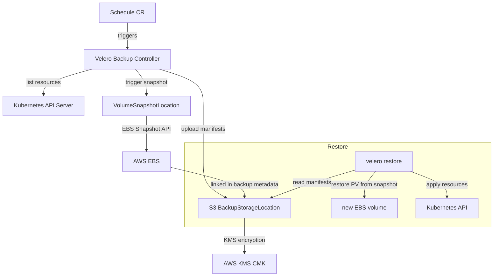
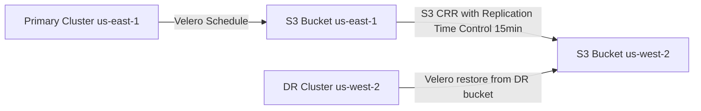

# Disaster Recovery on Kubernetes — Backup and Restore

A Kubernetes cluster without a tested disaster recovery plan is an operational liability. For regulated financial services, recovery testing is not optional: PCI-DSS 12.10 requires an incident response plan — including business recovery and continuity procedures and data backup processes — that is tested at least annually, and resilience regulations such as the EU's DORA require regular testing of backup and recovery. Results must be documented. This lesson covers what must be backed up, how to back it up, and how to verify that recovery actually works before you need it.

---

## 1. DR Objectives for Kubernetes

### 1.1 RTO and RPO Definitions

**Recovery Time Objective (RTO)**: Maximum acceptable time between a disaster and full service restoration.

**Recovery Point Objective (RPO)**: Maximum acceptable data loss, expressed as a time window (e.g., RPO of 1 hour means you can lose at most 1 hour of data).

Typical targets for a fintech payment platform:

| Component                | RTO Target  | RPO Target  | Recovery Strategy              |
|--------------------------|-------------|-------------|-------------------------------|
| Payment processing API   | < 15 min    | 0 (no loss) | Multi-AZ with auto-failover    |
| PostgreSQL primary       | < 30 min    | < 5 min     | Streaming replication + PITR   |
| Kafka payment events     | < 1 hour    | < 15 min    | Multi-AZ Kafka + S3 backup     |
| Full cluster (etcd loss) | < 4 hours   | < 1 hour    | etcd snapshot + Velero backup  |
| Cross-region DR          | < 8 hours   | < 1 hour    | Velero cross-region restore    |

### 1.2 What Needs Backup in Kubernetes

A complete Kubernetes backup consists of:

```
┌─────────────────────────────────────────────────────────────┐
│  What must be backed up                                      │
├──────────────────────────────┬──────────────────────────────┤
│  etcd                        │  All Kubernetes API objects: │
│  (cluster state)             │  Deployments, Services,      │
│                              │  ConfigMaps, Secrets,        │
│                              │  NetworkPolicies, RBAC       │
├──────────────────────────────┼──────────────────────────────┤
│  PersistentVolumes           │  Actual application data:    │
│  (stateful data)             │  PostgreSQL, Kafka logs,     │
│                              │  Redis snapshots             │
├──────────────────────────────┼──────────────────────────────┤
│  Helm values                 │  Chart versions and          │
│  (deployment config)         │  override values per env     │
├──────────────────────────────┼──────────────────────────────┤
│  Certificates and PKI        │  TLS certificates, CA roots, │
│                              │  Sealed Secrets master key   │
└──────────────────────────────┴──────────────────────────────┘
```

---

## 2. Velero Architecture

Velero is the de-facto backup tool for Kubernetes. It backs up all Kubernetes API objects to object storage (S3) and uses the VolumeSnapshot API for persistent volume data.



### 2.1 Velero Schedule CRD — Daily Backup at 2am

```yaml
apiVersion: velero.io/v1
kind: Schedule
metadata:
  name: daily-cluster-backup
  namespace: velero
spec:
  schedule: "0 2 * * *"       # 2 AM UTC every day
  useOwnerReferencesInBackup: false
  template:
    includedNamespaces:
      - payments
      - fraud-detection
      - account-management
      - kafka
      - data
    excludedResources:
      - events.events.k8s.io
      - events
      - endpointslices
    snapshotVolumes: true       # trigger EBS VolumeSnapshots
    ttl: 720h                   # each backup kept 30 days
    storageLocation: primary
    volumeSnapshotLocations:
      - primary
    includeClusterResources: true   # include RBAC, StorageClasses, CRDs
    metadata:
      labels:
        backup-type: scheduled
        pci-evidence: "true"        # flag for PCI-DSS audit evidence
---
# BackupStorageLocation — primary S3 bucket
apiVersion: velero.io/v1
kind: BackupStorageLocation
metadata:
  name: primary
  namespace: velero
spec:
  provider: aws
  default: true
  objectStorage:
    bucket: fintech-k8s-backups-prod
    prefix: cluster-backups
  config:
    region: us-east-1
    kmsKeyId: "arn:aws:kms:us-east-1:123456789:key/backup-cmk"
    serverSideEncryption: aws:kms
  credential:
    name: velero-credentials
    key: cloud
---
# VolumeSnapshotLocation — EBS
apiVersion: velero.io/v1
kind: VolumeSnapshotLocation
metadata:
  name: primary
  namespace: velero
spec:
  provider: aws
  config:
    region: us-east-1
```

### 2.2 Restore Procedure

```bash
# Step 1: List available backups
velero backup get -n velero
# NAME                               STATUS     ERRORS   EXPIRES
# daily-cluster-backup-20241101...   Completed  0        29d

# Step 2: Describe backup to verify contents
velero backup describe daily-cluster-backup-20241101020012 \
  --details -n velero
# Verify: Phase: Completed, no errors; the resource list contains
# v1/Secret and v1/PersistentVolumeClaim entries; volume snapshots listed

# Step 3: Restore a full namespace
velero restore create payments-dr-restore \
  --from-backup daily-cluster-backup-20241101020012 \
  --include-namespaces payments \
  --restore-volumes=true \
  --include-cluster-resources=true \
  --wait

# Step 4: Monitor restore progress
velero restore describe payments-dr-restore -n velero
velero restore logs payments-dr-restore -n velero

# Step 5: Verify restored resources
kubectl get all -n payments
kubectl get pvc -n payments
kubectl get secrets -n payments     # verify Secrets are present

# Step 6: Run smoke tests
kubectl exec -n payments deploy/payment-api -- \
  curl -sf http://localhost:8080/actuator/health/readiness
```

---

## 3. etcd Backup and Restore

etcd is the Kubernetes control plane database. It stores all API objects — Deployments, Services, ConfigMaps, Secrets, and every other Kubernetes resource. Losing etcd without a backup means losing the entire cluster configuration.

### 3.1 etcd Backup with etcdctl

```bash
#!/bin/bash
# etcd-backup.sh — run on a control plane node every 6 hours
set -euo pipefail   # stop on any error -- never delete the local copy
                    # if the upload failed

ETCD_ENDPOINT="https://127.0.0.1:2379"
BACKUP_DIR="/opt/etcd-backups"
BACKUP_FILE="${BACKUP_DIR}/etcd-snapshot-$(date +%Y%m%d-%H%M%S).db"
# client certificate of the API server (a client cert for etcd)
ETCD_CERT="/etc/kubernetes/pki/apiserver-etcd-client.crt"
ETCD_KEY="/etc/kubernetes/pki/apiserver-etcd-client.key"
ETCD_CA="/etc/kubernetes/pki/etcd/ca.crt"

mkdir -p "${BACKUP_DIR}"

# Take snapshot — a consistent point-in-time copy of the whole keyspace;
# safe while the API server keeps running
etcdctl \
  --endpoints="${ETCD_ENDPOINT}" \
  --cert="${ETCD_CERT}" \
  --key="${ETCD_KEY}" \
  --cacert="${ETCD_CA}" \
  snapshot save "${BACKUP_FILE}"

# Verify snapshot integrity (etcd 3.5+: etcdutl; etcdctl's version is deprecated)
etcdutl snapshot status "${BACKUP_FILE}" --write-out=table

# Encrypt and upload to S3 (offsite — NEVER keep only local)
aws s3 cp "${BACKUP_FILE}" \
  "s3://fintech-etcd-backups/prod-cluster/$(basename "${BACKUP_FILE}")" \
  --sse aws:kms \
  --sse-kms-key-id "arn:aws:kms:us-east-1:123456789:key/etcd-backup-key"

# Remove local copy only after the upload succeeded (set -e)
rm -f "${BACKUP_FILE}"
echo "etcd backup completed: $(basename "${BACKUP_FILE}")"
```

### 3.2 etcd Restore Procedure

Restoring etcd requires stopping the kube-apiserver to prevent writes during the restore. The example is a single-member etcd; in an HA control plane, every member is restored from the SAME snapshot (each with its own `--name` and the full `--initial-cluster` list) before any of them is started.

```bash
#!/bin/bash
# etcd-restore.sh — CAUTION: disrupts the cluster control plane

SNAPSHOT_FILE="/tmp/etcd-snapshot-20241101-020000.db"
RESTORE_DIR="/var/lib/etcd-restore"
ETCD_DATA_DIR="/var/lib/etcd"

# Step 1: Download snapshot from S3
aws s3 cp \
  "s3://fintech-etcd-backups/prod-cluster/etcd-snapshot-20241101-020000.db" \
  "${SNAPSHOT_FILE}"

# Step 2: Stop the API server and etcd by moving static pod manifests
mv /etc/kubernetes/manifests/kube-apiserver.yaml /tmp/
mv /etc/kubernetes/manifests/etcd.yaml /tmp/
sleep 10    # wait for containers to terminate

# Step 3: Restore snapshot to new data directory (etcdutl in etcd 3.5+)
etcdutl snapshot restore "${SNAPSHOT_FILE}" \
  --data-dir="${RESTORE_DIR}" \
  --name=master-0 \
  --initial-cluster="master-0=https://127.0.0.1:2380" \
  --initial-cluster-token=etcd-cluster-prod \
  --initial-advertise-peer-urls="https://127.0.0.1:2380"

# Step 4: Replace etcd data directory (keep the old one until verified)
mv "${ETCD_DATA_DIR}" "${ETCD_DATA_DIR}.old"
mkdir -p "${ETCD_DATA_DIR}"
mv "${RESTORE_DIR}/member" "${ETCD_DATA_DIR}/member"

# Step 5: Restart control plane
mv /tmp/etcd.yaml /etc/kubernetes/manifests/
sleep 15
mv /tmp/kube-apiserver.yaml /etc/kubernetes/manifests/

# Step 6: Verify cluster health. The cluster is now back at the snapshot
# time: objects created later are gone, and controllers/kubelets reconcile
# the difference -- restart kubelets and controllers if they act on stale state
kubectl get nodes
kubectl get pods -n kube-system
```

---

## 4. Multi-Region DR

For RTO targets under 8 hours, pre-stage a backup cluster in a second AWS region and get the backups there. Two things must reach the DR region: the Velero backup objects (manifests) **and the volume data** — EBS snapshots stay in the region where they were taken. Use S3 Cross-Region Replication for the bucket (with S3 Replication Time Control for a 15-minute SLA), and either copy the EBS snapshots across regions (AWS Backup / DLM) or use Velero's data mover, which uploads volume data into the bucket itself.



```yaml
# Second region BackupStorageLocation (bucket kept in sync by S3 CRR).
# Velero writes each backup to exactly ONE location -- there is no
# "additional locations" setting. On the DR cluster, register this bucket
# (read-only) and restore from it.
apiVersion: velero.io/v1
kind: BackupStorageLocation
metadata:
  name: dr-region
  namespace: velero
spec:
  provider: aws
  accessMode: ReadOnly          # on the DR cluster: never write into it
  objectStorage:
    bucket: fintech-k8s-backups-dr
    prefix: cluster-backups
  config:
    region: us-west-2
    kmsKeyId: "arn:aws:kms:us-west-2:123456789:key/backup-cmk-dr"
    serverSideEncryption: aws:kms
---
# Schedule with the data mover: volume data is copied into the (replicated)
# bucket instead of staying only in region-bound EBS snapshots
apiVersion: velero.io/v1
kind: Schedule
metadata:
  name: daily-backup-with-dr
  namespace: velero
spec:
  schedule: "0 2 * * *"
  template:
    includedNamespaces:
      - payments
      - data
    snapshotMoveData: true      # CSI snapshot -> data mover -> object storage
    ttl: 720h
    storageLocation: primary
```

---

## 5. DR Testing Runbook

Run DR drills quarterly — company policy for a payment platform; PCI-DSS 12.10.2 asks for at least annual testing of the response plan, including recovery. Execute on a non-production test cluster, not on production.

```
┌─────────────────────────────────────────────────────────────────┐
│  Quarterly DR Restore Drill — Step by Step                       │
├──────────────────────────────────────────────────────────────────┤
│                                                                   │
│  1. Pre-drill preparation (T-1 day)                              │
│     - velero backup get: identify most recent Completed backup   │
│     - Provision a clean test cluster (same size as production)   │
│     - Install Velero on test cluster with DR S3 bucket access    │
│     - Document baseline: pod count, service versions, DB rows    │
│                                                                   │
│  2. Cluster restore (T=0, record start time)                     │
│     - velero restore create drill-restore \                      │
│         --from-backup <backup-name> \                            │
│         --include-namespaces payments,data \                     │
│         --restore-volumes=true \                                 │
│         --wait                                                    │
│                                                                   │
│  3. Verification (T+30 min)                                      │
│     - kubectl get all -n payments → all pods Running             │
│     - kubectl get pvc -n payments → all PVCs Bound               │
│     - kubectl get secrets -n payments → credentials present      │
│     - Smoke test: payment API health check returns HTTP 200      │
│     - DB verification: row count matches pre-disaster baseline   │
│     - Record actual RTO vs target RTO                            │
│                                                                   │
│  4. PCI-DSS Evidence Collection                                  │
│     - Screenshot: velero restore describe output                 │
│     - Screenshot: kubectl get all -n payments → Running pods     │
│     - Smoke test results (pass/fail with timestamps)             │
│     - Actual RTO vs target signed by security officer            │
│                                                                   │
│  5. Post-drill cleanup                                           │
│     - Delete test cluster (never keep DR drill data in prod)     │
│     - File report in compliance documentation system             │
│     - Open P2 remediation tickets for any failures               │
│     - Schedule next drill: T+90 days                             │
│                                                                   │
└──────────────────────────────────────────────────────────────────┘
```

Automate the verification step:

```bash
#!/bin/bash
# dr-verify.sh — run after every restore to validate completeness
NAMESPACE=payments

echo "DR Restore Verification — $(date -u)"

# 1. Wait for pods to become Ready
kubectl wait pod --all -n "${NAMESPACE}" \
  --for=condition=Ready --timeout=300s

# 2. Check all expected Deployments are available
kubectl get deployments -n "${NAMESPACE}" \
  -o=custom-columns='NAME:.metadata.name,AVAILABLE:.status.availableReplicas,DESIRED:.spec.replicas'

# 3. Verify Secrets are present
SECRET_COUNT=$(kubectl get secrets -n "${NAMESPACE}" \
  --no-headers | grep -v default-token | wc -l)
echo "Secrets restored: ${SECRET_COUNT}"

# 4. Run application health check
kubectl exec -n "${NAMESPACE}" \
  "$(kubectl get pod -n ${NAMESPACE} -l app=payment-service \
     -o jsonpath='{.items[0].metadata.name}')" \
  -- curl -sf http://localhost:8080/actuator/health

echo "Verification complete — $(date -u)"
```

---

## Production Pitfalls

### Pitfall 1: Not Testing Restores Until Disaster Strikes

**Problem**: Organizations create Velero Schedules, verify that backup objects appear in S3, and consider their backup strategy complete. The first time they attempt a restore is during an actual incident — when time pressure, stress, and unfamiliar failure modes combine to maximize error likelihood.

**Common failures discovered only during first-ever restore**:
- Secrets excluded from backup (see Pitfall 3)
- CRDs (ArgoCD, Cert-Manager) must be re-installed before namespaced resources
- PVC snapshots succeeded but application data is corrupted
- ClusterRoleBindings needed by service accounts were not restored
- ECR images are in the failed region — pods cannot pull images in DR region

**Fix**: Schedule quarterly DR drills as a mandatory calendar event and treat restore failures as P1 incidents.

```bash
# Minimal automated restore verification — run after every drill
#!/bin/bash
NAMESPACE=payments
BACKUP_NAME=$1
DRILL_START=$(date +%s)

echo "Starting DR drill from backup: ${BACKUP_NAME}"

velero restore create "drill-$(date +%Y%m%d%H%M)" \
  --from-backup "${BACKUP_NAME}" \
  --include-namespaces "${NAMESPACE}" \
  --restore-volumes=true \
  --wait

kubectl wait pod --all -n "${NAMESPACE}" \
  --for=condition=Ready --timeout=300s

kubectl exec -n "${NAMESPACE}" \
  "$(kubectl get pod -n ${NAMESPACE} -l app=payment-service \
     -o jsonpath='{.items[0].metadata.name}')" \
  -- curl -sf http://localhost:8080/actuator/health

DRILL_END=$(date +%s)
RTO_MINUTES=$(( (DRILL_END - DRILL_START) / 60 ))
echo "Actual RTO: ${RTO_MINUTES} minutes (target: 240)"

if [ "${RTO_MINUTES}" -gt 240 ]; then
  echo "FAIL: RTO target exceeded — open P1 remediation ticket"
  exit 1
fi
echo "PASS: RTO target achieved"
```

---

### Pitfall 2: Stopping kube-apiserver to Take etcd Snapshots

**Problem**: Some runbooks stop the API server before every etcd snapshot, believing that a snapshot taken during writes could capture "half-created" Kubernetes objects. This causes a control-plane outage on every backup run — and it is unnecessary.

**What actually happens**: `etcdctl snapshot save` produces a consistent point-in-time copy of the whole etcd keyspace. Kubernetes has no multi-object transactions: a Deployment, its ReplicaSet and its Pods are separate objects, created one after another by different controllers. A snapshot may contain the Deployment but not yet its ReplicaSet — exactly the state the cluster itself was in at that moment, and after a restore the controllers simply continue reconciling and create what is missing.

**The real risks of an etcd restore** are different:
- the cluster jumps back in time: everything created after the snapshot (Deployments, Secrets, certificates, Leases) is gone, while running nodes and pods reflect the newer state — restart kubelets and controllers and let them reconcile;
- in an HA control plane, all etcd members must be restored from the same snapshot;
- an etcd snapshot restores the cluster you already had — it cannot move workloads to a new cluster or region (Velero or GitOps can).

```bash
# Take snapshots online -- no API server downtime
etcdctl snapshot save /opt/backups/etcd-$(date +%Y%m%d-%H%M).db \
  --endpoints=https://127.0.0.1:2379 \
  --cert=/etc/kubernetes/pki/apiserver-etcd-client.crt \
  --key=/etc/kubernetes/pki/apiserver-etcd-client.key \
  --cacert=/etc/kubernetes/pki/etcd/ca.crt

# For GitOps clusters: Git holds the desired state; after a restore,
# Argo CD / Flux re-applies anything the snapshot was missing
```

**For EKS / GKE / AKS**: the provider runs etcd and you have no access to it. You still need object-level backups (Velero and/or GitOps) and volume backups — the provider protects its control plane, not your accidentally deleted namespace.

---

### Pitfall 3: Not Encrypting Backup Storage

**Problem**: Velero backups stored in S3 contain all Kubernetes Secrets as base64 JSON — effectively plaintext: database passwords, API keys, TLS private keys, and signing certificates. Without encryption at rest and in transit and tight access control, a compromised S3 bucket grants full access to all application credentials. That conflicts with PCI-DSS 8.3.2 (authentication factors unreadable in storage and transmission) and the key protection requirements of 3.6.

**Wrong backup storage configuration**:
```yaml
apiVersion: velero.io/v1
kind: BackupStorageLocation
metadata:
  name: default
  namespace: velero
spec:
  provider: aws
  objectStorage:
    bucket: fintech-backups-prod     # NO encryption configured
  config:
    region: us-east-1
    # Missing: kmsKeyId — data stored without encryption
    # Missing: serverSideEncryption — no at-rest protection
```

**Correct configuration with KMS CMK encryption**:
```yaml
apiVersion: velero.io/v1
kind: BackupStorageLocation
metadata:
  name: default
  namespace: velero
spec:
  provider: aws
  objectStorage:
    bucket: fintech-k8s-backups-encrypted
  config:
    region: us-east-1
    kmsKeyId: "arn:aws:kms:us-east-1:123456789:key/backup-cmk"
    serverSideEncryption: aws:kms    # AES-256 with customer-managed key
```

Enforce encryption at the S3 bucket policy level (denies any non-KMS upload):

```json
{
  "Version": "2012-10-17",
  "Statement": [
    {
      "Sid": "DenyUnencryptedObjectUploads",
      "Effect": "Deny",
      "Principal": "*",
      "Action": "s3:PutObject",
      "Resource": "arn:aws:s3:::fintech-k8s-backups-encrypted/*",
      "Condition": {
        "StringNotEquals": {
          "s3:x-amz-server-side-encryption": "aws:kms"
        }
      }
    },
    {
      "Sid": "DenyHTTP",
      "Effect": "Deny",
      "Principal": "*",
      "Action": "s3:*",
      "Resource": [
        "arn:aws:s3:::fintech-k8s-backups-encrypted",
        "arn:aws:s3:::fintech-k8s-backups-encrypted/*"
      ],
      "Condition": {
        "Bool": {
          "aws:SecureTransport": "false"
        }
      }
    }
  ]
}
```

This policy enforces that all uploads use KMS encryption and all API calls use TLS. Also set the bucket's default encryption to SSE-KMS, and enable S3 Object Lock so backups cannot be deleted or encrypted by an attacker (ransomware) before their retention date.

---

## Checklist

### Velero Configuration
- [ ] Velero Schedule deployed: daily at 2am, 30-day retention (720h TTL)
- [ ] `includedNamespaces` covers all application and data namespaces
- [ ] `snapshotVolumes: true` enabled for PVC backup via EBS VolumeSnapshot
- [ ] `includeClusterResources: true` to capture RBAC, StorageClasses, and CRDs
- [ ] Secrets explicitly NOT excluded from backup
- [ ] Backup stored in KMS-encrypted S3 bucket (CMK, not AWS-managed key)
- [ ] S3 bucket policy enforces KMS encryption (denies non-KMS uploads)
- [ ] S3 bucket versioning and Object Lock enabled to protect against corruption, deletion and ransomware
- [ ] Cross-region replication to DR region S3 bucket configured and tested — including the volume data (snapshot copies or data mover)
- [ ] `BackupStorageLocation` validated: `velero backup-location get` shows Available
- [ ] Velero backup success/failure alerts configured in Prometheus (page on failure)

### etcd Backup (self-managed clusters only)
- [ ] etcd CronJob runs every 6 hours minimum
- [ ] Snapshots uploaded to separate S3 bucket from Velero (different KMS CMK)
- [ ] `etcdctl snapshot status` verifies integrity after each backup
- [ ] etcd restore procedure documented and tested annually (all members from the same snapshot)
- [ ] Snapshots taken online — no API server stop
- [ ] EKS/GKE/AKS: no etcd access; rely on Velero + GitOps for object backup

### DR Testing (PCI-DSS 12.10, company DR policy)
- [ ] Quarterly DR drill scheduled as calendar event with named owner
- [ ] DR drill executed on test cluster (never on production cluster)
- [ ] Actual RTO measured and compared against target on each drill
- [ ] DR drill results signed by security officer and filed in compliance system
- [ ] P2 remediation tickets opened for any failures discovered
- [ ] CRD installation order documented (ArgoCD, Cert-Manager first)
- [ ] ECR cross-region image replication verified during drill (pods can pull images)

### Multi-Region DR
- [ ] `BackupStorageLocation` configured in secondary AWS region
- [ ] DR cluster infrastructure as code (Terraform/eksctl) verified runnable
- [ ] Velero on DR cluster verified with read access to DR S3 bucket
- [ ] Cross-region restore drill executed at least once per year

### Security and Compliance
- [ ] S3 bucket is not publicly accessible (AWS S3 Block Public Access enabled)
- [ ] Backup KMS CMK access controlled — only Velero service account can use it
- [ ] Backup access logs enabled (S3 server access logging) for PCI-DSS audit trail
- [ ] Backup encryption keys backed up separately (KMS key policy + cross-region CMK)
- [ ] DR drill reports retained per your evidence-retention policy as PCI-DSS 12.10 / regulatory resilience-testing evidence

---

<!-- KNOWLEDGE-CHECK
{"questions": [{"text": "PCI-DSS 12.10 requires the incident response plan — including recovery and backup processes — to be tested. What is the most critical mistake that invalidates a backup program and is only discovered at disaster time?", "options": ["a) Using Velero instead of etcdctl for cluster backup", "b) Setting backup TTL to 30 days instead of 90 days", "c) Never actually testing a restore — only verifying that backup files exist in S3, without validating that recovery from those backups completes within the RTO target", "d) Using S3 Standard storage class instead of S3 Intelligent-Tiering"], "correct": 2, "explanation": "Many organizations verify backup existence (files appear in S3) but never test a restore. The first actual restore during a disaster reveals issues like excluded Secrets, missing CRDs, incorrect IAM permissions, images only available in the failed region, and corrupt snapshots — all while under time pressure. Regulators and PCI-DSS expect evidence that recovery works (tested, with measured results), not just that backups are created."}, {"text": "Why should etcd backups be stored in a separate S3 bucket from Velero application backups, with separate KMS encryption keys?", "options": ["a) Velero cannot read etcd snapshot files — they are in a binary format incompatible with S3", "b) etcd snapshots contain all Kubernetes API objects including every Secret; separate buckets with separate CMKs limit the blast radius — a compromise of one backup access path does not automatically expose the other", "c) AWS S3 has a file size limit that requires splitting backups across multiple buckets", "d) etcd snapshots must be stored on the control plane node and cannot be uploaded to S3"], "correct": 1, "explanation": "etcd snapshots are complete dumps of all Kubernetes state including every Secret in the cluster. Separating etcd backups from Velero application backups — with different KMS CMKs, different IAM access policies, and different audit logs — means a compromise of one access path does not automatically expose the other, limiting the blast radius of a security incident."}, {"text": "A velero restore create command completes successfully but payment-service pods fail to start because they cannot authenticate to PostgreSQL. What was most likely missing from the Velero backup configuration?", "options": ["a) The PostgreSQL StatefulSet was not included in the backup namespace list", "b) The PVC snapshots were taken with snapshotVolumes: false", "c) Kubernetes Secrets were explicitly excluded from the Velero backup, so the postgres-credentials Secret was not restored — payment-service has no database password after restore", "d) The VolumeSnapshotLocation was configured for the wrong AWS region"], "correct": 2, "explanation": "Excluding Secrets from Velero backups is a common misconfiguration, often done with the intention of avoiding credential storage in backup storage. Without the postgres-credentials Secret, payment-service cannot authenticate to the database after restore. Secrets must be included in backup (with the backup bucket encrypted with KMS) to enable a complete namespace restore."}]}
-->

<!-- PRACTICAL-CHALLENGE
{"title": "Implement and Test Kubernetes Disaster Recovery for a Payment Platform", "difficulty": "advanced", "estimatedMinutes": 120, "tasks": [{"id": "1", "description": "Install Velero with an S3-compatible backend (MinIO locally or real S3). Create a Schedule that backs up the payments and data namespaces every 5 minutes (for drill speed). Deploy a PostgreSQL StatefulSet with 10 test payment records. Take a manual backup with velero backup create, verify it shows Completed, and confirm the backup manifest in S3 includes Secrets by running velero backup describe with --details."}, {"id": "2", "description": "Simulate a full namespace disaster: delete the entire payments namespace. Then perform a full restore using velero restore create with --restore-volumes=true. Time the restore from deletion to all pods Running. Verify: all pods are Running, all PVCs are Bound, the postgres-credentials Secret exists, and PostgreSQL contains the original 10 test records. Document the actual RTO vs target."}, {"id": "3", "description": "Practice an etcd backup on a local kubeadm cluster. Take an online snapshot with etcdctl snapshot save and verify it with etcdutl snapshot status (record the hash and key count). Create a new Deployment AFTER the snapshot and delete an older one. Stop kube-apiserver, restore from the snapshot following the restore procedure, restart the control plane, and verify: the deleted Deployment is back and the newer one is gone. Document how the controllers reconciled the running pods."}, {"id": "4", "description": "Configure a second (cross-region, or second MinIO) BackupStorageLocation that receives the backups by bucket replication, with volume data moved into object storage by the Velero data mover. Verify that after a backup, the backup exists in both locations. Set up a Velero instance pointing only to the secondary location (read-only) and perform a restore from it. Document the full multi-region DR runbook including all kubectl and velero commands, expected outputs, and verification steps as DR-test evidence."}]}
-->
