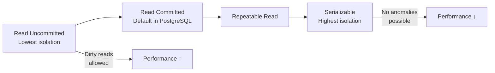

# ACID Properties — Atomicity, Consistency, Isolation, Durability

> [!NOTE]
> ACID is not an abstract academic concept — it is the operational foundation of financial data integrity. Every transaction your system processes relies on these guarantees. Principal engineers must be able to reason about what happens when each one is violated.

## Why ACID Matters for Financial Systems

Consider a money transfer: debit £500 from Account A, credit £500 to Account B.

Without ACID:
- **Without Atomicity** — debit succeeds, credit fails → £500 disappears from the system
- **Without Consistency** — total money in the system changes after the transfer
- **Without Isolation** — another transaction reads Account A as £500 lower mid-transfer, before Account B is credited
- **Without Durability** — the transfer succeeds, but a crash before disk flush loses it

---

## Atomicity — All or Nothing

An atomic transaction either completes fully or has no effect at all. There is no partial state.

```java
// Without atomicity — a crash between debit and credit causes money to disappear
accountRepository.debit(fromAccountId, amount);   // If crash here...
accountRepository.credit(toAccountId, amount);    // ...this never runs

// With atomicity — both operations in one transaction
@Transactional
public TransferResult transfer(UUID fromId, UUID toId, BigDecimal amount) {
    Account from = accountRepository.findByIdForUpdate(fromId);
    Account to   = accountRepository.findByIdForUpdate(toId);
    
    if (from.getBalance().compareTo(amount) < 0) {
        throw new InsufficientFundsException(fromId, amount, from.getBalance());
    }
    
    from.debit(amount);
    to.credit(amount);
    
    // Both writes happen atomically — either both persist or neither does
    accountRepository.save(from);
    accountRepository.save(to);
    
    return TransferResult.success(UUID.randomUUID(), from.getBalance(), to.getBalance());
    
    // If any exception occurs, Spring's @Transactional rolls back BOTH writes
}
```

### Atomicity Implementation — PostgreSQL WAL

PostgreSQL implements atomicity through the Write-Ahead Log (WAL). Before any data page is modified, the change is written to the WAL. If the database crashes mid-transaction:

1. On restart, PostgreSQL reads the WAL
2. Completed transactions (with COMMIT record) are replayed
3. Incomplete transactions (no COMMIT) are rolled back

The WAL provides the crash recovery guarantee — no partially-committed transactions survive a crash.

---

## Consistency — Valid State Transitions

Consistency guarantees that a transaction transforms the database from one valid state to another valid state. It relies on constraints, triggers, and application logic working together.

```sql
-- Database constraints enforce consistency rules
CREATE TABLE accounts (
    id          UUID PRIMARY KEY,
    balance     NUMERIC(20, 4) NOT NULL,
    -- Constraint: balance can never go negative
    CONSTRAINT balance_non_negative CHECK (balance >= 0)
);

CREATE TABLE journal_entries (
    id              UUID PRIMARY KEY,
    debit_account   UUID NOT NULL REFERENCES accounts(id),
    credit_account  UUID NOT NULL REFERENCES accounts(id),
    amount          NUMERIC(20, 4) NOT NULL CHECK (amount > 0),
    -- Constraint: a journal entry cannot debit and credit the same account
    CONSTRAINT different_accounts CHECK (debit_account != credit_account)
);
```

```java
// Application-level consistency: double-entry accounting invariant
// Sum of all debits must equal sum of all credits across all accounts
@Scheduled(cron = "0 0 1 * * *", zone = "UTC")  // Daily reconciliation
public void verifyLedgerBalance() {
    BigDecimal totalDebits  = ledgerRepository.sumAllDebits();
    BigDecimal totalCredits = ledgerRepository.sumAllCredits();
    
    if (totalDebits.compareTo(totalCredits) != 0) {
        BigDecimal imbalance = totalDebits.subtract(totalCredits);
        alertingService.page(OnCallTier.P1, 
            "LEDGER IMBALANCE: " + imbalance + " — immediate investigation required");
    }
}
```

> [!WARNING]
> **Consistency is partly your responsibility.** The database enforces structural constraints (CHECK, FOREIGN KEY), but business consistency rules must be implemented in application code. A `CHECK (balance >= 0)` constraint won't protect you from a race condition where two concurrent reads both see sufficient balance.

---

## Isolation — Concurrent Transaction Independence

Isolation is the most complex ACID property. It governs what a transaction can see when other transactions are in-flight concurrently.

### The Four Isolation Levels



| Isolation Level | Dirty Read | Non-Repeatable Read | Phantom Read | Financial Use |
|---|---|---|---|---|
| Read Uncommitted | Possible | Possible | Possible | Never — sees uncommitted data |
| **Read Committed** | Prevented | Possible | Possible | Default — most financial OLTP |
| Repeatable Read | Prevented | Prevented | Possible | Account snapshot reads |
| **Serializable** | Prevented | Prevented | Prevented | Critical financial totals |

### Read Anomalies in Financial Contexts

**Dirty Read** — Reading data written by an uncommitted transaction:
```
Transaction A: debit £500 from Account X (not yet committed)
Transaction B: reads Account X balance (sees £500 lower — dirty read)
Transaction A: rolls back (never committed)
Transaction B: made a decision based on data that never existed
```

**Non-Repeatable Read** — The same row returns different values within a transaction:
```
Transaction A: reads Account X balance = £1,000
Transaction B: commits: Account X balance = £800
Transaction A: reads Account X balance again = £800 (different!)
Transaction A: calculates fee based on first read (incorrect)
```

**Phantom Read** — A query returns different rows on second execution:
```
Transaction A: SELECT SUM(balance) FROM accounts WHERE type='CURRENT' → £1,000,000
Transaction B: INSERT new CURRENT account with £50,000 (committed)
Transaction A: SELECT SUM(balance) FROM accounts WHERE type='CURRENT' → £1,050,000 (phantom!)
Transaction A: regulatory report shows inconsistent total
```

### Setting Isolation Levels in Spring

```java
// Read Committed (PostgreSQL default) — good for most payment operations
@Transactional(isolation = Isolation.READ_COMMITTED)
public PaymentResult processPayment(PaymentRequest request) {
    // Each statement gets a fresh snapshot of committed data
    // Non-repeatable reads possible — but typically acceptable for payment processing
}

// Repeatable Read — prevents non-repeatable reads
// Useful when you read a balance at start of transaction and reference it at end
@Transactional(isolation = Isolation.REPEATABLE_READ)
public AccountSummary generateStatement(UUID accountId, YearMonth period) {
    // The same account row will return the same values throughout this transaction
    // Even if another transaction commits an update mid-way through
    Account account = accountRepository.findById(accountId).orElseThrow();
    List<Transaction> transactions = transactionRepository
        .findByAccountAndPeriod(accountId, period);
    return AccountSummary.from(account, transactions);
}

// Serializable — the strictest; prevents all anomalies including phantoms
// Use for regulatory reports, audit totals, and balance sheet calculations
@Transactional(isolation = Isolation.SERIALIZABLE)
public BalanceSheetReport generateBalanceSheet(LocalDate asOf) {
    // No concurrent transaction can affect what this transaction sees
    // Uses PostgreSQL's SSI (Serializable Snapshot Isolation) — no row locking
    BigDecimal totalAssets      = accountRepository.sumAssets(asOf);
    BigDecimal totalLiabilities = accountRepository.sumLiabilities(asOf);
    BigDecimal equity           = totalAssets.subtract(totalLiabilities);
    return new BalanceSheetReport(asOf, totalAssets, totalLiabilities, equity);
}
```

---

## Durability — Committed Data Survives Failures

A committed transaction must survive any subsequent failure: process crash, power loss, OS panic.

PostgreSQL provides durability through:

1. **WAL fsync** — before returning success for a COMMIT, the WAL record is flushed to disk
2. **Synchronous replication** — with `synchronous_commit = on`, the primary waits for at least one standby to confirm WAL receipt before acknowledging the commit

```sql
-- Configure synchronous replication for a financial production environment
-- postgresql.conf

synchronous_commit = on                           -- Wait for standby WAL receipt
synchronous_standby_names = 'FIRST 1 (standby1)' -- At least one standby must confirm

-- WARNING: synchronous_commit = off trades durability for 3x higher throughput
-- Never use this for financial writes. Acceptable for: audit log writes, 
-- analytics events, non-financial state.
```

### Durability Verification

```java
// Test that committed data survives a simulated crash
// Using Testcontainers with PostgreSQL
@Test
void committedTransfer_survivesContainerRestart() {
    UUID accountId = UUID.randomUUID();
    
    // Setup: create account with £1000
    testTemplate.update("INSERT INTO accounts VALUES (?, 1000.00)", accountId);
    
    // Execute: commit a debit of £300
    testTemplate.update("UPDATE accounts SET balance = balance - 300 WHERE id = ?", accountId);
    // Implicit commit in this test (no @Transactional)
    
    // Simulate crash: restart PostgreSQL container
    postgreSQLContainer.stop();
    postgreSQLContainer.start();
    
    // Verify: committed balance survives restart
    BigDecimal balance = testTemplate.queryForObject(
        "SELECT balance FROM accounts WHERE id = ?", BigDecimal.class, accountId);
    
    assertThat(balance).isEqualByComparingTo(new BigDecimal("700.00"));
}
```

---

## ACID Trade-offs — When to Relax Guarantees

Not every write in a financial system needs full ACID guarantees. Understanding where you can relax them — safely — unlocks significant performance gains.

| Data Type | Atomicity | Consistency | Isolation | Durability |
|---|---|---|---|---|
| Account balance transfer | Required | Required | Serializable | Required |
| Payment audit log | Required | Required | Read Committed | Can lag (async flush) |
| Fraud score cache update | Not required | Not required | None | Not required |
| Exchange rate update | Required | Required | Read Committed | Can lag |
| Analytics event | Optional | Not required | None | Not required |

```java
// Relaxed durability for audit log — synchronous_commit = local
// Commits locally without waiting for standby acknowledgement
// Acceptable for audit logs: data is not lost on primary failure, only on simultaneous primary+standby failure
@Transactional
@TransactionAttribute(synchronousCommit = SynchronousCommit.LOCAL)
public void recordAuditEvent(AuditEvent event) {
    auditRepository.insert(event);
    // Returns faster — does not wait for standby replication
}
```

<!-- KNOWLEDGE-CHECK
{
  "questions": [
    {
      "id": "q1",
      "text": "A payment service runs at Read Committed isolation. Transaction A reads account balance = £500 at time T1. Transaction B debits £300, committed at T2. Transaction A reads the balance again at T3 (T3 > T2). What does Transaction A see at T3?",
      "options": [
        "£500 — Read Committed prevents all re-reads from changing",
        "£200 — Read Committed allows non-repeatable reads; each statement sees the latest committed data",
        "£500 or £200 depending on which transaction has higher priority",
        "An error — concurrent modification detected"
      ],
      "correct": 1,
      "explanation": "Read Committed prevents dirty reads (uncommitted data) but allows non-repeatable reads. Each statement in Transaction A gets a fresh snapshot of committed data. At T3, Transaction B's commit is visible, so Transaction A sees £200. This is correct behaviour for Read Committed isolation."
    },
    {
      "id": "q2",
      "text": "You are generating a regulatory balance sheet report that must show a consistent point-in-time snapshot of all account balances. Concurrent transactions are continuously updating balances. Which isolation level should you use?",
      "options": [
        "Read Committed — it's the fastest and most databases default to it",
        "Repeatable Read — prevents non-repeatable reads for account rows",
        "Serializable — prevents phantom reads, ensuring no new accounts are included mid-report",
        "Read Uncommitted — to see the most current data"
      ],
      "correct": 2,
      "explanation": "Serializable prevents all anomalies including phantoms. For a balance sheet, you need to ensure: (1) balances don't change mid-report (no non-repeatable reads), AND (2) new accounts aren't included mid-report (no phantom reads). Repeatable Read prevents (1) but not (2). Serializable provides the full snapshot isolation needed for regulatory reports."
    },
    {
      "id": "q3",
      "text": "A CHECK constraint `balance >= 0` exists on the accounts table. Can a concurrent double-spend still occur at Read Committed isolation?",
      "options": [
        "No — the CHECK constraint prevents any negative balance",
        "Yes — two concurrent transactions can both read balance = £500, both pass the constraint check, both subtract £400, and the constraint catches the second update. But the first may have already committed.",
        "Yes — two concurrent transactions can both read balance = £500, both succeed with their £400 debit (each setting balance to £100), resulting in balance = £100 (the CHECK is satisfied but £800 was spent from £500)",
        "No — Read Committed isolation prevents this race condition"
      ],
      "correct": 2,
      "explanation": "This is the classic read-modify-write race condition. Both transactions read £500, both compute new balance £100 (£500-£400), both check constraint (£100 ≥ 0 passes), and both commit their UPDATE. The final balance is £100, not £-300. The constraint is never violated but £800 was spent from £500. Prevention requires SELECT FOR UPDATE or atomic conditional UPDATE."
    },
    {
      "id": "q4",
      "text": "When is it safe to use `synchronous_commit = off` in a financial PostgreSQL deployment?",
      "options": [
        "Never — all financial data must use synchronous commit",
        "For non-financial writes where a small window of data loss (up to ~600ms) is acceptable: session state, analytics events, rate limit counters",
        "For all writes — the performance benefit outweighs the risk",
        "Only when using Amazon RDS Multi-AZ"
      ],
      "correct": 1,
      "explanation": "synchronous_commit = off means the database returns success before the WAL is flushed to disk. A crash within ~600ms of the commit can cause data loss. This is never acceptable for account balances, transactions, or regulatory data. It is acceptable for data that is either ephemeral (session state), reconstructable (from an event stream), or low-stakes (analytics events, rate limit counters)."
    }
  ]
}
-->

<!-- PRACTICAL-CHALLENGE
{
  "title": "ACID Properties \u2014 Atomicity, Consistency, Isolation, Durability \u2014 Production Implementation",
  "difficulty": "advanced",
  "estimatedMinutes": 85,
  "tasks": [
    {
      "id": "1",
      "description": "Design the schema"
    },
    {
      "id": "2",
      "description": "Demonstrate the race condition"
    },
    {
      "id": "3",
      "description": "Fix the race condition"
    },
    {
      "id": "4",
      "description": "Isolation level selection"
    }
  ]
}
-->
