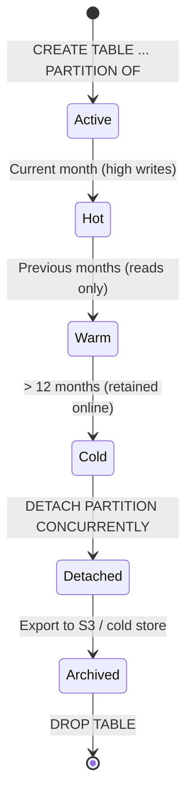

# Table Partitioning — Range and Hash for Financial Data

> A transaction table growing at 10 million rows per day reaches 3.6 billion rows in a year. Without partitioning, every VACUUM, REINDEX, and range query operates against the full dataset. Partitioning is not an optimisation — it is a maintenance prerequisite for any financial table at scale.

---

## Learning Objectives

By the end of this lesson you will be able to:

- Explain the three reasons to partition financial tables and choose the right strategy for each use case
- Create a monthly range-partitioned transactions table with proper index propagation
- Create a hash-partitioned accounts table and verify even distribution
- Demonstrate partition pruning with EXPLAIN and diagnose when it fails
- Configure pg_partman for automated partition creation and retention
- Migrate existing unpartitioned data via ATTACH PARTITION
- Design partition-level VACUUM, ANALYZE, and partial index strategies

---

## 1. Why Partition Financial Tables

A digital payments platform processing 10 million transactions per day accumulates:

| Period | Approximate Row Count |
|--------|-----------------------|
| 1 month | 300 million rows |
| 6 months | 1.8 billion rows |
| 1 year | 3.6 billion rows |
| 3 years | 10.8 billion rows |

Three operational problems emerge at this scale without partitioning:

**1. VACUUM can never catch up.** PostgreSQL VACUUM must scan every page looking for dead tuples. On a 500GB monolithic table with continuous write traffic, autovacuum may run indefinitely, never finishing before new dead tuples accumulate.

**2. Index bloat becomes unmanageable.** B-tree indexes on a 10-billion-row table reach tens of GB. REINDEX requires an ACCESS SHARE lock on the full table (PostgreSQL 12+ has REINDEX CONCURRENTLY, but it still takes hours and doubles temporary disk usage).

**3. Time-range queries hit the wrong data.** A query for "last 30 days" must navigate a B-tree index across 10 years of data, reading many more index pages than necessary.

Partitioning solves all three:
- VACUUM runs per-partition; a 2GB monthly partition vacuums in seconds
- REINDEX operates per-partition
- Partition pruning eliminates irrelevant partitions entirely from query planning

---

## 2. Partitioning Strategies

```
┌─────────────────────────────────────────────────────────────────────┐
│                    PostgreSQL Partition Strategies                  │
├─────────────────┬────────────────────┬──────────────────────────────┤
│ RANGE           │ HASH               │ LIST                         │
├─────────────────┼────────────────────┼──────────────────────────────┤
│ Date/timestamp  │ ID columns         │ Enum values                  │
│ Time-ordered    │ Even distribution  │ Region/currency              │
│ queries         │ No natural order   │ Data residency               │
│ Archival        │ Parallel write     │ Jurisdiction split           │
├─────────────────┼────────────────────┼──────────────────────────────┤
│ transactions    │ accounts           │ payment_methods by currency  │
│ audit_logs      │ customers          │ orders by country            │
│ statements      │ positions          │ events by type               │
└─────────────────┴────────────────────┴──────────────────────────────┘
```

### Choosing a Strategy for Financial Tables

| Table | Recommended Strategy | Key | Reason |
|-------|---------------------|-----|--------|
| `transactions` | RANGE (transaction_date) | timestamp | Time-scoped queries, monthly archival |
| `audit_log` | RANGE (created_at) | timestamp | Compliance retention; drop old partitions |
| `accounts` | HASH (account_id) | uuid/bigint | No natural ordering; even distribution |
| `ledger_entries` | RANGE (posted_at) | timestamp | Accounting periods, year-end close |
| `payment_events` | RANGE (event_time) | timestamp | Event retention policies |

---

## 3. Range Partitioning by Date — Transactions Table

### 3.1 Create the Partitioned Parent Table

```sql
-- Drop existing unpartitioned version first (migration scenario handled later)
CREATE TABLE transactions (
    transaction_id      UUID        NOT NULL DEFAULT gen_random_uuid(),
    account_id          UUID        NOT NULL,
    counterparty_id     UUID,
    amount              NUMERIC(19,4) NOT NULL,
    currency            CHAR(3)     NOT NULL,
    direction           CHAR(1)     NOT NULL CHECK (direction IN ('D','C')),
    status              VARCHAR(20) NOT NULL DEFAULT 'PENDING',
    reference           VARCHAR(100),
    initiated_at        TIMESTAMPTZ NOT NULL,
    settled_at          TIMESTAMPTZ,
    created_at          TIMESTAMPTZ NOT NULL DEFAULT NOW(),
    metadata            JSONB
) PARTITION BY RANGE (created_at);

-- The partition key MUST be in every unique constraint
-- Global uniqueness on transaction_id alone is NOT enforceable across partitions
-- Use a separate deduplication table if you need cross-partition uniqueness
```

### 3.2 Create Monthly Partitions

```sql
-- Create partitions for a full year
CREATE TABLE transactions_2024_01
    PARTITION OF transactions
    FOR VALUES FROM ('2024-01-01') TO ('2024-02-01');

CREATE TABLE transactions_2024_02
    PARTITION OF transactions
    FOR VALUES FROM ('2024-02-01') TO ('2024-03-01');

-- ... repeat for each month

CREATE TABLE transactions_2024_12
    PARTITION OF transactions
    FOR VALUES FROM ('2024-12-01') TO ('2025-01-01');

-- Always create a default partition to catch out-of-range inserts
-- Without this, inserts outside defined ranges raise an error
CREATE TABLE transactions_default
    PARTITION OF transactions DEFAULT;
```

### 3.3 Create Indexes on the Parent (Propagate to All Partitions)

```sql
-- Composite index: covers the most common query pattern
-- (account_id = ? AND created_at BETWEEN ? AND ?)
CREATE INDEX idx_transactions_account_date
    ON transactions (account_id, created_at DESC)
    INCLUDE (amount, currency, status);

-- Status index for settlement processing queries
-- Use partial index to avoid indexing terminal states (most rows)
CREATE INDEX idx_transactions_pending
    ON transactions (account_id, created_at)
    WHERE status IN ('PENDING', 'PROCESSING');

-- Verify indexes propagated to all partitions
SELECT
    c.relname   AS partition_name,
    i.relname   AS index_name,
    ix.indisprimary,
    ix.indisunique
FROM pg_class c
JOIN pg_inherits ih ON c.oid = ih.inhrelid
JOIN pg_class p ON p.oid = ih.inhparent
JOIN pg_index ix ON ix.indrelid = c.oid
JOIN pg_class i ON i.oid = ix.indexrelid
WHERE p.relname = 'transactions'
ORDER BY c.relname, i.relname;
```

---

## 4. Partition Pruning — Proof with EXPLAIN

### 4.1 Correct Predicate — Pruning Engaged

```sql
-- Query with a range predicate on the partition key
EXPLAIN (ANALYZE, BUFFERS, FORMAT TEXT)
SELECT transaction_id, amount, currency, status
FROM transactions
WHERE created_at >= '2024-01-01'
  AND created_at <  '2024-02-01'
  AND account_id = 'acct-001';
```

Expected plan output:
```
Append  (cost=0.00..8.50 rows=10 width=52) (actual time=0.030..0.045 rows=3 loops=1)
  Subplans Removed: 11
  ->  Index Scan using idx_transactions_account_date_2024_01 on transactions_2024_01
        Index Cond: ((account_id = 'acct-001') AND (created_at >= '2024-01-01') AND (created_at < '2024-02-01'))
        Buffers: shared hit=4
Planning Time: 1.2 ms
Execution Time: 0.08 ms
```

"Subplans Removed: 11" means 11 partitions were eliminated before execution.

### 4.2 Incorrect Predicate — Pruning Disabled

```sql
-- WRONG: wrapping partition key in a function defeats pruning
EXPLAIN (ANALYZE, BUFFERS)
SELECT transaction_id, amount
FROM transactions
WHERE DATE_TRUNC('month', created_at) = '2024-01-01';
```

```
Append  (cost=0.00..1240.00 rows=1500 width=28)
  ->  Seq Scan on transactions_2024_01  (cost=0.00..103.33 ...)
  ->  Seq Scan on transactions_2024_02  (cost=0.00..103.33 ...)
  ->  Seq Scan on transactions_2024_03  (cost=0.00..103.33 ...)
  -- ALL 12 partitions scanned
```

**Rule:** Never wrap the partition key in a function in a WHERE clause. Use range predicates directly against the column.

### 4.3 Enable/Verify Partition Pruning Setting

```sql
-- Confirm pruning is enabled (it is by default)
SHOW enable_partition_pruning;

-- Per-session override if needed
SET enable_partition_pruning = on;
```

---

## 5. Hash Partitioning for Accounts Table

```sql
CREATE TABLE accounts (
    account_id      UUID        NOT NULL DEFAULT gen_random_uuid(),
    customer_id     UUID        NOT NULL,
    account_type    VARCHAR(20) NOT NULL,
    currency        CHAR(3)     NOT NULL,
    status          VARCHAR(20) NOT NULL DEFAULT 'ACTIVE',
    opened_at       TIMESTAMPTZ NOT NULL DEFAULT NOW(),
    closed_at       TIMESTAMPTZ,
    balance_cache   NUMERIC(19,4)  -- Denormalised; always recalculate from ledger
) PARTITION BY HASH (account_id);

-- 16 partitions — power of 2, allows future split if needed
-- Partition names encode modulus/remainder for operational clarity
CREATE TABLE accounts_h0  PARTITION OF accounts FOR VALUES WITH (MODULUS 16, REMAINDER 0);
CREATE TABLE accounts_h1  PARTITION OF accounts FOR VALUES WITH (MODULUS 16, REMAINDER 1);
CREATE TABLE accounts_h2  PARTITION OF accounts FOR VALUES WITH (MODULUS 16, REMAINDER 2);
CREATE TABLE accounts_h3  PARTITION OF accounts FOR VALUES WITH (MODULUS 16, REMAINDER 3);
CREATE TABLE accounts_h4  PARTITION OF accounts FOR VALUES WITH (MODULUS 16, REMAINDER 4);
CREATE TABLE accounts_h5  PARTITION OF accounts FOR VALUES WITH (MODULUS 16, REMAINDER 5);
CREATE TABLE accounts_h6  PARTITION OF accounts FOR VALUES WITH (MODULUS 16, REMAINDER 6);
CREATE TABLE accounts_h7  PARTITION OF accounts FOR VALUES WITH (MODULUS 16, REMAINDER 7);
CREATE TABLE accounts_h8  PARTITION OF accounts FOR VALUES WITH (MODULUS 16, REMAINDER 8);
CREATE TABLE accounts_h9  PARTITION OF accounts FOR VALUES WITH (MODULUS 16, REMAINDER 9);
CREATE TABLE accounts_h10 PARTITION OF accounts FOR VALUES WITH (MODULUS 16, REMAINDER 10);
CREATE TABLE accounts_h11 PARTITION OF accounts FOR VALUES WITH (MODULUS 16, REMAINDER 11);
CREATE TABLE accounts_h12 PARTITION OF accounts FOR VALUES WITH (MODULUS 16, REMAINDER 12);
CREATE TABLE accounts_h13 PARTITION OF accounts FOR VALUES WITH (MODULUS 16, REMAINDER 13);
CREATE TABLE accounts_h14 PARTITION OF accounts FOR VALUES WITH (MODULUS 16, REMAINDER 14);
CREATE TABLE accounts_h15 PARTITION OF accounts FOR VALUES WITH (MODULUS 16, REMAINDER 15);

-- Verify distribution after bulk insert
SELECT
    c.relname                           AS partition,
    pg_stat_get_live_tuples(c.oid)      AS live_rows,
    pg_size_pretty(pg_relation_size(c.oid)) AS size,
    ROUND(
        pg_stat_get_live_tuples(c.oid)::NUMERIC
        / NULLIF(SUM(pg_stat_get_live_tuples(c.oid)) OVER (), 0) * 100,
        2
    )                                   AS pct_of_total
FROM pg_class c
JOIN pg_inherits ih ON c.oid = ih.inhrelid
JOIN pg_class p ON p.oid = ih.inhparent
WHERE p.relname = 'accounts'
ORDER BY c.relname;
```

---

## 6. pg_partman — Automated Partition Management

pg_partman is the production standard for maintaining date-based partitions. It handles creation of future partitions, retention/dropping of old ones, and integration with pg_cron.

### 6.1 Install and Configure

```sql
-- Install extension (requires superuser)
CREATE EXTENSION pg_partman;
CREATE EXTENSION pg_cron;  -- For scheduling maintenance

-- Register the transactions table with pg_partman
SELECT partman.create_parent(
    p_parent_table   => 'public.transactions',
    p_control        => 'created_at',
    p_type           => 'range',
    p_interval       => 'monthly',
    p_premake        => 3,         -- Pre-create 3 future partitions
    p_start_partition => '2024-01-01'
);
```

### 6.2 Configure Retention Policy

```sql
-- Keep 24 months of data online; older partitions are dropped automatically
UPDATE partman.part_config
SET
    retention              = '24 months',
    retention_keep_table   = FALSE,   -- Actually DROP old partitions
    retention_keep_index   = FALSE,
    infinite_time_partitions = FALSE,
    premake                = 3        -- Always have 3 future months ready
WHERE parent_table = 'public.transactions';

-- Schedule maintenance via pg_cron (runs at 2:00 AM UTC daily)
SELECT cron.schedule(
    'partman-maintenance',
    '0 2 * * *',
    $$CALL partman.run_maintenance_proc()$$
);
```

### 6.3 Verify pg_partman State

```sql
SELECT
    parent_table,
    control,
    partition_interval,
    premake,
    retention,
    last_partition_created
FROM partman.part_config
WHERE parent_table = 'public.transactions';
```

---

## 7. Java Partition Maintenance Job

```java
@Component
@RequiredArgsConstructor
@Slf4j
public class PartitionMaintenanceJob {

    private final JdbcTemplate jdbc;

    /**
     * Creates monthly partitions for the next {@code monthsAhead} months.
     * Safe to run multiple times (idempotent via IF NOT EXISTS logic).
     */
    @Scheduled(cron = "0 0 2 * * *")  // Daily at 02:00
    public void ensureFuturePartitions() {
        int monthsAhead = 3;
        YearMonth current = YearMonth.now();

        for (int i = 0; i <= monthsAhead; i++) {
            YearMonth month = current.plusMonths(i);
            createPartitionIfAbsent(month);
        }
    }

    private void createPartitionIfAbsent(YearMonth month) {
        String partitionName = "transactions_" + month.format(DateTimeFormatter.ofPattern("yyyy_MM"));
        LocalDate start = month.atDay(1);
        LocalDate end   = month.plusMonths(1).atDay(1);

        String sql = """
            DO $$
            BEGIN
                IF NOT EXISTS (
                    SELECT 1 FROM pg_class c
                    JOIN pg_namespace n ON n.oid = c.relnamespace
                    WHERE c.relname = :partitionName
                    AND n.nspname = 'public'
                ) THEN
                    EXECUTE format(
                        'CREATE TABLE %I PARTITION OF transactions
                         FOR VALUES FROM (%L) TO (%L)',
                        :partitionName,
                        :start::TEXT,
                        :end::TEXT
                    );
                END IF;
            END $$;
            """;

        try {
            jdbc.execute(sql
                .replace(":partitionName", "'" + partitionName + "'")
                .replace(":start", "'" + start + "'")
                .replace(":end",   "'" + end + "'")
            );
            log.info("Partition ensured: {}", partitionName);
        } catch (DataAccessException e) {
            log.error("Failed to create partition {}: {}", partitionName, e.getMessage());
            // Do not rethrow — missing future partition is not immediately fatal
            // Alert on-call if this fails 3+ consecutive days
        }
    }

    /**
     * Archives partitions older than retentionMonths by detaching them.
     * Detached tables are independent and can be exported before dropping.
     */
    @Scheduled(cron = "0 30 2 * * *")  // 02:30 daily, after ensureFuturePartitions
    public void archiveOldPartitions() {
        int retentionMonths = 24;
        YearMonth cutoff = YearMonth.now().minusMonths(retentionMonths);

        List<String> candidates = jdbc.queryForList(
            """
            SELECT c.relname
            FROM pg_class c
            JOIN pg_inherits ih ON c.oid = ih.inhrelid
            JOIN pg_class p ON p.oid = ih.inhparent
            WHERE p.relname = 'transactions'
              AND c.relname ~ '^transactions_\\d{4}_\\d{2}$'
            ORDER BY c.relname
            """,
            String.class
        );

        for (String partition : candidates) {
            YearMonth partitionMonth = extractMonth(partition);
            if (partitionMonth != null && partitionMonth.isBefore(cutoff)) {
                detachAndArchive(partition);
            }
        }
    }

    private YearMonth extractMonth(String partitionName) {
        // Format: transactions_2022_01
        String[] parts = partitionName.split("_");
        if (parts.length < 4) return null;
        try {
            int year  = Integer.parseInt(parts[2]);
            int month = Integer.parseInt(parts[3]);
            return YearMonth.of(year, month);
        } catch (NumberFormatException e) {
            return null;
        }
    }

    private void detachAndArchive(String partition) {
        try {
            long rowCount = jdbc.queryForObject(
                "SELECT COUNT(*) FROM " + partition, Long.class
            );
            // DETACH PARTITION CONCURRENTLY requires PostgreSQL 14+
            // Uses a weaker lock than DETACH PARTITION (no ACCESS EXCLUSIVE)
            jdbc.execute("ALTER TABLE transactions DETACH PARTITION " + partition + " CONCURRENTLY");
            log.info("Detached partition {} ({} rows). Ready for archival.", partition, rowCount);
            // After detaching, the table is standalone.
            // Export to S3/cold storage before dropping:
            // jdbc.execute("DROP TABLE " + partition);
        } catch (DataAccessException e) {
            log.error("Failed to detach partition {}: {}", partition, e.getMessage());
        }
    }
}
```

---

## 8. ATTACH PARTITION — Migrating Existing Data

Migrating from an unpartitioned table to a partitioned one without downtime:

```sql
-- Step 1: Create the new partitioned table (different name to avoid conflicts)
CREATE TABLE transactions_partitioned (
    LIKE transactions INCLUDING ALL
) PARTITION BY RANGE (created_at);

-- Step 2: Create partitions for all existing data ranges
-- (pre-create based on your data's date range)

-- Step 3: Create a temporary staging table with the same structure
CREATE TABLE transactions_migrate_2024_01 (LIKE transactions INCLUDING ALL);

-- Step 4: Copy data for one month into the staging table
INSERT INTO transactions_migrate_2024_01
SELECT * FROM transactions
WHERE created_at >= '2024-01-01' AND created_at < '2024-02-01';

-- Step 5: Add a CHECK constraint (required for ATTACH PARTITION to skip full scan)
-- Without this constraint, PostgreSQL scans every row to verify partition bounds
ALTER TABLE transactions_migrate_2024_01
ADD CONSTRAINT chk_created_at
CHECK (created_at >= '2024-01-01' AND created_at < '2024-02-01')
NOT VALID;  -- Skip scanning existing rows

-- Validate the constraint separately (uses only a SHARE UPDATE EXCLUSIVE lock)
ALTER TABLE transactions_migrate_2024_01
VALIDATE CONSTRAINT chk_created_at;

-- Step 6: ATTACH PARTITION (uses CHECK constraint to skip full scan — near-instant)
ALTER TABLE transactions_partitioned
ATTACH PARTITION transactions_migrate_2024_01
FOR VALUES FROM ('2024-01-01') TO ('2024-02-01');

-- Step 7: Atomically swap the tables (requires brief ACCESS EXCLUSIVE lock)
BEGIN;
ALTER TABLE transactions RENAME TO transactions_old;
ALTER TABLE transactions_partitioned RENAME TO transactions;
COMMIT;
```

---

## 9. Partition-Level Maintenance

### 9.1 VACUUM and ANALYZE Per Partition

```sql
-- Vacuum a specific partition (much faster than the full table)
VACUUM ANALYZE transactions_2024_01;

-- Freeze a partition that is fully archived (no more writes)
-- This prevents transaction ID wraparound concerns
VACUUM FREEZE transactions_2022_01;

-- Check per-partition vacuum status
SELECT
    c.relname       AS partition,
    n_live_tup,
    n_dead_tup,
    last_autovacuum,
    last_autoanalyze,
    pg_size_pretty(pg_relation_size(c.oid)) AS size
FROM pg_stat_user_tables t
JOIN pg_class c ON c.relname = t.relname
WHERE c.relname LIKE 'transactions_%'
ORDER BY c.relname;
```

### 9.2 Cross-Partition Queries

```sql
-- Query spanning multiple partitions (the planner handles the Append automatically)
-- Covers Q1 2024 — will touch 3 partitions
EXPLAIN (ANALYZE, BUFFERS)
SELECT
    account_id,
    SUM(amount) FILTER (WHERE direction = 'D') AS total_debits,
    SUM(amount) FILTER (WHERE direction = 'C') AS total_credits,
    COUNT(*) AS transaction_count
FROM transactions
WHERE created_at >= '2024-01-01'
  AND created_at <  '2024-04-01'
  AND currency = 'USD'
GROUP BY account_id
ORDER BY total_debits DESC
LIMIT 100;
```

### 9.3 Partial Indexes Per Partition

```sql
-- Create a targeted partial index only on the most recent (hot) partition
-- Old partitions rarely need PENDING status indexes
CREATE INDEX idx_tx_2024_01_pending
    ON transactions_2024_01 (account_id, created_at)
    WHERE status = 'PENDING';

-- Settlement team query: only on current month's partition
CREATE INDEX idx_tx_current_unsettled
    ON transactions_2024_12 (initiated_at)
    WHERE settled_at IS NULL AND status NOT IN ('FAILED', 'CANCELLED');
```

---

## 10. Mermaid: Partition Lifecycle



---

## 11. Production Pitfalls

### Pitfall 1: Function-Wrapped Partition Key Disables Pruning

```sql
-- BAD: DATE_TRUNC wraps the partition key — all partitions scanned
SELECT * FROM transactions
WHERE DATE_TRUNC('month', created_at) = '2024-01-01';

-- BAD: Implicit cast via TO_CHAR
SELECT * FROM transactions
WHERE TO_CHAR(created_at, 'YYYY-MM') = '2024-01';

-- GOOD: Direct range predicate
SELECT * FROM transactions
WHERE created_at >= '2024-01-01'
  AND created_at <  '2024-02-01';

-- GOOD: Use a generate_series to build date ranges programmatically
-- rather than wrapping dates in functions
```

### Pitfall 2: Missing Future Partition Causes Silent Data Loss

```sql
-- If a partition for February 2025 does not exist and there is no DEFAULT partition,
-- an INSERT of a February 2025 row raises:
--   ERROR:  no partition of relation "transactions" found for row
--
-- If a DEFAULT partition EXISTS, the row goes into the default partition silently.
-- A later ATTACH PARTITION for Feb 2025 will FAIL because the default partition
-- already contains Feb 2025 rows, and those rows violate the new partition bounds.
--
-- Prevention:
-- 1. Always pre-create 3+ future partitions (pg_partman p_premake = 3)
-- 2. Alert if the number of future partitions drops below 2
-- 3. Treat missing-partition as a P1 incident

-- Monitor future partition coverage
SELECT
    child.relname,
    pg_get_expr(child.relpartbound, child.oid) AS partition_bound
FROM pg_class parent
JOIN pg_inherits ON pg_inherits.inhparent = parent.oid
JOIN pg_class child ON child.oid = pg_inherits.inhrelid
WHERE parent.relname = 'transactions'
  AND pg_get_expr(child.relpartbound, child.oid) LIKE '%2025%'  -- adjust year
ORDER BY child.relname;
```

### Pitfall 3: Global Unique Constraints Are Not Enforceable Across Partitions

```sql
-- This FAILS on a partitioned table (partition key not included):
-- ERROR:  unique constraint on partitioned table must include all partitioning columns
CREATE UNIQUE INDEX ON transactions (transaction_id);

-- WORKAROUND 1: Include partition key in the unique constraint
CREATE UNIQUE INDEX ON transactions (transaction_id, created_at);
-- This only enforces uniqueness per (transaction_id, created_at) combination
-- Two rows CAN have the same transaction_id if created_at differs

-- WORKAROUND 2: Separate deduplication table (recommended for idempotency keys)
CREATE TABLE transaction_dedup (
    idempotency_key VARCHAR(100) PRIMARY KEY,
    transaction_id  UUID NOT NULL,
    created_at      TIMESTAMPTZ NOT NULL DEFAULT NOW()
);
-- INSERT INTO transaction_dedup first; if it conflicts, the transaction is a duplicate
-- Then INSERT INTO transactions (the main partitioned table)
```

---

## 12. Checklist

- Range partition transaction/audit tables by month or week depending on write volume
- Hash partition account/customer tables with 16 or 32 partitions (power of 2)
- Always include partition key in unique constraints; use a dedup table for global uniqueness
- Run EXPLAIN and confirm "Subplans Removed" before deploying to production
- Never wrap the partition key in a function in WHERE clauses
- Configure pg_partman with p_premake = 3 to maintain future partitions
- Alert when future partition count drops below 2
- Use DETACH PARTITION CONCURRENTLY (PostgreSQL 14+) for zero-impact archival
- Add NOT VALID CHECK constraints before ATTACH PARTITION to skip full table scans
- Monitor per-partition row counts for hash partition skew (should be within 10% of ideal)
- Run VACUUM FREEZE on archived (read-only) partitions to avoid transaction ID wraparound

---

<!-- KNOWLEDGE-CHECK
{
  "questions": [
    {
      "text": "A query runs: SELECT * FROM transactions WHERE DATE_TRUNC('month', created_at) = '2024-01-01'. EXPLAIN shows all 12 monthly partitions are scanned. What is the root cause and the correct fix?",
      "options": [
        "The index on created_at is missing; add CREATE INDEX ON transactions (created_at)",
        "Wrapping the partition key in DATE_TRUNC prevents the planner from comparing against partition bounds; rewrite as WHERE created_at >= '2024-01-01' AND created_at < '2024-02-01'",
        "The partition type should be HASH instead of RANGE for timestamp columns",
        "The enable_partition_pruning setting is OFF; run SET enable_partition_pruning = on"
      ],
      "correct": 1,
      "explanation": "PostgreSQL partition pruning works by comparing predicate values against stored partition bounds. When the partition key is wrapped in a function like DATE_TRUNC, the planner cannot determine which partitions match without evaluating the function for every partition. The fix is a direct range predicate: WHERE created_at >= '2024-01-01' AND created_at < '2024-02-01'. This allows the planner to compare against partition bounds exactly and eliminate all non-matching partitions."
    },
    {
      "text": "A transactions table is RANGE-partitioned by created_at. The team tries: CREATE UNIQUE INDEX ON transactions (transaction_id). The command fails. What is the error and the recommended production workaround?",
      "options": [
        "The index type BTREE is not supported on partitioned tables; use a GIN index instead",
        "Unique constraints on partitioned tables must include all partitioning columns; use a separate transaction_dedup table with transaction_id as PRIMARY KEY to enforce global uniqueness",
        "The table must first be VACUUM FULL before creating unique indexes on partitions",
        "Unique indexes cannot be created on the parent table; create them on each partition individually"
      ],
      "correct": 1,
      "explanation": "PostgreSQL cannot enforce global uniqueness across partitions without the partition key, because each partition has an independent index and there is no global index across all partitions. The command fails with: 'unique constraint on partitioned table must include all partitioning columns'. The recommended workaround for idempotency is a separate deduplication table: CREATE TABLE transaction_dedup (idempotency_key TEXT PRIMARY KEY, transaction_id UUID). Insert into this table first; a conflict means the transaction is a duplicate. Then insert into the partitioned transactions table."
    },
    {
      "text": "The team is using ATTACH PARTITION to migrate data from a staging table into a partitioned parent. Without adding a CHECK constraint first, what performance problem occurs and what is the solution?",
      "options": [
        "ATTACH PARTITION acquires an ACCESS EXCLUSIVE lock on the entire partitioned table and scans every row in the staging table to verify all rows fall within the partition bounds; add NOT VALID CHECK constraint then VALIDATE CONSTRAINT separately before attaching",
        "ATTACH PARTITION copies all data from the staging table into the partition, doubling storage temporarily",
        "ATTACH PARTITION is blocked by any active read transactions on the parent table",
        "ATTACH PARTITION reindexes the staging table using ACCESS SHARE lock, causing index bloat"
      ],
      "correct": 0,
      "explanation": "Without a CHECK constraint, PostgreSQL must scan every row in the staging table to verify all rows satisfy the partition bounds. This can take many minutes on a large table while holding an ACCESS EXCLUSIVE lock. The workaround: (1) ALTER TABLE staging_table ADD CONSTRAINT chk_date CHECK (created_at >= '...' AND created_at < '...') NOT VALID — this skips scanning existing rows; (2) ALTER TABLE staging_table VALIDATE CONSTRAINT chk_date — this validates using a weaker SHARE UPDATE EXCLUSIVE lock; (3) ATTACH PARTITION — now PostgreSQL trusts the constraint and skips the full scan. The ATTACH step itself is near-instantaneous."
    }
  ]
}
-->

<!-- PRACTICAL-CHALLENGE
{
  "title": "Design and Operate a Partitioned Financial Transaction Table",
  "difficulty": "advanced",
  "estimatedMinutes": 45,
  "tasks": [
    {
      "id": "1",
      "description": "Create a monthly RANGE-partitioned transactions table covering the current year (12 partitions plus a default partition). Create a composite index on (account_id, created_at DESC) INCLUDE (amount, currency, status) on the parent table and verify via pg_class that it propagated to all child partitions. Run EXPLAIN (ANALYZE, BUFFERS) for a single-month query and confirm 'Subplans Removed: 11' appears in the output. Then run the same query with DATE_TRUNC and document the difference in the plan."
    },
    {
      "id": "2",
      "description": "Implement a Spring Boot @Scheduled PartitionMaintenanceJob that runs daily at 02:00. The job must: (1) ensure partitions exist for the current month plus the next 3 months, (2) be idempotent — safe to run multiple times without error, (3) log whether each partition was created or already existed, (4) handle DataAccessException per partition without failing the entire job. Write a @SpringBootTest that injects a Testcontainers PostgreSQL instance, runs the job twice, and asserts no exceptions and correct partition count."
    },
    {
      "id": "3",
      "description": "Create a HASH-partitioned accounts table with 16 partitions. Insert 160,000 test accounts using generate_series. Write a SQL query that reports the row count and percentage of total rows for each partition. Verify that no partition deviates more than 15% from the ideal 10,000 rows. Document why UUID v4 produces good hash distribution but sequential integer IDs with HASH partitioning can cause skew."
    },
    {
      "id": "4",
      "description": "Implement a PartitionArchivalService that archives partitions older than 24 months. The service must: (1) validate the partition is at least 24 months old before proceeding, (2) record a pre-archival row count in an archival_audit table with partition_name, row_count, archived_at, and archived_by columns, (3) execute DETACH PARTITION CONCURRENTLY, (4) verify the partition is no longer listed in pg_inherits, (5) log all steps. Write a test that creates a fake old partition, runs the service, and asserts the partition is detached and the audit record exists."
    }
  ]
}
-->
