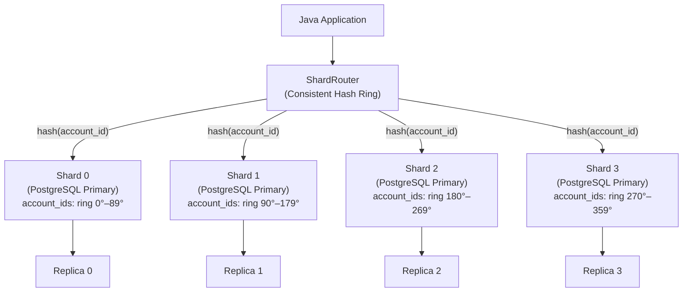

A single PostgreSQL primary can sustain roughly 10,000 to 20,000 write transactions per second on modern NVMe hardware before CPU, WAL throughput, or lock contention becomes the ceiling. For a mid-sized payment processor handling 50,000 transactions per second at peak, that ceiling arrives faster than the engineering team expects. Vertical scaling buys time — a 192-core machine with 6 TB RAM exists, and it costs $80,000 per month. Horizontal scaling via sharding distributes the data and the write load across many smaller nodes, each of which is cheap, replaceable, and independently scalable.

Sharding is not free. It introduces a routing layer, removes the ability to run arbitrary cross-shard joins, and complicates transactions. This lesson teaches you to make the right trade-offs: when sharding is warranted, how to choose a shard key that avoids hotspots, how to route queries in Java, and how to safely re-shard a live database without downtime.

## Learning Objectives

By the end of this lesson you will be able to:

- Identify the operational signals that indicate a single-node PostgreSQL has reached its scaling ceiling
- Explain the difference between range sharding and consistent-hash sharding and when each is appropriate
- Select a shard key that provides even write distribution and avoids time-based hotspots
- Implement a `ShardRouter` in Java using consistent hashing to route queries to the correct shard
- Design a strategy for cross-shard queries using fan-out and merge
- Plan and execute an online shard split with dual-write to avoid downtime during re-sharding
- Describe how Vitess (MySQL) and Citus (PostgreSQL) automate sharding concerns
- Justify why distributed transactions across shards should be avoided and replaced with Saga patterns

## Business Context

In Q3 2021, Robinhood's brokerage platform experienced a catastrophic outage during a GameStop trading surge. At peak, options trading volume hit 850% of its daily average. Their database layer, backed by a single primary cluster, hit connection and write throughput limits within 90 minutes of market open. Order placement began failing. Within 2 hours, 2,900 customers reported being unable to close positions. The SEC investigation estimated $70 million in customer harm from the inability to trade during volatile price movements.

The root cause was not a software bug. It was an architectural assumption: that one primary database node would always have sufficient headroom. The team had indexes, read replicas, and caching — but no horizontal write-scale strategy. When GameStop moved, the write path had nowhere to go.

Sharding, applied to the orders and positions tables, would have distributed writes across dozens of nodes proportional to account ID, eliminating the single-node ceiling.

## When to Shard — Recognising the Ceiling

Sharding adds significant operational complexity. It is justified only when you have exhausted the following cheaper options:

| Optimisation | Expected Relief | When Exhausted |
|---|---|---|
| Index tuning | 2–10× query speed | Queries already optimal |
| Connection pooling (PgBouncer) | 3× effective connections | Pool already deployed |
| Read replicas | Offload 60–80% of reads | Writes are the bottleneck |
| Table partitioning | 2–5× on partition-pruned queries | Writes still hit one primary |
| Vertical scaling | 2–4× with larger instance | Cost curve becomes non-linear |
| **Sharding** | Linear write scale | — |

Signals that the primary has hit its ceiling:

```
-- Check WAL generation rate (MB/s) — above 500 MB/s is a warning
SELECT pg_wal_lsn_diff(pg_current_wal_lsn(), '0/0') / 1024 / 1024 AS wal_mb;

-- Check average active connections at peak
SELECT count(*) FROM pg_stat_activity WHERE state = 'active';

-- Check top lock wait events
SELECT wait_event_type, wait_event, count(*)
FROM pg_stat_activity
WHERE wait_event IS NOT NULL
GROUP BY 1, 2
ORDER BY 3 DESC
LIMIT 10;
```

> [!WARNING]
> **Do not shard prematurely.** A well-tuned single PostgreSQL node with read replicas handles the write load of most fintech companies at Series B and C. Add sharding only when profiling confirms that the write path is the irreducible bottleneck.

## Shard Key Selection — The Most Important Decision

The shard key determines how data is distributed across shards. A bad shard key causes hotspots — one shard receives the majority of writes while others sit idle, negating the purpose of sharding entirely.

**Good shard key: `account_id`**

Account IDs (UUID v4 or high-cardinality integer) produce a near-uniform distribution of writes. No single account generates significantly more writes than any other, so the write load distributes evenly.

```sql
-- payments distributed by account_id — even distribution
-- With 8 shards and 1 million accounts, each shard serves ~125,000 accounts
SELECT
    hashtext(account_id::text) % 8 AS shard_id,
    count(*) AS payment_count
FROM payments
GROUP BY 1
ORDER BY 1;

-- Expected output: each shard_id gets ~12.5% of payments
-- shard_id | payment_count
--        0 |       124,891
--        1 |       125,310
--        2 |       124,567
--        3 |       125,102
--  ...
```

**Bad shard key: `created_at`**

Time-based shard keys route all current writes to a single shard — the one containing the current time range. All historical shards are read-only. This recreates the single-node write bottleneck in a more expensive configuration.

```sql
-- Range sharding by date — all December 2026 writes go to shard 7
-- Shards 0-6 (older months) receive zero writes — they are cold
-- Shard 7 receives 100% of writes — a severe hotspot
-- This is the worst possible shard key for a write-heavy payment table
CREATE TABLE payments_2026_12 PARTITION OF payments
    FOR VALUES FROM ('2026-12-01') TO ('2027-01-01');
```

| Shard Key Candidate | Distribution | Write Hotspot Risk | Cross-Shard Query Risk |
|---|---|---|---|
| `account_id` (UUID v4) | Uniform | None | Medium (inter-account queries) |
| `merchant_id` | Skewed (large merchants) | High | Medium |
| `created_at` | Sequential | Severe | Low |
| `customer_id` | Uniform (if UUID) | None | Medium |
| `payment_id` (UUID v4) | Uniform | None | High (account balance queries) |

## Range Sharding vs Hash Sharding

**Range sharding** assigns contiguous key ranges to shards. Useful when range queries are common — a payment history query for account IDs 1–1,000,000 hits one shard.

```
Shard 0: account_id  00000000  –  1FFFFFFF
Shard 1: account_id  20000000  –  3FFFFFFF
Shard 2: account_id  40000000  –  5FFFFFFF
Shard 3: account_id  60000000  –  7FFFFFFF
```

**Hash sharding** applies a hash function to the shard key, distributing rows uniformly regardless of key ordering. Range queries require fan-out across all shards, but write distribution is statistically guaranteed to be even.

```
Shard for key k = hash(k) mod N
```

Consistent hashing is the preferred variant: when a new shard is added, only 1/N of the data moves rather than rehashing everything.



## ShardRouter — Java Implementation with Consistent Hashing

```java
import com.google.common.hash.Hashing;
import java.nio.charset.StandardCharsets;
import java.util.*;

/**
 * Routes database operations to the correct shard based on a shard key.
 * Uses consistent hashing so that adding a shard minimises data movement.
 *
 * Thread-safe. The hash ring is immutable after construction.
 */
public class ShardRouter {

    private static final int VIRTUAL_NODES_PER_SHARD = 150;
    private final TreeMap<Long, ShardDataSource> ring = new TreeMap<>();
    private final List<ShardDataSource> shards;

    public ShardRouter(List<ShardDataSource> shards) {
        this.shards = List.copyOf(shards);
        for (ShardDataSource shard : shards) {
            for (int v = 0; v < VIRTUAL_NODES_PER_SHARD; v++) {
                long hash = hash(shard.getShardId() + "-vnode-" + v);
                ring.put(hash, shard);
            }
        }
    }

    /**
     * Returns the DataSource responsible for the given shard key.
     * @param shardKey  typically account_id or customer_id as a String
     */
    public ShardDataSource routeFor(String shardKey) {
        if (ring.isEmpty()) {
            throw new IllegalStateException("Shard ring is empty — no shards configured");
        }
        long keyHash = hash(shardKey);
        Map.Entry<Long, ShardDataSource> entry = ring.ceilingEntry(keyHash);
        if (entry == null) {
            // Wrap around: key is beyond the last virtual node — use the first
            entry = ring.firstEntry();
        }
        return entry.getValue();
    }

    /**
     * Returns all shards — used for fan-out queries that must touch every shard.
     */
    public List<ShardDataSource> allShards() {
        return shards;
    }

    private long hash(String input) {
        return Hashing.murmur3_128()
                      .hashString(input, StandardCharsets.UTF_8)
                      .asLong();
    }
}

// Usage in a payment repository
@Repository
public class ShardedPaymentRepository {

    private final ShardRouter shardRouter;

    public ShardedPaymentRepository(ShardRouter shardRouter) {
        this.shardRouter = shardRouter;
    }

    public void insert(Payment payment) {
        ShardDataSource shard = shardRouter.routeFor(payment.getAccountId().toString());
        shard.jdbcTemplate().update("""
            INSERT INTO payments (id, account_id, amount, currency, status, created_at)
            VALUES (?, ?, ?, ?, ?, ?)
            """,
            payment.getId(),
            payment.getAccountId(),
            payment.getAmount(),
            payment.getCurrency().getCode(),
            payment.getStatus().name(),
            payment.getCreatedAt()
        );
    }

    public Optional<Payment> findById(UUID paymentId, UUID accountId) {
        // accountId is the shard key — always route by it, not by paymentId
        ShardDataSource shard = shardRouter.routeFor(accountId.toString());
        return shard.jdbcTemplate().query("""
            SELECT * FROM payments WHERE id = ? AND account_id = ?
            """,
            PaymentRowMapper.INSTANCE,
            paymentId, accountId
        ).stream().findFirst();
    }
}
```

> [!IMPORTANT]
> **Always include the shard key in every query.** If a query does not include the shard key, the router cannot determine which shard to target and must fan out to all shards — a costly operation. Design your data model so the shard key is always available at query time.

## Cross-Shard Queries — Fan-Out and Merge

Some queries cannot be satisfied by a single shard. The pattern is: issue the query to all shards in parallel, then merge the results in the application layer.

```java
/**
 * Fan-out query: sum all payments for a given merchant across all shards.
 * Used for merchant settlement — merchant_id is not the shard key.
 */
public MerchantSettlementSummary calculateMerchantSettlement(
        UUID merchantId, LocalDate settlementDate) {

    List<CompletableFuture<BigDecimal>> futures = shardRouter.allShards().stream()
        .map(shard -> CompletableFuture.supplyAsync(() ->
            shard.jdbcTemplate().queryForObject("""
                SELECT COALESCE(SUM(amount), 0)
                FROM payments
                WHERE merchant_id = ?
                  AND DATE(created_at) = ?
                  AND status = 'SETTLED'
                """,
                BigDecimal.class,
                merchantId, settlementDate
            ), fanOutExecutor
        ))
        .toList();

    BigDecimal total = futures.stream()
        .map(CompletableFuture::join)
        .reduce(BigDecimal.ZERO, BigDecimal::add);

    return new MerchantSettlementSummary(merchantId, settlementDate, total);
}
```

> [!WARNING]
> **Cross-shard queries are expensive.** A fan-out to 16 shards executes 16 database queries and merges results in Java. Avoid them in the hot write path. Use an event-driven analytics store (ClickHouse, Redshift, BigQuery) pre-aggregated by merchant, fed by CDC from the sharded primary — see Lesson 11 (WAL/CDC).

## Online Re-Sharding — Dual-Write Split Strategy

When a shard grows too large, it must be split into two smaller shards without downtime. The dual-write strategy allows this:

**Phase 1 — Seed:** create the new shard and copy the half of the data it will own.

```sql
-- On the new shard (shard_4): copy the upper half of shard_3's key space
INSERT INTO payments
SELECT * FROM shard_3.payments
WHERE hashtext(account_id::text) % 16 >= 8;
-- This seeds the new shard with historical data
```

**Phase 2 — Dual-Write:** update the router to write new records to both the original and new shard for the affected key range.

```java
// During the split window: dual-write
public void insert(Payment payment) {
    String key = payment.getAccountId().toString();
    ShardDataSource primary = shardRouter.routeFor(key);
    primary.jdbcTemplate().update(INSERT_SQL, /* params */);

    // If this key belongs to the shard being split, also write to new shard
    if (splitConfig.isInSplitRange(key)) {
        ShardDataSource newShard = shardRouter.newShardFor(key);
        newShard.jdbcTemplate().update(INSERT_SQL, /* params */);
    }
}
```

**Phase 3 — Verify and Cut Over:** once the new shard's data is confirmed consistent (compare row counts, checksums), update the routing table to direct reads to the new shard and stop dual-writing.

## Vitess and Citus — Managed Sharding Layers

**Vitess** is the sharding proxy built by YouTube and used by GitHub and Slack. It sits between the application and MySQL shards, handling routing, resharding, and connection multiplexing transparently.

**Citus** is a PostgreSQL extension that transforms a single PostgreSQL instance into a sharding coordinator. Tables are declared as distributed, and Citus handles routing, parallelising queries across worker nodes.

```sql
-- Citus: declare payments as a distributed table, sharded by account_id
SELECT create_distributed_table('payments', 'account_id');

-- Citus handles routing transparently — this INSERT goes to the right shard
INSERT INTO payments (id, account_id, amount) VALUES (gen_random_uuid(), $1, $2);

-- Aggregation across shards: Citus executes in parallel and merges
SELECT account_id, SUM(amount) FROM payments GROUP BY account_id;
```

> [!NOTE]
> **Shard count planning:** over-shard initially. With 8 shards today and 32 projected shards at 5× growth, design the shard count as 32 from day one. Each physical machine hosts 4 shards. As load grows, move shards to dedicated machines — no data movement required. Under-sharding forces a painful re-shard under production load.

## Distributed Transactions — Why to Avoid Them

A payment that updates a balance on shard 2 and an audit entry on shard 7 requires a cross-shard transaction. Two-phase commit (2PC) is technically possible but introduces:

- **Availability risk:** if the coordinator crashes after prepare but before commit, shards hold locks indefinitely
- **Latency:** 2PC adds two round trips — prepare and commit — to every transaction
- **Operational complexity:** in-doubt transactions require manual intervention

The correct alternative is the Saga pattern: decompose the cross-shard operation into a sequence of single-shard transactions, each with a compensating rollback action. The Saga coordinator is a service, not a database protocol. See Track 06, Lesson 14.

```java
// Cross-shard payment: account debit (shard A) + audit entry (shard B)
// Use a Saga — not 2PC
public PaymentResult processPayment(PaymentRequest req) {
    // Step 1: debit account on shard A
    // Step 2: write audit entry on shard B  
    // If step 2 fails: compensating action credits account on shard A
    return sagaOrchestrator.execute(
        new DebitAccountStep(req.getAccountId(), req.getAmount()),
        new WriteAuditStep(req.getCorrelationId(), req.getAmount())
    );
}
```

## Knowledge Check

**Q1: Your payments table has account_id (UUID v4) and merchant_id. You shard by account_id. A query asks for all payments made to a specific merchant yesterday. How does this execute?**

**A1:** Because merchant_id is not the shard key, the router cannot direct this query to a single shard. It must fan-out the query to all shards in parallel (each receiving `WHERE merchant_id = ? AND created_at >= ?`), collect the results from all shards, and merge them in the application layer. This is expensive at high shard counts. The recommended solution is to maintain a secondary materialised view (or an OLAP store such as ClickHouse) keyed by merchant_id, populated asynchronously via CDC from the sharded primaries. The settlement calculation becomes a fast single-node query against the analytics store rather than a fan-out against all production shards.

**Q2: Your team proposes sharding by `created_at` (month) so that old data can be archived shard by shard. What is the critical flaw and what alternative achieves the archival goal without it?**

**A2:** Time-based sharding routes 100% of current writes to the single "current month" shard, recreating the single-node write bottleneck in a more expensive configuration. The correct approach is to shard by `account_id` (hash sharding for even write distribution) and implement per-shard time-based table partitioning within each shard. This keeps writes evenly distributed while enabling partition-level archival: an old month's partition on each shard can be detached and moved to cold storage independently, with no impact on write throughput.

## Practical Challenge

**Scenario:** You are the principal engineer at a payment processor expecting to grow from 5,000 to 80,000 writes per second over the next 18 months. Your current single-node PostgreSQL is at 70% write capacity.

1. **Shard key analysis:** your `payments` table has columns `payment_id UUID`, `account_id UUID`, `merchant_id UUID`, `amount NUMERIC`, `created_at TIMESTAMPTZ`. Evaluate each column as a potential shard key: state the write distribution quality, the cross-shard query risk, and your final recommendation with justification.

2. **ShardRouter implementation:** implement the `ShardRouter` class from this lesson with a `routeFor(String shardKey)` method. Write a JUnit 5 test that verifies: (a) the same key always routes to the same shard, (b) keys distribute approximately evenly across 8 shards (within 15% of ideal), and (c) adding a 9th shard moves fewer than 15% of keys (consistent hashing property).

3. **Re-sharding plan:** your 8-shard cluster must grow to 16 shards. Write step-by-step operational runbook: seed phase SQL, dual-write Java code, verification query (checksum comparison between old and new shard), and cut-over procedure. Include rollback steps for each phase.

4. **Cross-shard merchant settlement:** implement a `MerchantSettlementService.calculateDailySettlement(UUID merchantId, LocalDate date)` method that fans out to all shards in parallel using `CompletableFuture`, merges the totals, and handles partial shard failures gracefully (log and continue with available data, flagging the result as incomplete).

<!-- KNOWLEDGE-CHECK
{
  "questions": [
    {
      "text": "A payment platform shards its payments table by account_id (UUID v4). A merchant settlement query needs the total amount paid to merchant_id = X yesterday. How does this query execute in the sharded system?",
      "options": ["It routes directly to the shard containing merchant_id X", "It fans out to all shards in parallel, each executing the WHERE merchant_id = ? filter, and results are merged in the application layer", "It fails because merchant_id is not the shard key", "It uses a global index to identify which shard holds merchant X's payments"],
      "correct": 1,
      "explanation": "Because merchant_id is not the shard key, the router cannot determine which shard(s) contain payments for a given merchant. The query must fan out to all shards in parallel. Each shard filters locally and returns its partial total. The application layer merges these into the final settlement amount."
    },
    {
      "text": "What is the fundamental problem with using created_at (timestamp) as a shard key for a write-heavy payments table?",
      "options": ["Timestamps have insufficient cardinality for even distribution", "All current writes route to the single shard covering the current time range, creating a severe write hotspot while all other shards receive zero writes", "Range queries become impossible across time boundaries", "Consistent hashing cannot be applied to timestamp values"],
      "correct": 1,
      "explanation": "Time-based shard keys create temporal hotspots: 100% of current writes go to the shard containing the current timestamp range. All historical shards become read-only cold storage. This defeats the purpose of sharding, which is to distribute write load. Use account_id (UUID v4) for uniform write distribution."
    },
    {
      "text": "During a shard split (8 shards → 16 shards), what is the purpose of the dual-write phase?",
      "options": ["To create a backup of the original shard data", "To verify that the new shard's data matches the original shard before cutover", "To write new records to both the original shard and the new shard simultaneously, ensuring the new shard stays current while historical data is being seeded", "To test the routing logic without affecting production traffic"],
      "correct": 2,
      "explanation": "During a shard split, the new shard needs to receive both historical data (seeded via bulk copy) and new writes happening during the migration. Dual-write ensures the new shard stays synchronized with the original during the seeding phase. Once the new shard is fully caught up and verified, the router is updated to direct reads to the new shard and dual-writing stops."
    }
  ]
}
-->

<!-- PRACTICAL-CHALLENGE
{
  "title": "Build a Production-Grade Sharded Payment Repository",
  "difficulty": "advanced",
  "estimatedMinutes": 45,
  "tasks": [
    {"id": "1", "description": "Implement the ShardRouter class using consistent hashing with 150 virtual nodes per shard. Write JUnit 5 tests verifying: (a) the same key always routes to the same shard across 10,000 calls, (b) 1 million random UUIDs distribute within 15% of ideal across 8 shards, and (c) adding a 9th shard moves fewer than 15% of keys from their original shard assignment."},
    {"id": "2", "description": "Implement ShardedPaymentRepository with insert(Payment) and findById(UUID paymentId, UUID accountId) methods. The findById method must route by accountId (the shard key), not paymentId. Write a test that inserts 1,000 payments across 8 shards and verifies each can be retrieved using its accountId."},
    {"id": "3", "description": "Implement MerchantSettlementService.calculateDailySettlement(UUID merchantId, LocalDate date) using CompletableFuture to fan out to all shards in parallel. The method must handle individual shard failures gracefully: log the error, mark the result as INCOMPLETE, and return the partial sum from available shards rather than failing the entire request."},
    {"id": "4", "description": "Design and document a re-sharding runbook for splitting shard 3 of an 8-shard cluster into two shards (creating shard 8). Include: (a) the SQL to seed shard 8 with the upper half of shard 3's key space, (b) the dual-write Java code that detects which keys are in the split range, (c) a checksum verification query comparing row counts between old and new shards, and (d) rollback steps for each phase if inconsistency is detected."}
  ]
}
-->
