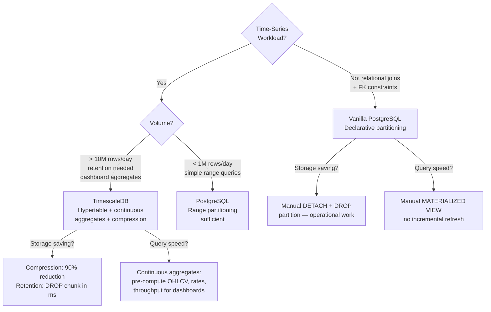

# Time-Series Data — TimescaleDB and Hypertables

Fintech platforms generate enormous volumes of time-ordered data: payment throughput metrics sampled every second, OHLCV candlestick data for every currency pair, fraud score time series per account, and system health metrics tied to business events. Vanilla PostgreSQL handles this workload poorly at scale. TimescaleDB — a PostgreSQL extension — transforms it into a first-class time-series database without sacrificing SQL compatibility or ACID guarantees.

---

## 1. Time-Series Characteristics

Understanding what makes time-series data different from regular relational data is essential before choosing a storage strategy.

| Characteristic | Description | Implication |
|----------------|-------------|-------------|
| Append-mostly | New rows are almost never updated | Write path can be optimized for sequential appends |
| Time-ordered queries | Almost every query filters by time range | Time is always the first predicate |
| High cardinality | Millions of unique series (one per account, instrument, service) | Indexes must be efficient on time + series key |
| Recent-data hotspot | 90% of queries touch the last 7 days | Recent chunks should stay in memory |
| Bulk aggregation | Dashboards aggregate millions of rows | Materialized aggregations are essential |
| Retention-limited | Old data has diminishing value and must be purged | Automated retention policies are required |

### 1.1 Why Vanilla PostgreSQL Struggles

```sql
-- Without TimescaleDB: a vanilla payments_metrics table
CREATE TABLE payments_metrics (
    recorded_at   TIMESTAMPTZ NOT NULL,
    service       VARCHAR(50) NOT NULL,
    metric_name   VARCHAR(50) NOT NULL,
    value         DOUBLE PRECISION NOT NULL
);

CREATE INDEX idx_payments_metrics_time ON payments_metrics (recorded_at DESC);

-- After 6 months at 10,000 rows/second:
-- Table size: ~500 GB
-- Index size: ~100 GB
-- INSERT performance degrades as B-tree index grows
-- Range queries require scanning the entire large B-tree
-- VACUUM and autovacuum struggle with 500 GB of hot data
-- Dropping old data: DELETE is catastrophically slow on 500 GB
```

---

## 2. TimescaleDB Hypertables

A hypertable is a TimescaleDB abstraction that looks like a regular PostgreSQL table but is internally partitioned into **chunks** along the time dimension automatically.

### 2.1 Creating a Hypertable

```sql
-- Install TimescaleDB extension
CREATE EXTENSION IF NOT EXISTS timescaledb;

-- Step 1: Create a standard PostgreSQL table
CREATE TABLE payment_throughput (
    recorded_at    TIMESTAMPTZ     NOT NULL,
    service_name   VARCHAR(50)     NOT NULL,
    region         VARCHAR(20)     NOT NULL,
    payments_count INTEGER         NOT NULL DEFAULT 0,
    total_amount   BIGINT          NOT NULL DEFAULT 0,  -- minor units
    error_count    INTEGER         NOT NULL DEFAULT 0,
    p50_latency_ms DOUBLE PRECISION,
    p99_latency_ms DOUBLE PRECISION
);

-- Step 2: Convert to a hypertable with 7-day chunks
-- TimescaleDB automatically creates a new partition (chunk) every 7 days
SELECT create_hypertable(
    'payment_throughput',   -- table name
    'recorded_at',          -- time column
    chunk_time_interval => INTERVAL '7 days'
);

-- Step 3: Create indexes on the hypertable
-- TimescaleDB creates one index per chunk — these are small and fast
CREATE INDEX idx_pt_service_time
    ON payment_throughput (service_name, recorded_at DESC);

CREATE INDEX idx_pt_region_time
    ON payment_throughput (region, recorded_at DESC);
```

### 2.2 Automatic Chunk Creation

```sql
-- TimescaleDB creates chunks automatically as data is inserted
-- Each chunk covers a 7-day time range

-- Inspect existing chunks
SELECT
    chunk_name,
    range_start,
    range_end,
    is_compressed,
    total_bytes / (1024*1024) AS size_mb
FROM timescaledb_information.chunks
WHERE hypertable_name = 'payment_throughput'
ORDER BY range_start DESC;

/*
chunk_name                      | range_start          | range_end            | is_compressed | size_mb
_timescaledb_internal._hyper_1_8_chunk  | 2024-01-29 00:00:00 | 2024-02-05 00:00:00 | false         | 450
_timescaledb_internal._hyper_1_7_chunk  | 2024-01-22 00:00:00 | 2024-01-29 00:00:00 | true          | 45
_timescaledb_internal._hyper_1_6_chunk  | 2024-01-15 00:00:00 | 2024-01-22 00:00:00 | true          | 43
*/

-- The most recent chunk is uncompressed (hot, in memory)
-- Older chunks are compressed 10:1

-- TimescaleDB query planner automatically uses the right chunk(s)
EXPLAIN (ANALYZE)
SELECT * FROM payment_throughput
WHERE recorded_at > NOW() - INTERVAL '1 hour'
  AND service_name = 'payment-processor';
-- Scans only the current 7-day chunk — not the entire table
```

### 2.3 Chunk Interval Sizing

```sql
-- Choosing chunk_time_interval:
-- Target: each uncompressed chunk fits in ~25% of available RAM
-- Payment metrics at 1,000 rows/second, each row ~200 bytes:
-- Rows per 7 days = 1,000 * 86,400 * 7 = 604,800,000 rows
-- Chunk size = 604,800,000 * 200 bytes = ~115 GB — too large!

-- For 32 GB RAM, target chunk size = 8 GB
-- 8 GB / 200 bytes = 40,000,000 rows
-- 40,000,000 / 86,400 seconds/day / 1,000 rows/second = 0.46 days

-- Use 1-day chunks for high-volume metrics tables
SELECT create_hypertable(
    'payment_throughput_hf',  -- high-frequency version
    'recorded_at',
    chunk_time_interval => INTERVAL '1 day'  -- fits in RAM
);

-- Check current chunk sizes
SELECT
    chunk_name,
    pg_size_pretty(total_bytes) AS total_size,
    num_rows
FROM timescaledb_information.chunks
WHERE hypertable_name = 'payment_throughput_hf'
ORDER BY range_start DESC
LIMIT 5;
```

---

## 3. time_bucket() for Aggregation

`time_bucket()` is TimescaleDB's equivalent of `date_trunc()` but more flexible — it supports arbitrary bucket widths.

```sql
-- Payments per minute for the last hour
SELECT
    time_bucket('1 minute', recorded_at) AS bucket,
    SUM(payments_count)                  AS total_payments,
    SUM(error_count)                     AS total_errors,
    AVG(p99_latency_ms)                  AS avg_p99_ms
FROM payment_throughput
WHERE recorded_at > NOW() - INTERVAL '1 hour'
GROUP BY bucket
ORDER BY bucket;

-- 5-minute buckets with error rate
SELECT
    time_bucket('5 minutes', recorded_at) AS bucket,
    service_name,
    SUM(payments_count)                   AS payments,
    SUM(error_count)                      AS errors,
    ROUND(
        100.0 * SUM(error_count) / NULLIF(SUM(payments_count), 0),
        2
    )                                     AS error_rate_pct
FROM payment_throughput
WHERE recorded_at BETWEEN '2024-01-15 09:00' AND '2024-01-15 17:00'
GROUP BY bucket, service_name
ORDER BY bucket, service_name;

-- Hourly totals with time_bucket for the last 24 hours
SELECT
    time_bucket('1 hour', recorded_at)   AS hour,
    region,
    SUM(payments_count)                  AS payments_per_hour,
    SUM(total_amount) / 100.0            AS total_volume_gbp
FROM payment_throughput
WHERE recorded_at > NOW() - INTERVAL '24 hours'
GROUP BY hour, region
ORDER BY hour DESC, region;
```

---

## 4. Continuous Aggregates — OHLCV Candlestick Data

Continuous aggregates are materialized views that TimescaleDB keeps incrementally up to date as new data arrives. They are essential for dashboards and reporting.

### 4.1 Raw FX Rate Time Series

```sql
-- Raw tick data: every FX rate quote from liquidity providers
CREATE TABLE fx_rates (
    quoted_at  TIMESTAMPTZ     NOT NULL,
    pair       VARCHAR(7)      NOT NULL,  -- 'EUR/USD', 'GBP/USD', etc.
    provider   VARCHAR(30)     NOT NULL,
    bid        NUMERIC(16, 6)  NOT NULL,
    ask        NUMERIC(16, 6)  NOT NULL,
    mid        NUMERIC(16, 6)  NOT NULL
);

SELECT create_hypertable('fx_rates', 'quoted_at',
    chunk_time_interval => INTERVAL '1 day');

CREATE INDEX idx_fx_rates_pair_time
    ON fx_rates (pair, quoted_at DESC);
```

### 4.2 OHLCV Continuous Aggregate

```sql
-- 1-minute OHLCV candlesticks computed from tick data
CREATE MATERIALIZED VIEW fx_ohlcv_1m
WITH (timescaledb.continuous) AS
SELECT
    time_bucket('1 minute', quoted_at)   AS bucket,
    pair,
    FIRST(mid, quoted_at)                AS open,
    MAX(mid)                             AS high,
    MIN(mid)                             AS low,
    LAST(mid, quoted_at)                 AS close,
    COUNT(*)                             AS tick_count,
    AVG(ask - bid)                       AS avg_spread
FROM fx_rates
GROUP BY bucket, pair
WITH NO DATA;  -- Populate on-demand, not at creation time

-- Configure refresh policy: keep the view up to date within 1 minute
SELECT add_continuous_aggregate_policy(
    'fx_ohlcv_1m',
    start_offset  => INTERVAL '10 minutes',
    end_offset    => INTERVAL '1 minute',
    schedule_interval => INTERVAL '1 minute'
);

-- Backfill historical data
CALL refresh_continuous_aggregate('fx_ohlcv_1m',
    '2024-01-01', '2024-01-15');

-- Query the materialized view — extremely fast (pre-aggregated)
SELECT
    bucket,
    open,
    high,
    low,
    close,
    tick_count
FROM fx_ohlcv_1m
WHERE pair = 'EUR/USD'
  AND bucket > NOW() - INTERVAL '1 hour'
ORDER BY bucket;
```

### 4.3 Hierarchical Continuous Aggregates

TimescaleDB 2.9+ supports creating continuous aggregates on top of other continuous aggregates:

```sql
-- 1-hour OHLCV built from 1-minute OHLCV (not from raw tick data)
CREATE MATERIALIZED VIEW fx_ohlcv_1h
WITH (timescaledb.continuous) AS
SELECT
    time_bucket('1 hour', bucket)        AS bucket,
    pair,
    FIRST(open, bucket)                  AS open,
    MAX(high)                            AS high,
    MIN(low)                             AS low,
    LAST(close, bucket)                  AS close,
    SUM(tick_count)                      AS tick_count
FROM fx_ohlcv_1m
GROUP BY time_bucket('1 hour', bucket), pair
WITH NO DATA;

SELECT add_continuous_aggregate_policy(
    'fx_ohlcv_1h',
    start_offset  => INTERVAL '2 hours',
    end_offset    => INTERVAL '1 hour',
    schedule_interval => INTERVAL '1 hour'
);
```

---

## 5. time_bucket_gapfill() with locf()

Real-world time series have gaps: a currency pair might have no trades for 3 minutes during low-liquidity hours. `time_bucket_gapfill` fills gaps; `locf` (Last Observation Carried Forward) fills missing values.

```sql
-- Without gapfill: missing buckets are absent from result
SELECT
    time_bucket('1 minute', quoted_at) AS bucket,
    LAST(mid, quoted_at)               AS last_mid
FROM fx_rates
WHERE pair = 'EUR/USD'
  AND quoted_at > NOW() - INTERVAL '1 hour'
GROUP BY bucket
ORDER BY bucket;
-- Some minutes may be missing if no ticks arrived

-- With gapfill + locf: all 60 buckets present, missing filled with last known value
SELECT
    time_bucket_gapfill(
        '1 minute',
        quoted_at,
        start  => NOW() - INTERVAL '1 hour',
        finish => NOW()
    )                                AS bucket,
    pair,
    locf(LAST(mid, quoted_at))       AS mid_price,
    locf(LAST(bid, quoted_at))       AS bid_price,
    locf(LAST(ask, quoted_at))       AS ask_price,
    COUNT(*)                         AS tick_count  -- NULL for filled gaps
FROM fx_rates
WHERE pair = 'EUR/USD'
  AND quoted_at > NOW() - INTERVAL '1 hour'
GROUP BY bucket, pair
ORDER BY bucket;

-- interpolate(): linear interpolation instead of LOCF
SELECT
    time_bucket_gapfill('5 minutes', recorded_at) AS bucket,
    service_name,
    interpolate(AVG(p99_latency_ms))              AS p99_ms_interpolated
FROM payment_throughput
WHERE recorded_at > NOW() - INTERVAL '6 hours'
GROUP BY bucket, service_name
ORDER BY bucket;
```

---

## 6. Compression Policy

Older time-series data is queried far less frequently. TimescaleDB's native compression reduces storage by 90-95% using columnar compression on cold chunks.

```sql
-- Enable compression on the hypertable
-- orderby: controls how data is sorted within a compressed segment
-- segmentby: creates one segment per unique value — critical for
--            query performance: TimescaleDB can skip entire segments
ALTER TABLE payment_throughput SET (
    timescaledb.compress,
    timescaledb.compress_orderby   = 'recorded_at DESC',
    timescaledb.compress_segmentby = 'service_name, region'
);

-- Add a compression policy: compress chunks older than 7 days
SELECT add_compression_policy(
    'payment_throughput',
    compress_after => INTERVAL '7 days'
);

-- Verify compression status and savings
SELECT
    chunk_name,
    before_compression_total_bytes / (1024*1024)  AS before_mb,
    after_compression_total_bytes  / (1024*1024)  AS after_mb,
    ROUND(
        100.0 * (1 - after_compression_total_bytes::float /
                     before_compression_total_bytes),
        1
    )                                              AS compression_pct
FROM chunk_compression_stats('payment_throughput')
ORDER BY chunk_name;

/*
chunk_name  | before_mb | after_mb | compression_pct
_hyper_1_1  |       450 |       42 |            90.7
_hyper_1_2  |       448 |       41 |            90.8
*/

-- Manually compress a specific chunk (for immediate space recovery)
SELECT compress_chunk(
    '_timescaledb_internal._hyper_1_3_chunk'
);

-- Decompress if you need to INSERT into an old compressed chunk
-- (TimescaleDB 2.11+ handles this automatically)
SELECT decompress_chunk(
    '_timescaledb_internal._hyper_1_3_chunk'
);
```

---

## 7. Retention Policy

```sql
-- Drop chunks older than 90 days automatically
-- This is a metadata operation (DROP TABLE on a chunk) — nearly instantaneous
-- Compare: DELETE on 500 GB would take hours and generate massive WAL
SELECT add_retention_policy(
    'payment_throughput',
    drop_after => INTERVAL '90 days'
);

-- For the OHLCV continuous aggregate, keep summarized data longer
SELECT add_retention_policy(
    'fx_ohlcv_1m',
    drop_after => INTERVAL '1 year'
);

SELECT add_retention_policy(
    'fx_ohlcv_1h',
    drop_after => INTERVAL '5 years'
);

-- View all scheduled jobs (compression + retention policies)
SELECT
    job_id,
    application_name,
    schedule_interval,
    next_start,
    last_run_status,
    last_run_duration
FROM timescaledb_information.jobs
ORDER BY job_id;

-- Manual retention execution (useful for immediate cleanup)
SELECT drop_chunks('payment_throughput', older_than => INTERVAL '90 days');

-- View chunk boundaries before dropping (dry run)
SELECT
    chunk_name,
    range_start,
    range_end,
    total_bytes / (1024*1024*1024) AS size_gb
FROM timescaledb_information.chunks
WHERE hypertable_name = 'payment_throughput'
  AND range_end < NOW() - INTERVAL '90 days'
ORDER BY range_end;
```

---

## 8. Payment Throughput Monitoring Example

A complete implementation for monitoring payment processing rates in a fintech platform.

```sql
-- Metric collection table (1-second resolution)
CREATE TABLE payment_metrics_raw (
    recorded_at    TIMESTAMPTZ     NOT NULL,
    service        VARCHAR(50)     NOT NULL,
    region         VARCHAR(20)     NOT NULL,
    metric         VARCHAR(50)     NOT NULL,
    value          DOUBLE PRECISION NOT NULL
);

SELECT create_hypertable('payment_metrics_raw', 'recorded_at',
    chunk_time_interval => INTERVAL '1 day');

ALTER TABLE payment_metrics_raw SET (
    timescaledb.compress,
    timescaledb.compress_orderby   = 'recorded_at DESC',
    timescaledb.compress_segmentby = 'service, metric'
);

SELECT add_compression_policy('payment_metrics_raw',
    compress_after => INTERVAL '3 days');
SELECT add_retention_policy('payment_metrics_raw',
    drop_after => INTERVAL '30 days');

-- 1-minute pre-aggregated view for dashboards
CREATE MATERIALIZED VIEW payment_metrics_1m
WITH (timescaledb.continuous) AS
SELECT
    time_bucket('1 minute', recorded_at) AS bucket,
    service,
    region,
    metric,
    AVG(value)   AS avg_value,
    MIN(value)   AS min_value,
    MAX(value)   AS max_value,
    COUNT(*)     AS sample_count
FROM payment_metrics_raw
GROUP BY time_bucket('1 minute', recorded_at), service, region, metric
WITH NO DATA;

SELECT add_continuous_aggregate_policy('payment_metrics_1m',
    start_offset      => INTERVAL '5 minutes',
    end_offset        => INTERVAL '1 minute',
    schedule_interval => INTERVAL '1 minute');

-- Dashboard query: payment success rate over last 24 hours
WITH success_rate AS (
    SELECT
        bucket,
        service,
        MAX(CASE WHEN metric = 'payments_succeeded' THEN avg_value ELSE 0 END) AS succeeded,
        MAX(CASE WHEN metric = 'payments_failed'    THEN avg_value ELSE 0 END) AS failed
    FROM payment_metrics_1m
    WHERE bucket > NOW() - INTERVAL '24 hours'
      AND metric IN ('payments_succeeded', 'payments_failed')
    GROUP BY bucket, service
)
SELECT
    bucket,
    service,
    succeeded,
    failed,
    ROUND(
        100.0 * succeeded / NULLIF(succeeded + failed, 0),
        2
    ) AS success_rate_pct
FROM success_rate
ORDER BY bucket DESC, service;
```

---

## 9. Real-Time Aggregation: Continuous Aggregate + Live Data

Continuous aggregates have a small lag (the `end_offset`). For true real-time, combine the materialized view with a query on the raw table for the most recent data.

```sql
-- Real-time query: combines pre-aggregated data + live tail
-- (TimescaleDB calls this "real-time aggregation" and enables it by default)

-- Enable real-time aggregation (default ON in TimescaleDB 2.x)
ALTER MATERIALIZED VIEW fx_ohlcv_1m
SET (timescaledb.materialized_only = false);
-- Now queries against fx_ohlcv_1m automatically combine:
-- 1. Pre-computed data from the materialized layer
-- 2. Live data from the raw fx_rates table for the recent end_offset period

-- The query below returns all data including the last 60 seconds
-- without any application-side stitching
SELECT
    bucket,
    open, high, low, close,
    tick_count
FROM fx_ohlcv_1m
WHERE pair = 'EUR/USD'
  AND bucket > NOW() - INTERVAL '1 hour'
ORDER BY bucket;
```

---

## 10. TimescaleDB vs Vanilla PostgreSQL Partitioning



| Feature | TimescaleDB | Vanilla PostgreSQL Partitioning |
|---------|------------|--------------------------------|
| Chunk creation | Automatic | Manual (or pg_partman) |
| Compression | Native columnar, 90% reduction | None (use pg_compress or tablespaces) |
| Retention | `add_retention_policy` — one line | DETACH + DROP — operational script |
| Incremental aggregates | `CREATE MATERIALIZED VIEW ... continuous` | Full refresh only (`REFRESH MATERIALIZED VIEW`) |
| Gap filling | `time_bucket_gapfill + locf` | Custom PL/pgSQL |
| SQL compatibility | 100% — it is PostgreSQL | 100% |
| Cloud managed | Available on Timescale Cloud, Aiven, AWS | Available everywhere |

---

## 11. Production Pitfalls

### Pitfall 1: Not Using Continuous Aggregates — Dashboard Queries Scan Raw Data

```sql
-- WRONG — dashboard query scans raw tick data every time
-- At 10,000 ticks/second for 30 days: 25,920,000,000 rows
SELECT
    time_bucket('1 hour', quoted_at) AS hour,
    pair,
    FIRST(mid, quoted_at)            AS open,
    MAX(mid)                         AS high,
    MIN(mid)                         AS low,
    LAST(mid, quoted_at)             AS close
FROM fx_rates  -- 25 billion rows!
WHERE quoted_at > NOW() - INTERVAL '30 days'
GROUP BY hour, pair;
-- Runtime: 45 minutes (even with hypertable chunk pruning)
-- Causes: high I/O, high CPU, dashboard timeouts

-- CORRECT — pre-aggregate with continuous aggregate
-- Query runs in <100ms
SELECT bucket, pair, open, high, low, close
FROM fx_ohlcv_1h  -- pre-aggregated, only 720 rows per pair for 30 days
WHERE bucket > NOW() - INTERVAL '30 days'
ORDER BY bucket, pair;

-- If you need a timeframe not covered by existing aggregates:
-- Create a new continuous aggregate at the right granularity
CREATE MATERIALIZED VIEW fx_ohlcv_4h
WITH (timescaledb.continuous) AS
SELECT
    time_bucket('4 hours', bucket) AS bucket,
    pair,
    FIRST(open, bucket)             AS open,
    MAX(high)                       AS high,
    MIN(low)                        AS low,
    LAST(close, bucket)             AS close,
    SUM(tick_count)                 AS tick_count
FROM fx_ohlcv_1h
GROUP BY time_bucket('4 hours', bucket), pair
WITH NO DATA;
```

### Pitfall 2: Too-Small Chunk Interval Causes Excessive Chunk Count

A chunk interval that is too small creates thousands of chunks, overwhelming the PostgreSQL catalog and causing slow query planning.

```sql
-- WRONG — 1-minute chunks for a low-volume table
-- 1 year of data = 525,600 chunks
-- PostgreSQL catalog bloat, slow EXPLAIN, slow DROP retention jobs

SELECT create_hypertable('payment_audit_low_volume', 'created_at',
    chunk_time_interval => INTERVAL '1 minute');  -- DO NOT DO THIS
-- After 1 year: pg_class has 525,600 entries for this table
-- EXPLAIN on any query takes 5+ seconds for chunk exclusion
-- TimescaleDB recommends: aim for 1,000-10,000 chunks maximum

-- Calculate the right interval:
-- Expected rows per day: 100,000 (for a low-volume audit table)
-- Target chunk size: 1 GB
-- Row size: ~500 bytes
-- Rows per GB: 2,000,000
-- Days to reach 1 GB: 2,000,000 / 100,000 = 20 days
SELECT create_hypertable('payment_audit_low_volume', 'created_at',
    chunk_time_interval => INTERVAL '30 days');  -- Correct for this volume

-- Check current chunk count
SELECT hypertable_name, num_chunks
FROM timescaledb_information.hypertables;

-- If you have too many chunks already, you must recreate the hypertable:
-- 1. Create new table with correct interval
-- 2. INSERT INTO new_table SELECT * FROM old_table (can take hours)
-- 3. Rename tables in a transaction
-- Prevention is better than cure — size your interval at creation time
```

### Pitfall 3: Compression Blocking Writes to Old Chunks

TimescaleDB compresses data into an immutable columnar format. Direct INSERTs or UPDATEs to a compressed chunk fail unless you first decompress it.

```sql
-- WRONG — attempting to backfill historical data into a compressed chunk
INSERT INTO payment_throughput (recorded_at, service_name, region,
                                payments_count, total_amount)
VALUES ('2024-01-10 12:00:00', 'payment-processor', 'eu-west-1',
        5000, 50000000);
-- ERROR: cannot insert into chunk that is compressed

-- Also affected:
UPDATE payment_throughput
SET error_count = 5
WHERE recorded_at = '2024-01-10 12:00:00'
  AND service_name = 'payment-processor';
-- ERROR: cannot update rows in a compressed chunk

-- FIX option 1: decompress, modify, re-compress (operational overhead)
SELECT decompress_chunk(
    show_chunks('payment_throughput',
        older_than => '2024-01-15'::timestamptz,
        newer_than => '2024-01-10'::timestamptz)
);

INSERT INTO payment_throughput ...;  -- Now works

SELECT compress_chunk(
    show_chunks('payment_throughput',
        older_than => '2024-01-15'::timestamptz,
        newer_than => '2024-01-10'::timestamptz)
);

-- FIX option 2 (TimescaleDB 2.11+): enable DML on compressed chunks
-- TimescaleDB 2.11 introduced transparent DML on compressed chunks
-- (auto-decompresses the affected rows into an internal staging area)
ALTER TABLE payment_throughput SET (
    timescaledb.compress_segmentby = 'service_name, region'
    -- DML decompresses only the affected segment, not the whole chunk
);

-- FIX option 3: architectural — never backfill historical data
-- Design your pipeline so data arrives in real-time
-- For corrections, insert a new row with a note field rather than updating old data
-- Time-series data is append-only by nature — treat corrections as new events
INSERT INTO payment_throughput (
    recorded_at, service_name, region,
    payments_count, total_amount, error_count
)
VALUES (
    NOW(),           -- correction recorded NOW, not in the past
    'payment-processor', 'eu-west-1',
    -50, -500000, 0  -- negative delta to correct the error
);
```

---

## 12. Checklist

- [ ] `create_hypertable()` called with `chunk_time_interval` sized for 1,000-10,000 total chunks over retention period
- [ ] Chunk interval validated: target each uncompressed chunk < 25% of available RAM
- [ ] Continuous aggregates created for every dashboard/reporting query that runs more than once per hour
- [ ] `add_continuous_aggregate_policy` configured with `end_offset >= 1 minute` (do not set to zero)
- [ ] `timescaledb.materialized_only = false` for real-time aggregation on continuous aggregate views
- [ ] `compress_segmentby` set to the column(s) used in WHERE clauses for compressed data
- [ ] `add_compression_policy` configured: compress after the hot retention window (e.g., 7 days)
- [ ] `add_retention_policy` configured: drop raw data after the required retention period
- [ ] `time_bucket_gapfill + locf` used in queries that must return a continuous time series
- [ ] Backfill operations performed on decompressed chunks only; re-compressed after
- [ ] Chunk count monitored with `timescaledb_information.hypertables.num_chunks`
- [ ] TimescaleDB background jobs (`timescaledb_information.jobs`) monitored for `last_run_status = 'Failed'`

---

<!-- KNOWLEDGE-CHECK
{"questions":[{"text":"You have a hypertable storing 10,000 rows per second, each row 200 bytes. You have 64 GB of RAM and want the hot (uncompressed) chunk to fit in ~25% of RAM. What chunk_time_interval should you use?","options":["a) 1 day — 10,000 * 86,400 * 200 bytes = 165 GB, too large","b) 1 hour — 10,000 * 3,600 * 200 bytes = 6.9 GB, fits in 16 GB (25% of 64 GB)","c) 7 days — this is TimescaleDB's default and always correct","d) 1 minute — smaller chunks are always faster"],"correct":1,"explanation":"With 10,000 rows/second and 200 bytes/row: rows per hour = 36,000,000; size = 36,000,000 * 200 = 7.2 GB. 25% of 64 GB = 16 GB, so a 1-hour chunk at 7.2 GB fits comfortably. The 7-day default is for lower-volume workloads. 1-day chunks at 165 GB would exceed RAM, causing disk I/O on recent data. 1-minute chunks at 120 MB each would create 8,760 chunks per year, risking catalog bloat."},{"text":"A continuous aggregate on fx_rates computes 1-minute OHLCV candles. The policy is configured with end_offset = INTERVAL '1 minute'. A query on the continuous aggregate view returns data up to 2 minutes ago but not the last minute. How do you get truly up-to-the-second data from the view?","options":["a) Decrease the end_offset to zero seconds","b) Set timescaledb.materialized_only = false on the continuous aggregate to enable real-time aggregation, which combines pre-aggregated data with live raw data","c) Increase the schedule_interval to run more frequently","d) Query the raw table instead — continuous aggregates always have a lag"],"correct":1,"explanation":"Real-time aggregation (timescaledb.materialized_only = false, the default in TimescaleDB 2.x) makes the continuous aggregate view transparently combine its materialized data with a live query on the raw table for the recent end_offset period. This means the view returns up-to-the-second data without any lag, while still using the pre-aggregated data for older time ranges. Setting end_offset to zero is not recommended as it causes the refresh job to compete with incoming writes on the most recent chunk."},{"text":"What happens if you attempt to INSERT a row with a timestamp 2 months ago into a TimescaleDB hypertable that has compression enabled with compress_after = INTERVAL '7 days'?","options":["a) The INSERT succeeds and the row is automatically appended to the compressed chunk","b) The INSERT fails with an error because the target chunk is compressed and immutable; you must decompress the chunk first","c) The INSERT creates a new uncompressed chunk for the old timestamp","d) TimescaleDB silently drops the INSERT and returns success"],"correct":1,"explanation":"TimescaleDB compresses chunks into an immutable columnar format. Direct writes (INSERT, UPDATE, DELETE) to a compressed chunk fail with an error. To backfill data, you must first call decompress_chunk() on the target chunk, perform the write, then call compress_chunk() again. TimescaleDB 2.11+ introduced partial decompression for DML on compressed chunks, which decompresses only the affected segment rather than the entire chunk. The best architectural approach is to treat time-series data as append-only and model corrections as new events rather than updates to old rows."}]}
-->

<!-- PRACTICAL-CHALLENGE
{"title":"TimescaleDB Payment Metrics: Hypertables, Continuous Aggregates, and Compression","difficulty":"advanced","estimatedMinutes":85,"tasks":[{"id":"1","description":"Install TimescaleDB (use Docker: timescale/timescaledb-ha:pg16) and create a payment_throughput hypertable with columns: recorded_at TIMESTAMPTZ, service VARCHAR(50), region VARCHAR(20), payments_count INT, error_count INT, p50_latency_ms FLOAT, p99_latency_ms FLOAT. Set chunk_time_interval to 1 day. Generate 30 days of synthetic data at 1-second resolution (simulate 10 services across 3 regions). Verify chunk creation with timescaledb_information.chunks and confirm that EXPLAIN on a 1-day range query shows only the target chunk being scanned, not all 30 chunks."},{"id":"2","description":"Create a continuous aggregate payment_throughput_1m that computes AVG, MIN, MAX for all metric columns with 1-minute buckets. Set a refresh policy with start_offset=5 minutes, end_offset=1 minute, schedule_interval=1 minute. Enable real-time aggregation (materialized_only=false). Write a query that compares response time between: (a) querying the raw hypertable with time_bucket() and (b) querying the continuous aggregate view, for a 7-day range. Record the difference in a SQL comment."},{"id":"3","description":"Enable native compression on the payment_throughput hypertable with compress_segmentby='service,region' and compress_orderby='recorded_at DESC'. Add a compression policy for data older than 3 days. Manually compress chunks older than 10 days using compress_chunk(). Query chunk_compression_stats() and report the before/after sizes and compression percentage in a SQL comment. Then attempt to INSERT a row into a compressed chunk and document the error. Demonstrate the decompress_chunk() workaround."},{"id":"4","description":"Build a gap-filled dashboard query: use time_bucket_gapfill() with a 5-minute interval over the last 24 hours, applying locf() to p99_latency_ms and interpolate() to payments_count. The result must have exactly 288 rows (24h / 5min) for each service, with no NULL values for p99_latency_ms. Add a retention policy that drops raw data older than 30 days and compressed data older than 90 days. Verify the policy is registered in timescaledb_information.jobs and manually execute it with drop_chunks() to confirm it removes the expected chunks without locking the table."}]}
-->
