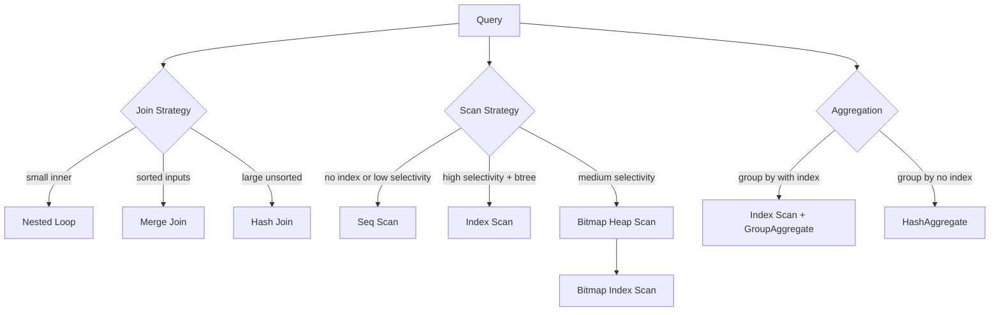

# Query Plan Analysis — EXPLAIN, ANALYZE, and Visualisation

Understanding what PostgreSQL actually does when it executes a query is the single most important debugging skill for a database engineer. A query that runs in 2 ms on a table with 10,000 rows might take 45 seconds on a table with 50 million rows — not because the query changed, but because the execution strategy did. This lesson teaches you to read, interpret, and act on query execution plans.

---

## 1. The Three Levels of EXPLAIN

PostgreSQL provides three progressive levels of introspection, each revealing more information at greater cost.

### EXPLAIN (estimated only)

```sql
EXPLAIN
SELECT p.id, p.amount, p.status, a.holder_name
FROM   payments p
JOIN   accounts a ON a.id = p.source_account_id
WHERE  p.created_at >= NOW() - INTERVAL '7 days'
  AND  p.status = 'PENDING';
```

Output:

```
Hash Join  (cost=1842.55..9201.33 rows=4120 width=52)
  Hash Cond: (p.source_account_id = a.id)
  ->  Seq Scan on payments p  (cost=0.00..6945.20 rows=4120 width=36)
        Filter: ((status = 'PENDING') AND (created_at >= (now() - '7 days'::interval)))
  ->  Hash  (cost=1105.00..1105.00 rows=59004 width=24)
        ->  Seq Scan on accounts a  (cost=0.00..1105.00 rows=59004 width=24)
```

The numbers are **estimates** produced from table statistics — no SQL is executed. The planner uses `pg_statistic` (exposed through `pg_stats`) to estimate row counts and costs.

**Cost notation:** `cost=startup..total`
- `startup`: cost to produce the first row (e.g., sorting requires reading all rows before returning any)
- `total`: cost to produce all rows
- Cost units are arbitrary but consistent — 1.0 equals one sequential page read

**Width:** average row width in bytes

### EXPLAIN ANALYZE (runs the query)

```sql
EXPLAIN ANALYZE
SELECT p.id, p.amount, p.status, a.holder_name
FROM   payments p
JOIN   accounts a ON a.id = p.source_account_id
WHERE  p.created_at >= NOW() - INTERVAL '7 days'
  AND  p.status = 'PENDING';
```

Output (abbreviated):

```
Hash Join  (cost=1842.55..9201.33 rows=4120 width=52)
           (actual time=38.212..412.831 rows=5891 loops=1)
  Hash Cond: (p.source_account_id = a.id)
  ->  Seq Scan on payments p  (cost=0.00..6945.20 rows=4120 width=36)
                               (actual time=0.041..389.342 rows=5891 loops=1)
        Filter: ((status = 'PENDING') AND (created_at >= ...))
        Rows Removed by Filter: 744108
  ->  Hash  (cost=1105.00..1105.00 rows=59004 width=24)
            (actual time=37.814..37.814 rows=59004 loops=1)
        Buckets: 65536  Batches: 1  Memory Usage: 3528kB
        ->  Seq Scan on accounts a  (cost=0.00..1105.00 rows=59004 width=24)
                                    (actual time=0.015..19.223 rows=59004 loops=1)
Planning Time: 1.231 ms
Execution Time: 413.904 ms
```

Key differences: `actual time` and `actual rows` let you compare estimates vs reality. A large discrepancy (e.g., estimated 4,120 vs actual 5,891) indicates stale statistics.

### EXPLAIN (ANALYZE, BUFFERS, FORMAT JSON)

```sql
EXPLAIN (ANALYZE, BUFFERS, FORMAT JSON)
SELECT p.id, p.amount
FROM   payments p
WHERE  p.status = 'PENDING'
  AND  p.created_at >= NOW() - INTERVAL '7 days';
```

The `BUFFERS` option reveals cache behavior:

```json
{
  "Node Type": "Seq Scan",
  "Actual Rows": 5891,
  "Shared Hit Blocks": 342,
  "Shared Read Blocks": 6103,
  "Shared Dirtied Blocks": 0,
  "Shared Written Blocks": 0
}
```

- `Shared Hit Blocks`: pages served from `shared_buffers` (RAM) — fast
- `Shared Read Blocks`: pages read from disk (or OS cache) — slow
- A high read-to-hit ratio means your working set does not fit in `shared_buffers`

**FORMAT JSON** produces machine-readable output suitable for tools like [explain.depesz.com](https://explain.depesz.com) or pgBadger.

---

## 2. Node Types Reference



### Seq Scan

Reads every page of the table sequentially. Fast for large result sets (more than ~5% of the table) because sequential I/O is efficient. The planner prefers it when:

- No suitable index exists
- The filter is not selective (most rows match)
- Table statistics suggest the index would read nearly as many pages as a seq scan

### Index Scan

Follows the B-tree index for each matching key, then fetches heap rows individually. Efficient for high selectivity (few rows). Can cause random I/O on large result sets.

### Bitmap Heap Scan

Two phases: first builds an in-memory bitmap of matching TIDs from the index (`Bitmap Index Scan`), then fetches heap pages in physical order. Efficient for medium selectivity — avoids random I/O by sorting page fetches.

```
Bitmap Heap Scan on payments  (cost=94.21..2871.45 rows=4120 width=36)
  Recheck Cond: (created_at >= (now() - '7 days'::interval))
  ->  Bitmap Index Scan on idx_payments_created_at
        Index Cond: (created_at >= (now() - '7 days'::interval))
```

### Hash Join

Build phase: reads the smaller table and builds a hash table in `work_mem`. Probe phase: reads the larger table and probes the hash. When the hash table does not fit in `work_mem`, it spills to disk (`Batches > 1`).

### Nested Loop

For each row in the outer relation, probe the inner relation. Efficient when the outer has few rows and the inner has an index. Disastrous when the outer has many rows without an index on the inner.

### Merge Join

Both inputs must be sorted on the join key. Efficient when inputs are already sorted (index scan) or when doing ORDER BY anyway.

---

## 3. When PostgreSQL Chooses a Seq Scan

The planner calculates the cost of each access path and chooses the cheapest. It chooses a seq scan over an index when:

1. **Low selectivity**: the filter matches a large fraction of rows. Reading heap pages randomly via an index costs more than a sequential scan when you need most of the pages anyway.

2. **Small table**: for tables that fit in a few pages, a seq scan is always cheaper.

3. **Stale statistics**: `n_distinct` or the histogram in `pg_stats` is out of date, causing the planner to underestimate or overestimate row counts.

4. **Cost misconfiguration**: `random_page_cost` is set too high relative to `seq_page_cost` (default 4.0 vs 1.0). On SSDs, `random_page_cost = 1.1` is more accurate.

```sql
-- Check estimated vs actual correlation for a column
SELECT attname, correlation
FROM   pg_stats
WHERE  tablename = 'payments'
  AND  attname = 'created_at';
```

A correlation near 1.0 or -1.0 means the physical row order matches the index order — index scans are cheap. Near 0 means random I/O.

---

## 4. pg_stats — Column Statistics

PostgreSQL collects per-column statistics during `ANALYZE`. The `pg_stats` view exposes them:

```sql
SELECT
    attname,
    n_distinct,
    null_frac,
    avg_width,
    most_common_vals,
    most_common_freqs,
    histogram_bounds
FROM pg_stats
WHERE tablename = 'payments'
ORDER BY attname;
```

| Column | Meaning |
|---|---|
| `n_distinct` | Estimated number of distinct values. Negative = fraction of rows |
| `null_frac` | Fraction of rows that are NULL |
| `most_common_vals` | Top N values (default N=100, controlled by `default_statistics_target`) |
| `most_common_freqs` | Frequency of each most-common value |
| `histogram_bounds` | Bucket boundaries for non-common values |

Increasing statistics target for a selective column:

```sql
-- Increase statistics resolution for the status column
ALTER TABLE payments ALTER COLUMN status SET STATISTICS 500;
ANALYZE payments;
```

---

## 5. ANALYZE — Keeping Statistics Fresh

```sql
-- Analyze a single table immediately (non-blocking)
ANALYZE payments;

-- Analyze with verbose output
ANALYZE VERBOSE payments;

-- Check when a table was last analyzed
SELECT relname, last_analyze, last_autoanalyze, n_live_tup, n_dead_tup
FROM   pg_stat_user_tables
WHERE  relname = 'payments';
```

`autovacuum` runs `ANALYZE` automatically, but it can lag after:
- Bulk inserts (millions of rows inserted in one statement)
- Initial data loads
- Partitioned tables where autovacuum processes partitions separately

Trigger a manual analyze after every bulk load in your ETL pipelines.

---

## 6. work_mem Impact on Sort and Hash Operations

`work_mem` controls how much RAM a single sort or hash operation can use before spilling to disk. Each query can use multiple `work_mem` allocations simultaneously.

```sql
-- Check current setting
SHOW work_mem;

-- Set per-session for a large analytical query
SET work_mem = '256MB';

EXPLAIN (ANALYZE, BUFFERS)
SELECT account_id, SUM(amount) as total
FROM   payments
WHERE  created_at >= '2024-01-01'
GROUP  BY account_id
ORDER  BY total DESC;
```

**Without sufficient work_mem:**

```
Sort  (cost=98421.50..98673.50 rows=100800 width=16)
      (actual time=4821.332..5891.221 rows=100800 loops=1)
  Sort Key: (sum(amount)) DESC
  Sort Method: external merge  Disk: 3824kB    -- SPILLING TO DISK
```

**With sufficient work_mem:**

```
Sort  (cost=15421.50..15673.50 rows=100800 width=16)
      (actual time=312.441..381.223 rows=100800 loops=1)
  Sort Key: (sum(amount)) DESC
  Sort Method: quicksort  Memory: 10240kB    -- IN MEMORY
```

The `Sort Method: external merge Disk` line is the signal to increase `work_mem` for this query class. Never set `work_mem` globally too high — a connection executing 10 parallel nodes × 500 MB = 5 GB RAM consumed by one session.

---

## 7. pg_stat_statements — Identifying Slow Queries

```sql
-- Enable the extension (requires superuser, once per database)
CREATE EXTENSION IF NOT EXISTS pg_stat_statements;

-- Find the top 10 slowest queries by total execution time
SELECT
    left(query, 120)                AS query_snippet,
    calls,
    round(total_exec_time::numeric, 2) AS total_ms,
    round(mean_exec_time::numeric, 2)  AS mean_ms,
    round(stddev_exec_time::numeric, 2) AS stddev_ms,
    rows
FROM   pg_stat_statements
ORDER  BY total_exec_time DESC
LIMIT  10;

-- Find queries with the highest row estimates vs actuals divergence
-- (indicates stale statistics)
SELECT
    left(query, 120) AS query_snippet,
    calls,
    round(mean_exec_time::numeric, 2) AS mean_ms
FROM   pg_stat_statements
WHERE  mean_exec_time > 100
ORDER  BY mean_exec_time DESC;
```

Reset statistics after a schema or index change to get a clean baseline:

```sql
SELECT pg_stat_statements_reset();
```

---

## 8. auto_explain — Automatic Slow Query Logging

The `auto_explain` extension captures plans for slow queries without manual instrumentation:

```sql
-- In postgresql.conf or via ALTER SYSTEM:
-- shared_preload_libraries = 'auto_explain'
-- auto_explain.log_min_duration = 1000   -- log queries > 1 second
-- auto_explain.log_analyze = on
-- auto_explain.log_buffers = on
-- auto_explain.log_format = json

-- Enable per-session for testing
LOAD 'auto_explain';
SET auto_explain.log_min_duration = 0;
SET auto_explain.log_analyze = true;
```

After enabling, slow query plans appear in the PostgreSQL log:

```
LOG:  duration: 1832.491 ms  plan:
{
  "Node Type": "Hash Join",
  "Total Cost": 9201.33,
  "Actual Total Time": 1831.22,
  ...
}
```

---

## 9. explain.depesz.com Format

Pasting output into [explain.depesz.com](https://explain.depesz.com) or [explain.dalibo.com](https://explain.dalibo.com) produces an interactive visualisation with colour-coded nodes highlighting the most expensive operations. For CI pipelines, use the JSON format and pipe it through `pgbadger` or custom tooling.

```bash
# Capture JSON plan to file
psql -d fintech -c "EXPLAIN (ANALYZE, BUFFERS, FORMAT JSON) SELECT ..." \
  | python3 -c "import sys,json; print(json.dumps(json.loads(sys.stdin.read()[1:-2]), indent=2))" \
  > plan.json
```

---

## 10. Real Example — Slow Payment History Query

### Before: table scan on 50M rows

```sql
-- Query: fetch last 90 days of payments for a customer portal
SELECT p.id, p.amount, p.status, p.created_at, a.holder_name
FROM   payments p
JOIN   accounts a ON a.id = p.source_account_id
WHERE  p.customer_id = 42001
  AND  p.created_at >= NOW() - INTERVAL '90 days'
ORDER  BY p.created_at DESC
LIMIT  100;
```

```
EXPLAIN (ANALYZE, BUFFERS):

Limit  (cost=89421.50..89421.75 rows=100 width=60)
       (actual time=14821.33..14821.42 rows=100 loops=1)
  ->  Sort  (cost=89421.50..89441.50 rows=8000 width=60)
            (actual time=14821.33..14821.38 rows=100 loops=1)
        Sort Key: p.created_at DESC
        Sort Method: external merge  Disk: 1240kB
        ->  Hash Join  (cost=1842.55..89101.33 rows=8000 width=60)
                       (actual time=38.21..14801.22 rows=8213 loops=1)
              ->  Seq Scan on payments p
                  (actual time=0.04..14721.33 rows=8213 loops=1)
                  Filter: ((customer_id = 42001) AND (created_at >= ...))
                  Rows Removed by Filter: 49991787
              ->  Hash ... accounts a
```

Execution time: **14.8 seconds**. The seq scan reads all 50 million rows.

### Create the right index

```sql
-- Composite index: filter on customer_id, range on created_at,
-- covering columns to avoid heap fetch (index-only scan)
CREATE INDEX CONCURRENTLY idx_payments_customer_created
    ON payments (customer_id, created_at DESC)
    INCLUDE (amount, status, source_account_id);

ANALYZE payments;
```

### After: index scan

```
EXPLAIN (ANALYZE, BUFFERS):

Limit  (cost=0.56..412.21 rows=100 width=60)
       (actual time=0.142..1.891 rows=100 loops=1)
  ->  Index Scan using idx_payments_customer_created on payments p
      (actual time=0.141..1.882 rows=100 loops=1)
        Index Cond: ((customer_id = 42001)
                     AND (created_at >= (now() - '90 days'::interval)))
  ->  Nested Loop
        (actual time=0.144..1.943 rows=100 loops=1)
        ->  Index Scan on accounts a ...
```

Execution time: **1.9 ms**. A 7,800x improvement.

---

## 11. Production Pitfalls

### Pitfall 1 — Stale Statistics After Bulk Load

After a bulk import of historical payment data, the query planner still uses the old statistics and chooses a seq scan instead of an index scan.

```sql
-- BAD: Bulk load without updating statistics
INSERT INTO payments SELECT * FROM payments_staging;
-- Autovacuum has not caught up yet; planner uses stale row counts

-- GOOD: Always ANALYZE after a significant bulk operation
INSERT INTO payments SELECT * FROM payments_staging;
ANALYZE payments;  -- Run immediately after the load

-- For very large loads, also check autovacuum thresholds
SELECT relname,
       n_live_tup,
       autovacuum_analyze_threshold,
       autovacuum_analyze_scale_factor
FROM   pg_stat_user_tables
JOIN   pg_class ON relname = relname
WHERE  relname = 'payments';
```

Practical rule: run `ANALYZE` explicitly in every ETL script that modifies more than 1% of a table's rows.

### Pitfall 2 — Low work_mem Forcing Disk Sorts

Month-end reconciliation reports scan millions of rows and sort them, but `work_mem` is set at the default 4 MB. The sort spills to disk repeatedly.

```sql
-- BAD: global work_mem too low, disk sorts in reconciliation report
-- postgresql.conf: work_mem = 4MB  (default)

-- Check if disk sorts are happening
SELECT query, sort_spills
FROM   pg_stat_statements
WHERE  sort_spills > 0;

-- GOOD: set work_mem at the transaction level for heavy analytical queries
BEGIN;
SET LOCAL work_mem = '512MB';

SELECT
    DATE_TRUNC('day', created_at) AS day,
    currency,
    SUM(amount)                   AS daily_volume,
    COUNT(*)                      AS tx_count
FROM   payments
WHERE  created_at >= '2024-01-01'
  AND  created_at <  '2024-02-01'
GROUP  BY 1, 2
ORDER  BY 1, 2;

COMMIT;
-- work_mem resets to global value after COMMIT/ROLLBACK
```

### Pitfall 3 — Unused Index Due to Type Cast

A developer adds `payment_reference` as `VARCHAR` in the database but the application passes an integer literal in the query, causing an implicit cast that makes the index unusable.

```sql
-- Table definition
CREATE TABLE payments (
    id               BIGSERIAL PRIMARY KEY,
    payment_reference VARCHAR(64),
    ...
);
CREATE INDEX idx_payments_ref ON payments (payment_reference);

-- BAD: type mismatch — passing integer, column is VARCHAR
-- PostgreSQL must cast every row: index cannot be used
EXPLAIN SELECT * FROM payments WHERE payment_reference = 12345;
-- -> Seq Scan (Filter: ((payment_reference)::integer = 12345))

-- GOOD: pass the correct type — single quotes for string literals
EXPLAIN SELECT * FROM payments WHERE payment_reference = '12345';
-- -> Index Scan using idx_payments_ref

-- In Java (Spring JDBC / JPA), always bind the right Java type:
// BAD (binds as int)
jdbcTemplate.queryForList(
    "SELECT * FROM payments WHERE payment_reference = ?",
    12345);         // passes Integer

// GOOD (binds as String)
jdbcTemplate.queryForList(
    "SELECT * FROM payments WHERE payment_reference = ?",
    "12345");       // passes String
```

---

## 12. Query Plan Analysis Checklist

- [ ] Run `EXPLAIN (ANALYZE, BUFFERS)` — never deploy without seeing the actual plan
- [ ] Check `actual rows` vs `rows` (estimate) — a 10x+ discrepancy means stale stats
- [ ] Look for `Seq Scan` on large tables — verify the filter selectivity justifies it
- [ ] Look for `Sort Method: external merge Disk` — increase `work_mem` for the query
- [ ] Check `Shared Read Blocks` — high values mean cache miss, check `shared_buffers`
- [ ] Look for `Rows Removed by Filter` after a scan — may need a better index
- [ ] Look for `Batches: N > 1` in Hash Join — hash table spilling to disk
- [ ] Run `ANALYZE` after any bulk load
- [ ] Check `pg_stat_statements` weekly for new slow query patterns
- [ ] Set `random_page_cost = 1.1` on SSD-backed instances
- [ ] Use `CONCURRENTLY` when creating indexes on live tables
- [ ] Verify index is being used after creation (`EXPLAIN` again)
- [ ] For type-cast issues: ensure application binds the same type as the column

---

<!-- KNOWLEDGE-CHECK
{"questions":[{"text":"In an EXPLAIN ANALYZE output, the node shows cost=100..5000 rows=200 and actual time=50..8000 actual rows=12000. What does this indicate?","options":["The query ran faster than estimated","Statistics are stale — the planner severely underestimated row count","The index is being used correctly","work_mem needs to be reduced"],"correct":1,"explanation":"When actual rows (12000) far exceed estimated rows (200), it means pg_stats are outdated. The planner made decisions based on wrong cardinality estimates. Run ANALYZE to refresh statistics."},{"text":"A Hash Join node shows Batches: 8. What is the most effective way to fix this?","options":["Add an index on the join column","Increase work_mem for this query session","Run VACUUM ANALYZE","Change the join to a Nested Loop"],"correct":1,"explanation":"Batches > 1 means the hash table spilled to disk because work_mem was insufficient. Increasing work_mem allows the hash table to stay in memory, eliminating disk I/O. SET LOCAL work_mem = '256MB' before the query."},{"text":"An index exists on payments(payment_reference VARCHAR) but EXPLAIN shows a Seq Scan with filter ((payment_reference)::integer = 42). What is the root cause?","options":["The index is corrupt and needs REINDEX","The table statistics are stale","The application is passing an integer literal instead of a string, causing a type cast that prevents index use","The index needs to be a GIN index instead of B-tree"],"correct":2,"explanation":"PostgreSQL cannot use the index when it must cast the column type to match the predicate type. The cast (payment_reference)::integer must be applied to every row, defeating the index. Fix by passing a string literal: WHERE payment_reference = '42'."}]}
-->

<!-- PRACTICAL-CHALLENGE
{"title":"Diagnose and Fix a Slow Payment History Query","difficulty":"advanced","estimatedMinutes":60,"tasks":[{"id":"1","description":"Run EXPLAIN (ANALYZE, BUFFERS, FORMAT JSON) on the payment history query: SELECT p.id, p.amount, p.status, p.created_at FROM payments p WHERE p.customer_id = ? AND p.created_at >= NOW() - INTERVAL '90 days' ORDER BY p.created_at DESC LIMIT 100. Identify and document: the scan type, actual vs estimated rows, whether disk spill is occurring, and cache hit ratio."},{"id":"2","description":"Create a composite index on payments(customer_id, created_at DESC) INCLUDE (amount, status) using CONCURRENTLY. Run ANALYZE payments. Re-run the EXPLAIN and confirm the plan changes from Seq Scan to Index Scan. Record the execution time before and after."},{"id":"3","description":"Write a SQL query against pg_stat_statements to find the top 5 queries by mean execution time where mean_exec_time > 50ms. For each, identify whether the slowness is likely due to missing index, stale stats, or low work_mem based on the plan."},{"id":"4","description":"Simulate a stale-statistics pitfall: INSERT 500,000 rows into a test payments table in one statement without running ANALYZE. Run EXPLAIN ANALYZE on a selective query and observe the row count discrepancy. Then run ANALYZE and re-run the plan. Document the difference in estimated vs actual rows and the resulting change in execution plan."}]}
-->
