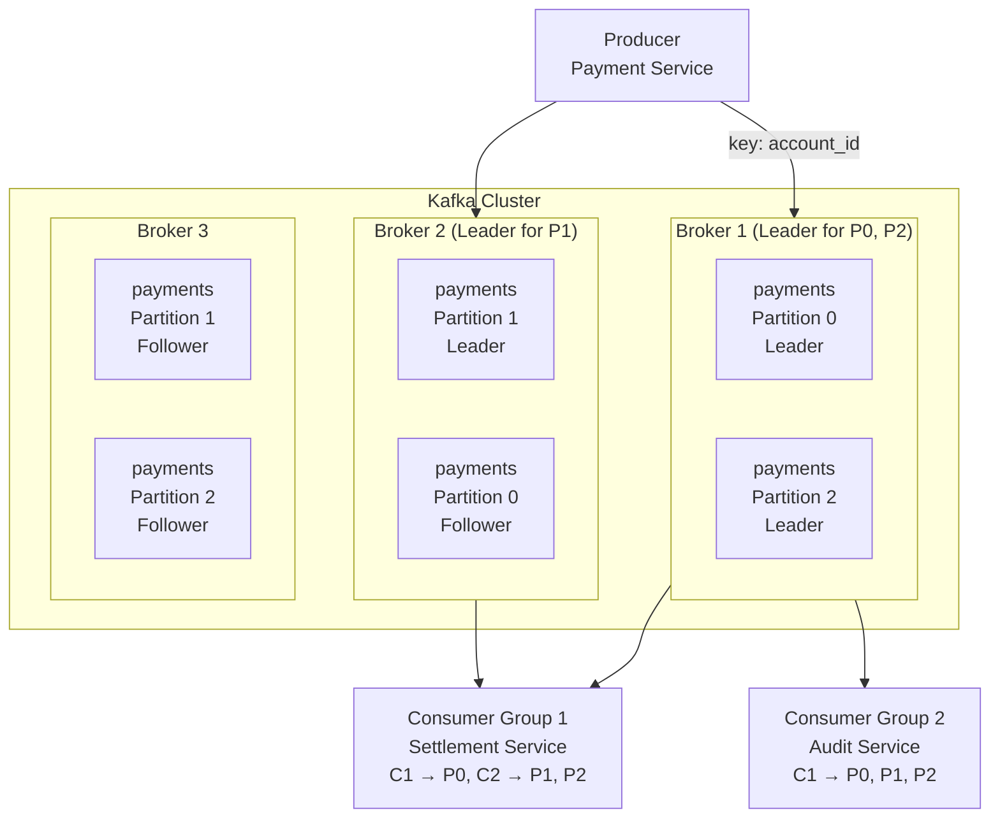
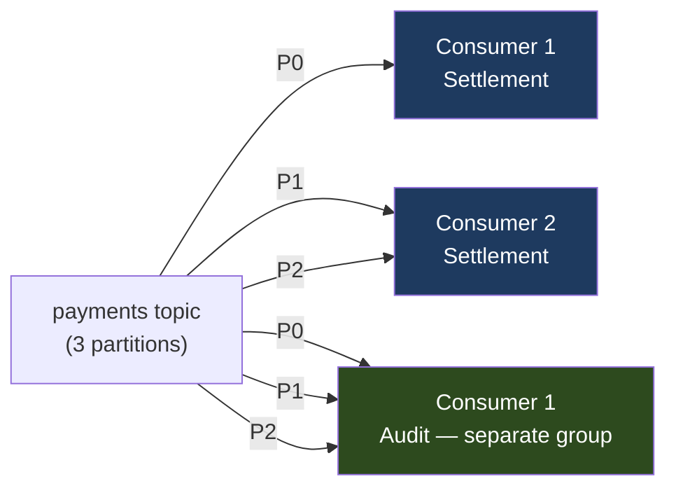
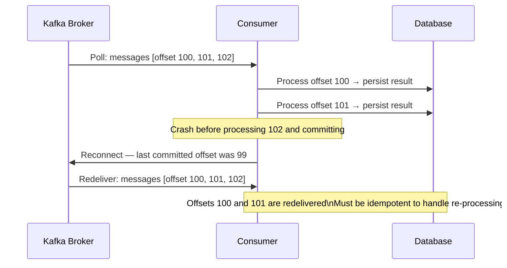

# Kafka Architecture — Topics, Partitions, and Consumer Groups

> [!NOTE]
> Apache Kafka is the dominant messaging platform in financial services — not because it's simple, but because it provides the combination of durability, throughput, and replay capability that event-driven financial systems require. This lesson builds the architectural mental model needed to use Kafka correctly.

## Why Kafka Exists — The Problem It Solves

Traditional message queues (RabbitMQ, ActiveMQ) delete messages after consumption. This creates a fundamental problem for financial systems:

- **Replay** — if a consumer has a bug, you cannot re-process historical events
- **Multiple consumers** — adding a new service (analytics, compliance) requires a separate queue copy
- **Throughput** — queue-based systems struggle beyond ~100k messages/second
- **Ordering** — delivery ordering guarantees conflict with high availability

Kafka solves these by being a **distributed, partitioned, replicated commit log**. Messages are written to a persistent log. Consumers read from the log at their own pace. The log is not deleted after consumption — it is retained for a configurable period.

---

## Core Architecture



### Topics — The Logical Channel

A **topic** is a named, ordered sequence of records. Topics are durable — records are retained regardless of whether they have been consumed.

```
Topic: payments
  Partition 0: [event1] [event2] [event3] [event4] ...
  Partition 1: [event5] [event6] [event7] ...
  Partition 2: [event8] [event9] ...
```

Each record in a partition has a **monotonically increasing offset** — the position within that partition's log.

### Partitions — Parallelism and Ordering

Partitions are the unit of:
- **Parallelism** — consumers process partitions concurrently
- **Ordering** — ordering is guaranteed within a partition, not across partitions

**Partition selection** determines which partition a message goes to:
```java
// Explicit key — messages with the same key always go to the same partition
// This guarantees ordering for a given account
ProducerRecord<String, PaymentEvent> record = new ProducerRecord<>(
    "payments",
    payment.getAccountId(),   // partition key — all events for this account go to same partition
    paymentEvent
);

// Round-robin (no key) — maximises throughput, no ordering guarantee
ProducerRecord<String, PaymentEvent> record = new ProducerRecord<>(
    "payments",
    null,                     // no key — round-robin across partitions
    paymentEvent
);
```

**Choosing partition count** is a critical design decision:

| Factor | Recommendation |
|---|---|
| Consumer parallelism | Partitions ≥ max consumers in group |
| Throughput | Each partition handles ~10-100 MB/s; size for 3-5x headroom |
| Ordering requirement | Key-based routing; order only guaranteed within a partition |
| Rebalance frequency | More partitions = longer rebalance |

For a financial payments topic expecting 1M events/day peak: 12-24 partitions is typical.

### Replication — Durability and High Availability

Each partition has one **leader** (handles all reads and writes) and multiple **followers** (replicate from leader).

```
Replication factor = 3 (minimum for production financial systems)
min.insync.replicas = 2 (at least 2 replicas must acknowledge a write)
acks = all (producer waits for all in-sync replicas)

This configuration: withstands loss of 1 broker without data loss or availability impact
```

```java
// Producer configuration for financial-grade durability
Properties props = new Properties();
props.put(ProducerConfig.BOOTSTRAP_SERVERS_CONFIG, kafkaBrokers);
props.put(ProducerConfig.ACKS_CONFIG, "all");                     // all ISR must acknowledge
props.put(ProducerConfig.RETRIES_CONFIG, Integer.MAX_VALUE);      // retry forever
props.put(ProducerConfig.ENABLE_IDEMPOTENCE_CONFIG, true);        // exactly-once semantics
props.put(ProducerConfig.MAX_IN_FLIGHT_REQUESTS_PER_CONNECTION, 5); // idempotent: safe to have 5
props.put(ProducerConfig.DELIVERY_TIMEOUT_MS_CONFIG, 120_000);    // 2 minutes total delivery timeout
props.put(ProducerConfig.REQUEST_TIMEOUT_MS_CONFIG, 30_000);      // 30 seconds per request attempt
```

---

## Consumer Groups — Parallel Processing

A **consumer group** is a set of consumers that jointly consume a topic. Each partition is assigned to exactly one consumer within the group.



**Key properties:**
- Consumer groups are independent — adding an audit group doesn't affect the settlement group
- If consumers < partitions: some consumers process multiple partitions
- If consumers > partitions: extra consumers are idle (they receive no partitions)
- If a consumer crashes: Kafka **rebalances** — reassigns that consumer's partitions to remaining consumers

### Consumer Configuration for Financial Systems

```java
Properties props = new Properties();
props.put(ConsumerConfig.BOOTSTRAP_SERVERS_CONFIG, kafkaBrokers);
props.put(ConsumerConfig.GROUP_ID_CONFIG, "settlement-service");
props.put(ConsumerConfig.AUTO_OFFSET_RESET_CONFIG, "earliest");   // start from beginning if no offset
props.put(ConsumerConfig.ENABLE_AUTO_COMMIT_CONFIG, false);       // NEVER auto-commit in finance
props.put(ConsumerConfig.MAX_POLL_RECORDS_CONFIG, 100);           // process 100 records per poll
props.put(ConsumerConfig.MAX_POLL_INTERVAL_MS_CONFIG, 300_000);   // 5 min max between polls
props.put(ConsumerConfig.SESSION_TIMEOUT_MS_CONFIG, 30_000);      // 30s to detect consumer failure
props.put(ConsumerConfig.HEARTBEAT_INTERVAL_MS_CONFIG, 10_000);   // heartbeat every 10s

KafkaConsumer<String, PaymentEvent> consumer = new KafkaConsumer<>(props, 
    new StringDeserializer(), 
    new JsonDeserializer<>(PaymentEvent.class));
```

> [!WARNING]
> **Never use `enable.auto.commit=true` in financial systems.** Auto-commit advances the offset on a timer, regardless of whether processing succeeded. This can cause silent data loss: the offset advances, the process crashes before persisting the result, and the message is never processed.

### Manual Offset Commit Pattern

```java
// Commit only after successful processing — at-least-once delivery
@KafkaListener(topics = "payments", groupId = "settlement-service",
               containerFactory = "manualAckKafkaListenerContainerFactory")
public void processPayment(ConsumerRecord<String, PaymentEvent> record,
                           Acknowledgment ack) {
    try {
        // Process the payment
        settlementService.processPayment(record.value());
        
        // Only commit offset after successful processing
        ack.acknowledge();
        
    } catch (TransientException e) {
        // Transient failure (DB timeout, etc.) — do not commit
        // Kafka will redeliver this message after session timeout
        log.warn("Transient failure processing payment {}, will retry", 
            record.value().getId(), e);
        // Do NOT call ack.acknowledge()
        
    } catch (PermanentException e) {
        // Permanent failure (invalid message) — commit offset but send to DLQ
        deadLetterQueueService.send("payments.dlq", record, e);
        ack.acknowledge();  // advance past the bad message
    }
}
```

---

## The Offset Model — Exactly-Once vs At-Least-Once

Understanding offset management is critical to achieving your desired delivery semantics.



**At-Least-Once** (manual commit after processing): messages may be redelivered. Processing must be **idempotent** — safe to execute multiple times.

**Exactly-Once** (Kafka transactions): consume, process, and produce in a single atomic transaction. More complex but eliminates duplicates.

```java
// Exactly-once: consume from input topic, produce to output topic atomically
consumer.subscribe(List.of("payment-instructions"));

while (true) {
    ConsumerRecords<String, PaymentInstruction> records = consumer.poll(Duration.ofMillis(100));
    
    producer.beginTransaction();
    try {
        for (ConsumerRecord<String, PaymentInstruction> record : records) {
            PaymentResult result = processPayment(record.value());
            
            // Produce result to output topic
            producer.send(new ProducerRecord<>("payment-results", 
                record.key(), result));
        }
        
        // Commit offsets AND output messages in a single atomic transaction
        Map<TopicPartition, OffsetAndMetadata> offsets = calculateOffsets(records);
        producer.sendOffsetsToTransaction(offsets, consumer.groupMetadata());
        producer.commitTransaction();
        
    } catch (Exception e) {
        producer.abortTransaction();  // rolls back both output messages and offset commit
    }
}
```

---

## Topic Design for Financial Events

### Event Naming Conventions

```
Domain events (immutable facts):
  payments.submitted        — payment submitted by customer
  payments.authorised       — payment authorisation decision made  
  payments.settled          — settlement confirmed
  payments.failed           — payment permanently failed

Command topics (instructions):
  payment-commands          — instructions to process payments
  
Internal state topics (compacted):
  account-balances          — latest balance per account (log-compacted)
```

### Log Compaction for State Topics

Log compaction retains only the latest record per key. Use for state topics where you only need the current value:

```java
// Topic configuration: account balances (compacted — keep only latest per account)
Map<String, String> accountBalancesConfig = Map.of(
    "cleanup.policy",     "compact",
    "min.cleanable.dirty.ratio", "0.1",
    "segment.ms",         String.valueOf(Duration.ofHours(24).toMillis()),
    "delete.retention.ms", String.valueOf(Duration.ofHours(1).toMillis())
);

// Sending a compacted message: same key = later message replaces earlier
producer.send(new ProducerRecord<>(
    "account-balances",
    accountId.toString(),              // partition and compaction key
    new AccountBalance(accountId, newBalance, Instant.now())
));
```

<!-- KNOWLEDGE-CHECK
{
  "questions": [
    {
      "id": "q1",
      "text": "A payments topic has 6 partitions. The settlement consumer group has 8 consumers. What happens?",
      "options": [
        "Error — Kafka requires consumer count ≤ partition count",
        "All 8 consumers are assigned partitions (each partition gets multiple consumers)",
        "6 consumers are assigned one partition each; 2 consumers are idle",
        "Kafka automatically creates 2 more partitions to match consumer count"
      ],
      "correct": 2,
      "explanation": "Each partition can only be assigned to ONE consumer within a group. With 6 partitions and 8 consumers, 6 consumers each get one partition and 2 consumers receive no partitions (idle). This is not an error — the idle consumers act as standby and receive partitions if another consumer fails."
    },
    {
      "id": "q2",
      "text": "Payment events for Account A must be processed in order. How should you configure the Kafka producer?",
      "options": [
        "Set acks=all and replication-factor=3",
        "Use Account A's ID as the message key — Kafka routes all messages with the same key to the same partition, guaranteeing partition-level ordering",
        "Use a single-partition topic for all payment events",
        "Set max.in.flight.requests.per.connection=1"
      ],
      "correct": 1,
      "explanation": "Kafka guarantees ordering within a partition. By using the account ID as the message key, the hash-based partitioner routes all events for that account to the same partition, guaranteeing they are delivered to consumers in order. A single-partition topic would work but eliminates all parallelism."
    },
    {
      "id": "q3",
      "text": "Why is `enable.auto.commit=true` dangerous for financial Kafka consumers?",
      "options": [
        "Auto-commit causes messages to be delivered twice",
        "Auto-commit advances the offset on a timer regardless of processing success — if the consumer crashes after auto-commit but before persisting the result, the message is permanently skipped",
        "Auto-commit reduces consumer throughput by 50%",
        "Auto-commit is incompatible with Avro serialisation"
      ],
      "correct": 1,
      "explanation": "Auto-commit advances the offset every `auto.commit.interval.ms` (default 5 seconds), independent of whether processing succeeded. If a payment is polled at T=0, auto-committed at T=5, and the consumer crashes at T=4 before persisting the payment result, the offset is committed (advanced) and the payment is never reprocessed — it is silently lost."
    },
    {
      "id": "q4",
      "text": "You are consuming payment events at-least-once. The same payment arrives twice (duplicate delivery after a consumer crash). How must your payment processing be designed?",
      "options": [
        "The consumer should check the offset to detect duplicates",
        "Payment processing must be idempotent — processing the same payment event twice must have the same effect as processing it once (use payment ID as idempotency key)",
        "Duplicates are impossible with acks=all configuration",
        "Use a single consumer with no consumer group to prevent rebalancing"
      ],
      "correct": 1,
      "explanation": "At-least-once delivery inherently allows redelivery. The only safe approach is idempotent processing: check if the payment ID has already been processed before executing the payment. This can be done with a database UNIQUE constraint on the payment ID or an idempotency key store with a TTL."
    }
  ]
}
-->

<!-- PRACTICAL-CHALLENGE
{
  "title": "Kafka Architecture \u2014 Topics, Partitions, and Consumer Groups \u2014 Production Implementation",
  "difficulty": "advanced",
  "estimatedMinutes": 90,
  "tasks": [
    {
      "id": "1",
      "description": "Calculate partition count"
    },
    {
      "id": "2",
      "description": "Write the topic creation command"
    },
    {
      "id": "3",
      "description": "Write the producer configuration"
    },
    {
      "id": "4",
      "description": "Design the consumer group strategy"
    }
  ]
}
-->
