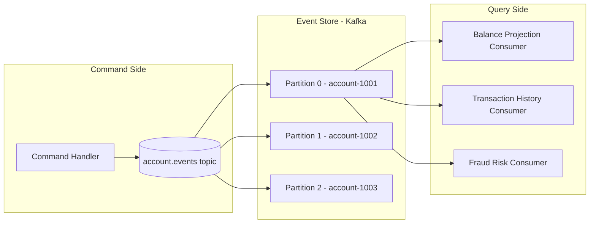

# Event Sourcing with Kafka — Event Store Architecture

Traditional systems store the current state of an entity — the account balance is 4,250.00. Event sourcing stores the facts that led to that state — deposit 1,000, withdraw 500, receive transfer 3,750. This distinction is fundamental in financial systems where the audit trail is not a secondary concern but the primary record. This lesson covers how Kafka implements event sourcing for payment aggregates, including snapshot strategies, replay mechanics, and projection consumers.

---

## 1. Event Sourcing Fundamentals

The core principle: **store facts, not state**. State is derived by replaying facts.

```
Traditional:   Account { balance: 4250.00 }

Event-Sourced: AccountCreated { accountId: 1001, initialBalance: 0 }
               MoneyDeposited { accountId: 1001, amount: 1000.00 }
               MoneyWithdrawn  { accountId: 1001, amount: 500.00 }
               TransferReceived { accountId: 1001, amount: 3750.00 }
               -- replay → balance = 0 + 1000 - 500 + 3750 = 4250.00
```

Benefits for fintech:
- Complete audit trail built into the data model (regulatory requirement)
- Temporal queries: "what was the balance on 2023-12-31?" — seek to that timestamp and replay
- Event replay for bug fixes: fix the projection logic and rebuild the read model
- Decoupled write and read models (CQRS)

Costs:
- Event replay can be slow without snapshots
- Schema evolution requires upcasters
- Eventual consistency for read models

---

## 2. Kafka as an Event Store

Kafka's append-only, immutable log aligns naturally with event sourcing. The key design decisions:

| Design Decision | Recommendation | Rationale |
|---|---|---|
| Topic per aggregate type | `account.events`, `payment.events` | Enables independent retention and compaction per aggregate |
| Partition key | `aggregateId` | Preserves ordering per aggregate; all events for account-1001 go to the same partition |
| Retention | Unlimited (or very long) | Events are the source of truth — delete only after full snapshot |
| Log compaction | Enabled on snapshot topic, not event topic | Compaction on the event topic would delete history |
| Message format | Avro or Protobuf with schema registry | Schema evolution support |



### Topic Configuration

```bash
# Create the event store topic
# Retention: 10 years for regulatory compliance
# Compaction: disabled — keep all events, not just latest per key
kafka-topics.sh --create \
  --topic account.events \
  --partitions 32 \
  --replication-factor 3 \
  --config retention.ms=315360000000 \
  --config cleanup.policy=delete \
  --config min.insync.replicas=2 \
  --bootstrap-server kafka:9092

# Snapshot topic: compacted — only the latest snapshot per aggregate
kafka-topics.sh --create \
  --topic account.snapshots \
  --partitions 32 \
  --replication-factor 3 \
  --config cleanup.policy=compact \
  --config min.insync.replicas=2 \
  --bootstrap-server kafka:9092
```

---

## 3. Appending Events — ProducerRecord with Headers

Events carry metadata via Kafka headers: aggregate version, correlation ID, causation ID, and event type.

```java
public class AccountEventStore {

    private static final String TOPIC = "account.events";
    private final KafkaProducer<String, byte[]> producer;
    private final SchemaRegistryClient schemaRegistry;

    public void append(AccountEvent event, EventMetadata metadata) {
        byte[] serializedEvent = serialize(event);  // Avro serialization

        ProducerRecord<String, byte[]> record = new ProducerRecord<>(
            TOPIC,
            null,              // let Kafka assign partition based on key hash
            event.getAggregateId().toString(),  // key = aggregateId
            serializedEvent
        );

        // Headers carry metadata without inflating the event payload
        record.headers()
            .add("eventType",      event.getClass().getSimpleName().getBytes())
            .add("aggregateType",  "Account".getBytes())
            .add("aggregateVersion", String.valueOf(metadata.getVersion()).getBytes())
            .add("correlationId",  metadata.getCorrelationId().getBytes())
            .add("causationId",    metadata.getCausationId().getBytes())
            .add("schemaVersion",  "1".getBytes());

        try {
            RecordMetadata rm = producer.send(record).get();
            log.info("Event appended: {} offset={} partition={}",
                     event.getClass().getSimpleName(), rm.offset(), rm.partition());
        } catch (ExecutionException e) {
            throw new EventStoreException("Failed to append event", e.getCause());
        }
    }
}
```

### Account Aggregate with Version Control

```java
@Value
public class AccountAggregate {
    UUID accountId;
    BigDecimal balance;
    AccountStatus status;
    int version;

    public static AccountAggregate empty(UUID accountId) {
        return new AccountAggregate(accountId, BigDecimal.ZERO,
                                    AccountStatus.PENDING, 0);
    }

    public AccountAggregate apply(AccountEvent event) {
        return switch (event) {
            case AccountCreated e   -> new AccountAggregate(
                accountId, e.getInitialBalance(), AccountStatus.ACTIVE, version + 1);
            case MoneyDeposited e   -> new AccountAggregate(
                accountId, balance.add(e.getAmount()), status, version + 1);
            case MoneyWithdrawn e   -> new AccountAggregate(
                accountId, balance.subtract(e.getAmount()), status, version + 1);
            case AccountSuspended e -> new AccountAggregate(
                accountId, balance, AccountStatus.SUSPENDED, version + 1);
            default -> throw new UnknownEventException(event.getClass().getSimpleName());
        };
    }
}
```

---

## 4. Replaying Events from a Kafka Topic

```java
public class AccountEventReplay {

    private final KafkaConsumer<String, byte[]> replayConsumer;
    private final String eventTopic = "account.events";

    public AccountAggregate replay(UUID accountId) {
        // Assign the specific partition for this accountId
        int partition = computePartition(accountId, 32);
        TopicPartition tp = new TopicPartition(eventTopic, partition);

        replayConsumer.assign(List.of(tp));
        replayConsumer.seekToBeginning(List.of(tp));

        AccountAggregate aggregate = AccountAggregate.empty(accountId);
        boolean finished = false;

        while (!finished) {
            ConsumerRecords<String, byte[]> records =
                replayConsumer.poll(Duration.ofMillis(500));

            if (records.isEmpty()) {
                finished = true;
                break;
            }

            for (ConsumerRecord<String, byte[]> record : records) {
                // Filter: only events for this specific account
                if (!record.key().equals(accountId.toString())) continue;

                AccountEvent event = deserialize(record.value(), record.headers());
                aggregate = aggregate.apply(event);
            }
        }

        return aggregate;
    }

    // Seek to a specific point in time for temporal queries
    public AccountAggregate replayUntil(UUID accountId, Instant asOf) {
        int partition = computePartition(accountId, 32);
        TopicPartition tp = new TopicPartition(eventTopic, partition);

        replayConsumer.assign(List.of(tp));
        replayConsumer.seekToBeginning(List.of(tp));

        // Find the offset for the given timestamp
        Map<TopicPartition, Long> timestampMap = Map.of(tp, asOf.toEpochMilli());
        Map<TopicPartition, OffsetAndTimestamp> offsetsForTimes =
            replayConsumer.offsetsForTimes(timestampMap);

        OffsetAndTimestamp offsetAndTimestamp = offsetsForTimes.get(tp);
        if (offsetAndTimestamp != null) {
            replayConsumer.seek(tp, offsetAndTimestamp.offset());
        }

        // ... replay from beginning up to this offset
        return replayFromBeginningUpTo(accountId, tp, offsetAndTimestamp);
    }
}
```

---

## 5. Snapshot Strategy

Full replay from the beginning becomes expensive as event counts grow. Snapshots store aggregate state every N events.

```java
public class SnapshotStrategy {

    private static final int SNAPSHOT_THRESHOLD = 100;
    private static final String SNAPSHOT_TOPIC = "account.snapshots";

    private final AccountEventStore eventStore;
    private final KafkaProducer<String, byte[]> snapshotProducer;

    public AccountAggregate loadWithSnapshot(UUID accountId) {
        // 1. Try to load latest snapshot from compacted topic
        AccountSnapshot latestSnapshot = loadLatestSnapshot(accountId);

        if (latestSnapshot == null) {
            // No snapshot — full replay
            return eventStore.replay(accountId);
        }

        // 2. Replay only events after the snapshot version (delta replay)
        return eventStore.replayFromVersion(accountId, latestSnapshot.getVersion(),
                                            latestSnapshot.toAggregate());
    }

    public void maybeSnapshot(AccountAggregate aggregate, long kafkaOffset) {
        // Write a snapshot every 100 events
        if (aggregate.getVersion() % SNAPSHOT_THRESHOLD == 0) {
            writeSnapshot(aggregate, kafkaOffset);
        }
    }

    private void writeSnapshot(AccountAggregate aggregate, long eventOffset) {
        AccountSnapshot snapshot = AccountSnapshot.builder()
            .accountId(aggregate.getAccountId())
            .balance(aggregate.getBalance())
            .status(aggregate.getStatus())
            .aggregateVersion(aggregate.getVersion())
            .eventOffset(eventOffset)
            .snapshotTime(Instant.now())
            .schemaVersion(1)
            .build();

        ProducerRecord<String, byte[]> record = new ProducerRecord<>(
            SNAPSHOT_TOPIC,
            aggregate.getAccountId().toString(),
            serialize(snapshot)
        );

        snapshotProducer.send(record);
        log.info("Snapshot written for account={} at version={}",
                 aggregate.getAccountId(), aggregate.getVersion());
    }

    private AccountSnapshot loadLatestSnapshot(UUID accountId) {
        // Consumer seek to end of compacted snapshot topic
        // The latest record for this key is the most recent snapshot
        int partition = computePartition(accountId, 32);
        TopicPartition tp = new TopicPartition(SNAPSHOT_TOPIC, partition);

        try (KafkaConsumer<String, byte[]> snapshotConsumer = createConsumer()) {
            snapshotConsumer.assign(List.of(tp));
            snapshotConsumer.seekToBeginning(List.of(tp));

            AccountSnapshot latest = null;
            ConsumerRecords<String, byte[]> records;

            do {
                records = snapshotConsumer.poll(Duration.ofMillis(300));
                for (ConsumerRecord<String, byte[]> r : records) {
                    if (r.key().equals(accountId.toString())) {
                        latest = deserializeSnapshot(r.value());
                    }
                }
            } while (!records.isEmpty());

            return latest;
        }
    }
}
```

---

## 6. Projection Consumers — Rebuilding Read Models

Projection consumers subscribe to the event log and maintain read-optimised views in PostgreSQL.

```java
@Component
public class AccountBalanceProjection {

    private final JdbcTemplate jdbc;

    @KafkaListener(
        topics = "account.events",
        groupId = "projection-account-balance",
        containerFactory = "readCommittedKafkaListenerFactory"
    )
    public void project(ConsumerRecord<String, byte[]> record) {
        AccountEvent event = deserialize(record.value(), record.headers());

        switch (event) {
            case AccountCreated e -> jdbc.update(
                """
                INSERT INTO account_summary (account_id, balance, status, version, last_updated)
                VALUES (?, ?, 'ACTIVE', ?, NOW())
                ON CONFLICT (account_id) DO NOTHING
                """,
                e.getAccountId(), e.getInitialBalance(), 1);

            case MoneyDeposited e -> jdbc.update(
                """
                UPDATE account_summary
                SET    balance = balance + ?,
                       version = version + 1,
                       last_updated = NOW()
                WHERE  account_id = ?
                """,
                e.getAmount(), e.getAccountId());

            case MoneyWithdrawn e -> jdbc.update(
                """
                UPDATE account_summary
                SET    balance = balance - ?,
                       version = version + 1,
                       last_updated = NOW()
                WHERE  account_id = ?
                """,
                e.getAmount(), e.getAccountId());

            default -> log.debug("Event type not handled by balance projection: {}",
                                  event.getClass().getSimpleName());
        }
    }
}
```

### Rebuilding a Projection

When the projection logic has a bug or the schema changes, you can rebuild by replaying all events:

```java
@Component
public class ProjectionRebuildService {

    private final KafkaAdmin kafkaAdmin;
    private final JdbcTemplate jdbc;

    public void rebuildAccountSummary() {
        log.warn("Starting full projection rebuild for account_summary");

        // 1. Truncate the read model (do this during a maintenance window
        //    or use a shadow table approach for zero-downtime rebuild)
        jdbc.execute("TRUNCATE TABLE account_summary");

        // 2. Reset the consumer group offset to earliest
        // This causes all partitions to be replayed from offset 0
        Map<TopicPartition, RecordsToDelete> recordsToDelete = new HashMap<>();
        AdminClient adminClient = AdminClient.create(adminProps());

        Map<TopicPartition, OffsetSpec> offsetSpec = new HashMap<>();
        // For all partitions in account.events, seek to earliest
        for (int i = 0; i < 32; i++) {
            offsetSpec.put(new TopicPartition("account.events", i),
                           OffsetSpec.earliest());
        }

        // Reset by altering consumer group offsets
        Map<TopicPartition, OffsetAndMetadata> resetOffsets = new HashMap<>();
        for (int i = 0; i < 32; i++) {
            resetOffsets.put(new TopicPartition("account.events", i),
                             new OffsetAndMetadata(0));
        }

        adminClient.alterConsumerGroupOffsets(
            "projection-account-balance", resetOffsets);

        log.info("Consumer group offset reset — projection will rebuild on next start");
        // 3. Restart the consumer service to trigger replay
    }
}
```

---

## 7. EventStoreDB vs Kafka vs PostgreSQL

| Feature | EventStoreDB | Kafka | PostgreSQL (append-only) |
|---|---|---|---|
| Native event sourcing support | Yes (built-in streams, subscriptions) | No (can be adapted) | No (can be adapted) |
| Ordering guarantee | Per stream, global for small clusters | Per partition per key | Per table insert order |
| Snapshot support | Native projections | Manual (compacted topic) | Manual (snapshot table) |
| Temporal queries | Built-in by stream position | Via `offsetsForTimes` | Via `created_at` index |
| Throughput | Medium (single-node bottleneck) | Very high (horizontal scale) | Medium (write-intensive) |
| Consumer model | Push (subscriptions) | Pull (consumer groups) | Polling / LISTEN/NOTIFY |
| Schema registry | None built-in | Confluent/Apicurio | None |
| Operational complexity | Low | High | Low |
| Use case fit | Domain event sourcing | High-throughput streaming | Simple audit log |

---

## 8. Temporal Queries — Balance on a Past Date

```java
public BigDecimal getBalanceAsOf(UUID accountId, LocalDate date) {
    Instant asOf = date.plusDays(1).atStartOfDay(ZoneOffset.UTC).toInstant();

    int partition = computePartition(accountId, 32);
    TopicPartition tp = new TopicPartition("account.events", partition);

    try (KafkaConsumer<String, byte[]> consumer = createReplayConsumer()) {
        consumer.assign(List.of(tp));

        // Find the offset just before midnight on the target date
        Map<TopicPartition, OffsetAndTimestamp> offsets =
            consumer.offsetsForTimes(Map.of(tp, asOf.toEpochMilli()));

        OffsetAndTimestamp boundary = offsets.get(tp);
        long maxOffset = (boundary != null)
            ? boundary.offset()
            : Long.MAX_VALUE;

        consumer.seekToBeginning(List.of(tp));

        AccountAggregate aggregate = AccountAggregate.empty(accountId);

        outer:
        while (true) {
            ConsumerRecords<String, byte[]> records =
                consumer.poll(Duration.ofMillis(500));
            if (records.isEmpty()) break;

            for (ConsumerRecord<String, byte[]> r : records) {
                if (r.offset() >= maxOffset) break outer;
                if (!r.key().equals(accountId.toString())) continue;
                aggregate = aggregate.apply(
                    deserialize(r.value(), r.headers()));
            }
        }

        return aggregate.getBalance();
    }
}
```

---

## 9. Saga Events — Each Step Appends

In a saga, each compensation or completion step appends an event to the saga's stream:

```java
// Each saga step appends an event to the saga topic
public class PaymentSagaEventStore {

    public void appendSagaEvent(UUID sagaId, SagaEvent event) {
        ProducerRecord<String, byte[]> record = new ProducerRecord<>(
            "payment.saga.events",
            sagaId.toString(),       // key = sagaId for ordering
            serialize(event)
        );
        record.headers()
            .add("sagaStepId",   event.getStepId().getBytes())
            .add("sagaStepType", event.getStepType().name().getBytes());

        producer.send(record);
    }

    public PaymentSagaState replaySaga(UUID sagaId) {
        // Seek to partition for sagaId, replay all events
        // Derive current saga state from event sequence
        return replayFromBeginning(sagaId);
    }
}
```

---

## 10. Production Pitfalls

### Pitfall 1 — Using Kafka Offsets as Sequence Numbers

A team uses the Kafka offset as the event version number. When a partition rebalance or reassignment occurs, offsets reset or diverge, breaking the version-based optimistic locking.

```java
// BAD: using Kafka offset as aggregate version
public void handleRecord(ConsumerRecord<String, byte[]> record) {
    AccountEvent event = deserialize(record.value());
    // WRONG: offset is per-partition, not per-aggregate
    // After partition rebalance, offset can be non-consecutive for a given aggregate
    long version = record.offset();  // DO NOT USE AS VERSION
    aggregateRepository.save(aggregate, version);
}

// GOOD: embed the version in the event payload itself
// Version is managed by the application, not Kafka
public void appendEvent(UUID aggregateId, AccountEvent event, int expectedVersion) {
    // Optimistic concurrency: check that the aggregate version matches
    // before appending the new event
    event.setVersion(expectedVersion + 1);
    event.setAggregateId(aggregateId);

    ProducerRecord<String, byte[]> record = new ProducerRecord<>(
        "account.events",
        aggregateId.toString(),
        serialize(event)
    );
    // Version is in the event payload and headers, not the Kafka offset
    record.headers().add("aggregateVersion",
                         String.valueOf(event.getVersion()).getBytes());
    producer.send(record);
}
```

### Pitfall 2 — Log Compaction Deleting Events Needed for Temporal Queries

A team enables `cleanup.policy=compact` on the `account.events` topic to save storage. Compaction keeps only the latest event per key, destroying the event history. Temporal queries ("balance on date X") become impossible.

```bash
# BAD: compaction on the event store topic destroys event history
kafka-configs.sh --alter \
  --topic account.events \
  --add-config cleanup.policy=compact \
  --bootstrap-server kafka:9092
# This keeps only the last event per accountId!
# All intermediate events (deposits, withdrawals) are deleted.

# GOOD: use delete retention on event topic, compact only snapshot topic
kafka-configs.sh --alter \
  --topic account.events \
  --add-config "cleanup.policy=delete,retention.ms=315360000000" \
  --bootstrap-server kafka:9092

kafka-configs.sh --alter \
  --topic account.snapshots \
  --add-config "cleanup.policy=compact" \
  --bootstrap-server kafka:9092
# Snapshots: only latest per aggregate → compaction is correct here
```

### Pitfall 3 — Snapshot Not Versioned — Breaks on Schema Change

A team stores snapshots as plain JSON without a schema version. When the `AccountAggregate` adds a new field (`creditLimit`), old snapshots cannot be deserialized, and the system crashes during replay.

```java
// BAD: snapshot without schema version
public class AccountSnapshot {
    private UUID accountId;
    private BigDecimal balance;
    private String status;
    // No schemaVersion field — deserialization fails when AccountSnapshot changes
}

// GOOD: snapshot with schema version and migration logic
public class AccountSnapshot {
    private int schemaVersion;    // MUST be first field, always present
    private UUID accountId;
    private BigDecimal balance;
    private String status;
    private BigDecimal creditLimit;   // new field in schema version 2

    public AccountAggregate toAggregate() {
        // Handle migration from old schema versions
        return switch (schemaVersion) {
            case 1 -> new AccountAggregate(
                accountId, balance, AccountStatus.valueOf(status),
                BigDecimal.ZERO,   // creditLimit defaults to 0 for old snapshots
                0);
            case 2 -> new AccountAggregate(
                accountId, balance, AccountStatus.valueOf(status),
                creditLimit, 0);
            default -> throw new UnknownSnapshotVersionException(schemaVersion);
        };
    }
}
```

---

## 11. Event Sourcing with Kafka Checklist

- [ ] Use topic-per-aggregate-type with key=aggregateId for partition ordering
- [ ] Set `cleanup.policy=delete` on event topics — never compact event history
- [ ] Use `cleanup.policy=compact` on snapshot topics only
- [ ] Embed schema version in every event and snapshot payload
- [ ] Never use Kafka offsets as aggregate version numbers — use application-managed versions
- [ ] Write snapshots every N events to bound replay time
- [ ] Include snapshot schema version and write migration logic in `toAggregate()`
- [ ] Use `offsetsForTimes` for temporal queries — test it in staging
- [ ] Set unlimited (or very long) retention on event topics for regulatory compliance
- [ ] Test projection rebuild: truncate read model, reset offset, restart consumer
- [ ] Monitor event replay latency — alert if rebuild time exceeds SLA
- [ ] Implement optimistic concurrency at append time using aggregate version

---

<!-- KNOWLEDGE-CHECK
{"questions":[{"text":"Why should cleanup.policy=compact NOT be set on the account.events Kafka topic in an event-sourced system?","options":["Compaction increases storage costs significantly","Compaction keeps only the latest record per key, destroying intermediate events needed for replay and temporal queries","Compaction is not supported on topics with more than 32 partitions","Compaction prevents consumers from reading the topic"],"correct":1,"explanation":"Log compaction retains only the most recent message per key. For an event-sourced account, the key is the accountId. Compaction would keep only the last event (e.g., the most recent withdrawal), deleting all earlier events. This makes it impossible to replay state or answer temporal queries like the balance on a specific date."},{"text":"An AccountAggregate has 1,500 events in Kafka. How does the snapshot strategy reduce replay time?","options":["It deletes old events after snapshotting","It seeks directly to the snapshot offset and replays only the delta events (e.g., events 1401-1500 after a snapshot at version 1400)","It pre-computes all projections so no replay is needed","It uses a secondary index in Kafka to skip non-matching events"],"correct":1,"explanation":"The snapshot stores the aggregate state at version 1400 (for example). On load, the system reads the snapshot (O(1) operation from the compacted snapshot topic), then replays only events 1401 through 1500 — just 100 events instead of 1500. The snapshot + delta approach bounds replay time regardless of total event count."},{"text":"A developer proposes using record.offset() as the aggregate version number to implement optimistic locking. What is the critical flaw?","options":["Kafka offsets are not sequential within a partition","Kafka offsets are global across partitions — different aggregates share the same counter","Kafka offsets are per-partition and not per-aggregate. After partition reassignment or rebalance, the offset sequence for a given aggregate is non-consecutive, breaking version-based optimistic locking","Kafka offsets are only available after the message is consumed, not at produce time"],"correct":2,"explanation":"Kafka offsets are assigned per partition and increment globally for all messages on that partition, regardless of which aggregate they belong to. If account-1001 has events at offsets 5, 12, 31, 44 (interleaved with other accounts' events), you cannot use these offsets as the aggregate's version 1, 2, 3, 4. The version must be embedded in the event payload and managed by the application."}]}
-->

<!-- PRACTICAL-CHALLENGE
{"title":"Build an Event-Sourced Account Service with Kafka","difficulty":"advanced","estimatedMinutes":75,"tasks":[{"id":"1","description":"Create an AccountAggregate class with fields (accountId, balance, status, version). Implement an apply(AccountEvent) method that handles AccountCreated, MoneyDeposited, MoneyWithdrawn, and AccountSuspended events. Write a replay() method that creates a KafkaConsumer, seeks to the beginning of the account.events partition for the given accountId, filters by key, and rebuilds the aggregate by calling apply() for each event. Write unit tests for each event type."},{"id":"2","description":"Implement the SnapshotStrategy class that writes an AccountSnapshot to the account.snapshots topic every 100 events. The snapshot must include schemaVersion=1, all aggregate fields, and the Kafka offset of the last applied event. Implement loadWithSnapshot() that first checks the compacted snapshot topic, then replays only events after the snapshot version. Verify with a test that creates 150 events and confirms only 50 events are replayed after the snapshot is written."},{"id":"3","description":"Create an AccountBalanceProjection @KafkaListener that maintains an account_summary table in PostgreSQL. The table must have columns (account_id, balance, status, version, last_updated). Handle AccountCreated with INSERT ON CONFLICT DO NOTHING, MoneyDeposited and MoneyWithdrawn with UPDATE. Implement a rebuildProjection() method that truncates the table and resets the consumer group offset to 0. Write an integration test that publishes 10 events, verifies the projection, then rebuilds and verifies again."},{"id":"4","description":"Implement a temporal query getBalanceAsOf(UUID accountId, LocalDate date) using KafkaConsumer.offsetsForTimes() to find the partition offset corresponding to midnight on the given date. Replay events from the beginning up to that offset and return the balance. Write a test that publishes events with known timestamps, calls getBalanceAsOf() for a date in the middle, and verifies the balance matches the expected value at that point in time."}]}
-->
