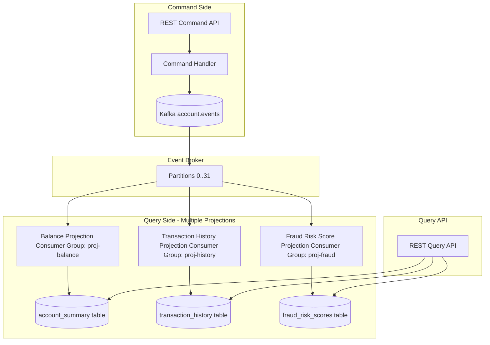

# CQRS with Kafka — Read Model Projection Strategies

Command Query Responsibility Segregation (CQRS) separates the data model used for writes from the data model used for reads. In a payment system, the write side appends events to Kafka; the read side maintains optimised PostgreSQL projections built by consuming those events. This lesson covers the full mechanics of building, monitoring, and rebuilding projections, including schema evolution and consistency tradeoffs.

---

## 1. CQRS Architecture Overview



The write side never touches the read tables. The read side never writes back to Kafka. Each projection is an independent consumer group, allowing them to evolve independently.

---

## 2. Projection Consumer — Account Balance

```java
@Component
public class AccountBalanceProjection {

    private static final Logger log = LoggerFactory.getLogger(AccountBalanceProjection.class);
    private final JdbcTemplate jdbc;

    @KafkaListener(
        topics = "account.events",
        groupId = "proj-account-balance",
        containerFactory = "readCommittedKafkaListenerContainerFactory"
    )
    @Transactional("dataSourceTransactionManager")
    public void project(ConsumerRecord<String, byte[]> record) {
        String eventType = new String(
            record.headers().lastHeader("eventType").value());

        UUID accountId = UUID.fromString(record.key());

        switch (eventType) {
            case "AccountCreated" -> {
                AccountCreated event = deserialize(record.value(), AccountCreated.class);
                jdbc.update("""
                    INSERT INTO account_summary
                        (account_id, holder_name, currency, balance, status,
                         event_offset, last_event_at)
                    VALUES (?, ?, ?, ?, 'ACTIVE', ?, NOW())
                    ON CONFLICT (account_id) DO NOTHING
                    """,
                    accountId, event.getHolderName(), event.getCurrency(),
                    event.getInitialBalance(), record.offset());
            }
            case "MoneyDeposited" -> {
                MoneyDeposited event = deserialize(record.value(), MoneyDeposited.class);
                jdbc.update("""
                    UPDATE account_summary
                    SET    balance = balance + ?,
                           event_offset = ?,
                           last_event_at = NOW()
                    WHERE  account_id = ?
                      AND  event_offset < ?
                    """,
                    event.getAmount(), record.offset(), accountId, record.offset());
            }
            case "MoneyWithdrawn" -> {
                MoneyWithdrawn event = deserialize(record.value(), MoneyWithdrawn.class);
                jdbc.update("""
                    UPDATE account_summary
                    SET    balance = balance - ?,
                           event_offset = ?,
                           last_event_at = NOW()
                    WHERE  account_id = ?
                      AND  event_offset < ?
                    """,
                    event.getAmount(), record.offset(), accountId, record.offset());
            }
            case "AccountSuspended" -> {
                jdbc.update("""
                    UPDATE account_summary
                    SET    status = 'SUSPENDED',
                           event_offset = ?,
                           last_event_at = NOW()
                    WHERE  account_id = ?
                    """,
                    record.offset(), accountId);
            }
            default -> log.debug("Event type {} not handled by balance projection", eventType);
        }
    }
}
```

The `event_offset < ?` guard in UPDATE prevents out-of-order replay from overwriting a newer state with an older one during projection rebuild.

---

## 3. Multiple Independent Projections from the Same Stream

Each projection is a separate consumer group consuming the same `account.events` topic. They are entirely independent:

```java
// Projection 1: Account Balance Summary
@KafkaListener(topics = "account.events", groupId = "proj-account-balance")
public void projectBalance(ConsumerRecord<String, byte[]> record) { /* ... */ }

// Projection 2: Transaction History (builds searchable history per account)
@KafkaListener(topics = "account.events", groupId = "proj-transaction-history")
public void projectHistory(ConsumerRecord<String, byte[]> record) {
    String eventType = new String(record.headers().lastHeader("eventType").value());

    if (Set.of("MoneyDeposited", "MoneyWithdrawn", "TransferSent",
               "TransferReceived").contains(eventType)) {
        MonetaryEvent event = deserialize(record.value(), MonetaryEvent.class);

        jdbc.update("""
            INSERT INTO transaction_history
                (event_id, account_id, event_type, amount, reference,
                 occurred_at, event_offset)
            VALUES (?, ?, ?, ?, ?, ?, ?)
            ON CONFLICT (event_id) DO NOTHING
            """,
            event.getEventId(), event.getAccountId(), eventType,
            event.getAmount(), event.getReference(),
            Instant.ofEpochMilli(record.timestamp()), record.offset());
    }
}

// Projection 3: Fraud Risk Score (rolling 30-day velocity)
@KafkaListener(topics = "account.events", groupId = "proj-fraud-risk")
public void projectFraudRisk(ConsumerRecord<String, byte[]> record) {
    String eventType = new String(record.headers().lastHeader("eventType").value());

    if ("MoneyWithdrawn".equals(eventType) || "TransferSent".equals(eventType)) {
        MonetaryEvent event = deserialize(record.value(), MonetaryEvent.class);

        jdbc.update("""
            INSERT INTO fraud_risk_velocity
                (account_id, event_id, amount, occurred_at)
            VALUES (?, ?, ?, ?)
            ON CONFLICT (event_id) DO NOTHING
            """,
            event.getAccountId(), event.getEventId(),
            event.getAmount(), Instant.ofEpochMilli(record.timestamp()));

        // Recalculate rolling velocity score
        fraudRiskCalculator.recalculate(event.getAccountId());
    }
}
```

Consumer group isolation means:
- The fraud risk projection can lag behind without affecting the balance projection
- Each projection can be rebuilt independently without affecting others
- Throughput can be scaled independently by adding instances per consumer group

---

## 4. Projection Rebuild — Full Replay

Rebuilding a projection is necessary when:
- The projection schema changes (e.g., a new column is added)
- A bug is found in the projection logic
- A new projection is introduced that needs historical data

```java
@Service
public class ProjectionRebuildService {

    private final AdminClient adminClient;
    private final JdbcTemplate jdbc;
    private final ApplicationContext ctx;

    /**
     * Rebuild a projection with zero-downtime using a shadow table approach.
     * The live table remains readable during rebuild.
     */
    public void rebuildWithShadow(String projectionName, String consumerGroupId,
                                   String topic, int partitionCount) {
        log.warn("Starting projection rebuild: {} consumer group: {}",
                 projectionName, consumerGroupId);

        // 1. Create shadow table (copy of the live table, empty)
        jdbc.execute("CREATE TABLE account_summary_shadow " +
                     "AS TABLE account_summary WITH NO DATA");

        // 2. Reset consumer group offsets to 0 (earliest) for all partitions
        Map<TopicPartition, OffsetAndMetadata> resetOffsets = new HashMap<>();
        for (int i = 0; i < partitionCount; i++) {
            resetOffsets.put(new TopicPartition(topic, i),
                             new OffsetAndMetadata(0));
        }

        // Consumer group must be stopped before resetting offsets
        adminClient.alterConsumerGroupOffsets(consumerGroupId, resetOffsets)
                   .all()
                   .get(30, TimeUnit.SECONDS);

        log.info("Consumer group offsets reset to 0 for group: {}", consumerGroupId);

        // 3. Restart the consumer service — it will replay from offset 0
        //    and populate the shadow table
        //    (In practice: rolling restart of the projection microservice
        //     with shadow table target configuration)

        // 4. When replay is complete (consumer lag reaches 0), atomically swap:
        jdbc.execute("BEGIN");
        jdbc.execute("ALTER TABLE account_summary RENAME TO account_summary_old");
        jdbc.execute("ALTER TABLE account_summary_shadow RENAME TO account_summary");
        jdbc.execute("DROP TABLE account_summary_old");
        jdbc.execute("COMMIT");

        log.info("Projection rebuild complete — shadow table promoted to live");
    }

    /**
     * Simple rebuild for non-production or small tables.
     * Causes brief unavailability of the read model.
     */
    public void rebuildSimple(String consumerGroupId, String topic,
                               int partitionCount) {
        // 1. Stop the consumer (outside this method — requires orchestration)
        // 2. Truncate the read table
        jdbc.execute("TRUNCATE TABLE account_summary");

        // 3. Reset offsets
        Map<TopicPartition, OffsetAndMetadata> resetOffsets = new HashMap<>();
        for (int i = 0; i < partitionCount; i++) {
            resetOffsets.put(new TopicPartition(topic, i),
                             new OffsetAndMetadata(0));
        }
        adminClient.alterConsumerGroupOffsets(consumerGroupId, resetOffsets)
                   .all()
                   .get(30, TimeUnit.SECONDS);

        // 4. Restart the consumer — replay from offset 0
    }
}
```

---

## 5. Monitoring Consumer Group Lag

Consumer group lag measures how far behind a projection is from the head of the topic. For payment projections, lag directly translates to data staleness in the UI.

```sql
-- Kafka consumer group lag query (via Kafka Admin API materialized into a table)
-- If you export consumer group lag to your metrics system (Prometheus/CloudWatch):
SELECT
    consumer_group,
    topic,
    partition_num,
    current_offset,
    log_end_offset,
    (log_end_offset - current_offset) AS lag,
    CASE
        WHEN (log_end_offset - current_offset) > 10000 THEN 'CRITICAL'
        WHEN (log_end_offset - current_offset) > 1000  THEN 'WARNING'
        ELSE 'OK'
    END AS lag_status
FROM kafka_consumer_lag_metrics
WHERE consumer_group LIKE 'proj-%'
ORDER BY lag DESC;
```

```java
// Programmatic lag check using AdminClient
@Component
public class ProjectionLagMonitor {

    private final AdminClient adminClient;
    private final MeterRegistry meterRegistry;

    @Scheduled(fixedDelayString = "${projection.lag.check.interval:30000}")
    public void checkLag() throws Exception {
        List<String> projectionGroups = List.of(
            "proj-account-balance",
            "proj-transaction-history",
            "proj-fraud-risk"
        );

        for (String groupId : projectionGroups) {
            Map<TopicPartition, OffsetAndMetadata> offsets =
                adminClient.listConsumerGroupOffsets(groupId)
                           .partitionsToOffsetAndMetadata()
                           .get(10, TimeUnit.SECONDS);

            // Fetch end offsets for the same partitions
            Map<TopicPartition, Long> endOffsets =
                adminClient.listOffsets(
                    offsets.keySet().stream()
                           .collect(Collectors.toMap(tp -> tp, tp -> OffsetSpec.latest()))
                ).all().get(10, TimeUnit.SECONDS)
                 .entrySet().stream()
                 .collect(Collectors.toMap(
                     Map.Entry::getKey,
                     e -> e.getValue().offset()));

            long totalLag = offsets.entrySet().stream()
                .mapToLong(e -> Math.max(0,
                    endOffsets.getOrDefault(e.getKey(), 0L)
                    - e.getValue().offset()))
                .sum();

            meterRegistry.gauge("kafka.projection.lag",
                Tags.of("group", groupId), totalLag);

            if (totalLag > 50_000) {
                log.error("Projection lag critical: group={} lag={}", groupId, totalLag);
            }
        }
    }
}
```

---

## 6. Strong vs Eventual Consistency

| Query Type | Consistency Requirement | Strategy |
|---|---|---|
| Payment authorisation (can I debit?) | Strong — must be current | Query write-side aggregate via Kafka (synchronous replay) or use a strongly-consistent write-side cache |
| Account balance for customer portal | Near-real-time (seconds) | Projection consumer with low lag target (< 5 seconds) |
| Transaction history (past 90 days) | Eventually consistent | Standard projection consumer |
| Fraud risk score | Eventually consistent (minutes) | Dedicated batch projection |
| Analytics dashboard (daily volumes) | Eventually consistent (minutes to hours) | Offline projection or data warehouse |

```java
// Payment authorisation: requires strong consistency
// Use command-side aggregate (direct replay or write-through cache)
// NOT the projection
@PostMapping("/payments/authorise")
public ResponseEntity<AuthorisationResult> authorise(@RequestBody PaymentRequest req) {
    // Load the aggregate directly — not from the projection table
    AccountAggregate account = accountEventStore.load(req.getSourceAccountId());

    if (account.getBalance().compareTo(req.getAmount()) < 0) {
        return ResponseEntity.ok(AuthorisationResult.declined("Insufficient funds"));
    }

    // ... proceed with the payment
}

// Balance for UI: use projection (eventual consistency is acceptable)
@GetMapping("/accounts/{accountId}/balance")
public ResponseEntity<BalanceResponse> getBalance(@PathVariable UUID accountId) {
    // This may be a few seconds behind the write side — acceptable for display
    AccountSummary summary = accountSummaryRepository.findById(accountId)
        .orElseThrow(() -> new AccountNotFoundException(accountId));

    return ResponseEntity.ok(new BalanceResponse(
        summary.getBalance(),
        summary.getLastEventAt(),
        "Data may be up to 5 seconds delayed"));
}
```

---

## 7. Handling Event Schema Evolution in Projections

When an event schema changes, the projection consumer must handle both the old and new schema. An upcaster converts old events to the new schema.

```java
@Component
public class AccountEventUpcaster {

    /**
     * Upcaster: MoneyDeposited v1 had no 'reference' field.
     * MoneyDeposited v2 adds a mandatory 'reference' field.
     */
    public MoneyDeposited upcast(ConsumerRecord<String, byte[]> record) {
        String schemaVersion = record.headers().lastHeader("schemaVersion") != null
            ? new String(record.headers().lastHeader("schemaVersion").value())
            : "1";

        return switch (schemaVersion) {
            case "1" -> {
                // Old event: no reference field — deserialize v1 and add default
                MoneyDepositedV1 v1 = deserializeV1(record.value());
                yield MoneyDeposited.builder()
                    .accountId(v1.getAccountId())
                    .amount(v1.getAmount())
                    .reference("LEGACY-" + v1.getEventId())  // synthetic reference
                    .eventId(v1.getEventId())
                    .build();
            }
            case "2" -> deserialize(record.value(), MoneyDeposited.class);
            default  -> throw new UnknownSchemaVersionException(schemaVersion);
        };
    }
}

// In the projection consumer, always upcast before applying:
@KafkaListener(topics = "account.events", groupId = "proj-transaction-history")
public void project(ConsumerRecord<String, byte[]> record) {
    String eventType = new String(record.headers().lastHeader("eventType").value());

    if ("MoneyDeposited".equals(eventType)) {
        MoneyDeposited event = upcaster.upcast(record);  // handles v1 and v2
        // apply to projection ...
    }
}
```

---

## 8. Payment History Projection — Full Example

```java
@Component
public class PaymentHistoryProjection {

    private final JdbcTemplate jdbc;
    private final AccountEventUpcaster upcaster;

    @KafkaListener(
        topics = "account.events",
        groupId = "proj-payment-history",
        containerFactory = "readCommittedKafkaListenerContainerFactory"
    )
    @Transactional
    public void project(ConsumerRecord<String, byte[]> record) {
        String eventType = new String(
            record.headers().lastHeader("eventType").value());

        UUID accountId = UUID.fromString(record.key());
        Instant occurredAt = Instant.ofEpochMilli(record.timestamp());

        switch (eventType) {
            case "MoneyDeposited" -> {
                MoneyDeposited event = upcaster.upcast(record);
                jdbc.update("""
                    INSERT INTO account_transactions
                        (event_id, account_id, tx_type, amount, reference,
                         direction, occurred_at, kafka_offset)
                    VALUES (?, ?, 'DEPOSIT', ?, ?, 'CREDIT', ?, ?)
                    ON CONFLICT (event_id) DO NOTHING
                    """,
                    event.getEventId(), accountId, event.getAmount(),
                    event.getReference(), occurredAt, record.offset());
            }
            case "MoneyWithdrawn" -> {
                MoneyWithdrawn event = deserialize(record.value(), MoneyWithdrawn.class);
                jdbc.update("""
                    INSERT INTO account_transactions
                        (event_id, account_id, tx_type, amount, reference,
                         direction, occurred_at, kafka_offset)
                    VALUES (?, ?, 'WITHDRAWAL', ?, ?, 'DEBIT', ?, ?)
                    ON CONFLICT (event_id) DO NOTHING
                    """,
                    event.getEventId(), accountId, event.getAmount(),
                    event.getReference(), occurredAt, record.offset());
            }
            case "TransferSent" -> {
                TransferSent event = deserialize(record.value(), TransferSent.class);
                jdbc.update("""
                    INSERT INTO account_transactions
                        (event_id, account_id, tx_type, amount, reference,
                         counterpart_account_id, direction, occurred_at, kafka_offset)
                    VALUES (?, ?, 'TRANSFER_OUT', ?, ?, ?, 'DEBIT', ?, ?)
                    ON CONFLICT (event_id) DO NOTHING
                    """,
                    event.getEventId(), accountId, event.getAmount(),
                    event.getReference(), event.getDestAccountId(),
                    occurredAt, record.offset());
            }
            default -> log.trace("Event type {} not relevant to payment history", eventType);
        }
    }
}
```

```sql
-- Supporting table with BRIN index for time-range queries
CREATE TABLE account_transactions (
    event_id              UUID          NOT NULL,
    account_id            UUID          NOT NULL,
    tx_type               VARCHAR(32)   NOT NULL,
    amount                NUMERIC(19,4) NOT NULL,
    reference             VARCHAR(255),
    counterpart_account_id UUID,
    direction             VARCHAR(8)    NOT NULL,  -- CREDIT or DEBIT
    occurred_at           TIMESTAMPTZ   NOT NULL,
    kafka_offset          BIGINT        NOT NULL,
    CONSTRAINT pk_account_transactions PRIMARY KEY (event_id)
);

CREATE INDEX idx_at_account_occurred ON account_transactions
    (account_id, occurred_at DESC);

-- Query: last 90 days of transactions for account dashboard
CREATE INDEX idx_at_occurred_brin ON account_transactions
    USING BRIN (occurred_at) WITH (pages_per_range = 128);
```

---

## 9. Production Pitfalls

### Pitfall 1 — Not Handling Projection Rebuild Atomically

A team truncates the `account_summary` table and then resets the consumer group offset. The projection is unavailable for the minutes it takes to replay. API requests return 404 during this window.

```java
// BAD: truncate first, then replay — table is empty during replay
jdbc.execute("TRUNCATE TABLE account_summary");
adminClient.alterConsumerGroupOffsets(consumerGroupId, resetOffsets).all().get();
// DURING REPLAY: all GET /accounts/{id}/balance return 404 or 0 balance
// Duration of outage: depends on replay time (can be hours for large topics)

// GOOD: shadow table approach — live table is never unavailable
// 1. Consumer writes to account_summary_rebuild during replay
// 2. When lag reaches 0, atomically rename tables in a single transaction
jdbc.execute("BEGIN");
jdbc.execute("ALTER TABLE account_summary RENAME TO account_summary_bak");
jdbc.execute("ALTER TABLE account_summary_rebuild RENAME TO account_summary");
jdbc.execute("COMMIT");
// DROP account_summary_bak after verification
// Zero downtime: the live table is accessible throughout
```

### Pitfall 2 — Too Many Consumer Groups Causing Broker Pressure

A team creates a separate consumer group for every micro-feature (12 projections, each with 3 instances, all consuming the same 32-partition topic). The broker handles 36 × 32 = 1,152 open fetch sessions simultaneously, causing elevated CPU and memory on the broker.

```java
// BAD: 12 separate consumer groups, each with 3 replicas, for a single topic
// @KafkaListener(topics = "account.events", groupId = "proj-balance")
// @KafkaListener(topics = "account.events", groupId = "proj-history")
// @KafkaListener(topics = "account.events", groupId = "proj-velocity")
// ... 9 more groups ...
// = 36 consumer instances x 32 partitions = 1152 fetch sessions on broker

// GOOD OPTION 1: multiplex event types within a single listener
// One consumer group dispatches to multiple projection handlers
@KafkaListener(topics = "account.events", groupId = "proj-combined")
public void dispatchToProjections(ConsumerRecord<String, byte[]> record) {
    String eventType = new String(record.headers().lastHeader("eventType").value());
    projectionRegistry.dispatch(eventType, record);  // fan-out to handlers
}

// GOOD OPTION 2: use topic-level filtering with separate topics per aggregate type
// and only create a consumer group where the projection genuinely needs it
// The key: audit which consumer groups are truly independent in their replay cadence
```

### Pitfall 3 — Projection with Business Logic Causing Split Brain

A team adds interest calculation logic into the balance projection consumer. The logic runs asynchronously and produces slightly different results depending on when the event is consumed, creating inconsistency between the event log and the projection.

```java
// BAD: business logic embedded in projection
@KafkaListener(topics = "account.events", groupId = "proj-balance")
public void project(ConsumerRecord<String, byte[]> record) {
    if ("MoneyDeposited".equals(eventType)) {
        MoneyDeposited event = deserialize(record.value(), MoneyDeposited.class);
        BigDecimal interestEarned = interestCalculator.calculate(
            event.getAmount(), LocalDate.now());  // depends on CURRENT date!
        jdbc.update("UPDATE account_summary SET balance = balance + ? + ? WHERE ...",
                    event.getAmount(), interestEarned);
        // Interest depends on when the projection runs — not deterministic!
        // Rebuilding the projection on a different day yields different results.
    }
}

// GOOD: projection is a pure, deterministic transformation of events
// Business logic (interest calculation) belongs in the command side;
// it produces an InterestCredited event that the projection then applies deterministically
@KafkaListener(topics = "account.events", groupId = "proj-balance")
public void project(ConsumerRecord<String, byte[]> record) {
    if ("MoneyDeposited".equals(eventType)) {
        MoneyDeposited event = deserialize(record.value(), MoneyDeposited.class);
        jdbc.update("UPDATE account_summary SET balance = balance + ? WHERE ...",
                    event.getAmount());
        // Pure: same event always produces same projection state
    }
    // Interest is handled by InterestCredited event emitted by the command side
}
```

---

## 10. CQRS with Kafka Checklist

- [ ] Each projection is a separate Kafka consumer group
- [ ] Projection consumers use `read_committed` isolation level
- [ ] All INSERT statements include `ON CONFLICT (event_id) DO NOTHING` for idempotency
- [ ] UPDATE statements include an `event_offset < ?` guard to prevent stale overwrites
- [ ] Payment authorisation queries the write-side aggregate, not the projection
- [ ] Consumer group lag is monitored and alerted (threshold: > 10,000 events lag)
- [ ] Projection rebuild uses shadow table to avoid unavailability
- [ ] Event upcasters handle all historical schema versions
- [ ] Projection logic is a pure deterministic transformation — no current-time-dependent business logic
- [ ] Number of consumer groups is reviewed — consolidate co-dependent projections
- [ ] Integration tests cover projection rebuild: publish N events, rebuild, verify same result
- [ ] Projection tables have appropriate indexes for query patterns

---

<!-- KNOWLEDGE-CHECK
{"questions":[{"text":"Why should payment authorisation (checking if sufficient funds exist) query the write-side aggregate rather than the balance projection?","options":["Projections are stored in a different database that is slower to query","The balance projection may be seconds behind the write side due to Kafka consumer lag, meaning a recently debited account could appear to have sufficient funds in the projection","Projections do not store balance information","The write-side aggregate is always faster to query than a PostgreSQL table"],"correct":1,"explanation":"Projections are updated asynchronously by a Kafka consumer. If the consumer is even one second behind, a projection-based authorisation could approve a payment for an account that was just debited by another concurrent transaction. Authorisation requires the current, strongly-consistent state from the write-side aggregate."},{"text":"A projection consumer has a bug that causes it to calculate account balances incorrectly. After fixing the bug, what is the correct procedure to get accurate projections?","options":["Deploy the fix and wait for the next event to trigger a re-calculation","Truncate the projection table, reset the consumer group offset to 0 (earliest), and restart the consumer to replay all events","Manually update the incorrect rows in the projection table","Create a database migration script that corrects the balance calculations"],"correct":1,"explanation":"Event sourcing enables exactly this scenario. Because all events are stored in Kafka, you can truncate the projection table, reset the consumer group offset to 0, and replay all events through the corrected projection logic. The result is a fully accurate projection derived deterministically from the event log."},{"text":"A projection consumer uses INSERT INTO account_transactions ... ON CONFLICT (event_id) DO NOTHING. Why is this critical for correctness?","options":["It improves query performance by avoiding duplicate index entries","It makes the projection consumer idempotent — if the same event is consumed twice (due to consumer restart before offset commit), the second application is safely ignored, preventing duplicate transaction history rows","It prevents the Kafka consumer from polling the same partition twice","It is required by the read_committed isolation level"],"correct":1,"explanation":"Kafka guarantees at-least-once delivery by default — after a consumer restart, events may be redelivered. Without ON CONFLICT DO NOTHING on the idempotency key (event_id), a redelivered MoneyDeposited event would insert a second row in account_transactions, showing a deposit twice in the customer's history. The idempotency guard makes the consumer safe to replay."}]}
-->

<!-- PRACTICAL-CHALLENGE
{"title":"Build a Multi-Projection CQRS System for Account Events","difficulty":"advanced","estimatedMinutes":70,"tasks":[{"id":"1","description":"Create three independent projection consumers for the account.events topic: (a) AccountBalanceProjection with groupId=proj-balance maintaining account_summary table, (b) PaymentHistoryProjection with groupId=proj-history maintaining account_transactions table, (c) FraudVelocityProjection with groupId=proj-fraud maintaining fraud_velocity table. Each must use read_committed isolation, ON CONFLICT DO NOTHING idempotency, and handle at least 4 event types. Write integration tests using EmbeddedKafka that publish 20 events and verify all three projections are consistent."},{"id":"2","description":"Implement a ProjectionLagMonitor that uses AdminClient to calculate consumer group lag for all three projection groups every 30 seconds. Expose the lag as a Prometheus gauge metric (kafka_projection_lag with label group). Write a test that pauses a consumer, publishes 100 events, and asserts the lag metric exceeds 100 before the consumer resumes."},{"id":"3","description":"Implement the shadow-table rebuild strategy for the AccountBalanceProjection: create account_summary_rebuild as a copy of account_summary with no data, reset consumer group offsets to 0 for proj-balance, let the consumer write to the shadow table during replay, and when lag reaches 0, atomically rename the tables in a single transaction. Write a test that verifies GET /accounts/{id}/balance returns non-empty responses throughout the rebuild."},{"id":"4","description":"Implement an AccountEventUpcaster that handles MoneyDeposited schema version 1 (no reference field) and version 2 (with reference field). The upcaster reads the schemaVersion header and returns a fully populated MoneyDeposited regardless of version. Integrate it into the PaymentHistoryProjection consumer. Write a test that publishes both v1 and v2 MoneyDeposited events and verifies both appear correctly in account_transactions with synthetic references for v1 events."}]}
-->
