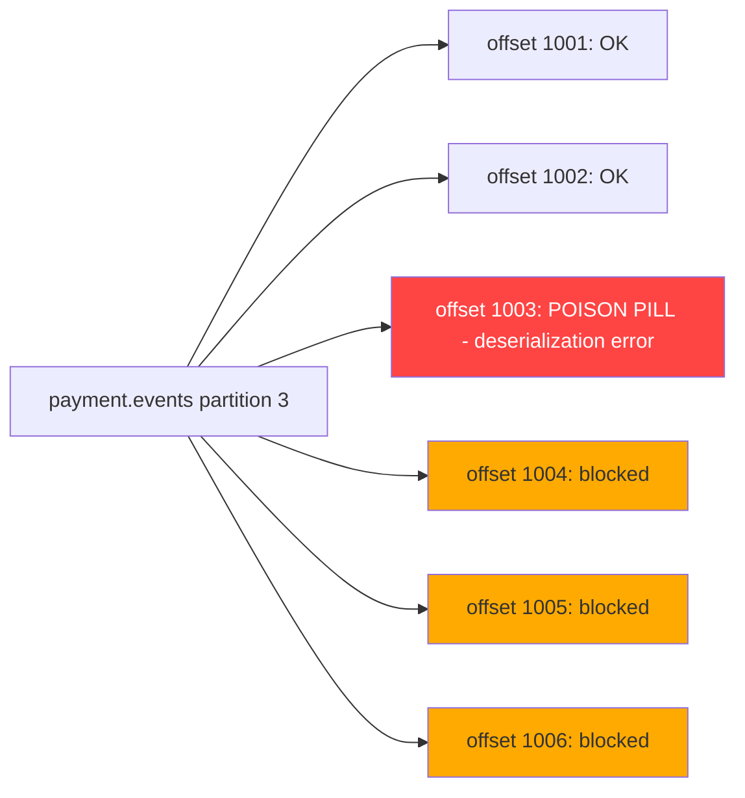

# Dead Letter Queues — Poison Pill Handling and Retry

A single malformed payment event can halt all processing for a Kafka partition. Without a dead letter queue strategy, one bad message can silently block thousands of downstream consumers. This lesson covers poison pill detection, non-blocking retry topology, failure classification, and re-driving from the DLQ.

---

## 1. The Poison Pill Problem

A poison pill is a message that causes the consumer to throw an exception every time it attempts processing. Because Kafka consumers process a partition sequentially, a poison pill at offset N blocks all processing of offsets N+1, N+2, ... for that partition.



Without DLQ handling, a consumer that retries indefinitely will:
1. Never advance past the poison pill
2. Accumulate lag for all subsequent messages on that partition
3. Potentially cause cascading failures downstream

---

## 2. DLQ Retry Topology

The non-blocking retry pattern creates dedicated retry topics with delays:

```
payment.events
    |
    +--(failure, attempt 1)--> payment.events.RETRY_0  (delay: 1s)
                                    |
                                    +--(failure, attempt 2)--> payment.events.RETRY_1  (delay: 10s)
                                                                    |
                                                                    +--(failure, attempt 3)--> payment.events.RETRY_2  (delay: 60s)
                                                                                                    |
                                                                                                    +--(still failing)--> payment.events.DLT
```

```bash
# Create the retry and dead letter topics
# Retry topics have short retention — messages are re-processed quickly or die
kafka-topics.sh --create --topic payment.events.RETRY_0 \
  --partitions 32 --replication-factor 3 \
  --config retention.ms=3600000 \
  --bootstrap-server kafka:9092

kafka-topics.sh --create --topic payment.events.RETRY_1 \
  --partitions 32 --replication-factor 3 \
  --config retention.ms=3600000 \
  --bootstrap-server kafka:9092

kafka-topics.sh --create --topic payment.events.RETRY_2 \
  --partitions 32 --replication-factor 3 \
  --config retention.ms=3600000 \
  --bootstrap-server kafka:9092

# Dead letter topic: long retention for investigation and re-driving
kafka-topics.sh --create --topic payment.events.DLT \
  --partitions 32 --replication-factor 3 \
  --config retention.ms=2592000000 \
  --bootstrap-server kafka:9092
```

---

## 3. Spring Kafka DefaultErrorHandler with Exponential Backoff

```java
@Configuration
public class KafkaConsumerConfig {

    @Bean
    public DefaultErrorHandler errorHandler(
            DeadLetterPublishingRecoverer recoverer) {

        // Exponential backoff: 1s, 2s, 4s, 8s — max 3 retries in-process
        // After in-process retries are exhausted, the message goes to RETRY_0
        ExponentialBackOffWithMaxRetries backoff =
            new ExponentialBackOffWithMaxRetries(3);
        backoff.setInitialInterval(1_000L);   // 1 second initial delay
        backoff.setMultiplier(2.0);           // double each retry
        backoff.setMaxInterval(8_000L);       // cap at 8 seconds

        DefaultErrorHandler handler = new DefaultErrorHandler(recoverer, backoff);

        // Classify non-retryable exceptions — go directly to DLT, no retry
        handler.addNotRetryableExceptions(
            DeserializationException.class,
            MessageConversionException.class,
            MethodArgumentResolutionException.class
        );

        // Retryable exceptions (default behaviour — retry with backoff)
        handler.addRetryableExceptions(
            TransientDataAccessException.class,
            ResourceAccessException.class   // network timeouts
        );

        return handler;
    }

    @Bean
    public DeadLetterPublishingRecoverer deadLetterRecoverer(
            KafkaTemplate<Object, Object> kafkaTemplate) {

        // Route failed messages to the correct retry/DLT topic
        // by default: appends -DLT to original topic name
        // We override to use the tiered retry topology
        return new DeadLetterPublishingRecoverer(kafkaTemplate,
            (record, exception) -> {
                // Determine which retry tier to use
                Integer retryCount = getRetryCount(record);

                if (exception instanceof DeserializationException
                        || exception instanceof MessageConversionException) {
                    // Non-retryable: skip retry tiers, go straight to DLT
                    return new TopicPartition(
                        record.topic() + ".DLT",
                        record.partition());
                }

                return switch (retryCount) {
                    case 0  -> new TopicPartition(record.topic() + ".RETRY_0",
                                                   record.partition());
                    case 1  -> new TopicPartition(record.topic() + ".RETRY_1",
                                                   record.partition());
                    case 2  -> new TopicPartition(record.topic() + ".RETRY_2",
                                                   record.partition());
                    default -> new TopicPartition(record.topic() + ".DLT",
                                                   record.partition());
                };
            });
    }

    private Integer getRetryCount(ConsumerRecord<?, ?> record) {
        Header retryHeader = record.headers().lastHeader("kafka_retry_count");
        if (retryHeader == null) return 0;
        return Integer.parseInt(new String(retryHeader.value()));
    }

    @Bean
    public ConcurrentKafkaListenerContainerFactory<String, String>
            kafkaListenerContainerFactory(
                ConsumerFactory<String, String> cf,
                DefaultErrorHandler errorHandler) {

        ConcurrentKafkaListenerContainerFactory<String, String> factory =
            new ConcurrentKafkaListenerContainerFactory<>();
        factory.setConsumerFactory(cf);
        factory.setCommonErrorHandler(errorHandler);
        return factory;
    }
}
```

---

## 4. Non-Blocking Retry Topics — Listener Configuration

```java
@Component
public class PaymentEventConsumer {

    private final PaymentProcessingService paymentService;
    private final KafkaTemplate<String, String> kafkaTemplate;

    // Main listener — original topic
    @KafkaListener(topics = "payment.events", groupId = "payment-processor",
                   containerFactory = "kafkaListenerContainerFactory")
    public void consume(ConsumerRecord<String, String> record) {
        processWithContext(record);
    }

    // RETRY_0 listener — consumers for retry topics run on a schedule delay
    // Spring Kafka non-blocking retry adds a header-based delay
    @KafkaListener(topics = "payment.events.RETRY_0",
                   groupId = "payment-processor-retry-0",
                   containerFactory = "kafkaListenerContainerFactory")
    public void consumeRetry0(ConsumerRecord<String, String> record) {
        // The retry consumer uses the same processing logic
        // Spring Kafka automatically enforces the delay via the timestamp header
        processWithContext(record);
    }

    @KafkaListener(topics = "payment.events.RETRY_1",
                   groupId = "payment-processor-retry-1",
                   containerFactory = "kafkaListenerContainerFactory")
    public void consumeRetry1(ConsumerRecord<String, String> record) {
        processWithContext(record);
    }

    @KafkaListener(topics = "payment.events.RETRY_2",
                   groupId = "payment-processor-retry-2",
                   containerFactory = "kafkaListenerContainerFactory")
    public void consumeRetry2(ConsumerRecord<String, String> record) {
        processWithContext(record);
    }

    // DLT handler — receives messages that exhausted all retry attempts
    @DltHandler
    public void handleDlt(ConsumerRecord<String, String> record,
                          @Header(KafkaHeaders.RECEIVED_TOPIC) String topic,
                          @Header(KafkaHeaders.EXCEPTION_MESSAGE) String exceptionMessage) {
        log.error("Message sent to DLT: topic={} partition={} offset={} key={} error={}",
                  topic, record.partition(), record.offset(), record.key(),
                  exceptionMessage);

        // Persist to database for investigation
        dltRepository.save(DltMessage.builder()
            .topic(topic)
            .partition(record.partition())
            .offset(record.offset())
            .messageKey(record.key())
            .payload(record.value())
            .errorMessage(exceptionMessage)
            .arrivedAt(Instant.now())
            .build());

        // Alert operations team
        alertingService.sendAlert(
            "DLT message received", "payment.events", record.key());
    }

    private void processWithContext(ConsumerRecord<String, String> record) {
        try {
            PaymentEvent event = objectMapper.readValue(record.value(),
                                                        PaymentEvent.class);
            paymentService.process(event);
        } catch (JsonProcessingException e) {
            // Non-retryable: schema mismatch or corrupt payload
            throw new MessageConversionException("Cannot deserialize payment event", e);
        } catch (TransientPaymentException e) {
            // Retryable: downstream service unavailable
            throw new RetryableException("Transient failure", e);
        } catch (PermanentPaymentException e) {
            // Non-retryable: business rule violation — go to DLT immediately
            throw new MessageConversionException("Permanent business failure", e);
        }
    }
}
```

---

## 5. Using Spring Kafka RetryTopicConfiguration (Auto-setup)

Spring Kafka 2.7+ provides a declarative approach:

```java
@Configuration
public class RetryTopicConfig {

    @Bean
    public RetryTopicConfiguration retryTopicConfig(
            KafkaTemplate<String, String> kafkaTemplate) {

        return RetryTopicConfigurationBuilder
            .newInstance()
            .fixedBackOff(1_000)             // 1 second between retries
            .maxAttempts(4)                  // 3 retries + 1 original = 4 total attempts
            .retryTopicSuffix("-RETRY")
            .dltSuffix("-DLT")
            .retryOn(TransientException.class)
            .notRetryOn(DeserializationException.class)
            .notRetryOn(MessageConversionException.class)
            .dltHandlerMethod("handleDlt")
            .create(kafkaTemplate);
    }
}

// With the annotation-driven approach:
@Component
public class PaymentEventConsumer {

    @RetryableTopic(
        backoff = @Backoff(delay = 1000, multiplier = 2.0, maxDelay = 60_000),
        attempts = "4",
        topicSuffixingStrategy = TopicSuffixingStrategy.SUFFIX_WITH_INDEX_VALUE,
        exclude = {DeserializationException.class, MessageConversionException.class}
    )
    @KafkaListener(topics = "payment.events", groupId = "payment-processor")
    public void consume(PaymentEvent event,
                        @Header(KafkaHeaders.RECEIVED_TOPIC) String topic) {
        paymentService.process(event);
    }

    @DltHandler
    public void handleDlt(PaymentEvent event,
                          @Header(KafkaHeaders.RECEIVED_TOPIC) String topic) {
        log.error("Payment event in DLT: {} from topic: {}",
                  event.getPaymentId(), topic);
        alertingService.sendCriticalAlert(event);
    }
}
```

---

## 6. Failure Classification — Transient vs Permanent

Correct classification prevents infinite retry loops on unrecoverable errors:

```java
public enum FailureType { TRANSIENT, PERMANENT }

public FailureType classify(Exception e) {
    // PERMANENT failures — retry is futile
    if (e instanceof DeserializationException)        return PERMANENT; // corrupt message
    if (e instanceof MessageConversionException)      return PERMANENT; // schema mismatch
    if (e instanceof ConstraintViolationException)    return PERMANENT; // invalid business data
    if (e instanceof FraudBlacklistException)         return PERMANENT; // business rule
    if (e instanceof AccountClosedException)          return PERMANENT; // business rule

    // TRANSIENT failures — retry may succeed
    if (e instanceof TransientDataAccessException)    return TRANSIENT; // DB lock timeout
    if (e instanceof ResourceAccessException)         return TRANSIENT; // HTTP timeout
    if (e instanceof RedisConnectionException)        return TRANSIENT; // cache unavailable
    if (e instanceof DataIntegrityViolationException) {
        // Could be transient (deadlock) or permanent (FK violation)
        // Inspect the cause
        return e.getMessage().contains("deadlock") ? TRANSIENT : PERMANENT;
    }

    // Default: treat unknown exceptions as transient (conservative)
    log.warn("Unknown exception type, treating as transient: {}",
             e.getClass().getSimpleName());
    return TRANSIENT;
}
```

---

## 7. DLQ Monitoring — Consumer Group Lag on DLT Topic

```java
@Component
public class DltLagMonitor {

    private final AdminClient adminClient;
    private final AlertingService alertingService;
    private final MeterRegistry meterRegistry;

    @Scheduled(fixedDelayString = "${dlt.monitor.interval:60000}")
    public void monitorDltLag() throws Exception {
        // Check all DLT consumer groups
        List<String> dltGroups = List.of(
            "payment-processor",         // listens to payment.events.DLT via @DltHandler
            "payment-processor-retry-0",
            "payment-processor-retry-1",
            "payment-processor-retry-2"
        );

        for (String group : dltGroups) {
            long lag = calculateLag(group, "payment.events.DLT");

            meterRegistry.gauge("kafka.dlt.lag",
                Tags.of("group", group), lag);

            if (lag > 0) {
                log.warn("Messages in DLT: group={} lag={}", group, lag);
                alertingService.sendAlert(
                    "DLT has unprocessed messages",
                    "group=" + group + " lag=" + lag,
                    AlertSeverity.WARNING);
            }
        }
    }

    private long calculateLag(String groupId, String topic) throws Exception {
        // Fetch committed offsets for this group
        Map<TopicPartition, OffsetAndMetadata> committedOffsets =
            adminClient.listConsumerGroupOffsets(groupId)
                       .partitionsToOffsetAndMetadata()
                       .get(10, TimeUnit.SECONDS);

        if (committedOffsets.isEmpty()) return 0L;

        // Fetch end offsets for the DLT topic partitions
        Set<TopicPartition> dltPartitions = committedOffsets.keySet().stream()
            .filter(tp -> tp.topic().equals(topic))
            .collect(Collectors.toSet());

        if (dltPartitions.isEmpty()) {
            // Group has never consumed this topic — check end offsets directly
            return getEndOffset(topic);
        }

        Map<TopicPartition, Long> endOffsets =
            adminClient.listOffsets(
                dltPartitions.stream()
                    .collect(Collectors.toMap(tp -> tp, tp -> OffsetSpec.latest())))
            .all().get(10, TimeUnit.SECONDS)
            .entrySet().stream()
            .collect(Collectors.toMap(Map.Entry::getKey,
                                      e -> e.getValue().offset()));

        return dltPartitions.stream()
            .mapToLong(tp -> Math.max(0,
                endOffsets.getOrDefault(tp, 0L)
                - committedOffsets.get(tp).offset()))
            .sum();
    }
}
```

---

## 8. Re-Driving from the DLQ

When an upstream issue is resolved (e.g., a downstream service is restored), re-drive messages from the DLT:

```java
@Service
public class DltRedriveService {

    private final AdminClient adminClient;
    private final KafkaTemplate<String, String> kafkaTemplate;
    private final DltMessageRepository dltMessageRepository;

    /**
     * Reprocess all messages in the DLT by resetting the consumer group offset.
     * Use when the root cause is fixed and all DLT messages should be retried.
     */
    public void redriveAll(String dltTopic, String originalTopic) throws Exception {
        log.warn("Re-driving all messages from DLT: {} to {}",
                 dltTopic, originalTopic);

        // Get all partitions for the DLT topic
        Map<TopicPartition, OffsetAndMetadata> resetOffsets = new HashMap<>();
        for (int i = 0; i < 32; i++) {
            resetOffsets.put(new TopicPartition(dltTopic, i),
                             new OffsetAndMetadata(0));
        }

        // Reset the DLT consumer group offset to replay from beginning
        // The @DltHandler consumer will re-process all messages
        // But this re-processes them AS DLT messages, not as original messages.
        // For re-injection into the original topic, use targeted replay below.
        adminClient.alterConsumerGroupOffsets("payment-processor-dlt-redrive",
                                              resetOffsets)
                   .all().get(30, TimeUnit.SECONDS);
    }

    /**
     * Re-inject a specific message from the DLT back into the original topic.
     * Use for targeted replay of a single payment event after root cause fix.
     */
    public void redriveMessage(String messageKey, String originalTopic) {
        DltMessage dltMessage = dltMessageRepository.findByMessageKey(messageKey)
            .orElseThrow(() -> new DltMessageNotFoundException(messageKey));

        ProducerRecord<String, String> record = new ProducerRecord<>(
            originalTopic,
            dltMessage.getPartition(),
            messageKey,
            dltMessage.getPayload()
        );

        // Add header to indicate this is a re-driven message
        record.headers()
            .add("kafka_redrive_from_dlt", "true".getBytes())
            .add("kafka_original_dlt_offset",
                 String.valueOf(dltMessage.getOffset()).getBytes());

        kafkaTemplate.send(record);
        dltMessageRepository.markAsRedriven(messageKey);

        log.info("Re-drove message: key={} to topic={}", messageKey, originalTopic);
    }
}
```

---

## 9. Production Pitfalls

### Pitfall 1 — Retrying Permanent Failures Infinitely

A payment event contains an invalid currency code. The currency validation throws a `ValidationException` on every attempt. Without classifying this as permanent, the message cycles through all retry tiers and re-enters RETRY_0 forever.

```java
// BAD: all exceptions trigger retry, including permanent validation failures
@KafkaListener(topics = "payment.events", groupId = "payment-processor")
public void consume(PaymentEvent event) {
    // If this throws ValidationException, Spring Kafka retries 3 times
    // then sends to RETRY_0, then RETRY_1, then RETRY_2, then DLT
    // But if something keeps re-driving from DLT, this loops forever
    validateCurrency(event.getCurrency());  // throws ValidationException for "XYZ"
    paymentService.process(event);
}

// GOOD: classify exceptions so permanent failures skip retries
@KafkaListener(topics = "payment.events", groupId = "payment-processor")
public void consume(PaymentEvent event) {
    try {
        validateCurrency(event.getCurrency());
        paymentService.process(event);
    } catch (ValidationException e) {
        // Permanent: re-wrapping as MessageConversionException causes
        // DefaultErrorHandler to route directly to DLT without retrying
        throw new MessageConversionException(
            "Invalid currency code: " + event.getCurrency()
            + " — no retry, routing to DLT", e);
    }
}

// In DefaultErrorHandler configuration:
// handler.addNotRetryableExceptions(MessageConversionException.class);
// handler.addNotRetryableExceptions(ValidationException.class);  // also direct
```

### Pitfall 2 — Not Setting DLT Topic Retention

The DLT topic uses the default broker retention (7 days). A team discovers DLT messages after 10 days and finds they have been deleted, losing the ability to investigate and re-drive.

```bash
# BAD: default retention (7 days) on DLT — messages expire before investigation
# No explicit retention set for payment.events.DLT

# GOOD: set long retention on DLT topics — 30 days minimum for financial messages
kafka-configs.sh --alter \
  --topic payment.events.DLT \
  --add-config retention.ms=2592000000 \
  --bootstrap-server kafka:9092
# 2592000000 ms = 30 days

# In Terraform / Helm values, enforce retention for DLT topics:
# kafka_topic_configs:
#   "payment.events.DLT":
#     retention_ms: "2592000000"
#     min_insync_replicas: "2"

# Also: set a large retention.bytes to prevent size-based deletion
kafka-configs.sh --alter \
  --topic payment.events.DLT \
  --add-config retention.bytes=10737418240 \
  --bootstrap-server kafka:9092
# 10 GB — adjust based on expected DLT volume
```

### Pitfall 3 — Not Monitoring DLT Lag

A team deploys the DLQ infrastructure but does not add monitoring for DLT consumer lag. After a downstream outage, 50,000 payment events land in the DLT. No alert fires. The issue is discovered 48 hours later during a manual audit.

```java
// BAD: no DLT lag monitoring
// The DLT consumer group lag is never checked
// Operations team only discovers the issue when customers complain

// GOOD: monitor DLT lag and alert immediately when it is non-zero
// Because ANY message in the DLT represents a failed payment that needs attention
@Component
public class DltLagAlerts {

    @Scheduled(fixedDelay = 60_000)
    public void alertOnDltMessages() {
        long dltLag = calculateTotalDltLag("payment.events.DLT");

        // Any non-zero lag in a payment DLT is a P2 incident
        if (dltLag > 0) {
            alertingService.page(
                "P2: Payment DLT has " + dltLag + " unprocessed messages",
                "payment-oncall-rotation");
        }

        // Also check retry topics — high lag in retry topics means
        // something is consistently failing
        long retry2Lag = calculateTotalDltLag("payment.events.RETRY_2");
        if (retry2Lag > 100) {
            alertingService.page(
                "P2: Payment RETRY_2 has " + retry2Lag + " messages",
                "payment-oncall-rotation");
        }
    }
}
```

---

## 10. DLQ Checklist

- [ ] Retry topology is defined: original → RETRY_0 → RETRY_1 → RETRY_2 → DLT
- [ ] `DefaultErrorHandler` configured with `ExponentialBackOffWithMaxRetries`
- [ ] `addNotRetryableExceptions()` includes `DeserializationException` and `MessageConversionException`
- [ ] `DeadLetterPublishingRecoverer` routes to the correct tier based on retry count
- [ ] DLT topic has minimum 30-day retention (`retention.ms=2592000000`)
- [ ] DLT topic has sufficient `retention.bytes` to handle outage scenarios
- [ ] `@DltHandler` persists DLT messages to a database for investigation
- [ ] DLT lag is monitored and alerts fire on any non-zero lag (P2 incident)
- [ ] Retry topic lag is also monitored (threshold: > 100 events on RETRY_2)
- [ ] Re-drive procedure is documented and tested (test before you need it)
- [ ] Failure classification logic is reviewed for every new exception type added
- [ ] Integration tests cover: transient failure (retries and succeeds), permanent failure (goes directly to DLT), DLT redrive (message re-appears in original topic)

---

<!-- KNOWLEDGE-CHECK
{"questions":[{"text":"A PaymentEvent consumer encounters a DeserializationException on a message. With DefaultErrorHandler configured to not retry DeserializationException, what happens?","options":["The consumer retries 3 times with exponential backoff before sending to DLT","The consumer skips the message silently and advances to the next offset","The message is immediately routed to the DLT topic without any retry attempts","The consumer stops processing and waits for the message to be manually fixed"],"correct":2,"explanation":"DeserializationException is a permanent failure — the message payload is corrupt or uses an incompatible schema. No amount of retrying will fix it. When added to addNotRetryableExceptions(), the DefaultErrorHandler bypasses all retry tiers and immediately invokes the DeadLetterPublishingRecoverer, routing the message to the DLT topic."},{"text":"Why is isolation.level=read_committed important for the retry topic consumers?","options":["It prevents the retry consumer from reading messages that are still being processed by the original consumer","It prevents retry consumers from seeing messages from aborted transactions if the original producer used transactions","It speeds up retry processing by batching reads","It is required by the non-blocking retry implementation in Spring Kafka"],"correct":1,"explanation":"If the original producer uses Kafka transactions (which is the case in an exactly-once setup), uncommitted or aborted messages may appear in the topic. Without read_committed, the retry consumer could process a message from an aborted transaction — a payment that was explicitly rolled back. read_committed ensures only committed messages are visible."},{"text":"A team discovers that payment.events.DLT has 10,000 messages from a 3-hour outage of the fraud service. The fraud service is now restored. What is the safest re-drive strategy?","options":["Delete the DLT messages — they are too old to process","Reset the original consumer group offset to 0 to replay all events from the beginning","Re-inject DLT messages back to the original topic one at a time, verifying idempotency keys prevent duplicate processing, then monitor for successful processing","Run a manual SQL migration to process the payments directly in the database"],"correct":2,"explanation":"Re-injecting from DLT to the original topic allows the normal processing pipeline to handle them. The idempotency key (payment event ID) in the consumer prevents any message that was already partially processed from being applied twice. Processing one at a time (or in small batches) with monitoring lets you detect if the fraud service is still intermittent before flooding it with 10,000 messages."}]}
-->

<!-- PRACTICAL-CHALLENGE
{"title":"Implement a Non-Blocking Retry and DLQ System for Payment Events","difficulty":"advanced","estimatedMinutes":60,"tasks":[{"id":"1","description":"Configure a DefaultErrorHandler with ExponentialBackOffWithMaxRetries(3) starting at 1 second, multiplier 2.0, max 8 seconds. Add DeserializationException and MessageConversionException as non-retryable. Configure a DeadLetterPublishingRecoverer that routes to payment.events.RETRY_0, RETRY_1, RETRY_2, or DLT based on the kafka_retry_count header value. Write a unit test that verifies a DeserializationException goes directly to DLT without any retry delay."},{"id":"2","description":"Implement a @DltHandler method that receives DLT messages, logs the error, persists a DltMessage record (topic, partition, offset, messageKey, payload, errorMessage, arrivedAt) to a dlt_messages table, and sends a PagerDuty or email alert. Write a @Scheduled DltLagMonitor that uses AdminClient to calculate lag on payment.events.DLT every 60 seconds and fires an alert when lag exceeds 0."},{"id":"3","description":"Implement a DltRedriveService with two methods: redriveAll() that resets the DLT consumer group offset to 0 to replay all messages, and redriveByKey(String messageKey) that re-publishes a specific DLT message back to the original topic with a kafka_redrive_from_dlt=true header. The consumer must be idempotent (use ON CONFLICT DO NOTHING) so re-driven messages do not cause duplicates."},{"id":"4","description":"Write an end-to-end integration test using EmbeddedKafka that: (a) publishes 5 payment events where events 2 and 4 will throw a TransientException on first attempt, (b) verifies events 2 and 4 succeed on retry via RETRY_0, (c) publishes 2 events that always throw ValidationException, (d) verifies those 2 events appear in the DLT without any retry delay, (e) calls redriveByKey() for one DLT message and verifies it re-appears in the original topic and is processed successfully."}]}
-->
