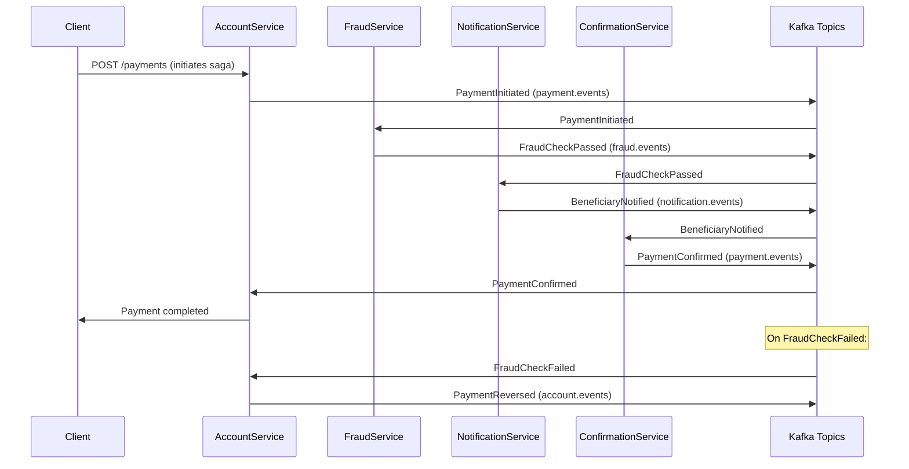
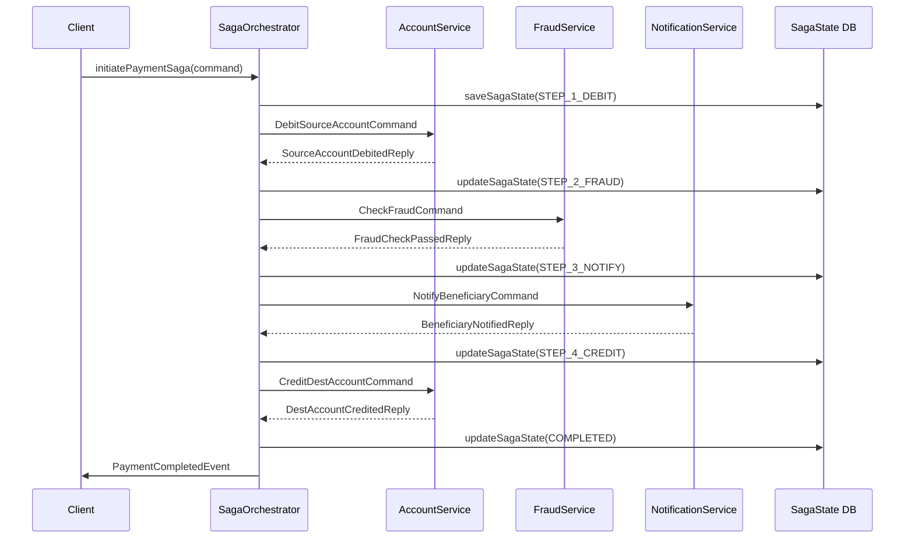

# Saga Pattern — Choreography and Orchestration

A payment that spans multiple microservices — debit source, check fraud, notify beneficiary, credit destination — cannot be wrapped in a single database transaction. The saga pattern replaces the distributed two-phase commit with a sequence of local transactions and compensating transactions. This lesson covers both flavours (choreography and orchestration), the full payment saga lifecycle, and how to make compensations idempotent and durable.

---

## 1. Why Not Two-Phase Commit?

Two-phase commit (2PC) is impractical in a microservices architecture:

| Problem | Impact in Microservices |
|---|---|
| Coordinator is a single point of failure | A crashed coordinator leaves all participants locked forever |
| Blocking lock duration | All resources are locked from prepare until commit — typically 100ms–1s, unacceptable at payment scale |
| Cross-database vendor support | A PostgreSQL, MySQL, and MongoDB cluster cannot participate in the same XA transaction |
| Network partitions cause indefinite lock | CAP theorem: in a distributed system, partition tolerance requires sacrificing consistency |
| Operational complexity | XA transactions require all services to implement the XA protocol; most REST/gRPC services do not |

The saga pattern avoids all these issues by using local transactions only. If a step fails, compensating transactions undo the work of completed steps.

---

## 2. Saga Definition

A saga is a sequence of local transactions where:
1. Each local transaction updates a single service's data and publishes an event (or sends a command)
2. If a local transaction fails, compensating transactions reverse the effects of all previously committed transactions

```
Payment Saga:
  Step 1: Debit source account      (compensation: Reverse debit)
  Step 2: Reserve fraud check slot  (compensation: Release fraud check slot)
  Step 3: Notify beneficiary        (compensation: Send cancellation notification)
  Step 4: Credit destination        (compensation: Reverse credit)
  Step 5: Confirm payment           (compensation: N/A — final step)
```

**Key property**: compensating transactions must be **idempotent** because they can be called multiple times on failure/retry.

---

## 3. Choreography Saga

In choreography, each service reacts to events and publishes the next event. There is no central coordinator. Each service knows its local role but not the overall flow.



### Choreography Event Handlers

```java
// AccountService: starts the saga and handles compensation
@KafkaListener(topics = "payment.commands", groupId = "account-service")
@Transactional
public void handlePaymentCommand(PaymentInitiateCommand command) {
    // Local transaction: debit source account
    Account source = accountRepository.findById(command.getSourceAccountId())
        .orElseThrow(() -> new AccountNotFoundException(command.getSourceAccountId()));

    if (source.getBalance().compareTo(command.getAmount()) < 0) {
        // Publish failure event immediately
        eventPublisher.publish("payment.events",
            new PaymentFailed(command.getPaymentId(), "Insufficient funds"));
        return;
    }

    source.debit(command.getAmount());
    accountRepository.save(source);

    // Publish event to trigger next saga step
    eventPublisher.publish("payment.events",
        new PaymentInitiated(
            command.getPaymentId(),
            command.getSourceAccountId(),
            command.getDestAccountId(),
            command.getAmount(),
            command.getCorrelationId()));
}

// AccountService: handles compensation (reverse debit)
@KafkaListener(topics = "fraud.events", groupId = "account-service-fraud")
@Transactional
public void handleFraudCheckResult(FraudCheckEvent event) {
    if (event instanceof FraudCheckFailed failed) {
        // COMPENSATION: reverse the debit
        Account source = accountRepository.findById(failed.getSourceAccountId())
            .orElseThrow();
        source.credit(failed.getAmount());  // reversal
        accountRepository.save(source);

        eventPublisher.publish("payment.events",
            new PaymentReversed(
                failed.getPaymentId(),
                "Fraud check failed: " + failed.getReason()));
    }
}

// FraudService: reacts to PaymentInitiated
@KafkaListener(topics = "payment.events", groupId = "fraud-service")
@Transactional
public void handlePaymentInitiated(PaymentInitiated event) {
    FraudCheckResult result = fraudEngine.check(
        event.getSourceAccountId(),
        event.getAmount(),
        event.getCorrelationId());

    if (result.isPassed()) {
        eventPublisher.publish("fraud.events",
            new FraudCheckPassed(event.getPaymentId(), event.getSourceAccountId(),
                                 event.getDestAccountId(), event.getAmount()));
    } else {
        eventPublisher.publish("fraud.events",
            new FraudCheckFailed(event.getPaymentId(), event.getSourceAccountId(),
                                 event.getAmount(), result.getReason()));
    }
}
```

---

## 4. Orchestration Saga

In orchestration, a central `SagaOrchestrator` sends commands to each service and receives replies. The orchestrator owns the saga state machine.



### Orchestrator Implementation

```java
@Component
public class PaymentSagaOrchestrator {

    private final SagaStateRepository sagaStateRepository;
    private final KafkaTemplate<String, String> commandBus;

    public UUID initiatePayment(PaymentInitiateCommand command) {
        UUID sagaId = UUID.randomUUID();

        // Persist initial saga state before sending any commands
        SagaState state = SagaState.builder()
            .sagaId(sagaId)
            .paymentId(command.getPaymentId())
            .sourceAccountId(command.getSourceAccountId())
            .destAccountId(command.getDestAccountId())
            .amount(command.getAmount())
            .currentStep(SagaStep.DEBIT_SOURCE)
            .status(SagaStatus.IN_PROGRESS)
            .createdAt(Instant.now())
            .build();

        sagaStateRepository.save(state);

        // Send step 1 command
        commandBus.send("account.commands",
            command.getSourceAccountId().toString(),
            toJson(new DebitSourceAccountCommand(sagaId, command.getSourceAccountId(),
                                                  command.getAmount())));

        return sagaId;
    }

    // Reply handler for step 1
    @KafkaListener(topics = "account.replies", groupId = "payment-saga-orchestrator")
    @Transactional
    public void handleAccountReply(ConsumerRecord<String, String> record) {
        AccountReply reply = fromJson(record.value(), AccountReply.class);
        SagaState state = sagaStateRepository.findBySagaId(reply.getSagaId())
            .orElseThrow(() -> new SagaNotFoundException(reply.getSagaId()));

        if (reply instanceof SourceAccountDebitedReply debitedReply
                && state.getCurrentStep() == SagaStep.DEBIT_SOURCE) {

            // Advance to step 2
            state.setCurrentStep(SagaStep.FRAUD_CHECK);
            sagaStateRepository.save(state);

            commandBus.send("fraud.commands",
                state.getSagaId().toString(),
                toJson(new CheckFraudCommand(state.getSagaId(),
                                              state.getSourceAccountId(),
                                              state.getAmount())));

        } else if (reply instanceof DebitFailedReply failedReply) {
            // Step 1 failed — no compensation needed (nothing was committed)
            state.setStatus(SagaStatus.FAILED);
            state.setFailureReason(failedReply.getReason());
            sagaStateRepository.save(state);
        }
    }

    // Reply handler for step 2 (fraud check)
    @KafkaListener(topics = "fraud.replies", groupId = "payment-saga-orchestrator")
    @Transactional
    public void handleFraudReply(ConsumerRecord<String, String> record) {
        FraudReply reply = fromJson(record.value(), FraudReply.class);
        SagaState state = sagaStateRepository.findBySagaId(reply.getSagaId())
            .orElseThrow();

        if (reply instanceof FraudCheckPassedReply
                && state.getCurrentStep() == SagaStep.FRAUD_CHECK) {

            state.setCurrentStep(SagaStep.NOTIFY_BENEFICIARY);
            sagaStateRepository.save(state);

            commandBus.send("notification.commands",
                state.getSagaId().toString(),
                toJson(new NotifyBeneficiaryCommand(state.getSagaId(),
                                                     state.getDestAccountId(),
                                                     state.getAmount())));

        } else if (reply instanceof FraudCheckFailedReply failedReply) {
            // Step 2 failed — compensate step 1
            state.setCurrentStep(SagaStep.COMPENSATING_DEBIT);
            sagaStateRepository.save(state);

            commandBus.send("account.commands",
                state.getSourceAccountId().toString(),
                toJson(new ReverseDebitCommand(state.getSagaId(),
                                               state.getSourceAccountId(),
                                               state.getAmount())));
        }
    }
}
```

---

## 5. Compensation Chain

When a step fails, all previously completed steps must be compensated in reverse order:

```java
public enum SagaStep {
    DEBIT_SOURCE,          // compensation: REVERSE_DEBIT
    FRAUD_CHECK,           // compensation: RELEASE_FRAUD_SLOT
    NOTIFY_BENEFICIARY,    // compensation: SEND_CANCELLATION
    CREDIT_DESTINATION,    // compensation: REVERSE_CREDIT
    COMPLETED,             // no compensation needed (terminal success)
    COMPENSATING_DEBIT,
    COMPENSATING_NOTIFICATION,
    FAILED                 // terminal failure
}

public class SagaCompensationService {

    public void compensate(SagaState state) {
        // Execute compensations in reverse order of completed steps
        SagaStep failedAt = state.getFailedAtStep();

        if (failedAt.ordinal() > SagaStep.CREDIT_DESTINATION.ordinal()) {
            issueCommand(new ReverseDestinationCreditCommand(state));
        }
        if (failedAt.ordinal() > SagaStep.NOTIFY_BENEFICIARY.ordinal()) {
            issueCommand(new SendCancellationNotificationCommand(state));
        }
        if (failedAt.ordinal() > SagaStep.FRAUD_CHECK.ordinal()) {
            issueCommand(new ReleaseFraudSlotCommand(state));
        }
        if (failedAt.ordinal() > SagaStep.DEBIT_SOURCE.ordinal()) {
            issueCommand(new ReverseSourceDebitCommand(state));
        }
        // Step 1 failure: nothing to compensate (debit not yet applied)
    }
}
```

### Idempotent Compensation

Each compensation command includes the sagaId as the idempotency key:

```java
@KafkaListener(topics = "account.commands", groupId = "account-command-handler")
@Transactional
public void handleReverseDebit(ReverseDebitCommand command) {
    // Idempotency check: has this reversal already been applied?
    boolean alreadyApplied = compensationLog.exists(
        command.getSagaId(), "REVERSE_DEBIT");

    if (alreadyApplied) {
        log.info("Compensation already applied, skipping: sagaId={} step=REVERSE_DEBIT",
                 command.getSagaId());
        return;
    }

    Account source = accountRepository.findById(command.getSourceAccountId())
        .orElseThrow();
    source.credit(command.getAmount());  // reverse the debit
    accountRepository.save(source);

    // Record the compensation as applied — same transaction
    compensationLog.record(command.getSagaId(), "REVERSE_DEBIT");

    // Reply to orchestrator
    replyBus.send("account.replies",
        toJson(new DebitReversedReply(command.getSagaId())));
}
```

---

## 6. Choreography vs Orchestration Comparison

| Dimension | Choreography | Orchestration |
|---|---|---|
| Coupling | Low — services only know about events, not each other | Medium — services know the orchestrator |
| Visibility | Low — flow is implicit across many topics | High — flow is explicit in the orchestrator |
| Testability | Hard — requires all services to test end-to-end | Easy — orchestrator logic can be unit tested |
| Central coordinator | None — no SPOF | Orchestrator is a SPOF unless HA |
| Adding a step | Requires modifying multiple services | Modify only the orchestrator |
| Debugging failures | Difficult — must trace events across topics | Easier — saga state is in one database |
| Schema coupling | Services couple through event schemas | Services couple through command/reply schemas |
| Use case fit | Simple linear flows, event-driven pipelines | Complex flows with branching and compensation |

---

## 7. Saga Idempotency Per Step

Each saga step uses the `sagaId + stepName` as an idempotency key:

```sql
CREATE TABLE saga_step_idempotency (
    saga_id    UUID         NOT NULL,
    step_name  VARCHAR(64)  NOT NULL,
    executed_at TIMESTAMPTZ NOT NULL DEFAULT NOW(),
    result     VARCHAR(16)  NOT NULL,  -- SUCCESS, COMPENSATED
    CONSTRAINT pk_saga_step_idempotency PRIMARY KEY (saga_id, step_name)
);
```

```java
// Generic idempotent step executor
public <T> T executeStep(UUID sagaId, String stepName,
                          Supplier<T> stepLogic) {
    // Check if this step was already executed (e.g., due to retry)
    return sagaStepIdempotencyRepository
        .findBySagaIdAndStepName(sagaId, stepName)
        .map(existing -> {
            log.info("Step already executed: sagaId={} step={}", sagaId, stepName);
            return (T) existing.getCachedResult();
        })
        .orElseGet(() -> {
            T result = stepLogic.get();
            sagaStepIdempotencyRepository.save(
                new SagaStepRecord(sagaId, stepName, "SUCCESS", toJson(result)));
            return result;
        });
}
```

---

## 8. Axon Framework Saga Example

Axon Framework provides declarative saga support:

```java
@Saga
public class PaymentSaga {

    @Autowired
    @Transient
    private CommandGateway commandGateway;

    private UUID paymentId;
    private UUID sourceAccountId;
    private BigDecimal amount;
    private boolean debitApplied = false;

    @StartSaga
    @SagaEventHandler(associationProperty = "paymentId")
    public void on(PaymentInitiatedEvent event) {
        this.paymentId = event.getPaymentId();
        this.sourceAccountId = event.getSourceAccountId();
        this.amount = event.getAmount();

        // Send step 1 command
        commandGateway.send(new DebitSourceAccountCommand(
            event.getSourceAccountId(), event.getAmount(), event.getPaymentId()));
    }

    @SagaEventHandler(associationProperty = "paymentId")
    public void on(SourceAccountDebitedEvent event) {
        this.debitApplied = true;

        // Send step 2 command
        commandGateway.send(new CheckFraudCommand(
            event.getSourceAccountId(), event.getAmount(), event.getPaymentId()));
    }

    @SagaEventHandler(associationProperty = "paymentId")
    public void on(FraudCheckFailedEvent event) {
        if (debitApplied) {
            // Compensate step 1
            commandGateway.send(new ReverseDebitCommand(
                sourceAccountId, amount, paymentId));
        }
        // Saga ends in failure — Axon manages saga state persistence
        SagaLifecycle.end();
    }

    @EndSaga
    @SagaEventHandler(associationProperty = "paymentId")
    public void on(PaymentCompletedEvent event) {
        // Final step — saga ends successfully
        log.info("Payment saga completed: paymentId={}", paymentId);
    }
}
```

---

## 9. Production Pitfalls

### Pitfall 1 — No Compensation for the First Step

A team designs a saga where the first step (debit source account) has no compensation. They reason that if the debit fails, nothing has happened. But the saga code does not account for a scenario where the debit SUCCEEDS but the reply is lost (network partition), causing the orchestrator to retry the debit, debiting the account twice.

```java
// BAD: first step has no idempotency guard
@KafkaListener(topics = "account.commands", groupId = "account-service")
@Transactional
public void handleDebit(DebitSourceAccountCommand command) {
    Account account = accountRepository.findById(command.getSourceAccountId()).orElseThrow();
    account.debit(command.getAmount());  // no check if already debited for this sagaId
    accountRepository.save(account);
    // If reply is lost and orchestrator retries, account is debited TWICE
}

// GOOD: every step — including the first — is idempotent via sagaId
@KafkaListener(topics = "account.commands", groupId = "account-service")
@Transactional
public void handleDebit(DebitSourceAccountCommand command) {
    // Check if this saga step was already applied
    if (sagaStepLog.exists(command.getSagaId(), "DEBIT_SOURCE")) {
        log.info("Debit already applied, returning cached reply: sagaId={}",
                 command.getSagaId());
        replyBus.send("account.replies",
            toJson(new SourceAccountDebitedReply(command.getSagaId())));
        return;
    }

    Account account = accountRepository.findById(command.getSourceAccountId()).orElseThrow();
    account.debit(command.getAmount());
    accountRepository.save(account);
    sagaStepLog.record(command.getSagaId(), "DEBIT_SOURCE");

    replyBus.send("account.replies",
        toJson(new SourceAccountDebitedReply(command.getSagaId())));
}
```

### Pitfall 2 — Saga State Lost on Restart

An in-memory saga orchestrator stores saga state in a `ConcurrentHashMap`. When the service restarts (crash, deployment), all in-flight sagas are lost. Payments that were in progress during the restart are stuck — the debit was applied but the saga never completes.

```java
// BAD: saga state in memory — lost on restart
@Component
public class PaymentSagaOrchestrator {
    // ALL SAGA STATE IS LOST ON ANY RESTART
    private final Map<UUID, SagaState> activeSagas = new ConcurrentHashMap<>();

    public void startSaga(PaymentInitiateCommand command) {
        UUID sagaId = UUID.randomUUID();
        activeSagas.put(sagaId, new SagaState(...));  // in memory only!
    }
}

// GOOD: persist saga state to PostgreSQL before sending any commands
@Component
public class PaymentSagaOrchestrator {

    private final SagaStateRepository sagaStateRepository;  // JPA repository

    public void startSaga(PaymentInitiateCommand command) {
        SagaState state = new SagaState(UUID.randomUUID(), command);
        sagaStateRepository.save(state);  // persisted BEFORE any command is sent

        commandBus.send("account.commands",
            toJson(new DebitSourceAccountCommand(state.getSagaId(), ...)));
    }

    // On startup: find and resume all in-progress sagas from the DB
    @PostConstruct
    public void resumeInFlightSagas() {
        List<SagaState> inProgress = sagaStateRepository
            .findByStatus(SagaStatus.IN_PROGRESS);
        inProgress.forEach(this::resume);
        log.info("Resumed {} in-flight sagas on startup", inProgress.size());
    }
}
```

### Pitfall 3 — Compensation Is Not Idempotent

A team implements compensation for the debit step but does not add an idempotency guard. The compensation command is delivered twice (Kafka at-least-once), and the account is credited twice — turning a 100 EUR payment reversal into a 200 EUR credit.

```java
// BAD: compensation without idempotency
@KafkaListener(topics = "account.commands", groupId = "account-service")
@Transactional
public void handleReverseDebit(ReverseDebitCommand command) {
    Account account = accountRepository.findById(command.getSourceAccountId())
        .orElseThrow();
    account.credit(command.getAmount());  // applied again on duplicate delivery!
    accountRepository.save(account);
}

// GOOD: compensation with idempotency guard using saga_compensations table
@KafkaListener(topics = "account.commands", groupId = "account-service")
@Transactional
public void handleReverseDebit(ReverseDebitCommand command) {
    // Check if this compensation was already applied
    Optional<SagaCompensation> existing = compensationRepository
        .findBySagaIdAndCompensationType(command.getSagaId(), "REVERSE_DEBIT");

    if (existing.isPresent()) {
        log.info("Compensation already applied, skipping: sagaId={}", command.getSagaId());
        return;
    }

    Account account = accountRepository.findById(command.getSourceAccountId())
        .orElseThrow();
    account.credit(command.getAmount());
    accountRepository.save(account);

    // Record compensation in same transaction
    compensationRepository.save(new SagaCompensation(
        command.getSagaId(), "REVERSE_DEBIT", Instant.now()));

    replyBus.send("account.replies",
        toJson(new DebitReversedReply(command.getSagaId())));
}
```

---

## 10. Saga Pattern Checklist

- [ ] Every saga step (including the first) is idempotent using `sagaId + stepName` as key
- [ ] Saga state is persisted to a durable store before any command is sent
- [ ] Service startup resumes in-progress sagas from the state store
- [ ] Every compensation is idempotent — guard with a `saga_compensations` table
- [ ] Compensation chain covers all steps in reverse order
- [ ] Failure at step N triggers compensation for steps N-1 down to 1
- [ ] Choreography: each service has a DLQ for failed event handling
- [ ] Orchestration: the orchestrator has a timeout per step — alert and compensate on timeout
- [ ] Saga step timeouts are configured and tested
- [ ] End-to-end saga completion is monitored (histogram of saga duration)
- [ ] Stuck sagas (IN_PROGRESS beyond threshold) are alerted and manually reviewed
- [ ] Integration tests cover happy path, failure at each step, and retry of compensation
- [ ] Saga state table is indexed on `(status, created_at)` for timeout queries

---

<!-- KNOWLEDGE-CHECK
{"questions":[{"text":"In a choreography saga for a payment, the FraudService publishes a FraudCheckFailed event. Which service should handle this event and issue a compensation?","options":["The FraudService itself — it knows the saga failed","The AccountService — it listens for FraudCheckFailed and reverses the debit it previously applied","A dedicated SagaOrchestrator service that coordinates all compensations","No compensation is needed — the FraudService just blocks the payment"],"correct":1,"explanation":"In choreography, each service is responsible for reacting to events that require it to compensate its own local changes. The AccountService applied the debit in step 1. When it consumes FraudCheckFailed from the fraud.events topic, it knows it must reverse that debit. There is no central coordinator — each service owns its compensation logic."},{"text":"A saga orchestrator sends a DebitSourceAccountCommand and never receives a reply due to a network partition. The orchestrator times out and retries. The AccountService received and processed the original command but the reply was lost. What prevents the account from being debited twice?","options":["The Kafka consumer at-most-once guarantee prevents duplicate delivery","The AccountService must check whether the sagaId+step combination was already executed before applying the debit, making the step idempotent","The orchestrator automatically detects the duplicate by checking Kafka offsets","The DebitSourceAccountCommand includes a TTL that expires before the retry"],"correct":1,"explanation":"Every saga step must be idempotent using the sagaId + stepName as the idempotency key. When the orchestrator retries the DebitSourceAccountCommand, the AccountService checks the saga_step_idempotency table. It finds a SUCCESS record for sagaId+DEBIT_SOURCE and returns a cached success reply without applying the debit again."},{"text":"What is the fundamental advantage of an orchestration saga over a choreography saga for a complex payment flow with 5 steps and conditional branching?","options":["Orchestration is always faster because there is no event propagation delay","Orchestration makes the saga flow explicit and visible in one place, the orchestrator, making debugging, testing, and adding conditional steps significantly easier than tracing implicit flows across 5 event topics","Orchestration requires fewer Kafka topics","Orchestration avoids the need for compensating transactions"],"correct":1,"explanation":"In choreography, the flow is implicit — you must trace events across multiple topics and services to understand what happened. Conditional branching (e.g., different fraud outcomes trigger different next steps) requires complex event filtering in each service. The orchestrator centralises the flow logic, making it explicit, testable in isolation, and easier to debug when a saga gets stuck."}]}
-->

<!-- PRACTICAL-CHALLENGE
{"title":"Implement a Payment Saga with Orchestration and Compensation","difficulty":"advanced","estimatedMinutes":75,"tasks":[{"id":"1","description":"Implement a PaymentSagaOrchestrator with a saga_state table in PostgreSQL. The orchestrator must persist SagaState (sagaId, paymentId, sourceAccountId, destAccountId, amount, currentStep, status, failureReason, createdAt, updatedAt) to the database BEFORE sending any command. Implement a @PostConstruct method that queries for all SagaStatus.IN_PROGRESS sagas older than 30 seconds and resumes them by re-sending the command for the current step. Write a unit test that simulates a restart mid-saga and verifies the saga resumes correctly."},{"id":"2","description":"Implement idempotent command handlers in AccountService for DebitSourceAccountCommand and ReverseDebitCommand. Each handler must check a saga_step_idempotency table (saga_id, step_name) before applying any change. If the step was already applied, return the cached reply. Write a test that calls each handler twice with the same sagaId and verifies the account balance changes exactly once."},{"id":"3","description":"Implement the full compensation chain: when FraudCheckFailed is received, the orchestrator must compensate in reverse order: (1) SendCancellationNotification, (2) ReverseSourceDebit. Each compensation step must be idempotent via a saga_compensations table. Write an integration test that simulates FraudCheckFailed at step 2 and verifies: the account balance is fully restored, the compensation log has two entries, and the saga status is FAILED."},{"id":"4","description":"Add saga step timeout monitoring: a @Scheduled task that queries for SagaState where status=IN_PROGRESS and updatedAt < NOW() - 5 minutes. For each timed-out saga, log the sagaId and currentStep, trigger the compensation chain, and set status=TIMED_OUT. Write a test that creates a saga, waits for the timeout threshold, and verifies the timeout monitor picks it up and compensates correctly."}]}
-->
