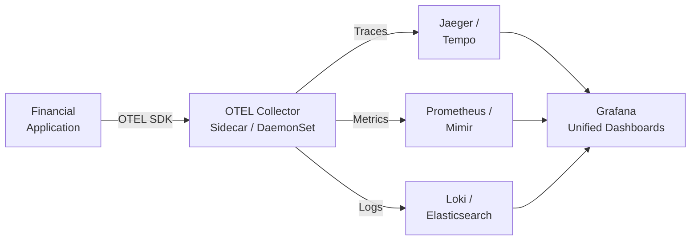

# ‏OpenTelemetry — التجهيز للرصد في الخدمات المالية

> [!NOTE]
> ‏OpenTelemetry معيار CNCF لتجهيز الأنظمة للرصد (instrumentation). وللخدمات المالية، يوفر أساس القياس عن بُعد الموحد لفهم تدفقات الدفع الموزعة، وتلبية متطلبات التدقيق، وتشخيص حوادث الإنتاج.

## الركائز الثلاث للرصد

الرصد (observability) هو القدرة على فهم الحالة الداخلية للنظام من مخرجاته الخارجية.

| الركيزة | ما تجيب عنه | إشارة OTEL |
|---|---|---|
| **التتبعات (Traces)** | ماذا حدث لطلب الدفع هذا تحديدًا؟ | امتدادات (spans) مربوطة بمعرّف تتبع |
| **المقاييس (Metrics)** | كيف يؤدي نظامي؟ | عدادات، ومقاييس لحظية، ومدرجات تكرارية |
| **السجلات (Logs)** | ماذا كان النظام يفعل في هذه اللحظة؟ | سجلات منظمة |

يوفر OpenTelemetry **واجهة وحزمة تطوير موحدتين** للإشارات الثلاث، مع تصدير محايد للمزوّد عبر OTLP ‏(OpenTelemetry Protocol).



---

## التتبع الموزع — تتبع دفعة عبر الخدمات

يربط التتبع الموزع تنفيذ طلب عبر خدمات وقواعد بيانات وطوابير متعددة.

```mermaid
gantt
    title Distributed Trace: POST /payments (Trace ID: abc123)
    dateFormat X
    axisFormat %Lms
    
    section payment-api
    HTTP handler            :0, 180
    
    section fraud-service
    Fraud score lookup      :5, 85
    
    section account-service
    Balance read            :10, 65
    PostgreSQL query        :15, 55
    
    section payment-api
    Authorisation decision  :90, 120
    
    section ledger-service
    Debit entry write       :120, 170
    PostgreSQL INSERT       :125, 165
    
    section payment-api
    HTTP response           :170, 180
```



### التجهيز بحزمة OpenTelemetry لـ Java

```java
// Automatic instrumentation (recommended for most financial services)
// Add javaagent to JVM args — instruments Spring Boot, JDBC, Kafka automatically
// -javaagent:/opt/opentelemetry-javaagent.jar
// -Dotel.service.name=payment-api
// -Dotel.exporter.otlp.endpoint=http://otel-collector:4317
// -Dotel.traces.exporter=otlp
// -Dotel.metrics.exporter=otlp
// -Dotel.logs.exporter=otlp

// Manual instrumentation for financial business logic
@Service
public class PaymentService {

    private final Tracer tracer;
    
    public PaymentService(OpenTelemetry openTelemetry) {
        this.tracer = openTelemetry.getTracer("com.bank.payment");
    }

    public PaymentResult authorisePayment(PaymentRequest request) {
        // Create a span for the authorisation decision
        Span span = tracer.spanBuilder("payment.authorise")
            .setAttribute("payment.id", request.getId().toString())
            .setAttribute("payment.amount", request.getAmount().toPlainString())
            .setAttribute("payment.currency", request.getCurrency())
            .setAttribute("payment.channel", request.getChannel().name())
            .startSpan();
        
        try (Scope scope = span.makeCurrent()) {
            // All child operations inherit this trace context
            FraudScore fraud = fraudService.score(request);
            Account account = accountService.getWithBalance(request.getAccountId());
            
            PaymentResult result = makeAuthorisationDecision(request, fraud, account);
            
            // Record the outcome on the span
            span.setAttribute("payment.decision", result.getDecision().name());
            span.setAttribute("payment.decline_reason", 
                result.getDeclineReason() != null ? result.getDeclineReason().name() : "");
                
            return result;
            
        } catch (Exception e) {
            span.recordException(e);
            span.setStatus(StatusCode.ERROR, e.getMessage());
            throw e;
        } finally {
            span.end();
        }
    }
}
```

### حاسم: نشر سياق التتبع

يجب نشر سياق التتبع عبر كل حدود الخدمات — ترويسات HTTP، وترويسات رسائل Kafka، والعمليات غير المتزامنة.

```java
// HTTP: W3C TraceContext propagation (automatic with javaagent)
// Incoming: traceparent: 00-abc123def456...-span1234-01
// Outgoing: propagated by OTEL HTTP client instrumentation

// Kafka: propagate trace context in message headers.
// The javaagent (and Spring Kafka observation) already does this for
// KafkaTemplate and @KafkaListener -- write it by hand only WITHOUT them,
// otherwise each message gets duplicate traceparent headers.
@Component
public class PaymentEventPublisher {

    private final KafkaTemplate<String, PaymentEvent> kafkaTemplate;
    private final OpenTelemetry openTelemetry;
    
    public void publish(PaymentEvent event) {
        ProducerRecord<String, PaymentEvent> record = new ProducerRecord<>(
            "payments", event.getAccountId().toString(), event);
        
        // Inject current trace context into Kafka message headers
        // This allows the consumer to continue the same trace
        openTelemetry.getPropagators().getTextMapPropagator().inject(
            Context.current(),
            record.headers(),
            (headers, key, value) -> headers.add(key, value.getBytes(UTF_8))
        );
        
        kafkaTemplate.send(record);
    }
}

// Kafka consumer: extract and restore trace context
@KafkaListener(topics = "payments")
public void processPayment(ConsumerRecord<String, PaymentEvent> record) {
    // Extract trace context from Kafka headers to continue the trace
    Context extractedContext = openTelemetry.getPropagators().getTextMapPropagator()
        .extract(Context.current(), record.headers(),
            (headers, key) -> {
                Header header = headers.lastHeader(key);
                return header != null ? new String(header.value(), UTF_8) : null;
            });
    
    // All spans created inside this scope will be children of the original trace
    try (Scope scope = extractedContext.makeCurrent()) {
        settlementService.process(record.value());
    }
}
```

---

## المقاييس — قياس صحة النظام المالي

تعمل مقاييس OpenTelemetry جنبًا إلى جنب مع Micrometer في Spring Boot. ويستطيع عامل OTEL لـ Java تصدير مقاييس Micrometer عبر OTLP.

```java
// Financial-specific metrics — go beyond the defaults
@Component
public class PaymentMetrics {
    
    private final LongCounter paymentCounter;
    private final DoubleHistogram paymentLatency;
    private final LongUpDownCounter queueDepth;

    public PaymentMetrics(OpenTelemetry openTelemetry) {
        Meter meter = openTelemetry.getMeter("com.bank.payment");
        
        // Payment outcome counter — split by channel and decision
        this.paymentCounter = meter.counterBuilder("payments.total")
            .setDescription("Total payment decisions")
            .setUnit("payments")
            .build();
        
        // End-to-end authorisation latency histogram (OpenTelemetry semantic
        // conventions use SECONDS for durations)
        this.paymentLatency = meter.histogramBuilder("payments.authorisation.duration")
            .setDescription("Payment authorisation duration")
            .setUnit("s")
            // Bucket boundaries tuned for financial SLO (P50, P95, P99 visibility)
            .setExplicitBucketBoundariesAdvice(List.of(
                0.010, 0.025, 0.050, 0.100, 0.150, 0.200, 0.500, 1.0))
            .build();
        
        // Queue depth gauge — payment processing backlog
        this.queueDepth = meter.upDownCounterBuilder("payments.queue.depth")
            .setDescription("Current payment processing queue depth")
            .build();
    }
    
    public void recordPaymentDecision(Payment payment, PaymentDecision decision, 
                                       Duration latency) {
        Attributes attrs = Attributes.builder()
            .put("channel", payment.getChannel().name())
            .put("decision", decision.name())
            .put("currency", payment.getCurrency())
            .put("amount_bucket", getAmountBucket(payment.getAmount()))
            .build();
        
        paymentCounter.add(1, attrs);
        paymentLatency.record(latency.toNanos() / 1e9, attrs);
    }
    
    private String getAmountBucket(BigDecimal amount) {
        if (amount.compareTo(new BigDecimal("100")) < 0) return "micro";
        if (amount.compareTo(new BigDecimal("1000")) < 0) return "small";
        if (amount.compareTo(new BigDecimal("10000")) < 0) return "medium";
        return "large";
    }
}
```

---

## السجلات المنظمة — الربط مع التتبعات

تكون السجلات أثمن حين تتضمن معرّف التتبع ومعرّف الامتداد، فتتيح الانتقال مباشرة من سطر سجل إلى التتبع الموزع.

```java
// Spring Boot + Logback: trace/span IDs are put into the MDC automatically.
// The MDC key names depend on the instrumentation:
//   Micrometer Tracing (Spring Boot):  traceId / spanId
//   OpenTelemetry javaagent:            trace_id / span_id
// Add to logback-spring.xml pattern (here: javaagent keys):
// %d{ISO8601} %-5level [%X{trace_id},%X{span_id}] %logger{36} - %msg%n

// Application code: add business context to MDC
@Service
public class PaymentService {

    private static final Logger log = LoggerFactory.getLogger(PaymentService.class);
    
    public PaymentResult authorise(PaymentRequest request) {
        // Add financial context to log correlation
        MDC.put("paymentId",    request.getId().toString());
        MDC.put("accountId",    request.getAccountId().toString());
        MDC.put("channel",      request.getChannel().name());
        MDC.put("amountGBP",    request.getAmountGBP().toPlainString());
        
        try {
            log.info("Payment authorisation started");  
            // Log line: 2024-11-07T14:23:01 INFO [abc123,span456] PaymentService - 
            //           Payment authorisation started
            //           paymentId=pay-789 accountId=acc-012 channel=API amountGBP=250.00
            
            PaymentResult result = doAuthorise(request);
            
            log.info("Payment authorisation completed decision={} latencyMs={}", 
                result.getDecision(), result.getLatencyMs());
                
            return result;
            
        } finally {
            // Always clean up MDC to prevent context leaking to other requests
            MDC.remove("paymentId");
            MDC.remove("accountId");
            MDC.remove("channel");
            MDC.remove("amountGBP");
        }
    }
}
```

---

## ‏OTEL Collector — الإعداد للخدمات المالية

يعمل OTEL Collector كخط لبيانات القياس عن بُعد: يستقبل البيانات من الخدمات، ويعالجها، ويصدّرها إلى الواجهات الخلفية.

```yaml
# otel-collector-config.yaml — financial services configuration
receivers:
  otlp:
    protocols:
      grpc:
        endpoint: 0.0.0.0:4317
      http:
        endpoint: 0.0.0.0:4318

processors:
  # Protect the collector from running out of memory under load (first!)
  memory_limiter:
    check_interval: 1s
    limit_percentage: 80
    spike_limit_percentage: 20

  # Add environment metadata to all telemetry
  resource:
    attributes:
    - key: environment
      value: production
      action: insert
    - key: region
      value: eu-west-1
      action: insert
      
  # Sample traces — keep 100% of error and slow traces, 10% of the rest.
  # Critical for financial: never sample away errors or slow traces.
  # (Policies are OR-ed: a trace is kept if ANY policy says so. A policy
  #  like "payment.id matches .*" would keep every payment trace and switch
  #  sampling off.)
  # Tail sampling needs ALL spans of a trace on the same collector: in a
  # multi-replica setup, put a first tier with the loadbalancing exporter
  # (routing by trace ID) in front of the sampling collectors.
  tail_sampling:
    decision_wait: 10s
    policies:
    - name: keep-errors
      type: status_code
      status_code: { status_codes: [ERROR] }    # keep all error traces
    - name: keep-slow
      type: latency
      latency: { threshold_ms: 500 }             # keep all traces > 500ms
    - name: sample-the-rest
      type: probabilistic
      probabilistic: { sampling_percentage: 10 } # 10% of everything else
      
  # Batch for efficiency
  batch:
    timeout: 1s
    send_batch_size: 1000

exporters:
  otlp/jaeger:
    endpoint: jaeger-collector:4317
    tls:
      insecure: false
      cert_file: /certs/collector.crt
      key_file: /certs/collector.key
      
  # Prometheus must run with --web.enable-remote-write-receiver
  # (or use Prometheus' native OTLP receiver instead)
  prometheusremotewrite:
    endpoint: http://prometheus:9090/api/v1/write

  # Loki 3.x ingests OTLP natively (the old "loki" exporter was removed)
  otlphttp/loki:
    endpoint: http://loki:3100/otlp

service:
  pipelines:
    traces:
      receivers: [otlp]
      processors: [memory_limiter, resource, tail_sampling, batch]
      exporters: [otlp/jaeger]
    metrics:
      receivers: [otlp]
      processors: [memory_limiter, resource, batch]
      exporters: [prometheusremotewrite]
    logs:
      receivers: [otlp]
      processors: [memory_limiter, resource, batch]
      exporters: [otlphttp/loki]
```

---

## تتبع الامتثال — المتطلبات التنظيمية

للخدمات المالية متطلبات مسار تدقيق محددة تتجاوز الرصد التشغيلي.

```java
// Compliance trace: every regulatory decision must be traceable
// PSD2 requires that Strong Customer Authentication decisions are auditable
@Component
public class SCAComplianceTracer {

    private final Tracer tracer;
    
    public void traceAuthenticationDecision(
            String paymentId, 
            SCAMethod method, 
            SCADecision decision,
            String regulatoryJustification) {
        
        Span complianceSpan = tracer.spanBuilder("sca.authentication.decision")
            .setSpanKind(SpanKind.INTERNAL)
            // PSD2 Article 97 required fields
            .setAttribute("compliance.regulation", "PSD2")
            .setAttribute("compliance.article", "97")
            .setAttribute("sca.payment_id", paymentId)
            .setAttribute("sca.method", method.name())
            .setAttribute("sca.decision", decision.name())
            .setAttribute("sca.justification", regulatoryJustification)
            .setAttribute("sca.timestamp", Instant.now().toString())
            .startSpan();
            
        complianceSpan.end();
        
        // Also emit a compliance event to the audit log — traces are sampled
        // and expire after days or weeks, but compliance records must be
        // complete and kept for years (e.g. 5 years under EU anti-money-
        // laundering rules; check your local regulation)
        complianceAuditLog.record(ComplianceEvent.sca(paymentId, method, decision));
    }
}
```

<!-- KNOWLEDGE-CHECK
{
  "questions": [
    {
      "id": "q1",
      "text": "تفشل دفعة في الإنتاج. ويظهر الخطأ في سجلات خدمة payment-api، لكنك لا تستطيع تحديد أي خدمة لاحقة (fraud-service، أو account-service، أو ledger-service) سببته. أي ميزة في OTEL كانت ستمنع هذه المشكلة؟",
      "options": [
        "رسائل خطأ أفضل في سجلات payment-api",
        "التتبع الموزع مع نشر سياق التتبع — معرّف تتبع واحد يمتد عبر كل الخدمات، فتستطيع تتبع سلسلة الاستدعاءات الدقيقة للدفعة الفاشلة",
        "مقاييس Prometheus أكثر لكل خدمة",
        "إضافة عبارات سجل أكثر لكل خدمة"
      ],
      "correct": 1,
      "explanation": "دون التتبع الموزع، لديك ملفات سجلات معزولة لكل خدمة بلا طريقة لربطها بطلب محدد. ومع نشر سياق التتبع، يتضمن كل سطر سجل معرّف التتبع نفسه، ويُظهر Jaeger/Tempo شجرة الاستدعاءات الكاملة مع التوقيت للطلب الفاشل — فيتبين فورًا أي خدمة وأي عملية فشلت."
    },
    {
      "id": "q2",
      "text": "تُعدّ أخذ العينات من الذيل (tail sampling) في OTEL Collector. ما ميزة أخذ العينات من الذيل على أخذها من الرأس (head sampling) للتتبعات المالية؟",
      "options": [
        "أخذ العينات من الذيل أسرع لأنه يتخذ القرارات فورًا",
        "يتخذ أخذ العينات من الذيل قرار الاحتفاظ بعد رؤية التتبع كاملًا — فيضمن الاحتفاظ بكل تتبعات الأخطاء والتتبعات البطيئة، بغض النظر عن نسبة العينات المطبقة على التتبعات الناجحة السريعة",
        "أخذ العينات من الرأس يستهلك ذاكرة أقل لأنه يتخلص من التتبعات فورًا",
        "لا ميزة — أخذ العينات من الرأس ومن الذيل متكافئان"
      ],
      "correct": 1,
      "explanation": "يقرر أخذ العينات من الرأس الاحتفاظ بالتتبع أو التخلص منه عند أول امتداد، قبل معرفة النتيجة. فعينة رأس بنسبة 10% ستتخلص من 90% من تتبعات الأخطاء. أما أخذ العينات من الذيل فينتظر التتبع الكامل ثم يقرر: احتفظ بكل الأخطاء، واحتفظ بكل التتبعات البطيئة (> 500ms)، وخذ عينة فقط من التتبعات الناجحة السريعة غير المهمة. وهذا حاسم للخدمات المالية حيث يجب الاحتفاظ بالأخطاء دائمًا."
    },
    {
      "id": "q3",
      "text": "ينسى مهندس استدعاء MDC.remove() بعد إضافة paymentId إلى MDC. ما العاقبة في خادم ويب قائم على مجمّع خيوط؟",
      "options": [
        "لا عاقبة — قيم MDC تُمسح تلقائيًا لكل طلب",
        "تسرب ذاكرة — تتراكم قيم MDC بلا حد",
        "يتسرب سياق MDC بين الطلبات — فطلب لاحق على الخيط نفسه سيسجل بـ paymentId الطلب السابق، فيفسد سجلات التدقيق",
        "سيرمي التطبيق ConcurrentModificationException"
      ],
      "correct": 2,
      "explanation": "تُخزن قيم MDC في متغيرات ThreadLocal. وفي مجمّع خيوط (Tomcat، وNetty)، يُعاد استخدام الخيوط عبر الطلبات. فإذا أضفت paymentId إلى MDC في الطلب A ونسيت إزالته، فحين يُعاد استخدام الخيط T للطلب B، سيسجل أفعال الطلب B بـ paymentId الطلب A. وهذه مشكلة إفساد لمسار التدقيق — حرجة في الخدمات المالية."
    },
    {
      "id": "q4",
      "text": "يتطلب PSD2 أن تكون قرارات SCA ‏(المصادقة القوية للعميل) قابلة للتدقيق. لماذا لا يكفي تتبع OTEL بمدة احتفاظ 7 أيام لهذا المتطلب الامتثالي؟",
      "options": [
        "لا تستطيع تتبعات OTEL تخزين سمات الامتثال",
        "يجب أن تكون سجلات التدقيق التنظيمية كاملة ومحفوظة لسنوات (مثل 5 سنوات وفق قواعد حفظ السجلات لمكافحة غسل الأموال في الاتحاد الأوروبي) — وتتبعات OTEL بيانات تشغيلية مأخوذة بالعينات بمدة احتفاظ قصيرة، لا سجلات امتثال",
        "‏OTEL غير معتمد من الهيئة المصرفية الأوروبية",
        "التتبعات ليست منظمة بما يكفي للاستعلامات التنظيمية"
      ],
      "correct": 1,
      "explanation": "تتبعات OTEL قياس تشغيلي عن بُعد — مأخوذ بالعينات، ويُحتفظ به عادةً 7-30 يومًا للتحقيق في الحوادث. أما السجلات التنظيمية فيجب أن تكون كاملة (كل قرار SCA، دون عينات) ومحفوظة لسنوات: يتطلب PSD2 أن تكون قرارات SCA قابلة للتدقيق، وتحدد قواعد حفظ السجلات مثل قواعد مكافحة غسل الأموال في الاتحاد الأوروبي (5 سنوات) أو القانون المصرفي المحلي مدة الاحتفاظ. والبنية الصحيحة: استخدم OTEL للتتبع التشغيلي واكتب أحداث الامتثال إلى مخزن تدقيق منفصل، طويل الاحتفاظ، وغير قابل للتعديل (قاعدة بيانات للإلحاق فقط، أو تخزين WORM)."
    }
  ]
}
-->

<!-- PRACTICAL-CHALLENGE
{
  "title": "تجهيز تدفق دفع بـ OpenTelemetry",
  "difficulty": "advanced",
  "estimatedMinutes": 85,
  "tasks": [
    {
      "id": "1",
      "description": "اكتب وسائط JVM لعامل OTEL لـ Java في payment-api (اسم الخدمة، ونقطة OTLP، والمصدّرات للتتبعات والمقاييس والسجلات، وسمات الموارد للبيئة والمنطقة) وتحقق في Jaeger/Tempo من ظهور امتدادات HTTP وJDBC وKafka دون تغيير الشيفرة."
    },
    {
      "id": "2",
      "description": "جهّز استدعاء تقييم الاحتيال يدويًا: أنشئ امتدادًا فرعيًا بسمات معرّف الدفعة، والقناة، والقرار (دون بيانات البطاقة)، وسجّل الاستثناءات واضبط حالة الامتداد عند الفشل، وتحقق من ظهور الامتداد تحت تتبع payment-api."
    },
    {
      "id": "3",
      "description": "اكتب إعداد MDC وتنظيفه لـ paymentId، وaccountId، وchannel في كتلة try/finally، واضبط نمط Logback بمفاتيح معرّفي التتبع والامتداد الخاصة بأداة التجهيز لديك، واعرض سطر سجل يمكن تتبعه إلى تتبعه."
    },
    {
      "id": "4",
      "description": "اكتب إعداد أخذ العينات من الذيل في OTEL Collector: احتفظ بكل تتبعات الأخطاء وكل التتبعات الأبطأ من 500ms، وخذ عينة 10% من الباقي، مع معالجي memory_limiter وbatch. واشرح كيف توجّه كل امتدادات التتبع إلى نسخة المُجمّع نفسها."
    }
  ]
}
-->
