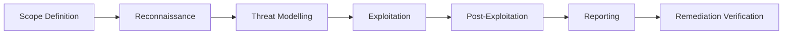
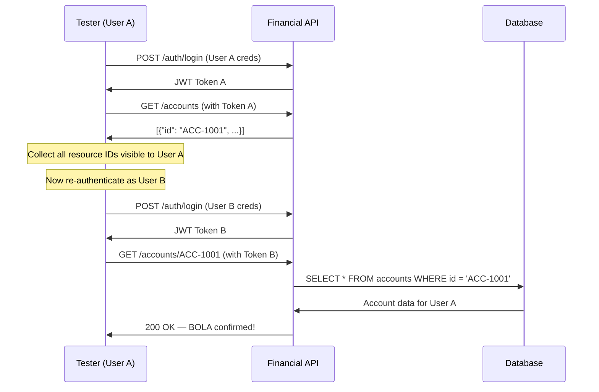
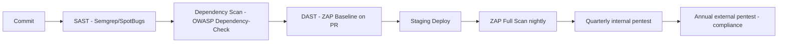

# اختبار الاختراق — تقييم أمان الواجهات المالية

اختبار الاختراق (pentesting) هو ممارسة محاكاة هجمات عدائية ضد أنظمتك لاكتشاف الثغرات قبل أن يكتشفها المهاجمون. وفي الخدمات المالية، حيث قد تكون كلفة الاختراق غرامات تنظيمية وتعويضات للعملاء وضررًا دائمًا بالسمعة، فإن اختبار الاختراق المنظم ليس اختياريًا — فيتطلب PCI DSS اختبارات اختراق داخلية وخارجية سنويًا على الأقل وبعد التغييرات الجوهرية (المتطلب 11.4)، ويتطلب DORA اختبار اختراق قائمًا على التهديدات (TLPT) كل ثلاث سنوات على الأقل للكيانات المالية المهمة، وتدير الجهات الرقابية برامج قائمة على الاستخبارات مثل CBEST ‏(المملكة المتحدة) وTIBER-EU.

يغطي هذا الدرس منهجية اختبار الاختراق الكاملة مطبقة على الواجهات المالية، وكل فئة في OWASP API Security Top 10 ‏(إصدار 2023) مع سيناريوهات استغلال واقعية في التقنية المالية، وكيفية دمج الاختبار الديناميكي الآلي في خط CI/CD لالتقاط التراجعات قبل وصولها إلى الإنتاج.

---

## نظرة عامة على منهجية اختبار الاختراق

يتبع اختبار الاختراق الاحترافي دورة حياة منظمة. فدون نطاق ومنهجية محددين، يصبح الاختبار تحسسًا عشوائيًا يفوّت المسارات الحرجة ويهدر الوقت.



### المرحلة 1: تحديد النطاق

وثيقة النطاق عقد قانوني وتقني بين فريق الاختبار والمؤسسة. ويجب أن تحدد:

- **الأنظمة ضمن النطاق**: أسماء المضيفين، ونطاقات IP، ونقاط الواجهات، وتطبيقات الهاتف
- **خارج النطاق**: قواعد بيانات الإنتاج ذات بيانات العملاء الحية (استخدم نسخة اصطناعية أو مقنّعة بشكل صحيح)، وقنوات الدفع لدى الأطراف الثالثة (إلا إن وافق المزوّد كتابيًا)
- **نافذة الاختبار**: وقت اليوم، وفترات تجميد التغييرات
- **التقنيات المسموحة**: استطلاع سلبي فقط مقابل استغلال كامل مقابل هندسة اجتماعية
- **قواعد الاشتباك**: ماذا يحدث إن اكتُشفت ثغرة حرجة أثناء الاختبار (مسار تصعيد فوري)
- **التعامل مع البيانات**: كيف يجب التعامل مع بيانات الاعتماد أو عينات PAN المكتشفة وإتلافها

ولتقييم واجهة تقنية مالية نموذجي، تحدد وثيقة النطاق أيضًا حسابات الاختبار وأرقام بطاقات الاختبار المصرح بها مسبقًا. ولا تستخدم أبدًا بيانات اعتماد عملاء حقيقيين.

### المرحلة 2: الاستطلاع

يجمع الاستطلاع معلومات عن الهدف دون إطلاق التنبيهات. ولتقييمات الواجهات:

- **سلبي**: مراجعة مواصفات OpenAPI/Swagger المنشورة، ومستودعات GitHub العامة، وإعلانات الوظائف (التي تكشف حزمة التقنيات)، وسجلات شفافية الشهادات، وShodan/Censys للخدمات المكشوفة
- **نشط**: تعداد النقاط عبر الزحف، وتشويش معاملات المسار (fuzzing)، ومراجعة حزم JavaScript بحثًا عن مسارات الواجهات الداخلية

ونتيجة شائعة في التقنية المالية: ملفات APK لتطبيقات الهاتف المفككة بـ `apktool` تكشف عناوين أساسية مكتوبة في الكود لواجهات التجهيز ومسارات نقاط داخلية لم توثّق علنًا قط.

### المرحلة 3: الاستغلال

يثبت الاستغلال أن الثغرات حقيقية ويقيس أثرها. والهدف ليس التدمير — بل الدليل. وتتضمن النتيجة الجيدة:

1. طلب HTTP الدقيق الذي يطلق الثغرة
2. الاستجابة التي تثبت كشف البيانات أو تصعيد الصلاحيات
3. أثر الأعمال (ما البيانات أو العملية المكشوفة)
4. إصلاحًا موصى به

---

## ‏OWASP API Top 10 — سيناريوهات استغلال في التقنية المالية

### ‏API1: التفويض المعطوب على مستوى الكائن (BOLA / IDOR)

‏BOLA أكثر ثغرات الواجهات شيوعًا وأثرًا في الخدمات المالية. فتتيح الواجهة للمستخدم قراءة موارد مستخدم آخر أو تعديلها بمجرد تغيير معرّف في الطلب.

**متحكم معرّض للثغرة:**

```java
// VULNERABLE: no ownership check
@GetMapping("/accounts/{accountId}")
public ResponseEntity<AccountResponse> getAccount(
        @PathVariable String accountId,
        @AuthenticationPrincipal UserPrincipal principal) {
    // BUG: fetches any account by ID regardless of who is asking
    Account account = accountRepository.findById(accountId)
        .orElseThrow(() -> new AccountNotFoundException(accountId));
    return ResponseEntity.ok(AccountMapper.toResponse(account));
}
```

**الاستغلال:** يزيد مهاجم موثق كالمستخدم 1001 معرّف الحساب ببساطة:

```
GET /api/v1/accounts/1002 HTTP/1.1
Authorization: Bearer <token_for_user_1001>
```

فيتلقى تفاصيل الحساب كاملة — الرصيد، ورمز الفرع، ورقم الحساب، وسجل المعاملات — للمستخدم 1002.

**المتحكم المُصلح:**

```java
@GetMapping("/accounts/{accountId}")
public ResponseEntity<AccountResponse> getAccount(
        @PathVariable String accountId,
        @AuthenticationPrincipal UserPrincipal principal) {
    Account account = accountRepository.findByIdAndOwnerId(accountId, principal.getUserId())
        .orElseThrow(() -> new AccessDeniedException("Account not found or not accessible"));
    return ResponseEntity.ok(AccountMapper.toResponse(account));
}
```

يرشّح الإصلاح دائمًا بمعرّف المورد ومعرّف المستخدم الموثق معًا. ورسالة الخطأ مبهمة عمدًا — فلا تكشف ما إذا كان الحساب موجودًا لكن غير متاح أم غير موجود أصلًا.

**منهجية الاختبار:** أتمت اختبار BOLA بتسجيل الدخول كمستخدمَي اختبار مختلفين، والتقاط كل معرّفات الموارد المعادة للمستخدم A، ثم إعادة تلك الطلبات موثقة كالمستخدم B.

---

### ‏API2: المصادقة المعطوبة

**السيناريو: سر توقيع JWT ضعيف.** سوء إعداد شائع هو توقيع JWT بسر متوقع أو قصير.

```bash
# Attacker brute-forces the JWT secret using hashcat or jwt_tool
python3 jwt_tool.py eyJ... -C -d /wordlists/common-jwt-secrets.txt

# If the secret is "secret123", the attacker can forge any token:
python3 jwt_tool.py eyJ... -T -S hs256 -p "secret123"
# Then modifies the payload: "sub": "admin", "role": "ADMIN"
```

**هجوم الخلط بين خوارزميات JWT ‏(RS256 ← HS256):**

إن قبل الخادم RS256 وHS256 معًا، يستطيع المهاجم:

1. الحصول على مفتاح RSA العام للخادم (كثيرًا ما يكون مكشوفًا عند `/.well-known/jwks.json`)
2. تزوير رمز جديد موقع بـ HS256 باستخدام المفتاح العام كسر HMAC
3. يتحقق الخادم من توقيع HS256 باستخدام المفتاح العام — فينجح

```java
// VULNERABLE (pseudo-code): picks the verification algorithm from the
// attacker-controlled "alg" header and uses one key for every algorithm
String alg = decodedJWT.getAlgorithm();           // "HS256" chosen by the attacker
Algorithm algorithm = "HS256".equals(alg)
    ? Algorithm.HMAC256(publicKeyPemBytes)        // public key used as HMAC secret!
    : Algorithm.RSA256(publicKey, null);
JWT.require(algorithm).build().verify(token);

// FIXED (auth0 java-jwt): the server fixes the algorithm and key; a token
// with any other "alg" fails verification
JWTVerifier verifier = JWT.require(Algorithm.RSA256(publicKey, null))
    .withIssuer("https://auth.fintech.example.com")   // the token ISSUER (auth server)
    .withAudience("payments-api")                     // this API
    .build();
DecodedJWT jwt = verifier.verify(token);              // also checks exp/nbf
```

---

### ‏API3: التفويض المعطوب على مستوى خصائص الكائن (الإسناد الجماعي)

**السيناريو:** يحدّث مستخدم ملفه الشخصي فتربط الواجهة كل حقول الطلب مباشرة بالكيان، بما فيها حقول مثل `role` أو `kycStatus`.

```java
// VULNERABLE: binds all fields from request body
@PutMapping("/users/me")
public ResponseEntity<UserResponse> updateProfile(
        @RequestBody UserUpdateRequest request,
        @AuthenticationPrincipal UserPrincipal principal) {
    User user = userRepository.findById(principal.getUserId()).orElseThrow();
    // BUG: maps every field including role, kycStatus, creditLimit
    modelMapper.map(request, user);
    return ResponseEntity.ok(UserMapper.toResponse(userRepository.save(user)));
}
```

**الاستغلال:**

```http
PUT /api/v1/users/me
Content-Type: application/json

{
  "displayName": "John",
  "email": "john@example.com",
  "role": "ADMIN",
  "kycStatus": "VERIFIED",
  "creditLimit": 1000000
}
```

**الحل:** استخدم كائنات DTO مخصصة بالحقول المسموح للمستخدمين بتعديلها فقط:

```java
// Only expose fields the user is allowed to change
public class UserProfileUpdateRequest {
    private String displayName;
    private String phoneNumber;
    // role, kycStatus, creditLimit — not present here
}
```

---

### ‏API4: الاستهلاك غير المقيد للموارد

**السيناريو:** غياب تحديد المعدل على نقطة سجل المعاملات يتيح لمهاجم كشط سجل المعاملات الكامل لكل عميل عبر BOLA.

```bash
# Attacker script: iterate account IDs and dump all transactions
for i in $(seq 10000 99999); do
  curl -s -H "Authorization: Bearer $TOKEN" \
    "https://api.bank.example/v1/accounts/$i/transactions?limit=1000" \
    >> transactions_dump.json
done
```

ودون تحديد المعدل، يكتمل هذا في دقائق ويسرّب ملايين سجلات المعاملات.

**تحديد المعدل في Spring Boot بـ Bucket4j:**

```java
// Bucket4j 8.x API. Buckets live in memory PER POD -- with N replicas a
// client gets N x the limit. For a real limit use a shared store
// (bucket4j-redis / the API gateway), as in the API security lesson.
// Register the filter AFTER Spring Security so the user ID is known.
@Component
public class RateLimitingFilter extends OncePerRequestFilter {

    // Caffeine cache: idle buckets expire instead of growing forever
    private final Cache<String, Bucket> buckets = Caffeine.newBuilder()
        .expireAfterAccess(Duration.ofMinutes(10))
        .maximumSize(1_000_000)
        .build();

    @Override
    protected void doFilterInternal(HttpServletRequest request,
                                     HttpServletResponse response,
                                     FilterChain chain) throws IOException, ServletException {
        String userId = extractUserId(request);       // fall back to client IP if anonymous
        Bucket bucket = buckets.get(userId, key ->
            Bucket.builder()
                .addLimit(limit -> limit.capacity(100)
                                        .refillGreedy(100, Duration.ofMinutes(1)))
                .build()
        );

        if (bucket.tryConsume(1)) {
            chain.doFilter(request, response);
        } else {
            response.setStatus(429);
            response.setHeader("Retry-After", "60");
            response.setContentType("application/json");
            response.getWriter().write("{\"error\":\"Rate limit exceeded\"}");
        }
    }
}
```

---

### ‏API5: التفويض المعطوب على مستوى الوظيفة

**السيناريو:** نقطة إدارية لتجميد حسابات العملاء متاحة للمستخدمين العاديين لأنها تعتمد فقط على أمان مسار URL، لا على التفويض على مستوى الدالة.

```java
// VULNERABLE: regular users can reach this endpoint
@PostMapping("/accounts/{accountId}/freeze")
public ResponseEntity<Void> freezeAccount(@PathVariable String accountId) {
    accountService.freeze(accountId);
    return ResponseEntity.noContent().build();
}
```

**الاستغلال:**

```
POST /api/v1/accounts/9999/freeze HTTP/1.1
Authorization: Bearer <regular_user_token>
```

فيُجمَّد الحساب 9999. وقد نفّذ المستخدم العادي إجراءً إداريًا.

**الحل:**

```java
@PostMapping("/accounts/{accountId}/freeze")
@PreAuthorize("hasRole('COMPLIANCE_OFFICER') or hasRole('ADMIN')")
public ResponseEntity<Void> freezeAccount(
        @PathVariable String accountId,
        @AuthenticationPrincipal UserPrincipal principal) {
    auditService.log("ACCOUNT_FREEZE", accountId, principal.getUserId());
    accountService.freeze(accountId);
    return ResponseEntity.noContent().build();
}
```

---

### ‏API6: الوصول غير المقيد إلى تدفقات الأعمال الحساسة

**السيناريو:** كل طلب منفرد مصرح به وسليم الصيغة، لكن *التدفق* يمكن أتمتته بحجم لم تقصده الأعمال قط. أمثلة من التقنية المالية:

- **اختبار البطاقات**: تدفع الروبوتات آلاف عمليات "إضافة بطاقة" الصغيرة أو تفويضات بقيمة يورو واحد عبر تدفق الدفع لمعرفة أي أرقام البطاقات المسروقة ما زالت فعالة.
- **إساءة استخدام التسجيل والإحالة**: إنشاء حسابات بسكربتات لجني مكافأة "20 يورو لكل صديق تحيله".
- **مقارنة الأسعار**: منافس يكشط نقطة عروض أسعار الصرف كل ثانية.

**الحل:** حدد تدفقات الأعمال التي ستضر إن أُتمتت، واحمِ كلًا منها تحديدًا: حدود لكل حساب وجهاز وبطاقة (قواعد السرعة)، وبصمة الأجهزة واكتشاف الروبوتات، وتحقق إضافي (3-D Secure، وCAPTCHA) حين يبدو السلوك آليًا، ومراقبة مقاييس مستوى التدفق (مثل نسبة تفويضات البطاقات الفاشلة إلى الناجحة).

---

### ‏API7: تزوير الطلبات من جانب الخادم (SSRF)

**السيناريو:** تتيح نقطة إعداد webhook للدفع للمستخدمين تسجيل عناوين رد النداء. فيسجّل مهاجم نقطة البيانات الوصفية في AWS.

```http
POST /api/v1/webhooks
Content-Type: application/json

{
  "url": "http://169.254.169.254/latest/meta-data/iam/security-credentials/",
  "events": ["PAYMENT_COMPLETED"]
}
```

حين تكتمل دفعة، يجلب التطبيق عنوان رد النداء ويعيد الاستجابة في سجل خطأ — فيكشف بيانات اعتماد IAM لمثيل EC2.

**الحل:** تحقق من عناوين webhook مقابل قائمة سماح بالمخططات، واحظر نطاقات IP الخاصة، وأرسل الطلبات عبر وكيل خروج مخصص:

```java
public void validateWebhookUrl(String url) throws UnknownHostException {
    URI uri = URI.create(url);

    if (!"https".equals(uri.getScheme()) || uri.getUserInfo() != null) {
        throw new InvalidWebhookUrlException("Only HTTPS URLs without credentials are permitted");
    }

    // Check EVERY resolved address, not just the first one
    for (InetAddress address : InetAddress.getAllByName(uri.getHost())) {
        if (address.isAnyLocalAddress() || address.isLoopbackAddress()
                || address.isLinkLocalAddress() || address.isSiteLocalAddress()
                || isUniqueLocalOrCgnat(address)) {   // fc00::/7, 100.64.0.0/10 -- the
                                                      // JDK checks above miss these
            throw new InvalidWebhookUrlException("Private/internal URLs are not permitted");
        }
    }
}
// Validation alone does not stop DNS rebinding or redirects: connect only to
// the validated IP (or via an egress proxy that applies the same rules) and
// disable redirect following -- see the SSRF section of the OWASP lesson.
```

---

### ‏API8: سوء إعداد الأمان — ‏Swagger UI في الإنتاج

‏Swagger UI المكشوف في الإنتاج يعطي المهاجمين خريطة موثقة بالكامل لسطح الهجوم — كل نقطة ومعامل ونموذج — إضافة إلى زر "Try it out" لإرسال الطلبات مباشرة من المتصفح.

**الاكتشاف:**

```bash
# Common paths to check
curl -I https://api.bank.example/swagger-ui.html
curl -I https://api.bank.example/v3/api-docs
curl -I https://api.bank.example/api-docs
```

**الحل في Spring Boot:**

```yaml
# application-production.yml
springdoc:
  api-docs:
    enabled: false
  swagger-ui:
    enabled: false
```

أو فعّله شرطيًا فقط في الملفات الشخصية غير الإنتاجية:

```java
@Configuration
@Profile({"development", "staging"})
public class OpenApiConfig {
    @Bean
    public GroupedOpenApi publicApi() {
        return GroupedOpenApi.builder().group("public").pathsToMatch("/api/**").build();
    }
}
```

---

### ‏API9: الإدارة غير السليمة للجرد

**السيناريو 1 — نقطة غير موثقة:** نقطة `/internal/admin` غير موثقة اكتُشفت أثناء تحليل حزمة JavaScript:

```bash
# In the mobile app bundle:
grep -r "internal/admin" app.bundle.js
# Found: /internal/admin/users/{userId}/balance-override
```

بُنيت هذه النقطة لاختبار الحمل، ولم تُزل قط، وتتيح تعديلات اعتباطية للأرصدة دون مصادقة في مسار HTTP (اعتمدت على ضوابط على مستوى الشبكة تم تجاوزها في الإنتاج).

**الضابط:** احتفظ بجرد كامل للواجهات في بوابة الواجهات أو مواصفة قابلة للقراءة آليًا. وشغّل اختبارات آلية في CI تتحقق من ظهور كل نقطة منشورة في جردك.

**السيناريو 2 — إصدار واجهة قديم منسي:** أُهمل الإصدار v1 من الواجهة (`/api/v1/`) قبل 18 شهرًا لكنه لم يُوقف قط. وليس فيه تحديد معدل، ولا منطق التحقق الحالي من JWT، ويقبل كلمات مرور مجزأة بـ MD5.

```http
POST /api/v1/auth/login
Content-Type: application/json

{"username": "user@example.com", "password": "md5hashhere"}
```

تصادق نقطة v1 المستخدم وتعيد JWT تقبله كل خدمات v2 الحالية.

**الحل:** حدد تواريخ انتهاء صريحة لإصدارات الواجهات. واحجب الإصدارات القديمة خلف مفاتيح ميزات. وراقب الحركة إلى الإصدارات المهملة ونبّه حين يقترب الاستخدام من الصفر (ما يشير إلى أمان إزالتها) أو يرتفع فجأة (ما يشير إلى أن أحدًا يستهدفها).

---

### ‏API10: الاستهلاك غير الآمن للواجهات

**السيناريو:** تعيد بوابة الدفع حقل `status`. ويثق التطبيق به دون تحقق:

```java
// VULNERABLE: trusts external API response blindly
PaymentGatewayResponse gatewayResponse = callPaymentGateway(request);
if ("SUCCESS".equals(gatewayResponse.getStatus())) {
    ledgerService.credit(accountId, amount);
}
```

والمهاجم الذي يستطيع تنفيذ هجوم الرجل في المنتصف على اتصال البوابة (أو يخترق البوابة نفسها) يستطيع حقن `"status": "SUCCESS"` لدفعة فاشلة.

**الحل:** استخدم TLS مع التحقق من الشهادة (ولا تعطله أبدًا "مؤقتًا")، وتحقق من مخطط الاستجابة، وتحقق من توقيعات الاستجابة أو webhook حيث يقدمها المزوّد، وافحص مفاتيح عدم التكرار، وطابق بشكل غير متزامن مقابل واجهة التقارير الخاصة بالبوابة:

```java
PaymentGatewayResponse gatewayResponse = callPaymentGateway(request);
if (!signatureVerifier.verify(gatewayResponse)) {
    throw new PaymentResponseIntegrityException("Gateway response signature invalid");
}
// Also persist the raw response for async reconciliation
paymentAuditRepository.save(new PaymentAudit(request.getIdempotencyKey(), gatewayResponse));
```

---

## منهجية اختبار BOLA/IDOR بالتفصيل

اختبار BOLA منهجي لواجهة مالية:



أتمت هذا بـ Burp Suite Intruder أو سكربت مخصص يعيد الطلبات عبر سياقات مصادقة مختلفة.

---

## ‏DAST آلي بـ OWASP ZAP في CI/CD

ادمج فحص OWASP ZAP الأساسي في خط GitHub Actions لالتقاط التراجعات مع كل طلب سحب.

```yaml
# .github/workflows/security-scan.yml
name: OWASP ZAP Security Scan

on:
  pull_request:
    branches: [main]
  schedule:
    - cron: '0 2 * * *'  # nightly run (use zaproxy/action-full-scan against
                         # staging for an active "full" scan)

jobs:
  zap-baseline:
    runs-on: ubuntu-latest
    steps:
      - name: Checkout
        uses: actions/checkout@v4

      - name: Start application
        run: |
          docker compose -f docker-compose.test.yml up -d
          ./scripts/wait-for-healthy.sh http://localhost:8080/actuator/health

      - name: ZAP Baseline Scan
        uses: zaproxy/action-baseline@v0.14.0   # pin to a commit SHA in production
        with:
          target: 'http://localhost:8080'
          rules_file_name: '.zap/rules.tsv'
          cmd_options: '-a -j -l WARN'
          fail_action: true

      - name: Upload ZAP report
        if: always()
        uses: actions/upload-artifact@v4
        with:
          name: zap-report
          path: report_html.html

      - name: Stop application
        if: always()
        run: docker compose -f docker-compose.test.yml down
```

**ملف قواعد ZAP** لكبت الإيجابيات الكاذبة المعروفة. والصيغة مفصولة بعلامات جدولة: معرّف القاعدة، والإجراء (`IGNORE`، أو `INFO`، أو `WARN`، أو `FAIL`)، ووصف نصي حر؛ وسجّل *سبب* كبت كل قاعدة في توثيقك الأمني، وراجع القائمة بانتظام:

```tsv
10038	IGNORE	(Content Security Policy Header Not Set - set by the CDN, not the app)
10054	IGNORE	(Cookie without SameSite Attribute - session cookie issued by the auth service)
90033	IGNORE	(Loosely Scoped Cookie)
```

---

## بنية تقرير اختبار الاختراق

يجب أن يتبع تقرير اختبار الاختراق لمنظمي الخدمات المالية ولجان المخاطر بنية قياسية:

```
1. Executive Summary (1 page)
   - Testing period and scope
   - Critical findings count by severity
   - Risk posture statement

2. Methodology
   - Testing approach (black/grey/white box)
   - Tools used (Burp Suite Pro, OWASP ZAP, custom scripts)
   - OWASP Testing Guide version

3. Findings (per vulnerability)
   - ID, Title, Severity (Critical/High/Medium/Low/Informational)
   - CVSS score and vector (v3.1 or v4.0 — state which)
   - Description
   - Evidence (request/response)
   - Business impact
   - Remediation recommendation

4. Risk Register
   - All findings mapped to risk register entries

5. Remediation Tracking
   - Status: Open / In Progress / Resolved / Risk Accepted
```

---

## اتفاقيات مستوى الخدمة للمعالجة في التقنية المالية

تحدد سياسة أمن المعلومات الخاصة بكل شركة الجداول الزمنية للمعالجة وتُراجع أثناء التدقيقات؛ وتضع اللوائح الحد الأدنى. فيتطلب PCI DSS مثلًا تثبيت تصحيحات الأمان الحرجة والعالية خلال شهر من إصدارها (المتطلب 6.3.3) وتصحيح الثغرات القابلة للاستغلال التي تكتشفها اختبارات الاختراق وإعادة اختبارها (11.4.4) — ولا يحدد ساعات. وسياسة التقنية المالية النموذجية أشد بكثير من الحد الأدنى:

| الخطورة | نطاق CVSS | مثال على مدة السياسة | مثال |
|----------|-----------|-----|---------|
| حرجة | 9.0–10.0 | 24 ساعة | ‏BOLA يكشف كل أرصدة الحسابات |
| عالية | 7.0–8.9 | 7 أيام | تجاوز مصادقة معطوبة |
| متوسطة | 4.0–6.9 | 30 يومًا | غياب تحديد المعدل على نقطة غير حساسة |
| منخفضة | 0.1–3.9 | 90 يومًا | كشف معلومات في رسائل الخطأ |
| معلوماتية | لا ينطبق | السباق التالي | غياب ترويسات الأمان |

وللنتائج الحرجة، تكون العملية:

1. تأكيد النتيجة من المختبِر وقائد الأمن (ساعة)
2. فتح تذكرة حادث وإشراك المناوب P1 ‏(ساعتان)
3. نشر تخفيف مؤقت (قاعدة WAF، أو تعطيل مفتاح ميزة) (12 ساعة)
4. نشر إصلاح السبب الجذري في الإنتاج (24 ساعة)
5. تأكيد إعادة الاختبار من المختبِر (48 ساعة)

---

## مزالق الإنتاج

### المزلق 1: الاختبار على بيانات الإنتاج

**المشكلة:** فرق اختبار الاختراق التي تُمنح وصولًا إلى بيئات الإنتاج تطلق أحيانًا وظائف تعدّل بيانات عملاء حقيقية أو ترسل إشعارات حقيقية.

```http
# A pentest that sends real payment instructions
POST /api/v1/payments
Authorization: Bearer <pentest_token_with_prod_access>
{
  "fromAccount": "REAL_CUSTOMER_ACCOUNT",
  "toAccount": "ATTACKER_ACCOUNT",
  "amount": 1000,
  "currency": "GBP"
}
```

وهذا حادث أمني وخرق تنظيمي معًا إن كان الحساب لعميل حقيقي.

**الوقاية:** احتفظ ببيئة اختبار اختراق معزولة تمامًا ببيانات اصطناعية تحاكي مخطط الإنتاج. ويجب ألا يكون لبيئة اختبار الاختراق أي مسار شبكي إلى قواعد بيانات الإنتاج أو قنوات الدفع. واحصر رموز اختبار الاختراق في مستأجر منفصل في خدمة المصادقة:

```java
@Component
public class PentestTenantIsolationFilter extends OncePerRequestFilter {
    @Override
    protected void doFilterInternal(HttpServletRequest request,
                                     HttpServletResponse response,
                                     FilterChain chain) throws IOException, ServletException {
        String tenant = extractTenant(request);
        if ("pentest".equals(tenant) && isProductionDataPath(request.getRequestURI())) {
            response.setStatus(403);
            response.getWriter().write("{\"error\":\"Pentest tenant cannot access production data paths\"}");
            return;
        }
        chain.doFilter(request, response);
    }
}
```

---

### المزلق 2: إصلاح الأعراض لا الأسباب الجذرية

**المشكلة:** تُ"صلح" نتيجة BOLA بإضافة فحص ملكية للنقطة المحددة في التقرير، لكن عشرات النقاط الأخرى بالنمط نفسه تبقى معرّضة للثغرة.

```java
// "Fixed" only the reported endpoint
@GetMapping("/accounts/{id}")
public Account getAccount(@PathVariable String id, @AuthenticationPrincipal UserPrincipal p) {
    return accountRepository.findByIdAndOwnerId(id, p.getUserId()).orElseThrow();
}

// But these were not in scope and remain vulnerable:
// GET /loans/{id}        — no ownership check
// GET /cards/{id}        — no ownership check
// GET /beneficiaries/{id} — no ownership check
```

**الوقاية:** عامل نتائج اختبار الاختراق كإشارات إلى فئات ثغرات، لا كأخطاء فردية فقط. فحين يُكتشف BOLA، دقّق كل نقطة موارد في قاعدة الكود بحثًا عن النمط نفسه. واستخدم مستودعًا أساسيًا يفرض الملكية:

```java
// Enforce at the repository layer. Extending the bare Repository marker
// (NOT JpaRepository/CrudRepository) means findById/findAll simply do not
// exist -- callers must always provide ownerId.
@NoRepositoryBean
public interface OwnedResourceRepository<T, ID> extends Repository<T, ID> {
    Optional<T> findByIdAndOwnerId(ID id, String ownerId);
    List<T> findAllByOwnerId(String ownerId);
    T save(T entity);
}
// Complement with an ArchUnit test that forbids controllers from using
// repositories that still expose findById
```

---

### المزلق 3: اعتبار اختبارات الاختراق السنوية كافية

**المشكلة:** تتطلب اللوائح المالية اختبارات اختراق دورية (PCI DSS: سنويًا على الأقل وبعد التغييرات الجوهرية). وتعامل الفرق الاختبار السنوي كشبكة أمان ولا تختبر الأمان باستمرار.

يغطي الاختبار السنوي لقطة في نقطة زمنية. والكود المنشور بعد أسبوع من الاختبار قد يُدخل ثغرات جديدة تبقى دون اختبار 51 أسبوعًا.

**الوقاية:** وزّع الاختبار الأمني على طبقات عبر دورة حياة التطوير:



تلتقط كل طبقة فئات ثغرات مختلفة. فيجد SAST مشكلات على مستوى الكود. ويجد DAST مشكلات إعداد وقت التشغيل. واختبار الاختراق السنوي تأكيد امتثال لنظام مختبر بالفعل، لا خط الدفاع الأول.

---

## قائمة تحقق الدرس

- [ ] تستطيع شرح فئات أمان الواجهات العشر في OWASP مع مثال خاص بالتقنية المالية لكل منها
- [ ] تستطيع تحديد ثغرات BOLA في كود Java Spring Boot وكتابة الإصلاح الصحيح
- [ ] تستطيع وصف هجوم الخلط بين خوارزميات JWT ومنعه بفرض الخوارزمية المتوقعة من جانب الخادم
- [ ] تستطيع ضبط فحص OWASP ZAP الأساسي في سير عمل GitHub Actions
- [ ] تستطيع تحديد مدد المعالجة حسب الخطورة (مثل: حرجة 24 ساعة، عالية 7 أيام، متوسطة 30 يومًا، منخفضة 90 يومًا) وتعرف أنها سياسة الشركة — فـ PCI DSS يضع الحد الأدنى فقط (التصحيحات الحرجة خلال شهر، وتصحيح نتائج اختبار الاختراق وإعادة اختبارها)
- [ ] تستطيع كتابة وثيقة نطاق لاختبار الاختراق تمنع الأثر العرضي على الإنتاج
- [ ] تفهم لماذا لا تكفي اختبارات الاختراق السنوية وحدها وتستطيع وصف استراتيجية اختبار متعددة الطبقات

---

<!-- KNOWLEDGE-CHECK
{"questions":[{"text":"ينجح مهاجم موثق كالمستخدم A في استرجاع تفاصيل حساب المستخدم B بتغيير معرّف الحساب في مسار URL. أي فئة من OWASP API Top 10 يمثلها هذا؟","options":["‏API2: المصادقة المعطوبة","‏API1: التفويض المعطوب على مستوى الكائن","‏API5: التفويض المعطوب على مستوى الوظيفة","‏API3: التفويض المعطوب على مستوى خصائص الكائن"],"correct":1,"explanation":"يحدث BOLA ‏(التفويض المعطوب على مستوى الكائن)، المعروف أيضًا بـ IDOR، حين لا تتحقق الواجهة من أن المستخدم الموثق يملك المورد الذي يطلبه. والإصلاح ترشيح عمليات البحث عن الموارد دائمًا بمعرّف المورد ومعرّف المستخدم الموثق معًا."},{"text":"‏JWT موقع بـ RS256 والمفتاح العام للخادم متاح عند /.well-known/jwks.json. أي هجوم ممكن إن قبل الخادم أيضًا رموز HS256؟","options":["يستطيع المهاجم سرقة المفتاح الخاص من نقطة JWKS","يستطيع المهاجم تزوير رمز HS256 صالح باستخدام المفتاح العام كسر HMAC","يستطيع المهاجم إعادة رموز RS256 القديمة إلى ما لا نهاية","يستطيع المهاجم تعداد معرّفات المستخدمين من ادعاء subject في JWT"],"correct":1,"explanation":"في هجوم الخلط بين خوارزميات JWT، ينزّل المهاجم مفتاح RSA العام ويستخدمه كسر HMAC لتوقيع رمز HS256 مزوّر. وإن قبل الخادم الخوارزميتين وتحقق من رموز HS256 باستخدام المفتاح العام، يجتاز الرمز المزوّر التحقق. والإصلاح فرض الخوارزمية المتوقعة صراحة من جانب الخادم."},{"text":"تحدد سياسة الأمان في شركة تقنية مالية مدد المعالجة حسب الخطورة. ماذا يتطلب PCI DSS نفسه، وما المدة النموذجية في السياسة لنتيجة حرجة (CVSS 9.0+) من اختبار اختراق؟","options":["يتطلب PCI DSS إصلاح كل النتائج خلال 24 ساعة؛ ويمكن للسياسة تخفيف ذلك إلى 7 أيام","يضع PCI DSS حدًا أدنى (مثل تصحيحات الأمان الحرجة خلال شهر، وتصحيح نتائج اختبار الاختراق وإعادة اختبارها)؛ وسياسات الشركات عادة أشد بكثير — مثل التخفيف خلال ساعات والإصلاح خلال 24 ساعة","ليس في PCI DSS متطلبات معالجة، فلا حاجة لمدة محددة","يتطلب PCI DSS الإصلاحات فقط عند اختبار الاختراق السنوي التالي"],"correct":1,"explanation":"لا يحدد PCI DSS ساعات: فيتطلب تصحيحات الأمان الحرجة/العالية خلال شهر من إصدارها (6.3.3) وتصحيح الثغرات القابلة للاستغلال التي يكتشفها اختبار الاختراق والتحقق من الإصلاح بإعادة الاختبار (11.4.4). وتضع الشركات مددًا داخلية أشد — للنتائج الحرجة عادة تخفيف مؤقت فوري (قاعدة WAF، أو مفتاح ميزة) خلال ساعات وإصلاح السبب الجذري خلال نحو 24 ساعة، يليه تأكيد إعادة الاختبار."}]}
-->

<!-- PRACTICAL-CHALLENGE
{"title":"تقييم أمان واجهة مالية","difficulty":"advanced","estimatedMinutes":90,"tasks":[{"id":"1","description":"أعدّ تطبيق Spring Boot محليًا بنقطة /api/v1/accounts/{id}. ونفّذ النسخة المعرّضة للثغرة (بلا فحص ملكية)، ثم اكتب اختبارًا آليًا باستخدام رمزي مستخدمَي اختبار يثبت ثغرة BOLA. ثم أصلح النقطة وتأكد من أن الاختبار يعيد الآن 403 للطلب بين المستخدمين."},{"id":"2","description":"احصل على JWT اختباري موقع بـ HS256 باستخدام السر 'secret123'. واستخدم jwt_tool أو برنامج Java بسيطًا لتزوير رمز جديد بـ role=ADMIN. ثم نفّذ متحقق JWT في Spring Security يرفض أي رمز غير موقع بالخوارزمية والسر المتوقعين، وتأكد من رفض الرمز المزوّر."},{"id":"3","description":"أضف فحص OWASP ZAP الأساسي إلى سير عمل GitHub Actions لتطبيق Spring Boot نموذجي. واضبط ملف .zap/rules.tsv لكبت إيجابيتين كاذبتين معروفتين على الأقل. وتأكد من أن سير العمل يُفشل البناء حين يبلّغ ZAP عن نتيجة عالية الخطورة وينجح حين توجد نتائج منخفضة/معلوماتية فقط."},{"id":"4","description":"اكتب قالب وثيقة نطاق لاختبار اختراق لتقييم واجهة تقنية مالية. ويجب أن يتضمن: أقسام ضمن النطاق/خارج النطاق، ونافذة الاختبار، والتقنيات المسموحة، وقواعد الاشتباك للنتائج الحرجة، ومتطلبات التعامل مع عينات PAN المكتشفة، وجدول مدد المعالجة (من حرجة إلى معلوماتية)، مع بيان أي المدد تأتي من سياسة الشركة وأيها من اللوائح."}]}
-->
