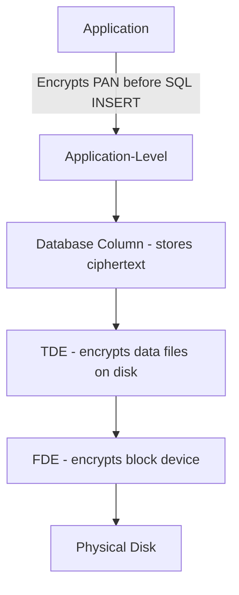
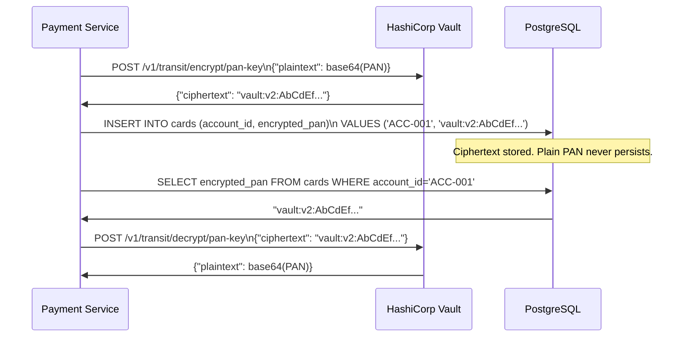
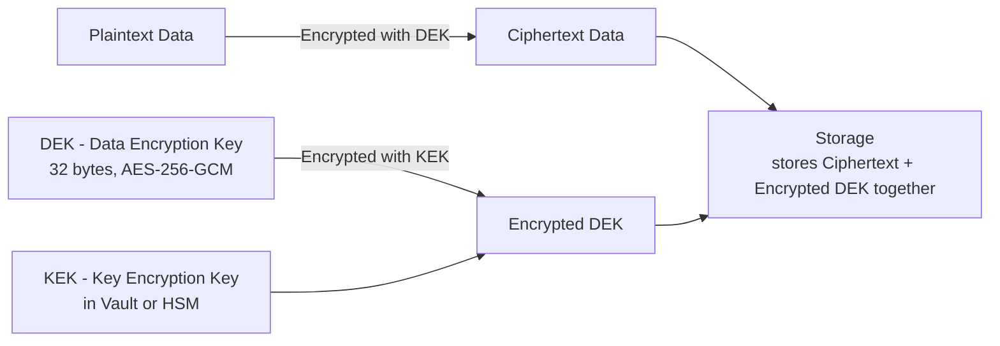
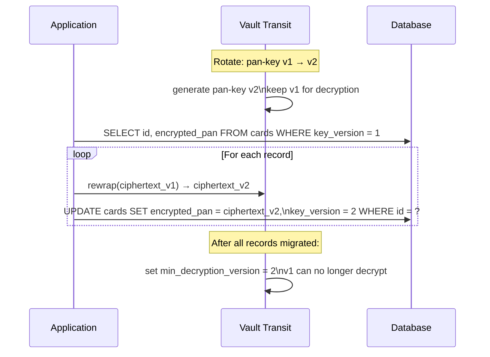

# تشفير البيانات — أثناء التخزين وأثناء النقل في القطاع المالي

تخضع البيانات المالية أثناء التخزين والنقل لأشد متطلبات الحماية صرامة بين كل القطاعات. فيفرض المتطلب 3 في PCI-DSS جعل أرقام الحسابات الأساسية (PAN) غير قابلة للقراءة أينما خُزنت. ويفرض المتطلب 4 تشفيرًا قويًا عبر الشبكات المفتوحة. ويتطلب GDPR تدابير تقنية مناسبة للبيانات الشخصية. وتتوقع الجهات الرقابية المالية (FCA في المملكة المتحدة، وقواعد إدارة مخاطر تقنية المعلومات والاتصالات في DORA بالاتحاد الأوروبي) أن تحمي الشركات معلومات العملاء الحساسة.

يبني هذا الدرس الأساس التقني: مستويات التشفير، وتنفيذ AES-256-GCM، وإعداد TLS 1.3، والتشفير على مستوى الحقل عبر HashiCorp Vault، والتشفير المغلّف، ووحدات HSM، وتدوير المفاتيح — دون توقف.

---

## التشفير أثناء التخزين: اختيار المستوى الصحيح

لا توجد إجابة صحيحة واحدة لمكان تطبيق التشفير. فكل طبقة تحمي من تهديد مختلف. وعمليًا، تطبق شركات الخدمات المالية طبقات متعددة في آن واحد.

| المستوى | ما يحميه | ما لا يحميه | مثال على التقنية |
|-------|-----------------|--------------------------|-------------------|
| تشفير القرص الكامل (FDE) | الوسائط المادية المسروقة | نظام تشغيل مخترق، وقاعدة بيانات قيد التشغيل | dm-crypt/LUKS، وBitLocker |
| تشفير قاعدة البيانات الشفاف (TDE) | ملفات بيانات قاعدة البيانات، والنسخ الاحتياطية | مستخدم قاعدة بيانات ذو صلاحيات، وطبقة التطبيق | Oracle TDE، وتشفير AWS RDS |
| التشفير على مستوى العمود | أعمدة حساسة محددة | ذاكرة التطبيق | SQL Server Always Encrypted |
| التشفير على مستوى التطبيق | البيانات قبل وصولها إلى قاعدة البيانات | كود تطبيق مخترق | Java + محرك Vault transit |



لـ PAN المخزن، لم يعد PCI DSS v4.0 ‏(المتطلب 3.5.1.2) يقبل تشفير القرص أو القسم وحده للوسائط غير القابلة للإزالة: يجب أيضًا جعل PAN غير قابل للقراءة بطريقة أخرى — الترميز (tokenisation)، أو الاقتطاع، أو تجزئة بمفتاح، أو التشفير على مستوى الحقل (التطبيق/العمود). ولـ TDE الضعف نفسه: لا يحمي من مسؤول قاعدة بيانات مخترق أو بيانات اعتماد إدارية مخترقة. وبيانات المصادقة الحساسة (SAD: بيانات الشريط الكاملة، وCVV2، وكتل PIN) مختلفة أيضًا — فيجب ألا تُخزن إطلاقًا بعد التفويض (3.3.1)، مشفرة كانت أم لا.

---

## ‏AES-256-GCM: تشفير PAN في Java

‏AES-256-GCM ‏(وضع Galois/Counter) هو المعيار لتشفير البيانات المالية. ويوفر السرية (التشفير) والسلامة (وسم المصادقة) في عملية واحدة. وعلى خلاف وضع CBC، لا يتطلب GCM حشوًا وقابل للتوازي.

**المكونات الأساسية:**
- **المفتاح**: ‏256 بت (32 بايت)، مولّد من مصدر آمن تشفيريًا
- **متجه التهيئة (IV)**: ‏96 بت (12 بايت)، فريد لكل عملية تشفير — لا تُعِد استخدامه أبدًا (إعادة استخدام IV مع المفتاح نفسه تكسر سرية GCM *وسلامته*). ومع متجهات IV عشوائية، تحدّ NIST SP 800-38D المفتاح الواحد بـ 2³² عملية تشفير — سبب آخر لتدوير المفاتيح أو استخدام مفاتيح لكل سجل (التشفير المغلّف)
- **البيانات الإضافية الموثقة (AAD)**: بيانات سياقية تُوثق لكن لا تُشفر (مثل معرّف الحساب، والطابع الزمني)
- **وسم المصادقة**: وسم بـ 128 بت يُلحق بالنص المشفر — يتحقق من السلامة عند فك التشفير

```java
import javax.crypto.Cipher;
import javax.crypto.KeyGenerator;
import javax.crypto.SecretKey;
import javax.crypto.spec.GCMParameterSpec;
import javax.crypto.spec.SecretKeySpec;
import java.security.SecureRandom;
import java.util.Base64;

public class PanEncryptionService {

    private static final String ALGORITHM = "AES/GCM/NoPadding";
    private static final int GCM_IV_LENGTH = 12;   // 96 bits
    private static final int GCM_TAG_LENGTH = 128;  // bits
    private static final SecureRandom RANDOM = new SecureRandom();  // thread-safe, reuse it

    private final SecretKey encryptionKey;

    public PanEncryptionService(byte[] keyBytes) {
        // keyBytes must be exactly 32 bytes for AES-256
        this.encryptionKey = new SecretKeySpec(keyBytes, "AES");
    }

    /**
     * Encrypts a PAN. The IV is prepended to the ciphertext so it can be
     * stored and retrieved together. AAD binds the ciphertext to a specific
     * account — prevents ciphertext from being moved to a different account.
     */
    public String encrypt(String pan, String accountId) throws Exception {
        byte[] iv = generateIv();
        byte[] aad = accountId.getBytes("UTF-8");

        Cipher cipher = Cipher.getInstance(ALGORITHM);
        GCMParameterSpec parameterSpec = new GCMParameterSpec(GCM_TAG_LENGTH, iv);
        cipher.init(Cipher.ENCRYPT_MODE, encryptionKey, parameterSpec);
        cipher.updateAAD(aad);

        byte[] ciphertext = cipher.doFinal(pan.getBytes("UTF-8"));

        // Prepend IV to ciphertext: [12 bytes IV][ciphertext + 16 byte tag]
        byte[] combined = new byte[iv.length + ciphertext.length];
        System.arraycopy(iv, 0, combined, 0, iv.length);
        System.arraycopy(ciphertext, 0, combined, iv.length, ciphertext.length);

        return Base64.getEncoder().encodeToString(combined);
    }

    /**
     * Decrypts a PAN. Extracts IV from the stored value.
     * AAD must match what was used during encryption — provides binding check.
     */
    public String decrypt(String encryptedPan, String accountId) throws Exception {
        byte[] combined = Base64.getDecoder().decode(encryptedPan);
        byte[] aad = accountId.getBytes("UTF-8");

        byte[] iv = new byte[GCM_IV_LENGTH];
        byte[] ciphertext = new byte[combined.length - GCM_IV_LENGTH];
        System.arraycopy(combined, 0, iv, 0, GCM_IV_LENGTH);
        System.arraycopy(combined, GCM_IV_LENGTH, ciphertext, 0, ciphertext.length);

        Cipher cipher = Cipher.getInstance(ALGORITHM);
        GCMParameterSpec parameterSpec = new GCMParameterSpec(GCM_TAG_LENGTH, iv);
        cipher.init(Cipher.DECRYPT_MODE, encryptionKey, parameterSpec);
        cipher.updateAAD(aad);

        byte[] plaintext = cipher.doFinal(ciphertext); // throws AEADBadTagException if tampered
        return new String(plaintext, "UTF-8");
    }

    private byte[] generateIv() {
        byte[] iv = new byte[GCM_IV_LENGTH];
        RANDOM.nextBytes(iv);
        return iv;
    }
}
```

**اختبار وحدة يؤكد اكتشاف العبث:**

```java
@Test
void decryptShouldFailWhenCiphertextTampered() throws Exception {
    PanEncryptionService service = new PanEncryptionService(generateKey());
    String encrypted = service.encrypt("4111111111111111", "ACC-001");

    // Flip a byte in the ciphertext
    byte[] raw = Base64.getDecoder().decode(encrypted);
    raw[20] ^= 0xFF;
    String tampered = Base64.getEncoder().encodeToString(raw);

    assertThrows(AEADBadTagException.class,
        () -> service.decrypt(tampered, "ACC-001"));
}
```

---

## إعداد TLS 1.3 لـ Spring Boot

يزيل TLS 1.3 مجموعات التشفير الضعيفة، ويختصر المصافحة إلى رحلة ذهاب وإياب واحدة، ويفرض السرية الأمامية التامة. ففضّل TLS 1.3 في كل مكان؛ واسمح بـ TLS 1.2 ‏(بمجموعات AEAD/ECDHE قوية فقط) حيث ما زال الشركاء أو الأجهزة يحتاجونه — فيتطلب PCI DSS "تشفيرًا قويًا"، وTLS 1.2 مع مجموعات جيدة ما زال يحققه. ويجب تعطيل TLS 1.0/1.1.

```yaml
# application.yml
server:
  port: 8443
  ssl:
    enabled: true
    key-store: file:/etc/tls/payments-api.p12   # mounted Secret -- never bake keys into the jar
    key-store-password: ${SSL_KEYSTORE_PASSWORD}
    key-store-type: PKCS12
    key-alias: payments-api
    protocol: TLS
    enabled-protocols:
      - TLSv1.3
      - TLSv1.2       # Remove when all clients support TLS 1.3
    ciphers:
      # TLS 1.3 cipher suites (automatically selected, listed for documentation)
      - TLS_AES_256_GCM_SHA384
      - TLS_AES_128_GCM_SHA256
      - TLS_CHACHA20_POLY1305_SHA256
      # TLS 1.2 cipher suites (AES-GCM only, no CBC, no RC4, no 3DES)
      - TLS_ECDHE_RSA_WITH_AES_256_GCM_SHA384
      - TLS_ECDHE_RSA_WITH_AES_128_GCM_SHA256
      # (with an ECDSA certificate use the TLS_ECDHE_ECDSA_* equivalents)
```

**إعداد HSTS** — إجبار المتصفحات وعملاء HTTP على استخدام HTTPS دائمًا:

```java
@Configuration
@EnableWebSecurity
public class SecurityConfig {

    @Bean
    public SecurityFilterChain filterChain(HttpSecurity http) throws Exception {
        // The app listens only on 8443 (no plain-HTTP connector), so no
        // HTTP->HTTPS redirect is needed; HSTS keeps clients on HTTPS
        http
            .headers(headers ->
                headers.httpStrictTransportSecurity(hsts ->
                    hsts
                        .includeSubDomains(true)
                        .maxAgeInSeconds(31536000)  // 1 year
                        .preload(true)  // only once EVERY subdomain serves HTTPS --
                                        // removal from browser preload lists takes months
                )
            );
        return http.build();
    }
}
```

**التحقق من إعداد TLS:**

```bash
# Check supported protocols and cipher suites
openssl s_client -connect api.payments.example:8443 \
  -tls1_3 -ciphersuites TLS_AES_256_GCM_SHA384

# Old protocols must FAIL to connect
openssl s_client -connect api.payments.example:8443 -tls1_1

# Check certificate chain and HSTS header
curl -v --tlsv1.3 https://api.payments.example:8443/actuator/health 2>&1 \
  | grep -E "(TLSv|Strict-Transport)"
```

---

## التشفير على مستوى الحقل بـ HashiCorp Vault Transit

يوفر محرك أسرار Vault Transit التشفير كخدمة. فيرسل تطبيقك النص الصريح إلى Vault، الذي يعيد النص المشفر. ولا يغادر مفتاح التشفير Vault أبدًا — فلا يتعامل تطبيقك مع مادة المفتاح الخام أبدًا.



**خدمة Spring تغلّف Vault transit:**

```java
@Service
public class VaultFieldEncryptionService {

    private final VaultTemplate vaultTemplate;
    private static final String KEY_NAME = "pan-key";

    public VaultFieldEncryptionService(VaultTemplate vaultTemplate) {
        this.vaultTemplate = vaultTemplate;
    }

    public String encryptPan(String plainPan) {
        // Spring Vault base64-encodes the plaintext for the transit API itself
        // and returns the ciphertext string, e.g. "vault:v2:AbCdEf..."
        return vaultTemplate.opsForTransit().encrypt(KEY_NAME, plainPan);
    }

    public String decryptPan(String ciphertext) {
        return vaultTemplate.opsForTransit().decrypt(KEY_NAME, ciphertext);
    }
    // (An encryption "context" -- Plaintext.of(...).with(VaultTransitContext) --
    // only applies to keys created with derived=true.)

    /**
     * Rewrap re-encrypts ciphertext under the latest key version without
     * decrypting to plaintext. Used during key rotation.
     */
    public String rewrap(String oldCiphertext) {
        return vaultTemplate.opsForTransit().rewrap(KEY_NAME, oldCiphertext);
    }
}
```

**سياسة Vault لخدمة الدفع** — مبدأ أقل الصلاحيات:

```hcl
# payment-service-policy.hcl
path "transit/encrypt/pan-key" {
  capabilities = ["update"]
}

path "transit/decrypt/pan-key" {
  capabilities = ["update"]
}

path "transit/rewrap/pan-key" {
  capabilities = ["update"]
}

# Explicitly deny key creation and deletion
path "transit/keys/pan-key" {
  capabilities = ["deny"]
}
```

---

## التشفير المغلّف

التشفير المغلّف هو النمط القياسي حين تحتاج تشفير أحجام كبيرة من البيانات بكفاءة مع إبقاء مادة المفاتيح قابلة للإدارة.



**الخصائص الأساسية:**
- **مفتاح تشفير البيانات (DEK)**: مؤقت، يُولّد لكل سجل أو لكل دفعة، ويُستخدم للتشفير الفعلي للبيانات
- **مفتاح تشفير المفاتيح (KEK)**: طويل العمر، مخزن في Vault أو HSM، ويُستخدم فقط لحماية مفاتيح DEK
- تدوير KEK يتطلب إعادة تشفير مفاتيح DEK، لا إعادة تشفير البيانات
- إن اختُرق DEK، تُكشف بيانات ذلك السجل فقط
- يستطيع Vault توليد مفاتيح DEK لك: تعيد `transit/datakey/plaintext/<key>` مفتاح DEK جديدًا كنص صريح (استخدمه ثم تخلص منه) وملفوفًا بـ KEK (خزّنه)

```java
public class EnvelopeEncryptionService {

    private final VaultFieldEncryptionService vaultService;

    public EncryptedRecord encrypt(byte[] plaintext) throws Exception {
        // Generate a random DEK for this record
        KeyGenerator keyGen = KeyGenerator.getInstance("AES");
        keyGen.init(256, new SecureRandom());
        SecretKey dek = keyGen.generateKey();

        // Encrypt the data with the DEK
        byte[] ciphertext = encryptWithDek(plaintext, dek);

        // Encrypt the DEK with the KEK (via Vault)
        String encryptedDek = vaultService.encryptPan(
            Base64.getEncoder().encodeToString(dek.getEncoded())
        );

        return new EncryptedRecord(
            Base64.getEncoder().encodeToString(ciphertext),
            encryptedDek
        );
        // Both ciphertext and encryptedDek are stored together
        // Plain DEK never persists
    }

    public byte[] decrypt(EncryptedRecord record) throws Exception {
        // Retrieve DEK from Vault
        String dekBase64 = vaultService.decryptPan(record.getEncryptedDek());
        byte[] dekBytes = Base64.getDecoder().decode(dekBase64);
        SecretKey dek = new SecretKeySpec(dekBytes, "AES");

        // Decrypt data with the DEK
        return decryptWithDek(Base64.getDecoder().decode(record.getCiphertext()), dek);
    }
}
```

---

## ‏HSM وإدارة المفتاح الرئيسي

وحدة أمان الأجهزة (HSM) جهاز مقاوم للعبث يخزن المفاتيح التشفيرية وينفذ العمليات التشفيرية. ويجب أن يقيم المفتاح الرئيسي (جذر KEK) للمؤسسة المالية في HSM، لا في البرمجيات.

**مراسم المفاتيح** — عملية توليد مفتاح رئيسي وتحميله في HSM:

1. تقسيم المعرفة والتحكم المزدوج: لا يعرف شخص واحد المفتاح كاملًا ولا يتحكم فيه أبدًا — يلزم أمينا مفاتيح على الأقل (كثيرًا M-of-N، مثل 3 من 5 بطاقات ذكية)
2. تُجرى المراسم في غرفة آمنة ماديًا بلا أجهزة تسجيل، وفق نص معتمد مسبقًا
3. إما أن يولّد HSM المفتاح الرئيسي داخليًا (مفضّل — فلا يغادر الجهاز كنص صريح أبدًا؛ والنسخ الاحتياطية تغادر فقط كمكونات مشفرة على البطاقات الذكية للأمناء)، أو يُحمّل مفتاح موجود كمكونات منفصلة، يُدخل كل منها أمينه الخاص
4. يحتفظ كل أمين بمكونه أو بطاقته فقط، مخزنًا في خزنة شخصية تُظهر أي عبث
5. تُسجل قيمة فحص المفتاح (KCV) لتأكيد تحميل المفتاح الصحيح
6. تُوثق المراسم ويوقعها كل الأمناء وشاهد مستقل

**‏DUKPT ‏(مفتاح فريد مشتق لكل معاملة)** — تشفير كتلة PIN:

```
Master Key (BDK) → loaded into HSM
    ↓
Initial PIN Encryption Key (IPEK) → derived and loaded onto PIN entry device
    ↓
Per-transaction key → derived using DUKPT algorithm for each PIN entry
    ↓
PIN Block → encrypted with the per-transaction key
    ↓
Transmitted to HSM for decryption
```

يضمن DUKPT أن اختراق مفتاح معاملة واحد لا يكشف PIN أي معاملة أخرى (فلا يمكن اشتقاق المفاتيح السابقة من الحالة الحالية للجهاز). ويُستبدل DUKPT الأصلي القائم على TDES بـ AES DUKPT ‏(ANSI X9.24-3).

---

## تدوير المفاتيح دون توقف

يجب أن يكون تدوير المفاتيح ممكنًا في أي وقت، بما في ذلك أثناء ذروة معالجة المعاملات، دون انقطاع للخدمة.



**مهمة دفعية لتدوير المفاتيح:**

```java
@Component
public class PanKeyRotationJob {

    private final CardRepository cardRepository;
    private final VaultFieldEncryptionService vaultService;
    private final TransactionTemplate tx;

    // ... constructor

    public KeyRotationResult rotate(int targetVersion, int batchSize) {
        int processed = 0, errors = 0;
        long lastId = 0;
        List<CardEntity> batch;
        do {
            // Keyset pagination: a record that fails is skipped instead of
            // being read again forever, and no transaction spans the whole run
            batch = cardRepository.findByIdGreaterThanAndKeyVersionLessThanOrderById(
                lastId, targetVersion, PageRequest.of(0, batchSize));

            for (CardEntity card : batch) {
                lastId = card.getId();
                try {
                    String rewrapped = vaultService.rewrap(card.getEncryptedPan());
                    int version = parseVersion(rewrapped);   // "vault:v3:..." -> 3
                    // Conditional UPDATE ... WHERE id = ? AND encrypted_pan = ?old
                    // so a concurrent change by the application is not overwritten
                    tx.executeWithoutResult(status -> cardRepository.updateCiphertext(
                        card.getId(), card.getEncryptedPan(), rewrapped, version));
                    processed++;
                } catch (Exception e) {
                    log.error("Key rotation failed for card {}", card.getId(), e);
                    errors++;
                }
            }
        } while (!batch.isEmpty());

        // errors > 0: fix and re-run BEFORE raising min_decryption_version
        return new KeyRotationResult(processed, errors);
    }
}
```

تعيد عملية `rewrap` التشفير تحت أحدث إصدار للمفتاح دون فك التشفير إلى نص صريح — فلا يظهر PAN الصريح أبدًا في ذاكرة التطبيق أثناء التدوير.

---

## ربط متطلبات PCI-DSS

| متطلب PCI-DSS | الضابط التقني | التنفيذ |
|--------------------|-------------------|----------------|
| المتطلب 3.5.1: جعل PAN غير قابل للقراءة أينما خُزن | ‏AES-256-GCM على مستوى التطبيق أو الترميز | محرك Vault transit + التشفير المغلّف |
| المتطلب 3.6: حماية المفاتيح التشفيرية | مفتاح تشفير المفاتيح في HSM | ‏HSM للمفتاح الرئيسي، وVault لـ DEK/KEK |
| المتطلب 3.7: إجراءات إدارة المفاتيح | فترات صلاحية المفاتيح، والتدوير، وتقسيم المعرفة والتحكم المزدوج | تدوير Vault + توثيق مراسم المفاتيح |
| المتطلب 4.2.1: تشفير قوي عبر الشبكات المفتوحة | ‏TLS 1.3 ‏(1.2 بمجموعات قوية) | إعداد SSL في Spring Boot، وقائمة سماح لمجموعات التشفير |
| المتطلب 4.2.2: تأمين PAN حين يُرسل عبر تقنيات المراسلة للمستخدم النهائي | لا ترسل PAN الكامل أبدًا بالبريد/الدردشة؛ وأخفِه | إخفاء الحقول في الرسائل والسجلات |

---

## مزالق الإنتاج

### المزلق 1: تخزين DEK بجوار النص المشفر — دون تشفير

**المشكلة:** ينفذ مطور حسن النية التشفير المغلّف لكنه يخزن DEK كنص صريح بجوار النص المشفر في عمود قاعدة البيانات نفسه.

```java
// WRONG: DEK stored in plaintext — envelope encryption provides zero benefit
public EncryptedRecord encryptWrong(byte[] plaintext) {
    SecretKey dek = generateDek();
    byte[] ciphertext = encryptWithDek(plaintext, dek);

    return new EncryptedRecord(
        Base64.getEncoder().encodeToString(ciphertext),
        Base64.getEncoder().encodeToString(dek.getEncoded())  // BUG: DEK in plaintext!
    );
}
```

يستطيع أي شخص لديه صلاحية قراءة قاعدة البيانات فك تشفير كل سجل فورًا. ويجب دائمًا تشفير DEK بـ KEK قبل التخزين:

```java
// CORRECT: DEK protected by Vault KEK before storage
String encryptedDek = vaultService.encryptDek(
    Base64.getEncoder().encodeToString(dek.getEncoded())
);
return new EncryptedRecord(ciphertext, encryptedDek);
```

**الاكتشاف:** أضف اختبار خصائص يتحقق من أن DEK المخزن لا يساوي أبدًا بايتات المفتاح الخام المولّد.

---

### المزلق 2: عدم تدوير مفاتيح التشفير أبدًا

**المشكلة:** يُولّد مفتاح عند بدء النظام، ويُكتب في ملف إعداد، ولا يُدوَّر أبدًا. وبعد 5 سنوات، يكون المفتاح قد رآه 40 مطورًا مختلفًا، وخُزن في أنظمة CI/CD متعددة، ونُسخ احتياطيًا في S3 دون تشفير مغلّف على النسخة الاحتياطية.

يتطلب المتطلب 3.7.4 في PCI DSS تغيير المفاتيح عند نهاية فترة صلاحيتها المحددة (المضبوطة بإرشادات مثل NIST SP 800-57 — عادة سنة أو أقل لمفاتيح تشفير البيانات). وكثير من الشركات ليس لديها عملية تدوير لأن بناءها أُجّل إلى أجل غير مسمى.

**الوقاية:** صمّم تدوير المفاتيح كإجراء تشغيلي من الدرجة الأولى منذ اليوم الأول:

```bash
# Vault transit key with automatic rotation every 365 days
vault write transit/keys/pan-key type=aes256-gcm96 auto_rotate_period=8760h

# Key settings are changed via the /config endpoint
vault write transit/keys/pan-key/config deletion_allowed=false

# After the rewrap job has migrated every record to v2:
vault write transit/keys/pan-key/config min_decryption_version=2
```

ضمّن تدوير المفاتيح في دليل تشغيل الإنتاج مع المدة المقدرة وإجراء التراجع. واختبر مهمة التدوير شهريًا في بيئة تجهيز بأحجام بيانات شبيهة بالإنتاج.

---

### المزلق 3: استخدام وضع AES-ECB

**المشكلة:** ينفذ مطور تشفير AES باستخدام وضع ECB ‏(Electronic Codebook)، الوضع الافتراضي في كثير من الدروس القديمة والكود الموروث. ويشفر ECB كل كتلة من 16 بايت بشكل مستقل، فتنتج كتل النص الصريح المتطابقة كتل نص مشفر متطابقة.

```java
// WRONG: ECB mode — deterministic, reveals patterns
Cipher cipher = Cipher.getInstance("AES");  // defaults to AES/ECB/PKCS5Padding
cipher.init(Cipher.ENCRYPT_MODE, key);
byte[] ciphertext = cipher.doFinal(plaintext);
```

وللبيانات المالية، هذا كارثي. فرقم PAN من 16 خانة يملأ كتلة AES واحدة بالضبط، فينتج رقم البطاقة نفسه دائمًا النص المشفر نفسه: يستطيع أي شخص لديه وصول إلى قاعدة البيانات رؤية السجلات التي تتشارك بطاقة، وعدّ مرات ظهور كل بطاقة، ومطابقة النصوص المشفرة مع قيم يعرفها مسبقًا — كل ذلك دون المفتاح. ولا يوفر ECB أيضًا أي حماية للسلامة.

```java
// CORRECT: GCM mode — probabilistic, authenticated
Cipher cipher = Cipher.getInstance("AES/GCM/NoPadding");
byte[] iv = new byte[12];
new SecureRandom().nextBytes(iv);
cipher.init(Cipher.ENCRYPT_MODE, key, new GCMParameterSpec(128, iv));
byte[] ciphertext = cipher.doFinal(plaintext);
// Store IV prepended to ciphertext
```

أضف بندًا في قائمة مراجعة الكود وقاعدة Semgrep لالتقاط `Cipher.getInstance("AES")` دون تحديد الوضع:

```yaml
# .semgrep/aes-mode.yml
rules:
  - id: aes-without-mode
    pattern-either:
      - pattern: Cipher.getInstance("AES")
      - pattern-regex: Cipher\.getInstance\("AES/ECB/
    message: "AES without a mode (or with ECB) is insecure — use AES/GCM/NoPadding"
    severity: ERROR
    languages: [java]
```

---

## قائمة تحقق الدرس

- [ ] تستطيع مقارنة FDE وTDE والتشفير على مستوى العمود وعلى مستوى التطبيق وشرح التهديدات التي يحمي منها كل منها
- [ ] تستطيع تنفيذ تشفير AES-256-GCM وفكه في Java مع توليد IV صحيح واستخدام AAD
- [ ] تستطيع ضبط TLS 1.3 بمجموعات تشفير قوية وHSTS في تطبيق Spring Boot
- [ ] تستطيع وصف التشفير المغلّف: DEK مشفر بـ KEK، ويُخزنان مع النص المشفر
- [ ] تستطيع ضبط محرك أسرار HashiCorp Vault Transit لتشفير PAN على مستوى الحقل
- [ ] تستطيع تصميم عملية تدوير مفاتيح تعيد تشفير البيانات باستخدام عملية rewrap في Vault دون توقف
- [ ] تعرف متطلبات PCI DSS: المتطلب 3 (جعل PAN غير قابل للقراءة، وحماية المفاتيح وإدارتها) والمتطلب 4 (تشفير قوي أثناء النقل) وتستطيع ربطها بضوابط تقنية
- [ ] تستطيع شرح لماذا AES-ECB خطير على البيانات المالية وفرض وضع GCM عبر التحليل الساكن

---

<!-- KNOWLEDGE-CHECK
{"questions":[{"text":"تحتاج تشفير PAN لعميل وتخزينه في قاعدة بيانات. وتريد اكتشاف العبث ليعرف التطبيق إن عُدّلت القيمة المخزنة. أي تحويل تشفير في Java يجب أن تستخدم؟","options":["AES/CBC/PKCS5Padding","AES/ECB/NoPadding","AES/GCM/NoPadding","AES/CTR/NoPadding"],"correct":2,"explanation":"يوفر AES/GCM/NoPadding السرية والسلامة معًا عبر وسم المصادقة. فإن عُدّل النص المشفر، يرمي فك التشفير AEADBadTagException. ويوفر وضعا CBC وCTR التشفير لكن دون فحص سلامة. وECB غير آمن لأن كتل النص الصريح المتطابقة تنتج كتل نص مشفر متطابقة، فتكشف أنماطًا في البيانات."},{"text":"في التشفير المغلّف، ما الذي يُخزن في قاعدة البيانات بجوار البيانات المشفرة؟","options":["‏KEK ‏(مفتاح تشفير المفاتيح) كنص صريح","‏DEK ‏(مفتاح تشفير البيانات) مشفرًا بـ KEK","معرّف KEK ومؤشر إلى HSM","‏DEK الصريح مدموجًا بـ XOR مع معرّف الحساب"],"correct":1,"explanation":"يخزن التشفير المغلّف النص المشفر وDEK المشفر معًا. ويُشفر DEK بـ KEK قبل التخزين. وبهذا تكون مادة مفتاح التشفير في قاعدة البيانات عديمة الفائدة دون الوصول إلى KEK في Vault أو HSM. ولا يُخزن إلا معرّف DEK أو بايتات DEK المشفرة — ولا يُخزن DEK الخام أبدًا."},{"text":"مفتاح Vault transit ‏pan-key على الإصدار 3. ولديك سجلات في قاعدة البيانات ما زالت مشفرة تحت الإصدارين 1 و2. بعد إكمال مهمة ترحيل تدوير المفاتيح، ما تغيير إعداد Vault الذي يجب أن تجريه؟","options":["احذف الإصدارين 1 و2 من Vault","اضبط auto_rotate_period على صفر لمنع مزيد من التدوير","حدّث min_decryption_version إلى 3 فلا يمكن استخدام إصدارات المفتاح القديمة لفك التشفير","ألغِ رمز Vault الذي استخدمته مهمة التدوير"],"correct":2,"explanation":"ضبط min_decryption_version على الإصدار الحالي يمنع فك تشفير أي نص مشفر تحت إصدارات المفتاح القديمة. وهذا يفرض أن تكون كل البيانات محمية بالمفتاح الحالي. ويجب فعل ذلك فقط بعد التحقق من ترحيل كل السجلات إلى أحدث إصدار للمفتاح."}]}
-->

<!-- PRACTICAL-CHALLENGE
{"title":"خط أنابيب تشفير البيانات المالية","difficulty":"advanced","estimatedMinutes":100,"tasks":[{"id":"1","description":"نفّذ PanEncryptionService في Java باستخدام AES-256-GCM. ويجب أن: تولّد IV عشوائيًا بـ 96 بت لكل تشفير، وتقبل accountId كـ AAD، وتلحق IV في بداية النص المشفر قبل ترميز Base64، وترمي AEADBadTagException إن عُبث بالنص المشفر. واكتب اختبارات وحدة تغطي: رحلة ذهاب وإياب ناجحة، واكتشاف العبث، واكتشاف عدم تطابق AAD."},{"id":"2","description":"اضبط نسخة HashiCorp Vault محلية (وضع التطوير) مع محرك أسرار Transit. وأنشئ مفتاحًا باسم pan-key من النوع aes256-gcm96 مع auto_rotate_period ‏24h. واكتب خدمة Spring Boot تشفر قائمة أرقام PAN اختبارية باستخدام Vault transit، وتخزن النص المشفر في قاعدة بيانات H2، ثم تدوّر المفتاح وتشغّل مهمة rewrap. وتحقق من أن كل السجلات على إصدار المفتاح الجديد بعد التدوير."},{"id":"3","description":"اضبط TLS 1.3 لتطبيق Spring Boot. ويجب أن يحمّل الإعداد مخزن مفاتيح PKCS12، ويفعّل TLS 1.3 وTLS 1.2 فقط، ويقصر مجموعات التشفير على متغيرات AES-GCM فقط (بلا CBC)، ويضبط ترويسة HSTS بـ max-age ‏31536000 وincludeSubDomains. وتحقق من الإعداد باستخدام openssl s_client وتأكد من رفض اتصالات TLS 1.0 و1.1."},{"id":"4","description":"اكتب قاعدة Semgrep تكتشف الأنماط غير الآمنة التالية في كود Java: ‏(1) Cipher.getInstance بوضع AES ECB أو دون تحديد وضع، (2) IvParameterSpec مبني بمصفوفة بايتات ثابتة/مكتوبة في الكود، (3) SecretKeySpec منشأ من نص حرفي. وشغّل القاعدة على ملف اختبار يحتوي أمثلة معرّضة للثغرة وآمنة وتأكد من أنها تُعلّم المعرّضة فقط."}]}
-->
