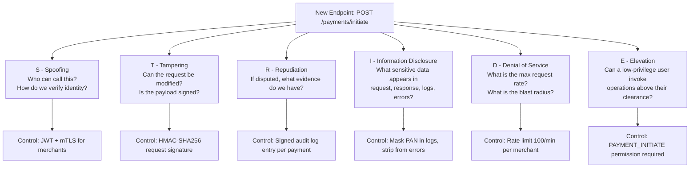
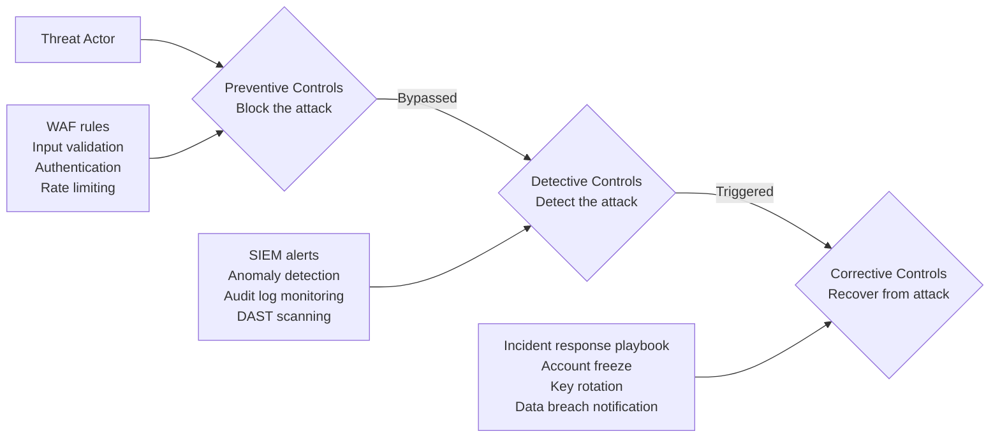
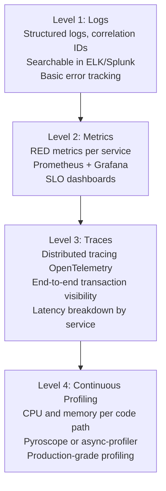

# إطار قرارات الأمان وقابلية المراقبة للمهندس الرئيسي

المهندس الرئيسي العامل في الخدمات المالية ليس أساسًا منفذًا للضوابط الأمنية — بل مهندس نظام لإدارة المخاطر. فالقرارات التي يتخذها تحدد التهديدات التي تستطيع المؤسسة اكتشافها والاستجابة لها، والثغرات المقبولة حاليًا، وكيفية توزيع الموارد على التدابير الوقائية والكشفية والتصحيحية.

يقدم هذا الدرس أطرًا لاتخاذ تلك القرارات باتساق وبشكل يمكن الدفاع عنه: نمذجة التهديدات بـ STRIDE، وتقييم المخاطر، وإطار اختيار الضوابط الأمنية، ونموذج نضج قابلية المراقبة، وكيفية التعامل مع التوتر المتأصل بين الأمان (لا تسجّل البيانات الحساسة) وقابلية المراقبة (سجّل ما يكفي لتصحيح حوادث الإنتاج).

---

## نمذجة التهديدات بـ STRIDE مطبقة على واجهة دفع

‏STRIDE نموذج لتصنيف التهديدات طُوّر في Microsoft. ويمثل كل حرف فئة تهديدات. ولكل فئة تهديد خاصية أمنية مقابلة تحققها الضوابط.

| فئة STRIDE | الخاصية الأمنية | مثال من واجهة الدفع | الضابط |
|----------------|-------------------|---------------------|---------|
| **S**poofing (الانتحال) | المصادقة | مستدعٍ يدّعي أنه التاجر A وهو ليس كذلك | ‏JWT بـ RS256، وmTLS |
| **T**ampering (العبث) | السلامة | تعديل مبلغ الدفع أثناء النقل أو التخزين | توقيع الطلب (HMAC)، وTLS، وتشفير GCM |
| **R**epudiation (الإنكار) | عدم الإنكار | عميل ينكر تفويض دفعة | سجل تدقيق غير قابل للتغيير، وتوقيع رقمي على المعاملة |
| **I**nformation Disclosure (كشف المعلومات) | السرية | كشف PAN في سجل، أو جسم استجابة، أو رسالة خطأ | إخفاء الحقول، والتشفير على مستوى الحقل، وترشيح الاستجابات |
| **D**enial of Service (حجب الخدمة) | الإتاحة | فيض 10,000 طلب/ثانية يُسقط معالجة المدفوعات | تحديد المعدل، وقواطع الدائرة، والتوسع التلقائي |
| **E**levation of Privilege (رفع الصلاحيات) | التفويض | مستخدم عادي يصل إلى ضوابط الدفع الإدارية | ‏RBAC، وABAC، وأقل الصلاحيات، والتفويض على مستوى الوظيفة |

### تطبيق STRIDE على نقطة دفع جديدة

حين تُقترح نقطة جديدة، مرّ على STRIDE منهجيًا قبل كتابة الكود:



مخرج نمذجة التهديدات ليس وثيقة — بل مجموعة ضوابط ملموسة للتنفيذ، إضافة إلى مُدخل في سجل المخاطر لأي تهديدات تُقبل دون تخفيف كامل.

---

## مصفوفة تقييم المخاطر

تُقيّم المخاطر على مصفوفة 5×5 من الاحتمالية (1=نادر، 5=شبه مؤكد) × الأثر (1=ضئيل، 5=كارثي). وحاصل الضرب هو درجة المخاطرة.

| الاحتمالية \ الأثر | 1 ضئيل | 2 طفيف | 3 متوسط | 4 كبير | 5 كارثي |
|--------------------|-------------|---------|-----------|---------|---------------|
| 5 شبه مؤكد | 5 | 10 | 15 | 20 | **25** |
| 4 مرجّح | 4 | 8 | 12 | **16** | **20** |
| 3 ممكن | 3 | 6 | 9 | 12 | 15 |
| 2 غير مرجّح | 2 | 4 | 6 | 8 | 10 |
| 1 نادر | 1 | 2 | 3 | 4 | 5 |

**نطاقات المخاطر:**
- ‏15–25: حرجة — تخفيف فوري مطلوب، والتصعيد إلى المدير التقني/مدير أمن المعلومات
- ‏8–14: عالية — التخفيف خلال 30 يومًا، وتُضمَّن في السباق التالي
- ‏4–7: متوسطة — التخفيف خلال 90 يومًا، أو القبول الرسمي مع مبرر موثق
- ‏1–3: منخفضة — القبول أو التخفيف عند أول فرصة مناسبة

**صيغة مُدخل سجل المخاطر:**

```yaml
risk_id: RISK-2026-047
title: "BOLA vulnerability in account retrieval endpoint"
threat_category: Information Disclosure
asset: Customer account balance and transaction history
threat_scenario: >
  Authenticated attacker iterates account IDs and retrieves financial
  data for accounts they do not own.
likelihood: 4   # API is external-facing, BOLA is well-known attack
impact: 5       # Exposes PAN, balance, transaction history — regulatory breach
risk_score: 20  # Critical
current_controls:
  - JWT authentication (reduces unauthenticated access)
residual_risk_score: 20  # Authentication alone does not prevent BOLA
treatment: Mitigate
mitigation: Add ownership check to account repository query
owner: payments-team
due_date: 2026-12-15
status: In Progress
```

---

## إطار اختيار الضوابط الأمنية

تُصنف الضوابط حسب وظيفتها في نموذج الدفاع:



**لكل ميزة جديدة، عرّف ضابطًا واحدًا على الأقل لكل فئة:**

| الميزة | وقائي | كشفي | تصحيحي |
|---------|-----------|-----------|-----------|
| بدء الدفع | ‏JWT + توقيع HMAC + تحديد المعدل | تنبيه على شذوذ سرعة المدفوعات | تجميد الحساب عند إشارة احتيال |
| تخزين PAN | تشفير الحقول بـ AES-256-GCM | تنبيه على فك التشفير الجماعي (>100 طلب/دقيقة) | تدوير المفاتيح + إبلاغ شبكات البطاقات |
| واجهة الإدارة | ‏mTLS + ‏RBAC + قائمة سماح IP | تنبيه SIEM على إجراء إداري خارج ساعات العمل | إلغاء رمز المسؤول، وسجل التدقيق |
| تسليم webhook | التحقق من العنوان + توقيع على الحمولة | تنبيه على أنماط محاولات SSRF | تعطيل webhook + إبلاغ التاجر |

---

## نموذج نضج قابلية المراقبة

قابلية المراقبة ليست ثنائية. ويعرّف نموذج النضج مستويات متدرجة، يوفر كل منها رؤية أعمق لسلوك النظام.



**المستوى 1 — السجلات:** تُصدر كل خدمة سجلات JSON منظمة بمعرّف ارتباط يربط كل مُدخلات السجل لطلب واحد عبر الخدمات. ويتيح استيعاب السجلات في منصة مركزية البحث والتنبيه.

**المستوى 2 — المقاييس:** تكشف كل خدمة مقاييس RED ‏(المعدل، والأخطاء، والمدة) لكل نقطة. وتُظهر لوحات المعلومات حالة SLO. وتنطلق التنبيهات عند معدل استهلاك ميزانية الأخطاء.

**المستوى 3 — التتبعات:** يجهّز OpenTelemetry كل خدمة. وتنتج معاملة دفع واحدة تتبعًا يُظهر كل استدعاء خدمة، واستعلام قاعدة بيانات، واستدعاء واجهة خارجية بتوقيت دقيق. واستراتيجية أخذ العينات: 100% للأخطاء، و1% للمعاملات الناجحة، و100% للمعاملات التي تتجاوز ثانيتين — وهذا يتطلب أخذ عينات *قائمًا على الذيل* (tail-based، مثلًا في OpenTelemetry Collector)، لأن الأخطاء وزمن الاستجابة لا يُعرفان إلا بعد انتهاء التتبع.

**المستوى 4 — التنميط المستمر:** تعمل وكلاء التنميط في الإنتاج وتلتقط مخططات اللهب لوحدة المعالجة. وحين يُكتشف تراجع في زمن الاستجابة عبر المقاييس، تُظهر بيانات التنميط مسار الكود المسبب دون الحاجة إلى إعادة إنتاج المشكلة.

**تعمل معظم شركات التقنية المالية عند المستوى 2–3.** ويتزايد اعتماد المستوى 4 لمسارات معالجة المدفوعات الحرجة.

---

## التنبيه المدفوع بـ SLO — معدل استهلاك ميزانية الأخطاء

تنطلق التنبيهات التقليدية عند عتبات مطلقة ("معدل الأخطاء > 5%"). أما التنبيه المدفوع بـ SLO فينطلق بناءً على سرعة استهلاك ميزانية الأخطاء — فيتيح لك اكتشاف الاستهلاك البطيء قبل أن يستنفد الميزانية.

**حساب ميزانية الأخطاء:**

```
SLO target: 99.9% availability over 30 days
Allowed downtime: 30 days × (1 - 0.999) = 43.2 minutes
Error budget = 43.2 minutes of allowed failures
```

**تنبيهات معدل الاستهلاك:**

```yaml
# Prometheus alerting rules. sum() is essential: dividing the raw series
# would match each 5xx series only with itself (labels must match 1:1).
# In practice, precompute these ratios with recording rules.
groups:
  - name: payment-slo-alerts
    rules:
      # Page immediately: consuming error budget 14.4x faster than sustainable
      # = 2% of the 30-day budget per hour; ALL of it in ~2 days (30 d / 14.4)
      - alert: PaymentApiErrorBudgetFastBurn
        expr: |
          (
            sum(rate(http_requests_total{service="payment-api",status=~"5.."}[1h]))
            /
            sum(rate(http_requests_total{service="payment-api"}[1h]))
          ) > 14.4 * (1 - 0.999)
          and
          (
            sum(rate(http_requests_total{service="payment-api",status=~"5.."}[5m]))
            /
            sum(rate(http_requests_total{service="payment-api"}[5m]))
          ) > 14.4 * (1 - 0.999)
        for: 2m
        labels:
          severity: page
          slo: payment-api-availability
        annotations:
          summary: "Payment API error budget burning 14.4x — page immediately"
          runbook: "https://wiki.internal/runbooks/payment-api-fast-burn"

      # Ticket: consuming error budget 2x faster than sustainable
      # Will exhaust 100% of monthly budget in ~15 days
      - alert: PaymentApiErrorBudgetSlowBurn
        expr: |
          (
            sum(rate(http_requests_total{service="payment-api",status=~"5.."}[6h]))
            /
            sum(rate(http_requests_total{service="payment-api"}[6h]))
          ) > 2 * (1 - 0.999)
          and
          (
            sum(rate(http_requests_total{service="payment-api",status=~"5.."}[30m]))
            /
            sum(rate(http_requests_total{service="payment-api"}[30m]))
          ) > 2 * (1 - 0.999)
        for: 15m
        labels:
          severity: ticket
          slo: payment-api-availability
        annotations:
          summary: "Payment API error budget burning 2x — investigate this week"
```

يستخدم تنبيه معدل الاستهلاك 14.4x نافذة ساعة (استهلاك سريع)؛ ويستخدم تنبيه 2x نافذة 6 ساعات (استهلاك بطيء). ويشترط كل منهما أيضًا أن تكون نافذة قصيرة (5 دقائق / 30 دقيقة) ما زالت تستهلك، فيُحل التنبيه بسرعة بمجرد إصلاح المشكلة. ومعًا يلتقطان الانقطاعات المفاجئة والتدهور التدريجي. ‏(يوصي Google SRE Workbook أيضًا بتنبيه استدعاء عند 6x على 6 ساعات وتذكرة عند 1x على 3 أيام — اضبط المجموعة حسب SLO الخاص بك.)

---

## التوتر بين الأمان وقابلية المراقبة

التوتر الأساسي: يتطلب الأمان عدم تسجيل البيانات الحساسة (PAN، ورموز المصادقة، وأرقام الحسابات الكاملة). وتتطلب قابلية المراقبة سياقًا كافيًا لتشخيص حوادث الإنتاج. وهذان يشدّان في اتجاهين متعاكسين.

**الحل هو التسجيل المنظم مع إخفاء الحقول — لا تقليل التسجيل.**

```java
@Component
public class PaymentAuditLogger {

    private static final Logger log = LoggerFactory.getLogger(PaymentAuditLogger.class);

    public void logPaymentInitiated(Payment payment, String merchantId) {
        log.info("Payment initiated",
            StructuredArguments.keyValue("event", "PAYMENT_INITIATED"),
            StructuredArguments.keyValue("paymentId", payment.getId()),
            StructuredArguments.keyValue("merchantId", merchantId),
            StructuredArguments.keyValue("amount", payment.getAmount()),
            StructuredArguments.keyValue("currency", payment.getCurrency()),
            // Masked: last 4 digits only — enough for debugging, not enough to be useful to attacker
            StructuredArguments.keyValue("panLastFour", payment.getPanLastFour()),
            // Never log: full PAN, CVV, authentication token, raw account number
            StructuredArguments.keyValue("accountIdHash",
                hashAccountId(payment.getAccountId()))  // hash for correlation without exposure
        );
    }
}
```

**ما يُسجل مقابل ما لا يُسجل أبدًا:**

| يُسجل دائمًا | يُسجل مع الإخفاء | لا يُسجل أبدًا |
|-----------|------------------|-----------|
| معرّف الدفع، ومعرّف الارتباط | آخر 4 أرقام من PAN | ‏PAN الكامل |
| معرّف التاجر، والمبلغ، والعملة | رقم الحساب (تجزئة فقط) | CVV/CVC |
| نوع الحدث، والطابع الزمني | اسم العميل (الأحرف الأولى) | رموز المصادقة |
| رمز حالة HTTP | عنوان IP ‏(مقتطع) | كلمات المرور |
| زمن الاستجابة، واسم الخدمة | البريد الإلكتروني (النطاق فقط) | المفاتيح الخاصة |

**قاعدة عملية للمهندسين الرئيسيين:** عرّف تعليقًا `SensitiveField` وابنِ مُسلسِل Jackson يُخفي الحقول المعلّمة تلقائيًا قبل وصولها إلى إطار التسجيل.

```java
@Retention(RetentionPolicy.RUNTIME)
@Target(ElementType.FIELD)
public @interface SensitiveField {
    MaskingStrategy strategy() default MaskingStrategy.FULL_MASK;
}

public class Payment {
    private String id;
    @SensitiveField(strategy = MaskingStrategy.LAST_FOUR)
    private String pan;
    @SensitiveField(strategy = MaskingStrategy.HASH)
    private String accountId;
}
```

---

## قرارات مدفوعة بالامتثال

تتقاطع ثلاثة أطر تنظيمية في التقنية المالية في المملكة المتحدة. ويفرض كل منها ضوابط محددة (وفي الاتحاد الأوروبي، يؤدي DORA دور العمود الثالث — إدارة مخاطر تقنية المعلومات والاتصالات، والإبلاغ عن الحوادث الكبرى، واختبار الاختراق القائم على التهديدات):

| المتطلب | PCI-DSS | GDPR | المرونة التشغيلية لـ FCA/PRA ‏(PS21/3) |
|-------------|---------|------|-------------|
| حماية البيانات | جعل PAN غير قابل للقراءة (المتطلب 3) | تدابير تقنية مناسبة | حماية خدمات الأعمال المهمة |
| أمان النقل | تشفير قوي عبر الشبكات المفتوحة (المتطلب 4) | التشفير أثناء النقل | تغطيه قواعد الأنظمة والضوابط العامة |
| التحكم في الوصول | أقل الصلاحيات (المتطلب 7) | أساس الحاجة إلى المعرفة | ضوابط الوصول |
| سجلات التدقيق | تسجيل كل وصول إلى بيانات حاملي البطاقات (المتطلب 10) | سجلات أنشطة المعالجة | سجل تدقيق للمراجعة التنظيمية |
| الاستجابة للحوادث | خطة استجابة للحوادث (المتطلب 12) | إشعار الخرق خلال 72 ساعة | الإبلاغ عن الحوادث التشغيلية |
| الاختبار | اختبار اختراق سنوي + فحوص فصلية (المتطلب 11) | اختبار منتظم للتدابير الأمنية | اختبار السيناريوهات مقابل حدود تحمل الأثر (إضافة إلى CBEST للشركات ذات الأهمية النظامية) |

حين يعالج ضابط أطرًا متعددة في آن واحد، وثّقه على هذا النحو في سجل المخاطر. فهذا يُثبت للمدققين أن البرنامج الأمني متماسك لا عشوائي.

---

## البناء مقابل الشراء للضوابط الأمنية

| الضابط | اعتبار البناء | اعتبار الشراء | التوصية |
|---------|--------------------|--------------------|----------------|
| WAF | تخصيص عميق، وقواعد منطق أعمال خاصة | ‏90% من القواعد عامة، والمورد يحدّث معلومات التهديدات | اشترِ (AWS WAF / Cloudflare) |
| SIEM | قواعد ربط مخصصة لمجالك | كلفة إدارة البنية التحتية عالية | اشترِ SaaS ‏(Splunk Cloud، وDatadog) |
| منع فقدان البيانات (DLP) | نموذج بياناتك فريد | محركات التصنيف عامة | اشترِ + اضبط سياسات مخصصة |
| تشفير الحقول | اختيار الخوارزمية، وتصميم إدارة المفاتيح | تغليف المكتبات أمر قياسي | ابنِ غلافًا رقيقًا على Vault transit (واشترِ اللبنة الأساسية) |
| تحديد المعدل | منطق أعمال مخصص (حدود خاصة بكل تاجر) | خوارزميات قياسية متاحة | ابنِ على مكتبة (Bucket4j، وResilience4j) |
| IAM / SSO | لا تبنِ نظام مصادقتك الخاص أبدًا | البروتوكولات القياسية (OIDC، وSAML) محلولة جيدًا | اشترِ (Okta، وAuth0، وAWS IAM) |

**مبدأ قرار المهندس الرئيسي:** اشترِ الضابط السلعي، وابنِ المنطق الخاص بالمجال فوقه. لا تبنِ المصادقة من الصفر أبدًا. وابنِ دائمًا منطق فحص الملكية بنفسك لأنه يرمّز نموذج بياناتك.

---

## سيناريو قرار: نقطة دفع جديدة

يقترح فريق نقطة جديدة: `POST /payments/initiate` لواجهة موجهة للتجار. مرّ على الإطار كاملًا:

**الخطوة 1: نموذج تهديدات STRIDE ‏(5 دقائق)**

| التهديد | الاحتمالية | الأثر | الضابط |
|--------|-----------|--------|---------|
| الانتحال — تاجر مزيف يستدعي النقطة | 3 | 5 | شهادة عميل mTLS + مفتاح واجهة |
| العبث — تعديل المبلغ أثناء النقل | 2 | 5 | توقيع الطلب بـ HMAC-SHA256 |
| الإنكار — تاجر ينكر بدء الدفع | 2 | 4 | سجل تدقيق موقع بشهادة التاجر |
| كشف المعلومات — PAN في السجلات أو الأخطاء | 3 | 5 | تسجيل منظم مع الإخفاء |
| حجب الخدمة — تاجر يُغرق النقطة | 3 | 4 | تحديد المعدل: 100/دقيقة لكل تاجر |
| رفع الصلاحيات — تاجر يصل إلى مدفوعات تاجر آخر | 2 | 5 | حصر كل الاستعلامات في نطاق التاجر |

**الخطوة 2: سجل المخاطر — المخاطر المتبقية بعد الضوابط**

بعد الضوابط، تنخفض كل المخاطر إلى درجة ≤ 8 (متوسطة أو أقل). ويبقى خطر متبقٍ واحد:

```yaml
risk_id: RISK-2026-048
title: "HMAC replay attack on payment initiation"
residual_risk_score: 6
treatment: Accept
justification: >
  The signature covers a timestamp (requests older than 5 minutes are
  rejected) and the idempotency key, which is stored for 10 minutes, so a
  captured request cannot be replayed with a new key. The remaining risk is
  theft of a merchant's signing key, reduced by mTLS and regular key
  rotation. Risk accepted by CISO.
```

**الخطوة 3: متطلبات قابلية المراقبة**

لهذه النقطة عند نضج المستوى 3:
- السجلات: معرّف الدفع، ومعرّف التاجر، والمبلغ، والعملة، وآخر أربعة أرقام من PAN، ونوع الحدث
- المقاييس: معدل الطلبات، ومعدل الأخطاء، وزمن الاستجابة p50/p95/p99 — ‏SLO: نجاح 99.95%، وp95 < 500 مللي ثانية
- التتبعات: تتبع موزع كامل يشمل الكتابة في قاعدة البيانات وخدمة الإشعارات اللاحقة
- التنبيهات: معدل استهلاك 14.4x ← استدعاء، ومعدل استهلاك 2x ← تذكرة، وزمن استجابة p95 > ثانية ← تذكرة

---

## مزالق الإنتاج

### المزلق 1: نمذجة التهديدات مرة واحدة وعدم مراجعتها أبدًا

**المشكلة:** تُجرى نمذجة تهديدات STRIDE شاملة في بداية مشروع. وخلال 18 شهرًا، تتغير البنية جوهريًا: يُضاف تكامل مع شريك خارجي جديد، ويُرحّل مخزن بيانات من PostgreSQL إلى MongoDB، وتُقدَّم واجهة إدارة جديدة. ولا يُحدّث نموذج التهديدات الأصلي قط.

```
Original threat model: payment-service calls internal ledger-service
New reality: payment-service calls external partner API (not in original model)
            → new SSRF threat never identified
            → new information disclosure path to partner not modelled
```

**الوقاية:** عامل نماذج التهديدات كوثائق حية. وحدّثها كجزء من سجلات القرارات المعمارية (ADRs) كلما أُجري تغيير معماري جوهري. وأضف بندًا إلى قالب RFC: "هل يتطلب هذا التغيير تحديث نموذج التهديدات؟". وراجع نموذج التهديدات فصليًا كجزء من البرنامج الأمني.

---

### المزلق 2: الإفراط في التسجيل لقابلية المراقبة وإحداث حادث أمني

**المشكلة:** ينفذ فريق تسجيلًا مفصلًا للطلبات/الاستجابات للمساعدة في التصحيح. ويكشف سوء إعداد في خط تجميع السجلات السجلات لجمهور أوسع من المقصود. وتحتوي السجلات أرقام PAN كاملة سُجلت "مؤقتًا" أثناء جلسة تصحيح ولم تُزل قط.

```java
// Developer adds this for debugging a production issue:
log.debug("Payment request: {}", objectMapper.writeValueAsString(paymentRequest));
// paymentRequest contains a full PAN — now in every log platform that receives DEBUG level
```

‏PAN في السجلات يُدخل كل نظام يخزن تلك السجلات في نطاق PCI DSS، وإن كُشفت السجلات فقد يكون ذلك اختراقًا لبيانات الحسابات واجب الإبلاغ. ويمكن لشبكات البطاقات تغريم المستحوذ، الذي يحمّل الكلفة بدوره — وكثيرًا ما تُذكر أرقام من 5,000 إلى 100,000 دولار عن كل شهر من عدم الامتثال، وإن كانت الغرامات الفعلية غير معلنة.

**الوقاية:** ضع سياسة "لا PAN في السجلات" مفروضة على ثلاثة مستويات:

1. قائمة مراجعة الكود: يجب أن يتحقق المراجع من عدم تسجيل PAN
2. التحليل الساكن: قاعدة Semgrep تُعلّم تسجيل الحقول المعلّمة بـ `@SensitiveField`
3. الاكتشاف وقت التشغيل: اكتشاف شذوذ في السجلات ينبّه على أنماط تطابق صيغة PAN ‏(`\d{13,19}`، ثم فحص Luhn لتقليل الإيجابيات الكاذبة) في حمولات السجل

```yaml
# Semgrep rule: detect logging of sensitive fields
rules:
  - id: sensitive-field-in-log
    pattern-either:
      - pattern: log.$METHOD(..., $X.getPan(), ...)
      - pattern: log.$METHOD(..., $X.getCardNumber(), ...)
      - pattern: log.$METHOD(..., $X.getCvv(), ...)
    message: "Potential PAN or sensitive card data in log statement"
    severity: ERROR
    languages: [java]
```

---

### المزلق 3: اختيار الضوابط الأمنية دون مراعاة الكلفة التشغيلية

**المشكلة:** يفرض مهندس رئيسي TLS المتبادل (mTLS) لكل الاتصالات الداخلية بين الخدمات. وهذا ضابط أمني ممتاز. لكن عملية تدوير الشهادات يدوية، ولم تُضبط شبكة الخدمات للتعامل معها تلقائيًا، وبعد 18 شهرًا صارت حوادث انتهاء الشهادات شهرية — فتسبب حوادث إتاحة أكثر مما تبرره الفائدة الأمنية.

```
mTLS certificate expiry at 03:00 UTC
  → payment-service cannot authenticate to ledger-service
  → all payment processing stops
  → P1 incident, 23 minutes to resolution
  → 3rd consecutive monthly expiry incident
```

**الوقاية:** حين تختار ضابطًا أمنيًا، قيّم الكلفة التشغيلية إلى جانب الفائدة الأمنية:

```
Control selection criteria:
1. Security benefit: what threat does this mitigate? (quantified)
2. Implementation cost: one-time engineering effort
3. Operational cost: certificate rotation, key management, monitoring overhead
4. Failure mode: what breaks when this control fails? (critical path vs non-critical)
5. Recovery time: how long to recover if the control fails?
```

لـ mTLS، تكون الكلفة التشغيلية قابلة للإدارة فقط مع شبكة خدمات (Istio، وLinkerd) تتولى تدوير الشهادات تلقائيًا. ودون شبكة خدمات، أتمت التدوير بطريقة أخرى (cert-manager أو SPIRE مع إعادة تحميل حية في حمل العمل) — أو فكّر في مصادقة بمفاتيح واجهات مع تدوير آلي بدلًا من ذلك: كلفة تشغيلية أقل، وما زالت تحقق المصادقة.

---

## قائمة تحقق الدرس

- [ ] تستطيع تطبيق STRIDE على أي نقطة واجهة جديدة وإنتاج ضابط لكل فئة تهديد
- [ ] تستطيع تقييم المخاطر على مصفوفة احتمالية × أثر 5x5 وإسنادها إلى نطاقات مخاطر بمدد مناسبة
- [ ] تستطيع تصنيف الضوابط الأمنية كوقائية أو كشفية أو تصحيحية واختيار واحد على الأقل لكل فئة لأي ميزة جديدة
- [ ] تستطيع وصف المستويات الأربعة لنموذج نضج قابلية المراقبة وتقييم موقع نظام معين
- [ ] تستطيع كتابة قواعد تنبيه Prometheus لمعدلي استهلاك ميزانية الأخطاء 14.4x و2x ‏(نوافذ طويلة + قصيرة)
- [ ] تستطيع حل التوتر بين الأمان وقابلية المراقبة باستخدام التسجيل المنظم مع إخفاء الحقول
- [ ] تستطيع تطبيق إطار البناء مقابل الشراء على الضوابط الأمنية الشائعة وتبرير التوصية
- [ ] تستطيع المرور على سيناريوهات القرار الثلاثة (نموذج التهديدات، وتقييم المخاطر، ومتطلبات قابلية المراقبة) لنقطة دفع جديدة في أقل من 15 دقيقة

---

<!-- KNOWLEDGE-CHECK
{"questions":[{"text":"تنمذج تهديدات نقطة webhook دفع جديدة تستدعي عنوانًا يقدمه التاجر. أي فئة STRIDE تنطبق مباشرة على خطر أن يسجّل مهاجم http://169.254.169.254/ كعنوان webhook له؟","options":["الانتحال — يتظاهر المهاجم بأنه تاجر مشروع","العبث — يعدّل المهاجم حمولة webhook","كشف المعلومات — يستطيع المهاجم استرجاع البيانات الوصفية الداخلية عبر SSRF","حجب الخدمة — يُغرق المهاجم نقطة webhook"],"correct":2,"explanation":"يتيح SSRF ‏(تزوير الطلبات من جانب الخادم) للمهاجم جعل الخادم يرسل طلبات إلى موارد داخلية. فبتسجيل نقطة بيانات وصفية داخلية كعنوان webhook، يجعل المهاجم الخادم يسترجع بيانات اعتماد داخلية حساسة وربما يعيدها. وهذا يقابل كشف المعلومات في STRIDE — بيانات سرية (بيانات اعتماد IAM، واستجابات الخدمات الداخلية) تُكشف لطرف غير مصرح له."},{"text":"لواجهة الدفع لديك SLO بإتاحة 99.9% على 30 يومًا. ينطلق تنبيه معدل استهلاك 14.4x. كم من الوقت تقريبًا حتى تُستنفد ميزانية الأخطاء الشهرية كاملة بمعدل الاستهلاك الحالي؟","options":["نحو يومين","نحو 15 يومًا","نحو ساعتين","نحو 6 ساعات"],"correct":0,"explanation":"معدل استهلاك 1 يستهلك الميزانية كاملة بالضبط خلال نافذة SLO ‏(30 يومًا). وعند 14.4x، تدوم الميزانية 30 يومًا / 14.4 ≈ ‏2.1 يوم — ويذهب 2% منها كل ساعة. ولهذا يطلق معدل استهلاك 14.4x، المؤكد على نافذتي ساعة و5 دقائق، استدعاءً فوريًا: فإن تُرك، تختفي ميزانية أسبوع في نحو نصف يوم. ‏(ومعدل استهلاك 2x يدوم نحو 15 يومًا — نطاق التذاكر.)"},{"text":"يقترح مطور تسجيل كائن طلب الدفع كاملًا (بما فيه PAN) بمستوى DEBUG للمساعدة في تشخيص مشكلة إنتاج. ما الاستجابة الأنسب؟","options":["اسمح به مؤقتًا في بيئة التجهيز فقط، لا في الإنتاج أبدًا","اسمح به لأن سجلات DEBUG لا تُرسل عادة إلى SIEM","ارفضه ونفّذ تسجيلًا منظمًا مع إخفاء PAN إلى آخر أربعة أرقام بدلًا من ذلك","اسمح به لأن السجلات مشفرة أثناء التخزين في منصة السجلات"],"correct":2,"explanation":"يجب ألا يظهر PAN في السجلات أبدًا بغض النظر عن مستوى السجل، أو البيئة، أو حالة التشفير أثناء التخزين. ويعتبر PCI-DSS وجود PAN في السجلات مخالفة للنطاق. والنهج الصحيح هو التسجيل المنظم مع الإخفاء — سجّل سياقًا كافيًا لتصحيح المشكلة (آخر أربعة أرقام من PAN، ومعرّف الدفع، والطابع الزمني، ونوع الخطأ) دون تسجيل بيانات حساسة. والتشفير أثناء التخزين في منصة السجلات لا يمنع الكشف لمستخدمي المنصة."}]}
-->

<!-- PRACTICAL-CHALLENGE
{"title":"تطبيق إطار قرارات الأمان وقابلية المراقبة","difficulty":"principal","estimatedMinutes":90,"tasks":[{"id":"1","description":"طبّق إطار STRIDE كاملًا على نقطة واجهة جديدة: POST /transfers/international. ولكل فئة من فئات STRIDE الست، حدد سيناريو تهديد محددًا ذا صلة بالمدفوعات الدولية، وقيّمه على مصفوفة المخاطر 5x5، واقترح ضابطًا تقنيًا ملموسًا، واكتب مُدخل سجل مخاطر بصيغة YAML لأعلى خطرين متبقيين درجةً."},{"id":"2","description":"نفّذ إطار تسجيل منظم في Spring Boot: ‏(1) يستخدم تعليقًا مخصصًا @SensitiveField باستراتيجيات FULL_MASK وLAST_FOUR وHASH، (2) ينفذ مُسلسِل Jackson يطبق الإخفاء قبل مخرجات السجل، (3) يسجّل 8 حقول على الأقل لكل حدث دفع (معرّف الدفع، والمبلغ، والعملة، وPAN المخفي، ومعرّف الحساب المجزأ، ومعرّف التاجر، وزمن الاستجابة، ونوع الحدث)، (4) يتضمن قاعدة Semgrep تكتشف تسجيل الحقول الحساسة الخام."},{"id":"3","description":"اكتب قواعد تنبيه Prometheus لواجهة دفع بـ SLO ‏99.95% على 30 يومًا. وأنشئ: (1) تنبيه استدعاء لمعدل استهلاك 14.4x باستخدام نافذة ساعة مؤكدة بنافذة 5 دقائق، (2) تنبيه تذكرة لمعدل استهلاك 2x باستخدام نافذة 6 ساعات مؤكدة بنافذة 30 دقيقة، (3) تنبيه SLO لزمن الاستجابة حين يتجاوز p95 ‏500 مللي ثانية، (4) لوحة Grafana تُظهر ميزانية الأخطاء المتبقية كنسبة مئوية. ووثّق حساب ميزانية الأخطاء."},{"id":"4","description":"أجرِ تحليل البناء مقابل الشراء لثلاثة ضوابط أمنية: WAF، والتشفير على مستوى الحقل لـ PAN، وSSO/IAM. ولكل منها، وثّق: الفائدة الأمنية، وكلفة التنفيذ لمرة واحدة (نقاط القصص)، والكلفة التشغيلية المستمرة، وأثر نمط الإخفاق، وتوصيتك مع المبرر. وقدّم النتائج كسجل قرار (بصيغة ADR) مناسب لمراجعة مدير أمن المعلومات."}]}
-->
