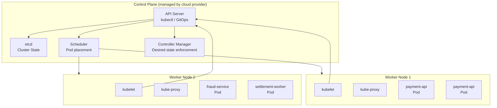

# Kubernetes for Financial Services — Architecture and Workloads

> [!NOTE]
> Kubernetes has become the standard deployment platform for financial services, but running regulated workloads on K8s requires different patterns than general application development. This lesson covers the K8s model and its application to financial production environments.

## Why Kubernetes for Financial Services

Financial technology organisations migrate to Kubernetes for three reasons:

1. **Declarative infrastructure** — the desired state is version-controlled; rollback is a git revert
2. **Operational consistency** — identical deployment mechanism for dev, staging, and production
3. **Resilience primitives** — health checks, pod restart, rolling updates, and horizontal scaling are built-in

The challenge is that financial services have additional requirements: data residency, network segmentation, secrets management, and audit trails for every configuration change.

---

## Kubernetes Architecture



### Key Control Plane Concepts

**etcd** stores all cluster state — deployments, services, secrets, configmaps. For financial K8s clusters, etcd encryption at rest is mandatory.

**API Server** is the single entry point for all cluster operations. All changes go through it, providing a complete audit trail in the K8s audit log.

**Scheduler** places pods on nodes based on resource requests, affinity rules, and taints.

---

## Pods — The Deployment Unit

A **pod** is the smallest deployable unit in Kubernetes. It encapsulates one or more containers that share network and storage.

```yaml
# payment-api pod specification
apiVersion: v1
kind: Pod
metadata:
  name: payment-api-7b4f9d
  namespace: payments-prod
  labels:
    app: payment-api
    version: "2.4.1"
    tier: "frontend"
  annotations:
    # Compliance: record who deployed this and when
    deploy.bank.internal/deployed-by: "ci-pipeline"
    deploy.bank.internal/deployed-at: "2024-11-07T14:30:00Z"
    deploy.bank.internal/change-ref: "CHG-20241107-003"
spec:
  serviceAccountName: payment-api-sa  # least-privilege service account
  
  containers:
  - name: payment-api
    image: bank-registry.internal/payment-api:2.4.1
    
    ports:
    - containerPort: 8080
      name: http
    - containerPort: 8081
      name: actuator   # separate port for health/metrics — not exposed externally
      
    # Resource requests and limits — REQUIRED for financial workloads
    resources:
      requests:
        memory: "512Mi"
        cpu: "250m"
      limits:
        memory: "1Gi"
        cpu: "1000m"
        
    # Health checks
    livenessProbe:
      httpGet:
        path: /actuator/health/liveness
        port: 8081
      initialDelaySeconds: 30
      periodSeconds: 10
      failureThreshold: 3
      
    readinessProbe:
      httpGet:
        path: /actuator/health/readiness
        port: 8081
      initialDelaySeconds: 10
      periodSeconds: 5
      failureThreshold: 3
      
    # Secrets from Vault via External Secrets Operator — never hardcoded
    env:
    - name: DB_PASSWORD
      valueFrom:
        secretKeyRef:
          name: payment-api-db-secret
          key: password
          
    # Security context — run as non-root
    securityContext:
      runAsNonRoot: true
      runAsUser: 1000
      readOnlyRootFilesystem: true
      allowPrivilegeEscalation: false
      capabilities:
        drop: ["ALL"]
```

---

## Deployments — Managing Pod Lifecycle

A **Deployment** manages a set of identical pods, handling rolling updates and rollbacks.

```yaml
apiVersion: apps/v1
kind: Deployment
metadata:
  name: payment-api
  namespace: payments-prod
spec:
  replicas: 6         # 6 pods across nodes for HA
  
  selector:
    matchLabels:
      app: payment-api
      
  strategy:
    type: RollingUpdate
    rollingUpdate:
      maxUnavailable: 1    # at most 1 pod down during update
      maxSurge: 2          # at most 2 extra pods during update
      # With 6 replicas: update removes 1, adds 2 → never below 5 pods serving traffic
      
  template:
    metadata:
      labels:
        app: payment-api
        version: "2.4.1"
    spec:
      # Anti-affinity: spread pods across nodes and availability zones
      affinity:
        podAntiAffinity:
          requiredDuringSchedulingIgnoredDuringExecution:
          - labelSelector:
              matchLabels:
                app: payment-api
            topologyKey: "kubernetes.io/hostname"   # no two pods on same node
          preferredDuringSchedulingIgnoredDuringExecution:
          - weight: 100
            podAffinityTerm:
              labelSelector:
                matchLabels:
                  app: payment-api
              topologyKey: "topology.kubernetes.io/zone"  # prefer different AZs
              
      # Graceful shutdown — give in-flight requests 30 seconds to complete
      terminationGracePeriodSeconds: 30
      
      containers:
      - name: payment-api
        image: bank-registry.internal/payment-api:2.4.1
        lifecycle:
          preStop:
            exec:
              # Give load balancer time to stop routing traffic before pod terminates
              command: ["/bin/sh", "-c", "sleep 5"]
```

---

## Namespaces — Multi-Tenancy and Isolation

Namespaces provide logical isolation between teams and environments within a cluster.

```yaml
# Production namespace with resource quotas
apiVersion: v1
kind: ResourceQuota
metadata:
  name: payments-prod-quota
  namespace: payments-prod
spec:
  hard:
    # Compute resources
    requests.cpu: "32"
    requests.memory: "64Gi"
    limits.cpu: "64"
    limits.memory: "128Gi"
    
    # Object counts
    pods: "50"
    services: "20"
    persistentvolumeclaims: "20"
    
    # Prevent runaway secret/configmap creation
    secrets: "50"
    configmaps: "50"
```

```yaml
# Network policy: payments namespace can only talk to database and kafka namespaces
apiVersion: networking.k8s.io/v1
kind: NetworkPolicy
metadata:
  name: payments-egress-policy
  namespace: payments-prod
spec:
  podSelector: {}  # applies to all pods in namespace
  policyTypes:
  - Egress
  egress:
  # Allow traffic to database namespace only
  - to:
    - namespaceSelector:
        matchLabels:
          name: database
    ports:
    - protocol: TCP
      port: 5432  # PostgreSQL
  # Allow traffic to Kafka namespace
  - to:
    - namespaceSelector:
        matchLabels:
          name: kafka
    ports:
    - protocol: TCP
      port: 9092
  # Allow DNS
  - to:
    - namespaceSelector: {}
    ports:
    - protocol: UDP
      port: 53
```

---

## Horizontal Pod Autoscaler — Scaling for Payment Peaks

Financial systems experience predictable peaks: salary payment days, bill payment windows, end of month. The HPA scales pods based on observed metrics.

```yaml
apiVersion: autoscaling/v2
kind: HorizontalPodAutoscaler
metadata:
  name: payment-api-hpa
  namespace: payments-prod
spec:
  scaleTargetRef:
    apiVersion: apps/v1
    kind: Deployment
    name: payment-api
    
  minReplicas: 6    # never below 6 — always HA
  maxReplicas: 24   # sized for 4x peak traffic
  
  metrics:
  # Scale on CPU — standard metric
  - type: Resource
    resource:
      name: cpu
      target:
        type: Utilization
        averageUtilization: 60   # scale up when average CPU > 60%
        
  # Scale on custom metric — payment queue depth (via KEDA/Prometheus)
  - type: Pods
    pods:
      metric:
        name: payment_queue_depth
      target:
        type: AverageValue
        averageValue: "100"      # scale up when each pod has >100 queued payments
        
  behavior:
    scaleUp:
      stabilizationWindowSeconds: 0     # scale up immediately — don't wait
      policies:
      - type: Pods
        value: 4
        periodSeconds: 60              # add up to 4 pods per minute
    scaleDown:
      stabilizationWindowSeconds: 300   # wait 5 minutes before scaling down
      policies:
      - type: Pods
        value: 1
        periodSeconds: 60              # remove at most 1 pod per minute
```

---

## ConfigMaps and Secrets — Configuration Management

```yaml
# ConfigMap — non-sensitive configuration
apiVersion: v1
kind: ConfigMap
metadata:
  name: payment-api-config
  namespace: payments-prod
data:
  application.yml: |
    payment:
      timeout-ms: 5000
      max-retries: 3
      currency-conversion-service: https://fx.internal.bank:8443
    kafka:
      bootstrap-servers: kafka.kafka.svc.cluster.local:9092
      consumer-group: payment-api-prod
```

```yaml
# External Secrets Operator: sync secrets from HashiCorp Vault
# Never store sensitive values in K8s Secrets (base64 is not encryption)
apiVersion: external-secrets.io/v1beta1
kind: ExternalSecret
metadata:
  name: payment-api-db-secret
  namespace: payments-prod
spec:
  refreshInterval: 1h    # re-sync from Vault every hour (picks up rotations)
  secretStoreRef:
    name: vault-backend
    kind: ClusterSecretStore
  target:
    name: payment-api-db-secret
    creationPolicy: Owner
  data:
  - secretKey: password
    remoteRef:
      key: secret/payments-prod/database
      property: password
```

---

## Principal Engineer's Kubernetes Checklist

Before deploying a financial service to production Kubernetes:

- [ ] **Resource requests and limits** set on all containers — no unbounded resource consumption
- [ ] **Pod anti-affinity** configured — no two replicas on the same node
- [ ] **Non-root security context** — `runAsNonRoot: true`, `readOnlyRootFilesystem: true`
- [ ] **External secrets** via Vault ESO — no plaintext secrets in configmaps or env vars
- [ ] **Network policy** restricts egress to known destinations only
- [ ] **Health probes** on separate actuator port — not the application port
- [ ] **Graceful shutdown** with `preStop` sleep + `terminationGracePeriodSeconds`
- [ ] **HPA configured** with both CPU and business metrics
- [ ] **Resource quotas** applied to namespace
- [ ] **K8s audit logging** enabled — all API server interactions recorded

<!-- KNOWLEDGE-CHECK
{
  "questions": [
    {
      "id": "q1",
      "text": "A payment-api Deployment has 6 replicas and rollingUpdate.maxUnavailable=1, maxSurge=2. During a rolling update, what is the minimum number of pods serving traffic at any point?",
      "options": [
        "4 pods — Kubernetes removes all old pods before adding new ones",
        "5 pods — only 1 can be down at a time",
        "6 pods — surge ensures we never go below current replica count",
        "7 pods — surge adds 2 before removing any"
      ],
      "correct": 1,
      "explanation": "maxUnavailable=1 means at most 1 pod can be unavailable (down or not ready) at any time. With 6 replicas, the minimum serving at any point is 6-1=5 pods. maxSurge=2 means up to 8 total pods can exist during the update (6+2), but the availability floor is set by maxUnavailable."
    },
    {
      "id": "q2",
      "text": "Why should Kubernetes Secrets not be used to store database passwords directly for a regulated financial service?",
      "options": [
        "Kubernetes Secrets are limited to 1MB in size",
        "Kubernetes Secrets are base64-encoded, not encrypted — anyone with namespace read access or etcd access can read the value; a secrets management system like Vault provides encryption, access control, and audit logging",
        "Kubernetes Secrets cannot be mounted as environment variables",
        "Kubernetes Secrets expire after 90 days"
      ],
      "correct": 1,
      "explanation": "Base64 is encoding, not encryption. Without etcd encryption at rest AND strict RBAC, K8s Secrets are effectively plaintext. For financial services, secrets must be: encrypted at rest (Vault), access-controlled with least-privilege ACLs, audited (every read is logged), and rotatable without pod restarts. External Secrets Operator + Vault provides all of this."
    },
    {
      "id": "q3",
      "text": "During salary payment day, your payment-api pods are CPU-spiking to 90% and the HPA is scaling up. New pods are taking 90 seconds to become Ready (JVM warmup time). What happens to traffic during this 90-second window?",
      "options": [
        "Traffic is queued — Kubernetes waits for new pods before routing",
        "Traffic is handled by the existing pods at high CPU — the new pods receive traffic only after their readiness probe passes",
        "Traffic is dropped — Kubernetes rejects new connections during scaling",
        "Traffic is split proportionally to available pods"
      ],
      "correct": 1,
      "explanation": "Kubernetes only sends traffic to pods that pass their readiness probe. During the 90-second warmup, the new pods are not Ready and receive no traffic. Existing pods handle all traffic at high CPU. This is correct behaviour — better to serve slow than to route to unready pods. The fix is application-level warmup before the readiness probe passes."
    },
    {
      "id": "q4",
      "text": "A NetworkPolicy denies all ingress to the payments-prod namespace except from the api-gateway namespace. A new compliance service in the compliance-prod namespace needs to query the payment API. What must you do?",
      "options": [
        "Delete the NetworkPolicy — it's too restrictive",
        "Add an ingress rule to the payments-prod NetworkPolicy allowing traffic from pods with namespace label 'name: compliance-prod'",
        "Move the compliance service into the payments-prod namespace",
        "Use an Ingress resource to bypass the NetworkPolicy"
      ],
      "correct": 1,
      "explanation": "NetworkPolicies are additive — you add an allow rule rather than removing the deny-all. The correct fix is adding an ingress rule to the existing payments-prod NetworkPolicy that permits traffic from namespaceSelector matching 'name: compliance-prod'. This maintains the principle of least privilege while enabling the specific access needed."
    }
  ]
}
-->

<!-- PRACTICAL-CHALLENGE
## Practical Challenge

**Scenario:** You are deploying a new microservice `fraud-scoring-api` to a financial services Kubernetes cluster.

**Tasks:**

1. **Write the Deployment manifest**: 4 replicas, rolling update (maxUnavailable=0, maxSurge=1), resource requests (200m CPU, 256Mi memory), limits (500m CPU, 512Mi), non-root security context.

2. **Write the HPA manifest**: minimum 4, maximum 16 replicas, scale up at 70% CPU, stabilise scale-down for 5 minutes.

3. **Write the NetworkPolicy**: fraud-scoring-api can only receive ingress from pods labelled `app: payment-api` and can only egress to the `model-serving` namespace (port 8080) and `database` namespace (port 5432).

4. **Write the ExternalSecret manifest**: sync the database password from Vault path `secret/fraud-prod/database` with a 30-minute refresh interval.

5. **Operational question**: a pod in fraud-scoring-api is stuck in `CrashLoopBackOff`. List three kubectl commands you would run to diagnose the issue, and what each command tells you.
-->
