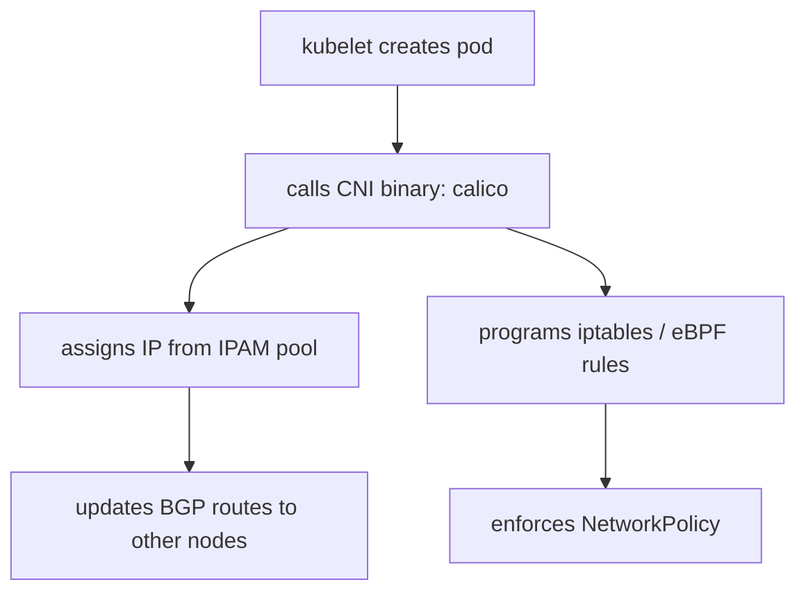
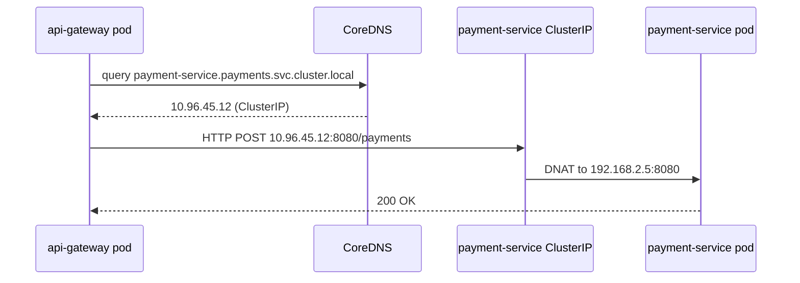
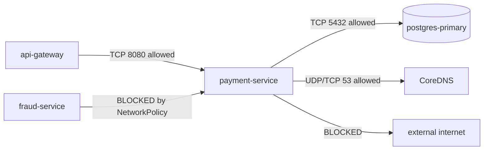
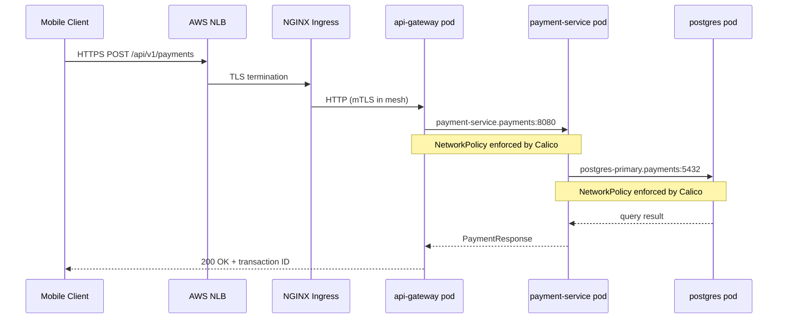

# Kubernetes Networking — CNI, Services, and Ingress

Kubernetes networking is one of the most consequential design decisions in a fintech platform. Payment services, fraud detection engines, and core banking APIs all share the cluster network, making isolation, discoverability, and performance non-negotiable. This lesson covers every networking layer from the CNI-level flat network through Services, Ingress, and NetworkPolicy enforcement.

---

## 1. The Kubernetes Pod Networking Model

Kubernetes mandates a flat network: every pod receives a unique, routable IP address, and any pod can communicate with any other pod on any node without NAT. This "IP-per-pod" guarantee simplifies service discovery and eliminates port conflicts between containers in the same pod.

```
┌────────────────────────────────────────────────────────────┐
│  Node A (10.0.1.10)          Node B (10.0.1.11)            │
│  ┌────────────┐               ┌────────────┐               │
│  │ Pod A      │               │ Pod B      │               │
│  │ 192.168.1.5│ ──── CNI ──── │ 192.168.2.7│               │
│  └────────────┘               └────────────┘               │
└────────────────────────────────────────────────────────────┘
```

Three rules govern this model:

1. All pods can communicate with all other pods without NAT.
2. All nodes can communicate with all pods without NAT.
3. The IP a pod sees for itself is the same IP other pods see it as.

This design means a payment-service pod at `192.168.1.5` can reach a database pod at `192.168.2.7` directly. The implication for security is severe — without NetworkPolicy, any compromised pod can reach any database in the cluster.

---

## 2. CNI Plugins

The Container Network Interface (CNI) is the plugin layer that provisions pod IPs, programs routes, and optionally enforces NetworkPolicy. Two CNI plugins dominate production fintech deployments.

### 2.1 Calico

Calico programs the network using BGP route distribution (or VXLAN in environments where BGP is not feasible). Its most important property for financial services is native NetworkPolicy enforcement at the kernel level using iptables or eBPF.



Calico also supports its own `GlobalNetworkPolicy` CRD, which applies cluster-wide before Kubernetes NetworkPolicy. For a fintech cluster, create a `GlobalNetworkPolicy` that defaults to deny-all and then layer allow rules on top.

### 2.2 Cilium (eBPF)

Cilium replaces iptables entirely with eBPF programs loaded into the Linux kernel. Benefits include:

- **Performance**: eBPF bypasses the full networking stack; throughput is significantly higher than iptables for high-connection-rate services like payment processors.
- **L7 visibility**: Cilium can enforce policy at HTTP/gRPC layer without a sidecar.
- **Hubble**: built-in network observability — flow logs at the kernel level.

For clusters processing millions of payment transactions per day, Cilium is the preferred CNI.

```yaml
# Cilium Helm values for fintech cluster
apiVersion: v1
kind: ConfigMap
metadata:
  name: cilium-config
  namespace: kube-system
data:
  kube-proxy-replacement: "strict"
  enable-hubble: "true"
  hubble-listen-address: ":4244"
  enable-l7-proxy: "true"
  enable-wireguard: "true"    # encrypt in-cluster traffic
```

---

## 3. Kubernetes Service Types

A Service gives pods a stable virtual IP (ClusterIP) and DNS name, decoupling consumers from the constantly changing set of pod IPs.

### 3.1 ClusterIP

ClusterIP is the default. It creates a virtual IP reachable only within the cluster.

```yaml
apiVersion: v1
kind: Service
metadata:
  name: payment-service
  namespace: payments
  labels:
    app: payment-service
    tier: backend
spec:
  type: ClusterIP
  selector:
    app: payment-service
  ports:
    - name: http
      port: 8080
      targetPort: 8080
      protocol: TCP
```

kube-proxy programs iptables (or IPVS) rules so that traffic to the ClusterIP is DNAT'd to one of the matching pod IPs. The service is reachable at `payment-service.payments.svc.cluster.local:8080`.

### 3.2 NodePort

NodePort opens a port (30000–32767) on every cluster node. Useful for development; avoid in production because it exposes ports on every node's public interface.

```yaml
apiVersion: v1
kind: Service
metadata:
  name: payment-service-nodeport
  namespace: payments
spec:
  type: NodePort
  selector:
    app: payment-service
  ports:
    - port: 8080
      targetPort: 8080
      nodePort: 31080
```

### 3.3 LoadBalancer

LoadBalancer provisions a cloud load balancer (AWS NLB, GCP Network LB). Used for services that must be reachable from outside the cluster without an Ingress controller.

```yaml
apiVersion: v1
kind: Service
metadata:
  name: payment-gateway-lb
  namespace: payments
  annotations:
    service.beta.kubernetes.io/aws-load-balancer-type: "nlb"
    service.beta.kubernetes.io/aws-load-balancer-scheme: "internal"
    service.beta.kubernetes.io/aws-load-balancer-cross-zone-load-balancing-enabled: "true"
spec:
  type: LoadBalancer
  selector:
    app: payment-gateway
  ports:
    - port: 443
      targetPort: 8443
  externalTrafficPolicy: Local  # preserve source IP for audit logs
```

The `internal` scheme annotation ensures the NLB is not internet-facing — critical for PCI-DSS compliance. `externalTrafficPolicy: Local` preserves the original client IP for audit trails.

### 3.4 ExternalName

ExternalName maps a Service to an external DNS name, giving third-party payment processors a Kubernetes-native service name.

```yaml
apiVersion: v1
kind: Service
metadata:
  name: visa-processor
  namespace: payments
spec:
  type: ExternalName
  externalName: api.visanet.example.com
```

---

## 4. kube-proxy: iptables vs IPVS

kube-proxy programs the data plane for Services on every node.

| Mode     | Implementation          | Scalability          | Load Balancing Algorithms    |
|----------|-------------------------|----------------------|------------------------------|
| iptables | linear rule chain       | degrades at ~5k svc  | random only                  |
| IPVS     | kernel hash table       | O(1) lookup          | round-robin, least-conn, etc |
| eBPF     | kernel BPF maps (Cilium)| O(1), no kube-proxy  | full flexibility              |

For clusters with hundreds of services processing payment traffic, enable IPVS:

```yaml
# kube-proxy ConfigMap (kube-system namespace)
apiVersion: v1
kind: ConfigMap
metadata:
  name: kube-proxy
  namespace: kube-system
data:
  config.conf: |
    apiVersion: kubeproxy.config.k8s.io/v1alpha1
    kind: KubeProxyConfiguration
    mode: "ipvs"
    ipvs:
      scheduler: "lc"       # least-connections for payment services
      syncPeriod: "30s"
      minSyncPeriod: "2s"
    iptables:
      masqueradeAll: false
```

Restart kube-proxy after the ConfigMap change:

```bash
kubectl rollout restart daemonset/kube-proxy -n kube-system
ipvsadm -Ln | head -20   # verify IPVS is active
```

---

## 5. CoreDNS Service Discovery

CoreDNS provides DNS-based service discovery inside the cluster. The FQDN pattern is:

```
<service-name>.<namespace>.svc.cluster.local
```

For the payment service: `payment-service.payments.svc.cluster.local`

Pods in the same namespace can use the short name `payment-service`. Pods in other namespaces must use at least `payment-service.payments`.



A pod's `/etc/resolv.conf` is injected by kubelet with `ndots:5`. Any hostname with fewer than 5 dots is tried against each search domain before an absolute lookup — causing up to 4 DNS queries for external names. Use FQDNs ending with `.` to bypass search iteration for external payment gateway calls.

### 5.1 DNS-Based Discovery in Java

```java
import java.net.URI;
import java.net.http.HttpClient;
import java.net.http.HttpRequest;
import java.net.http.HttpResponse;
import java.time.Duration;

@Service
public class PaymentClient {

    // FQDN avoids ndots:5 search domain overhead
    private static final String PAYMENT_SVC_BASE =
        "http://payment-service.payments.svc.cluster.local:8080";

    private final HttpClient httpClient;

    static {
        // JVM caches DNS indefinitely by default — override for K8s
        java.security.Security.setProperty("networkaddress.cache.ttl", "10");
        java.security.Security.setProperty("networkaddress.cache.negative.ttl", "5");
    }

    public PaymentClient() {
        this.httpClient = HttpClient.newBuilder()
            .connectTimeout(Duration.ofSeconds(2))
            .build();
    }

    public PaymentResponse submitPayment(PaymentRequest req) throws Exception {
        HttpRequest request = HttpRequest.newBuilder()
            .uri(URI.create(PAYMENT_SVC_BASE + "/api/v1/payments"))
            .header("Content-Type", "application/json")
            .header("X-Idempotency-Key", req.getIdempotencyKey())
            .POST(HttpRequest.BodyPublishers.ofString(
                objectMapper.writeValueAsString(req)))
            .timeout(Duration.ofSeconds(5))
            .build();

        HttpResponse<String> response =
            httpClient.send(request, HttpResponse.BodyHandlers.ofString());

        if (response.statusCode() != 200) {
            throw new PaymentException("Payment failed: " + response.statusCode());
        }
        return objectMapper.readValue(response.body(), PaymentResponse.class);
    }
}
```

Alternatively, set DNS TTL via JVM flags in the container spec:

```yaml
env:
  - name: JAVA_TOOL_OPTIONS
    value: >-
      -Dnetworkaddress.cache.ttl=10
      -Dnetworkaddress.cache.negative.ttl=5
```

---

## 6. Ingress Controller

An Ingress resource defines HTTP routing rules. An Ingress controller (NGINX, Traefik, Contour) watches these resources and programs the reverse proxy.

### 6.1 NGINX Ingress for Fintech API Routing with TLS

```yaml
apiVersion: networking.k8s.io/v1
kind: Ingress
metadata:
  name: fintech-api-ingress
  namespace: payments
  annotations:
    nginx.ingress.kubernetes.io/ssl-redirect: "true"
    nginx.ingress.kubernetes.io/proxy-body-size: "1m"
    nginx.ingress.kubernetes.io/proxy-read-timeout: "10"
    nginx.ingress.kubernetes.io/proxy-send-timeout: "10"
    nginx.ingress.kubernetes.io/limit-rps: "100"
    nginx.ingress.kubernetes.io/limit-burst-multiplier: "5"
    # Security headers
    nginx.ingress.kubernetes.io/configuration-snippet: |
      add_header Strict-Transport-Security "max-age=31536000; includeSubDomains" always;
      add_header X-Content-Type-Options "nosniff" always;
      add_header X-Frame-Options "DENY" always;
    cert-manager.io/cluster-issuer: "letsencrypt-prod"
spec:
  ingressClassName: nginx
  tls:
    - hosts:
        - api.payments.example.com
      secretName: payments-tls
  rules:
    - host: api.payments.example.com
      http:
        paths:
          # More specific paths must come before general paths
          - path: /api/v1/fraud
            pathType: Prefix
            backend:
              service:
                name: fraud-detection-service
                port:
                  number: 8080
          - path: /api/v1/payments
            pathType: Prefix
            backend:
              service:
                name: payment-service
                port:
                  number: 8080
          - path: /api/v1/accounts
            pathType: Prefix
            backend:
              service:
                name: account-service
                port:
                  number: 8080
```

The annotations enforce TLS redirect, rate-limit at 100 req/s per IP, constrain request body size to prevent large payload attacks, and add security headers for PCI-DSS compliance.

---

## 7. NetworkPolicy — Zero-Trust Cluster Networking

NetworkPolicy resources control which pods can communicate with which other pods. Without them, every pod can reach every other pod — a critical PCI-DSS violation.

### 7.1 Default Deny All (Namespace-Level)

Apply this to every namespace before creating allow rules:

```yaml
apiVersion: networking.k8s.io/v1
kind: NetworkPolicy
metadata:
  name: default-deny-all
  namespace: payments
spec:
  podSelector: {}       # matches all pods in namespace
  policyTypes:
    - Ingress
    - Egress
```

This blocks all ingress and egress for every pod in the `payments` namespace.

### 7.2 Allow payment-service Ingress from api-gateway Only

```yaml
apiVersion: networking.k8s.io/v1
kind: NetworkPolicy
metadata:
  name: allow-api-gateway-to-payment-service
  namespace: payments
spec:
  podSelector:
    matchLabels:
      app: payment-service
  policyTypes:
    - Ingress
  ingress:
    - from:
        - namespaceSelector:
            matchLabels:
              kubernetes.io/metadata.name: api-gateway
          podSelector:
            matchLabels:
              app: api-gateway
      ports:
        - protocol: TCP
          port: 8080
```

### 7.3 Allow payment-service Egress to PostgreSQL and DNS Only

```yaml
apiVersion: networking.k8s.io/v1
kind: NetworkPolicy
metadata:
  name: payment-service-egress
  namespace: payments
spec:
  podSelector:
    matchLabels:
      app: payment-service
  policyTypes:
    - Egress
  egress:
    - to:
        - podSelector:
            matchLabels:
              app: postgres-primary
      ports:
        - protocol: TCP
          port: 5432
    # DNS egress is ALWAYS required after default-deny-all
    - to:
        - namespaceSelector:
            matchLabels:
              kubernetes.io/metadata.name: kube-system
          podSelector:
            matchLabels:
              k8s-app: kube-dns
      ports:
        - protocol: UDP
          port: 53
        - protocol: TCP
          port: 53
```



---

## 8. Payment Network Flow End-to-End



---

## Production Pitfalls

### Pitfall 1: Not Setting NetworkPolicy Defaults Leaves Blast Radius Wide Open

**Problem**: Teams apply NetworkPolicy to individual services but forget to set a default-deny-all. Any new pod deployed without an explicit policy inherits full mesh access — a single compromised pod can reach every database in the cluster.

**Wrong approach**: Only adding NetworkPolicy for known sensitive services, leaving new services unrestricted.

**Correct approach**: Apply default-deny-all to every namespace at namespace creation time via a GitOps template. Always include the DNS egress rule as a companion policy.

```yaml
# Part of every namespace's base Helm chart
---
apiVersion: networking.k8s.io/v1
kind: NetworkPolicy
metadata:
  name: default-deny-all
  namespace: "{{ .Values.namespace }}"
spec:
  podSelector: {}
  policyTypes:
    - Ingress
    - Egress
---
apiVersion: networking.k8s.io/v1
kind: NetworkPolicy
metadata:
  name: allow-dns-egress
  namespace: "{{ .Values.namespace }}"
spec:
  podSelector: {}
  policyTypes:
    - Egress
  egress:
    - to:
        - namespaceSelector:
            matchLabels:
              kubernetes.io/metadata.name: kube-system
      ports:
        - protocol: UDP
          port: 53
        - protocol: TCP
          port: 53
---
apiVersion: networking.k8s.io/v1
kind: NetworkPolicy
metadata:
  name: allow-prometheus-scrape
  namespace: "{{ .Values.namespace }}"
spec:
  podSelector: {}
  policyTypes:
    - Ingress
  ingress:
    - from:
        - namespaceSelector:
            matchLabels:
              kubernetes.io/metadata.name: monitoring
          podSelector:
            matchLabels:
              app: prometheus
      ports:
        - protocol: TCP
          port: 9090
```

**Validation**:
```bash
# Verify no pod can reach another without explicit policy
kubectl exec -n payments test-pod -- curl -s --max-time 2 http://fraud-service:8080/health
# Expected: command terminated with exit code 28 (timeout — connection blocked)
```

---

### Pitfall 2: kube-proxy iptables Degradation Under Large Service Count

**Problem**: With iptables mode, every Service update rewrites the entire iptables chain. At 500+ services, a single pod restart can trigger a 2–4 second pause while iptables rules are rewritten — causing payment timeouts.

**Diagnosis**:
```bash
# Check kube-proxy sync latency in logs
kubectl logs -n kube-system -l k8s-app=kube-proxy | grep "sync_proxy_rules"
# Alert if: "Syncing iptables rules took 3.2s" or higher

# Count current iptables rules — over 20,000 is a risk signal
iptables-save | wc -l
```

**Fix**: Switch kube-proxy to IPVS mode.

```yaml
apiVersion: v1
kind: ConfigMap
metadata:
  name: kube-proxy
  namespace: kube-system
data:
  config.conf: |
    apiVersion: kubeproxy.config.k8s.io/v1alpha1
    kind: KubeProxyConfiguration
    mode: "ipvs"
    ipvs:
      scheduler: "lc"
      syncPeriod: "30s"
      minSyncPeriod: "2s"
```

After applying the ConfigMap, restart the DaemonSet and verify:
```bash
kubectl rollout restart daemonset/kube-proxy -n kube-system
ipvsadm -Ln | head -20
```

---

### Pitfall 3: JVM DNS TTL Caching Breaking Service Failover

**Problem**: The JVM by default caches positive DNS lookups indefinitely (`networkaddress.cache.ttl = -1`). When ExternalName services or external DNS entries change (e.g., failover to a secondary payment processor), the JVM holds the stale IP forever — until the pod is restarted.

**Symptoms**: After a database failover or external endpoint change, one or more pods continue routing to the old IP, producing connection refused errors that persist until pod restart.

**Fix**: Set a short DNS cache TTL at application startup.

```java
// PaymentApplication.java — static initializer runs before Spring context
static {
    // Cache successful DNS lookups for 10 seconds
    java.security.Security.setProperty(
        "networkaddress.cache.ttl", "10");
    // Cache failed lookups for 5 seconds only
    java.security.Security.setProperty(
        "networkaddress.cache.negative.ttl", "5");
}
```

Or via JVM arguments in the container spec (preferred for consistency across all services):

```yaml
# deployment.yaml - container env section
env:
  - name: JAVA_TOOL_OPTIONS
    value: >-
      -Dnetworkaddress.cache.ttl=10
      -Dnetworkaddress.cache.negative.ttl=5
```

**Verification**:
```bash
kubectl exec -n payments payment-service-xxx -- \
  java -XshowSettings:property -version 2>&1 | grep cache.ttl
# Expected output: networkaddress.cache.ttl = 10
```

---

## Checklist

### CNI and Pod Networking
- [ ] CNI plugin chosen: Calico (iptables/eBPF) or Cilium (eBPF) — documented in infrastructure repo
- [ ] Pod CIDR and Service CIDR do not overlap with VPC CIDR ranges
- [ ] kube-proxy mode set to `ipvs` or eBPF (not iptables for clusters with 100+ services)
- [ ] BGP peering or VXLAN configured between nodes (Calico-specific)
- [ ] Node-per-pod limit calculated: each node gets /24 = 254 pods max

### DNS and Service Discovery
- [ ] CoreDNS resource limits tuned for expected query rate (baseline: 200m CPU, 70Mi memory per replica)
- [ ] CoreDNS replicas set to at least 2 for high availability
- [ ] JVM `networkaddress.cache.ttl` set to 10–30 seconds in all Java services
- [ ] ExternalName services documented with DNS failover procedure tested
- [ ] FQDNs used in Java HttpClient to bypass ndots:5 search domain overhead

### NetworkPolicy
- [ ] `default-deny-all` NetworkPolicy applied to all production namespaces
- [ ] `allow-dns-egress` NetworkPolicy (UDP/TCP 53) applied alongside default-deny-all
- [ ] Explicit Ingress policies created for every service accepting traffic
- [ ] Explicit Egress policies created for every service (narrowest possible)
- [ ] NetworkPolicy validated with `kubectl exec` connectivity tests in staging
- [ ] Prometheus scrape ingress allowed from monitoring namespace

### Ingress
- [ ] NGINX Ingress deployed with minimum 2 replicas and anti-affinity rules
- [ ] TLS 1.2+ enforced; TLS 1.0/1.1 disabled in controller ConfigMap
- [ ] Rate limiting annotations applied to all external-facing Ingress paths
- [ ] Request body size limits configured to prevent large payload attacks
- [ ] Security headers (HSTS, X-Content-Type-Options, X-Frame-Options) added
- [ ] More specific paths listed before general paths in every Ingress resource

### Security and Compliance
- [ ] All Services internal to PCI-DSS scope use `type: ClusterIP` only
- [ ] AWS NLB (if used) is `scheme: internal` for all non-public-facing services
- [ ] `externalTrafficPolicy: Local` set on all LoadBalancer services requiring source IP logging
- [ ] Network topology diagram updated and reviewed for PCI-DSS network segmentation compliance
- [ ] `preStop` lifecycle hook with 5-second sleep on all payment pods for graceful shutdown

---

<!-- KNOWLEDGE-CHECK
{"questions":[{"text":"What is the purpose of a 'default-deny-all' NetworkPolicy in a production Kubernetes cluster?","options":["a) It prevents Kubernetes from scheduling new pods until a NetworkPolicy is explicitly applied","b) It blocks all ingress and egress for every pod in the namespace, requiring explicit allow rules for each communication path","c) It sets the default CNI plugin to Calico for the namespace","d) It disables kube-proxy iptables rules and forces IPVS mode"],"correct":1,"explanation":"A default-deny-all NetworkPolicy (podSelector: {}) blocks all ingress and egress traffic for every pod in the namespace. Teams must then create explicit allow NetworkPolicy objects for each required communication path, enforcing zero-trust networking. Without the companion allow-dns-egress policy, even DNS resolution fails."},{"text":"Why is IPVS mode preferred over iptables mode for kube-proxy in large fintech clusters?","options":["a) IPVS supports NetworkPolicy enforcement while iptables does not","b) IPVS uses kernel hash tables for O(1) service lookup and supports load-balancing algorithms like least-connections, while iptables performance degrades linearly with the number of services","c) IPVS mode disables kube-proxy entirely and routes traffic through Envoy sidecar proxies","d) IPVS is required for mTLS between services in the payments namespace"],"correct":1,"explanation":"iptables processes rules in a linear chain — with hundreds of services, a sync can take seconds and block payment traffic. IPVS uses kernel hash tables for O(1) lookup regardless of service count, and supports least-connections scheduling which is valuable for payment service load balancing."},{"text":"A Java payment client stops routing requests to a failover endpoint after an external DNS record changes. What is the most likely root cause?","options":["a) The Kubernetes NetworkPolicy is blocking egress to the new IP address","b) CoreDNS TTL is set too high in the kube-system ConfigMap","c) The JVM caches DNS results indefinitely by default and the cache TTL was not explicitly configured","d) The ExternalName service must be deleted and recreated for DNS changes to take effect"],"correct":2,"explanation":"By default, the JVM security property networkaddress.cache.ttl is set to -1 (indefinite caching). Applications must explicitly set this to a short value (e.g., 10 seconds) at startup, or via JAVA_TOOL_OPTIONS, to pick up DNS changes caused by failover events such as external payment processor switchovers."}]}
-->

<!-- PRACTICAL-CHALLENGE
{"title":"Secure Multi-Tier Payment Cluster Networking","difficulty":"advanced","estimatedMinutes":90,"tasks":[{"id":"1","description":"Deploy a 3-namespace cluster (api-gateway, payments, data). Apply a default-deny-all NetworkPolicy to each namespace along with an allow-dns-egress companion policy. Verify that a test pod in api-gateway cannot reach a test pod in payments before allow rules are created — expect timeout with exit code 28."},{"id":"2","description":"Create NetworkPolicy objects that allow: api-gateway pods to reach payment-service on port 8080, payment-service pods to reach postgres-primary on port 5432. Verify each path works with kubectl exec and that cross-paths (e.g., fraud-service to payment-service) remain blocked."},{"id":"3","description":"Deploy NGINX Ingress with a TLS certificate using cert-manager and a self-signed ClusterIssuer. Create an Ingress resource routing /api/v1/payments to payment-service and /api/v1/accounts to account-service. Add a rate-limiting annotation of 50 rps, verify TLS redirect is enforced, and confirm the HSTS header is present in responses."},{"id":"4","description":"Switch kube-proxy to IPVS mode in a local kind or minikube cluster. Deploy 100 Services, measure kube-proxy sync time in iptables mode via log inspection, switch to IPVS, then measure again. Document the latency difference and confirm ipvsadm shows the service entries correctly."}]}
-->
